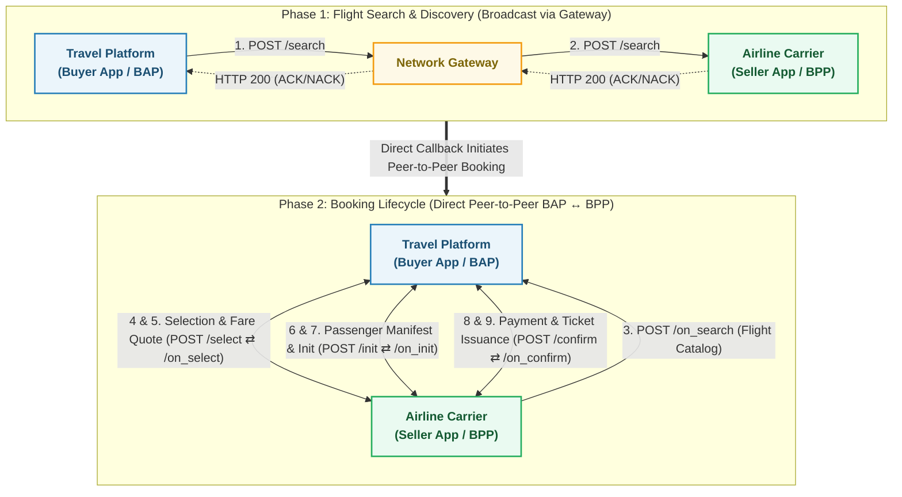
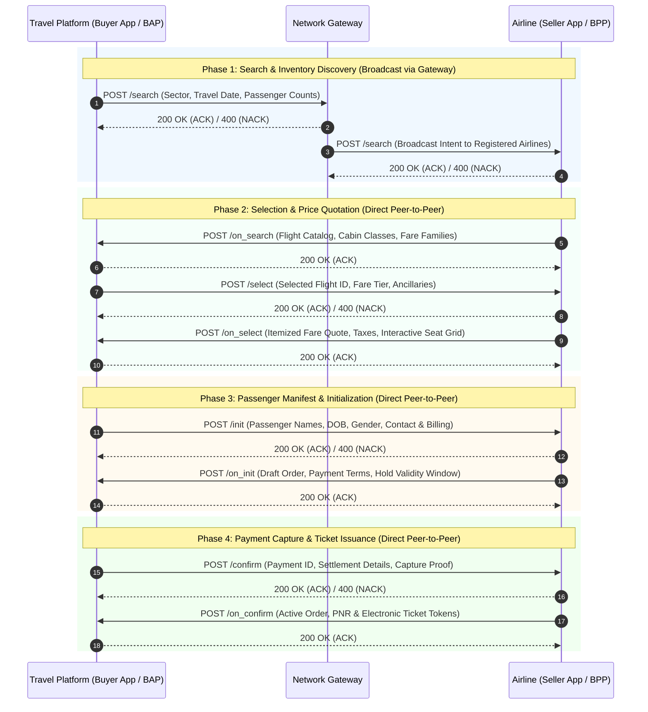
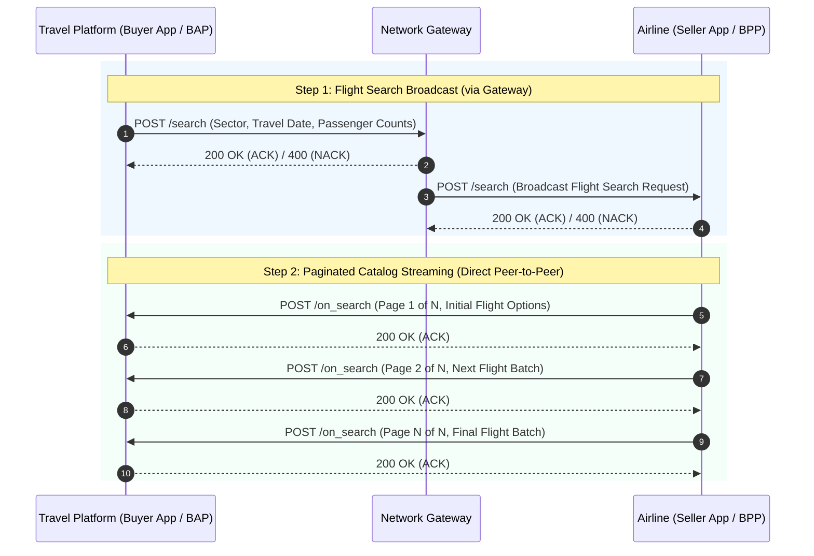
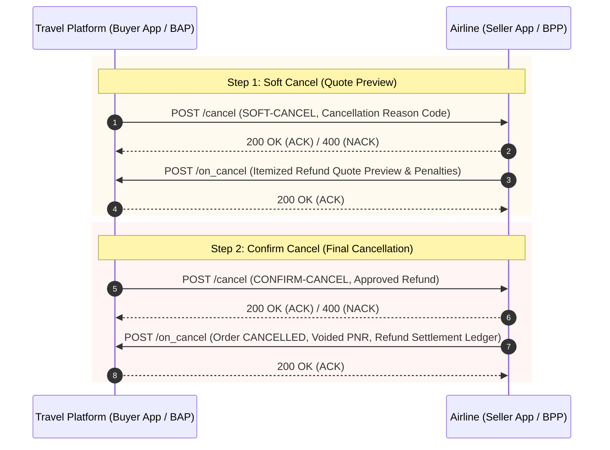
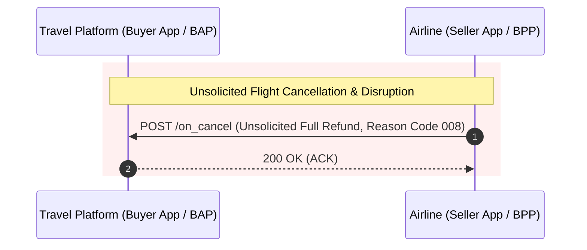

# Airlines

---

## Overview

Airline ticketing encompasses scheduled passenger flights offered by airline carriers. Each airline independently manages its flight schedules, seat inventory, pricing, fare rules, baggage policies, and flight operations.

The network enables airlines and travel platforms to connect through a common, open protocol instead of building separate integrations with each other. A travel platform integrates with the network as a Buyer App (BAP) to discover, compare, and book flight seats from participating airlines. Airlines integrate once as a Seller App (BPP) to make their seat inventory available to participating travel platforms.

The airline remains responsible for the flight service, including flight operations, schedule management, inventory availability, seat allocation, pricing, PNR issuance, and passenger servicing. The network standardizes the interactions for searching, comparing, selecting, booking, and servicing airline tickets across participating network participants.

This guide explains the airline ticketing use case and end-to-end journey from a business and product perspective, before covering the corresponding technical specifications and API flows.

---

## Participants

| Participant | What This Means |
|---|---|
| **Travel Platform (Buyer App / BAP)** | A consumer-facing application (travel portal, consumer app, or fintech platform) that enables travelers to search for flights, compare fare options, select seats and ancillaries, provide passenger manifests, and manage bookings by connecting with participating airlines through the network. |
| **Airline (Seller App / BPP)** | The airline operator or ticketing provider that publishes flight schedules, manages seat inventory, issues PNRs and e-tickets, and operates flights. The airline is responsible for flight operations, pricing, fare families (Saver, Flex), baggage policies, seat allocation, and servicing. |

---

## The User Journey

The airline booking journey enables a traveler to search for flights between airports, compare fare families, select seats and ancillaries, provide passenger details, complete payment, and receive confirmed e-tickets and PNR.

```
[Search Flights] ───► [Compare Offers] ───► [Select Fare & Add-ons] ───► [Provide Passenger Info] ───► [Payment & Confirmation] ───► [PNR & E-Ticket Issued]
```

The journey consists of the following stages:

### 1. Flight Search and Discovery

Through the Travel Platform (Buyer App / BAP), the traveler provides flight search criteria:

| Category | Field | Key | Mandatory | Type / Values |
|---|---|---|---|---|
| Routing | Origin Airport Code | `stops[type=START].location.descriptor.code` | Yes | Text (3-letter IATA, e.g. `DEL`) |
| | Destination Airport Code | `stops[type=END].location.descriptor.code` | Yes | Text (3-letter IATA, e.g. `BOM`) |
| Schedule | Departure Date & Time | `stops[type=START].time.timestamp` | Yes | ISO 8601 Date / Timestamp |
| Passengers | Adult Count | `passengers.adult` | Yes | Number (Minimum 1) |
| | Child Count | `passengers.child` | No | Number |
| | Infant Count | `passengers.infant` | No | Number |
| Cabin | Travel Class | `travel_class` | No | ENUM (`ECONOMY`, `PREMIUM_ECONOMY`, `BUSINESS`) |

The Travel Platform (Buyer App / BAP) transmits the search request to discover available flights across participating airlines.

**Network interaction:**

- **`/search`**: The Buyer App (BAP) broadcasts the flight search intent to the Gateway using standard IATA 3-letter airport codes, travel dates, and passenger counts. The Gateway routes this request to registered airlines.
- **`/on_search`**: Participating Seller Apps (BPP) respond asynchronously with flight catalogs containing available flights, departure/arrival schedules, cabin classes, and fare families.

### 2. Flight Offers and Fare Comparison

Airlines return flight offers that may include:

- Direct flights and connecting itineraries
- Multiple cabin classes (Economy, Premium Economy, Business)
- Fare families (e.g., Saver, Flex, Corporate)
- Baggage allowances (Cabin baggage, Check-in baggage)
- Change and cancellation rules (Refundable vs. Non-refundable)

The Travel Platform (Buyer App / BAP) presents the available flight options and fare families for the traveler to compare.

### 3. Flight Selection and Ancillaries

The traveler selects a specific flight itinerary and fare family through the Travel Platform (Buyer App / BAP).

The traveler may also select optional ancillaries, such as preferred seats, in-flight meals, or additional baggage allowance.

**Network interaction:**

- **`/select`**: The Buyer App (BAP) sends the selected flight item ID, chosen fare tier, and requested ancillaries to the airline.
- **`/on_select`**: The Seller App (BPP) responds with an itemized quote breakdown (base price, taxes, convenience fees, seat charges) and confirms inventory availability.

### 4. Passenger Details and Manifest

The traveler provides passenger information required for the airline flight manifest:

| Category | Field | Key | Mandatory | Format / Rules |
|---|---|---|---|---|
| Personal | Passenger Name | `person.name` | Yes | `<Title>\|<First Name>\|<Middle Name>\|<Last Name>` (e.g. `Mr\|John\|M\|Doe`) |
| | Date of Birth | `person.dob` | Yes | Date (`YYYY-MM-DD`) |
| | Gender | `person.gender` | Yes | ENUM (`MALE`, `FEMALE`, `TRANSGENDER`) |
| Contact | Phone Number | `contact.phone` | Yes | 10-digit mobile number |
| | Email Address | `contact.email` | Yes | Valid email address |
| Billing | Billing Name & Address | `billing` | Yes | Address lines, city, state, postal code |

**Network interaction:**

- **`/init`**: The Buyer App (BAP) initializes the draft booking order, passing the passenger manifest, contact details, and billing information.
- **`/on_init`**: The Seller App (BPP) validates the passenger manifest, creates a draft reservation, locks the fare for a defined validity window, and returns payment terms and cancellation policies.

### 5. Booking Confirmation and Ticketing

Once the traveler completes payment through the checkout interface, the Travel Platform (Buyer App / BAP) confirms the booking with the airline.

The airline validates the transaction, allocates seats, generates the airline reservation reference (PNR), and issues electronic tickets.

**Network interaction:**

- **`/confirm`**: The Buyer App (BAP) transmits the payment confirmation details and finalized order payload.
- **`/on_confirm`**: The Seller App (BPP) confirms the booking, changes the order status to `CONFIRMED`, and returns the official PNR, e-ticket tokens, and allocated seat numbers.

### 6. Post-Booking Servicing and Status

After confirmation, the traveler can view booking details, check flight schedules, and track departure updates through the Travel Platform (Buyer App / BAP).

**Network interaction:**

- **`/status`**: The Buyer App (BAP) queries the current status of an active flight booking.
- **`/on_status`**: The Seller App (BPP) returns real-time fulfillment status, departure terminal, gate updates, and web check-in availability.

---

## Additional Scenarios

The airline ticketing lifecycle supports operational modifications, cancellations, and disruptions post-booking.

### 1. User Cancellation (Full Cancellation)

A traveler can cancel a confirmed flight booking prior to departure, subject to the airline's cancellation policy and fare rules.

```
[Cancel Request] ───► [Soft Cancel Preview] ───► [Review Refund Quote] ───► [Confirm Cancel] ───► [PNR Cancelled & Refund Issued]
```

The network supports a two-step cancellation process:
1. **Soft Cancel (`SOFT-CANCEL`)**: The Buyer App (BAP) requests a cancellation preview. The airline calculates applicable cancellation fees based on time remaining before departure and returns the net refund quote.
2. **Confirm Cancel (`CONFIRM-CANCEL`)**: After the traveler reviews and approves the refund amount, the Buyer App (BAP) confirms the cancellation. The airline cancels the PNR, marks the order `CANCELLED`, and initiates the refund.

**Network interaction:**

- **`/cancel` (Soft Cancel)**: The Buyer App (BAP) initiates a soft cancellation request.
- **`/on_cancel`**: The Seller App (BPP) responds with the cancellation quote preview, itemizing the base refund, cancellation charges, and net refundable balance.
- **`/cancel` (Confirm Cancel)**: The Buyer App (BAP) submits the final confirmed cancellation.
- **`/on_cancel`**: The Seller App (BPP) confirms ticket cancellation, releases the seat inventory, and updates the order status to `CANCELLED`.

### 2. Partial Ticket Cancellation

In a multi-passenger booking, a traveler may choose to cancel tickets for specific passengers while retaining the booking for the remaining travelers.

```
[Partial Cancel Request] ───► [/update Specific Passenger IDs] ───► [Recalculate Remaining Seats] ───► [Updated Order & Partial Refund]
```

**Network interaction:**

- **`/update`**: The Buyer App (BAP) sends a partial cancellation request specifying the specific passenger item IDs to be cancelled.
- **`/on_update`**: The Seller App (BPP) updates the order, cancels the designated passenger seats, calculates the partial refund, and returns the updated order state.

### 3. Technical Cancellation

If a transaction fails due to payment authorization timeouts, network latency, or an expired confirmation window, the system triggers an automated technical cancellation.

```
[Confirmation Timeout] ───► [/status Check] ───► [Auto-Cancel Code 000] ───► [Seat Holds Released]
```

**Network interaction:**

- **`/status` & `/on_status`**: The Buyer App (BAP) queries order state after an unacknowledged confirmation call.
- **`/cancel` & `/on_cancel`**: If confirmation expired, an automated cancellation is issued with technical cancellation code `000` to release any temporary seat holds.

### 4. Merchant Flight Disruption or Cancellation

When an airline reschedules or cancels a flight due to operational reasons, air traffic control, or severe weather, the airline notifies the passenger.

```
[Airline Disruption / Weather] ───► [Unsolicited on_cancel] ───► [100% Full Refund Issued]
```

**Network interaction:**

- **`/on_cancel` (Unsolicited)**: The Seller App (BPP) pushes an unsolicited cancellation callback with reason code `008` (Flight/Venue Closure) or schedule change, providing a 100% full refund with zero cancellation penalty.

---

## Issue and Grievance Management

A passenger can raise a grievance through the Buyer App (BAP) for issues related to their flight booking or the network transaction. The Buyer App (BAP) routes the grievance to the relevant airline partner through the network's grievance mechanism.

The airline is responsible for investigating and resolving the grievance. The airline communicates the grievance status and resolution to the Buyer App (BAP), which makes the relevant information available to the passenger.

The grievance process can include:

- **Grievance Registration**: The passenger raises an issue through the Buyer App (BAP).
- **Grievance Routing**: The Buyer App (BAP) routes the grievance to the relevant airline.
- **Resolution**: The airline investigates the issue and takes the required action.
- **Status Updates**: The airline communicates progress and resolution status to the Buyer App (BAP).
- **Closure**: The Buyer App (BAP) communicates the resolution to the passenger and closes the grievance when appropriate.

The airline and Buyer App (BAP) remain responsible for complying with applicable grievance redressal requirements. Applicable guidelines provide for passenger grievance redressal mechanisms and identify the airline and Buyer App's designated grievance channels.

---

## Detailed Protocol Flows

### Flow 1: Airlines – Standard Booking Journey (Code Based Flow)

#### 1. Short Description

The Standard Booking Journey enables travelers to search for flights using standard 3-letter IATA airport codes (e.g. DEL to BOM), select flights and fare families, provide passenger manifests, complete payment, and receive confirmed PNR and e-tickets.

#### 2. Visual Interaction Map & Sequence Diagram

##### Protocol Interaction Architecture



##### End-to-End Sequence Diagram (Up to Confirmation)



#### 3. API Breakdown & Technical Actions

- **`/search` (Buyer App [BAP] → Gateway → Seller App [BPP])**: Triggered when a traveler searches for flights. The Buyer App (BAP) specifies origin and destination airport IATA codes (`stops[type=START].location.descriptor.code` and `stops[type=END].location.descriptor.code`), departure date, and passenger counts.
- **`/on_search` (Seller App [BPP] → Buyer App [BAP])**: The airline returns its flight catalog. Each flight option contains departure/arrival times, aircraft model, cabin classes, and available fare families (e.g., Saver, Flex) with associated baggage allowances.
- **`/select` (Buyer App [BAP] → Seller App [BPP])**: The traveler selects a specific flight and fare tier. The Buyer App (BAP) sends the item ID and any requested ancillary items (meals, extra baggage, seat selection).
- **`/on_select` (Seller App [BPP] → Buyer App [BAP])**: The airline validates inventory availability and returns an itemized price quotation including base price, taxes, airline surcharges, and seat selection fees.
- **`/init` (Buyer App [BAP] → Seller App [BPP])**: The Buyer App (BAP) passes the passenger manifest. Passenger names must strictly follow the format `<Title>|<First Name>|<Middle Name>|<Last Name>` along with date of birth (`YYYY-MM-DD`), gender, and contact details.
- **`/on_init` (Seller App [BPP] → Buyer App [BAP])**: The airline creates a provisional booking, locks the fare for a defined duration, and provides payment collection instructions and applicable cancellation terms.
- **`/confirm` (Buyer App [BAP] → Seller App [BPP])**: Transmitted after successful payment capture. Contains the payment status, payment transaction ID, and final order confirmation request.
- **`/on_confirm` (Seller App [BPP] → Buyer App [BAP])**: The airline books the reservation in its passenger service system (PSS), assigns seat numbers, sets order status to `CONFIRMED`, and returns the airline PNR and e-ticket numbers.

---

### Flow 2: Airlines – Seller App Pagination Flow

#### 1. Short Description

When an airline or flight aggregator has a large catalog of flights for a popular route, the results are split across multiple pages. The Seller App (BPP) streams catalog pages sequentially using pagination tokens so the Buyer App (BAP) can render flight results smoothly without network timeouts.

#### 2. Sequence Diagram



#### 3. API Breakdown & Technical Actions

- **`/search` (Buyer App [BAP] → Gateway → Seller App [BPP])**: Initial flight search request for the specified sector broadcast across the Gateway to registered airlines.
- **Sequential `/on_search` Callbacks (Seller App [BPP] → Buyer App [BAP])**: The airline delivers catalog pages in consecutive asynchronous callbacks directly to the Buyer App (BAP). Each payload contains:
  - `PAGINATION_ID`: Unique session identifier correlating the pages.
  - `CURRENT_PAGE_NUMBER`: Index of the current batch (e.g., `1`, `2`, `3`).
  - `MAX_PAGE_NUMBER`: Total page count for the search response.
  The Buyer App (BAP) acknowledges each callback with HTTP 200 `ACK` and renders the flight options incrementally.

---

### Flow 3: Airlines – User Cancellation Flow

#### 1. Short Description

When a traveler initiates a booking cancellation, the network executes a two-step cancellation workflow: a soft-cancel preview to calculate refund and penalties, followed by a confirm-cancel to finalize ticket cancellation.

#### 2. Sequence Diagram



#### 3. API Breakdown & Technical Actions

- **`/cancel` [Soft Cancel] (Buyer App [BAP] → Seller App [BPP])**: The Buyer App (BAP) initiates cancellation preview by setting `descriptor.code = "SOFT-CANCEL"` and passing the relevant cancellation reason code (e.g. `001` for change of plans).
- **`/on_cancel` [Quote Preview] (Seller App [BPP] → Buyer App [BAP])**: The airline calculates deductions based on the fare rules and time window. The response returns an itemized refund quote showing original fare, cancellation fees, and net refund balance.
- **`/cancel` [Confirm Cancel] (Buyer App [BAP] → Seller App [BPP])**: After traveler confirmation, the Buyer App (BAP) sends `descriptor.code = "CONFIRM-CANCEL"`.
- **`/on_cancel` [Confirmed Cancellation] (Seller App [BPP] → Buyer App [BAP])**: The airline releases the reserved seats, cancels the PNR in its system, sets order status to `CANCELLED`, and provides the final refund disbursement ledger.

---

### Flow 4: Airlines – Seller Cancellation Flow

#### 1. Short Description

If an airline cancels a scheduled flight due to severe weather, air traffic constraints, or technical maintenance, the Seller App (BPP) triggers an unsolicited cancellation pushing full refund details to the passenger.

#### 2. Sequence Diagram



#### 3. API Breakdown & Technical Actions

- **`/on_cancel` [Unsolicited] (Seller App [BPP] → Buyer App [BAP])**: Fired directly by the airline upon flight cancellation. The payload contains `order.status = "CANCELLED"`, `cancellation.cancelled_by = "PROVIDER"`, reason code `008` (Venue/Flight Closure), and a 100% full refund breakup without cancellation charges.