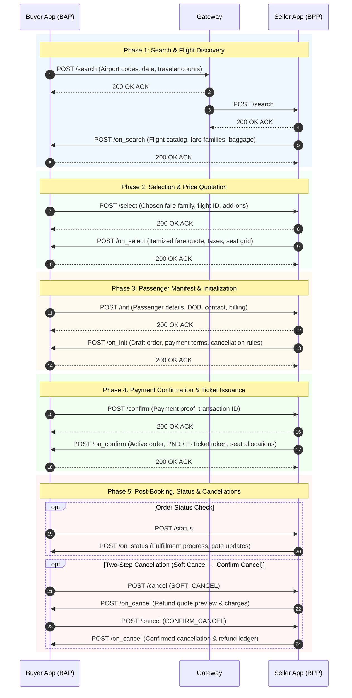
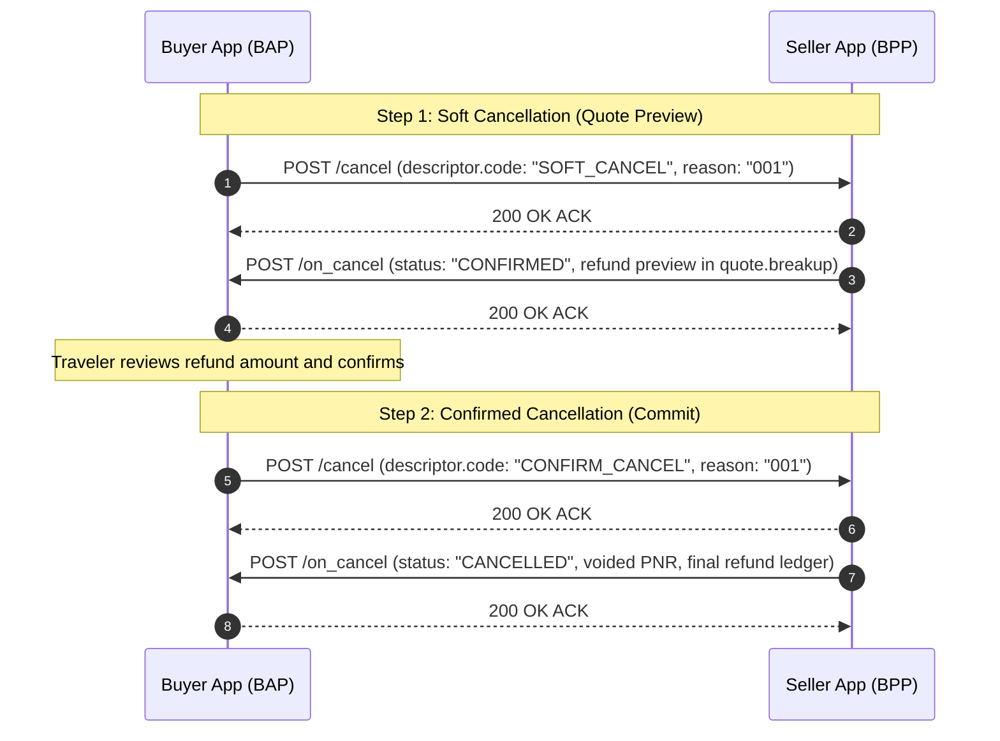

# Airline

## Overview

ONDC:TRV12 is the travel domain for booking intercity public transport—airlines and buses—on the ONDC network. It lets consumers search, book, and manage tickets across multiple transport operators in a single platform, while enabling airlines and bus companies to list and sell seats directly to end users.

## Sector & Purpose

This domain serves the **intercity public transport sector**, covering long-distance flights and bus services. The core problem it solves is fragmentation: today, consumers must visit separate websites or apps for each airline, each bus operator. ONDC:TRV12 unifies that experience, allowing any consumer-facing application (airline app, travel portal, marketplace) to tap into inventory from multiple operators through a single standardized network, while operators gain access to new distribution channels without building separate integrations.

## Real-World Actors

- **Consumers**: People booking trips between cities—whether flying across regions or taking long-distance buses. They want options, convenience, and clear pricing.
- **Airlines**: Operators with seat inventory to sell; they list flights and manage bookings, cancellations, and customer service through the ONDC network.
- **Bus Operators**: Intercity bus companies offering routes; they list schedules and seat availability just like airlines.
- **Platforms**: Travel booking apps, OTA sites, or marketplaces that aggregate these options for consumers and handle the transaction experience.

## Use Cases

- Searching for airline flights by route and date, browsing available airlines and prices
- Booking single or multiple airline tickets in one transaction (families, groups)
- Searching for intercity bus services and booking seats
- Cancelling bookings—initiated by either the consumer or the operator
- Partial cancellations when a customer wants to cancel only some tickets in a multi-ticket order
- Rating and reviewing flights or bus rides after travel
- Code-based search flows (searching by station codes for buses, airline codes for flights)
- Resolving disputes or service issues through the ONDC complaint mechanism (IGM)

## Key Concepts

- **Airline and Bus Booking as Parallel Flows**: The domain handles two distinct transport modes with different attributes (flights have aircraft classes and routing; buses have station stops and route types), but both follow similar booking and cancellation workflows.
- **Code-Based Discovery**: Operators use standardized codes (airline IATA codes, bus station codes) to tag inventory; consumers and platforms use these to search efficiently.
- **Ticket Inventory Management**: Whether booking one seat or ten, the system tracks availability, holds, and fulfillment per transaction—critical for managing overbooking and real-time availability.
- **Cancellation Workflows**: Both parties (buyer and seller) can initiate cancellations with different rules and refund implications; the domain specifies how these are processed.
- **Service Quality and Dispute Resolution**: Post-booking ratings and IGM (Issue Grievance Management) enable feedback loops and fair dispute handling across the network.

## Example Scenario

**A family booking a multi-city trip on the ONDC network:**

A consumer uses a travel platform integrated with ONDC:TRV12 to book flights from Mumbai to Delhi for four people. The platform queries multiple airlines' inventory, finds a suitable flight, and completes the booking in one transaction—all four tickets together. Two weeks later, one family member's plans change; the consumer cancels that one ticket through the ONDC platform, which sends the cancellation to the airline. The airline processes a partial refund per its policy.

After the trip, the family rates the airline's service (on-time, courteous crew, good food) through the ONDC platform. The rating feeds back into the network, helping other consumers see service quality signals.

Later, when planning an intercity bus trip for a similar multi-city journey, the same consumer uses the same ONDC platform to search buses between intermediate cities—the discovery and booking flow is comparable to the airline experience, but adapted for bus routes and station-based stops. The unified experience across transport modes is the real-world value ONDC:TRV12 delivers.

---

## Complete API Contract & Architecture Guide

The `ONDC:TRV12` specification (v2.0.0) standardizes communication between **Buyer Applications (BAP)** and **Seller Applications (BPP / Airlines & Aggregators)** across the entire flight booking lifecycle.

Every transaction follows the Beckn asynchronous protocol:
1. The requester makes a `POST` call.
2. The receiver immediately replies with a synchronous HTTP 200 `ACK` (or `NACK` if validation fails).
3. The receiver performs the business processing and sends the result back via an asynchronous callback `POST /on_<action>` to the requester's webhook URL.
4. The requester acknowledges the callback with a synchronous HTTP 200 `ACK`.



---

### Complete Transaction Lifecycle Matrix

| Phase | Action API | Sender → Receiver | Callback API | Callback Sender → Receiver | Primary Business Purpose |
| :--- | :--- | :--- | :--- | :--- | :--- |
| **Discovery** | `POST /search` | BAP → Gateway / BPP | `POST /on_search` | BPP → BAP | Broadcast or direct flight search by airport IATA codes, dates, and traveler counts. |
| **Selection** | `POST /select` | BAP → BPP | `POST /on_select` | BPP → BAP | Select flight itinerary, fare families (Saver/Flex), add-ons, and request seat grid. |
| **Initialization** | `POST /init` | BAP → BPP | `POST /on_init` | BPP → BAP | Submit passenger manifests, formatted names, DOB, contact info, and billing address. |
| **Confirmation** | `POST /confirm` | BAP → BPP | `POST /on_confirm` | BPP → BAP | Authorize booking with payment confirmation; receives issued PNR and e-ticket authorization. |
| **Status** | `POST /status` | BAP → BPP | `POST /on_status` | BPP → BAP | Poll order lifecycle state (`CONFIRMED`, `IN_PROGRESS`, `COMPLETED`), flight delays, or gate changes. |
| **Cancellation** | `POST /cancel` | BAP → BPP | `POST /on_cancel` | BPP → BAP | Two-step cancellation flow (`SOFT_CANCEL` quote preview followed by `CONFIRM_CANCEL`). |
| **Seller Cancellation** | *Unsolicited* | — | `POST /on_cancel` | BPP → BAP | Airline-initiated flight cancellation (weather/technical disruption) with full refund breakup. |
| **Order Update** | `POST /update` | BAP → BPP | `POST /on_update` | BPP → BAP | Update traveler contact details, re-issue tickets, or add ancillary services post-booking. |
| **Tracking** | `POST /track` | BAP → BPP | `POST /on_track` | BPP → BAP | Live flight telemetry tracking and flight radar links. |
| **Feedback** | `POST /rating` | BAP → BPP | `POST /on_rating` | BPP → BAP | Submit customer feedback and ratings post-journey. |
| **Support** | `POST /support` | BAP → BPP | `POST /on_support` | BPP → BAP | Retrieve customer service telephone, email, and live support channels. |
| **Grievance (IGM)** | `POST /issue` | BAP → BPP | `POST /on_issue` | BPP → BAP | Raise passenger grievance ticket (IGM 2.0.0) with grievance officer details. |
| **IGM Status** | `POST /issue_status` | BAP → BPP | `POST /on_issue_status`| BPP → BAP | Track dispute resolution progress, refund escalation, and respondent actions. |

---

### Common Beckn Context Object

Every request and response envelope contains a mandatory `context` object. It provides network routing, tracing, cryptographic verification, and lifecycle auditing:

```yaml
context:
  domain: "ONDC:TRV12"                              # Fixed travel domain code
  version: "2.0.0"                                  # Specification version
  action: "search"                                  # Current protocol action
  country:
    code: "IND"                                     # Country code (ISO 3166-1 alpha-3)
  city:
    code: "std:080"                                 # Originating city STD code (e.g., std:080 for Bengaluru)
  bap_id: "travel-buyer-app.com"                    # Subscriber ID of the Buyer App
  bap_uri: "https://travel-buyer-app.com/beckn/v1"  # Buyer App callback webhook URL
  bpp_id: "airline-seller-app.com"                  # Subscriber ID of the Airline Seller App
  bpp_uri: "https://airline-seller-app.com/beckn"   # Seller App webhook URL
  transaction_id: "6743e9e2-4fb5-487c-92b7-13ba80"  # Shared UUID across all calls in a transaction
  message_id: "7381c78e-1eb4-47bb-96b4-ac2fce74e5"  # Unique UUID generated for each API request-response pair
  timestamp: "2026-11-13T10:00:00.000Z"             # ISO 8601 UTC timestamp of message generation
  ttl: "PT30S"                                      # Message validity duration (ISO 8601 duration)
```

---

### Synchronous Response Contract (`ACK` vs `NACK`)

Every HTTP POST request in the ONDC network must be synchronously acknowledged within **5000 milliseconds**.

#### Successful Acknowledgment (`ACK`):
```json
{
  "message": {
    "ack": {
      "status": "ACK"
    }
  }
}
```

#### Synchronous Rejection (`NACK`):
When request schema validation, signature verification, or context integrity fails:
```json
{
  "message": {
    "ack": {
      "status": "NACK"
    }
  },
  "error": {
    "type": "GATEWAY",
    "code": "30000",
    "message": "Invalid Signature / Invalid Context Validation Failed"
  }
}
```

---

### Cryptographic Security & Authorization Headers

All network traffic between BAPs, Gateways, and BPPs must be signed using the Beckn cryptographic standard:
- **Hashing**: BLAKE-512 digest of the raw HTTP request body.
- **Signing Algorithm**: `Ed25519` asymmetric key pair.
- **Header**:
  ```http
  Authorization: Signature keyId="subscriber_id|unique_key_id|ed25519",algorithm="ed25519",created="1700000000",expires="1700000030",headers="(created) (expires) digest",signature="base64_encoded_signature..."
  ```
- Receivers fetch the sender's public key from the ONDC Registry to verify request authenticity before generating an `ACK`.

---

## Detailed API Specifications & Payloads

### 1. `POST /search` — Intent & Flight Discovery

- **Flow**: Buyer App (BAP) → Gateway → Seller App (BPP)
- **Business Role**: When a traveler enters their trip requirements on the Buyer App (e.g., fly from Delhi to Bengaluru on October 15th for 2 adults and 1 child in Economy class), the BAP broadcasts a `/search` request across the network.
- **Key Payload Elements (`message.intent`)**:
  - `fulfillment.stops`: Origin and destination airport definitions:
    - `type: START`: Origin airport code (IATA code in `location.descriptor.code`, e.g. `DEL`) and scheduled date/time timestamp.
    - `type: END`: Destination airport code (e.g. `BLR`).
  - `fulfillment.vehicle.category`: Explicitly declared as `AIRLINE`.
  - `category.descriptor.code`: Cabin class requested (`ECONOMY`, `PREMIUM_ECONOMY`, `BUSINESS`, `FIRST`).
  - `provider.items`: Passenger breakdown counts (`ADULT_TICKET`, `CHILD_TICKET`, `INFANT_TICKET`).
  - `payment.tags`:
    - `BUYER_FINDER_FEES`: Buyer platform commission (`BUYER_FINDER_FEES_PERCENTAGE` or `BUYER_FINDER_FEES_AMOUNT`).
    - `SETTLEMENT_TERMS`: Default settlement rules, delay interest rate (`DELAY_INTEREST`), and legal terms URL (`STATIC_TERMS`).
  - `tags.PAGINATION`: Used when requesting subsequent pages (`PAGINATION_ID`, `REQUESTED_PAGE_NUMBER`).

```yaml
# Example: POST /search
message:
  intent:
    category:
      descriptor:
        code: ECONOMY
    fulfillment:
      stops:
        - type: START
          location:
            descriptor:
              code: DEL
          time:
            label: "Date Of Journey"
            timestamp: "2026-11-20T00:00:00.000Z"
        - type: END
          location:
            descriptor:
              code: BLR
      vehicle:
        category: AIRLINE
    provider:
      items:
        - descriptor:
            name: Adult
            code: ADULT_TICKET
          quantity:
            selected:
              count: 2
        - descriptor:
            name: Child
            code: CHILD_TICKET
          quantity:
            selected:
              count: 1
    payment:
      tags:
        - descriptor:
            code: BUYER_FINDER_FEES
          list:
            - descriptor:
                code: BUYER_FINDER_FEES_PERCENTAGE
              value: "1.5"
```

---

### 2. `POST /on_search` — Airline Catalog & Flight Inventory

- **Flow**: Seller App (BPP) → Buyer App (BAP)
- **Business Role**: The airline or aggregator returns all matching available flights, routes, fare families (Saver, Flexi, Super 6E), baggage entitlements, and pricing options.
- **Key Payload Elements (`message.catalog`)**:
  - `bpp/providers`: Airline operator identity, brand logo, and descriptor.
  - `fulfillments`: Flight leg (`type: TRIP`), flight vehicle code (e.g. `6E-284`), operating carrier (`tags.INFO.OPERATED_BY`), departure/arrival airport stops with exact terminals and timestamps.
  - `items`: Fare families and purchase options:
    - Base ticket items (`id: I1`, code: `ADULT_TICKET`, price, duration, refund eligibility).
    - Sub-fare items mapped via `parent_item_id` representing fare families with varying flexibility.
    - `tags.GENERAL_INFO`: Baggage allowances (`CABIN_BAGGAGE: "7 Kg"`, `CHECK_IN_BAGGAGE: "15 Kg"`).
    - `tags.FARE_TYPE`: Supported concession tariffs (`REGULAR`, `STUDENT`, `SENIOR_CITIZEN`, `ARMED_FORCES`, `DOCTORS_NURSES`).
  - `tags.PAGINATION`: Pagination state (`PAGINATION_ID`, `CURRENT_PAGE_NUMBER`, `MAX_PAGE_NUMBER`).

```yaml
# Example: POST /on_search (Catalog snippet)
message:
  catalog:
    bpp/providers:
      - id: "P1"
        descriptor:
          name: "IndiGo Airlines"
          images:
            - url: "https://airline.com/logo.png"
        fulfillments:
          - id: "F1"
            type: TRIP
            vehicle:
              category: AIRLINE
              code: "6E-284"
            stops:
              - type: START
                location:
                  descriptor:
                    name: "Indira Gandhi International Airport"
                    code: "DEL"
                time:
                  timestamp: "2026-11-20T06:00:00.000Z"
              - type: END
                location:
                  descriptor:
                    name: "Kempegowda International Airport"
                    code: "BLR"
                time:
                  timestamp: "2026-11-20T08:45:00.000Z"
        items:
          - id: "I1-SAVER"
            parent_item_id: "I1"
            descriptor:
              name: "Saver Fare - Adult"
              code: "ADULT_TICKET"
            price:
              currency: "INR"
              value: "4500"
            tags:
              - descriptor:
                  code: GENERAL_INFO
                list:
                  - descriptor:
                      code: CABIN_BAGGAGE
                    value: "7 Kg"
                  - descriptor:
                      code: CHECK_IN_BAGGAGE
                    value: "15 Kg"
```

---

### 3. `POST /select` — Flight & Ancillary Selection

- **Flow**: Buyer App (BAP) → Seller App (BPP)
- **Business Role**: The passenger picks their preferred flight schedule, specific fare category (e.g. Flexi fare), passenger counts, and optional add-on ancillaries (meals, extra luggage allowance).
- **Key Payload Elements (`message.order`)**:
  - `provider.id`: Target airline ID.
  - `items`: Selected tickets with `parent_item_id`, passenger count (`quantity.selected.count`), and requested `add_ons` (e.g., meal `A1`, priority boarding `A2`).
  - `fulfillments`: Flight journey identifier (`id: F1`, stops).

```yaml
# Example: POST /select
message:
  order:
    provider:
      id: "P1"
    items:
      - parent_item_id: "I1"
        quantity:
          selected:
            count: 2
        add_ons:
          - id: "MEAL-VEG"
            quantity:
              selected:
                count: 2
    fulfillments:
      - id: "F1"
```

---

### 4. `POST /on_select` — Itemized Quotation & Seat Grid Matrix

- **Flow**: Seller App (BPP) → Buyer App (BAP)
- **Business Role**: The airline validates live seat inventory, places a temporary soft-lock on the seats, returns an itemized price quote with all statutory taxes, and delivers the cabin seat layout map.
- **Key Payload Elements (`message.order`)**:
  - `quote.price`: Total price for the selection.
  - `quote.breakup`:
    - `title: BASE_FARE`: Core airfare per passenger item.
    - `title: TAX`: Itemized statutory charges (`cgst`, `sgst`, `fuel tax`, `cess`, user development fee).
    - `title: SELLER_FEES`: Convenience or service fee.
    - `title: OTHER_CHARGES`: Selected add-ons and luggage fees.
  - `fulfillments[].tags`:
    - `SEAT_GRID`: Complete cabin layout with coordinate mapping (`X`, `Y`, `Z`), seat numbers (`12A`, `12B`), price differentials (`SEAT_PRICE`), availability (`AVAILABLE: true/false`), and gender-restricted indicators (`RESTRICTED_GENDER: FEMALE`).
    - `VEHICLE_GRID`: Fuselage grid bounds (`X_MAX`, `Y_MAX`, `X_LOBBY_START`).

```yaml
# Example: POST /on_select (Quote & Seat Grid snippet)
message:
  order:
    quote:
      price:
        currency: "INR"
        value: "10500"
      breakup:
        - title: BASE_FARE
          item:
            id: "I1"
            quantity:
              selected:
                count: 2
          price:
            currency: "INR"
            value: "9000"
        - title: TAX
          item:
            id: "I1"
            tags:
              - descriptor:
                  code: TAX
                list:
                  - descriptor:
                      name: "cgst"
                    value: "250"
                  - descriptor:
                      name: "sgst"
                    value: "250"
                  - descriptor:
                      name: "fuel tax"
                    value: "500"
          price:
            currency: "INR"
            value: "1000"
        - title: OTHER_CHARGES
          item:
            id: "MEAL-VEG"
          price:
            currency: "INR"
            value: "500"
```

---

### 5. `POST /init` — Passenger Manifest & Billing Details

- **Flow**: Buyer App (BAP) → Seller App (BPP)
- **Business Role**: Submits traveler identity information, contact details, and billing details to prepare the final ticket booking.
- **Key Payload Elements (`message.order`)**:
  - `billing`: Name, tax invoice details (GSTIN), address, email, and phone.
  - `fulfillments`:
    - Journey leg (`id: F1`, `type: TRIP`, flight number).
    - Passenger tickets (`id: FT_1`, `id: FT_2`, `type: TICKET`):
      - `customer.person.name`: **Mandatory pipe-separated format**: `<Title> | <First Name> | <Middle Name> | <Last Name>`.
      - `customer.person.age`: Traveler age.
      - `customer.person.gender`: `MALE`, `FEMALE`, or `OTHER`.
      - `customer.person.dob`: Date of birth (`YYYY-MM-DD`), required for age verification, infant fare validation, and concession checks.
      - `customer.contact`: Mobile number and email address.

```yaml
# Example: POST /init
message:
  order:
    provider:
      id: "P1"
    items:
      - id: "I1-1"
        parent_item_id: "I1"
        quantity:
          selected:
            count: 1
    fulfillments:
      - id: "F1"
        type: TRIP
      - id: "FT_1"
        type: TICKET
        customer:
          person:
            name: "Mr. | Joe | Wick | Adams"
            age: "32"
            gender: "MALE"
            dob: "1994-05-18"
          contact:
            phone: "+919876543210"
            email: "joe.adams@example.com"
    billing:
      name: "Joe Adams"
      address: "123 MG Road, Bengaluru"
      phone: "+919876543210"
      email: "joe.adams@example.com"
```

---

### 6. `POST /on_init` — Draft Order & Settlement Terms

- **Flow**: Seller App (BPP) → Buyer App (BAP)
- **Business Role**: The airline confirms that all traveler information satisfies airline regulatory and safety checks, locks the inventory, and provides finalized payment settlement parameters and cancellation fee slabs.
- **Key Payload Elements (`message.order`)**:
  - `payment`:
    - `collected_by`: `BAP` (Buyer App collects passenger payment) or `BPP`.
    - `status`: `NOT-PAID`.
    - `type`: `PRE-FULFILLMENT`.
    - `tags.SETTLEMENT_TERMS`: Settlement basis, bank escrow window, and delay interest terms.
  - `cancellation_terms`: Exact tiered deduction rules (e.g. cancellation 48h prior vs 2h prior).

---

### 7. `POST /confirm` — Payment Authorization & Order Placement

- **Flow**: Buyer App (BAP) → Seller App (BPP)
- **Business Role**: Dispatched immediately after the passenger completes payment on the Buyer App to commit the booking and instruct the airline to issue tickets.
- **Key Payload Elements (`message.order`)**:
  - `items` & `fulfillments`: Full traveler manifest matching `init`.
  - `payment`:
    - `status`: Updated to `PAID`.
    - `params.transaction_id`: Gateway payment reference ID.
    - `params.amount`: Exact verified paid amount.
    - `params.currency`: `INR`.

```yaml
# Example: POST /confirm (Payment block)
payment:
  status: "PAID"
  type: "PRE-FULFILLMENT"
  collected_by: "BAP"
  params:
    transaction_id: "TXN-9841205128"
    amount: "10500"
    currency: "INR"
```

---

### 8. `POST /on_confirm` — Ticket Issuance & PNR Allocation

- **Flow**: Seller App (BPP) → Buyer App (BAP)
- **Business Role**: The airline generates the confirmed Airline PNR, e-ticket numbers, and assigned seat details, confirming the flight reservation.
- **Key Payload Elements (`message.order`)**:
  - `id`: Permanent booking order ID (e.g., `O1`).
  - `status`: `CONFIRMED`.
  - `created_at` & `updated_at`: Order generation timestamps.
  - `fulfillments`:
    - Journey leg (`type: TRIP`, state `CONFIRMED`, vehicle code `6E-284`, `tags.INFO.OPERATED_BY`).
    - Ticket fulfillments (`type: TICKET`):
      - `stops[].authorization.token`: Airline PNR string or QR code token for airport gate entry.
      - `tags.SEAT_GRID`: Assigned seat number (`SEAT_NUMBER: "14B"`).
  - `quote`: Finalized financial ledger.

---

### 9. `POST /status` & `POST /on_status` — Live Order & Flight Updates

- **Flow**: BAP ↔ BPP
- **Business Role**: Provides real-time flight tracking, gate change alerts, terminal notifications, and fulfillment progression tracking (`CONFIRMED` → `IN_PROGRESS` → `COMPLETED`).
- **Usage**:
  - BAP sends `order_id` in `/status`.
  - BPP responds via `/on_status` with revised timestamps, flight status updates, terminal changes, or boarding gate announcements.

---

### 10. `POST /cancel` & `POST /on_cancel` — Two-Step Cancellation Engine

The cancellation protocol guarantees that passengers always see transparent refund amounts before finalizing a cancellation:



#### Step 1: Soft Cancel (`SOFT_CANCEL`)
- Buyer App sends `/cancel` with `descriptor.code: "SOFT_CANCEL"` and `cancellation_reason_id`.
- Seller App returns `/on_cancel` with order status remaining `CONFIRMED` and `quote.breakup` providing:
  - `title: REFUND` (negative value reflecting refunded fare and taxes).
  - `title: CANCELLATION_CHARGES` (applicable airline cancellation penalties).
- **Purpose**: Displays the exact refund amount to the passenger before they make an irreversible decision.

#### Step 2: Confirmed Cancel (`CONFIRM_CANCEL`)
- Buyer App sends `/cancel` with `descriptor.code: "CONFIRM_CANCEL"`.
- Seller App responds via `/on_cancel` with order status updated to `CANCELLED`, voided PNR, and the final refund settlement order.

#### Unsolicited Seller-Side Cancellation
- If an airline cancels a flight (due to weather, technical faults, or operational disruption), the BPP triggers an unsolicited `POST /on_cancel` directly to the BAP.
- The order status is set to `CANCELLED`, cancellation reason code is provided, and `quote.breakup` contains a 100% full refund with zero cancellation charges.

---

### 11. Ancillary APIs: `/update`, `/track`, `/rating`, `/support`

- **`POST /update` & `/on_update`**: Modifies passenger contact details post-booking or purchases additional baggage/meal ancillaries.
- **`POST /track` & `/on_track`**: Provides real-time flight telemetry or live radar tracking URLs.
- **`POST /rating` & `/on_rating`**: Captures passenger feedback ratings (1–5 stars) on seat cleanliness, punctuality, and cabin crew service.
- **`POST /support` & `/on_support`**: Delivers airline 24x7 escalation contact numbers, support email addresses, and instant chat links.

---

## Special Domain Rules & Implementation Checklist

### 1. Passenger Name Formatting Standard
In accordance with global civil aviation and ticketing standards, all traveler names in `fulfillments.customer.person.name` must strictly follow a pipe-delimited format:
- Format: `<Title> | <First Name> | <Middle Name> | <Last Name>`
- Examples:
  - `Mr. | Rajesh | Kumar | Sharma`
  - `Ms. | Priya | | Patel` *(middle name omitted)*
  - `Dr. | Sarah | Jane | Connor`

### 2. Dual-Level Fulfillment Model
An airline order contains two distinct fulfillment layers:
1. **Journey Fulfillment (`type: TRIP`)**: Represents the physical flight sector (flight number e.g. `6E-284`, operating carrier `IndiGo`, departure/arrival airport IATA codes, and scheduled departure/arrival timestamps).
2. **Ticket Fulfillment (`type: TICKET`)**: Individual traveler fulfillment instances (`FT_1`, `FT_2`) containing the traveler's demographic data, assigned seat number, and issued PNR/e-ticket authorization token.

### 3. Concessionary Fare Types (`FARE_TYPE`)
Sellers and Buyers support distinct passenger fare categories via `FARE_TYPE` tags:
- `REGULAR`: Standard adult fare.
- `STUDENT`: Student concessions with additional baggage allowances.
- `SENIOR_CITIZEN`: Age-verified senior citizen discounted fares.
- `ARMED_FORCES`: Active military and veteran concessionary fares.
- `DOCTORS_NURSES`: Healthcare professional concessional fares.

### 4. Interactive Cabin Seat Layout Matrix
The `SEAT_GRID` tag structures the aircraft cabin:
- Coordinates: `X` (row), `Y` (column), `Z` (deck).
- Metadata: `SEAT_NUMBER` (e.g., `12A`), `SEAT_PRICE`, `AVAILABLE` (`true`/`false`).
- Safety & Policy Constraints: `RESTRICTED_GENDER: "FEMALE"` (designated female-only seating rows), `SINGLE_SEAT: "true"`.