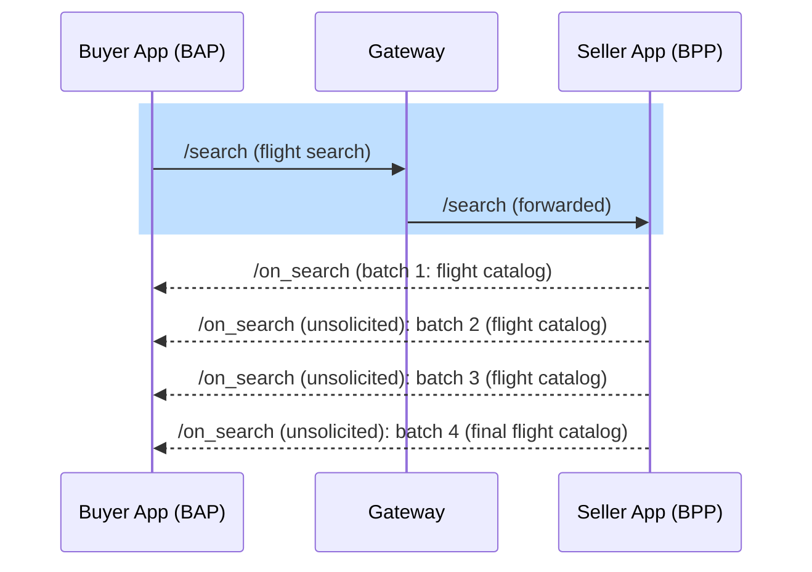
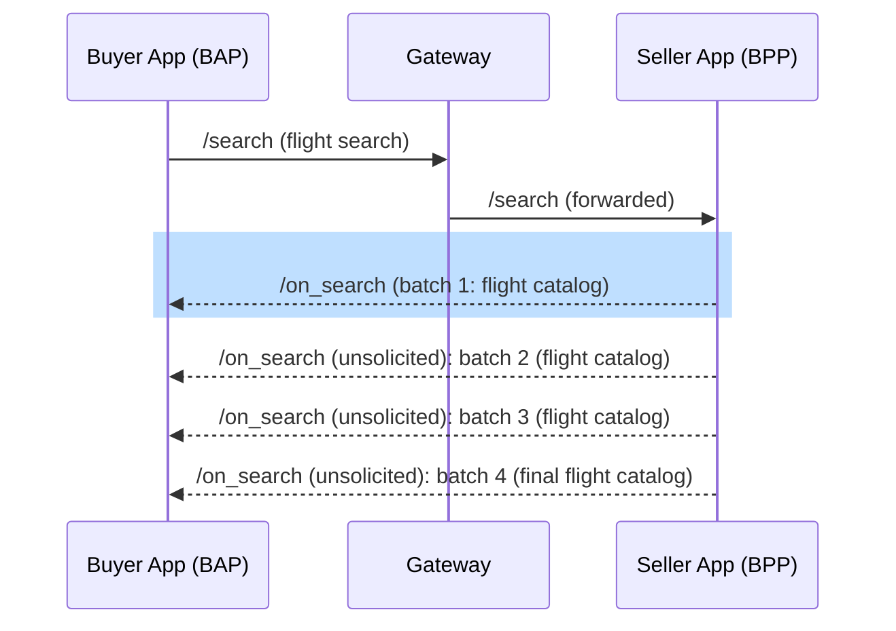
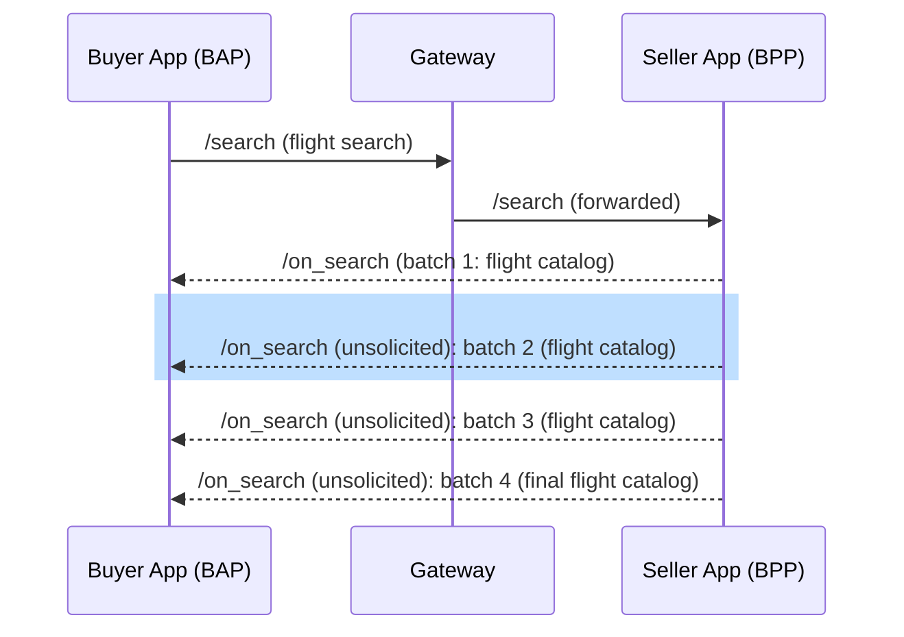
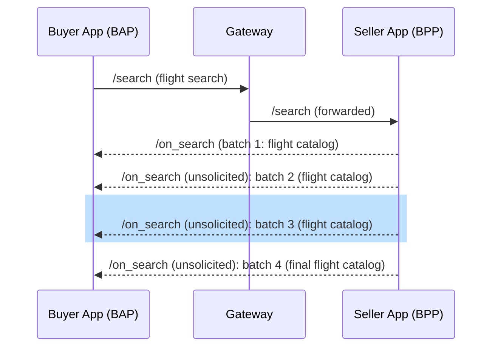
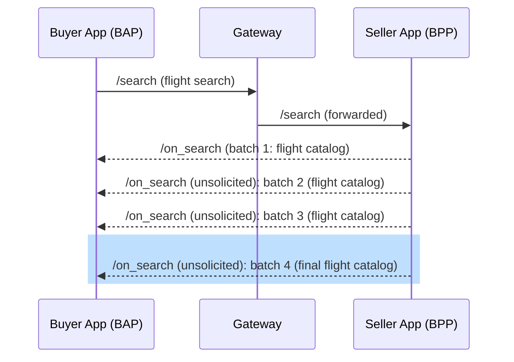

# Airlines - Seller App Pagination Flow — Sequence Diagrams

Internal data file consumed by the Developer Guide's "Sequence Diagram" tab (API Walkthrough).
Not meant to be shown as its own docs page — the frontend filters this slug out of the Use Case
Brief / Additional Resources / Changelog tab lists and instead looks up the section matching the
selected API call's `action_id` (the `##` heading below) to render that step's diagram.

One `## <action_id>` heading per step of `Airlines_-_Seller_App_Pagination_Flow.yaml`, in that flow's own step order, each followed by its Mermaid `sequenceDiagram`: the whole flow, with that call's own message(s) highlighted — same convention as the other domains' per-step sequence-diagram docs.

## search_1_Airline_200

## on_search_1_Airline_200

## on_search_2_Airline_200

## on_search_3_Airline_200

## on_search_4_Airline_200

