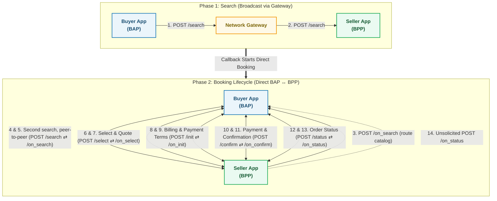
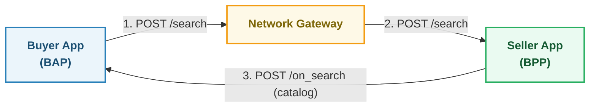
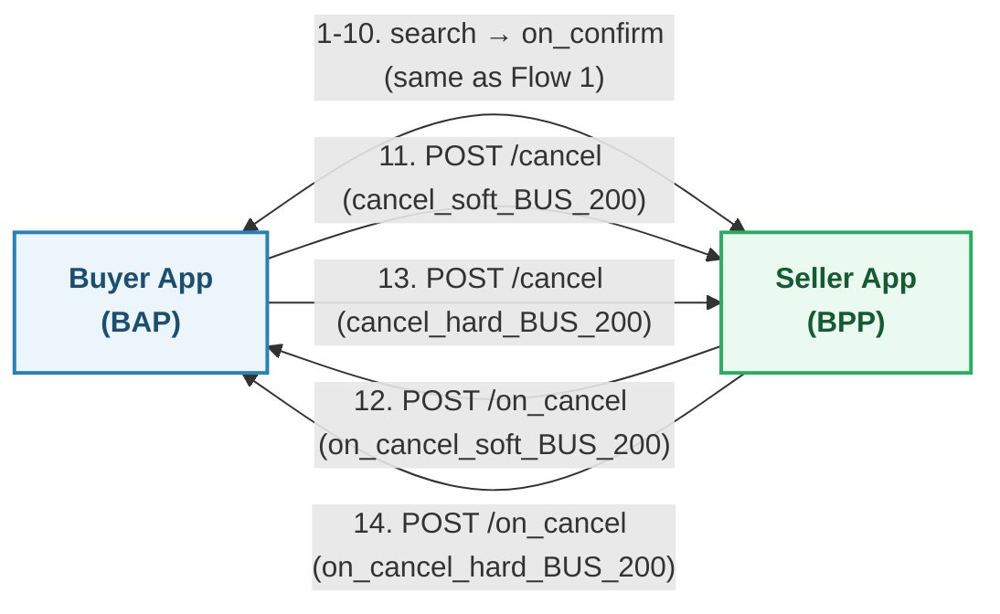
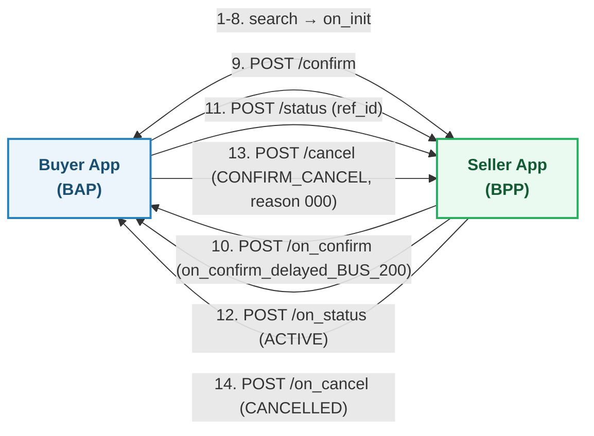

# Bus

---

## Overview

Intra-city bus ticketing under ONDC:TRV11 lets a buyer discover bus routes in a city, pick a Single Journey Ticket (`SJT`), book it, receive a QR ticket, and cancel it. Every interaction is a pair of asynchronous API calls: the sender calls `/X`, the receiver acknowledges it, and the answer comes later as `/on_X`.

This guide covers the Bus use case (`message.intent.fulfillment.vehicle.category = BUS`) of ONDC:TRV11 version `2.0.0`. It describes only what the contract defines: the four Bus flows in `config/flows/Bus`, the Bus validations in `config/validations`, the actions in `config/actions` and the error codes in `config/errors`.

| Item | Value |
|---|---|
| Domain | `ONDC:TRV11` |
| Version | `2.0.0` |
| Use case | `Bus` |
| Flows | `ORDER_TO_CONFIRM_TO_JOURNEY_COMPLETION`, `STATION_CODE_FLOW_CATALOG`, `USER_CANCELLATION_FLOW`, `TECHNICAL_CANCELLATION_FLOW` |
| Payment | Collected by the Buyer App (`payments[].collected_by = BAP`) |

---

## Participants

| Participant | What This Means |
|---|---|
| **Buyer App (BAP)** | Sends `search`, `select`, `init`, `confirm`, `status` and `cancel`. Collects the payment (`collected_by: BAP`) and passes the buyer's billing details. |
| **Seller App (BPP)** | Answers with `on_search`, `on_select`, `on_init`, `on_confirm`, `on_status` and `on_cancel`. Returns the catalog, quote, order, QR authorization and cancellation state. Can also send `on_status` on its own (unsolicited). |
| **Gateway** | Receives the BAP's first `search` (by city, `search1`) and forwards it to the Seller App. The second `search` (point A to point B, `search2`) and all later calls go directly between BAP and BPP (peer-to-peer). |

---

## The User Journey

```
[Search Routes] ───► [Select Ticket] ───► [Provide Billing] ───► [Pay & Confirm] ───► [QR Ticket Issued] ───► [Track Status]
```

**Mandatory column.** `Yes` means `config/validations/index.yaml` has a presence test (`attr are present`) for this field with use code `BUS`. `—` means no Bus test exists for that field in the contract. There is no `config/attributes/Bus.yaml`, so keys are taken from the flow payloads.

### Context (all calls)

| Field | Key | Mandatory | Type / Values |
|---|---|---|---|
| Country | `context.location.country.code` | Yes | `IND` |
| City | `context.location.city.code` | Yes (`on_*`, regex) | Text, e.g. `std:080` |
| Domain | `context.domain` | Yes | `ONDC:TRV11` |
| Version | `context.version` | Yes (must equal the version) | `2.0.0` |
| Action | `context.action` | Yes | API name |
| Timestamp | `context.timestamp` | Yes | ISO 8601 |
| Transaction ID | `context.transaction_id` | Yes | UUID, same across the whole transaction |
| Message ID | `context.message_id` | Yes | UUID, same for a request and its callback |
| TTL | `context.ttl` | Yes | `PT30S` |
| BAP | `context.bap_id`, `context.bap_uri` | Yes | Text |
| BPP | `context.bpp_id`, `context.bpp_uri` | Yes (`on_*`) | Text |

### 1. Bus Search and Route Discovery

| Category | Field | Key | Mandatory | Type / Values |
|---|---|---|---|---|
| Mode | Vehicle category | `intent.fulfillment.vehicle.category` | Yes | `BUS` |
| Location | City code | `context.location.city.code` | Yes | Text (form input "Enter city code") |
| Routing | Start station code | `intent.fulfillment.stops[type=START].location.descriptor.code` | — | Text (form input in `search2`) |
| | End station code | `intent.fulfillment.stops[type=END].location.descriptor.code` | — | Text (form input in `search2`) |
| Payment | Collected by | `intent.payment.collected_by` | — | `BAP` |
| | Buyer finder fees | `intent.payment.tags[BUYER_FINDER_FEES]` | — | `BUYER_FINDER_FEES_PERCENTAGE` (`1`), `BUYER_FINDER_FEES_TYPE` (`percent`) |
| | Settlement terms | `intent.payment.tags[SETTLEMENT_TERMS]` | — | `DELAY_INTEREST` (`2.5`), `STATIC_TERMS` (URL) |

**Network interaction:**

- **`/search`**: The flow `ORDER_TO_CONFIRM_TO_JOURNEY_COMPLETION` sends `search` twice. `search1_BUS_200` (search for the buses of a city) goes from the Buyer App (BAP) to the Gateway, which forwards it to the Seller App (BPP). `search2_BUS_200` (search from point A to point B) goes directly from the BAP to the BPP.
- **`/on_search`**: The Seller App (BPP) returns its catalog.

### 2. Route Catalog

| Category | Field | Key | Mandatory | Type / Values |
|---|---|---|---|---|
| Catalog | Catalog name | `catalog.descriptor.name` | Yes | Text |
| Provider | Provider ID | `catalog.providers[].id` | Yes | Text, e.g. `P1` |
| | Provider name | `catalog.providers[].descriptor.name` | Yes | Text |
| Route | Fulfillment ID | `catalog.providers[].fulfillments[].id` | Yes | Text, e.g. `F1`, `F2` |
| | Fulfillment type | `catalog.providers[].fulfillments[].type` | Yes | `ROUTE` |
| | Vehicle category | `catalog.providers[].fulfillments[].vehicle.category` | Yes | `BUS` |
| Stops | Stop ID, type | `...fulfillments[].stops[].id`, `.type` | — | `START`, `INTERMEDIATE_STOP`, `END` |
| | Station code, name | `...stops[].location.descriptor.code`, `.name` | — | Text, e.g. `MOCK_STATION_1` |
| | GPS | `...stops[].location.gps` | Yes | `lat, long` |
| | Previous stop | `...stops[].parent_stop_id` | — | Stop ID |
| Route tags | `ROUTE_INFO` | `...fulfillments[].tags[ROUTE_INFO]` | — | `ROUTE_ID` (`242`), `ROUTE_DIRECTION` (`UP`, `DOWN`) |
| Payment | Collected by | `catalog.providers[].payments[].collected_by` | Yes | `BAP`, `BPP` |
| | Tags | `catalog.providers[].payments[].tags` | — | `BUYER_FINDER_FEES`, `SETTLEMENT_TERMS` (`SETTLEMENT_WINDOW`, `SETTLEMENT_BASIS`, `MANDATORY_ARBITRATION`, `COURT_JURISDICTION`, `STATIC_TERMS`) |

In the example, route `242` is returned as two `ROUTE` fulfillments, `F1` (`UP`) and `F2` (`DOWN`), with the same six stops in opposite order.

### 3. Ticket Selection and Quote

| Category | Field | Key | Mandatory | Type / Values |
|---|---|---|---|---|
| Request | Provider ID | `order.provider.id` | — | `P1` |
| | Item ID | `order.items[].id` | — | `I1` |
| | Quantity | `order.items[].quantity.selected.count` | — | Number (example `2`) |
| Item | Ticket type | `order.items[].descriptor.code` | Yes | `SJT` in the flow |
| | Price | `order.items[].price.currency`, `.value` | Yes | `INR`, `35` |
| | Validity | `order.items[].time` | — | `label: Validity`, `duration: P2D` |
| | Fulfillments | `order.items[].fulfillment_ids[]` | Yes | One ID per ticket |
| Fulfillment | Type | `order.fulfillments[].type` | Yes | `TRIP` |
| Quote | Total | `order.quote.price.currency`, `.value` | Yes | `INR`, `70.00` |
| | Breakup | `order.quote.breakup[].title` | Yes | `BASE_FARE`, `OFFER`, `TOLL` |

**Network interaction:**

- **`/select`**: The Buyer App (BAP) sends the provider ID and the item with the quantity.
- **`/on_select`**: The Seller App (BPP) returns the items, one `TRIP` fulfillment per ticket (two in the example for quantity `2`), operating times (`OPERATIONAL_START_TIME`, `OPERATIONAL_END_TIME` in the `ROUTE_INFO` tag) and the quote.

### 4. Billing and Payment Terms

| Category | Field | Key | Mandatory | Type / Values |
|---|---|---|---|---|
| Billing | Name | `order.billing.name` | — | Text |
| | Phone | `order.billing.phone` | — | Text, e.g. `+91-9897867564` |
| | Email | `order.billing.email` | — | Text |
| Payment | Collected by | `order.payments[].collected_by` | Yes (`on_init`) | `BAP` |
| | Status | `order.payments[].status` | Yes (`on_init`) | `NOT-PAID` |
| | Type | `order.payments[].type` | Yes (`on_init`) | `PRE-ORDER` |
| | Payment ID | `order.payments[].id` | Yes (`on_init`) | Text, returned in `on_init` |
| | Bank details | `order.payments[].params.bank_code`, `.bank_account_number` | Yes (`on_init`) | Text, returned in `on_init` |
| Tags | `BUYER_FINDER_FEES` | `order.payments[].tags` | — | `BUYER_FINDER_FEES_PERCENTAGE`, `BUYER_FINDER_FEES_TYPE` |
| | `SETTLEMENT_TERMS` | `order.payments[].tags` | — | `SETTLEMENT_TYPE` (`neft`), `SETTLEMENT_WINDOW` (`PT60M`), `SETTLEMENT_BASIS` (`Delivery`), `MANDATORY_ARBITRATION`, `COURT_JURISDICTION`, `DELAY_INTEREST`, `STATIC_TERMS`, `SETTLEMENT_AMOUNT` |
| Cancellation | Terms | `order.cancellation_terms[]` | — | `cancel_by.duration` (`PT60M`), `cancellation_fee.percentage` (`0`) |

**Network interaction:**

- **`/init`**: The Buyer App (BAP) sends billing details, the item and the payment object with `NOT-PAID`.
- **`/on_init`**: The Seller App (BPP) returns the same order with the quote, a payment `id`, bank parameters and `cancellation_terms`.

### 5. Confirmation and Ticket

| Category | Field | Key | Mandatory | Type / Values |
|---|---|---|---|---|
| Payment | Status | `order.payments[].status` | Yes (`on_confirm`) | `PAID` |
| | Amount, currency | `order.payments[].params.amount`, `.currency` | Yes (`on_confirm`) | `70.00`, `INR` |
| | Transaction ID | `order.payments[].params.transaction_id` | Yes (`on_confirm`) | UUID |
| Order | Order ID | `order.id` | Yes (`on_confirm`) | Text |
| | Status | `order.status` | Yes (`on_confirm`) | `ACTIVE` |
| | Timestamps | `order.created_at`, `order.updated_at` | Yes (`on_confirm`) | ISO 8601 |
| Ticket | Authorization | `order.fulfillments[].stops[].authorization` | — | `type: QR`, `token`, `valid_to`, `status: UNCLAIMED` |
| | Ticket number | `order.fulfillments[].tags[TICKET_INFO]` | — | `NUMBER` |

**Network interaction:**

- **`/confirm`**: The Buyer App (BAP) sends the payment with `status: PAID`, `params` and the same tags as `init`.
- **`/on_confirm`**: The Seller App (BPP) returns the order with `status: ACTIVE`, the `order.id` and the QR `authorization` on the stops, each with a `TICKET_INFO` `NUMBER` on its fulfillment.

### 6. Status

**Network interaction:**

- **`/status`**: The Buyer App (BAP) sends `order_id` (`status_BUS_200`). The technical cancellation flow sends `ref_id` instead (`status_tech_cancel_BUS_200`).
- **`/on_status`**: The Seller App (BPP) returns the order. In `ORDER_TO_CONFIRM_TO_JOURNEY_COMPLETION` it has `order.status: ACTIVE` and the QR `authorization.status: UNCLAIMED`.

---

## Additional Scenarios

### 1. User Cancellation

```
[Cancel] ───► [SOFT_CANCEL] ───► [on_cancel: SOFT_CANCEL] ───► [Cancel] ───► [on_cancel: final state]
```

Two `/cancel` calls follow `on_confirm`. Each carries `order_id`, `cancellation_reason_id` and a `descriptor` (`code`, `name`). The Seller App answers each with `/on_cancel`, which includes `order.cancellation.cancelled_by: CONSUMER`, `cancellation_terms[].external_ref` and `order.status`.

### 2. Technical Cancellation

```
[on_confirm delayed] ───► [/status] ───► [on_status ACTIVE] ───► [/cancel CONFIRM_CANCEL, reason 000] ───► [on_cancel CANCELLED]
```

When `on_confirm` does not reach the Buyer App in time, the Buyer App queries `/status`, then cancels with `descriptor.code: CONFIRM_CANCEL` and `cancellation_reason_id: 000`. `on_cancel` returns `order.status: CANCELLED`, `order.cancellation.reason.descriptor.code: 000` and `order.quote.price.value: 0.00`.

### 3. Unsolicited Status

After `on_status` in `ORDER_TO_CONFIRM_TO_JOURNEY_COMPLETION`, the Seller App sends one more `on_status` on its own (`unsoliciated_on_status_BUS_200`, `unsolicited: true`). Its payload is the same as the solicited `on_status`.

---

## Detailed Protocol Flows

All flows use `ONDC:TRV11` `2.0.0` and the tags `WORKBENCH`, `MANDATORY` in `config/flows/index.yaml`. `REPORTABLE` is on every Bus flow except `STATION_CODE_FLOW_CATALOG`. The flow IDs `STATION_CODE_FLOW_CATALOG`, `USER_CANCELLATION_FLOW` and `TECHNICAL_CANCELLATION_FLOW` also exist under the Metro use case.

### Flow 1: ORDER_TO_CONFIRM_TO_JOURNEY_COMPLETION

#### 1. Short Description

A buyer searches for bus routes in a city, selects an `SJT` ticket, initializes the order with billing details, confirms it with payment, and checks the order status. 13 steps, one of them unsolicited.

#### 2. Visual Interaction Map



#### 3. API Breakdown & Technical Actions

| # | Step (`action_id`) | Owner | Notes |
|---|---|---|---|
| 1 | `search` (`search1_BUS_200`) | BAP | `vehicle.category: BUS`, payment tags; city code from the form |
| 2 | `on_search` (`on_search1_BUS_200`) | BPP | Provider `P1` with `ROUTE` fulfillments `F1` (UP) and `F2` (DOWN), `ROUTE_INFO` tags, payment tags |
| 3 | `search` (`search2_BUS_200`) | BAP | Form inputs: vehicle category (`BUS`), city code, start station code, end station code, `bpp_id` |
| 4 | `on_search` (`on_search2_BUS_200`) | BPP | Catalog with `ROUTE` fulfillments |
| 5 | `select` (`select_BUS_200`) | BAP | Item `I1`, quantity from the form (example `2`) |
| 6 | `on_select` (`on_select_BUS_200`) | BPP | `SJT` item, price `35`, two `TRIP` fulfillments, quote `70.00` |
| 7 | `init` (`init_BUS_200`) | BAP | Billing, payment `NOT-PAID` / `PRE-ORDER` |
| 8 | `on_init` (`on_init_BUS_200`) | BPP | Payment `id`, bank params, `cancellation_terms` |
| 9 | `confirm` (`confirm_BUS_200`) | BAP | Payment `PAID`, `params` |
| 10 | `on_confirm` (`on_confirm_BUS_200`) | BPP | `order.id`, `ACTIVE`, QR `authorization`, `TICKET_INFO` |
| 11 | `status` (`status_BUS_200`) | BAP | `order_id` |
| 12 | `on_status` (`on_status_BUS_200`) | BPP | `ACTIVE`, QR `UNCLAIMED` |
| 13 | `on_status` (`unsoliciated_on_status_BUS_200`) | BPP, unsolicited | Same payload as step 12 |

From `config/actions/index.yaml`: `on_search` is the async response of `search`, `on_select` of `select`, `on_init` of `init` and `on_confirm` of `confirm`. `status`, `cancel` and their callbacks list `init`, `on_init` and `confirm` as transaction partners.

---

### Flow 2: STATION_CODE_FLOW_CATALOG

#### 1. Short Description

The catalog-only flow. The buyer searches by city code and the Seller App returns its catalog. 2 steps (`search1_BUS_200`, `on_search1_BUS_200`). `config/flows/index.yaml` describes it as "User uses station code for searching bus".

#### 2. Process Flow



#### 3. API Breakdown & Technical Actions

- **`/search` (BAP → Gateway → BPP)**: Carries `vehicle.category`, the payment object (`collected_by: BAP`) and the `BUYER_FINDER_FEES` and `SETTLEMENT_TERMS` tags. The city code comes from the form input `city_code`.
- **`/on_search` (BPP → BAP)**: Returns `catalog.providers[]` with `fulfillments[]`, stops, `payments[]` and tags as in the Route Catalog table above.

---

### Flow 3: USER_CANCELLATION_FLOW

#### 1. Short Description

A buyer books a ticket and cancels it in two steps: a soft cancel, then a second cancel. 14 steps (`search1`, `search2`, `select`, `init`, `confirm` with their callbacks, then `cancel_soft`, `cancel_hard`).

#### 2. Process Flow



#### 3. API Breakdown & Technical Actions

- **`/cancel` (BAP → BPP)**: `order_id`, `cancellation_reason_id` (`005`) and `descriptor` (`code`, `name: Ride Cancellation`).
- **`/on_cancel` (BPP → BAP)**: `order.cancellation.cancelled_by: CONSUMER`, `order.cancellation.time`, `cancellation_terms[].external_ref` (`mimetype: text/html`), `order.status`, `order.quote`, `order.payments[]` (`PAID`, `PRE-ORDER`), `order.tags` (`SCHEDULED_INFO`).
- **Contract note:** the default payloads of this flow's steps are the same as in the Metro flow of the same name (`vehicle.category: METRO`, `SJT` price `60`). In the default payload of `cancel_hard_BUS_200` the `descriptor.code` is `SOFT_CANCEL`, and `on_cancel_hard_BUS_200` has `order.status: SOFT_CANCEL`, the same as the soft step.

---

### Flow 4: TECHNICAL_CANCELLATION_FLOW

#### 1. Short Description

The order's `on_confirm` is delayed, the buyer checks the order with `/status`, and cancels with reason `000`. 14 steps (`search1` to `init` with callbacks, `confirm`, `on_confirm_delayed`, `status_tech_cancel`, `on_status_active`, `cancel_tech`, `on_cancel_tech`).

#### 2. Process Flow



#### 3. API Breakdown & Technical Actions

- **`/on_confirm` (BPP → BAP)**: `order.status: ACTIVE` with QR `authorization.status: UNCLAIMED` and a `TICKET_INFO` `NUMBER` per fulfillment.
- **`/status` (BAP → BPP)**: carries `ref_id`.
- **`/on_status` (BPP → BAP)**: `order.status: ACTIVE`.
- **`/cancel` (BAP → BPP)**: `descriptor.code: CONFIRM_CANCEL`, `cancellation_reason_id: 000`.
- **`/on_cancel` (BPP → BAP)**: `order.status: CANCELLED`, `order.cancellation.cancelled_by: CONSUMER`, `order.cancellation.reason.descriptor.code: 000`, `order.quote.price.value: 0.00`.
- **Contract note:** as in Flow 3, the default payloads here use `vehicle.category: METRO` and the Metro provider data.

---

## Enumerations Seen in the Bus Flows and Validations

| Field | Values |
|---|---|
| `order.status` | `ACTIVE`, `CANCELLED`, `SOFT_CANCEL` |
| `payments[].status` | `NOT-PAID`, `PAID` (validation list for `on_cancel`) |
| `payments[].type` | `PRE-ORDER` in flows; `PRE-ORDER`, `ON-FULFILLMENT`, `POST-FULFILLMENT` in the `on_cancel` validation |
| `payments[].collected_by` | `BAP`, `BPP` (validation); `BAP` in flows |
| `fulfillments[].type` | `ROUTE`, `TRIP` |
| `stops[].type` | `START`, `INTERMEDIATE_STOP`, `END` |
| `items[].descriptor.code` | `SJT` in flows; `SJT`, `SFSJT`, `RJT`, `PASS` in the `on_cancel` validation |
| `quote.breakup[].title` | `BASE_FARE`, `OFFER`, `TOLL` in flows; also `REFUND`, `CANCELLATION_CHARGES` in the `on_cancel` validation |
| `authorization` | `type: QR`; `status: UNCLAIMED` |
| `cancel` `descriptor.code` | `SOFT_CANCEL`, `CONFIRM_CANCEL` |
| `cancellation_reason_id` | `005`, `000` |
| `order.cancellation.cancelled_by` | `CONSUMER` |
| Fulfillment tags | `ROUTE_INFO` (`ROUTE_ID`, `ROUTE_DIRECTION`, `OPERATIONAL_START_TIME`, `OPERATIONAL_END_TIME`), `TICKET_INFO` (`NUMBER`) |
| Order tags | `SCHEDULED_INFO` (`GTFS`) |
