# Bus

---

## Overview

Bus ticketing (IntraCity) in `ONDC:TRV11` 2.1.0 lets a buyer search a bus operator's catalog by city or by stop pair, buy single-journey tickets or an unlimited pass, receive a QR ticket and cancel. It also covers confirmation variants (seller side, user based, vehicle based) and agent (POS) flows for bus conductors. Every call is an action pair: the sender issues `X` and the receiver answers with `on_X`. Some callbacks are sent by the Seller App on its own (`unsolicited: true` in the flow files), such as the paginated `on_search` calls.

| | |
|---|---|
| **Domain** | `ONDC:TRV11` |
| **Version** | `2.1.0` |
| **Use case** | `Bus` (`config/index.yaml`, `x-status`: `DRAFT`) |
| **Flows** | 15 flows in `config/flows/Bus`; 13 of them are enabled in the contract's flow list and 2 exist only in this branch |
| **Audience** | BAP (Buyer App) and BPP (Seller App) developers |
| **Source of truth** | `config/flows/Bus`, `config/attributes/Bus.yaml`, `config/validations/index.yaml`, `config/actions/index.yaml`, `config/errors/index.yaml`, and the `draft-TRV11-2.1.0` contract of `ONDC-Official/mobility-specification` (flows, examples, enum, tags, `tlc`, `error_codes`, change log) |

What the 2.1.0 Bus flows define:

- Paginated search: the seller returns several unsolicited `on_search` calls with a `PAGINATION` catalog tag (`IntraCity - Search Pagination Flow(Code Based)`).
- Catalog items `SJT`, `SFSJT` (concession fares with a `FARE_POLICY` tag), `PASS` and `AGENT_TICKETING`.
- Stop-to-stop purchase with a `TRIP` fulfillment and one `TICKET` fulfillment per ticket, a QR `authorization`, and a quote (`BASE_FARE`, `OFFER`, `TOLL`, `TAX`, `OTHER_CHARGES`).
- Unlimited pass purchase (`PASS` fulfillment).
- Confirmation variants: seller side, user based, and vehicle based (with and without an `update`).
- Agent (POS) flows: route selection by the agent, route allotment by the seller, child orders that reference a base order, and the base order update.
- Payment collected by the Buyer App (`collected_by: BAP`, `PRE-ORDER`) with the terms tags `BAP_TERMS` and `BPP_TERMS`.
- Cancellation: user (`SOFT_CANCEL` then `CONFIRM_CANCEL`) and technical.
- Issue and Grievance Management (IGM 1.0.0), in one branch-only flow.

Four contract flows are commented out of the contract's flow index and are not in this branch: `IntraCity - Buyer App Pagination Flow(Code Based)`, `IntraCity - Delayed Cancellation Flow(Rejected)`, `IntraCity - Delayed Cancellation Flow(Successful)` and `IntraCity - GPS Based Flow`. The full list of changes is in `release-notes.md`.

---

## Participants

| Participant | What This Means |
|---|---|
| **Buyer App (BAP)** | Owns the `search`, `select`, `init`, `confirm`, `status`, `update`, `cancel` and `issue` calls. Collects the payment (`payments[].collected_by: BAP`). In the agent flows the BAP side is the agent's app (`fulfillments[].agent.person.id`). |
| **Seller App (BPP)** | The bus operator platform. Owns the `on_search`, `on_select`, `on_init`, `on_confirm`, `on_status`, `on_update`, `on_cancel`, `on_issue` and `on_issue_status` calls, including the unsolicited ones. Owns the catalog, fares, QR tickets and order states. |
| **Gateway** | Sits between the BAP and the BPP for the city-level `search` only (the searches without `bpp_id`: pagination and master search). The stop-to-stop `search` carries `bpp_id` and is peer-to-peer between BAP and BPP, as are all later calls. |

---

## The User Journey

```
[Search (city)] ───► [Search Fares (stop pair)] ───► [Select Tickets] ───► [Init: Billing & Payment Terms] ───► [Confirm & Pay] ───► [QR Ticket] ───► [Status / Cancel]
```

Mandatory flags below are marked `Yes` only where `config/validations/index.yaml` has a presence test for the field. `—` means there is no presence test; the field may still be present in the flow payloads. Attribute descriptions are in `config/attributes/Bus.yaml`. The validations file is shared with the Metro use case.

### 1. Catalog Search (City)

| Category | Field | Key | Mandatory | Type / Values |
|---|---|---|---|---|
| Context | Domain, action, version, timestamp, ids | `context.domain`, `context.action`, `context.version`, `context.timestamp`, `context.bap_id`, `context.bap_uri`, `context.transaction_id`, `context.message_id` | Yes | `ONDC:TRV11`, `search`, `2.1.0` |
| | City | `context.location.city.code` | — | Text, for example `std:011` |
| Vehicle | Transport category | `message.intent.fulfillment.vehicle.category` | Yes | `BUS` |
| Payment | Collector | `message.intent.payment.collected_by` | — | `BAP` |
| Terms | Buyer terms | `message.intent.tags` → `BAP_TERMS` | — | `BUYER_FINDER_FEES_PERCENTAGE`, `STATIC_TERMS`, `DELAY_INTEREST` |

**Network interaction:**

- **`/search`** (BAP → Gateway → BPP): the city search, without stops and without `bpp_id` (`IntraCity_Search_Pagination_Flow_Code_Based`, `IntraCity_Search_Without_Pagination_Flow_Code_Based_(Master Search)`).
- **`/on_search`**: the BPP returns `catalog` with one provider and items `SJT`, `SFSJT`, `PASS` and `AGENT_TICKETING`. In the pagination flow it sends four `on_search` calls with the same transaction: the first with `PAGINATION_ID` and `MAX_PAGE_NUMBER` (`3`), the next three (unsolicited) with `CURRENT_PAGE_NUMBER` `1`, `2` and `3`.

### 2. Fare Search (Stop Pair)

| Category | Field | Key | Mandatory | Type / Values |
|---|---|---|---|---|
| Routing | Origin stop code | `message.intent.fulfillment.stops[type=START].location.descriptor.code` | — | Text (`KASHMERE_GATE` in the examples) |
| | Destination stop code | `message.intent.fulfillment.stops[type=END].location.descriptor.code` | — | Text (`GREATER_KAILASH`) |
| Vehicle | Transport category | `message.intent.fulfillment.vehicle.category` | Yes | `BUS` |
| Context | Seller App id and URI | `context.bpp_id`, `context.bpp_uri` | — | Present in the stop-pair `search` |

**Network interaction:**

- **`/search`** (BAP → BPP, peer-to-peer): the stop-pair search (`search_1` in the confirmation, cancellation and technical flows).
- **`/on_search`**: the BPP returns items such as `I1` (`SJT`, price `35`), `I2` and `I3` (`SFSJT`, with a `FARE_POLICY` tag carrying `RESTRICTED_PERSON` and `RESTRICTION_PROOF`) and `I7` (`PASS`, price `350`), each with `quantity.minimum.count: 1` and `quantity.maximum.count` (`6`, or `1` for the pass); `TRIP` fulfillments with `START`, `INTERMEDIATE_STOP` and `END` stops and the tag `ROUTE_INFO` (`ROUTE_ID`, `ROUTE_DIRECTION`, `OPERATIONAL_START_TIME`, `OPERATIONAL_END_TIME`); `payments[].collected_by: BAP`; provider tag `ADDITIONAL_APIS` (`GTFS_RT`); catalog tag `BPP_TERMS`.
- The validations require in `on_search` the catalog name, the provider id and name, and for each fulfillment the `id`, `type`, `vehicle.category` and station name.

### 3. Selection and Quote

| Category | Field | Key | Mandatory | Type / Values |
|---|---|---|---|---|
| Provider | Provider id | `message.order.provider.id` | Yes | Text (`P1`) |
| Item | Item id | `message.order.items[].id` | Yes | Text (`I1`) |
| | Quantity | `message.order.items[].quantity.selected.count` | — | Number (`2` in the examples) |
| Fulfillment | Fulfillment id | `message.order.fulfillments[].id` | — | Text (`F1`) |

**Network interaction:**

- **`/select`**: the BAP sends the provider, item, quantity and fulfillment.
- **`/on_select`**: the BPP returns the priced order: a `TRIP` fulfillment `F1` and one `TICKET` fulfillment per ticket (tag `INFO` → `PARENT_ID`); `quote.price` and `quote.breakup[]` (`BASE_FARE`, `OFFER`, `TOLL`); order tag `ADDITIONAL_APIS`. The contract examples add `TAX` and `OTHER_CHARGES` titles with item tags `TAX` → `CGST`, `SGST` and `OTHER_CHARGES` → `SURCHARGE`.

### 4. Billing and Payment Terms (Init)

| Category | Field | Key | Mandatory | Type / Values |
|---|---|---|---|---|
| Items and provider | Item id, provider id | `message.order.items[].id`, `message.order.provider.id` | Yes | Text |
| Billing | Name, email, phone | `message.order.billing` | — | Text |
| Payment | Collector | `message.order.payments[].collected_by` | Yes | `BAP` |
| | Status | `message.order.payments[].status` | Yes | Payloads: `NOT-PAID`; contract enum `NOT_PAID` |
| | Type | `message.order.payments[].type` | Yes | Payloads: `PRE-ORDER`; contract enum `PRE_ORDER` |
| Terms | Buyer terms | `message.order.tags` → `BAP_TERMS` | — | `BUYER_FINDER_FEES_PERCENTAGE`, `SETTLEMENT_AMOUNT`, `SETTLEMENT_TYPE`, `DELAY_INTEREST`, `STATIC_TERMS`, `MANDATORY_ARBITRATION`, `COURT_JURISDICTION`, `SETTLEMENT_BASIS` |

**Network interaction:**

- **`/init`**: the BAP sends billing and a payment with `status: NOT-PAID`, `type: PRE-ORDER`.
- **`/on_init`**: the BPP returns the order with `quote`, `cancellation_terms`, `payments[].id` and the tag `BPP_TERMS`.

### 5. Confirmation and Ticketing

| Category | Field | Key | Mandatory | Type / Values |
|---|---|---|---|---|
| Payment | Payment id | `message.order.payments[].id` | Yes | Id returned in `on_init` |
| | Status | `message.order.payments[].status` | Yes | `PAID` |
| | Transaction id, currency, amount | `message.order.payments[].params.transaction_id`, `.currency`, `.amount` | Yes | Text, `INR`, text |

**Network interaction:**

- **`/confirm`**: the BAP sends the order with the payment marked `PAID`, its `params` and the terms tags.
- **`/on_confirm`**: the BPP returns `order.id`, `order.status: ACTIVE`, `created_at`, `updated_at`, the `TRIP` and `TICKET` fulfillments with a QR `authorization` on the ticket's `START` stop (`type: QR`, `status: UNCLAIMED`), `cancellation_terms` and `payments[]`.
- The validations require in `on_confirm` the QR `token` and `valid_to` of the `START` stop, `order.id`, `created_at`, `updated_at` and `status`, the payment `id` and `params`, and the item and quote fields.

### 6. Status and Update

- **`/status`** (technical cancellation flow): the BAP sends `ref_id`.
- **`/on_status`**: the BPP returns the order (`order.status: ACTIVE`, or `COMPLETED` for the unlimited pass).
- **`/update`, `/on_update`**: used in the confirmation variants (`update_target: order.fulfillments`), the base order update (`order.quote`) and the code-based purchase with IGM (`order.billing`).

---

## Additional Scenarios

### 1. Unlimited Pass

No search: `select` → `on_select` → `init` → `on_init` → `confirm` → `on_confirm` → unsolicited `on_status` (`COMPLETED`). The fulfillment is `type: PASS` with a `PAN` credential. Flow: `IntraCity_Unlimited_Passes_Flow_Code_Based`.

### 2. Confirmation Variants

| Flow | After `on_confirm` | Authorization and state in the payloads |
|---|---|---|
| `IntraCity_Seller_Based_Confirmation_flow` | Unsolicited `on_update` (`COMPLETED`) | `vehicle.registration` set, QR `CLAIMED` |
| `IntraCity_User_Based_Confirmation_flow` | `update` (buyer) → `on_update` | `authorization.type: USER_CONFIRMATION_AND_QR`; `TRIP` state `INACTIVE`, then `ACTIVE`; `UNCLAIMED`, then `CLAIMED` |
| `IntraCity_Vehicle_Based_Confirmation_flow(With Update Call)` | `update` (vehicle registration) → `on_update` | QR `UNCLAIMED`, then `CLAIMED` |
| `IntraCity_Vehicle_Based_Confirmation_flow(Without Update Call)` | none | `confirm` already has `vehicle.registration`; QR `CLAIMED` |

### 3. Agent (POS) Flows

Four flows with the agent as the BAP user. They use the item `AGENT_TICKETING` and the fulfillment type `AGENT_TICKETING`: `IntraCity_Agent_Activation(Route Selection by Agent)`, `IntraCity_Agent_Login(Route allotment by Seller)`, `IntraCity_Purchase_Journey(Agent Based)` (a child order with `order.ref_order_ids[]`) and `IntraCity_Base_Order_Update_Journey` (`update_target: order.quote`).

### 4. Cancellation

User cancellation: `cancel` with `SOFT_CANCEL`, then `CONFIRM_CANCEL` (`cancellation_reason_id: 7`). Technical cancellation: `status` and `cancel` with reason `000`. Flows: `IntraCity_User_Cancellation_Flow`, `IntraCity_Technical_Cancellation_Flow`.

---

## Issue and Grievance Management

IGM 1.0.0 exists as one flow: `IntraCity_Purchase_Journey_FlowCode_Based_Flow_With_IGM(v-1.0.0)`. It follows the code-based purchase journey with a grievance at the end. It is present in the flow configuration and not in the contract's enabled flow list; the contract has no IGM flow.

| Step | Call | Direction | Contents |
|---|---|---|---|
| 11 | `issue` (`issue_open_100`) | BAP to BPP | `issue.status: OPEN`, `category: FULFILLMENT`, `sub_category: FLM112` |
| 12 | `on_issue` (`on_issue_processing_100`) | BPP to BAP | Respondent action |
| 13 | `on_issue_status` (`on_issue_resolved_100`) | BPP to BAP, unsolicited | `resolution` with `action_triggered: REFUND` |
| 14 | `issue` (`issue_close_100`) | BAP to BPP | The payload has `issue.status: OPEN` (see [Contract Notes](#contract-notes)) |

---

## Detailed Protocol Flows

Each flow below shows its calls in order. The city-level `search` goes through the Gateway; the stop-pair `search` is peer-to-peer. Dotted arrows are unsolicited calls from the BPP. The step labels come from the example payloads of the flow configuration. Flows marked "not in the contract's enabled flow list" exist only in this branch.

### Search and Purchase

#### Flow 1: IntraCity_Search_Pagination_Flow_Code_Based

**Flow ID:** `IntraCity_Search_Pagination_Flow_Code_Based` (contract name: *IntraCity - Search Pagination Flow(Code Based)*)  
**Config file:** `Bus/IntraCity_Search_Pagination_Flow_Code_Based.yaml` · **Tags:** `WORKBENCH`, `OPTIONAL`

**1. Short description.** The buyer searches the bus catalog of a city; the seller returns the result in several `on_search` calls. 5 steps.

**2. Process flow.**

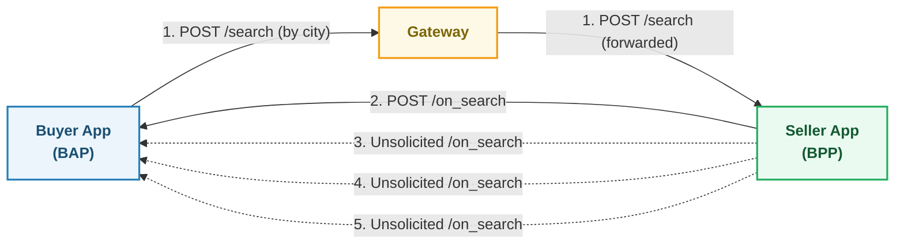

**3. API breakdown and technical actions.**

- **`/search`** (`search_1`): `vehicle.category: BUS`, no stops; no `bpp_id`, so the call goes through the Gateway.
- **`/on_search`** (`on_Search_1`): items `SJT`, `SFSJT`, `PASS` and `AGENT_TICKETING`; the catalog tag `PAGINATION` has `PAGINATION_ID` and `MAX_PAGE_NUMBER` (`3`).
- **`/on_search` (unsolicited)** (`on_search_2` to `on_search_4`): the `PAGINATION` tag also has `CURRENT_PAGE_NUMBER` `1`, `2` and `3`.

---

#### Flow 2: IntraCity_Search_Without_Pagination_Flow_Code_Based_(Master Search)

**Flow ID:** `IntraCity_Search_Without_Pagination_Flow_Code_Based_(Master Search)`  
*Present in the flow configuration; not in the contract's enabled flow list.*  
**Config file:** `Bus/IntraCity_Search_Without_Pagination_Flow_Code_Based_(Master Search).yaml` · **Tags:** `PRAMAAN`, `MANDATORY`, `REPORTABLE`, `WORKBENCH`

**1. Short description.** The buyer searches the bus catalog of a city and gets it in a single `on_search`. 2 steps.

**2. Process flow.**

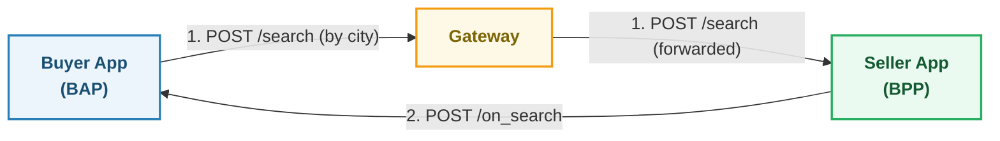

**3. API breakdown and technical actions.**

- **`/search`** (`search_1`): `vehicle.category: BUS`, no stops; through the Gateway.
- **`/on_search`** (`on_search_master`): items `SJT`, `SFSJT`, `PASS` and `AGENT_TICKETING`.

---

#### Flow 3: IntraCity_Purchase_Journey_Flow_Code_Based

**Flow ID:** `IntraCity_Purchase_Journey_Flow_Code_Based` (contract name: *IntraCity - Purchase Journey Flow(Code Based)*)  
**Config file:** `Bus/IntraCity_Purchase_Journey_Flow_Code_Based.yaml` · **Tags:** `PRAMAAN`, `MANDATORY`, `REPORTABLE`, `WORKBENCH`

**1. Short description.** The buyer books a bus ticket from stop A (code) to stop B (code). In this branch the flow is a skeleton without example payloads. 9 steps.

*9 of the 9 steps have no example payload in this branch, so their labels show only the API name.*

**2. Process flow.**

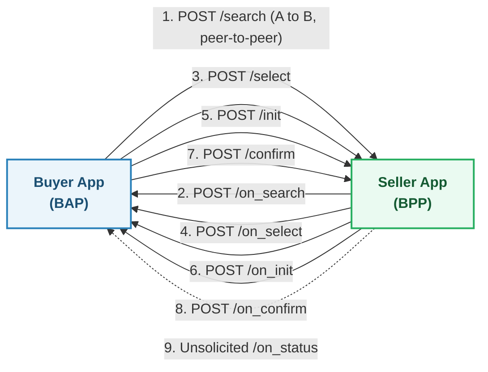

**3. API breakdown and technical actions.**

- The steps are `search`, `on_search`, `select`, `on_select`, `init`, `on_init`, `confirm`, `on_confirm` and an unsolicited `on_status`.
- The contract flow has 10 steps and ends with `update` and `on_update` (`update_target: order.billing`); its `search` is peer-to-peer between BAP and BPP. See [Contract Notes](#contract-notes).

---

#### Flow 4: IntraCity_Unlimited_Passes_Flow_Code_Based

**Flow ID:** `IntraCity_Unlimited_Passes_Flow_Code_Based` (contract name: *IntraCity - Unlimited Passes Flow(Code Based)*)  
**Config file:** `Bus/IntraCity_Unlimited_Passes_Flow_Code_Based_.yaml` · **Tags:** `PRAMAAN`, `MANDATORY`, `REPORTABLE`, `WORKBENCH`

**1. Short description.** The buyer books an unlimited pass without a search: `select` starts the flow. 7 steps.

**2. Process flow.**

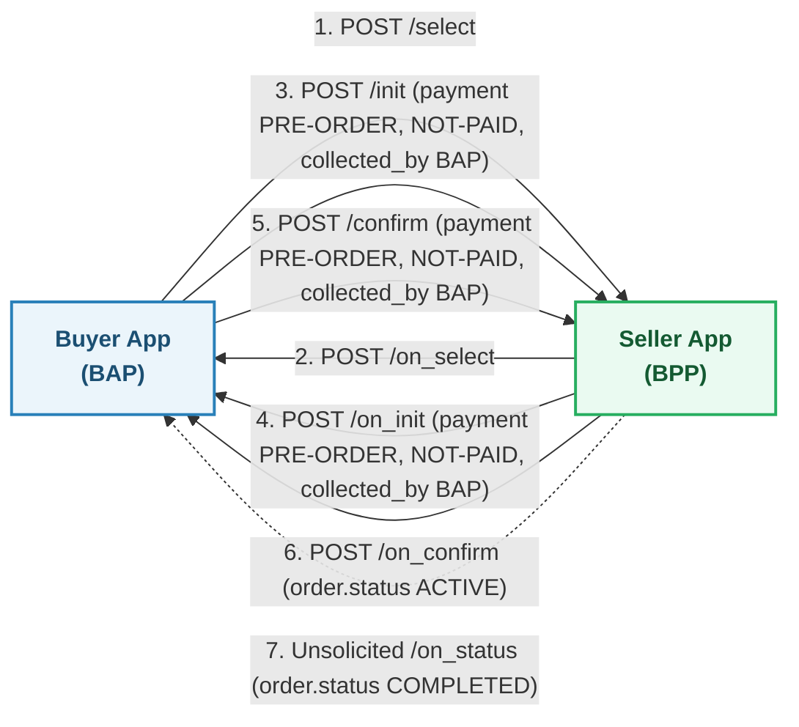

**3. API breakdown and technical actions.**

- **`/select`, `/on_select`**: fulfillment `type: PASS`; the quote has `BASE_FARE`, `OFFER`, `TOLL`, `TAX`, `OTHER_CHARGES`.
- **`/init`, `/on_init`, `/confirm`**: payment `PRE-ORDER`, `NOT-PAID`, `collected_by: BAP`; the `confirm` payment is still `NOT-PAID` in this branch (see [Contract Notes](#contract-notes)).
- **`/on_confirm`**: `ACTIVE`, payment `PAID`. **`/on_status` (unsolicited)**: `COMPLETED`; the pass has a QR `authorization` (`UNCLAIMED`, then `CLAIMED`).

---

### Confirmation Variants

#### Flow 5: IntraCity_Seller_Based_Confirmation_flow

**Flow ID:** `IntraCity_Seller_Based_Confirmation_flow` (contract name: *IntraCity - Seller Side Confirmation Flow*)  
**Config file:** `Bus/Intracity_Seller_Based_Confirmation_flow.yaml` · **Tags:** `WORKBENCH`, `OPTIONAL`

**1. Short description.** The seller app confirms the ticket check on its own: an unsolicited `on_update` ends the order. 9 steps.

**2. Process flow.**

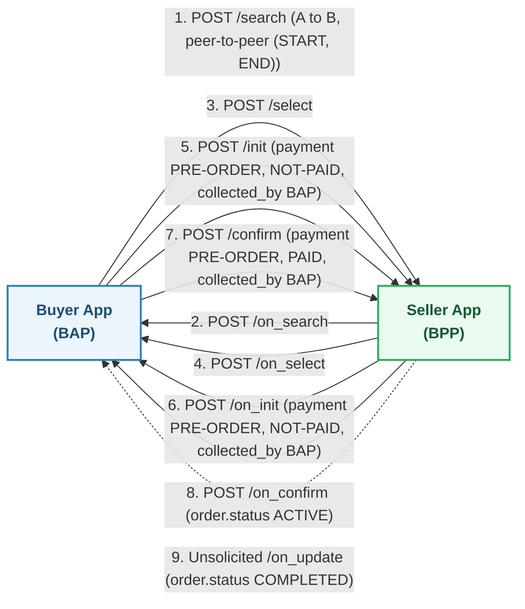

**3. API breakdown and technical actions.**

- **`/search`** (`search_1`): `START` and `END` stops, with `bpp_id`: peer-to-peer.
- **`/confirm`, `/on_confirm`**: `ACTIVE`, QR `authorization` `UNCLAIMED`.
- **`/on_update` (unsolicited)**: `order.status: COMPLETED`, `vehicle.registration` set, QR `CLAIMED`.

---

#### Flow 6: IntraCity_User_Based_Confirmation_flow

**Flow ID:** `IntraCity_User_Based_Confirmation_flow` (contract name: *IntraCity - User Based Confirmation flow*)  
**Config file:** `Bus/IntraCity_User_Based_Confirmation_flow.yaml` · **Tags:** `WORKBENCH`, `OPTIONAL`

**1. Short description.** The ticket is activated by a confirmation sent by the buyer app. 10 steps.

**2. Process flow.**

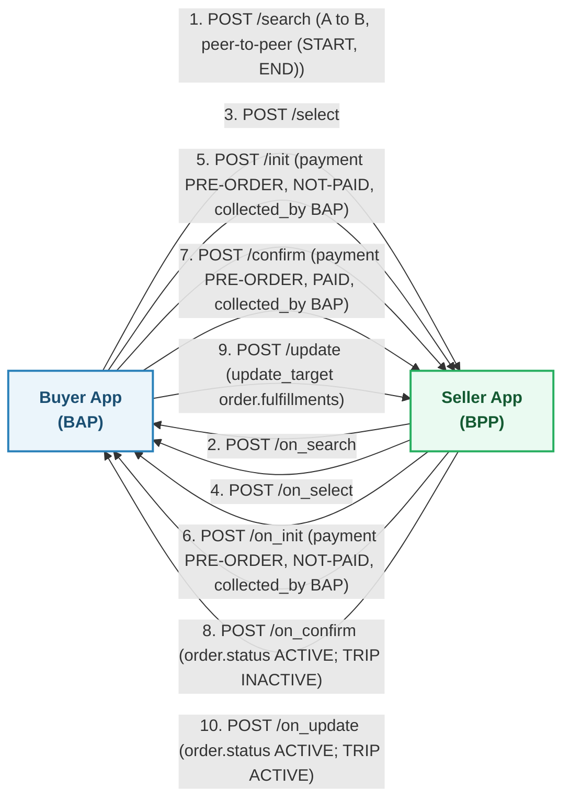

**3. API breakdown and technical actions.**

- **`/on_confirm`**: `ACTIVE`; the `TRIP` state is `INACTIVE`; `authorization.type: USER_CONFIRMATION_AND_QR`, `UNCLAIMED`.
- **`/update`**: `update_target: order.fulfillments`. **`/on_update`**: `TRIP` state `ACTIVE`, authorization `CLAIMED`.

---

#### Flow 7: IntraCity_Vehicle_Based_Confirmation_flow(With Update Call)

**Flow ID:** `IntraCity_Vehicle_Based_Confirmation_flow(With Update Call)` (contract name: *IntraCity - Vehicle Based Confirmation flow (With Update Call)*)  
**Config file:** `Bus/IntraCity_Vehicle_Based_Confirmation_flow_With_Update_Call_.yaml` · **Tags:** `WORKBENCH`, `OPTIONAL`

**1. Short description.** The ticket is activated by an `update` that carries the vehicle details. 10 steps.

**2. Process flow.**

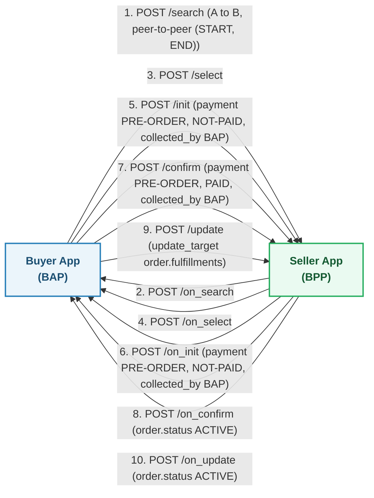

**3. API breakdown and technical actions.**

- **`/confirm`, `/on_confirm`**: `ACTIVE`, QR `UNCLAIMED`.
- **`/update`**: `update_target: order.fulfillments` with `vehicle.registration`. **`/on_update`**: the registration and QR `CLAIMED`. The authorization type is `QR` in this branch (see [Contract Notes](#contract-notes)).

---

#### Flow 8: IntraCity_Vehicle_Based_Confirmation_flow(Without Update Call)

**Flow ID:** `IntraCity_Vehicle_Based_Confirmation_flow(Without Update Call)` (contract name: *IntraCity - Vehicle Based Confirmation flow (Without Update Call)*)  
**Config file:** `Bus/IntraCity_Vehicle_Based_Confirmation_flow_Without_Update_Call_.yaml` · **Tags:** `WORKBENCH`, `OPTIONAL`

**1. Short description.** The ticket carries the vehicle details from `confirm`; no `update` follows. 8 steps.

**2. Process flow.**

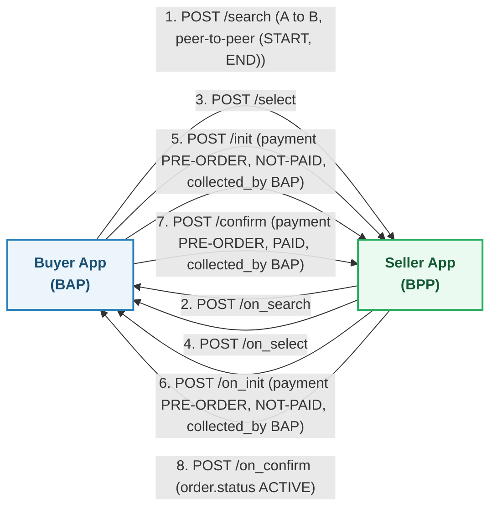

**3. API breakdown and technical actions.**

- **`/confirm`**: `fulfillments[].vehicle.registration` set. **`/on_confirm`**: `ACTIVE`, QR `CLAIMED`. The authorization type is `QR` in this branch (see [Contract Notes](#contract-notes)).

---

### Agent (POS) Flows

#### Flow 9: IntraCity_Agent_Activation(Route Selection by Agent)

**Flow ID:** `IntraCity_Agent_Activation(Route Selection by Agent)` (contract name: *IntraCity - Agent Activation(Route Selection by Agent)*)  
**Config file:** `Bus/IntraCity_Agent_Activation_Route_Selection_by_Agent_.yaml` · **Tags:** `PRAMAAN`, `MANDATORY`, `REPORTABLE`, `WORKBENCH`

**1. Short description.** A bus agent (POS) logs in and selects a route and a vehicle. 6 steps.

**2. Process flow.**

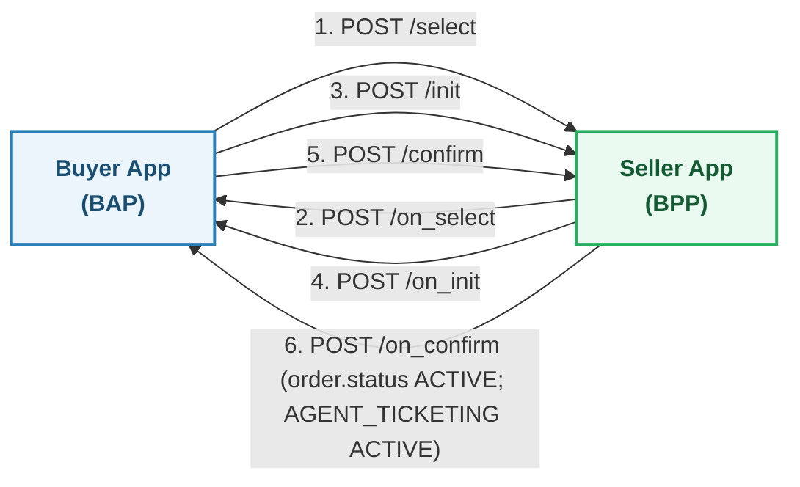

**3. API breakdown and technical actions.**

- **`/select`**: item `I10` (`AGENT_TICKETING`) and the agent id (`fulfillments[].agent.person.id`). **`/on_select`**: `ROUTE` and `AGENT_TICKETING` fulfillments with several vehicle registrations.
- **`/init`, `/on_init`, `/confirm`**: the chosen route and vehicle registration. **`/on_confirm`**: `order.status: ACTIVE`; the `AGENT_TICKETING` fulfillment state `ACTIVE`.

---

#### Flow 10: IntraCity_Agent_Login(Route allotment by Seller)

**Flow ID:** `IntraCity_Agent_Login(Route allotment by Seller)` (contract name: *IntraCity - Agent Login(Route allotment by Seller)*)  
**Config file:** `Bus/IntraCity_Agent_Login_Route_allotment_by_Seller_.yaml` · **Tags:** `PRAMAAN`, `MANDATORY`, `REPORTABLE`, `WORKBENCH`

**1. Short description.** A bus agent (POS) logs in and the seller allots the route and vehicle. 4 steps.

**2. Process flow.**

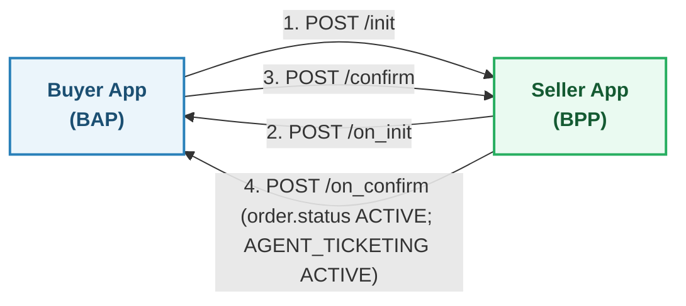

**3. API breakdown and technical actions.**

- **`/init`**: only the agent id (`AGENT_TICKETING` fulfillment). **`/on_init`**: `ROUTE` and `AGENT_TICKETING` fulfillments with the vehicle registration.
- **`/confirm`, `/on_confirm`**: `order.status: ACTIVE`; `AGENT_TICKETING` state `ACTIVE`.

---

#### Flow 11: IntraCity_Purchase_Journey(Agent Based)

**Flow ID:** `IntraCity_Purchase_Journey(Agent Based)` (contract name: *IntraCity - Purchase Journey(Agent Based)*)  
**Config file:** `Bus/IntraCity_Purchase_Journey_Agent_Based_.yaml` · **Tags:** `PRAMAAN`, `MANDATORY`, `REPORTABLE`, `WORKBENCH`

**1. Short description.** The agent sells a ticket; the order is a child order of the agent's base order. 2 steps.

**2. Process flow.**

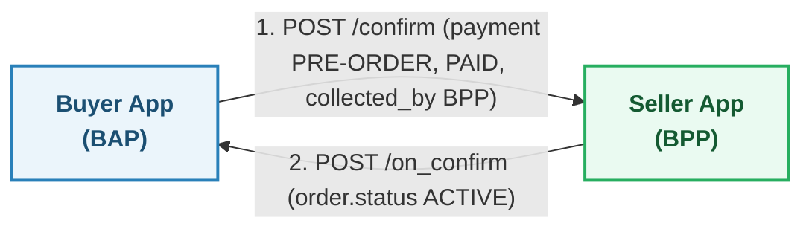

**3. API breakdown and technical actions.**

- **`/confirm`** (`confirm_BUS_Agent_Purchase_210`): `order.ref_order_ids[]` with the base order id; item `I1`; the `quote` (`35` INR); payment `PRE-ORDER`, `PAID`, `collected_by: BPP`.
- **`/on_confirm`**: `order.status: ACTIVE`; `TRIP` and `TICKET` fulfillments.

---

#### Flow 12: IntraCity_Base_Order_Update_Journey

**Flow ID:** `IntraCity_Base_Order_Update_Journey` (contract name: *IntraCity - Base Order Update Journey*)  
**Config file:** `Bus/IntraCity_Base_Order_Update_Journey.yaml` · **Tags:** `PRAMAAN`, `MANDATORY`, `REPORTABLE`, `WORKBENCH`

**1. Short description.** The base order of the agent is updated with the quote of the child orders. 2 steps.

**2. Process flow.**

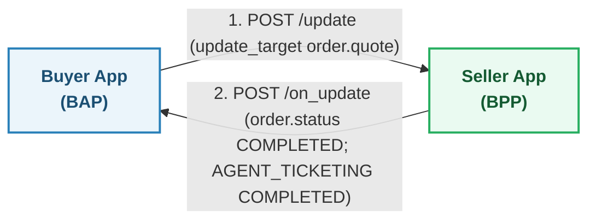

**3. API breakdown and technical actions.**

- **`/update`**: `update_target: order.quote`; `quote.price: 2750` INR. **`/on_update`**: `order.status: COMPLETED`; the `AGENT_TICKETING` fulfillment state `COMPLETED`; the quote has `BASE_FARE`, `OFFER`, `TOLL`, `TAX`, `OTHER_CHARGES`.

---

### Cancellation Flows

#### Flow 13: IntraCity_User_Cancellation_Flow

**Flow ID:** `IntraCity_User_Cancellation_Flow` (contract name: *IntraCity - User Cancellation Flow*)  
**Config file:** `Bus/IntraCity_User_Cancellation_Flow.yaml` · **Tags:** `PRAMAAN`, `MANDATORY`, `REPORTABLE`, `WORKBENCH`

**1. Short description.** The buyer cancels a confirmed ticket: a soft cancel, then a confirmed cancel. 12 steps.

**2. Process flow.**

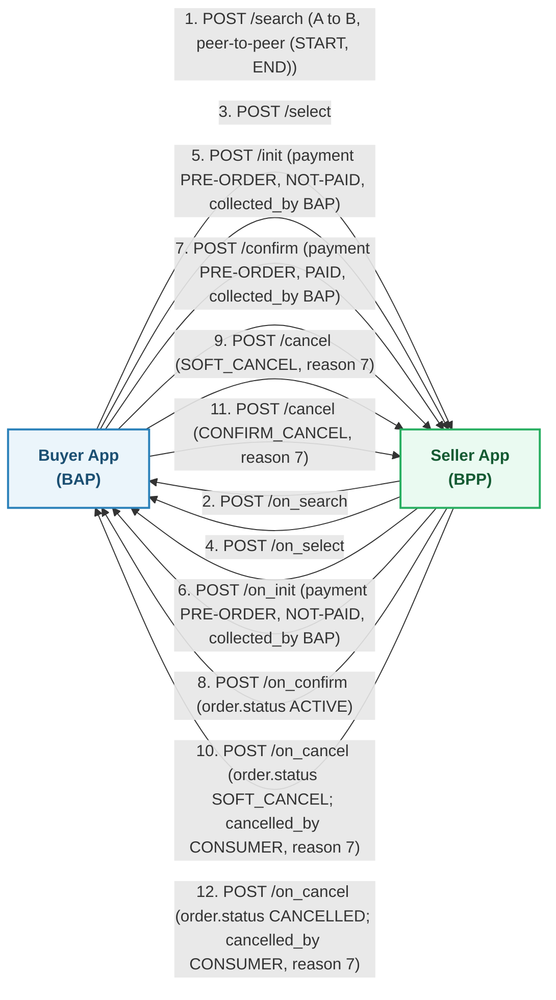

**3. API breakdown and technical actions.**

- **`/search`** to **`/on_confirm`**: `START` and `END` stops (peer-to-peer search), then the order sequence.
- **`/cancel`**: `SOFT_CANCEL`, `cancellation_reason_id: 7`. **`/on_cancel`**: `SOFT_CANCEL`, `cancelled_by: CONSUMER`.
- **`/cancel`**: `CONFIRM_CANCEL`. **`/on_cancel`**: `CANCELLED`; the quote has `REFUND` and `CANCELLATION_CHARGES`.

---

#### Flow 14: IntraCity_Technical_Cancellation_Flow

**Flow ID:** `IntraCity_Technical_Cancellation_Flow` (contract name: *IntraCity - Technical Cancellation Flow*)  
**Config file:** `Bus/IntraCity_Technical_Cancellation_Flow.yaml` · **Tags:** `PRAMAAN`, `MANDATORY`, `REPORTABLE`, `WORKBENCH`

**1. Short description.** The `on_confirm` reaches the buyer app after its TTL; the buyer app checks the status and cancels with reason `000`. 14 steps.

**2. Process flow.**

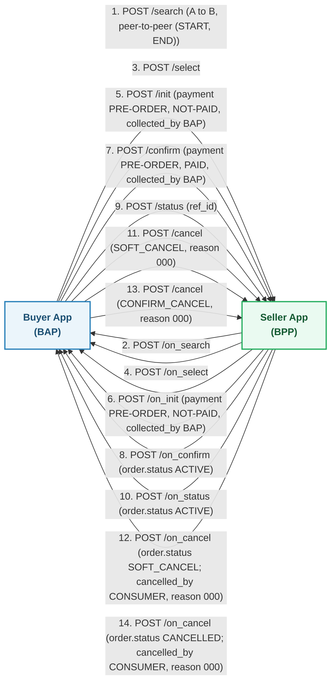

**3. API breakdown and technical actions.**

- **`/status`** (`status_1`): carries `ref_id`. **`/on_status`**: `ACTIVE`.
- **`/cancel`**: `SOFT_CANCEL`, then `CONFIRM_CANCEL`, reason `000`. **`/on_cancel`**: `SOFT_CANCEL`, then `CANCELLED`, `cancelled_by: CONSUMER`.

---

### Issue and Grievance Flow

#### Flow 15: IntraCity_Purchase_Journey_FlowCode_Based_Flow_With_IGM(v-1.0.0)

**Flow ID:** `IntraCity_Purchase_Journey_FlowCode_Based_Flow_With_IGM(v-1.0.0)`  
*Present in the flow configuration; not in the contract's enabled flow list.*  
**Config file:** `Bus/IntraCity_Purchase_Journey_FlowCode_Based_Flow_With_IGM_v-1_0_0_.yaml` · **Tags:** `MANDATORY`, `WORKBENCH`

**1. Short description.** The code based purchase journey with an `update` and an IGM 1.0.0 grievance. In this branch the order steps have no example payloads. 14 steps.

*8 of the 14 steps have no example payload in this branch, so their labels show only the API name.*

**2. Process flow.**

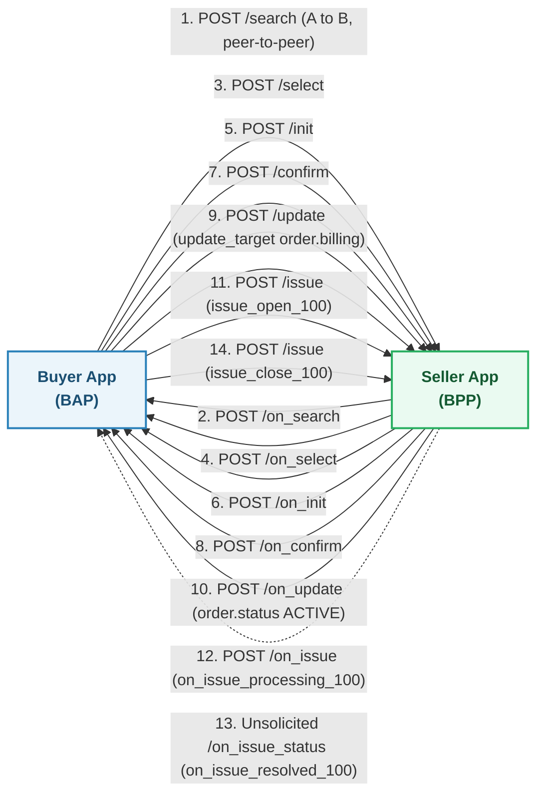

**3. API breakdown and technical actions.**

- Steps 1 to 8 are the order sequence; step 9 is an `update` (`update_target: order.billing`) with `on_update` (`order.status: ACTIVE`, payment `PRE-ORDER`, `PAID`, `collected_by: BAP`); steps 11 to 14 are the IGM calls (see [Issue and Grievance Management](#issue-and-grievance-management)).

---

## Flow Catalogue

| Flow ID (branch) | Contract name | In contract enabled flows | Steps |
|---|---|---|---|
| `IntraCity_Search_Pagination_Flow_Code_Based` | IntraCity - Search Pagination Flow(Code Based) | Yes | 5 |
| `IntraCity_Search_Without_Pagination_Flow_Code_Based_(Master Search)` | — | No (branch only) | 2 |
| `IntraCity_Purchase_Journey_Flow_Code_Based` | IntraCity - Purchase Journey Flow(Code Based) | Yes | 9 |
| `IntraCity_Unlimited_Passes_Flow_Code_Based` | IntraCity - Unlimited Passes Flow(Code Based) | Yes | 7 |
| `IntraCity_Seller_Based_Confirmation_flow` | IntraCity - Seller Side Confirmation Flow | Yes | 9 |
| `IntraCity_User_Based_Confirmation_flow` | IntraCity - User Based Confirmation flow | Yes | 10 |
| `IntraCity_Vehicle_Based_Confirmation_flow(With Update Call)` | IntraCity - Vehicle Based Confirmation flow (With Update Call) | Yes | 10 |
| `IntraCity_Vehicle_Based_Confirmation_flow(Without Update Call)` | IntraCity - Vehicle Based Confirmation flow (Without Update Call) | Yes | 8 |
| `IntraCity_Agent_Activation(Route Selection by Agent)` | IntraCity - Agent Activation(Route Selection by Agent) | Yes | 6 |
| `IntraCity_Agent_Login(Route allotment by Seller)` | IntraCity - Agent Login(Route allotment by Seller) | Yes | 4 |
| `IntraCity_Purchase_Journey(Agent Based)` | IntraCity - Purchase Journey(Agent Based) | Yes | 2 |
| `IntraCity_Base_Order_Update_Journey` | IntraCity - Base Order Update Journey | Yes | 2 |
| `IntraCity_User_Cancellation_Flow` | IntraCity - User Cancellation Flow | Yes | 12 |
| `IntraCity_Technical_Cancellation_Flow` | IntraCity - Technical Cancellation Flow | Yes | 14 |
| `IntraCity_Purchase_Journey_FlowCode_Based_Flow_With_IGM(v-1.0.0)` | — | No (branch only) | 14 |

The contract also has four Bus flows that are commented out of its flow index and are not in this branch: `IntraCity - Buyer App Pagination Flow(Code Based)`, `IntraCity - Delayed Cancellation Flow(Rejected)`, `IntraCity - Delayed Cancellation Flow(Successful)` and `IntraCity - GPS Based Flow`.

---

## Key Data Model

### Context

| Field | Notes |
|---|---|
| `domain` | `ONDC:TRV11` |
| `version` | `2.1.0` |
| `action` | API name |
| `location.country.code`, `location.city.code` | `IND`; city code like `std:011` |
| `transaction_id`, `message_id`, `timestamp` | Present in every call |
| `ttl` | `PT30S` |
| `bap_id`, `bap_uri` | Buyer App |
| `bpp_id`, `bpp_uri` | Seller App; not in the city-level `search` |

### Fulfillment and stop types

| Object | Values |
|---|---|
| `fulfillments[].type` | `TRIP`, `TICKET`, `PASS`, `ROUTE`, `STOPS`, `AGENT_TICKETING` |
| `stops[].type` | `START`, `END`, `INTERMEDIATE_STOP`, `TRANSIT_STOP` |
| `fulfillments[].state.descriptor.code` | `INACTIVE`, `ACTIVE`, `COMPLETED` |
| `stops[].authorization` | `type`: `QR`, `USER_CONFIRMATION_AND_QR` in the payloads (`QR_AND_VEHICLE_NUMBER` in the contract's vehicle-based flows); `status`: `UNCLAIMED`, `CLAIMED` |
| `customer.person.creds[].type` | `PAN` |
| `vehicle.category` | `BUS` |

### Items

| Object | Values |
|---|---|
| `items[].descriptor.code` | `SJT`, `SFSJT`, `PASS`, `AGENT_TICKETING` |
| `FARE_POLICY` tag | `RESTRICTED_PERSON`, `RESTRICTION_PROOF` |

### Order, payment and cancellation

| Object | Values |
|---|---|
| `order.status` | `ACTIVE`, `COMPLETED`, `SOFT_CANCEL`, `CANCELLED` |
| `payments[].collected_by` | `BAP`, `BPP` (the agent purchase flow has `BPP`) |
| `payments[].status` | Payloads: `NOT-PAID`, `PAID`. Contract enum: `NOT_PAID`, `PAID` |
| `payments[].type` | Payloads: `PRE-ORDER`. Contract enum: `PRE_ORDER` |
| `cancel` `descriptor.code` | `SOFT_CANCEL`, `CONFIRM_CANCEL` |
| `cancellation_reason_id` | `7` (user cancellation), `000` (technical cancellation) |
| `order.cancellation.cancelled_by` | `CONSUMER` |
| `update_target` | `order.billing`, `order.fulfillments`, `order.quote` |
| `quote.breakup[].title` | `BASE_FARE`, `OFFER`, `TOLL`, `TAX`, `OTHER_CHARGES`; in cancellation responses `REFUND`, `CANCELLATION_CHARGES` |

### Tags

| Tag | Level | Codes |
|---|---|---|
| `BAP_TERMS` | `intent`, order | `BUYER_FINDER_FEES_PERCENTAGE`, `STATIC_TERMS`, `DELAY_INTEREST`, `SETTLEMENT_AMOUNT`, `SETTLEMENT_TYPE`, `MANDATORY_ARBITRATION`, `COURT_JURISDICTION`, `SETTLEMENT_BASIS` |
| `BPP_TERMS` | catalog, order | `BUYER_FINDER_FEES_PERCENTAGE`, `SETTLEMENT_WINDOW`, `SETTLEMENT_BASIS`, `MANDATORY_ARBITRATION`, `COURT_JURISDICTION`, `STATIC_TERMS`, and in order calls the bank codes |
| `PAGINATION` | `on_search` catalog | `PAGINATION_ID`, `CURRENT_PAGE_NUMBER`, `MAX_PAGE_NUMBER` |
| `ROUTE_INFO` | fulfillment | `ROUTE_ID`, `ROUTE_DIRECTION`, `OPERATIONAL_START_TIME`, `OPERATIONAL_END_TIME` |
| `INFO` | fulfillment | `PARENT_ID` |
| `TICKET_INFO` | fulfillment | `NUMBER` |
| `FARE_POLICY` | item | `RESTRICTED_PERSON`, `RESTRICTION_PROOF` |
| `ADDITIONAL_APIS` | provider, order | `GTFS_RT` |

The terms tags `BAP_TERMS` and `BPP_TERMS` replaced the older payment-level terms (change log, 14 Nov 2025). The contract's `tlc` document describes each term, its owner and the APIs it applies to.

---

## Error Codes

Error codes for this version are defined in `config/errors/index.yaml`, identical to the contract's `error_codes`. The contract has one shared list for all TRV11 use cases. `BPP` is the Seller App; `BPP - AFCS` is the Seller App's Automated Fare Collection System.

| Code | Event | From | Description |
|---|---|---|---|
| `30001` | Internal Error | BPP | Internal Error Occured |
| `30008` | Location unserviceable | BPP | The provided city cannot be serviced |
| `50001` | Cancellation not possible | BPP | Cancellation not possible for the selected item |
| `91201` | Route Serviceability error | BPP | To & from location not serviceable by Seller application |
| `91202` | Origin station not serviceable | BPP | Origin/To station not operational or unavailable |
| `91203` | Destination not serviceable | BPP | Destination/From station not operational or unavailable |
| `91204` | Maximum order qty exceeded | BPP | Maximum order qty exceeded |
| `91205` | Tracking not enabled | BPP | Tracking not enabled for any fulfillment in the order |
| `91206` | Temporarily unavailable | BPP | Service temporarily unavailable from seller side |
| `91207` | Transaction failure | BPP | Payment transaction failed |
| `91208` | Out-of-operational hours | BPP | Ticketing not allowed during un-operational hours |
| `91209` | Error in retrieving the QR | BPP | Unable to retrieve ticket details |
| `91210` | Unable to get stations data | BPP | Unable to retrieve station list and data |
| `91211` | Fare fetch error | BPP | Cannot fetch fare details for the selected route |
| `91212` | Cancellation Window Closed | BPP | Cancellation Window Closed |
| `91213` | Order in progress or existing | BPP | Order in progress or already created (same context.transaction ID different message ID) for ticket booking |
| `91214` | Duplicate API call | BPP | Duplicate API call (duplicate context.transaction ID & context.message ID) |
| `91215` | Active booking exists | BPP - AFCS | The user already has an active booking |
| `91216` | Ticket already used | BPP - AFCS | The ticket has already been used for check in/check out |
| `91217` | Payment reference id duplicate | BPP - AFCS | Payment reference ID used is duplicate |
| `91218` | Sub system failure | BPP - AFCS | Something went wrong in the ticketing system(Non-Retryable) |
| `91219` | Sub system failure | BPP - AFCS | Request Timeout(Retryable) |
| `91220` | Stale request | BPP | The request is stale and can no longer be processed. |
| `91221` | Invalid Amount | BPP | The requested amount is invalid or does not meet the required criteria. |
| `91222` | Top up is pending | BPP | The requested top-up is still being processed and has not been completed. |
| `91223` | Amount limit is exceeded | BPP | The requested amount exceeds the applicable limit. |
| `91224` | Invalid card number length | BPP | Length of the card number is invalid |
| `91225` | Card data unavailable | BPP | No data available for this card number |

No flow payload in this branch carries an `error` object.

---

## Contract Notes

Inconsistencies found while reading the contract and the branch. They are recorded as found.

- **Payment values:** all payloads in this branch use `PRE-ORDER`, `NOT-PAID`, `POST-FULFILLMENT`; the contract enum and examples use underscores, and the change log (4 Aug 2026) says hyphens were replaced by underscores in the IntraCity, Metro and wallet use cases.
- **Skeleton flows:** `IntraCity_Purchase_Journey_Flow_Code_Based` has no example payload in any of its 9 steps, and `IntraCity_Purchase_Journey_FlowCode_Based_Flow_With_IGM(v-1.0.0)` has payloads only for steps 9 to 14 (the `update` and the IGM calls), not for steps 1 to 8. The contract flow `IntraCity - Purchase Journey Flow(Code Based)` has 10 steps and ends with `update` and `on_update`; the branch flow ends with an unsolicited `on_status` and has 9.
- **Unlimited pass:** the `confirm` payment is `NOT-PAID` and the `on_confirm` payment `PAID`.
- **Vehicle-based flows:** the payloads have `authorization.type: QR`; the contract examples of both vehicle-based flows have `QR_AND_VEHICLE_NUMBER`.
- **Cancellation name:** the `cancel` payloads carry `descriptor.name: Ride Cancellation`.
- **IGM:** `issue_close_100` has `issue.status: OPEN`; the contract's flow list has no IGM flow.
- **Enums:** the shared enum lists `SOFT-CANCEL` and `CONFIRM-CANCEL` for `cancel` `descriptor.code` and `AADHAR` as a credential type, and `order.status` lists `CANCEL_INITIATED`; the payloads and the change log use `SOFT_CANCEL`, `CONFIRM_CANCEL` and `AADHAAR` (changed 23 Jan 2026).
- **Flow lists:** the branch flow files carry the whole booking sequence (for example `IntraCity_User_Cancellation_Flow` has 12 steps) while the matching contract flows hold only the distinctive steps (5). `IntraCity_Seller_Based_Confirmation_flow` has 9 steps in the branch and 3 in the contract.
- **Master search:** `IntraCity_Search_Without_Pagination_Flow_Code_Based_(Master Search)` has no contract counterpart in the enabled flow list; its description reads "Metro: master search flow", as does the description of the pagination flow.
- **Agent flows:** the change log (21 Nov 2025) lists the POS enablement of the agent flows under Metro-Wallet.
- **Missing validations:** there are no presence tests for message fields of `status`.
