# Bus

---

## Overview

Intra-city bus ticketing under ONDC:TRV11 lets a buyer discover the bus routes of a city, search between two stops, buy a Single Journey Ticket (`SJT`), a Special Fare Single Journey Ticket (`SFSJT`) or a Monthly Pass (`PASS`), receive a QR ticket, and cancel the order. Every interaction is a pair of asynchronous API calls: the sender calls `/X`, the receiver acknowledges it, and the answer comes later as `/on_X`. Some callbacks are sent by the Seller App on its own (unsolicited).

This guide covers the Bus use case (`vehicle.category = BUS`) of ONDC:TRV11 version `2.0.1`. It describes only what the contract defines: the 15 Bus flows in `config/flows/Bus`, `config/attributes/Bus.yaml`, the Bus validations in `config/validations`, the actions in `config/actions` and the error codes in `config/errors`.

| Item | Value |
|---|---|
| Domain | `ONDC:TRV11` |
| Version | `2.0.1` |
| Use case | `Bus` |
| Flows | 15 (see the [flow catalogue](#flow-catalogue)) |
| Ticket types | `SJT`, `SFSJT`, `PASS` |
| Payment | Collected by the Buyer App (`payments[].collected_by = BAP`) |

---

## Participants

| Participant | What This Means |
|---|---|
| **Buyer App (BAP)** | Sends `search`, `select`, `init`, `confirm`, `status`, `update`, `cancel` and `issue`. Collects the payment (`collected_by: BAP`) and passes the buyer's billing details. |
| **Seller App (BPP)** | Answers with `on_search`, `on_select`, `on_init`, `on_confirm`, `on_status`, `on_update`, `on_cancel` and `on_issue`. Returns the catalog, quote, order, QR authorization and cancellation state. Also sends unsolicited `on_search`, `on_status`, `on_update`, `on_cancel` and `on_issue_status`. |
| **Gateway** | Receives the BAP's city-level `search`, the passes `search` and the `search` of `IntraCity_Seller_Side_Confirmation_Flow`, and forwards it to the Seller App. The `search` from point A to point B, and every later call, goes directly between BAP and BPP (peer-to-peer). |

---

## The User Journey

```
[Search City] ───► [Search A to B] ───► [Select Ticket] ───► [Provide Billing] ───► [Pay & Confirm] ───► [QR Ticket Issued] ───► [Track Status]
```

**Mandatory column.** `Yes` means `config/validations/index.yaml` has a presence test (`attr are present`) for this field that applies to use code `BUS` (or to all use cases). `—` means no such test exists. Keys are taken from the flow example payloads; descriptions of the same fields are in `config/attributes/Bus.yaml`, where `required` points to the validations file.

### Context (all calls)

| Field | Key | Mandatory | Type / Values |
|---|---|---|---|
| Country | `context.location.country.code` | Yes | `IND` |
| City | `context.location.city.code` | Yes (`status`, `on_status`) | Text, e.g. `std:011` (format test `^std:0\d+$`) |
| Domain | `context.domain` | Yes | `ONDC:TRV11` |
| Version | `context.version` | Yes | `2.0.1` |
| Action | `context.action` | Yes | API name |
| Timestamp | `context.timestamp` | Yes | ISO 8601 |
| Transaction ID | `context.transaction_id` | Yes | UUID, same across the whole transaction |
| Message ID | `context.message_id` | Yes | UUID, same for a request and its callback |
| TTL | `context.ttl` | Yes (`on_*`, `status`; regex-tested) | `PT30S` |
| BAP | `context.bap_id`, `context.bap_uri` | Yes | Text |
| BPP | `context.bpp_id`, `context.bpp_uri` | Yes (`on_*`, `status`) | Text; the A-to-B `search` example carries `bpp_id` |

### 1. Search and Route Discovery

| Category | Field | Key | Mandatory | Type / Values |
|---|---|---|---|---|
| Mode | Vehicle category | `intent.fulfillment.vehicle.category` | Yes | `BUS` |
| Location | City code | `context.location.city.code` | — | Text (form input `city_code`, default `std:011`) |
| Routing | Start stop code | `intent.fulfillment.stops[type=START].location.descriptor.code` | — | Text (form input `start_code`, A-to-B search only) |
| | End stop code | `intent.fulfillment.stops[type=END].location.descriptor.code` | — | Text (form input `end_code`, A-to-B search only) |
| | Seller App ID | `context.bpp_id` | — | Text (form input `bpp_id`, A-to-B search only) |
| Payment | Collected by | `intent.payment.collected_by` | — | `BAP` |
| | Buyer finder fees | `intent.payment.tags[BUYER_FINDER_FEES]` | — | `BUYER_FINDER_FEES_PERCENTAGE` |
| | Settlement terms | `intent.payment.tags[SETTLEMENT_TERMS]` | — | `DELAY_INTEREST`, `STATIC_TERMS` |

**Network interaction:**

- **`/search` (city, `search0_BUS_201`)**: The Buyer App (BAP) sends the vehicle category and payment terms with no stops. It goes to the Gateway, which forwards it to the Seller App (BPP).
- **`/search` (A to B, `search_BUS_201`)**: The same intent with a `START` and an `END` stop. It goes directly from the BAP to the BPP. In four flows (`IntraCity_Purchase_Journey_Flow_Code_Based` and the three IGM flows that start with it) this is the only `search`, and it is sent directly. In `IntraCity_Seller_Side_Confirmation_Flow` it is also the only `search`, but the contract's flow diagram sends it through the Gateway.
- **`/search` (passes, `search_monthly_pass_BUS_201`)**: Vehicle category and payment terms with no stops. It goes through the Gateway.
- **`/on_search`**: The Seller App (BPP) returns the catalog described below.

### 2. Catalog and Fare Options

**Route catalog (`on_search0_BUS_201`, answer to the city search):**

| Category | Field | Key | Mandatory | Type / Values |
|---|---|---|---|---|
| Catalog | Catalog name | `catalog.descriptor.name` | Yes | Text |
| Provider | Provider ID, name | `catalog.providers[].id`, `.descriptor.name` | Yes | Text |
| Route | Fulfillment ID, type | `catalog.providers[].fulfillments[].id`, `.type` | Yes | `ROUTE` |
| | Vehicle category | `catalog.providers[].fulfillments[].vehicle.category` | Yes | `BUS` |
| Stops | Stop type | `...fulfillments[].stops[].type` | — | `START`, `INTERMEDIATE_STOP`, `END`, `TRANSIT_STOP` |
| Route tags | `ROUTE_INFO` | `...fulfillments[].tags[ROUTE_INFO]` | — | `ROUTE_ID` |
| Payment | Collected by | `catalog.providers[].payments[].collected_by` | Yes | `BAP`, `BPP` |
| | Tags | `catalog.providers[].payments[].tags` | — | `BUYER_FINDER_FEES`, `SETTLEMENT_TERMS` (`SETTLEMENT_WINDOW`, `SETTLEMENT_BASIS`, `MANDATORY_ARBITRATION`, `COURT_JURISDICTION`, `STATIC_TERMS`) |

This response has no `items`.

**Fare catalog (`on_search_BUS_201`, answer to the A-to-B search):**

| Category | Field | Key | Mandatory | Type / Values |
|---|---|---|---|---|
| Item | Ticket type | `catalog.providers[].items[].descriptor.code` | — | `SJT`, `SFSJT` |
| | Name | `catalog.providers[].items[].descriptor.name` | — | `Single Journey Ticket`, `Special Fair Single Journey Ticket` |
| | Price | `catalog.providers[].items[].price.currency`, `.value` | — | `INR`, fare amount |
| | Quantity limits | `catalog.providers[].items[].quantity.minimum.count`, `.maximum.count` | — | `1`, `6` |
| | Validity | `catalog.providers[].items[].time` | — | `label: Validity`, `duration: P2D` |
| | Fulfillments | `catalog.providers[].items[].fulfillment_ids[]` | — | Fulfillment ID |
| | Fare policy | `catalog.providers[].items[].tags[FARE_POLICY]` | — | `RESTRICTED_PERSON`, `RESTRICTION_PROOF` |
| Fulfillment | Type | `catalog.providers[].fulfillments[].type` | Yes | `TRIP` |
| | Stops | `...fulfillments[].stops[].type` | — | `START`, `END` |
| | Route tags | `...fulfillments[].tags[ROUTE_INFO]` | — | `ROUTE_ID`, `ROUTE_DIRECTION` (`UP`) |
| Provider tags | `SCHEDULED_INFO` | `catalog.providers[].tags` | — | `GTFS` (URL) |

**Network interaction:**

- **`/on_search` (route catalog)**: Provider, payment terms and `ROUTE` fulfillments with stops and `ROUTE_INFO` tags.
- **`/on_search` (fares)**: Items with prices, validity and `FARE_POLICY` tags, a `TRIP` fulfillment for the two stops and the `SCHEDULED_INFO` tag.
- **`/on_search` (pagination)**: See Flow 2 (`IntraCity_Search_Pagination_FlowCode_Based`) below.
- **`/on_search` (master)**: See Flow 3 (`IntraCity_Search_Without_Pagination_FlowCode_Based(Master Search Flow)`) below.

### 3. Ticket Selection and Quote

| Category | Field | Key | Mandatory | Type / Values |
|---|---|---|---|---|
| Request | Provider ID | `order.provider.id` | Yes | Text |
| | Item ID | `order.items[].id` | Yes | Text |
| | Quantity | `order.items[].quantity.selected.count` | Yes | Number |
| | Fulfillment ID | `order.fulfillments[].id` | — | Text (form input `fulfillment`, default `F1`) |
| Item | Ticket type | `order.items[].descriptor.code` | Yes (`on_select`) | `SJT` |
| | Price | `order.items[].price.currency`, `.value` | Yes (`on_select`) | `INR`, fare amount |
| | Validity | `order.items[].time` | — | `label: Validity`, `duration: P2D` |
| | Fulfillments | `order.items[].fulfillment_ids[]` | Yes (`on_select`) | Fulfillment IDs |
| Fulfillment | Type | `order.fulfillments[].type` | Yes (`on_select`) | `TRIP`, `TICKET` |
| | Vehicle category | `order.fulfillments[].vehicle.category` | Yes (`on_select`) | `BUS` |
| | Ticket parent | `order.fulfillments[].tags[INFO]` | — | `PARENT_ID` (on the `TICKET` fulfillment) |
| | Authorization | `order.fulfillments[].stops[].authorization.type` | — | `QR` |
| Quote | Total | `order.quote.price.currency`, `.value` | Yes (`on_select`) | `INR`, total |
| | Breakup | `order.quote.breakup[].title` | Yes (`on_select`) | `BASE_FARE`, `OFFER`, `TOLL` |
| Order tags | `SCHEDULED_INFO` | `order.tags` | — | `GTFS` (URL) |

**Network interaction:**

- **`/select`**: The Buyer App (BAP) sends the provider, the item and the quantity.
- **`/on_select`**: The Seller App (BPP) returns the priced order: items, a `TRIP` fulfillment and a `TICKET` fulfillment per ticket, a quote with `BASE_FARE`, `OFFER` and `TOLL` lines, and the `SCHEDULED_INFO` tag.

### 4. Billing and Payment Terms

| Category | Field | Key | Mandatory | Type / Values |
|---|---|---|---|---|
| Billing | Name | `order.billing.name` | — | Text |
| | Phone | `order.billing.phone` | — | Text |
| | Email | `order.billing.email` | — | Text |
| Payment | Collected by | `order.payments[].collected_by` | Yes | `BAP` |
| | Status | `order.payments[].status` | Yes | `NOT-PAID` |
| | Type | `order.payments[].type` | Yes | `PRE-ORDER` |
| | Payment ID | `order.payments[].id` | Yes (`on_init`) | Text, returned in `on_init` |
| | Bank details | `order.payments[].params.bank_code`, `.bank_account_number` | — | Text, returned in `on_init` |
| Payment tags | `BUYER_FINDER_FEES` | `order.payments[].tags` | — | `BUYER_FINDER_FEES_PERCENTAGE` |
| | `SETTLEMENT_TERMS` | `order.payments[].tags` | — | `SETTLEMENT_TYPE`, `SETTLEMENT_WINDOW`, `SETTLEMENT_BASIS`, `MANDATORY_ARBITRATION`, `COURT_JURISDICTION`, `DELAY_INTEREST`, `STATIC_TERMS`, `SETTLEMENT_AMOUNT` |
| Cancellation | Terms | `order.cancellation_terms[]` | — | `cancel_by.duration` (`PT60M`), `cancellation_fee.percentage` (`0`) |

**Network interaction:**

- **`/init`**: The Buyer App (BAP) sends billing details, the item, the fulfillment and the payment object with status `NOT-PAID`.
- **`/on_init`**: The Seller App (BPP) returns the same order with the quote, a payment `id`, bank parameters and `cancellation_terms`.

### 5. Confirmation and Ticket

| Category | Field | Key | Mandatory | Type / Values |
|---|---|---|---|---|
| Payment | Status | `order.payments[].status` | Yes | `PAID` (enum test: `NOT-PAID`, `PAID`) |
| | Amount, currency | `order.payments[].params.amount`, `.currency` | Yes | Amount, `INR` |
| | Transaction ID | `order.payments[].params.transaction_id` | Yes | UUID |
| Order | Order ID | `order.id` | Yes (`on_confirm`) | Text |
| | Status | `order.status` | Yes (`on_confirm`) | `ACTIVE` |
| | Created, updated | `order.created_at`, `order.updated_at` | Yes (`on_confirm`) | ISO 8601 |
| Ticket | Ticket number | `order.fulfillments[].tags[TICKET_INFO]` | — | `NUMBER` |
| | QR | `order.fulfillments[].stops[].authorization` | — | `type: QR`, `token`, `valid_to`, `status: UNCLAIMED` |
| Cancellation | Terms | `order.cancellation_terms[]` | — | `cancel_by.duration`, `cancellation_fee.percentage` |

**Network interaction:**

- **`/confirm`**: The Buyer App (BAP) sends the provider, the item, the fulfillments and the payment object with status `PAID`, amount and transaction ID.
- **`/on_confirm`**: The Seller App (BPP) creates the order (`status: ACTIVE`), returns the `TRIP` and `TICKET` fulfillments, the QR `authorization` on the ticket's first stop, `TICKET_INFO`, the quote and the cancellation terms.

### 6. Status

| Category | Field | Key | Mandatory | Type / Values |
|---|---|---|---|---|
| Request | Order ID | `order_id` | — | Text (`IntraCity_Purchase_Journey_Flow_Code_Based`, IGM 1.0.0 flow) |
| | Reference ID | `ref_id` | — | Text (`IntraCity_Technical_Cancellation_Flow`) |
| Order | Status | `order.status` | Yes (`on_status`) | `COMPLETED`, `ACTIVE` |
| Ticket | QR status | `order.fulfillments[].stops[].authorization.status` | — | `CLAIMED`, `UNCLAIMED` |

**Network interaction:**

- **`/status`**: The Buyer App (BAP) asks for the latest state of the order.
- **`/on_status`**: The Seller App (BPP) returns the order with its status and the QR authorization state. In `IntraCity_Purchase_Journey_Flow_Code_Based` the Seller App also sends an unsolicited `on_status` with `COMPLETED` and a `CLAIMED` QR.

---

## Additional Scenarios

### 1. User Cancellation (Soft and Hard)

`IntraCity_User_Cancellation_Flow` cancels a confirmed order in two calls.

```
[cancel SOFT_CANCEL] ───► [on_cancel: SOFT_CANCEL + refund breakdown] ───► [cancel CONFIRM_CANCEL] ───► [on_cancel: CANCELLED]
```

- **`/cancel` (soft)**: `order_id`, `cancellation_reason_id: 005`, `descriptor.code: SOFT_CANCEL`, `descriptor.name`.
- **`/on_cancel` (soft)**: `order.status: SOFT_CANCEL`; `order.cancellation.cancelled_by: CONSUMER`, `cancellation.reason.descriptor.code: 005`; quote breakup adds `REFUND` and `CANCELLATION_CHARGES` to `BASE_FARE`, `OFFER` and `TOLL`.
- **`/cancel` (hard)**: `cancellation_reason_id: 005`, `descriptor.code: CONFIRM_CANCEL`.
- **`/on_cancel` (hard)**: `order.status: CANCELLED`; `cancellation.cancelled_by: CONSUMER`; reason `short_desc: Cancelled by the consumer`.

### 2. Technical Cancellation

`IntraCity_Technical_Cancellation_Flow`: after `on_confirm`, the Buyer App checks the order and cancels it.

```
[on_confirm] ───► [status (ref_id)] ───► [on_status: ACTIVE] ───► [cancel CONFIRM_CANCEL, reason 000] ───► [on_cancel: CANCELLED]
```

- **`/status`** carries `ref_id`; **`/on_status`** returns `order.status: ACTIVE`.
- **`/cancel`**: `cancellation_reason_id: 000`, `descriptor.code: CONFIRM_CANCEL`.
- **`/on_cancel`**: `order.status: CANCELLED`, `cancellation.cancelled_by: CONSUMER`, `cancellation.reason.descriptor.code: 000`, quote with `REFUND` and `CANCELLATION_CHARGES`.

### 3. Merchant Side Cancellation

`IntraCity_Merchant_Side_Cancellation`: after `on_confirm` the Seller App sends an unsolicited `on_cancel` with `order.status: CANCELLED`, `order.cancellation.cancelled_by: MERCHANT`, `cancellation.reason.descriptor.code: 007` and `cancellation.time`. The quote carries `REFUND` and `CANCELLATION_CHARGES`.

### 4. Confirmation Variants

The order is confirmed through the standard `confirm` / `on_confirm` pair. Four flows change what happens next:

| Flow | After `confirm` | Values in the payloads |
|---|---|---|
| `IntraCity_Seller_Side_Confirmation_Flow` | Seller App sends an unsolicited `on_update` | `order.status: COMPLETED`, `fulfillments[].vehicle.registration`, ticket `authorization.type: QR`, `status: CLAIMED` |
| `IntraCity_User_Based_Confirmation_flow` | `on_confirm` → `update` → `on_update` | `on_confirm`: `order.status: ACTIVE`, `TRIP` state `INACTIVE`, ticket `authorization.type: VEHICLE_NUMBER`, `UNCLAIMED`. `update`: `update_target: order.fulfillments`, ticket stop `authorization.status: CLAIMED`. `on_update`: `ACTIVE`, `TRIP` state `ACTIVE`, `authorization.type: QR`, `CLAIMED`, `TICKET_INFO` |
| `IntraCity_Vehicle_Based_Confirmation_flow(With Update Call)` | `on_confirm` → `update` → `on_update` | `confirm` carries `vehicle.registration`. `update`: `update_target: order.fulfillments`, `vehicle.registration`. `on_update`: `ACTIVE`, `TRIP` state `ACTIVE`, `authorization.type: QR`, `CLAIMED` |
| `IntraCity_Vehicle_Based_Confirmation_flow(Without Update Call)` | `on_confirm` only | `order.status: ACTIVE`, `TRIP` state `INACTIVE`, ticket `authorization.type: VEHICLE_NUMBER`, `status: CLAIMED`, `vehicle.registration` |

### 5. Monthly Pass

`IntraCity_Monthly_Passes_Flow_Code_Based` sells an item with `descriptor.code: PASS`, validity `P1M`, and a `PASS` fulfillment that carries `customer.person.creds` (supported types in the catalog: `AADHAR`, `DL`, `PAN`, `VOTER_ID`). The flow selects with a `PAN` credential. Terms move to order level tags `BAP_TERMS` (`init`, `confirm`) and `BPP_TERMS` (`on_init`, `confirm`), with an `ADDITIONAL_APIS` tag (`GTFS_RT`). `on_confirm` returns `order.status: ACTIVE` and a `TICKET_INFO` tag (`NUMBER`) on the `PASS` fulfillment.

---

## Issue and Grievance Management

Four flows add Issue and Grievance Management (IGM) after the order. `config/validations` has no presence or enum tests for `issue`, `on_issue` or `on_issue_status` under use code `BUS`; fields below come from the example payloads.

| Flow | Issue steps (`*` = unsolicited) |
|---|---|
| `IntraCity_Purchase_Journey_FlowCode_Based_Flow_With_IGM(v-1.0.0)` | `issue_open_metro_100` → `on_issue_processing_metro_100` → `on_issue_resolved_metro_100`* (`on_issue_status`) → `issue_close_metro_100` |
| `IntraCity_Purchase_Journey_FlowCode_Based_Flow_With_IGM(v-2.0.0)` | `issue_open` → `on_issue_processing` → `on_issue_need_more_info`* → `issue_info_provided` → `on_issue_provided` → `on_issue_resolution`* → `issue_resolution_accept` → `on_issue_resolved` → `issue_close` |
| `IntraCity_Purchase_Journey_FlowCode_Based_Flow_With_IGM_Rejection(v-2.0.0)` | `issue_open` → `on_issue_processing` → `on_issue_resolution`* → `issue_resolution_reject` → `on_issue_processing_1` → `on_issue_resolution_1`* → `issue_escalate` → `on_issue_processing_2` → `on_issue_resolution_2`* → `issue_resolution_accept` → `on_issue_resolved` → `issue_close` |
| `IntraCity_Purchase_Journey_FlowCode_Based_Flow_With_IGM_No_Action(v-2.0.0)` | `issue_open_2` → `on_issue_processing` → `on_issue_resolution_igm_3`* → `issue_resolution_accept_igm_3` → `on_issue_resolved_igm_3` → `issue_close_igm_3` |

**IGM 2.0.0 fields in the flows:**

| Field | Values |
|---|---|
| `issue.status` | `OPEN`, `PROCESSING`, `RESOLVED`, `CLOSED` |
| `issue.level` | `ISSUE`, `GREVIENCE` |
| `issue.refs[].ref_type` | `ORDER`, `PROVIDER`, `FULFILLMENT`, `ITEM` |
| `issue.actors[].type` | `CONSUMER`, `INTERFACING_NP`, `COUNTERPARTY_NP`, `COUNTERPARTY_NP_GRO` |
| `issue.descriptor.code` | `FLM101` |
| `issue.actions[].descriptor.code` | `OPEN`, `PROCESSING`, `INFO_REQUESTED`, `INFO_PROVIDED`, `RESOLUTION_PROPOSED`, `RESOLUTION_ACCEPTED`, `ESCALATED`, `RESOLVED`, `CLOSED` |
| `issue.resolution` | `action_triggered: REFUND`, `refund_amount` |
| `on_issue` `update_target[]` | `action: APPENDED`, `path: issue.actions` |

**IGM 1.0.0 fields:** `issue.category` (`FULFILLMENT`), `issue.sub_category` (`FLM101`), `issue.issue_type` (`ISSUE`), `issue.source.type` (`CONSUMER`), `issue.status` (`OPEN`, `CLOSED`), `issue.resolution_provider.respondent_info.type` (`TRANSACTION-COUNTERPARTY-NP`), `issue.issue_actions.complainant_actions[]` (`OPEN`, `CLOSE`), `issue.rating` (`THUMBS_UP`) on close.

---

## Detailed Protocol Flows

### Flow 1: IntraCity_Purchase_Journey_Flow_Code_Based

#### 1. Short Description

A passenger searches directly between two stops, selects a ticket, pays, receives the QR ticket and tracks the order. Tags: `PRAMAAN`, `MANDATORY`, `REPORTABLE`, `WORKBENCH`.

#### 2. Visual Interaction Map

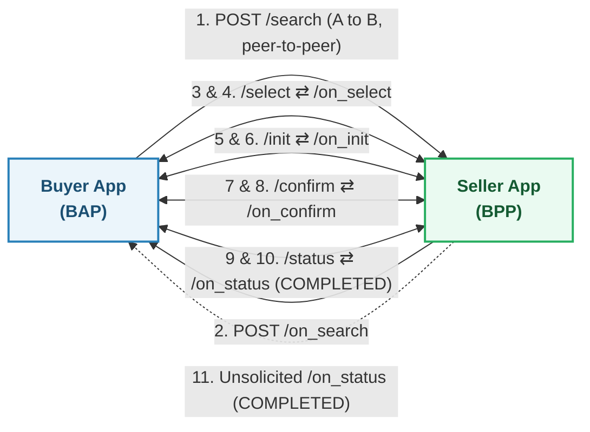

#### 3. API Breakdown & Technical Actions

- **`/search` and `/on_search`** (`search_BUS_201`, `on_search_BUS_201`): stops `START` / `END`; the response carries `SJT` and `SFSJT` items and a `TRIP` fulfillment.
- **`/select` and `/on_select`**: item and quantity; quote with `BASE_FARE`, `OFFER`, `TOLL`.
- **`/init` and `/on_init`**: billing, `NOT-PAID` payment; the response adds payment `id`, bank parameters and `cancellation_terms`.
- **`/confirm` and `/on_confirm`**: `PAID` payment; `order.status: ACTIVE`, QR `authorization`, `TICKET_INFO`.
- **`/status` and `/on_status`** (`status_purchase_flow_BUS_201`, `on_status_complete_BUS_201`, `unsolicited_on_status_complete_BUS_201`): `order_id`; `order.status: COMPLETED`.

---

### Flow 2: IntraCity_Search_Pagination_FlowCode_Based

#### 1. Short Description

The Seller App returns the catalog in four `on_search` calls: the first answers the `search`, the other three are unsolicited. Tags: `WORKBENCH`, `OPTIONAL`.

#### 2. Process Flow

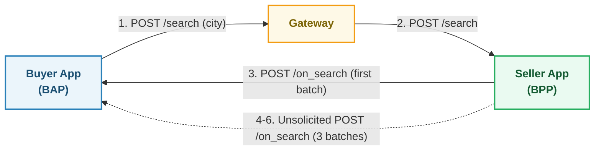

#### 3. API Breakdown & Technical Actions

- **`/search`** (`search0_BUS_201`): vehicle category and payment terms; city-level, no stops.
- **`/on_search`** (`on_search_catalog1_BUS_201` to `on_search_catalog4_BUS_201`): each carries `catalog.tags` with the `PAGINATION` tag (`display: true`). The first has `PAGINATION_ID` and `MAX_PAGE_NUMBER`. The three unsolicited ones add `CURRENT_PAGE_NUMBER` (`1`, `2`, `3`) with `MAX_PAGE_NUMBER: 3`.
- The pages carry items `SJT`, `SFSJT` and `PASS` (`Daily Pass` `P1D`, `Monthly Pass` `P1M`) and fulfillments of type `PASS`, `TICKET`, `ROUTE` and `STOPS`; pass fulfillments list `customer.person.creds` types and `vehicle.variant` (`AC`, `NON_AC`).

---

### Flow 3: IntraCity_Search_Without_Pagination_FlowCode_Based(Master Search Flow)

#### 1. Short Description

The Seller App returns the full catalog in one `on_search`, without the `PAGINATION` tag. Tags: `PRAMAAN`, `MANDATORY`, `WORKBENCH`.

#### 2. Process Flow

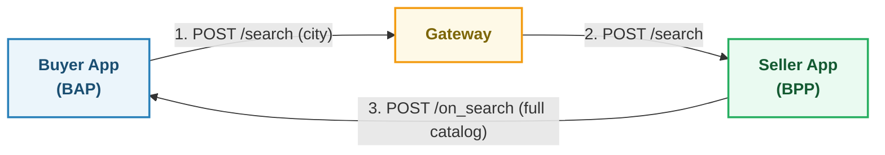

#### 3. API Breakdown & Technical Actions

- **`/search`** (`search0_BUS_201`) is the city-level search.
- **`/on_search`** (`on_search_master`): items `SJT`, `SFSJT`, `PASS`; fulfillments of type `PASS`, `ROUTE`, `STOPS`; `ROUTE_INFO` tags (`ROUTE_ID`, `ROUTE_DIRECTION`); `customer.person.creds` types and `vehicle.variant` on pass fulfillments.

---

### Flow 4: IntraCity_Monthly_Passes_Flow_Code_Based

#### 1. Short Description

A commuter buys a monthly unlimited pass with a `PAN` credential and receives a pass number. Tags: `PRAMAAN`, `WORKBENCH`, `MANDATORY`, `REPORTABLE`.

#### 2. Process Flow

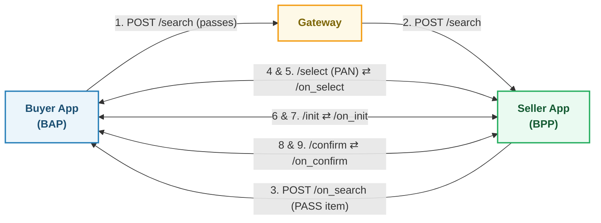

#### 3. API Breakdown & Technical Actions

- **`/search` and `/on_search`** (`search_monthly_pass_BUS_201`, `on_search_monthly_pass1_BUS_201`): item `PASS` (`Monthly Pass`, validity `P1M`), `PASS` fulfillment with supported `creds` types.
- **`/select` and `/on_select`**: form inputs `item_id`, `pan_id`; `creds` `PAN`; `on_select` adds `ADDITIONAL_APIS` (`GTFS_RT`), `vehicle.variant`, quote.
- **`/init` and `/on_init`**: `BAP_TERMS` tag group; `NOT-PAID` payment; `on_init` returns `BPP_TERMS`, `ADDITIONAL_APIS` and `cancellation_terms`.
- **`/confirm` and `/on_confirm`**: `BAP_TERMS`, `BPP_TERMS`, `ADDITIONAL_APIS`; `on_confirm` returns `order.status: ACTIVE` and `TICKET_INFO` (`NUMBER`).

---

### Flow 5: IntraCity_User_Cancellation_Flow

#### 1. Short Description

A passenger books a ticket and cancels it in two steps (soft cancel, then confirm cancel). Tags: `PRAMAAN`, `MANDATORY`, `REPORTABLE`, `WORKBENCH`.

#### 2. Process Flow

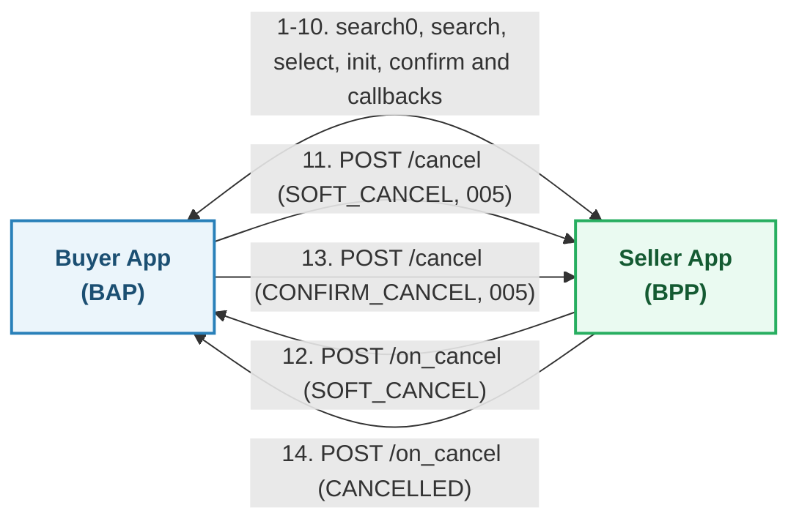

#### 3. API Breakdown & Technical Actions

- **Steps 1-10**: city `search0`, A-to-B `search`, `select`, `init` and `confirm` with their callbacks.
- **`/cancel`** (`cancel_soft_BUS_201`, `cancel_hard_BUS_201`): see [User Cancellation](#1-user-cancellation-soft-and-hard).
- **`/on_cancel`** (`on_cancel_soft_BUS_201`, `on_cancel_hard_BUS_201`): `order.status` `SOFT_CANCEL` then `CANCELLED`; quote with `REFUND` and `CANCELLATION_CHARGES`.

---

### Flow 6: IntraCity_Technical_Cancellation_Flow

#### 1. Short Description

The order is confirmed, the Buyer App checks its status and then cancels it technically. Tags: `PRAMAAN`, `MANDATORY`, `REPORTABLE`, `WORKBENCH`.

#### 2. Process Flow

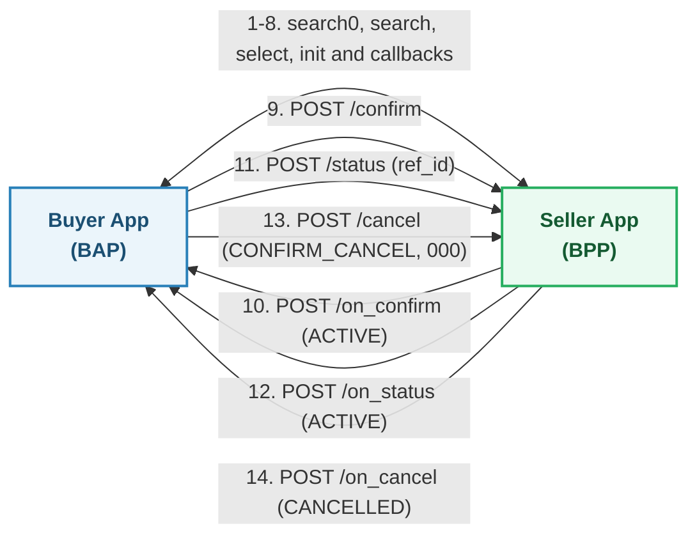

#### 3. API Breakdown & Technical Actions

- **`/confirm` and `/on_confirm`**: `on_confirm_BUS_201`, `order.status: ACTIVE`.
- **`/status` and `/on_status`** (`status_BUS_201`, `on_status_active_BUS_201`): `ref_id`; `order.status: ACTIVE`.
- **`/cancel` and `/on_cancel`** (`cancel_tech_BUS_201`, `on_cancel_BUS_201`): see [Technical Cancellation](#2-technical-cancellation).

---

### Flow 7: IntraCity_Merchant_Side_Cancellation

#### 1. Short Description

After confirmation, the Seller App cancels the order on its own. Tags: `PRAMAAN`, `MANDATORY`, `REPORTABLE`, `WORKBENCH`.

#### 2. Process Flow

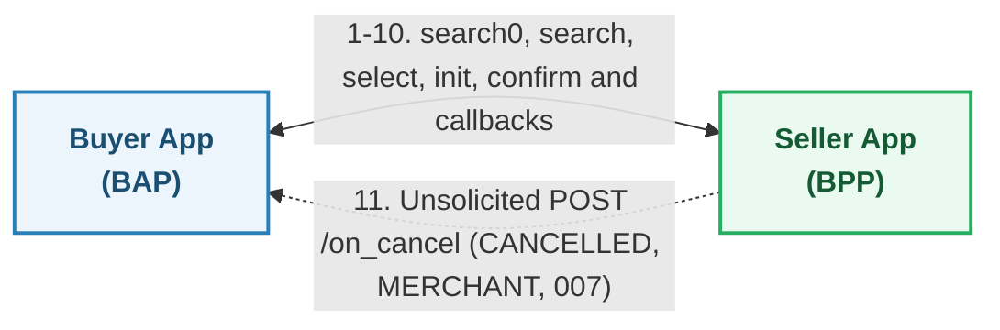

#### 3. API Breakdown & Technical Actions

- **`/on_cancel`** (`on_cancel_merchant_BUS_201`, unsolicited): `order.status: CANCELLED`, `order.cancellation.cancelled_by: MERCHANT`, reason `007`, `cancellation.time`.

---

### Flow 8: IntraCity_Seller_Side_Confirmation_Flow

#### 1. Short Description

After the order is confirmed, the Seller App sends an unsolicited `on_update`. Tags: `PRAMAAN`, `MANDATORY`, `WORKBENCH`.

#### 2. Process Flow

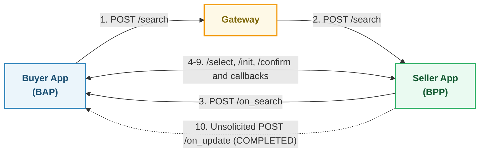

#### 3. API Breakdown & Technical Actions

- **`/search`** (`search_BUS_201`): the only search in this flow; the contract's flow diagram sends it through the Gateway.
- **`/on_update`** (`unsolicited_on_update__BUS_201`): `order.status: COMPLETED`, `vehicle.registration`, ticket `authorization` `QR` with `status: CLAIMED`.

---

### Flow 9: IntraCity_User_Based_Confirmation_flow

#### 1. Short Description

The booking is confirmed by the user at boarding through `update`. Tags: `WORKBENCH`, `OPTIONAL`.

#### 2. Process Flow

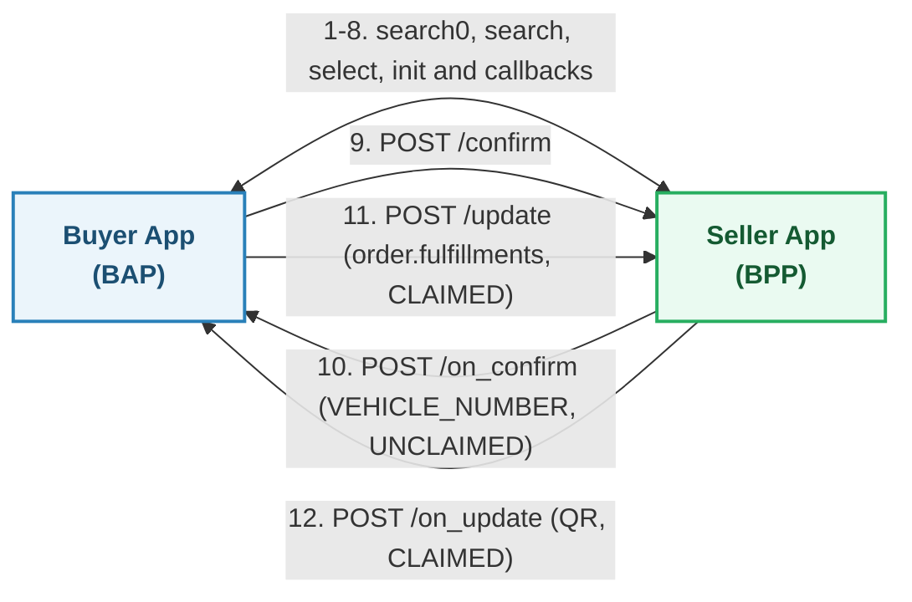

#### 3. API Breakdown & Technical Actions

- **`/on_confirm`** (`on_confirm_BUS_QR_201`): `order.status: ACTIVE`, `TRIP` state `INACTIVE`, ticket `authorization.type: VEHICLE_NUMBER`, `status: UNCLAIMED`.
- **`/update`** (`update_BUS_QR_201`): `update_target: order.fulfillments`, ticket stop `authorization.status: CLAIMED`.
- **`/on_update`** (`on_update_veh_QR_BUS_201`): `TRIP` state `ACTIVE`, `authorization.type: QR`, `CLAIMED`, `TICKET_INFO`.

---

### Flow 10: IntraCity_Vehicle_Based_Confirmation_flow(With Update Call)

#### 1. Short Description

The vehicle registration is sent in `confirm` and again in `update`. Tags: `WORKBENCH`, `OPTIONAL`.

#### 2. Process Flow

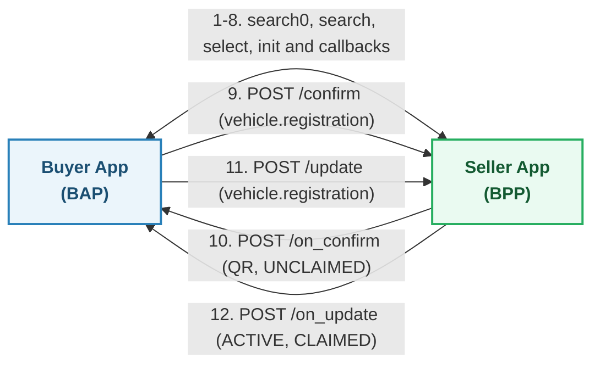

#### 3. API Breakdown & Technical Actions

- **`/confirm`** (`confirm_BUS_201`): `fulfillments[].vehicle.registration`.
- **`/on_confirm`** (`on_confirm_veh_con_BUS_201`): `order.status: ACTIVE`, `TRIP` and `TICKET` fulfillments, QR `authorization` with `status: UNCLAIMED`.
- **`/update` and `/on_update`** (`update_BUS_201`, `on_update_veh_con_BUS_201`): `update_target: order.fulfillments`; response `order.status: ACTIVE`, `TRIP` state `ACTIVE`, `authorization.status: CLAIMED`, `TICKET_INFO`.

---

### Flow 11: IntraCity_Vehicle_Based_Confirmation_flow(Without Update Call)

#### 1. Short Description

The vehicle registration is sent in `confirm` and the order is confirmed without a later `update`. Tags: `WORKBENCH`, `OPTIONAL`.

#### 2. Process Flow

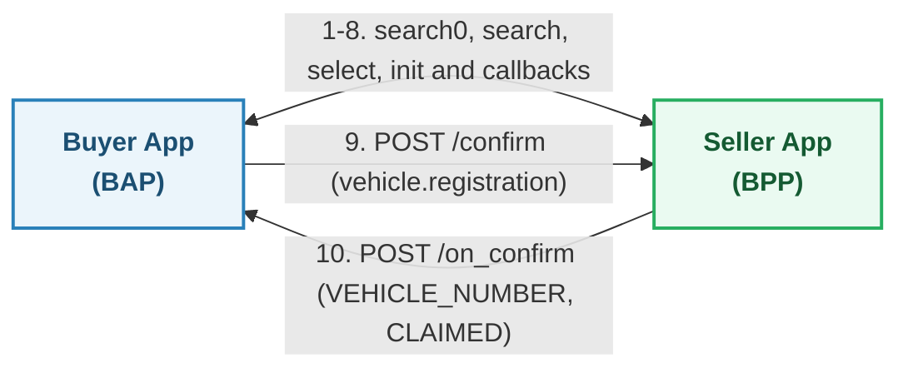

#### 3. API Breakdown & Technical Actions

- **`/on_confirm`** (`on_confirm_BUS_Without_update`): `order.status: ACTIVE`, `TRIP` state `INACTIVE`, ticket `authorization.type: VEHICLE_NUMBER`, `status: CLAIMED`, `vehicle.registration`.

---

### Flows 12-15: IntraCity Purchase Journey with IGM

#### 1. Short Description

`IntraCity_Purchase_Journey_FlowCode_Based_Flow_With_IGM(v-1.0.0)`, `..._With_IGM(v-2.0.0)`, `..._With_IGM_Rejection(v-2.0.0)` and `..._With_IGM_No_Action(v-2.0.0)` run the order and then raise an issue. Tags: `MANDATORY`, `WORKBENCH`. The v-1.0.0 flow and the Rejection and No Action flows use the A-to-B `search` only; the v-2.0.0 flow starts with the city `search0`.

#### 2. Process Flow

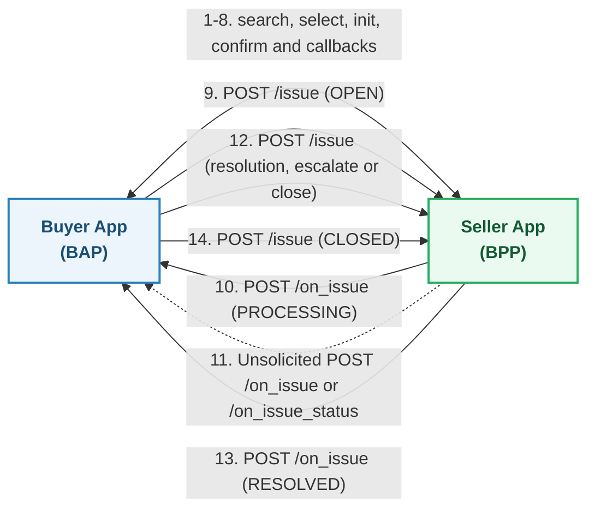

#### 3. API Breakdown & Technical Actions

- The step order of each flow is in [Issue and Grievance Management](#issue-and-grievance-management).
- The v-1.0.0 flow also runs `status` / `on_status` (`on_status_complete_BUS_201`) before the issue.

---

## Flow Catalogue

| Flow ID | Purpose |
|---|---|
| `IntraCity_Search_Pagination_FlowCode_Based` | Paginated catalog: one solicited and three unsolicited `on_search` calls |
| `IntraCity_Search_Without_Pagination_FlowCode_Based(Master Search Flow)` | Full catalog in a single `on_search` |
| `IntraCity_Purchase_Journey_Flow_Code_Based` | Search between two stops, order, status |
| `IntraCity_Monthly_Passes_Flow_Code_Based` | Monthly unlimited pass purchase |
| `IntraCity_User_Cancellation_Flow` | Soft then hard cancellation by the buyer |
| `IntraCity_Technical_Cancellation_Flow` | Status check then technical cancellation |
| `IntraCity_Merchant_Side_Cancellation` | Unsolicited cancellation by the seller |
| `IntraCity_Seller_Side_Confirmation_Flow` | Unsolicited `on_update` after confirmation |
| `IntraCity_User_Based_Confirmation_flow` | Confirmation by the user through `update` |
| `IntraCity_Vehicle_Based_Confirmation_flow(With Update Call)` | Vehicle confirmation with `update` |
| `IntraCity_Vehicle_Based_Confirmation_flow(Without Update Call)` | Vehicle confirmation without `update` |
| `IntraCity_Purchase_Journey_FlowCode_Based_Flow_With_IGM(v-1.0.0)` | Order and IGM 1.0.0 issue |
| `IntraCity_Purchase_Journey_FlowCode_Based_Flow_With_IGM(v-2.0.0)` | Order and IGM 2.0.0 issue with more info |
| `IntraCity_Purchase_Journey_FlowCode_Based_Flow_With_IGM_Rejection(v-2.0.0)` | Order and IGM 2.0.0 issue with rejection and escalation |
| `IntraCity_Purchase_Journey_FlowCode_Based_Flow_With_IGM_No_Action(v-2.0.0)` | Order and IGM 2.0.0 issue with resolution and no further action |

---

## Key Data Model

| Object | Values seen in the flows |
|---|---|
| `order.status` | `ACTIVE`, `COMPLETED`, `SOFT_CANCEL`, `CANCELLED` |
| `payments[].status` | `NOT-PAID`, `PAID` |
| `payments[].type` | `PRE-ORDER` |
| `items[].descriptor.code` | `SJT`, `SFSJT`, `PASS` |
| `fulfillments[].type` | `ROUTE`, `TRIP`, `TICKET`, `PASS`, `STOPS` |
| `fulfillments[].state.descriptor.code` | `ACTIVE`, `INACTIVE` |
| `stops[].type` | `START`, `INTERMEDIATE_STOP`, `END`, `TRANSIT_STOP` |
| `stops[].authorization.type` | `QR`, `VEHICLE_NUMBER`, `QR_AND_VEHICLE_NUMBER` |
| `stops[].authorization.status` | `UNCLAIMED`, `CLAIMED` |
| `descriptor.code` in `cancel` | `SOFT_CANCEL`, `CONFIRM_CANCEL` |
| `cancellation_reason_id` | `005`, `000` |
| `order.cancellation.cancelled_by` | `CONSUMER`, `MERCHANT` |
| `update_target` | `order.fulfillments` |
| `quote.breakup[].title` | `BASE_FARE`, `OFFER`, `TOLL`, `REFUND`, `CANCELLATION_CHARGES` |
| `customer.person.creds[].type` | `AADHAR`, `DL`, `PAN`, `VOTER_ID` |
| `vehicle.variant` | `AC`, `NON_AC` |

| Tag group | Codes in the flows |
|---|---|
| `BUYER_FINDER_FEES` | `BUYER_FINDER_FEES_PERCENTAGE` |
| `SETTLEMENT_TERMS` | `SETTLEMENT_AMOUNT`, `SETTLEMENT_WINDOW`, `SETTLEMENT_BASIS`, `SETTLEMENT_TYPE`, `DELAY_INTEREST`, `STATIC_TERMS`, `MANDATORY_ARBITRATION`, `COURT_JURISDICTION` |
| `BAP_TERMS`, `BPP_TERMS` | The same codes plus `SETTLEMENT_BANK_CODE`, `SETTLEMENT_BANK_ACCOUNT_NUMBER` (in `BPP_TERMS`); used in the passes flow |
| `ADDITIONAL_APIS` | `GTFS_RT` |
| `ROUTE_INFO` (fulfillment) | `ROUTE_ID`, `ROUTE_DIRECTION` |
| `INFO` (fulfillment) | `PARENT_ID` |
| `TICKET_INFO` (fulfillment) | `NUMBER` |
| `FARE_POLICY` (item) | `RESTRICTED_PERSON`, `RESTRICTION_PROOF` |
| `PAGINATION` (catalog) | `PAGINATION_ID`, `MAX_PAGE_NUMBER`, `CURRENT_PAGE_NUMBER` |
| `SCHEDULED_INFO` | `GTFS` |

---

## Error Codes

Error codes for this version are defined in `config/errors/index.yaml`.

---

## Contract Notes

Differences inside the contract, recorded as found:

- **Authorization type:** the flows use `QR` and `VEHICLE_NUMBER`, and `on_search` catalogs also use `QR_AND_VEHICLE_NUMBER`. The validations list only `QR` and `USER_CONFIRMATION_AND_QR`.
- **Order status:** the flows use `COMPLETED`; the validations enum lists `COMPLETE`.
- **Payment enums:** the flows use the hyphenated `PRE-ORDER` and `NOT-PAID`. The official changelog's Metro section records a change from hyphens to underscores (6 August 2026); this branch does not have it.
- **Boolean text:** `MANDATORY_ARBITRATION` is `"TRUE"` in most payloads and `"true"` in the passes flow terms.
- **Spelling in payloads:** `GOVERMENT_ID` (`RESTRICTION_PROOF` value) and `GREVIENCE` (`issue.level`) are used as written.
- **Names from other use cases:** the IGM 1.0.0 step ids contain `metro` (`issue_open_metro_100`), and the `cancel` calls carry `descriptor.name: Ride Cancellation`.
- **Status request:** `status` carries `order_id` in the purchase flow and `ref_id` in the technical cancellation flow.
- **Terms placement:** the passes flow carries terms in `BAP_TERMS` / `BPP_TERMS`; every other flow carries them in `BUYER_FINDER_FEES` / `SETTLEMENT_TERMS` on `payments[].tags`.
- **Changelog entries:** the official changelog mentions `CANCEL_INITIATED` as an `order.status` value and delayed cancellation flows (removed 3 July 2025). No Bus payload uses `CANCEL_INITIATED` and no delayed cancellation flow exists on this branch.
