# Intercity(Bus) Error Response(Soft Locking Time) — Sequence Diagrams

Internal data file consumed by the Developer Guide's "Sequence Diagram" tab (API Walkthrough).
Not meant to be shown as its own docs page — the frontend filters this slug out of the Use Case
Brief / Additional Resources / Changelog tab lists and instead looks up the section matching the
selected API call's `action_id` (the `##` heading below) to render that step's diagram.

One `## <action_id>` heading per step of `Intercity_Bus__Error_Response_Soft_Locking_Time_.yaml`, in that flow's own step order, each followed by its Mermaid `sequenceDiagram`: the whole flow, with that call's own message(s) highlighted — same convention as the other domains' per-step sequence-diagram docs.

## search_BUS_201

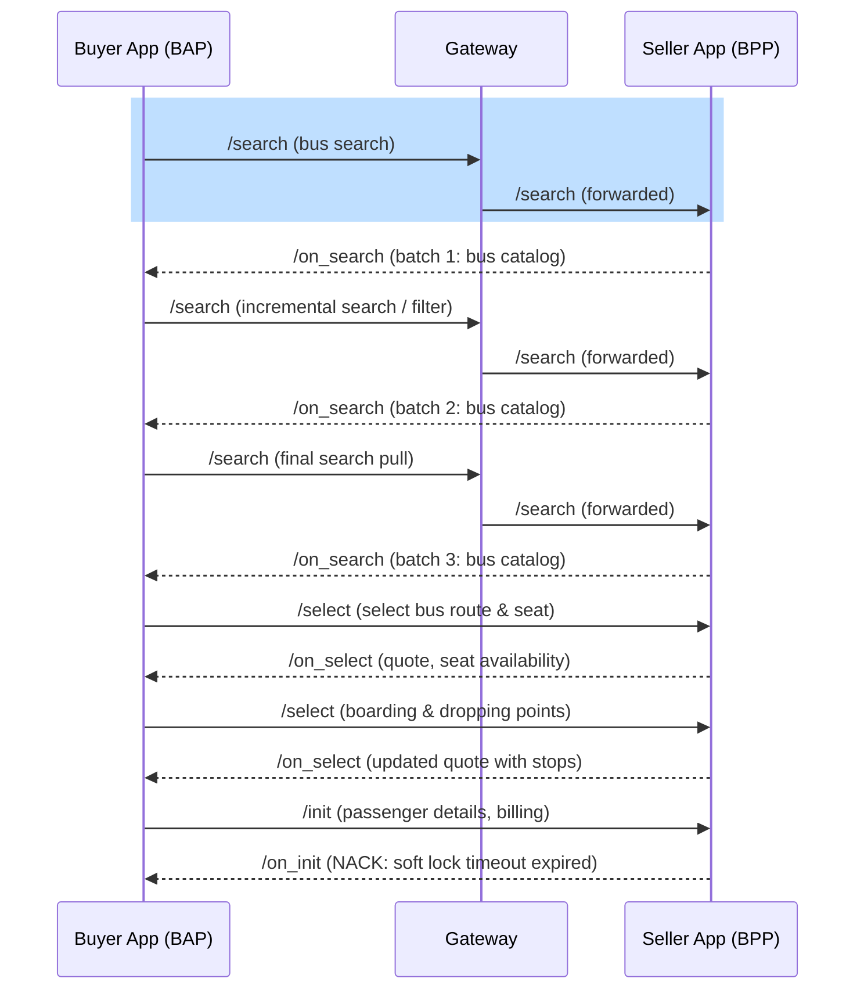

## on_search_BUS_201

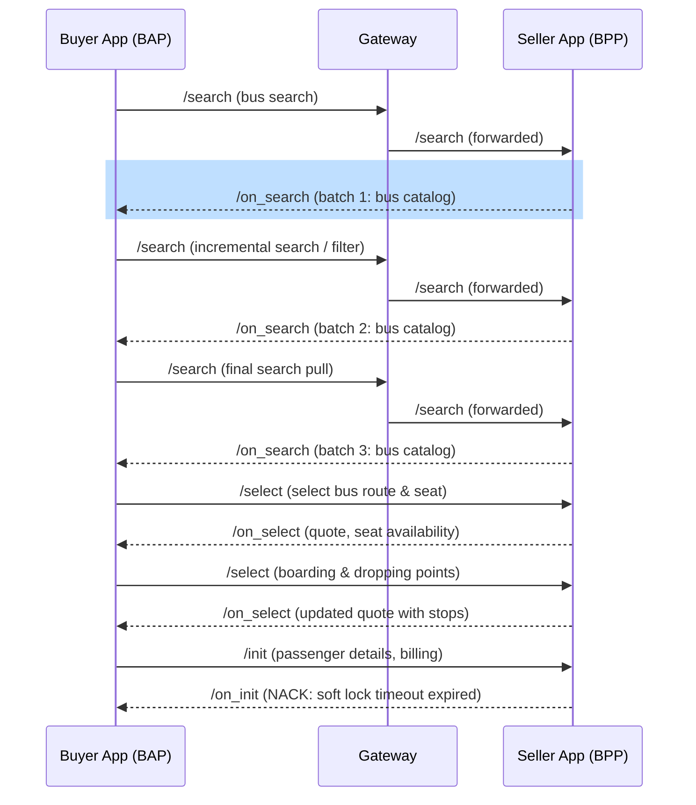

## search_BUS_202

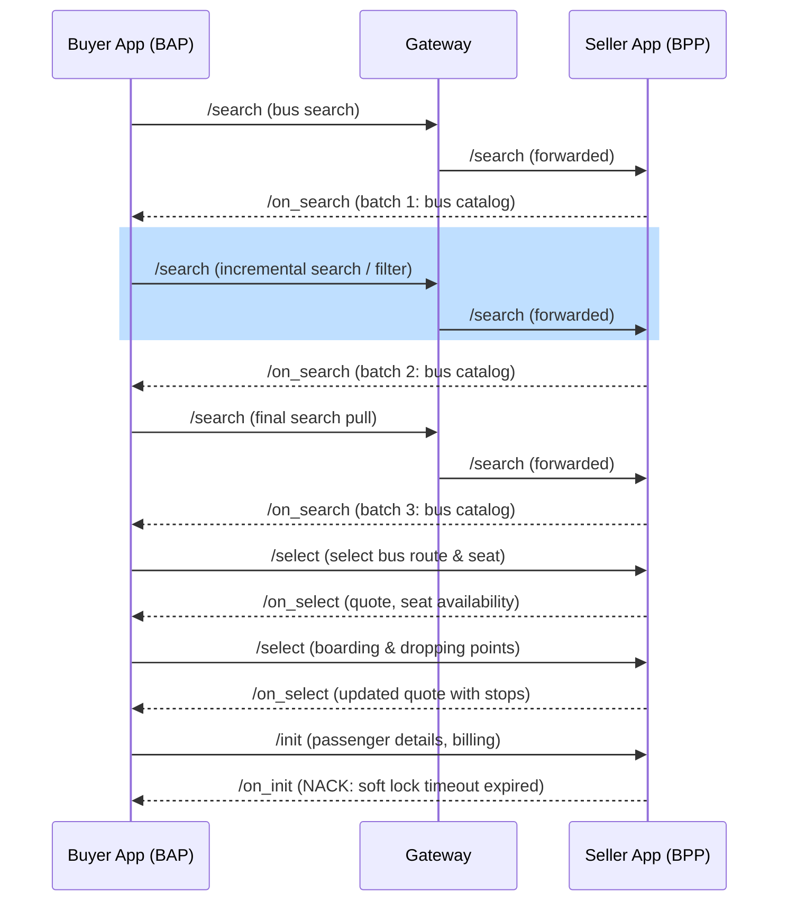

## on_search_BUS_202

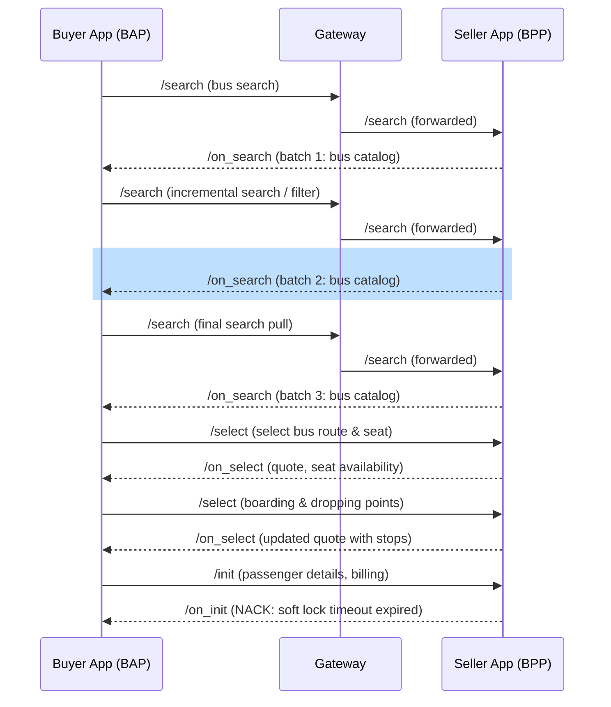

## search_BUS_203

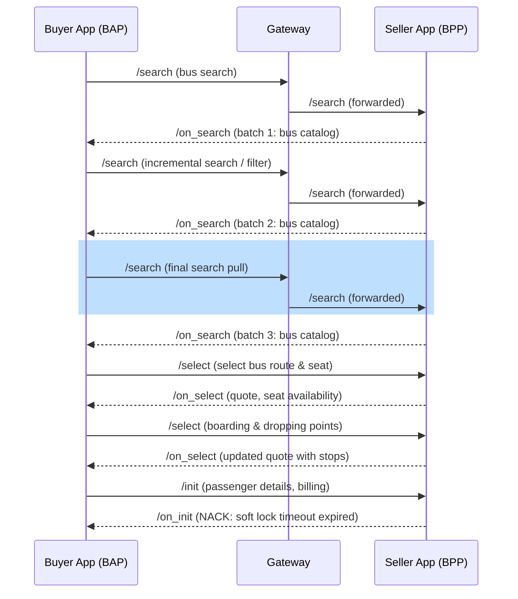

## on_search_BUS_203

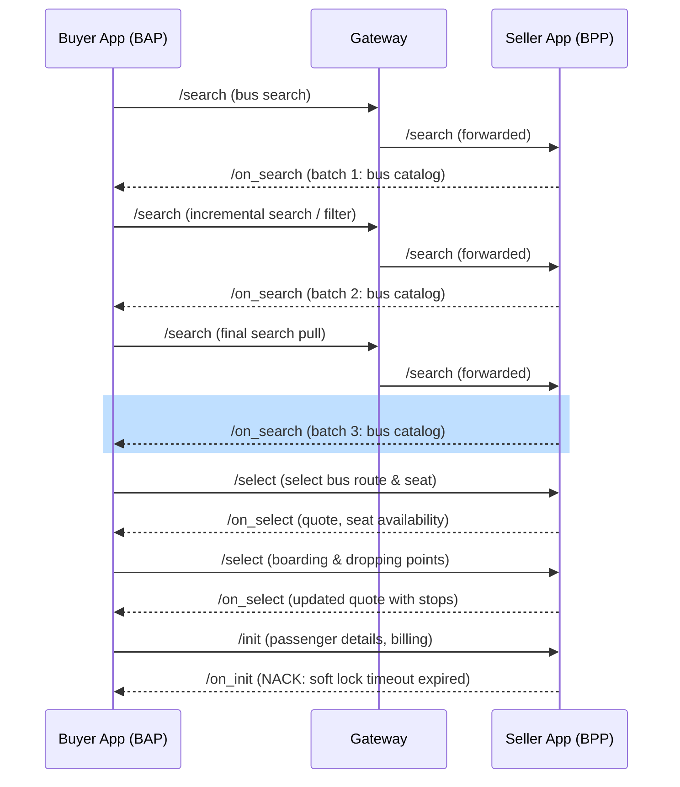

## select_BUS_201

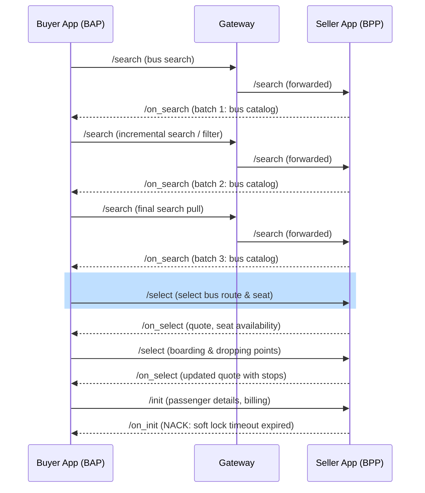

## on_select_BUS_201

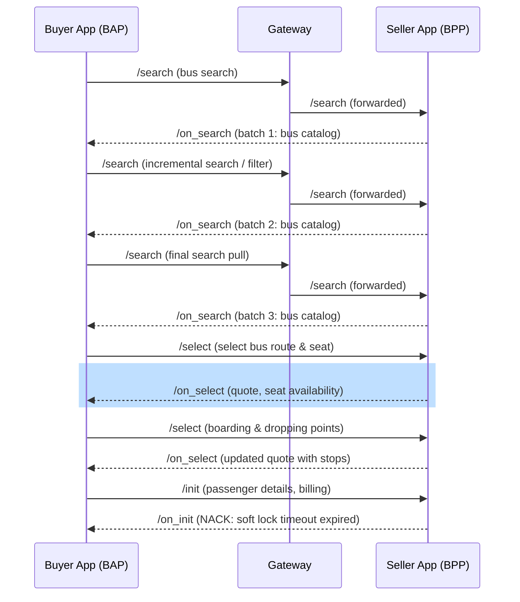

## select_BUS_202

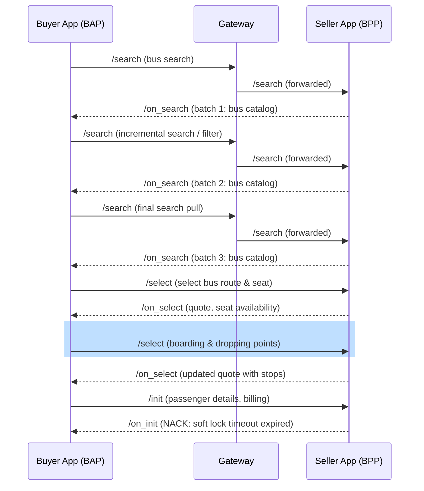

## on_select_BUS_202

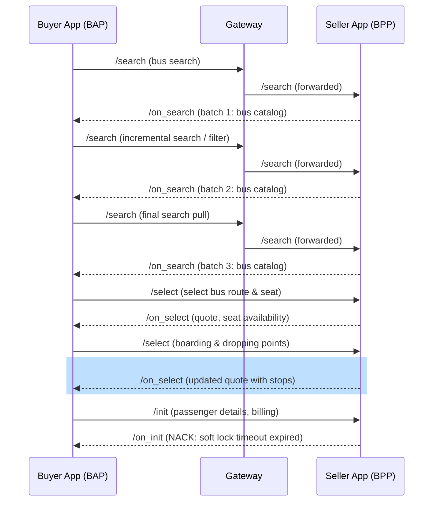

## init_BUS_201

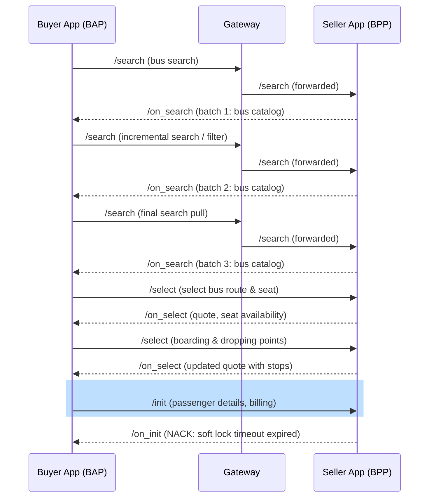

## on_init_BUS_221

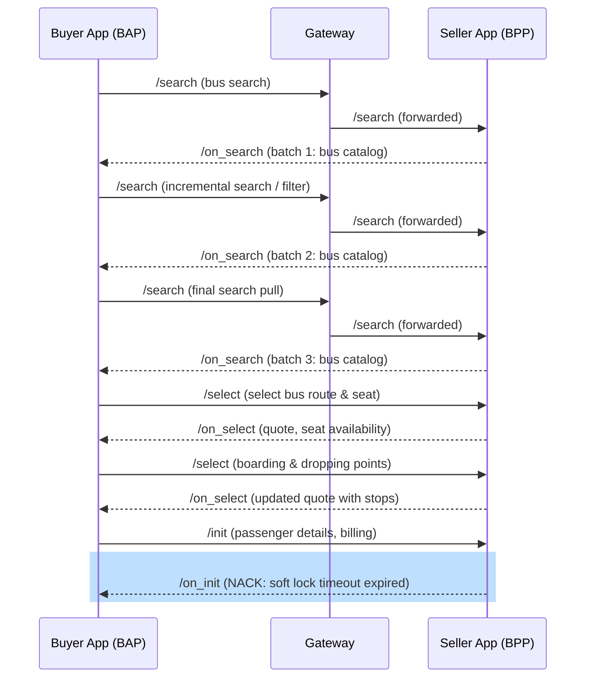
