# Intercity_Bus__Station_Code_Based_Flow_With_IGM_Rejection_v-2.0.0 — Sequence Diagrams

Internal data file consumed by the Developer Guide's "Sequence Diagram" tab (API Walkthrough).
Not meant to be shown as its own docs page — the frontend filters this slug out of the Use Case
Brief / Additional Resources / Changelog tab lists and instead looks up the section matching the
selected API call's `action_id` (the `##` heading below) to render that step's diagram.

One `## <action_id>` heading per step of `Intercity_Bus__Station_Code_Based_Flow_With_IGM_Rejection_v-2.0.0.yaml`, in that flow's own step order, each followed by its Mermaid `sequenceDiagram`: the whole flow, with that call's own message(s) highlighted — same convention as the other domains' per-step sequence-diagram docs.

## search_BUS_201

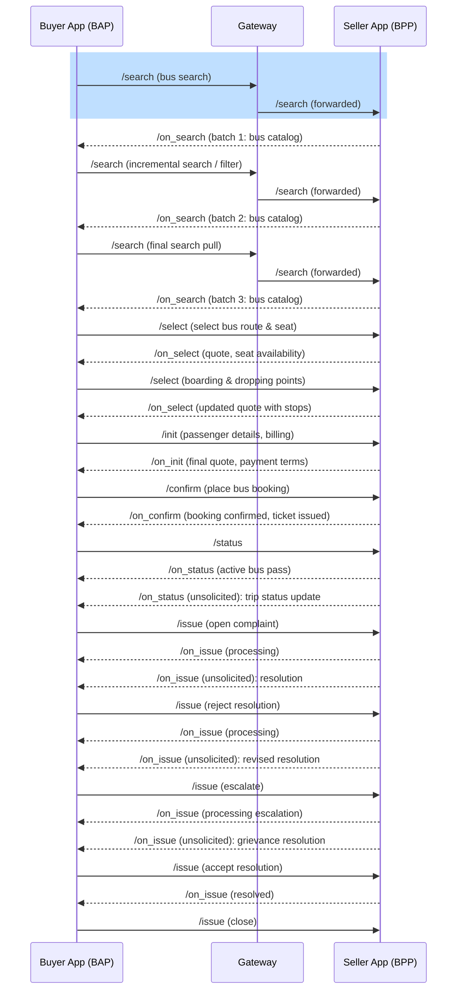

## on_search_BUS_201

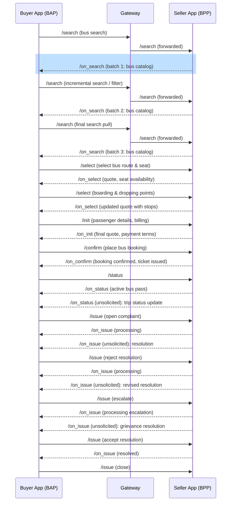

## search_BUS_202

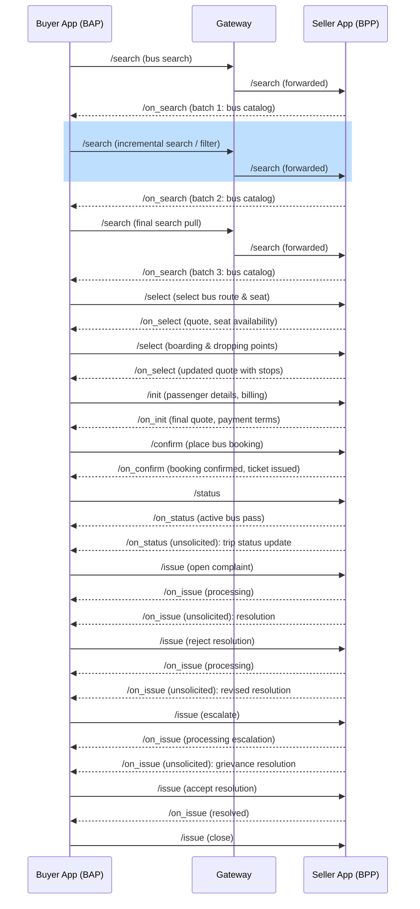

## on_search_BUS_202

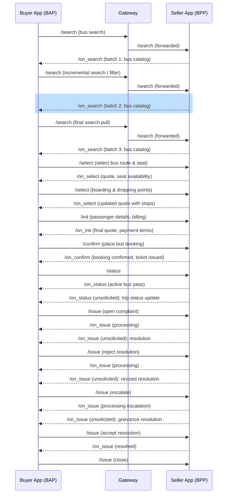

## search_BUS_203

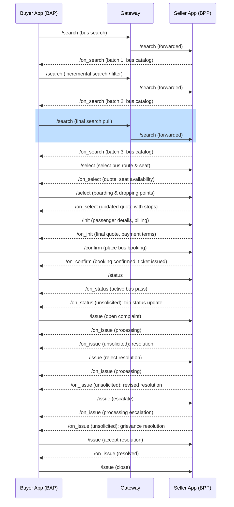

## on_search_BUS_203

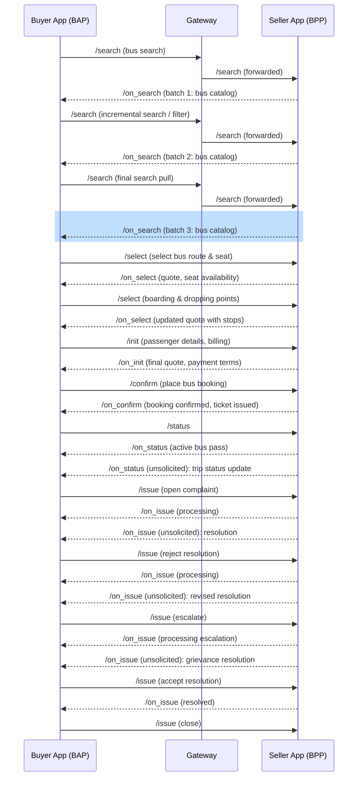

## select_BUS_201

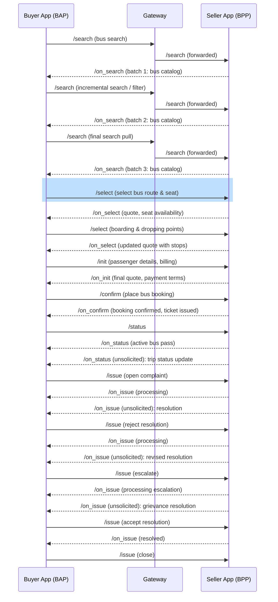

## on_select_BUS_201

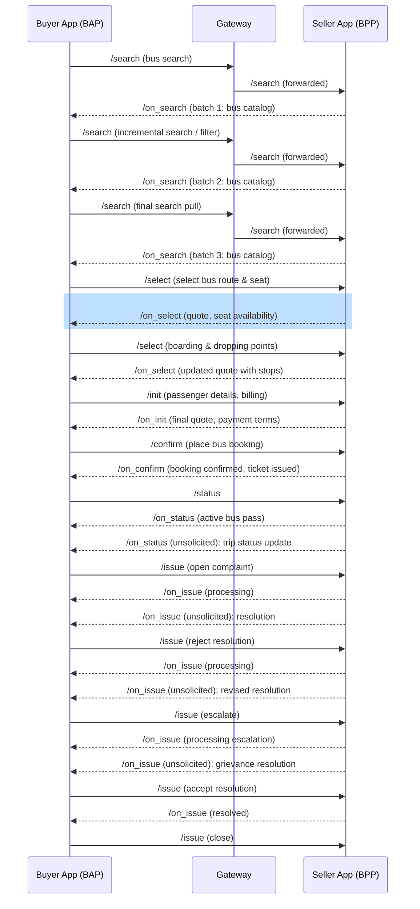

## select_BUS_202

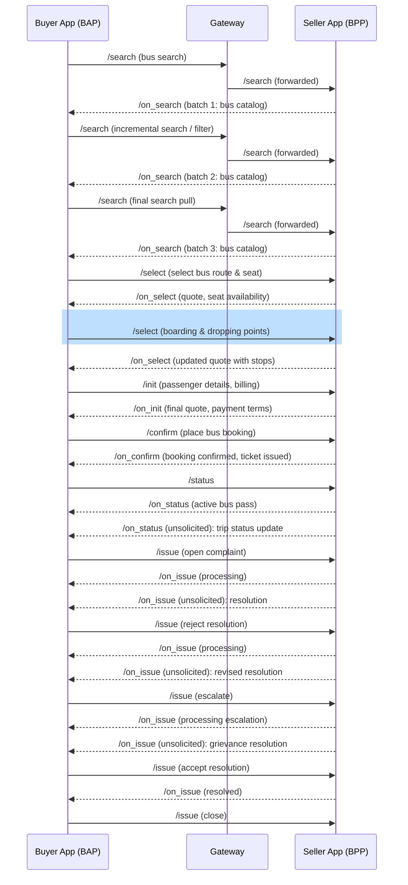

## on_select_BUS_202

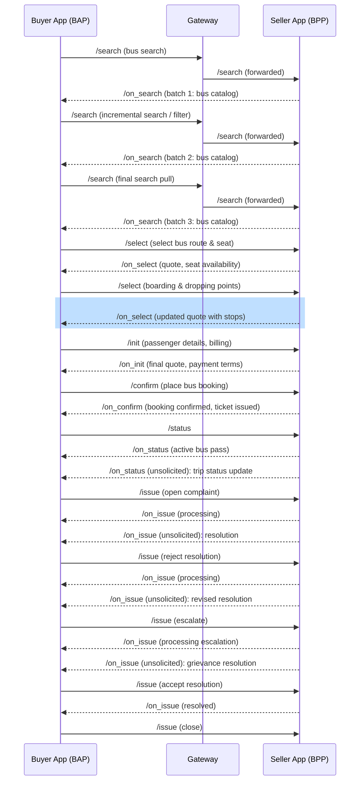

## init_BUS_201

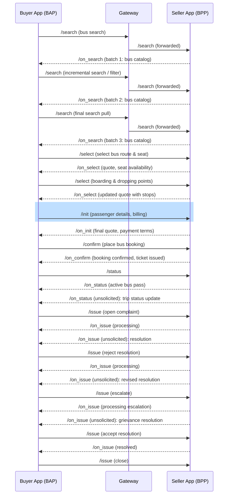

## on_init_BUS_201

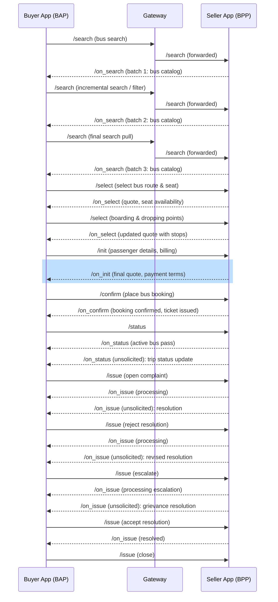

## confirm_BUS_201

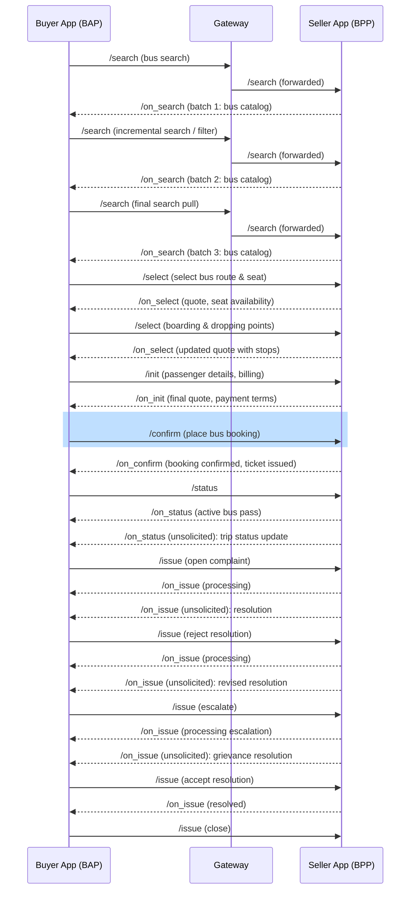

## on_confirm_BUS_201

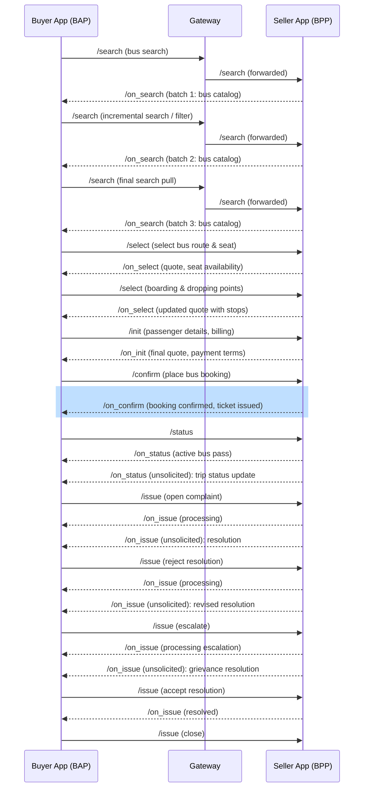

## status_BUS_201

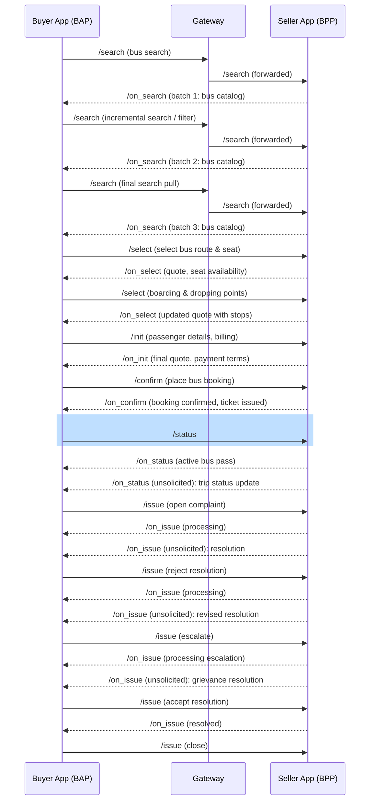

## on_status_BUS_201

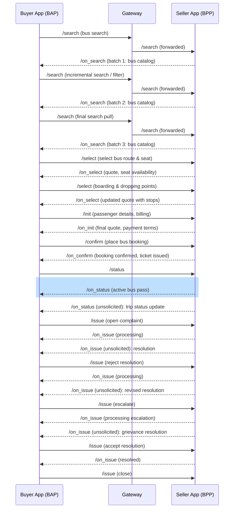

## on_status_unsolicited_201

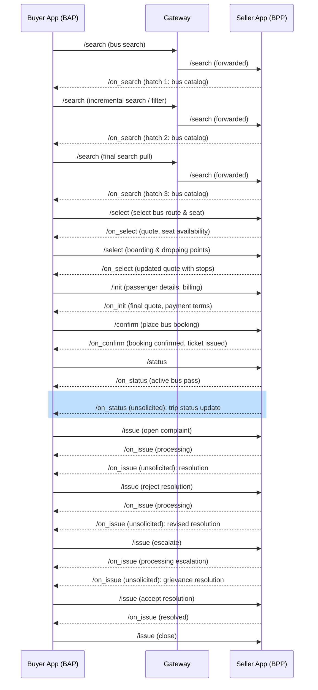

## issue_open

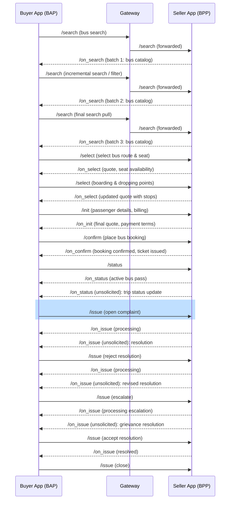

## on_issue_processing

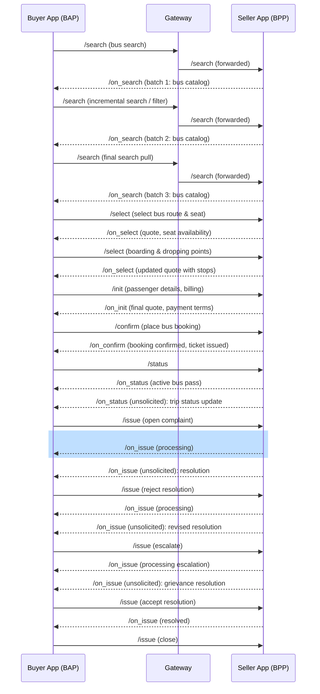

## on_issue_resolution

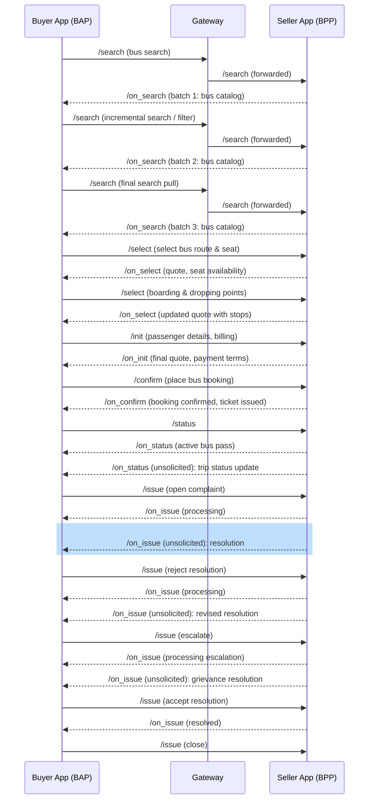

## issue_resolution_reject

```mermaid
sequenceDiagram
  participant Buyer App (BAP)
  participant Gateway
  participant Seller App (BPP)
  Buyer App (BAP)->>Gateway: /search (bus search)
  Gateway->>Seller App (BPP): /search (forwarded)
  Seller App (BPP)-->>Buyer App (BAP): /on_search (batch 1: bus catalog)
  Buyer App (BAP)->>Gateway: /search (incremental search / filter)
  Gateway->>Seller App (BPP): /search (forwarded)
  Seller App (BPP)-->>Buyer App (BAP): /on_search (batch 2: bus catalog)
  Buyer App (BAP)->>Gateway: /search (final search pull)
  Gateway->>Seller App (BPP): /search (forwarded)
  Seller App (BPP)-->>Buyer App (BAP): /on_search (batch 3: bus catalog)
  Buyer App (BAP)->>Seller App (BPP): /select (select bus route & seat)
  Seller App (BPP)-->>Buyer App (BAP): /on_select (quote, seat availability)
  Buyer App (BAP)->>Seller App (BPP): /select (boarding & dropping points)
  Seller App (BPP)-->>Buyer App (BAP): /on_select (updated quote with stops)
  Buyer App (BAP)->>Seller App (BPP): /init (passenger details, billing)
  Seller App (BPP)-->>Buyer App (BAP): /on_init (final quote, payment terms)
  Buyer App (BAP)->>Seller App (BPP): /confirm (place bus booking)
  Seller App (BPP)-->>Buyer App (BAP): /on_confirm (booking confirmed, ticket issued)
  Buyer App (BAP)->>Seller App (BPP): /status
  Seller App (BPP)-->>Buyer App (BAP): /on_status (active bus pass)
  Seller App (BPP)-->>Buyer App (BAP): /on_status (unsolicited): trip status update
  Buyer App (BAP)->>Seller App (BPP): /issue (open complaint)
  Seller App (BPP)-->>Buyer App (BAP): /on_issue (processing)
  Seller App (BPP)-->>Buyer App (BAP): /on_issue (unsolicited): resolution
  rect rgb(191, 223, 255)
  Buyer App (BAP)->>Seller App (BPP): /issue (reject resolution)
  end
  Seller App (BPP)-->>Buyer App (BAP): /on_issue (processing)
  Seller App (BPP)-->>Buyer App (BAP): /on_issue (unsolicited): revised resolution
  Buyer App (BAP)->>Seller App (BPP): /issue (escalate)
  Seller App (BPP)-->>Buyer App (BAP): /on_issue (processing escalation)
  Seller App (BPP)-->>Buyer App (BAP): /on_issue (unsolicited): grievance resolution
  Buyer App (BAP)->>Seller App (BPP): /issue (accept resolution)
  Seller App (BPP)-->>Buyer App (BAP): /on_issue (resolved)
  Buyer App (BAP)->>Seller App (BPP): /issue (close)
```

## on_issue_processing_1

```mermaid
sequenceDiagram
  participant Buyer App (BAP)
  participant Gateway
  participant Seller App (BPP)
  Buyer App (BAP)->>Gateway: /search (bus search)
  Gateway->>Seller App (BPP): /search (forwarded)
  Seller App (BPP)-->>Buyer App (BAP): /on_search (batch 1: bus catalog)
  Buyer App (BAP)->>Gateway: /search (incremental search / filter)
  Gateway->>Seller App (BPP): /search (forwarded)
  Seller App (BPP)-->>Buyer App (BAP): /on_search (batch 2: bus catalog)
  Buyer App (BAP)->>Gateway: /search (final search pull)
  Gateway->>Seller App (BPP): /search (forwarded)
  Seller App (BPP)-->>Buyer App (BAP): /on_search (batch 3: bus catalog)
  Buyer App (BAP)->>Seller App (BPP): /select (select bus route & seat)
  Seller App (BPP)-->>Buyer App (BAP): /on_select (quote, seat availability)
  Buyer App (BAP)->>Seller App (BPP): /select (boarding & dropping points)
  Seller App (BPP)-->>Buyer App (BAP): /on_select (updated quote with stops)
  Buyer App (BAP)->>Seller App (BPP): /init (passenger details, billing)
  Seller App (BPP)-->>Buyer App (BAP): /on_init (final quote, payment terms)
  Buyer App (BAP)->>Seller App (BPP): /confirm (place bus booking)
  Seller App (BPP)-->>Buyer App (BAP): /on_confirm (booking confirmed, ticket issued)
  Buyer App (BAP)->>Seller App (BPP): /status
  Seller App (BPP)-->>Buyer App (BAP): /on_status (active bus pass)
  Seller App (BPP)-->>Buyer App (BAP): /on_status (unsolicited): trip status update
  Buyer App (BAP)->>Seller App (BPP): /issue (open complaint)
  Seller App (BPP)-->>Buyer App (BAP): /on_issue (processing)
  Seller App (BPP)-->>Buyer App (BAP): /on_issue (unsolicited): resolution
  Buyer App (BAP)->>Seller App (BPP): /issue (reject resolution)
  rect rgb(191, 223, 255)
  Seller App (BPP)-->>Buyer App (BAP): /on_issue (processing)
  end
  Seller App (BPP)-->>Buyer App (BAP): /on_issue (unsolicited): revised resolution
  Buyer App (BAP)->>Seller App (BPP): /issue (escalate)
  Seller App (BPP)-->>Buyer App (BAP): /on_issue (processing escalation)
  Seller App (BPP)-->>Buyer App (BAP): /on_issue (unsolicited): grievance resolution
  Buyer App (BAP)->>Seller App (BPP): /issue (accept resolution)
  Seller App (BPP)-->>Buyer App (BAP): /on_issue (resolved)
  Buyer App (BAP)->>Seller App (BPP): /issue (close)
```

## on_issue_resolution_1

```mermaid
sequenceDiagram
  participant Buyer App (BAP)
  participant Gateway
  participant Seller App (BPP)
  Buyer App (BAP)->>Gateway: /search (bus search)
  Gateway->>Seller App (BPP): /search (forwarded)
  Seller App (BPP)-->>Buyer App (BAP): /on_search (batch 1: bus catalog)
  Buyer App (BAP)->>Gateway: /search (incremental search / filter)
  Gateway->>Seller App (BPP): /search (forwarded)
  Seller App (BPP)-->>Buyer App (BAP): /on_search (batch 2: bus catalog)
  Buyer App (BAP)->>Gateway: /search (final search pull)
  Gateway->>Seller App (BPP): /search (forwarded)
  Seller App (BPP)-->>Buyer App (BAP): /on_search (batch 3: bus catalog)
  Buyer App (BAP)->>Seller App (BPP): /select (select bus route & seat)
  Seller App (BPP)-->>Buyer App (BAP): /on_select (quote, seat availability)
  Buyer App (BAP)->>Seller App (BPP): /select (boarding & dropping points)
  Seller App (BPP)-->>Buyer App (BAP): /on_select (updated quote with stops)
  Buyer App (BAP)->>Seller App (BPP): /init (passenger details, billing)
  Seller App (BPP)-->>Buyer App (BAP): /on_init (final quote, payment terms)
  Buyer App (BAP)->>Seller App (BPP): /confirm (place bus booking)
  Seller App (BPP)-->>Buyer App (BAP): /on_confirm (booking confirmed, ticket issued)
  Buyer App (BAP)->>Seller App (BPP): /status
  Seller App (BPP)-->>Buyer App (BAP): /on_status (active bus pass)
  Seller App (BPP)-->>Buyer App (BAP): /on_status (unsolicited): trip status update
  Buyer App (BAP)->>Seller App (BPP): /issue (open complaint)
  Seller App (BPP)-->>Buyer App (BAP): /on_issue (processing)
  Seller App (BPP)-->>Buyer App (BAP): /on_issue (unsolicited): resolution
  Buyer App (BAP)->>Seller App (BPP): /issue (reject resolution)
  Seller App (BPP)-->>Buyer App (BAP): /on_issue (processing)
  rect rgb(191, 223, 255)
  Seller App (BPP)-->>Buyer App (BAP): /on_issue (unsolicited): revised resolution
  end
  Buyer App (BAP)->>Seller App (BPP): /issue (escalate)
  Seller App (BPP)-->>Buyer App (BAP): /on_issue (processing escalation)
  Seller App (BPP)-->>Buyer App (BAP): /on_issue (unsolicited): grievance resolution
  Buyer App (BAP)->>Seller App (BPP): /issue (accept resolution)
  Seller App (BPP)-->>Buyer App (BAP): /on_issue (resolved)
  Buyer App (BAP)->>Seller App (BPP): /issue (close)
```

## issue_escalate

```mermaid
sequenceDiagram
  participant Buyer App (BAP)
  participant Gateway
  participant Seller App (BPP)
  Buyer App (BAP)->>Gateway: /search (bus search)
  Gateway->>Seller App (BPP): /search (forwarded)
  Seller App (BPP)-->>Buyer App (BAP): /on_search (batch 1: bus catalog)
  Buyer App (BAP)->>Gateway: /search (incremental search / filter)
  Gateway->>Seller App (BPP): /search (forwarded)
  Seller App (BPP)-->>Buyer App (BAP): /on_search (batch 2: bus catalog)
  Buyer App (BAP)->>Gateway: /search (final search pull)
  Gateway->>Seller App (BPP): /search (forwarded)
  Seller App (BPP)-->>Buyer App (BAP): /on_search (batch 3: bus catalog)
  Buyer App (BAP)->>Seller App (BPP): /select (select bus route & seat)
  Seller App (BPP)-->>Buyer App (BAP): /on_select (quote, seat availability)
  Buyer App (BAP)->>Seller App (BPP): /select (boarding & dropping points)
  Seller App (BPP)-->>Buyer App (BAP): /on_select (updated quote with stops)
  Buyer App (BAP)->>Seller App (BPP): /init (passenger details, billing)
  Seller App (BPP)-->>Buyer App (BAP): /on_init (final quote, payment terms)
  Buyer App (BAP)->>Seller App (BPP): /confirm (place bus booking)
  Seller App (BPP)-->>Buyer App (BAP): /on_confirm (booking confirmed, ticket issued)
  Buyer App (BAP)->>Seller App (BPP): /status
  Seller App (BPP)-->>Buyer App (BAP): /on_status (active bus pass)
  Seller App (BPP)-->>Buyer App (BAP): /on_status (unsolicited): trip status update
  Buyer App (BAP)->>Seller App (BPP): /issue (open complaint)
  Seller App (BPP)-->>Buyer App (BAP): /on_issue (processing)
  Seller App (BPP)-->>Buyer App (BAP): /on_issue (unsolicited): resolution
  Buyer App (BAP)->>Seller App (BPP): /issue (reject resolution)
  Seller App (BPP)-->>Buyer App (BAP): /on_issue (processing)
  Seller App (BPP)-->>Buyer App (BAP): /on_issue (unsolicited): revised resolution
  rect rgb(191, 223, 255)
  Buyer App (BAP)->>Seller App (BPP): /issue (escalate)
  end
  Seller App (BPP)-->>Buyer App (BAP): /on_issue (processing escalation)
  Seller App (BPP)-->>Buyer App (BAP): /on_issue (unsolicited): grievance resolution
  Buyer App (BAP)->>Seller App (BPP): /issue (accept resolution)
  Seller App (BPP)-->>Buyer App (BAP): /on_issue (resolved)
  Buyer App (BAP)->>Seller App (BPP): /issue (close)
```

## on_issue_processing_2

```mermaid
sequenceDiagram
  participant Buyer App (BAP)
  participant Gateway
  participant Seller App (BPP)
  Buyer App (BAP)->>Gateway: /search (bus search)
  Gateway->>Seller App (BPP): /search (forwarded)
  Seller App (BPP)-->>Buyer App (BAP): /on_search (batch 1: bus catalog)
  Buyer App (BAP)->>Gateway: /search (incremental search / filter)
  Gateway->>Seller App (BPP): /search (forwarded)
  Seller App (BPP)-->>Buyer App (BAP): /on_search (batch 2: bus catalog)
  Buyer App (BAP)->>Gateway: /search (final search pull)
  Gateway->>Seller App (BPP): /search (forwarded)
  Seller App (BPP)-->>Buyer App (BAP): /on_search (batch 3: bus catalog)
  Buyer App (BAP)->>Seller App (BPP): /select (select bus route & seat)
  Seller App (BPP)-->>Buyer App (BAP): /on_select (quote, seat availability)
  Buyer App (BAP)->>Seller App (BPP): /select (boarding & dropping points)
  Seller App (BPP)-->>Buyer App (BAP): /on_select (updated quote with stops)
  Buyer App (BAP)->>Seller App (BPP): /init (passenger details, billing)
  Seller App (BPP)-->>Buyer App (BAP): /on_init (final quote, payment terms)
  Buyer App (BAP)->>Seller App (BPP): /confirm (place bus booking)
  Seller App (BPP)-->>Buyer App (BAP): /on_confirm (booking confirmed, ticket issued)
  Buyer App (BAP)->>Seller App (BPP): /status
  Seller App (BPP)-->>Buyer App (BAP): /on_status (active bus pass)
  Seller App (BPP)-->>Buyer App (BAP): /on_status (unsolicited): trip status update
  Buyer App (BAP)->>Seller App (BPP): /issue (open complaint)
  Seller App (BPP)-->>Buyer App (BAP): /on_issue (processing)
  Seller App (BPP)-->>Buyer App (BAP): /on_issue (unsolicited): resolution
  Buyer App (BAP)->>Seller App (BPP): /issue (reject resolution)
  Seller App (BPP)-->>Buyer App (BAP): /on_issue (processing)
  Seller App (BPP)-->>Buyer App (BAP): /on_issue (unsolicited): revised resolution
  Buyer App (BAP)->>Seller App (BPP): /issue (escalate)
  rect rgb(191, 223, 255)
  Seller App (BPP)-->>Buyer App (BAP): /on_issue (processing escalation)
  end
  Seller App (BPP)-->>Buyer App (BAP): /on_issue (unsolicited): grievance resolution
  Buyer App (BAP)->>Seller App (BPP): /issue (accept resolution)
  Seller App (BPP)-->>Buyer App (BAP): /on_issue (resolved)
  Buyer App (BAP)->>Seller App (BPP): /issue (close)
```

## on_issue_resolution_2

```mermaid
sequenceDiagram
  participant Buyer App (BAP)
  participant Gateway
  participant Seller App (BPP)
  Buyer App (BAP)->>Gateway: /search (bus search)
  Gateway->>Seller App (BPP): /search (forwarded)
  Seller App (BPP)-->>Buyer App (BAP): /on_search (batch 1: bus catalog)
  Buyer App (BAP)->>Gateway: /search (incremental search / filter)
  Gateway->>Seller App (BPP): /search (forwarded)
  Seller App (BPP)-->>Buyer App (BAP): /on_search (batch 2: bus catalog)
  Buyer App (BAP)->>Gateway: /search (final search pull)
  Gateway->>Seller App (BPP): /search (forwarded)
  Seller App (BPP)-->>Buyer App (BAP): /on_search (batch 3: bus catalog)
  Buyer App (BAP)->>Seller App (BPP): /select (select bus route & seat)
  Seller App (BPP)-->>Buyer App (BAP): /on_select (quote, seat availability)
  Buyer App (BAP)->>Seller App (BPP): /select (boarding & dropping points)
  Seller App (BPP)-->>Buyer App (BAP): /on_select (updated quote with stops)
  Buyer App (BAP)->>Seller App (BPP): /init (passenger details, billing)
  Seller App (BPP)-->>Buyer App (BAP): /on_init (final quote, payment terms)
  Buyer App (BAP)->>Seller App (BPP): /confirm (place bus booking)
  Seller App (BPP)-->>Buyer App (BAP): /on_confirm (booking confirmed, ticket issued)
  Buyer App (BAP)->>Seller App (BPP): /status
  Seller App (BPP)-->>Buyer App (BAP): /on_status (active bus pass)
  Seller App (BPP)-->>Buyer App (BAP): /on_status (unsolicited): trip status update
  Buyer App (BAP)->>Seller App (BPP): /issue (open complaint)
  Seller App (BPP)-->>Buyer App (BAP): /on_issue (processing)
  Seller App (BPP)-->>Buyer App (BAP): /on_issue (unsolicited): resolution
  Buyer App (BAP)->>Seller App (BPP): /issue (reject resolution)
  Seller App (BPP)-->>Buyer App (BAP): /on_issue (processing)
  Seller App (BPP)-->>Buyer App (BAP): /on_issue (unsolicited): revised resolution
  Buyer App (BAP)->>Seller App (BPP): /issue (escalate)
  Seller App (BPP)-->>Buyer App (BAP): /on_issue (processing escalation)
  rect rgb(191, 223, 255)
  Seller App (BPP)-->>Buyer App (BAP): /on_issue (unsolicited): grievance resolution
  end
  Buyer App (BAP)->>Seller App (BPP): /issue (accept resolution)
  Seller App (BPP)-->>Buyer App (BAP): /on_issue (resolved)
  Buyer App (BAP)->>Seller App (BPP): /issue (close)
```

## issue_resolution_accept

```mermaid
sequenceDiagram
  participant Buyer App (BAP)
  participant Gateway
  participant Seller App (BPP)
  Buyer App (BAP)->>Gateway: /search (bus search)
  Gateway->>Seller App (BPP): /search (forwarded)
  Seller App (BPP)-->>Buyer App (BAP): /on_search (batch 1: bus catalog)
  Buyer App (BAP)->>Gateway: /search (incremental search / filter)
  Gateway->>Seller App (BPP): /search (forwarded)
  Seller App (BPP)-->>Buyer App (BAP): /on_search (batch 2: bus catalog)
  Buyer App (BAP)->>Gateway: /search (final search pull)
  Gateway->>Seller App (BPP): /search (forwarded)
  Seller App (BPP)-->>Buyer App (BAP): /on_search (batch 3: bus catalog)
  Buyer App (BAP)->>Seller App (BPP): /select (select bus route & seat)
  Seller App (BPP)-->>Buyer App (BAP): /on_select (quote, seat availability)
  Buyer App (BAP)->>Seller App (BPP): /select (boarding & dropping points)
  Seller App (BPP)-->>Buyer App (BAP): /on_select (updated quote with stops)
  Buyer App (BAP)->>Seller App (BPP): /init (passenger details, billing)
  Seller App (BPP)-->>Buyer App (BAP): /on_init (final quote, payment terms)
  Buyer App (BAP)->>Seller App (BPP): /confirm (place bus booking)
  Seller App (BPP)-->>Buyer App (BAP): /on_confirm (booking confirmed, ticket issued)
  Buyer App (BAP)->>Seller App (BPP): /status
  Seller App (BPP)-->>Buyer App (BAP): /on_status (active bus pass)
  Seller App (BPP)-->>Buyer App (BAP): /on_status (unsolicited): trip status update
  Buyer App (BAP)->>Seller App (BPP): /issue (open complaint)
  Seller App (BPP)-->>Buyer App (BAP): /on_issue (processing)
  Seller App (BPP)-->>Buyer App (BAP): /on_issue (unsolicited): resolution
  Buyer App (BAP)->>Seller App (BPP): /issue (reject resolution)
  Seller App (BPP)-->>Buyer App (BAP): /on_issue (processing)
  Seller App (BPP)-->>Buyer App (BAP): /on_issue (unsolicited): revised resolution
  Buyer App (BAP)->>Seller App (BPP): /issue (escalate)
  Seller App (BPP)-->>Buyer App (BAP): /on_issue (processing escalation)
  Seller App (BPP)-->>Buyer App (BAP): /on_issue (unsolicited): grievance resolution
  rect rgb(191, 223, 255)
  Buyer App (BAP)->>Seller App (BPP): /issue (accept resolution)
  end
  Seller App (BPP)-->>Buyer App (BAP): /on_issue (resolved)
  Buyer App (BAP)->>Seller App (BPP): /issue (close)
```

## on_issue_resolved

```mermaid
sequenceDiagram
  participant Buyer App (BAP)
  participant Gateway
  participant Seller App (BPP)
  Buyer App (BAP)->>Gateway: /search (bus search)
  Gateway->>Seller App (BPP): /search (forwarded)
  Seller App (BPP)-->>Buyer App (BAP): /on_search (batch 1: bus catalog)
  Buyer App (BAP)->>Gateway: /search (incremental search / filter)
  Gateway->>Seller App (BPP): /search (forwarded)
  Seller App (BPP)-->>Buyer App (BAP): /on_search (batch 2: bus catalog)
  Buyer App (BAP)->>Gateway: /search (final search pull)
  Gateway->>Seller App (BPP): /search (forwarded)
  Seller App (BPP)-->>Buyer App (BAP): /on_search (batch 3: bus catalog)
  Buyer App (BAP)->>Seller App (BPP): /select (select bus route & seat)
  Seller App (BPP)-->>Buyer App (BAP): /on_select (quote, seat availability)
  Buyer App (BAP)->>Seller App (BPP): /select (boarding & dropping points)
  Seller App (BPP)-->>Buyer App (BAP): /on_select (updated quote with stops)
  Buyer App (BAP)->>Seller App (BPP): /init (passenger details, billing)
  Seller App (BPP)-->>Buyer App (BAP): /on_init (final quote, payment terms)
  Buyer App (BAP)->>Seller App (BPP): /confirm (place bus booking)
  Seller App (BPP)-->>Buyer App (BAP): /on_confirm (booking confirmed, ticket issued)
  Buyer App (BAP)->>Seller App (BPP): /status
  Seller App (BPP)-->>Buyer App (BAP): /on_status (active bus pass)
  Seller App (BPP)-->>Buyer App (BAP): /on_status (unsolicited): trip status update
  Buyer App (BAP)->>Seller App (BPP): /issue (open complaint)
  Seller App (BPP)-->>Buyer App (BAP): /on_issue (processing)
  Seller App (BPP)-->>Buyer App (BAP): /on_issue (unsolicited): resolution
  Buyer App (BAP)->>Seller App (BPP): /issue (reject resolution)
  Seller App (BPP)-->>Buyer App (BAP): /on_issue (processing)
  Seller App (BPP)-->>Buyer App (BAP): /on_issue (unsolicited): revised resolution
  Buyer App (BAP)->>Seller App (BPP): /issue (escalate)
  Seller App (BPP)-->>Buyer App (BAP): /on_issue (processing escalation)
  Seller App (BPP)-->>Buyer App (BAP): /on_issue (unsolicited): grievance resolution
  Buyer App (BAP)->>Seller App (BPP): /issue (accept resolution)
  rect rgb(191, 223, 255)
  Seller App (BPP)-->>Buyer App (BAP): /on_issue (resolved)
  end
  Buyer App (BAP)->>Seller App (BPP): /issue (close)
```

## issue_close

```mermaid
sequenceDiagram
  participant Buyer App (BAP)
  participant Gateway
  participant Seller App (BPP)
  Buyer App (BAP)->>Gateway: /search (bus search)
  Gateway->>Seller App (BPP): /search (forwarded)
  Seller App (BPP)-->>Buyer App (BAP): /on_search (batch 1: bus catalog)
  Buyer App (BAP)->>Gateway: /search (incremental search / filter)
  Gateway->>Seller App (BPP): /search (forwarded)
  Seller App (BPP)-->>Buyer App (BAP): /on_search (batch 2: bus catalog)
  Buyer App (BAP)->>Gateway: /search (final search pull)
  Gateway->>Seller App (BPP): /search (forwarded)
  Seller App (BPP)-->>Buyer App (BAP): /on_search (batch 3: bus catalog)
  Buyer App (BAP)->>Seller App (BPP): /select (select bus route & seat)
  Seller App (BPP)-->>Buyer App (BAP): /on_select (quote, seat availability)
  Buyer App (BAP)->>Seller App (BPP): /select (boarding & dropping points)
  Seller App (BPP)-->>Buyer App (BAP): /on_select (updated quote with stops)
  Buyer App (BAP)->>Seller App (BPP): /init (passenger details, billing)
  Seller App (BPP)-->>Buyer App (BAP): /on_init (final quote, payment terms)
  Buyer App (BAP)->>Seller App (BPP): /confirm (place bus booking)
  Seller App (BPP)-->>Buyer App (BAP): /on_confirm (booking confirmed, ticket issued)
  Buyer App (BAP)->>Seller App (BPP): /status
  Seller App (BPP)-->>Buyer App (BAP): /on_status (active bus pass)
  Seller App (BPP)-->>Buyer App (BAP): /on_status (unsolicited): trip status update
  Buyer App (BAP)->>Seller App (BPP): /issue (open complaint)
  Seller App (BPP)-->>Buyer App (BAP): /on_issue (processing)
  Seller App (BPP)-->>Buyer App (BAP): /on_issue (unsolicited): resolution
  Buyer App (BAP)->>Seller App (BPP): /issue (reject resolution)
  Seller App (BPP)-->>Buyer App (BAP): /on_issue (processing)
  Seller App (BPP)-->>Buyer App (BAP): /on_issue (unsolicited): revised resolution
  Buyer App (BAP)->>Seller App (BPP): /issue (escalate)
  Seller App (BPP)-->>Buyer App (BAP): /on_issue (processing escalation)
  Seller App (BPP)-->>Buyer App (BAP): /on_issue (unsolicited): grievance resolution
  Buyer App (BAP)->>Seller App (BPP): /issue (accept resolution)
  Seller App (BPP)-->>Buyer App (BAP): /on_issue (resolved)
  rect rgb(191, 223, 255)
  Buyer App (BAP)->>Seller App (BPP): /issue (close)
  end
```
