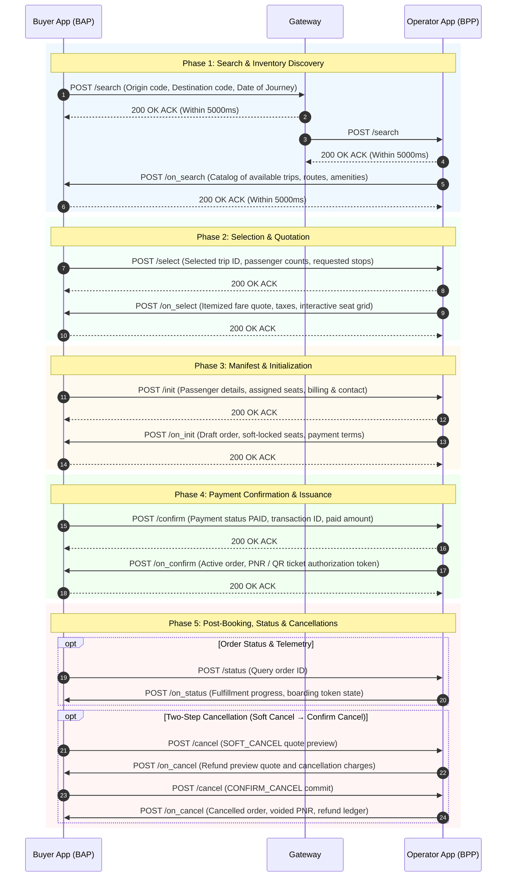
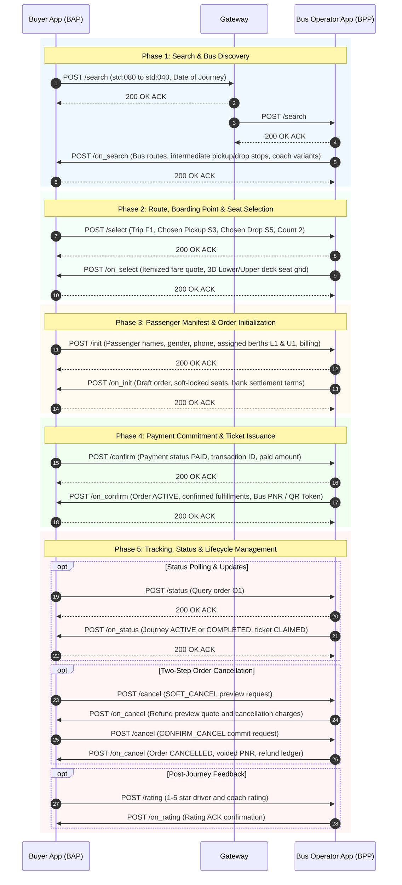
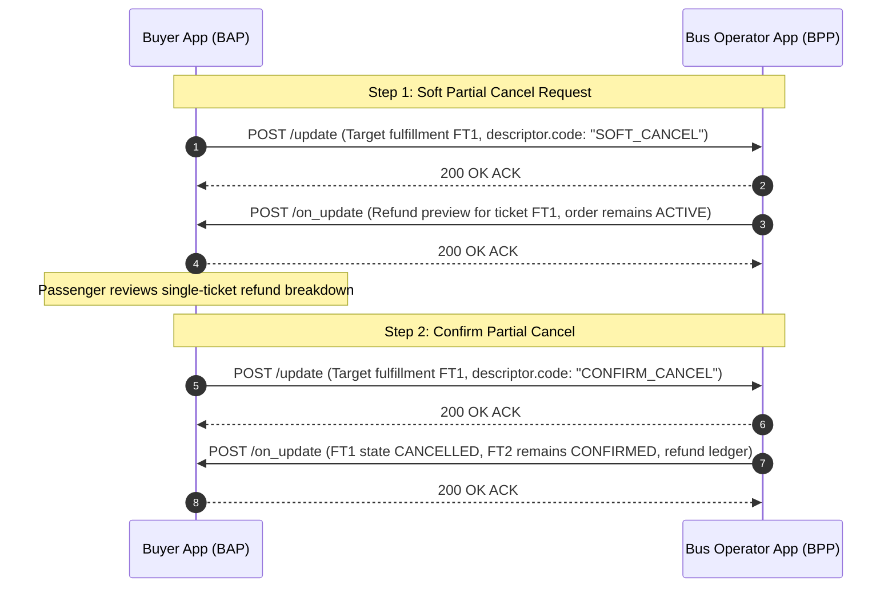
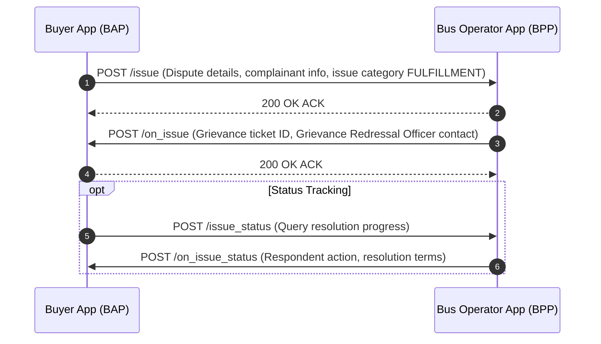

# Intercity (Bus)

## Overview

`ONDC:TRV12` is the open standard protocol for intercity passenger transit across the Open Network for Digital Commerce (ONDC). This specification provides the complete technical, operational, and architectural blueprint for the **Intercity Bus** domain, focusing on the **Station Code Based Flow**. 

It enables consumers to discover intercity bus services across private fleet operators and State Road Transport Corporations (SRTCs), browse multi-deck sleeper and seater coaches, choose specific intermediate boarding and dropping station points within metropolitan regions, reserve seats with strict gender allocation rules, and manage tickets, live tracking, and cancellations through any participating Buyer Application (BAP).

---

## Sector & Purpose

This domain serves the **intercity bus transportation sector**, covering scheduled long-distance bus services, interstate routes, luxury sleeper coaches, and intercity express shuttles. 

Today, intercity bus ticketing in India is heavily fragmented across hundreds of private fleet operators and dozens of state-owned transport corporations. Consumers must navigate disjointed platforms and aggregators, while operators face steep distribution fees and limited reach. 

`ONDC:TRV12` unifies this entire ecosystem under a single, open, standardized network:
- Any consumer platform (travel app, fintech wallet, e-commerce marketplace) can offer real-time bus booking without negotiating individual commercial or technical integrations with each bus company.
- Private bus fleet operators and State Road Transport Corporations (e.g., KSRTC, MSRTC, UPSRTC) gain ubiquitous distribution channels across all buyer apps on the network while retaining direct control over their schedules, seat allocations, dynamic pricing, and passenger policies.

---

## Real-World Actors

- **Consumers**: Travelers booking intercity bus trips between cities and suburban hubs. They seek transparent fares, flexible boarding/dropping points close to their locations, reliable coach amenity details, seat selection with gender safety, and real-time journey tracking.
- **Bus Operators (BPP)**: Private fleet owners (e.g., SRS, VRL, Orange) and State Road Transport Corporations that publish schedules, manage multi-deck coach inventory, execute seat reservations, issue boarding passes, and operate transit routes.
- **Buyer Platforms (BAP)**: Consumer-facing applications (OTAs, banking apps, mobility aggregators) that provide search interfaces, visual seat layout maps, payment processing, ticket delivery, and post-trip support.
- **The Gateway**: The network broadcast router that disseminates search intents to all eligible bus operators and aggregators servicing the route.
- **ONDC Registry**: The central network registry containing authenticated subscriber IDs, role certificates, encryption keys, and network routing metadata.

---

## Real-World Use Cases

- **Station-Code Based Discovery**: Searching for intercity buses by standard city STD codes (`std:080` for Bangalore to `std:040` for Hyderabad) and specific station/depot codes (`std:080-pincode:560103` for Bellandur).
- **Multi-Stop Boarding & Deboarding Selection**: Choosing specific intermediate suburban pickup points (e.g. Madiwala, Bellandur, Electronic City) and dropoff points (e.g. Gachibowli, Ameerpet, Lakdikapul) along a single bus trip.
- **Interactive 3D Multi-Deck Seat Selection**: Browsing lower and upper decks (`Z: 0` vs `Z: 1`), reserving horizontal sleeper berths or pushback seats, and viewing live seat pricing differentials.
- **Gender-Restricted Berth Reservation**: Booking berths designated exclusively for female passengers (`RESTRICTED_GENDER: FEMALE`), with automated network validation preventing conflicting adjoining seat bookings.
- **Single & Multi-Ticket Booking**: Reserving tickets for solo travelers, families, or groups under a single transaction.
- **Two-Step Full Order Cancellation**: Requesting a soft-cancellation quote preview (`SOFT_CANCEL`) to view exact refund and penalty deductions before committing to cancellation (`CONFIRM_CANCEL`).
- **Granular Partial Ticket Cancellation**: Cancelling an individual passenger seat within a multi-seat order via `POST /update` while preserving the remaining passengers' confirmed seats.
- **Operational Disruption Management**: Unsolicited seller-side cancellations for mechanical breakdowns, bus rescheduling, or weather delays with automatic 100% full refunds.
- **Live Order Status & Telemetry**: Polling trip progress, receiving real-time delay notifications, viewing driver telephone contacts, and recording ticket redemption at boarding.
- **Post-Journey Service Rating**: Submitting 1 to 5 star ratings and reviews for driver punctuality, vehicle cleanliness, and overall journey quality.
- **Dispute Redressal (IGM 2.0.0)**: Raising and resolving consumer grievances regarding boarding denials, luggage loss, or refund disputes.

---

## Key Concepts

- **Unified Mobility Protocol (`ONDC:TRV12 2.0.0`)**: Both Airlines and Intercity Buses share the exact same `ONDC:TRV12` domain code and Beckn protocol specification version `2.0.0`. Their foundational messaging architecture, security headers, context envelopes, and lifecycle phases are identical, while transport-specific semantics (airport IATA codes vs. bus station codes, flight cabins vs. bus sleeper decks) are declared cleanly via standardized tags and attributes.
- **Code-Based Station Discovery**: Standardized city STD codes (e.g. `std:080`) and depot postal codes represent physical bus stations, enabling precise route discovery without GPS ambiguity.
- **Timed Inventory Soft-Locking**: To avoid double-booking while passengers enter traveler details, operators hold selected seats temporarily with a declared soft-lock duration (`quote.ttl`). If passenger entry exceeds this window, the hold lapses and triggers error `90203`.
- **Multi-Stop Route Fulfillment**: A single bus trip fulfills passenger travel across dozens of intermediate boarding and dropping permutations, with distinct departure and arrival timestamps for every physical stop.
- **Dual-Level Fulfillment Hierarchy**: The booking structure decouples the vehicular journey (`type: TRIP`) from individual passenger tickets (`type: TICKET`), enabling modular ticketing, individual seat assignment, and partial ticket cancellation.

---

## Example Scenario

**An overnight intercity bus booking from Bangalore to Hyderabad on the ONDC network:**

1. **Discovery**: A traveler opens their Buyer App in Bangalore and searches for buses traveling to Hyderabad on Friday evening. The Buyer App sends a `POST /search` to the Gateway specifying `std:080` (Bangalore) to `std:040` (Hyderabad) for vehicle category `BUS`.
2. **Catalog Exploration**: Multiple bus operators return catalogs via `POST /on_search`. The traveler selects an AC Multi-Axle Sleeper coach operated by SRS Travels departing at 21:30. The catalog displays multiple pickup stops across Bangalore (Agara, Bellandur, Electronic City) and multiple drop points across Hyderabad (Gachibowli, Ameerpet, Central Bus Station).
3. **Stop & Seat Selection**: In `POST /select`, the traveler specifies boarding at **Bellandur (Stop S3)** and deboarding at **Gachibowli (Stop S5)** for 2 passengers. In `POST /on_select`, the operator returns an itemized price quote along with the coach's interactive 3D seat grid. The traveler picks a lower-deck single berth (`L1`, reserved for female passengers) for their sister and an upper-deck berth (`U1`) for themselves. The operator places a 10-minute soft-lock on both berths.
4. **Manifest & Payment**: In `POST /init`, the traveler enters passenger names, age, gender, and phone numbers, and verifies the billing address. In `POST /on_init`, the operator confirms valid gender matching, locks the seats, and provides payment terms. The traveler pays via UPI, and the Buyer App sends `POST /confirm` with payment authorization details.
5. **Ticket Issuance**: The operator returns `POST /on_confirm` with order status `ACTIVE` and issues a confirmed **Bus PNR & Boarding QR Code Token (`RB3F9K7H`)** for entry at Bellandur.
6. **Journey & Tracking**: On Friday evening, the traveler checks bus status via `POST /status`, receiving live driver contact details and real-time pickup updates. At boarding, the bus conductor scans the QR code, updating authorization status to `CLAIMED`.
7. **Post-Trip Feedback**: After arriving safely at Gachibowli, the trip transitions to `COMPLETED`, and the traveler submits a 5-star rating via `POST /rating` praising the cleanliness of the sleeper berths and on-time arrival.

---

## 1. Common Foundations: Shared Across Airline & Intercity (`ONDC:TRV12 2.0.0`)

Both Airlines and Intercity Buses operate under the unified domain code **`ONDC:TRV12`** and protocol version **`2.0.0`**. They share a common architectural core built upon the Beckn protocol. Any Network Participant (NP) building for one can leverage the exact same transport layer, cryptographic verification, and state machine for the other.



### 1.1 Asynchronous Request-Callback Architecture

Every transaction across the network is strictly **decoupled and asynchronous**:
1. **Outbound POST Action**: The requester (e.g. BAP) dispatches an HTTP `POST` request to the receiver's endpoint.
2. **Synchronous Acknowledgment (`ACK` / `NACK`)**: The receiver validates HTTP headers, schema structure, and cryptographic signatures, returning an immediate HTTP 200 `ACK` (or `NACK`) within **5000 milliseconds**.
3. **Asynchronous Business Processing**: The receiver processes the request asynchronously (e.g., querying central reservation engines, calculating taxes, or placing seat holds).
4. **Inbound Callback (`POST /on_<action>`)**: The receiver sends the business result via an asynchronous HTTP `POST` callback to the requester's webhook URL (`bap_uri`).
5. **Callback Acknowledgment**: The requester acknowledges the callback with a synchronous HTTP 200 `ACK` within 5000ms.

### 1.2 Synchronous Response Contract (`ACK` vs `NACK`)

Every network endpoint must reply synchronously with an `ACK` or `NACK`:

#### Successful Acknowledgment (`ACK`):
```json
{
  "message": {
    "ack": {
      "status": "ACK"
    }
  }
}
```

#### Synchronous Rejection (`NACK`):
Returned when schema validation, digital signature verification, or context integrity checks fail:
```json
{
  "message": {
    "ack": {
      "status": "NACK"
    }
  },
  "error": {
    "type": "GATEWAY",
    "code": "30000",
    "message": "Invalid Signature / Context Validation Failed"
  }
}
```

### 1.3 Role of the Gateway and Direct Routing

- **The Gateway**: Facilitates network discovery. During `POST /search`, the Buyer App sends its query to the Gateway. The Gateway consults the central ONDC Registry to look up active, subscribed Seller Apps (BPPs) servicing the requested domain and origin city, broadcasts the search request to all eligible BPPs, and aggregates acknowledgments.
- **Direct Point-to-Point Messaging**: Once a consumer selects a specific operator and trip from the catalog, all subsequent lifecycle requests (`/select`, `/init`, `/confirm`, `/status`, `/cancel`, `/update`) are sent **directly point-to-point** from the BAP to the chosen BPP using the `bpp_uri` discovered during search. The Gateway is bypassed entirely after the discovery phase, minimizing latency and maximizing network throughput.

### 1.4 Cryptographic Security & Header Signatures

All payloads exchanged between BAPs, Gateways, and BPPs must be digitally signed:
- **Hashing**: BLAKE-512 cryptographic digest computed over the raw HTTP request body.
- **Signing Algorithm**: `Ed25519` asymmetric private key.
- **HTTP Authorization Header**:
  ```http
  Authorization: Signature keyId="subscriber_id|unique_key_id|ed25519",algorithm="ed25519",created="1700000000",expires="1700000030",headers="(created) (expires) digest",signature="base64_encoded_signature..."
  ```
- **Verification**: Receivers look up the sender's public key from the ONDC Registry to verify request authenticity and payload integrity before generating an `ACK`.

### 1.5 Common Context Object

Every request and callback envelope includes a mandatory `context` object providing routing, tracing, and auditing metadata:

```yaml
context:
  domain: "ONDC:TRV12"                              # Travel domain code (Identical for Flights and Buses)
  version: "2.0.0"                                  # Protocol version
  action: "search"                                  # Current protocol method
  location:
    country:
      code: "IND"                                   # ISO 3166-1 alpha-3 country code
    city:
      code: "std:080"                               # Origin city STD code (e.g., std:080 for Bangalore)
  bap_id: "travel-bap.example.com"                  # Subscriber ID of the Buyer App
  bap_uri: "https://travel-bap.example.com/beckn"   # Webhook callback URL of the Buyer App
  bpp_id: "intercity-bus.operator.com"              # Subscriber ID of the Seller App (null in broadcast search)
  bpp_uri: "https://intercity-bus.operator.com/api" # Direct API URL of the Seller App
  transaction_id: "6743e9e2-4fb5-487c-92b7-13ba8018f176"  # Persists across all calls in a transaction
  message_id: "1ba2dca2-144d-41a2-add5-2cc65014fa23"      # Unique UUID generated for each request-callback pair
  timestamp: "2026-11-20T08:00:00.000Z"             # RFC3339 / ISO 8601 UTC timestamp
  ttl: "PT30S"                                      # Message validity window (ISO 8601 duration)
```

### 1.6 Complete Transaction Lifecycle Matrix

Both Airline and Intercity Bus domains implement the exact same 12 Beckn protocol actions:

| Phase | Action API | Sender → Receiver | Callback API | Callback Sender → Receiver | Primary Business Purpose |
| :--- | :--- | :--- | :--- | :--- | :--- |
| **Discovery** | `POST /search` | BAP → Gateway / BPP | `POST /on_search` | BPP → BAP | Broadcast or direct search by origin/destination codes, dates, and traveler counts. |
| **Selection** | `POST /select` | BAP → BPP | `POST /on_select` | BPP → BAP | Select vehicle trip, specific stops, passenger counts, and request interactive seat grid. |
| **Initialization** | `POST /init` | BAP → BPP | `POST /on_init` | BPP → BAP | Submit passenger manifests, assigned seat numbers, contact info, and billing address. |
| **Confirmation** | `POST /confirm` | BAP → BPP | `POST /on_confirm` | BPP → BAP | Authorize booking with payment confirmation; receives issued PNR and ticket token. |
| **Status** | `POST /status` | BAP → BPP | `POST /on_status` | BPP → BAP | Poll order lifecycle state (`ACTIVE`, `COMPLETED`), departure delay updates, or driver info. |
| **Order Update** | `POST /update` | BAP → BPP | `POST /on_update` | BPP → BAP | Modify booking, update passenger details, or perform partial ticket cancellations. |
| **Cancellation** | `POST /cancel` | BAP → BPP | `POST /on_cancel` | BPP → BAP | Two-step full cancellation flow (`SOFT_CANCEL` quote preview followed by `CONFIRM_CANCEL`). |
| **Seller Cancellation** | *Unsolicited* | — | `POST /on_cancel` | BPP → BAP | Operator-initiated service cancellation (mechanical fault/weather) with 100% full refund. |
| **Tracking** | `POST /track` | BAP → BPP | `POST /on_track` | BPP → BAP | Live vehicular telemetry, GPS coordinates, and real-time transit radar links. |
| **Feedback** | `POST /rating` | BAP → BPP | `POST /on_rating` | BPP → BAP | Submit passenger feedback ratings (1–5 stars) on vehicle cleanliness and driver service. |
| **Support** | `POST /support` | BAP → BPP | `POST /on_support` | BPP → BAP | Retrieve customer service telephone, email, and live support channels. |
| **Grievance (IGM)** | `POST /issue` | BAP → BPP | `POST /on_issue` | BPP → BAP | Raise passenger grievance ticket (IGM 2.0.0) with grievance officer details. |
| **IGM Status** | `POST /issue_status` | BAP → BPP | `POST /on_issue_status`| BPP → BAP | Track dispute resolution progress, refund escalation, and respondent actions. |

### 1.7 Shared Passenger Name Formatting Standard

In both Airline and Intercity Bus domains, passenger names in `fulfillments.customer.person.name` must strictly follow a pipe-delimited format:
- **Format**: `<Title> | <First Name> | <Middle Name> | <Last Name>`
- **Examples**:
  - `Mr. | Rajesh | Kumar | Sharma`
  - `Ms. | Sunita | | Patel` *(middle name omitted)*
  - `Dr. | Sarah | Jane | Connor`

### 1.8 Shared Dual-Level Fulfillment Model

Both domains structure fulfillments into two complementary layers:
1. **Journey Fulfillment (`type: TRIP`)**: Represents the physical vehicular journey schedule (vehicle code/registration, departure/arrival station codes, operator branding, scheduled timestamps).
2. **Ticket Fulfillment (`type: TICKET`)**: Represents individual passenger ticket instances (`FT1`, `FT2`) containing traveler demographic data, assigned seat/berth numbers, and issued ticket authorization tokens.

---

## 2. Differences Between Intercity Bus & Airline in ONDC:TRV12

While the protocol envelope and message flows are identical, the real-world operational models, physical vehicle geometry, station layouts, and ticketing dynamics differ significantly.

### 2.1 Architectural Comparison Matrix

| Dimension | Airline Domain (`AIRLINE`) | Intercity Bus Domain (`BUS`) |
| :--- | :--- | :--- |
| **Location Discovery** | Fixed 3-letter IATA Airport Codes (e.g. `DEL`, `BLR`, `BOM`). | City STD Codes (`std:080`, `std:040`) and Station/Pincode Codes (`std:080-pincode:560103`). |
| **Boarding / Dropping System** | Point-to-point airport terminal (1 origin terminal to 1 destination terminal). | **Multi-stop route**: Main `START`/`END` cities with multiple intermediate `PICKUP` and `DROP` stops across city suburbs. |
| **Stop Selection in `/select`** | Passenger selects flight itinerary; airport terminal is fixed by airline. | Passenger **explicitly selects** specific boarding stop ID (`PICKUP`) and deboarding stop ID (`DROP`) in `/select`. |
| **Vehicle Category** | `AIRLINE` | `BUS` (with variants: `AC`, `NON-AC`, `SLEEPER`, `SEATER`). |
| **Vehicle Specifications** | Aircraft model code (e.g. `A320-neo`), cabin class (`ECONOMY`, `BUSINESS`). | Coach capacity (e.g. `47`), wheel count (`6`), energy type (`DIESEL`, `ELECTRIC`, `CNG`). |
| **Seat / Berth Geometry** | Single-deck cabin (`X` row, `Y` column) with cabin class. | **Multi-deck 3D grid**: `Z: 0` (Lower Deck), `Z: 1` (Upper Deck), sleeper berths (`X_SIZE: 1`, `Y_SIZE: 2`). |
| **Gender Allocation Rules** | Occasional female-friendly row designations. | **Strict gender enforcement**: Berths designated `RESTRICTED_GENDER: FEMALE` / `MALE`, single-berth policies. Mismatches rejected with error `92211`. |
| **Ancillary Amenities** | In-flight meals, extra baggage kilograms, seat pitch. | Onboard amenities: `WATER_BOTTLE`, `WIFI`, `BLANKET`, `CCTV`, `CHARGING_POINT`, `READING_LIGHT`. |
| **Ticketing Authorization** | Airline PNR and E-Ticket numbers. | Bus PNR or QR Code Token string (e.g. `RB3F9K7H`) with state (`UNCLAIMED` → `CLAIMED`). |
| **Partial Cancellation** | Multi-passenger ticket cancellation via `/cancel`. | Granular ticket cancellation via **`POST /update`** targeting specific ticket IDs (`FT1`, `FT2`). |
| **Inventory Soft-Locking** | Standard fare quote TTL. | Timed soft-lock with explicit expiration error code `90203` if booking init exceeds TTL. |
| **Tracking & Status** | Flight radar links and terminal gate announcements. | Live bus telemetry, boarding point navigation, driver contact information, journey completion. |

---

### 2.2 Detailed Technical Breakdown of Differences

#### 1. Discovery & Station Identification
- **Airlines**: Every commercial airport globally has a unique, 3-letter IATA code (`DEL` for Delhi, `BLR` for Bangalore). Flights operate exclusively between these airport codes.
- **Intercity Buses**: Metropolitan areas contain dozens of bus boarding depots and roadside pickup hubs spread over 50 kilometers. The protocol uses **STD City Codes** (`std:080` for Bangalore, `std:040` for Hyderabad) as the macro-level search parameters, combined with **Pincode Station Codes** (`std:080-pincode:560103` for Bellandur, `std:080-pincode:560068` for Madiwala) to represent specific physical boarding stations.

#### 2. Multi-Stop Boarding & Deboarding Permutations
- **Airlines**: A flight takes off from Runway Terminal A and lands at Runway Terminal B.
- **Intercity Buses**: A single bus trip (`F1`) traverses a long highway corridor. In `/on_search`, the operator returns a comprehensive array of `stops`:
  - `type: START` (Bangalore city origin)
  - `type: PICKUP` (Agara, 21:00 departure)
  - `type: PICKUP` (Bellandur, 21:30 departure)
  - `type: PICKUP` (Electronic City, 22:00 departure)
  - `type: END` (Hyderabad city terminus)
  - `type: DROP` (Gachibowli, 06:00 arrival)
  - `type: DROP` (Ameerpet, 06:45 arrival)
  - `type: DROP` (Central Bus Station, 07:15 arrival)
- In `POST /select`, the passenger **must explicitly select** which `PICKUP` stop ID and which `DROP` stop ID they will use. The operator calculates the fare specifically for that pair of stops.

#### 3. Vehicle Taxonomy & Coach Specifications
- **Airlines**: Vehicles are designated as `category: AIRLINE` with cabin classes (`ECONOMY`, `PREMIUM_ECONOMY`, `BUSINESS`, `FIRST`).
- **Intercity Buses**: Declared as `category: BUS`, accompanied by rich mechanical attributes:
  - `variant`: `AC`, `NON-AC`, `SLEEPER`, `SEATER`, or `SEATER_SLEEPER`.
  - `capacity`: Total passenger count (e.g., `47` seats).
  - `wheels_count`: Chassis wheel layout (e.g., `'6'` for multi-axle coaches).
  - `energy_type`: Powertrain type (`DIESEL`, `ELECTRIC`, `CNG`).

#### 4. 3D Deck & Berth Grid Model (`SEAT_GRID`)
- **Airlines**: Single-level cabin coordinate systems where seats occupy a 1x1 space in a row/column grid.
- **Intercity Buses**: Long-distance buses are frequently **double-decker sleeper coaches**. The protocol models this with a 3D coordinate system:
  - `Z: 0`: Lower Deck.
  - `Z: 1`: Upper Deck.
  - `X_SIZE: 1`, `Y_SIZE: 2`: Represents a full-length horizontal sleeper berth (unlike a standard 1x1 seater chair).
  - `X_LOBBY_START`, `X_LOBBY_SIZE`, `Y_LOBBY_START`, `Y_LOBBY_SIZE`: Accurately demarcates the central aisle so Buyer Apps can render visually authentic coach layouts.

#### 5. Strict Gender Berth Allocation Rules & Error 92211
- **Airlines**: Seating is generally gender-neutral.
- **Intercity Buses**: Intercity transport regulations strictly regulate sleeper berth proximity between unrelated male and female passengers. Berths are tagged with:
  - `RESTRICTED_GENDER: FEMALE`: Reserved exclusively for female solo travelers.
  - `RESTRICTED_GENDER: MALE`: Reserved for male travelers.
  - `SINGLE_SEAT: "TRUE"`: An isolated berth with no adjoining partner.
  - If a male traveler selects an adjoining berth next to an already booked female passenger, the BPP rejects the request with domain error code **`92211`** (*"The selected seat is not bookable due to passenger gender mismatch rules"*).

#### 6. Timed Inventory Soft-Locking & Error 90203
- **Airlines**: Pricing quotes have TTLs, but seat holds are usually finalized at passenger entry.
- **Intercity Buses**: Because bus inventory is small (typically 30–50 seats per coach), operators place a hard temporary lock on selected seats immediately upon `/on_select`, declared via `quote.ttl` (e.g., `PT10M` - 10 minutes). If the Buyer App does not submit passenger details via `/init` before this TTL expires, the operator releases the lock and returns `POST /on_init` with error code **`90203`** (*"Buyer app did not respond within seat locking period"*).

#### 7. Ticketing Authorization Tokens (PNR vs QR Boarding Pass)
- **Airlines**: Fulfillment delivers an Airline GDS PNR string (e.g. `ABC12D`) and electronic ticket numbers.
- **Intercity Buses**: Fulfillment delivers `stops[].authorization`:
  - `type`: `PNR` or `QR`.
  - `token`: Alphanumeric booking reference (e.g. `RB3F9K7H`) or QR data stream scanned by the bus conductor.
  - `status`: Initialized as `UNCLAIMED`, transitioning to `CLAIMED` once the passenger boards the bus.

#### 8. Granular Partial Ticket Cancellation via `POST /update`
- In multi-seat airline bookings, cancellations are typically initiated via `/cancel` with refund recalculation across the remaining PNR.
- In Intercity Bus bookings, a multi-ticket order (e.g. 2 berths booked under order `O1`) allows the traveler to cancel **only one seat** (e.g. ticket `FT1`) while keeping `FT2` active. This is executed via a dedicated two-step **`POST /update`** flow (`SOFT_CANCEL` quote preview → `CONFIRM_CANCEL` commit).

---

## 3. End-to-End Sequence Diagrams

### 3.1 Master Station Code Based Flow



---

### 3.2 Granular Partial Cancellation via `POST /update`



---

### 3.3 Issue Grievance Management (IGM 2.0.0)



---

## 4. Complete API Specifications & Contract Payloads

### 4.1 `POST /search` — Station Code Based Route Discovery

- **Flow**: Buyer App (BAP) → Gateway → Bus Operator App (BPP)
- **Business Role**: When a traveler searches for buses between cities (e.g., Bangalore to Hyderabad on a specified journey date), the BAP broadcasts a `/search` intent.
- **Key Elements**:
  - `fulfillment.stops`:
    - `type: START`: Origin city STD code (`std:080` for Bangalore), label `DATE_OF_JOURNEY`, and timestamp.
    - `type: END`: Destination city STD code (`std:040` for Hyderabad).
    - `type: PICKUP` *(optional)*: Specific suburban station pincode code (`std:080-pincode:560103`).
  - `fulfillment.vehicle.category`: Declared as `BUS`.
  - `payment.tags`:
    - `BUYER_FINDER_FEES`: Buyer commission terms (`BUYER_FINDER_FEES_PERCENTAGE`).
    - `SETTLEMENT_TERMS`: Default settlement basis, delay interest rate, and static legal URL.

```yaml
# Example: POST /search
context:
  domain: "ONDC:TRV12"
  version: "2.0.0"
  action: "search"
  location:
    country:
      code: "IND"
    city:
      code: "std:080"
  bap_id: "travel-bap.example.com"
  bap_uri: "https://travel-bap.example.com/beckn"
  transaction_id: "6743e9e2-4fb5-487c-92b7-13ba8018f176"
  message_id: "1ba2dca2-144d-41a2-add5-2cc65014fa23"
  timestamp: "2026-11-20T08:00:00.000Z"
  ttl: "PT30S"
message:
  intent:
    fulfillment:
      stops:
        - type: START
          location:
            descriptor:
              code: "std:080"
              name: "Bangalore"
          time:
            label: "DATE_OF_JOURNEY"
            timestamp: "2026-11-25T00:00:00.000Z"
        - type: END
          location:
            descriptor:
              code: "std:040"
              name: "Hyderabad"
      vehicle:
        category: "BUS"
    payment:
      tags:
        - descriptor:
            code: "BUYER_FINDER_FEES"
          display: false
          list:
            - descriptor:
                code: "BUYER_FINDER_FEES_PERCENTAGE"
              value: "1.5"
            - descriptor:
                code: "BUYER_FINDER_FEES_TYPE"
              value: "percent"
        - descriptor:
            code: "SETTLEMENT_TERMS"
          display: false
          list:
            - descriptor:
                code: "DELAY_INTEREST"
              value: "2.5"
            - descriptor:
                code: "STATIC_TERMS"
              value: "https://travel-bap.example.com/legal/terms"
```

---

### 4.2 `POST /on_search` — Bus Catalog, Multi-Stop Itineraries & Amenities

- **Flow**: Bus Operator App (BPP) → Buyer App (BAP)
- **Business Role**: The operator returns all matching bus trips, intermediate boarding and dropping points with GPS coordinates and timestamps, coach specifications, onboard amenities, and seat inventory availability.
- **Key Elements**:
  - `bpp/providers`: Operator brand name, logo, rating, and contact channels.
  - `fulfillments[].stops`: Complete list of intermediate boarding points (`type: PICKUP`) and deboarding points (`type: DROP`) with station codes, GPS, and scheduled arrival/departure timestamps.
  - `fulfillments[].vehicle`:
    - `category`: `BUS`
    - `variant`: `AC` / `NON-AC` / `SLEEPER` / `SEATER`
    - `capacity`: Total seating/berth capacity (e.g. `47`)
    - `wheels_count`: Axle/wheel layout (e.g. `'6'`)
    - `energy_type`: `DIESEL`, `ELECTRIC`, or `CNG`
  - `fulfillments[].tags`:
    - `VEHICLE_GRID`: Overall bus dimensions (`X_MAX`, `Y_MAX`, `Z_MAX` where `Z_MAX: 1` indicates double-decker coach, aisle/lobby geometry).
    - `VEHICLE_AMENITIES`: Onboard services (`WIFI`, `BLANKET`, `CCTV`, `WATER_BOTTLE`, `CHARGING_POINT`, `READING_LIGHT`).
    - `VEHICLE_AVAILABILITY`: Remaining available seats count (`AVAILABLE_SEATS: "22"`).
  - `items`: Ticket classes (`SEAT`, `SLEEPER`) with minimum/maximum price brackets and cancellation policies.

```yaml
# Example: POST /on_search (Bus Catalog Snippet)
context:
  domain: "ONDC:TRV12"
  version: "2.0.0"
  action: "on_search"
  location:
    country:
      code: "IND"
    city:
      code: "std:080"
  bap_id: "travel-bap.example.com"
  bap_uri: "https://travel-bap.example.com/beckn"
  bpp_id: "intercity-bus.operator.com"
  bpp_uri: "https://intercity-bus.operator.com/api"
  transaction_id: "6743e9e2-4fb5-487c-92b7-13ba8018f176"
  message_id: "1ba2dca2-144d-41a2-add5-2cc65014fa23"
  timestamp: "2026-11-20T08:00:02.000Z"
  ttl: "PT30S"
message:
  catalog:
    descriptor:
      name: "SRS Intercity Express Solutions"
      images:
        - url: "https://operator.com/logo.png"
    providers:
      - id: "P1"
        descriptor:
          name: "SRS Travels Premium Services"
        fulfillments:
          - id: "F1"
            type: "TRIP"
            rateable: true
            rating: "4.7"
            stops:
              - id: "S1"
                type: "START"
                location:
                  descriptor:
                    name: "Bangalore"
                    code: "std:080"
              - id: "S2"
                type: "PICKUP"
                location:
                  descriptor:
                    name: "Madiwala Central Depot"
                    code: "std:080-pincode:560068"
                  gps: "12.922637, 77.620453"
                time:
                  label: "DATE_TIME"
                  timestamp: "2026-11-25T21:30:00.000Z"
              - id: "S3"
                type: "PICKUP"
                location:
                  descriptor:
                    name: "Bellandur Outer Ring Road"
                    code: "std:080-pincode:560103"
                  gps: "12.930839, 77.677941"
                time:
                  label: "DATE_TIME"
                  timestamp: "2026-11-25T22:00:00.000Z"
              - id: "S4"
                type: "END"
                location:
                  descriptor:
                    name: "Hyderabad"
                    code: "std:040"
              - id: "S5"
                type: "DROP"
                location:
                  descriptor:
                    name: "Gachibowli Junction"
                    code: "std:040-pincode:500032"
                  gps: "17.440081, 78.348915"
                time:
                  label: "DATE_TIME"
                  timestamp: "2026-11-26T06:30:00.000Z"
              - id: "S6"
                type: "DROP"
                location:
                  descriptor:
                    name: "Ameerpet Metro Station"
                    code: "std:040-pincode:500016"
                  gps: "17.441586, 78.441581"
                time:
                  label: "DATE_TIME"
                  timestamp: "2026-11-26T07:15:00.000Z"
            vehicle:
              category: "BUS"
              variant: "AC"
              capacity: 47
              wheels_count: "6"
              energy_type: "DIESEL"
            tags:
              - descriptor:
                  code: "VEHICLE_GRID"
                display: false
                list:
                  - descriptor:
                      code: "X_MAX"
                    value: "14"
                  - descriptor:
                      code: "Y_MAX"
                    value: "3"
                  - descriptor:
                      code: "Z_MAX"
                    value: "1"
                  - descriptor:
                      code: "X_LOBBY_START"
                    value: "0"
                  - descriptor:
                      code: "X_LOBBY_SIZE"
                    value: "12"
                  - descriptor:
                      code: "Y_LOBBY_START"
                    value: "1"
                  - descriptor:
                      code: "Y_LOBBY_SIZE"
                    value: "1"
              - descriptor:
                  code: "VEHICLE_AMENITIES"
                list:
                  - value: "WIFI"
                  - value: "BLANKET"
                  - value: "CCTV"
                  - value: "WATER_BOTTLE"
                  - value: "CHARGING_POINT"
              - descriptor:
                  code: "VEHICLE_AVAILABILITY"
                list:
                  - descriptor:
                      code: "AVAILABLE_SEATS"
                    value: "22"
        items:
          - id: "I1"
            descriptor:
              name: "AC Multi-Axle Sleeper"
              code: "SEAT"
            price:
              minimum_value: "800"
              maximum_value: "1600"
            fulfillment_ids:
              - "F1"
            cancellation_terms:
              - cancellation_fee:
                  percentage: "10"
                fulfillment_state:
                  descriptor:
                    code: "CONFIRMED"
                cancel_by:
                  label: "DURATION"
                  duration: "PT2H"
                cancellation_eligible: true
```

---

### 4.3 `POST /select` — Selection of Route, Boarding/Drop Stops & Quantity

- **Flow**: Buyer App (BAP) → Bus Operator App (BPP)
- **Business Role**: The passenger selects their preferred bus trip, specifies the **exact boarding point** (stop `S3` at Bellandur) and **dropping point** (stop `S5` at Gachibowli), and indicates the number of travelers.
- **Key Elements**:
  - `provider.id`: Target bus operator ID (`P1`).
  - `items`: Selected ticket item with requested passenger quantity.
  - `fulfillments[].stops`: Contains the chosen boarding stop (`type: PICKUP`, `id: S3`) and dropping stop (`type: DROP`, `id: S5`).

```yaml
# Example: POST /select
context:
  domain: "ONDC:TRV12"
  version: "2.0.0"
  action: "select"
  location:
    country:
      code: "IND"
    city:
      code: "std:080"
  bap_id: "travel-bap.example.com"
  bap_uri: "https://travel-bap.example.com/beckn"
  bpp_id: "intercity-bus.operator.com"
  bpp_uri: "https://intercity-bus.operator.com/api"
  transaction_id: "6743e9e2-4fb5-487c-92b7-13ba8018f176"
  message_id: "f05fea5e-ca35-449d-b653-f31b6d94ec33"
  timestamp: "2026-11-20T08:02:00.000Z"
  ttl: "PT30S"
message:
  order:
    provider:
      id: "P1"
    items:
      - id: "I1"
        quantity:
          selected:
            count: 2
    fulfillments:
      - id: "F1"
        stops:
          - id: "S3"
            type: "PICKUP"
          - id: "S5"
            type: "DROP"
```

---

### 4.4 `POST /on_select` — Itemized Quote, Soft-Lock TTL & 3D Interactive Seat Grid

- **Flow**: Bus Operator App (BPP) → Buyer App (BAP)
- **Business Role**: The operator calculates the fare for the selected stops, computes taxes and fees, applies a temporary soft-lock on inventory, and returns the **full 3D seat grid layout** with deck coordinates, berth types, pricing differentials, and gender reservation flags.
- **Key Elements**:
  - `quote.price`: Total price for the selection.
  - `quote.breakup`:
    - `title: BASE_FARE`: Core passenger transit fare.
    - `title: TAX`: Itemized GST charges (`CGST`, `SGST`, `SERVICE_TAX`).
    - `title: CONVENIENCE_FEE`: Platform/service booking fee.
    - `title: SEAT_FARE`: Premium seat/berth selection fee linked per ticket fulfillment (`FT1`, `FT2`).
    - `title: SELLER_FEES`: Reservation fee, toll fees, and concessions.
    - `quote.ttl`: **Seat locking expiration period** (e.g., `PT10M` - 10 minutes).
  - `fulfillments[].tags.SEAT_GRID`: Comprehensive layout of each seat/berth on the coach:
    - Coordinates: `X` (row), `Y` (column), `Z` (deck: `0` = Lower Deck, `1` = Upper Deck).
    - Dimensions: `X_SIZE: 1`, `Y_SIZE: 2` (indicates a full-length sleeper berth).
    - Metadata: `NUMBER: "L1"` (Seat/Berth number), `SEAT_PRICE: "50"`, `AVAILABLE: "true"`.
    - Restrictions: `RESTRICTED_GENDER: "FEMALE"` (designated female-only berth), `SINGLE_SEAT: "TRUE"`.

```yaml
# Example: POST /on_select (Quote & Seat Grid snippet)
context:
  domain: "ONDC:TRV12"
  version: "2.0.0"
  action: "on_select"
  location:
    country:
      code: "IND"
    city:
      code: "std:080"
  bap_id: "travel-bap.example.com"
  bap_uri: "https://travel-bap.example.com/beckn"
  bpp_id: "intercity-bus.operator.com"
  bpp_uri: "https://intercity-bus.operator.com/api"
  transaction_id: "6743e9e2-4fb5-487c-92b7-13ba8018f176"
  message_id: "f05fea5e-ca35-449d-b653-f31b6d94ec33"
  timestamp: "2026-11-20T08:02:02.000Z"
  ttl: "PT30S"
message:
  order:
    provider:
      id: "P1"
    items:
      - id: "I1"
        price:
          currency: "INR"
          value: "800"
        quantity:
          selected:
            count: 2
        fulfillment_ids:
          - "F1"
          - "FT1"
          - "FT2"
    fulfillments:
      - id: "F1"
        type: "TRIP"
        stops:
          - id: "S3"
            type: "PICKUP"
            location:
              descriptor:
                name: "Bellandur Outer Ring Road"
                code: "std:080-pincode:560103"
              gps: "12.930839, 77.677941"
            time:
              label: "DATE_TIME"
              timestamp: "2026-11-25T22:00:00.000Z"
          - id: "S5"
            type: "DROP"
            location:
              descriptor:
                name: "Gachibowli Junction"
                code: "std:040-pincode:500032"
              gps: "17.440081, 78.348915"
            time:
              label: "DATE_TIME"
              timestamp: "2026-11-26T06:30:00.000Z"
        tags:
          - descriptor:
              code: "SEAT_GRID"
            list:
              - descriptor:
                  code: "X"
                value: "0"
              - descriptor:
                  code: "Y"
                value: "0"
              - descriptor:
                  code: "Z"
                value: "0"                  # Lower Deck
              - descriptor:
                  code: "X_SIZE"
                value: "1"
              - descriptor:
                  code: "Y_SIZE"
                value: "2"                  # Sleeper berth
              - descriptor:
                  code: "NUMBER"
                value: "L1"
              - descriptor:
                  code: "RESTRICTED_GENDER"
                value: "FEMALE"
              - descriptor:
                  code: "SINGLE_SEAT"
                value: "TRUE"
              - descriptor:
                  code: "SEAT_PRICE"
                value: "50"
              - descriptor:
                  code: "AVAILABLE"
                value: "true"
          - descriptor:
              code: "SEAT_GRID"
            list:
              - descriptor:
                  code: "X"
                value: "0"
              - descriptor:
                  code: "Y"
                value: "0"
              - descriptor:
                  code: "Z"
                value: "1"                  # Upper Deck
              - descriptor:
                  code: "X_SIZE"
                value: "1"
              - descriptor:
                  code: "Y_SIZE"
                value: "2"                  # Sleeper berth
              - descriptor:
                  code: "NUMBER"
                value: "U1"
              - descriptor:
                  code: "RESTRICTED_GENDER"
                value: "MALE"
              - descriptor:
                  code: "SINGLE_SEAT"
                value: "TRUE"
              - descriptor:
                  code: "SEAT_PRICE"
                value: "50"
              - descriptor:
                  code: "AVAILABLE"
                value: "true"
      - id: "FT1"
        type: "TICKET"
      - id: "FT2"
        type: "TICKET"
    quote:
      price:
        currency: "INR"
        value: "1783"
      breakup:
        - title: "BASE_FARE"
          price:
            currency: "INR"
            value: "1600"
          item:
            id: "I1"
            quantity:
              selected:
                count: 2
        - title: "TAX"
          price:
            currency: "INR"
            value: "64"
          item:
            tags:
              - descriptor:
                  code: "TAX"
                list:
                  - descriptor:
                      code: "CGST"
                    value: "2%"
                  - descriptor:
                      code: "SGST"
                    value: "2%"
        - title: "CONVENIENCE_FEE"
          price:
            currency: "INR"
            value: "19"
        - title: "SEAT_FARE"
          price:
            currency: "INR"
            value: "50"
          item:
            id: "I1"
            fulfillment_ids:
              - "FT1"
        - title: "SEAT_FARE"
          price:
            currency: "INR"
            value: "50"
          item:
            id: "I1"
            fulfillment_ids:
              - "FT2"
      ttl: "PT10M"                          # Soft-lock duration
```

---

### 4.5 `POST /init` — Passenger Manifest, Seat Allocation & Billing Details

- **Flow**: Buyer App (BAP) → Bus Operator App (BPP)
- **Business Role**: Submits traveler personal information, links each passenger to their chosen seat/berth number, provides contact details, and declares billing/GST data.
- **Key Elements**:
  - `fulfillments`:
    - `id: F1`: Bus trip leg with chosen stops (`S3` pickup, `S5` drop).
    - `id: FT1`: Passenger 1 manifest (`customer.person.name`, `age`, `gender`, `contact.phone`) with assigned seat `NUMBER: "L1"`.
    - `id: FT2`: Passenger 2 manifest with assigned seat `NUMBER: "U1"`.
  - `billing`: Purchaser name, phone, email, and corporate tax ID (`tax_id: "GSTIN:29AAAAA0000A1Z5"`).
  - `payments`: Declared payment collection mode (`collected_by: BAP`), settlement type (`UPI`), and settlement basis (`Delivery`).

```yaml
# Example: POST /init
context:
  domain: "ONDC:TRV12"
  version: "2.0.0"
  action: "init"
  location:
    country:
      code: "IND"
    city:
      code: "std:080"
  bap_id: "travel-bap.example.com"
  bap_uri: "https://travel-bap.example.com/beckn"
  bpp_id: "intercity-bus.operator.com"
  bpp_uri: "https://intercity-bus.operator.com/api"
  transaction_id: "6743e9e2-4fb5-487c-92b7-13ba8018f176"
  message_id: "537c8bc0-bec5-473c-977c-0843df158d26"
  timestamp: "2026-11-20T08:04:00.000Z"
  ttl: "PT30S"
message:
  order:
    provider:
      id: "P1"
    items:
      - id: "I1"
        quantity:
          selected:
            count: 2
    fulfillments:
      - id: "F1"
        stops:
          - id: "S3"
            type: "PICKUP"
          - id: "S5"
            type: "DROP"
      - id: "FT1"
        customer:
          person:
            name: "Sunita Sharma"
            age: "29"
            gender: "FEMALE"
          contact:
            phone: "+919876543210"
        tags:
          - descriptor:
              code: "SEAT_GRID"
            list:
              - descriptor:
                  code: "NUMBER"
                value: "L1"
      - id: "FT2"
        customer:
          person:
            name: "Rajesh Sharma"
            age: "32"
            gender: "MALE"
          contact:
            phone: "+919876543210"
        tags:
          - descriptor:
              code: "SEAT_GRID"
            list:
              - descriptor:
                  code: "NUMBER"
                value: "U1"
    billing:
      name: "Rajesh Sharma"
      phone: "+919876543210"
      tax_id: "GSTIN:29AAAAA0000A1Z5"
    payments:
      - id: "PA1"
        collected_by: "BAP"
        status: "NOT_PAID"
        type: "PRE_ORDER"
        tags:
          - descriptor:
              code: "BUYER_FINDER_FEES"
            display: false
            list:
              - descriptor:
                  code: "BUYER_FINDER_FEES_PERCENTAGE"
                value: "1.5"
          - descriptor:
              code: "SETTLEMENT_TERMS"
            display: false
            list:
              - descriptor:
                  code: "SETTLEMENT_WINDOW"
                value: "PT60M"
              - descriptor:
                  code: "SETTLEMENT_BASIS"
                value: "Delivery"
              - descriptor:
                  code: "SETTLEMENT_TYPE"
                value: "UPI"
```

---

### 4.6 `POST /on_init` — Draft Order & Settlement Banking Parameters

- **Flow**: Bus Operator App (BPP) → Buyer App (BAP)
- **Business Role**: The operator verifies traveler manifests against seat gender constraints, commits the seat lock, delivers finalized payment banking instructions (VPA, bank escrow code), and states cancellation deduction slabs.
- **Key Elements**:
  - `payments[].params`:
    - `virtual_payment_address`: Operator UPI VPA (`srs-travels@okicic`).
    - `bank_code` & `bank_account_number`: Escrow account details.
    - `tags.SETTLEMENT_TERMS`: Final settlement amount (`SETTLEMENT_AMOUNT: "1766"`).
  - `quote`: Re-validated financial summary matching the `/select` terms.
  - *Error Handling*: If the passenger submitted details after the `quote.ttl` expired, the operator returns `on_init` with error code `90203` (Seat locking expiration error).

---

### 4.7 `POST /confirm` — Payment Authorization & Order Placement

- **Flow**: Buyer App (BAP) → Bus Operator App (BPP)
- **Business Role**: Dispatched immediately after the traveler completes payment on the Buyer App to permanently instruct the bus operator to issue tickets.
- **Key Elements**:
  - `payments`:
    - `status`: Updated to `PAID`.
    - `params.transaction_id`: Payment gateway reference ID (e.g. `TXN-9841205128`).
    - `params.amount`: Exact collected total (`1783`).
    - `params.currency`: `INR`.

```yaml
# Example: POST /confirm (Payment excerpt)
payments:
  - id: "PA1"
    collected_by: "BAP"
    status: "PAID"
    type: "PRE_ORDER"
    params:
      transaction_id: "TXN-9841205128"
      amount: "1783"
      currency: "INR"
      virtual_payment_address: "rajesh@okhdfc"
```

---

### 4.8 `POST /on_confirm` — Ticket Issuance & PNR / QR Authorization Token

- **Flow**: Bus Operator App (BPP) → Buyer App (BAP)
- **Business Role**: The operator commits the booking, transitions order status to `ACTIVE`, and delivers the **Bus PNR / QR Code Token** for boarding.
- **Key Elements**:
  - `order.id`: Permanent booking reference (e.g. `O1`).
  - `order.status`: `ACTIVE`.
  - `fulfillments[].stops[].authorization`:
    - `type`: `PNR` or `QR`.
    - `token`: Alphanumeric booking reference string (e.g. `RB3F9K7H`).
    - `status`: Initialized as `UNCLAIMED`.
  - `fulfillments[].state.descriptor.code`: `CONFIRMED`.

```yaml
# Example: POST /on_confirm (Ticket Issuance Snippet)
context:
  domain: "ONDC:TRV12"
  version: "2.0.0"
  action: "on_confirm"
  location:
    country:
      code: "IND"
    city:
      code: "std:080"
  bap_id: "travel-bap.example.com"
  bap_uri: "https://travel-bap.example.com/beckn"
  bpp_id: "intercity-bus.operator.com"
  bpp_uri: "https://intercity-bus.operator.com/api"
  transaction_id: "6743e9e2-4fb5-487c-92b7-13ba8018f176"
  message_id: "537c8bc0-bec5-473c-977c-0843df158d26"
  timestamp: "2026-11-20T08:05:00.000Z"
  ttl: "PT30S"
message:
  order:
    id: "O1"
    status: "ACTIVE"
    items:
      - id: "I1"
        descriptor:
          name: "AC Multi-Axle Sleeper"
          code: "SEAT"
        price:
          currency: "INR"
          value: "800"
        quantity:
          selected:
            count: 2
        fulfillment_ids:
          - "F1"
          - "FT1"
          - "FT2"
    fulfillments:
      - id: "F1"
        type: "TRIP"
        state:
          descriptor:
            code: "CONFIRMED"
        stops:
          - id: "S3"
            type: "PICKUP"
            location:
              descriptor:
                name: "Bellandur Outer Ring Road"
                code: "std:080-pincode:560103"
              gps: "12.930839, 77.677941"
            time:
              label: "DATE_TIME"
              timestamp: "2026-11-25T22:00:00.000Z"
            authorization:
              type: "PNR"
              token: "RB3F9K7H"
              status: "UNCLAIMED"
          - id: "S5"
            type: "DROP"
            location:
              descriptor:
                name: "Gachibowli Junction"
                code: "std:040-pincode:500032"
              gps: "17.440081, 78.348915"
            time:
              label: "DATE_TIME"
              timestamp: "2026-11-26T06:30:00.000Z"
        vehicle:
          category: "BUS"
          variant: "AC"
          capacity: 47
          wheels_count: "6"
          energy_type: "DIESEL"
      - id: "FT1"
        type: "TICKET"
        state:
          descriptor:
            code: "CONFIRMED"
        customer:
          person:
            name: "Sunita Sharma"
            age: "29"
            gender: "FEMALE"
          contact:
            phone: "+919876543210"
        tags:
          - descriptor:
              code: "SEAT_GRID"
            list:
              - descriptor:
                  code: "NUMBER"
                value: "L1"
      - id: "FT2"
        type: "TICKET"
        state:
          descriptor:
            code: "CONFIRMED"
        customer:
          person:
            name: "Rajesh Sharma"
            age: "32"
            gender: "MALE"
          contact:
            phone: "+919876543210"
        tags:
          - descriptor:
              code: "SEAT_GRID"
            list:
              - descriptor:
                  code: "NUMBER"
                value: "U1"
    quote:
      price:
        currency: "INR"
        value: "1783"
```

---

### 4.9 `POST /status` & `POST /on_status` — Live Tracking & Lifecycle Progression

- **Flow**: BAP ↔ BPP (polled and unsolicited)
- **Business Role**: 
  1. **Polled Tracking**: BAP sends `/status` with `order_id: "O1"` to retrieve live delay notices, driver telephone numbers, or boarding pass status.
  2. **Unsolicited Updates**: The BPP sends unsolicited `/on_status` notifications when:
     - The passenger boards the coach (`authorization.status: "CLAIMED"`).
     - The bus arrives at the destination and the trip completes (`order.status: "COMPLETED"`, `fulfillments[].state.descriptor.code: "COMPLETED"`).

```yaml
# Example: POST /on_status (Journey Completed)
message:
  order:
    id: "O1"
    status: "COMPLETED"
    fulfillments:
      - id: "F1"
        type: "TRIP"
        state:
          descriptor:
            code: "COMPLETED"
        stops:
          - id: "S3"
            type: "PICKUP"
            authorization:
              type: "PNR"
              token: "RB3F9K7H"
              status: "CLAIMED"
```

---

### 4.10 `POST /cancel` & `POST /on_cancel` — Two-Step Full Order Cancellation

#### Step 1: Soft Cancellation (Refund Quote Preview)
- **Request (`POST /cancel`)**:
  - `order_id: "O1"`
  - `cancellation_reason_id: "001"`
  - `descriptor.code: "SOFT_CANCEL"`
- **Response (`POST /on_cancel`)**:
  - `order.status`: Remains `SOFT_CANCEL` or `CONFIRMED`.
  - `quote.breakup`:
    - `title: CANCELLATION_CHARGES`: `value: "10"`, `currency: INR`
    - `title: REFUND`: `value: "-1773"`, `currency: INR` (negative amount reflecting refund to traveler).
  - Displays the exact net refund amount on the Buyer App screen.

#### Step 2: Confirmed Cancellation (Commit)
- **Request (`POST /cancel`)**:
  - `order_id: "O1"`
  - `descriptor.code: "CONFIRM_CANCEL"`
- **Response (`POST /on_cancel`)**:
  - `order.status`: Updated to `CANCELLED`.
  - Seat reservations are released back into the operator's public inventory.
  - Finalized refund settlement ledger delivered.

#### Unsolicited Seller-Side Cancellation (Operational Disruption)
- If an operator cancels a bus trip (breakdown, permit issue, severe weather), the BPP triggers an unsolicited `POST /on_cancel`.
- `order.status: "CANCELLED"`.
- `quote.breakup` contains a **100% full refund** with zero cancellation penalty charges.

---

### 4.11 `POST /update` & `POST /on_update` — Granular Partial Ticket Cancellation

In multi-seat bookings, cancelling an individual seat (e.g. seat `L1` for Sunita Sharma while keeping seat `U1` for Rajesh Sharma active) is executed via `POST /update`:

1. **Soft Partial Cancel**: BAP dispatches `/update` specifying `fulfillment_id: "FT1"` and `descriptor.code: "SOFT_CANCEL"`. The BPP calculates the single-ticket refund deduction in `/on_update`.
2. **Confirm Partial Cancel**: BAP dispatches `/update` with `descriptor.code: "CONFIRM_CANCEL"`. The BPP marks `FT1` as `CANCELLED`, releases berth `L1`, preserves `FT2` as active, and settles the partial refund.

---

### 4.12 `POST /rating` & `POST /on_rating` — Post-Trip Driver & Coach Feedback

After trip completion, the passenger submits a 1 to 5 star rating:

```yaml
# Example: POST /rating
context:
  domain: "ONDC:TRV12"
  version: "2.0.0"
  action: "rating"
  bap_id: "travel-bap.example.com"
  bpp_id: "intercity-bus.operator.com"
  transaction_id: "6743e9e2-4fb5-487c-92b7-13ba8018f176"
  message_id: "537c8bc0-bec5-473c-977c-0843df158d26"
  timestamp: "2026-11-26T10:00:00.000Z"
  ttl: "PT30S"
message:
  order_id: "O1"
  ratings:
    - rating_category: "FULFILLMENT"
      id: "O1"
      value: "5"
      feedback: "Very smooth ride, clean sleeper berths, and on-time arrival!"
```

The BPP acknowledges the rating via synchronous HTTP 200 `ACK` and confirms feedback recording via `POST /on_rating`.

---

## 5. Domain Specific Tags & Data Models

### 5.1 The 3D Seat Grid Coordinate Model

To render bus layouts faithfully on consumer apps (showing lower vs upper deck berths, single seats, and aisles), the `SEAT_GRID` tag specification is defined as follows:

| Attribute | Type | Description / Accepted Values |
| :--- | :--- | :--- |
| `X` | Integer | Row index along the length of the bus (0 to `X_MAX - 1`). |
| `Y` | Integer | Column index across the width of the bus (0 to `Y_MAX - 1`). |
| `Z` | Integer | **Deck indicator**: `0` = Lower Deck, `1` = Upper Deck. |
| `X_SIZE` | Integer | Number of row grid units occupied (typically `1`). |
| `Y_SIZE` | Integer | Number of column units occupied: `1` for regular seater, `2` for horizontal sleeper berth. |
| `NUMBER` | String | Seat / Berth display code (e.g., `L1`, `L2`, `U1`, `U2`, `14A`). |
| `RESTRICTED_GENDER`| String | Gender eligibility: `FEMALE`, `MALE`, or omit if open to all. |
| `SINGLE_SEAT` | Boolean String | `"TRUE"` if the seat has no adjoining seat (isolated single berth). |
| `SEAT_PRICE` | Decimal String | Differential seat reservation surcharge (e.g. `"50"`). |
| `AVAILABLE` | Boolean String | `"true"` if unbooked; `"false"` if already reserved. |

### 5.2 Multi-Stop Station Code Standard

In contrast to 3-letter airport IATA codes, intercity bus stops utilize STD-based regional and station codes:
- **Primary City Stop (`START` / `END`)**: Standard Telecommunications Directory (STD) code:
  - Bangalore: `std:080`
  - Hyderabad: `std:040`
  - Mumbai: `std:022`
  - Delhi: `std:011`
- **Suburban Boarding / Dropping Point (`PICKUP` / `DROP`)**: STD code combined with the local postal pincode:
  - `std:080-pincode:560103` (Bellandur, Bangalore)
  - `std:080-pincode:560068` (Madiwala, Bangalore)
  - `std:040-pincode:500032` (Gachibowli, Hyderabad)
  - `std:040-pincode:500016` (Ameerpet, Hyderabad)

### 5.3 Onboard Amenities Standard (`VEHICLE_AMENITIES`)

Sellers publish available onboard passenger amenities using standardized tag values:
- `WATER_BOTTLE`: Complimentary drinking water.
- `WIFI`: High-speed onboard internet.
- `BLANKET`: Fresh blankets provided on sleeper coaches.
- `CCTV`: Onboard security surveillance cameras.
- `CHARGING_POINT`: Individual USB or AC electrical power sockets.
- `READING_LIGHT`: Individual berth reading lamp.
- `TRACKING`: Real-time GPS tracking available for passengers and relatives.