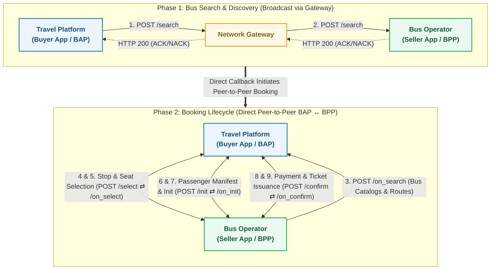
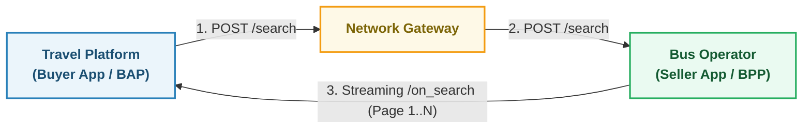
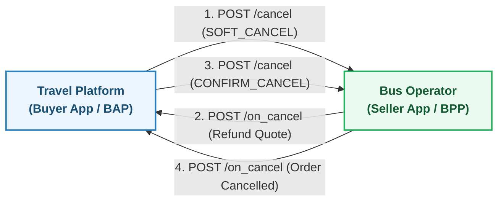
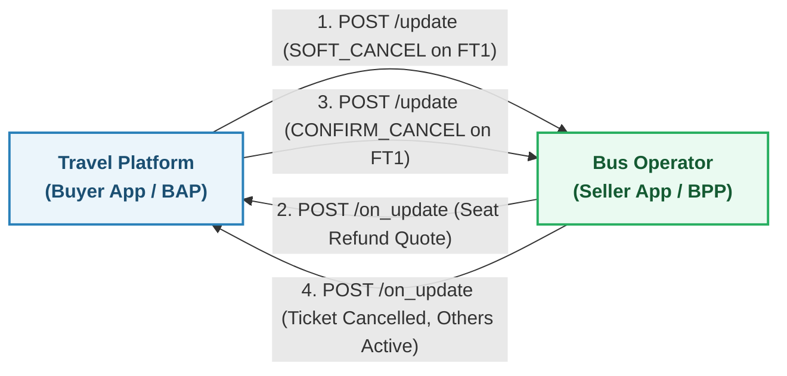
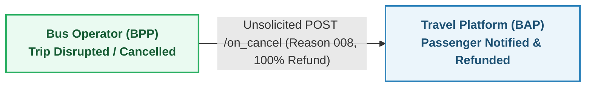

# Intercity Buses

---

## Overview

Intercity bus transit encompasses scheduled long-distance passenger bus services operated by private fleet operators and State Road Transport Corporations (SRTCs). Each bus operator independently manages its route networks, schedules, multi-deck coach inventory, seat and berth allocations, boarding and drop points, pricing, fare rules, and transit operations.

The network enables bus operators and travel platforms to connect through a common, open protocol instead of building separate integrations with each other. A travel platform integrates with the network as a Buyer App (BAP) to discover, compare, and book bus seats from participating operators. Bus operators and transport corporations integrate once as a Seller App (BPP) to make their route schedules and seat inventory available to participating travel platforms.

The bus operator remains responsible for the transport service, including vehicle operations, schedule reliability, inventory availability, seat and sleeper berth allocation, boarding point management, gender safety rules, dynamic pricing, PNR and boarding pass issuance, and passenger servicing. The network standardizes the interactions for searching, comparing, selecting, booking, and servicing intercity bus tickets across participating network participants.

This guide explains the intercity bus ticketing use case and end-to-end journey from a business and product perspective, before covering the corresponding technical specifications and API flows.

---

## Participants

| Participant | What This Means |
|---|---|
| **Travel Platform (Buyer App / BAP)** | A consumer-facing application (travel portal, consumer app, or mobility platform) that enables travelers to search for intercity bus services, compare coach amenities, view interactive 3D seat maps, select pickup and drop-off points, provide passenger manifests, and manage bookings by connecting with participating bus operators through the network. |
| **Bus Operator (Seller App / BPP)** | The private fleet operator (e.g., SRS, VRL, Orange) or State Road Transport Corporation (e.g., KSRTC, MSRTC, UPSRTC) that publishes bus schedules, manages multi-deck seat/berth inventory, executes seat reservations, issues PNRs and QR boarding tokens, and operates transit services. The operator is responsible for vehicular operations, pricing, boarding point logistics, gender-safety allocation, and traveler servicing. |

---

## The User Journey

The intercity bus booking journey enables a traveler to search for buses between cities or stations, compare coach types and operators, select boarding/dropping points and seats, provide passenger details, complete payment, and receive confirmed e-tickets, PNR, and boarding pass tokens.

```
[Search Buses] ───► [Compare Operators] ───► [Select Boarding/Drop & Seats] ───► [Provide Passenger Info] ───► [Payment & Confirmation] ───► [PNR & Boarding Pass Issued]
```

The journey consists of the following stages:

### 1. Bus Search and Route Discovery

Through the Travel Platform (Buyer App / BAP), the traveler provides bus search criteria:

| Category | Field | Key | Mandatory | Type / Values |
|---|---|---|---|---|
| Routing | Origin Station / City Code | `stops[type=START].location.descriptor.code` | Yes | Text (STD Code, e.g. `std:080` or depot code `std:080-pincode:560103`) |
| | Destination Station / City Code | `stops[type=END].location.descriptor.code` | Yes | Text (STD Code, e.g. `std:040` or depot code `std:040-pincode:500016`) |
| Schedule | Departure Date & Time | `stops[type=START].time.timestamp` | Yes | ISO 8601 Date / Timestamp |
| Vehicle | Transport Category | `vehicle.category` | Yes | ENUM (`BUS`) |
| Passengers | Passenger Count | `passengers.count` / item quantity | Yes | Number (Minimum 1) |

The Travel Platform (Buyer App / BAP) transmits the search request to discover available bus schedules across participating operators.

**Network interaction:**

- **`/search`**: The Buyer App (BAP) broadcasts the bus search intent to the Gateway using standardized city STD codes (e.g. `std:080` to `std:040`) or station depot codes, travel date, and passenger counts. The Gateway routes this request to registered bus operators.
- **`/on_search`**: Participating Seller Apps (BPP) respond asynchronously with bus catalogs containing available services, coach types, departure/arrival schedules, intermediate pickup/drop points, and fares.

### 2. Bus Offers and Coach Comparison

Bus operators return catalog offerings that may include:

- Coach types: Multi-Axle AC Sleeper, Semi-Sleeper, Pushback Seater, Non-AC Seater, SRTC Express
- Onboard amenities: Charging ports, Wi-Fi, blankets, reading lights, emergency exits, live GPS tracking
- Boarding and dropping point schedules with exact pickup/drop station addresses and departure timestamps
- Cancellation and refund policies (Refundable vs. Non-refundable time windows)

The Travel Platform (Buyer App / BAP) presents the available bus services and amenities for the traveler to compare.

### 3. Stop and Seat Selection

The traveler selects a specific bus service, intermediate pickup depot, drop-off location, and preferred seats through the Travel Platform (Buyer App / BAP).

- **Boarding and Drop Selection**: In an intercity bus route, a bus makes several intermediate suburban stops. The traveler selects their preferred pickup stop (e.g. Bellandur) and dropoff stop (e.g. Gachibowli).
- **3D Multi-Deck Seat Layout**: The operator provides an interactive seat grid across Lower Deck (`Z: 0`) and Upper Deck (`Z: 1`), distinguishing sleeper berths from seater chairs.
- **Gender-Restricted Berths**: Berths designated for women (`RESTRICTED_GENDER: "FEMALE"`) prevent conflicting adjoining bookings by male passengers.
- **Timed Inventory Soft-Locking**: The operator holds the selected seats temporarily with a declared duration (`quote.ttl`, typically 10 minutes) while passenger details are provided.

**Network interaction:**

- **`/select`**: The Buyer App (BAP) sends the selected bus route item ID, chosen pickup and drop stop IDs, and selected seat numbers.
- **`/on_select`**: The Seller App (BPP) reserves the seats under a temporary soft-lock, confirms the `quote.ttl` validity window, and returns an itemized price quotation (base fare, taxes, state transport levies, seat surcharges).

### 4. Passenger Details and Manifest

The traveler provides passenger information required for the operator's passenger manifest:

| Category | Field | Key | Mandatory | Format / Rules |
|---|---|---|---|---|
| Personal | Passenger Name | `person.name` | Yes | `<Title>\|<First Name>\|<Middle Name>\|<Last Name>` (e.g. `Mr\|Rahul\|S\|Sharma`) |
| | Age | `person.age` | Yes | Number (e.g. `28`) |
| | Gender | `person.gender` | Yes | ENUM (`MALE`, `FEMALE`, `OTHER`); must match gender-restricted berths |
| Contact | Phone Number | `contact.phone` | Yes | 10-digit mobile number |
| | Email Address | `contact.email` | No | Valid email address |
| Billing | Billing Name & Address | `billing` | Yes | Name, phone, tax ID / GSTIN (optional), and address |

**Network interaction:**

- **`/init`**: The Buyer App (BAP) initializes the draft booking order, passing the passenger manifest mapped to selected seats, contact numbers, and billing details.
- **`/on_init`**: The Seller App (BPP) validates the passenger manifest and gender allocations, creates a draft reservation, locks the seats for payment, and returns payment terms, settlement parameters, and cancellation policies.

### 5. Booking Confirmation and Ticketing

Once the traveler completes payment through the checkout interface, the Travel Platform (Buyer App / BAP) confirms the booking with the bus operator.

The bus operator validates the transaction, confirms seat assignments, and generates the passenger reservation reference (PNR) and electronic boarding pass token.

**Network interaction:**

- **`/confirm`**: The Buyer App (BAP) transmits the payment confirmation details and finalized order payload.
- **`/on_confirm`**: The Seller App (BPP) confirms the booking, changes the order status to `ACTIVE`, and returns the official bus PNR, QR boarding pass authorization token (`stops[].authorization.token` initialized as `UNCLAIMED`), and assigned seat numbers.

### 6. Post-Booking Servicing, Live Tracking, and Boarding

After confirmation, the traveler can track the bus in real time, view driver/conductor contact details, and present their boarding pass upon vehicle arrival.

At boarding, the conductor validates the passenger ticket and scans the QR code, updating the authorization status from `UNCLAIMED` to `CLAIMED`. After the journey completes, the traveler can submit a rating for the trip.

**Network interaction:**

- **`/status`**: The Buyer App (BAP) queries current trip fulfillment and live tracking status.
- **`/on_status`**: The Seller App (BPP) returns real-time coach telemetry, conductor contact, delay alerts, and boarding token redemption state.

---

## Additional Scenarios

The intercity bus ticketing lifecycle supports operational modifications, cancellations, and disruptions post-booking.

### 1. User Cancellation (Full Cancellation)

A traveler can cancel a confirmed bus booking prior to departure, subject to the operator's cancellation policy.

```
[Cancel Request] ───► [Soft Cancel Preview] ───► [Review Refund Quote] ───► [Confirm Cancel] ───► [PNR Cancelled & Refund Issued]
```

The network supports a two-step cancellation process:
1. **Soft Cancel (`SOFT_CANCEL`)**: The Buyer App (BAP) requests a cancellation preview. The operator calculates applicable cancellation fees based on time remaining before departure and returns the net refund quote.
2. **Confirm Cancel (`CONFIRM_CANCEL`)**: After the traveler reviews and approves the refund amount, the Buyer App (BAP) confirms the cancellation. The operator cancels the PNR, marks the order `CANCELLED`, releases the seat inventory, and initiates the refund.

**Network interaction:**

- **`/cancel` (Soft Cancel)**: The Buyer App (BAP) initiates a soft cancellation request with reason code.
- **`/on_cancel`**: The Seller App (BPP) responds with the cancellation quote preview, itemizing the base refund, cancellation charges, and net refundable balance.
- **`/cancel` (Confirm Cancel)**: The Buyer App (BAP) submits the final confirmed cancellation.
- **`/on_cancel`**: The Seller App (BPP) confirms ticket cancellation, releases the seat inventory, and updates the order status to `CANCELLED`.

### 2. Partial Ticket Cancellation

In a multi-passenger booking, a traveler may choose to cancel tickets for specific passengers while retaining the booking for the remaining travelers.

```
[Partial Cancel Request] ───► [/update Specific Ticket IDs] ───► [Recalculate Remaining Seats] ───► [Updated Order & Partial Refund]
```

**Network interaction:**

- **`/update` (Soft Cancel)**: The Buyer App (BAP) sends an update request targeting `order.fulfillments` with `descriptor.code = "SOFT_CANCEL"` specifying the individual ticket fulfillment ID (e.g. `FT1`).
- **`/on_update`**: The Seller App (BPP) returns the partial cancellation refund preview for that specific seat.
- **`/update` (Confirm Cancel)**: The Buyer App (BAP) sends the confirmed partial cancellation with `descriptor.code = "CONFIRM_CANCEL"`.
- **`/on_update`**: The Seller App (BPP) cancels the designated seat, updates the order with the remaining active tickets, and releases the partial refund.

### 3. Technical Cancellation

If a transaction fails due to payment authorization timeouts, network latency, or an expired soft-locking window (`quote.ttl`), the system triggers an automated technical cancellation.

```
[Confirmation Timeout] ───► [/status Check] ───► [Auto-Cancel Code 000] ───► [Seat Holds Released]
```

**Network interaction:**

- **`/status` & `/on_status`**: The Buyer App (BAP) queries order state after an unacknowledged confirmation call.
- **`/cancel` & `/on_cancel`**: If confirmation expired or failed, an automated cancellation is issued with technical cancellation code `000` to release any temporary seat holds.

### 4. Operator Bus Disruption or Cancellation

When an operator cancels a scheduled bus trip due to mechanical breakdown, road closures, or adverse weather, the operator notifies the passenger immediately.

```
[Operator Disruption / Breakdown] ───► [Unsolicited on_cancel] ───► [100% Full Refund Issued]
```

**Network interaction:**

- **`/on_cancel` (Unsolicited)**: The Seller App (BPP) pushes an unsolicited cancellation callback with reason code `008` (Venue/Service Closure), providing a 100% full refund with zero cancellation penalty.

---

## Issue and Grievance Management

A passenger can raise a grievance through the Buyer App (BAP) for issues related to their bus booking or the network transaction. The Buyer App (BAP) routes the grievance to the relevant bus operator partner through the network's grievance mechanism.

The bus operator is responsible for investigating and resolving the grievance. The operator communicates the grievance status and resolution to the Buyer App (BAP), which makes the relevant information available to the passenger.

The grievance process can include:

- **Grievance Registration**: The passenger raises an issue through the Buyer App (BAP).
- **Grievance Routing**: The Buyer App (BAP) routes the grievance to the relevant bus operator.
- **Resolution**: The bus operator investigates the issue and takes the required action.
- **Status Updates**: The bus operator communicates progress and resolution status to the Buyer App (BAP).
- **Closure**: The Buyer App (BAP) communicates the resolution to the passenger and closes the grievance when appropriate.

The bus operator and Buyer App (BAP) remain responsible for complying with applicable grievance redressal requirements. Applicable guidelines provide for passenger grievance redressal mechanisms and identify the bus operator and Buyer App's designated grievance channels.

---

## Detailed Protocol Flows

### Flow 1: Intercity Buses – Station Code Based Flow

#### 1. Short Description

The Station Code Based Flow enables travelers to search for intercity buses between physical stations using standard city STD codes (e.g. `std:080` to `std:040`), select pickup/drop depots and multi-deck seats, provide passenger manifests, complete payment, and receive confirmed PNRs and QR boarding tokens.

#### 2. Visual Interaction Map



#### 3. API Breakdown & Technical Actions

- **`/search` (Buyer App [BAP] → Gateway → Seller App [BPP])**: Triggered when a traveler searches for buses. The Buyer App (BAP) specifies origin and destination station codes using standard city STD codes (`stops[type=START].location.descriptor.code = "std:080"` and `stops[type=END].location.descriptor.code = "std:040"`), departure date, and vehicle category `BUS`.
- **`/on_search` (Seller App [BPP] → Buyer App [BAP])**: The operator returns its catalog of available bus trips. Each route item contains departure/arrival schedules, coach variant (AC Multi-Axle, Sleeper, Seater), and all intermediate suburban pickup/drop depots.
- **`/select` (Buyer App [BAP] → Seller App [BPP])**: The traveler selects a bus service along with specific pickup depot (e.g. `S2` Bellandur) and dropoff depot (e.g. `S5` Gachibowli), and chooses specific lower/upper deck seats or sleeper berths from the 3D seat grid.
- **`/on_select` (Seller App [BPP] → Buyer App [BAP])**: The operator places a temporary soft-lock on the requested seats, returns the soft-lock expiration TTL (`quote.ttl`, typically 10 minutes), and supplies an itemized price quotation including base fare, taxes, and service fees.
- **`/init` (Buyer App [BAP] → Seller App [BPP])**: The Buyer App (BAP) passes the passenger manifest. Passenger names follow the `<Title>|<First Name>|<Middle Name>|<Last Name>` format, along with age, gender (validated against female-restricted berths), phone number, and billing details.
- **`/on_init` (Seller App [BPP] → Buyer App [BAP])**: The operator validates the passenger manifest and gender allocations, creates a draft reservation, locks the seats for payment, and provides payment collection instructions and cancellation policies.
- **`/confirm` (Buyer App [BAP] → Seller App [BPP])**: Transmitted after successful payment capture. Contains the payment transaction ID, settlement terms, and final confirmation request.
- **`/on_confirm` (Seller App [BPP] → Buyer App [BAP])**: The operator sets order status to `ACTIVE`, confirms seat allocations, and returns the official bus PNR and QR boarding pass authorization token (`stops[].authorization.token`) with status `UNCLAIMED`.

---

### Flow 2: Intercity Buses – Seller App Pagination Flow

#### 1. Short Description

When an operator or transport corporation manages a high frequency of bus services on popular intercity routes, results are split into paginated batches. The Seller App (BPP) streams catalog pages sequentially using pagination metadata so the Buyer App (BAP) can render available buses smoothly without gateway timeouts.

#### 2. Process Flow

```
[BAP: POST /search] ──► [Network Gateway Broadcast] ──► [Bus Fleet Catalogs] ──► [Streaming POST /on_search Page 1..N] ──► [BAP: Incremental Bus Schedule Display]
```



#### 3. API Breakdown & Technical Actions

- **`/search` (Buyer App [BAP] → Gateway → Seller App [BPP])**: Initial bus search request for the specified city sector broadcast across the Gateway to registered bus operators.
- **Sequential `/on_search` Callbacks (Seller App [BPP] → Buyer App [BAP])**: The operator delivers catalog pages in consecutive asynchronous callbacks directly to the Buyer App (BAP). Each payload contains:
  - `PAGINATION_ID`: Unique session identifier correlating the pages.
  - `CURRENT_PAGE_NUMBER`: Index of the current batch (e.g., `1`, `2`, `3`).
  - `MAX_PAGE_NUMBER`: Total page count for the search response.
  The Buyer App (BAP) acknowledges each callback with HTTP 200 `ACK` and renders the bus schedules incrementally.

---

### Flow 3: Intercity Buses – User Cancellation Flow

#### 1. Short Description

When a traveler initiates a full booking cancellation, the network executes a two-step cancellation workflow: a soft-cancel preview to calculate refund and penalties, followed by a confirm-cancel to finalize ticket cancellation and release seat inventory.

#### 2. Process Flow

```
[Cancel Request (SOFT_CANCEL)] ───► [Refund Quote Preview (/on_cancel)] ───► [Confirm Cancel (CONFIRM_CANCEL)] ───► [PNR Cancelled & Refund Issued]
```



#### 3. API Breakdown & Technical Actions

- **`/cancel` [Soft Cancel] (Buyer App [BAP] → Seller App [BPP])**: The Buyer App (BAP) initiates cancellation preview by setting `descriptor.code = "SOFT_CANCEL"` and passing the relevant cancellation reason code (e.g. `001` for change of plans).
- **`/on_cancel` [Quote Preview] (Seller App [BPP] → Buyer App [BAP])**: The operator calculates deductions based on fare rules and time remaining before scheduled departure. The response returns an itemized refund quote showing original fare, cancellation fees, and net refund balance.
- **`/cancel` [Confirm Cancel] (Buyer App [BAP] → Seller App [BPP])**: After traveler confirmation, the Buyer App (BAP) sends `descriptor.code = "CONFIRM_CANCEL"`.
- **`/on_cancel` [Confirmed Cancellation] (Seller App [BPP] → Buyer App [BAP])**: The operator releases the reserved seats/berths back into inventory, voids the PNR/boarding tokens, sets order status to `CANCELLED`, and provides the final refund disbursement ledger.

---

### Flow 4: Intercity Buses – Partial Cancellation Flow via `/update`

#### 1. Short Description

In a multi-passenger booking, a traveler may choose to cancel tickets for specific passengers while retaining the reservation for the remaining travelers. This is executed using the `/update` API targeting specific ticket fulfillments.

#### 2. Process Flow

```
[Partial Cancel Request] ───► [/update: SOFT_CANCEL on Ticket FT1] ───► [Partial Refund Quote Preview] ───► [/update: CONFIRM_CANCEL on Ticket FT1] ───► [Updated Order & Partial Refund]
```



#### 3. API Breakdown & Technical Actions

- **`/update` [Partial Soft Cancel] (Buyer App [BAP] → Seller App [BPP])**: The Buyer App (BAP) specifies `update_target: "order.fulfillments"` and designates the specific ticket fulfillment to cancel with `state.descriptor.code = "SOFT_CANCEL"` (e.g. ticket `FT1`).
- **`/on_update` [Partial Quote Preview] (Seller App [BPP] → Buyer App [BAP])**: The operator calculates cancellation deductions for the individual seat and returns the partial refund quote preview.
- **`/update` [Partial Confirm Cancel] (Buyer App [BAP] → Seller App [BPP])**: The Buyer App (BAP) sends the finalized cancellation request with `state.descriptor.code = "CONFIRM_CANCEL"` for that ticket.
- **`/on_update` [Confirmed Partial Cancellation] (Seller App [BPP] → Buyer App [BAP])**: The operator marks the designated seat as cancelled, releases it back into available inventory, retains the remaining seats as confirmed/active, and initiates the partial refund.

---

### Flow 5: Intercity Buses – Seller Cancellation Flow

#### 1. Short Description

If an operator cancels a scheduled bus service due to mechanical breakdown, road conditions, or severe weather, the Seller App (BPP) triggers an unsolicited cancellation pushing 100% full refund details to the passenger.

#### 2. Process Flow

```
[Trip Disrupted / Breakdown] ───► [Unsolicited POST /on_cancel (Reason Code 008)] ───► [100% Full Refund Issued to BAP]
```



#### 3. API Breakdown & Technical Actions

- **`/on_cancel` [Unsolicited] (Seller App [BPP] → Buyer App [BAP])**: Fired directly by the bus operator upon trip cancellation. The payload contains `order.status = "CANCELLED"`, `cancellation.cancelled_by = "PROVIDER"`, reason code `008` (Service/Route Disruption), and a 100% full refund breakup without cancellation charges.