# Metro

---

## Overview

Metro ticketing in `ONDC:TRV11` 2.1.0 lets a buyer discover a metro operator's catalog, search a fare between two stations, buy Single Journey Tickets (`SJT`) or Round Journey Tickets (`RJT`), receive a QR ticket, and cancel, change the end stop or raise an issue after the booking. It also covers unlimited passes and the Metro-Wallet (Metro Card purchase and recharge). Every call is an action pair: the sender issues `X` and the receiver answers with `on_X`. Some callbacks are sent by the Seller App on its own (`unsolicited: true` in the flow files).

| | |
|---|---|
| **Domain** | `ONDC:TRV11` |
| **Version** | `2.1.0` |
| **Use case** | `Metro` (`config/index.yaml`, `x-status`: `DRAFT`); the Metro-Wallet flows are part of it |
| **Flows** | 13 flows in `config/flows/Metro`; 12 of them are enabled in the contract's flow list and 1 exists only in this branch |
| **Audience** | BAP (Buyer App) and BPP (Seller App) developers |
| **Source of truth** | `config/flows/Metro`, `config/attributes/Metro.yaml`, `config/validations/index.yaml`, `config/actions/index.yaml`, `config/errors/index.yaml`, and the `draft-TRV11-2.1.0` contract of `ONDC-Official/mobility-specification` (flows, examples, enum, tags, `error_codes`, change log) |

What the 2.1.0 Metro flows define:

- Master search by city (no stops) returning tickets, passes and wallet items (`Metro - Master Search`).
- Station-pair search (`START` / `END` stops with station codes) returning fare-bearing items `SJT` and `RJT`.
- `select`, `init`, `confirm` and `on_status` for a station-code order, with the terms tags `BAP_TERMS` and `BPP_TERMS`, a `TRIP` fulfillment and a `TICKET` fulfillment from `on_select`, and a QR `authorization` on the ticket from `on_confirm`.
- Ticket states `CHECKED_IN` and `CHECKED_OUT`, sent by the seller through `on_status`.
- Unlimited passes (`PASS` fulfillment with an `AADHAAR` credential).
- Cancellation: user (`SOFT_CANCEL` then `CONFIRM_CANCEL`), technical, delayed (accepted and rejected), offline (seller side) and partial (through `update`).
- End stop update through `update` / `on_update`, including a payment for the difference.
- Metro-Wallet: Metro Card purchase and recharge.
- Quote breakup with `TAX` (`CGST`, `SGST`) and `OTHER_CHARGES` (`SURCHARGE`) tags.
- Issue and Grievance Management (IGM 1.0.0), in one branch-only flow.

Compared with 2.0.1 there is no `W/O Search1 and Select` variant of the flows, and the first city search of the station-code flow is gone: the master search takes its place. The full list of changes is in `release-notes.md`.

---

## Participants

| Participant | What This Means |
|---|---|
| **Buyer App (BAP)** | Owns the `search`, `select`, `init`, `confirm`, `status`, `cancel`, `update` and `issue` calls. Collects the payment in most flows (`payments[].collected_by: BAP`); the station-to-station flows in this branch have `BPP` (see [Contract Notes](#contract-notes)). |
| **Seller App (BPP)** | Owns the `on_search`, `on_select`, `on_init`, `on_confirm`, `on_status`, `on_cancel`, `on_update`, `on_issue` and `on_issue_status` calls, including the unsolicited ones. Owns the catalog, fares, QR tickets and order states. |
| **Gateway** | Sits between the BAP and the BPP for the city-level `search` only (the master search, which has no `bpp_id`). The station-to-station `search` (`search2_METRO_210`) is peer-to-peer between BAP and BPP, as are all later calls. |

---

## The User Journey

```
[Master Search] ───► [Search Fare for a Station Pair] ───► [Select Ticket] ───► [Init: Billing & Payment Terms] ───► [Confirm & Pay] ───► [QR Ticket] ───► [Check-in / Check-out]
```

Mandatory flags below are marked `Yes` only where `config/validations/index.yaml` has a presence test for the field. `—` means there is no presence test; the field may still be present in the flow payloads. Attribute descriptions are in `config/attributes/Metro.yaml`. The validations file is shared with the Bus use case.

### 1. Master Search (Catalog)

The Buyer App searches without stops to get the seller's catalog.

| Category | Field | Key | Mandatory | Type / Values |
|---|---|---|---|---|
| Context | Domain, action, version, timestamp, ids | `context.domain`, `context.action`, `context.version`, `context.timestamp`, `context.bap_id`, `context.bap_uri`, `context.transaction_id`, `context.message_id` | Yes | `ONDC:TRV11`, `search`, `2.1.0` |
| | City | `context.location.city.code` | — | Text, for example `std:011` (format test `^std:0\d+$`) |
| Vehicle | Transport category | `message.intent.fulfillment.vehicle.category` | Yes | `METRO` |
| Payment | Collector | `message.intent.payment.collected_by` | — | `BAP` in the master search example |
| Terms | Buyer terms | `message.intent.tags` → `BAP_TERMS` | — | `BUYER_FINDER_FEES_PERCENTAGE`, `STATIC_TERMS`, `DELAY_INTEREST` |

**Network interaction:**

- **`/search`** (BAP → Gateway → BPP): the master search (`search_MASTER_METRO_210`), without stops and without `bpp_id`.
- **`/on_search`**: the BPP returns `catalog` with one provider and items `SJT`, `RJT`, `PURCHASE`, `RECHARGE` and `PASS` (several pass durations).

| Category | Field | Key | Mandatory | Type / Values |
|---|---|---|---|---|
| Catalog | Catalog name | `catalog.descriptor.name` | Yes | Text |
| Provider | Provider id and name | `catalog.providers[].id`, `.descriptor.name` | Yes | Text |
| Fulfillment | Id, type, vehicle category | `...fulfillments[].id`, `.type`, `.vehicle.category` | Yes | `TRIP`, `PASS`, `ONLINE`; `METRO` |
| | Station name | `...fulfillments[].stops[].location.descriptor.name` | Yes | Text |

### 2. Fare Search (Station Pair)

| Category | Field | Key | Mandatory | Type / Values |
|---|---|---|---|---|
| Routing | Origin station code | `message.intent.fulfillment.stops[type=START].location.descriptor.code` | — | Text (`SHAHEED_STHAL` in the examples) |
| | Destination station code | `message.intent.fulfillment.stops[type=END].location.descriptor.code` | — | Text (`AZADPUR`) |
| Vehicle | Transport category | `message.intent.fulfillment.vehicle.category` | Yes | `METRO` |
| Context | Seller App id and URI | `context.bpp_id`, `context.bpp_uri` | — | Present in `search2_METRO_210` |

**Network interaction:**

- **`/search`** (BAP → BPP, peer-to-peer): the station-pair search (`search2_METRO_210`).
- **`/on_search`**: the BPP returns items `I1` (`SJT`) and `I2` (`RJT`), each with `category_ids: [C1]`, `quantity.minimum.count: 1`, `quantity.maximum.count: 6` and `fulfillment_ids: [F1]`; a `TRIP` fulfillment `F1` with `START`, `INTERMEDIATE_STOP`, `TRANSIT_STOP` and `END` stops and the tag `ROUTE_INFO` (`ROUTE_ID`, `ROUTE_NAME`); provider tag `ADDITIONAL_APIS` (`GTFS_RT`, `GTFS_ST`, `WALLET_BALANCE_CHECK`); catalog tag `BPP_TERMS`.

### 3. Selection and Quote

| Category | Field | Key | Mandatory | Type / Values |
|---|---|---|---|---|
| Provider | Provider id | `message.order.provider.id` | Yes | Text (`P1`) |
| Item | Item id | `message.order.items[].id` | Yes | Text (`I1`) |
| | Quantity | `message.order.items[].quantity.selected.count` | — | Number |

**Network interaction:**

- **`/select`**: the BAP sends the provider, item and quantity.
- **`/on_select`**: the BPP returns the priced order: a `TRIP` fulfillment and one `TICKET` fulfillment per ticket (tag `INFO` → `PARENT_ID`); `quote.price` and `quote.breakup[]` (`BASE_FARE`, `TAX`, `OTHER_CHARGES`; the item tags `TAX` → `CGST`, `SGST` and `OTHER_CHARGES` → `SURCHARGE` are in the contract's examples); `cancellation_terms[].external_ref` (an HTML link).

The validations require, in `on_select`, the fulfillment `id`, `type` and `vehicle.category`, the item `id`, `descriptor.code`, `descriptor.name`, `price`, `quantity.selected.count`, `time.label` and `time.duration`, the provider `id` and name, and the quote price and breakup.

### 4. Billing and Payment Terms (Init)

| Category | Field | Key | Mandatory | Type / Values |
|---|---|---|---|---|
| Items and provider | Item id, provider id | `message.order.items[].id`, `message.order.provider.id` | Yes | Text |
| Billing | Name, email, phone | `message.order.billing` | — | Text |
| Payment | Collector | `message.order.payments[].collected_by` | Yes | `BAP`, `BPP` |
| | Status | `message.order.payments[].status` | Yes | Payloads: `NOT-PAID`, `PAID`; contract enum `NOT_PAID`, `PAID` |
| | Type | `message.order.payments[].type` | Yes | Payloads: `PRE-ORDER`; contract enum `PRE_ORDER` |
| Terms | Buyer terms | `message.order.tags` → `BAP_TERMS` | — | `BUYER_FINDER_FEES_PERCENTAGE`, `SETTLEMENT_AMOUNT`, `SETTLEMENT_TYPE`, `DELAY_INTEREST`, `STATIC_TERMS`, `MANDATORY_ARBITRATION`, `COURT_JURISDICTION` |

**Network interaction:**

- **`/init`**: the BAP sends billing and a payment with `status: NOT-PAID`, `type: PRE-ORDER`.
- **`/on_init`**: the BPP returns the order with `quote`, the `TRIP` and `TICKET` fulfillments, `payments[].id` and the tag `BPP_TERMS` (adds `SETTLEMENT_WINDOW`, `SETTLEMENT_BANK_CODE`, `SETTLEMENT_BANK_ACCOUNT_NUMBER`, `SETTLEMENT_BASIS`).

### 5. Confirmation and Ticketing

| Category | Field | Key | Mandatory | Type / Values |
|---|---|---|---|---|
| Payment | Payment id | `message.order.payments[].id` | Yes | Id returned in `on_init` |
| | Status | `message.order.payments[].status` | Yes | `PAID` |
| | Transaction id, currency, amount | `message.order.payments[].params.transaction_id`, `.currency`, `.amount` | Yes | Text, `INR`, text |

**Network interaction:**

- **`/confirm`**: the BAP sends the order with the payment marked `PAID`, its `params` and the tags `BAP_TERMS` (adds `SETTLEMENT_WINDOW`, `SETTLEMENT_BASIS`) and `BPP_TERMS`.
- **`/on_confirm`**: the BPP returns `order.id`, `order.status: ACTIVE`, `created_at` and `updated_at`; the `TICKET` fulfillment with `state.descriptor.code: ACTIVE`, tags `INFO` and `TICKET_INFO` (`NUMBER`), and on its `START` stop an `authorization` with `type: QR`, `token`, `valid_to` and `status: UNCLAIMED`; `items[].time` (`label: Validity`, `duration: P2D`).
- The validations require in `on_confirm` the QR `token` and `valid_to` of the `START` stop, `order.id`, `created_at`, `updated_at` and `status`, the payment `id` and `params`, and the item and quote fields.

### 6. Status and Journey Completion

**Network interaction:**

- **`/status`**: the BAP sends `order_id` (`ref_id` in the technical cancellation flow).
- **`/on_status` (unsolicited)**: the BPP sends the ticket state with the order: `CHECKED_IN` (`order.status: ACTIVE`), then `CHECKED_OUT` (`order.status: COMPLETED`, QR `authorization.status: CLAIMED`).

---

## Additional Scenarios

### 1. Unlimited Pass

No search: `select` → `on_select` → `init` → `on_init` → `confirm` → `on_confirm`. The `PASS` fulfillment carries `customer.person.creds[]` with `type: AADHAAR`. Flow: `METRO_UNLIMITED_PASS_FLOW`.

### 2. End Stop Update

After `on_confirm` the buyer sends `update` with `update_target: order.fulfillments` and `order.status: SOFT_UPDATE`, then `CONFIRM_UPDATE`; the seller answers with `SOFT_UPDATE` and `UPDATED`. A third `update` carries the payment `POST-FULFILLMENT`, `PAID`. Flow: `END_STOP_UPDATE_FLOW`.

### 3. User Cancellation

`cancel` with `SOFT_CANCEL`, then `CONFIRM_CANCEL` (`cancellation_reason_id: 005`); the seller answers `SOFT_CANCEL` and `CANCELLED`. Flow: `USER_CANCELLATION_FLOW`.

### 4. Technical Cancellation

The `on_confirm` reaches the buyer app after the TTL. The BAP sends `status` (`ref_id`), gets `on_status` (`ACTIVE`) and cancels with reason `000`. Flow: `TECHNICAL_CANCELLATION_FLOW`.

### 5. Delayed Cancellation (Accepted or Rejected)

After `cancel` (`CONFIRM_CANCEL`) the seller answers `on_cancel` with the order status `CANCELLATION_INITIATED` (accepted flow) or `CANCEL_INITIATED` (rejected flow). The accepted flow ends with an unsolicited `on_update` (`CANCELLED`); the rejected flow with an unsolicited `on_status` (`COMPLETED`). Flows: `DELAYED_CANCELLATION_FLOW_ACCEPTED`, `DELAYED_CANCELLATION_FLOW_REJECTED`.

### 6. Offline (Seller) Cancellation

After `on_confirm` the seller sends an unsolicited `on_cancel` (`CANCELLED`). Flow: `OFFLINE_CANCELLATION_FLOW`.

### 7. Partial Cancellation

One of two tickets is cancelled through `update` (`update_target: order.fulfillments`, `SOFT_CANCEL`, then `CONFIRM_CANCEL`). Flow: `PARTIAL_CANCELLATION_FLOW`.

### 8. Metro-Wallet

`METRO_CARD_PURCHASE` and `METRO_CARD_RECHARGE`: no search, fulfillment types `PASS` and `ONLINE`, a `CARD_IDENTIFIER` credential, and a quote with `CONVENIENCE_FEE`, `TAX`, `OTHER_CHARGES` and `OFFER`.

---

## Issue and Grievance Management

IGM 1.0.0 exists as one flow: `PURCHASE_JOURNEY_STATION_CODE_BASED_FLOW_WITH_IGM(v-1.0.0)`. It follows the station-code purchase journey with a grievance after the journey. It is present in the flow configuration and not in the contract's enabled flow list; the contract has no IGM flow.

| Step | Call | Direction | Contents |
|---|---|---|---|
| 11 | `issue` (`issue_open_metro_100`) | BAP to BPP | `issue.status: OPEN`, `issue_type: ISSUE`, `category: FULFILLMENT`, `sub_category: FLM101` |
| 12 | `on_issue` (`on_issue_processing_metro_100`) | BPP to BAP | Respondent action |
| 13 | `on_issue_status` (`on_issue_resolved_metro_100`) | BPP to BAP, unsolicited | `resolution` (`action_triggered: REFUND`, `refund_amount`) |
| 14 | `issue` (`issue_close_metro_100`) | BAP to BPP | `issue.status: CLOSED` |

---

## Detailed Protocol Flows

Each flow below shows its calls in order. The city-level `search` goes through the Gateway; the station-pair `search` is peer-to-peer. Dotted arrows are unsolicited calls from the BPP. The step labels come from the example payloads of the flow configuration. Flows marked "not in the contract's enabled flow list" exist only in this branch.

### Discovery and Purchase

#### Flow 1: METRO_MASTER_SEARCH_FLOW

**Flow ID:** `METRO_MASTER_SEARCH_FLOW` (contract name: *Metro - Master Search*)  
**Config file:** `Metro/METRO_MASTER_SEARCH_FLOW.yaml` · **Tags:** `WORKBENCH`, `MANDATORY`, `REPORTABLE`

**1. Short description.** The buyer searches the whole Metro catalog of a seller without stops: tickets, passes and wallet items in one catalog. 2 steps.

**2. Process flow.**

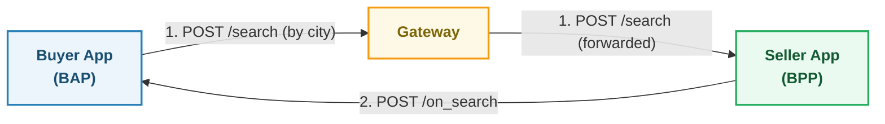

**3. API breakdown and technical actions.**

- **`/search`** (`search_MASTER_METRO_210`): `vehicle.category: METRO`, no `START` or `END` stop; no `bpp_id` in the context, so the call goes through the Gateway.
- **`/on_search`** (`on_search_MASTER_METRO_210`): one provider with items `SJT`, `RJT`, `PURCHASE`, `RECHARGE` and `PASS` (several pass durations).

---

#### Flow 2: PURCHASE_JOURNEY_STATION_CODE_BASED_FLOW

**Flow ID:** `PURCHASE_JOURNEY_STATION_CODE_BASED_FLOW` (contract name: *Metro - Purchase Journey (Station Code Based)*)  
**Config file:** `Metro/PURCHASE_JOURNEY_STATION_CODE_BASED_FLOW.yaml` · **Tags:** `WORKBENCH`, `MANDATORY`, `REPORTABLE`

**1. Short description.** The buyer searches a fare between two station codes, books tickets and receives the QR ticket; the seller reports `CHECKED_IN` and `CHECKED_OUT`. 10 steps.

**2. Process flow.**

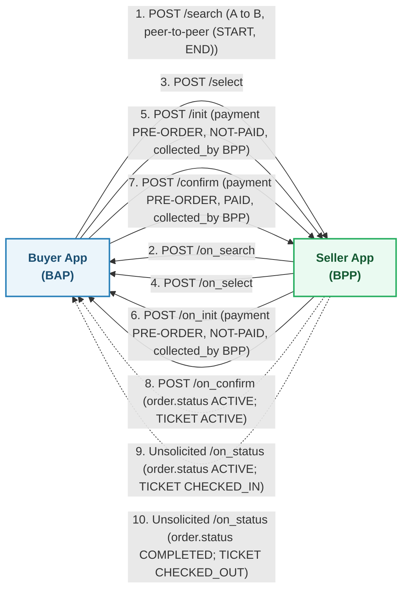

**3. API breakdown and technical actions.**

- **`/search`** (`search2_METRO_210`): `START` and `END` stops with station codes; the context has `bpp_id`, so the call is peer-to-peer. **`/on_search`**: items `SJT` and `RJT`.
- **`/select`, `/on_select`**: item and quantity; the response has a `TRIP` and `TICKET` fulfillments and a quote (`BASE_FARE`, `TAX`, `OTHER_CHARGES`).
- **`/init`, `/on_init`**: payment `PRE-ORDER`, `NOT-PAID`, `collected_by: BPP` in this branch (see [Contract Notes](#contract-notes)).
- **`/confirm`, `/on_confirm`**: payment `PAID`; `order.status: ACTIVE`; `TICKET` state `ACTIVE`; a QR `authorization` (`UNCLAIMED`) on the ticket.
- **`/on_status` (unsolicited)**: `CHECKED_IN` (`order.status: ACTIVE`), then `CHECKED_OUT` (`COMPLETED`, QR `CLAIMED`).

---

#### Flow 3: METRO_UNLIMITED_PASS_FLOW

**Flow ID:** `METRO_UNLIMITED_PASS_FLOW` (contract name: *Metro - Unlimited Passes Flow*)  
**Config file:** `Metro/METRO_UNLIMITED_PASS_FLOW.yaml` · **Tags:** `WORKBENCH`, `MANDATORY`, `REPORTABLE`

**1. Short description.** The buyer books an unlimited pass without a search: `select` starts the flow. 6 steps.

**2. Process flow.**

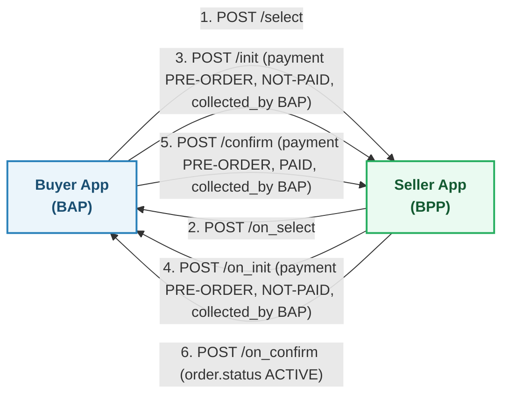

**3. API breakdown and technical actions.**

- **`/select`, `/on_select`**: fulfillment `type: PASS` with a customer credential (`AADHAAR`); the quote has `BASE_FARE`, `TAX`, `OTHER_CHARGES`.
- **`/init`, `/on_init`**: payment `NOT-PAID`, `collected_by: BAP`.
- **`/confirm`**: the payment is still `NOT-PAID` in this branch. **`/on_confirm`**: `order.status: ACTIVE`, payment `PAID` (see [Contract Notes](#contract-notes)).

---

#### Flow 4: END_STOP_UPDATE_FLOW

**Flow ID:** `END_STOP_UPDATE_FLOW` (contract name: *Metro - End Stop Update Flow*)  
**Config file:** `Metro/END_STOP_UPDATE_FLOW.yaml` · **Tags:** `WORKBENCH`, `MANDATORY`, `REPORTABLE`

**1. Short description.** After the booking the buyer changes the end stop: a soft update, a confirmed update and a payment for the difference. 14 steps.

**2. Process flow.**

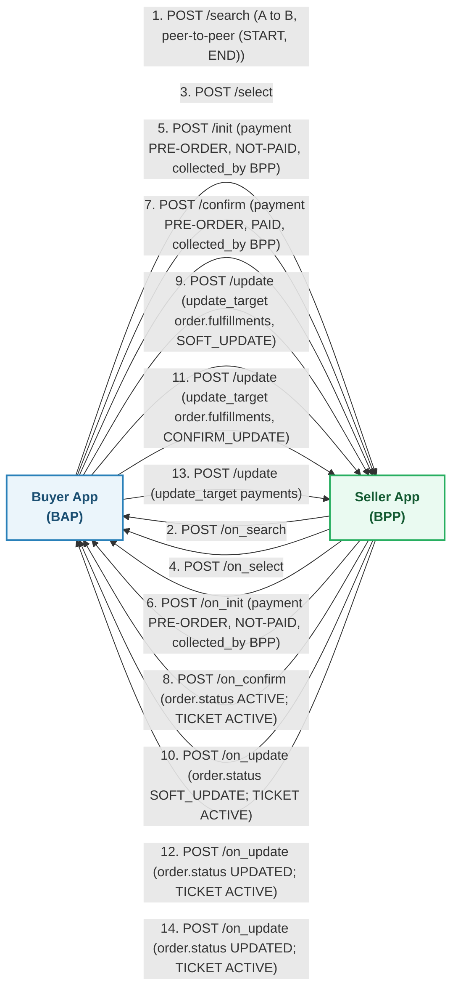

**3. API breakdown and technical actions.**

- **`/update`** (`update_end_stop_1`): `update_target: order.fulfillments`, `order.status: SOFT_UPDATE`. **`/on_update`**: `SOFT_UPDATE`.
- **`/update`** (`update_end_stop_2`): `CONFIRM_UPDATE`. **`/on_update`**: `order.status: UPDATED`.
- **`/update`** (`update_end_stop_3`): `update_target: payments`, payment `POST-FULFILLMENT`, `PAID` (see [Contract Notes](#contract-notes)). **`/on_update`**: `UPDATED`.

---

### Metro-Wallet

#### Flow 5: METRO_CARD_PURCHASE

**Flow ID:** `METRO_CARD_PURCHASE` (contract name: *Metro Card Purchase*)  
**Config file:** `Metro/METRO_CARD_PURCHASE.yaml` · **Tags:** `WORKBENCH`, `MANDATORY`, `REPORTABLE`

**1. Short description.** The buyer buys a Metro Card (Metro-Wallet) without a search. 6 steps.

**2. Process flow.**


**3. API breakdown and technical actions.**

- **`/select`, `/on_select`**: item `PURCHASE`; the quote has `CONVENIENCE_FEE`, `TAX`, `OTHER_CHARGES`, `OFFER`.
- **`/init`, `/on_init`, `/confirm`**: fulfillment `type: PASS` with a `CARD_IDENTIFIER` credential; payment `NOT-PAID`, then `PAID`, `collected_by: BAP`.
- **`/on_confirm`**: `order.status: ACTIVE`; the `PASS` stop has a QR `authorization` with `status: ACTIVE`.

---

#### Flow 6: METRO_CARD_RECHARGE

**Flow ID:** `METRO_CARD_RECHARGE` (contract name: *Metro Card Recharge*)  
**Config file:** `Metro/METRO_CARD_RECHARGE.yaml` · **Tags:** `WORKBENCH`, `MANDATORY`, `REPORTABLE`

**1. Short description.** The buyer recharges a Metro Card. 6 steps.

**2. Process flow.**

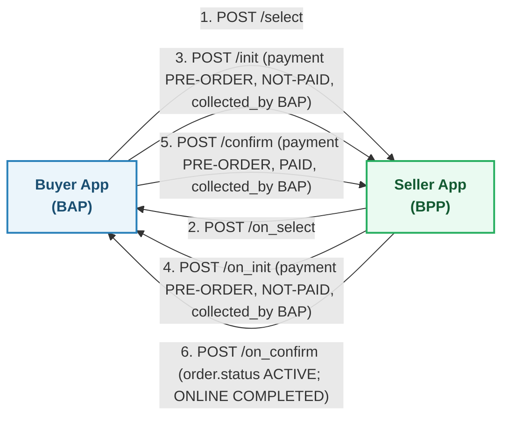

**3. API breakdown and technical actions.**

- **`/select`, `/on_select`**: fulfillment `type: ONLINE`; the quote has `CONVENIENCE_FEE`, `TAX`, `OTHER_CHARGES`, `OFFER`. The contract flow has no `select` or `on_select` (see [Contract Notes](#contract-notes)).
- **`/init`, `/on_init`, `/confirm`**: `CARD_IDENTIFIER` credential; payment `NOT-PAID`, then `PAID`, `collected_by: BAP`.
- **`/on_confirm`**: `order.status: ACTIVE`; the `ONLINE` fulfillment state is `COMPLETED`.

---

### Cancellation Flows

#### Flow 7: USER_CANCELLATION_FLOW

**Flow ID:** `USER_CANCELLATION_FLOW` (contract name: *Metro - Cancel Flow*)  
**Config file:** `Metro/USER_CANCELLATION_FLOW.yaml` · **Tags:** `WORKBENCH`, `MANDATORY`, `REPORTABLE`

**1. Short description.** The buyer cancels a confirmed booking: a soft cancel first, then a confirmed cancel. 12 steps.

**2. Process flow.**

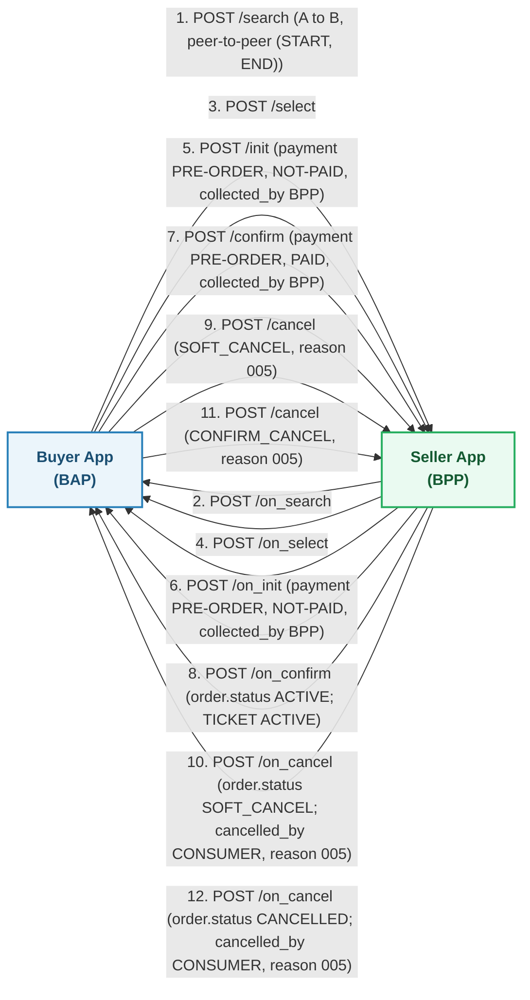

**3. API breakdown and technical actions.**

- **`/cancel`** (`cancel_soft_METRO_210`): `descriptor.code: SOFT_CANCEL`, `cancellation_reason_id: 005`. **`/on_cancel`**: `SOFT_CANCEL`, `cancelled_by: CONSUMER`.
- **`/cancel`** (`cancel_hard_METRO_210`): `CONFIRM_CANCEL`. **`/on_cancel`**: `order.status: CANCELLED`; the quote adds `REFUND` and `CANCELLATION_CHARGES`.

---

#### Flow 8: TECHNICAL_CANCELLATION_FLOW

**Flow ID:** `TECHNICAL_CANCELLATION_FLOW` (contract name: *Metro - Technical Cancellation Flow*)  
**Config file:** `Metro/TECHNICAL_CANCELLATION_FLOW.yaml` · **Tags:** `WORKBENCH`, `MANDATORY`, `REPORTABLE`

**1. Short description.** The `on_confirm` reaches the buyer app after its TTL; the buyer app checks the status and cancels with reason `000`. 14 steps.

**2. Process flow.**

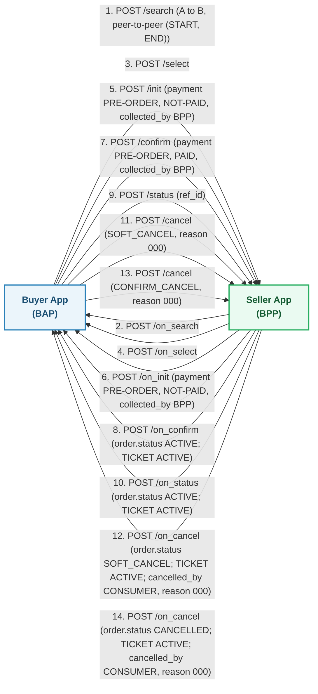

**3. API breakdown and technical actions.**

- **`/on_confirm`** (`on_confirm_delayed_METRO_210`): `ACTIVE`. **`/status`**: carries `ref_id`. **`/on_status`**: `ACTIVE`.
- **`/cancel`** (`SOFT_CANCEL`, then `CONFIRM_CANCEL`), reason `000`. **`/on_cancel`**: `SOFT_CANCEL`, then `CANCELLED`, with `REFUND` and `CANCELLATION_CHARGES` in the quote.

---

#### Flow 9: DELAYED_CANCELLATION_FLOW_ACCEPTED

**Flow ID:** `DELAYED_CANCELLATION_FLOW_ACCEPTED` (contract name: *Metro - Delayed Cancellation Flow(accepted)*)  
**Config file:** `Metro/DELAYED_CANCELLATION_FLOW_ACCEPTED.yaml` · **Tags:** `WORKBENCH`, `MANDATORY`, `REPORTABLE`

**1. Short description.** The seller app accepts a cancellation later: `on_cancel` shows the cancellation as initiated and an unsolicited `on_update` closes it. 11 steps.

**2. Process flow.**

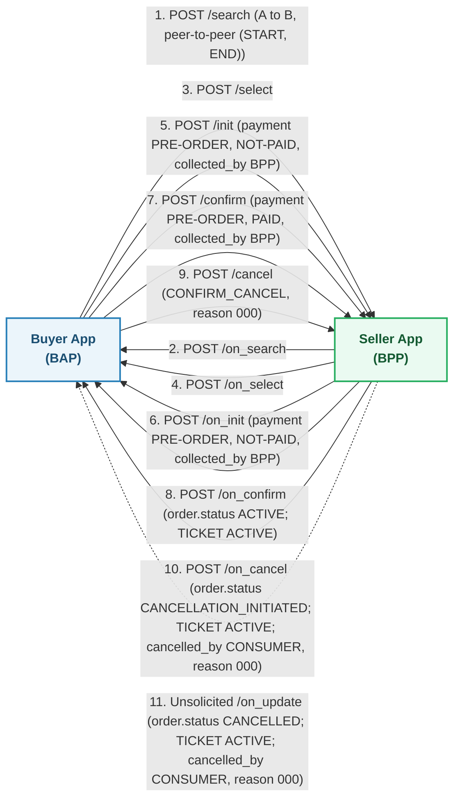

**3. API breakdown and technical actions.**

- **`/cancel`** (`cancel_hard_METRO_210`): `CONFIRM_CANCEL`, reason `000`. **`/on_cancel`**: `order.status: CANCELLATION_INITIATED`.
- **`/on_update` (unsolicited)**: `order.status: CANCELLED`; the quote has `REFUND` and `CANCELLATION_CHARGES`.

---

#### Flow 10: DELAYED_CANCELLATION_FLOW_REJECTED

**Flow ID:** `DELAYED_CANCELLATION_FLOW_REJECTED` (contract name: *Metro - Delayed Cancellation Flow(Rejected)*)  
**Config file:** `Metro/DELAYED_CANCELLATION_FLOW_REJECTED.yaml` · **Tags:** `WORKBENCH`, `MANDATORY`, `REPORTABLE`

**1. Short description.** The seller app rejects a cancellation later: `on_cancel` shows the cancellation as initiated and an unsolicited `on_status` completes the order. 11 steps.

**2. Process flow.**

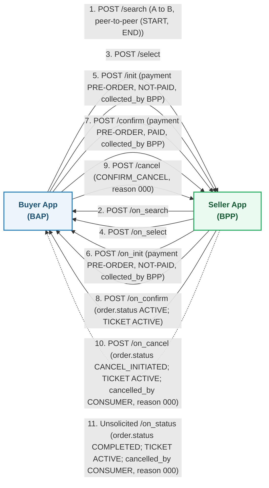

**3. API breakdown and technical actions.**

- **`/cancel`**: `CONFIRM_CANCEL`, reason `000`. **`/on_cancel`**: `order.status: CANCEL_INITIATED`.
- **`/on_status` (unsolicited)** (`on_status_cancel_METRO_210`): `order.status: COMPLETED`.

---

#### Flow 11: OFFLINE_CANCELLATION_FLOW

**Flow ID:** `OFFLINE_CANCELLATION_FLOW` (contract name: *Metro - Offline Cancellation Flow*)  
**Config file:** `Metro/OFFLINE_CANCELLATION_FLOW.yaml` · **Tags:** `WORKBENCH`, `MANDATORY`, `REPORTABLE`

**1. Short description.** The seller app cancels a confirmed booking on its own (an offline cancellation). 9 steps.

**2. Process flow.**

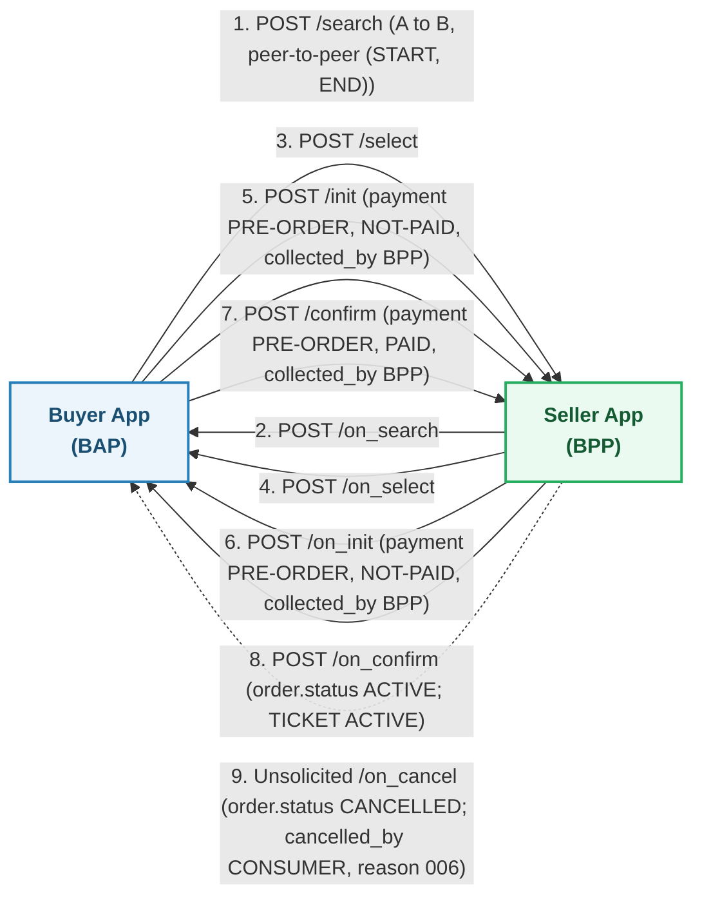

**3. API breakdown and technical actions.**

- **`/on_cancel` (unsolicited)** (`on_cancel_unsoliciated`): `order.status: CANCELLED`, `cancelled_by: CONSUMER`, reason `006`; the quote has `REFUND` and `CANCELLATION_CHARGES` (see [Contract Notes](#contract-notes)).

---

#### Flow 12: PARTIAL_CANCELLATION_FLOW

**Flow ID:** `PARTIAL_CANCELLATION_FLOW` (contract name: *Metro - Partial Cancellation Flow*)  
**Config file:** `Metro/PARTIAL_CANCELLATION_FLOW.yaml` · **Tags:** `WORKBENCH`, `MANDATORY`, `REPORTABLE`

**1. Short description.** The buyer cancels one of two tickets through `update`: a soft cancel and a confirmed cancel. 12 steps.

**2. Process flow.**

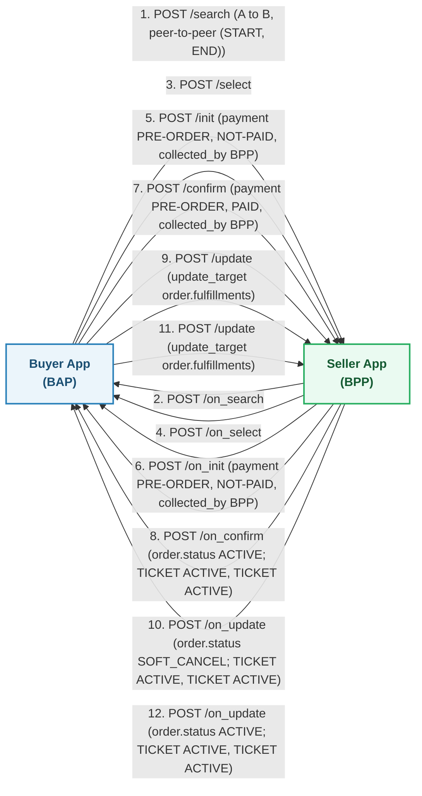

**3. API breakdown and technical actions.**

- **`/on_confirm`**: a `TRIP` fulfillment and two `TICKET` fulfillments.
- **`/update`** (`update_soft_cancel`, `update_confirm_cancel`): `update_target: order.fulfillments`, a `TICKET` fulfillment, `cancellation.reason.id: 001`, `descriptor.code` `SOFT_CANCEL`, then `CONFIRM_CANCEL`.
- **`/on_update`**: `SOFT_CANCEL` with `REFUND` and `CANCELLATION_CHARGES`; then `order.status: ACTIVE` (see [Contract Notes](#contract-notes)).

---

### Issue and Grievance Flow

#### Flow 13: PURCHASE_JOURNEY_STATION_CODE_BASED_FLOW_WITH_IGM(v-1.0.0)

**Flow ID:** `PURCHASE_JOURNEY_STATION_CODE_BASED_FLOW_WITH_IGM(v-1.0.0)`  
*Present in the flow configuration; not in the contract's enabled flow list.*  
**Config file:** `Metro/PURCHASE_JOURNEY_STATION_CODE_BASED_FLOW_WITH_IGM_v-1_0_0_.yaml` · **Tags:** `WORKBENCH`, `MANDATORY`, `REPORTABLE`

**1. Short description.** The station code purchase journey followed by an IGM 1.0.0 grievance. 14 steps.

**2. Process flow.**

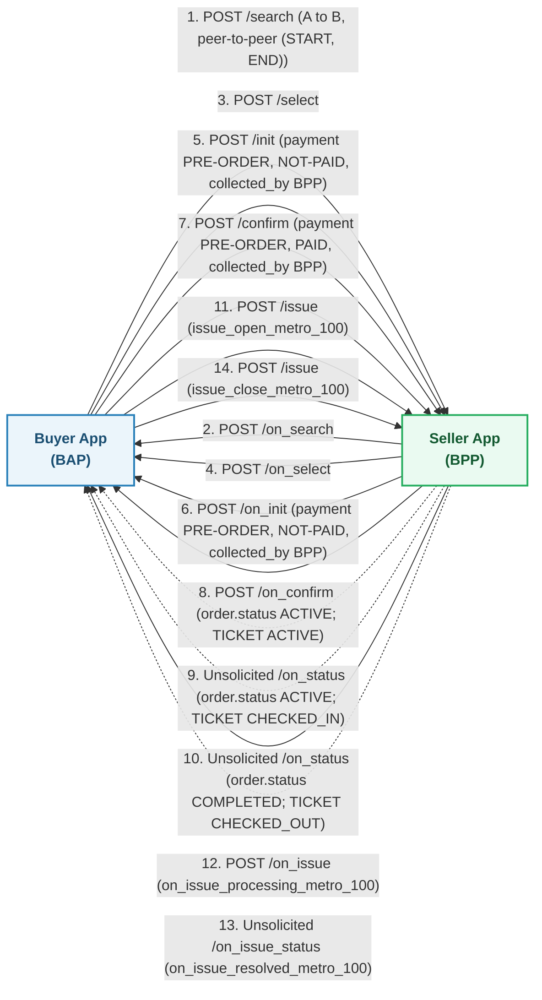

**3. API breakdown and technical actions.**

- Steps 1 to 10 are the station code purchase journey. Steps 11 to 14 are the IGM calls (see [Issue and Grievance Management](#issue-and-grievance-management)).

---

## Flow Catalogue

| Flow ID (branch) | Contract name | In contract enabled flows | Steps |
|---|---|---|---|
| `METRO_MASTER_SEARCH_FLOW` | Metro - Master Search | Yes | 2 |
| `PURCHASE_JOURNEY_STATION_CODE_BASED_FLOW` | Metro - Purchase Journey (Station Code Based) | Yes | 10 |
| `METRO_UNLIMITED_PASS_FLOW` | Metro - Unlimited Passes Flow | Yes | 6 |
| `END_STOP_UPDATE_FLOW` | Metro - End Stop Update Flow | Yes | 14 |
| `METRO_CARD_PURCHASE` | Metro Card Purchase | Yes | 6 |
| `METRO_CARD_RECHARGE` | Metro Card Recharge | Yes | 6 |
| `USER_CANCELLATION_FLOW` | Metro - Cancel Flow | Yes | 12 |
| `TECHNICAL_CANCELLATION_FLOW` | Metro - Technical Cancellation Flow | Yes | 14 |
| `DELAYED_CANCELLATION_FLOW_ACCEPTED` | Metro - Delayed Cancellation Flow(accepted) | Yes | 11 |
| `DELAYED_CANCELLATION_FLOW_REJECTED` | Metro - Delayed Cancellation Flow(Rejected) | Yes | 11 |
| `OFFLINE_CANCELLATION_FLOW` | Metro - Offline Cancellation Flow | Yes | 9 |
| `PARTIAL_CANCELLATION_FLOW` | Metro - Partial Cancellation Flow | Yes | 12 |
| `PURCHASE_JOURNEY_STATION_CODE_BASED_FLOW_WITH_IGM(v-1.0.0)` | — | No (branch only) | 14 |

The contract also has three Metro flows that are commented out of its flow index and are not in this branch: `Metro - GPS Based Flow`, `Metro Card Balance - Success` and `Metro Card Balance - Failure`.

---

## Key Data Model

### Context

| Field | Notes |
|---|---|
| `domain` | `ONDC:TRV11` |
| `version` | `2.1.0` |
| `action` | API name |
| `location.country.code`, `location.city.code` | `IND`; city code like `std:011` |
| `transaction_id`, `message_id`, `timestamp` | Present in every call |
| `ttl` | `PT30S` |
| `bap_id`, `bap_uri` | Buyer App |
| `bpp_id`, `bpp_uri` | Seller App; not in the master `search` |

### Fulfillment and stop types

| Object | Values |
|---|---|
| `fulfillments[].type` | `TRIP`, `TICKET`, `PASS`, `ONLINE` |
| `stops[].type` | `START`, `END`, `INTERMEDIATE_STOP`, `TRANSIT_STOP` |
| `fulfillments[].state.descriptor.code` | `ACTIVE`, `CHECKED_IN`, `CHECKED_OUT`, `COMPLETED` |
| `stops[].authorization` | `type: QR`; `status`: `UNCLAIMED`, `CLAIMED` (`ACTIVE` in the Metro Card purchase flow) |
| `customer.person.creds[].type` | `AADHAAR`, `CARD_IDENTIFIER`, `PAN` |

### Order, payment and cancellation

| Object | Values |
|---|---|
| `order.status` | Payloads: `ACTIVE`, `COMPLETED`, `SOFT_CANCEL`, `CANCELLED`, `CANCELLATION_INITIATED`, `CANCEL_INITIATED`, `SOFT_UPDATE`, `CONFIRM_UPDATE`, `UPDATED` |
| `payments[].collected_by` | `BAP`, `BPP` |
| `payments[].status` | Payloads: `NOT-PAID`, `PAID`. Contract enum: `NOT_PAID`, `PAID` |
| `payments[].type` | Payloads: `PRE-ORDER`, `POST-FULFILLMENT`. Contract enum: `PRE_ORDER`, `POST_FULFILLMENT`, and others |
| `cancel` `descriptor.code` | `SOFT_CANCEL`, `CONFIRM_CANCEL` |
| `cancellation_reason_id` | `005`, `000` in the `cancel` calls; the offline `on_cancel` has `006`; the partial cancellation `update` has `cancellation.reason.id: 001` |
| `order.cancellation.cancelled_by` | `CONSUMER` |
| `update_target` | `order.fulfillments`, `payments` |
| `quote.breakup[].title` | `BASE_FARE`, `TAX`, `OTHER_CHARGES`, `REFUND`, `CANCELLATION_CHARGES`, `CONVENIENCE_FEE`, `OFFER` |
| Item `descriptor.code` | `SJT`, `RJT`, `PASS`, `PURCHASE`, `RECHARGE` |

### Tags

| Tag | Level | Codes |
|---|---|---|
| `BAP_TERMS` | `intent`, order | `BUYER_FINDER_FEES_PERCENTAGE`, `STATIC_TERMS`, `DELAY_INTEREST`, `SETTLEMENT_AMOUNT`, `SETTLEMENT_TYPE`, `MANDATORY_ARBITRATION`, `COURT_JURISDICTION`, `SETTLEMENT_WINDOW`, `SETTLEMENT_BASIS` |
| `BPP_TERMS` | catalog, order | Same codes plus `SETTLEMENT_BANK_CODE`, `SETTLEMENT_BANK_ACCOUNT_NUMBER` |
| `ADDITIONAL_APIS` | provider, order | `GTFS_RT`, `GTFS_ST`, `WALLET_BALANCE_CHECK` |
| `ROUTE_INFO` | fulfillment | `ROUTE_ID`, `ROUTE_NAME` |
| `INFO` | fulfillment | `PARENT_ID` |
| `TICKET_INFO` | fulfillment | `NUMBER` |
| `TAX`, `OTHER_CHARGES` | quote breakup item | `CGST`, `SGST`; `SURCHARGE` (in the contract examples) |
| `PRICE_INFO` | item | `STEP_VALUE` (in the contract's Metro Card recharge flow) |

---

## Error Codes

Error codes for this version are defined in `config/errors/index.yaml`, identical to the contract's `error_codes`. The contract has one shared list for all TRV11 use cases. `BPP` is the Seller App; `BPP - AFCS` is the Seller App's Automated Fare Collection System.

| Code | Event | From | Description |
|---|---|---|---|
| `30001` | Internal Error | BPP | Internal Error Occured |
| `30008` | Location unserviceable | BPP | The provided city cannot be serviced |
| `50001` | Cancellation not possible | BPP | Cancellation not possible for the selected item |
| `91201` | Route Serviceability error | BPP | To & from location not serviceable by Seller application |
| `91202` | Origin station not serviceable | BPP | Origin/To station not operational or unavailable |
| `91203` | Destination not serviceable | BPP | Destination/From station not operational or unavailable |
| `91204` | Maximum order qty exceeded | BPP | Maximum order qty exceeded |
| `91205` | Tracking not enabled | BPP | Tracking not enabled for any fulfillment in the order |
| `91206` | Temporarily unavailable | BPP | Service temporarily unavailable from seller side |
| `91207` | Transaction failure | BPP | Payment transaction failed |
| `91208` | Out-of-operational hours | BPP | Ticketing not allowed during un-operational hours |
| `91209` | Error in retrieving the QR | BPP | Unable to retrieve ticket details |
| `91210` | Unable to get stations data | BPP | Unable to retrieve station list and data |
| `91211` | Fare fetch error | BPP | Cannot fetch fare details for the selected route |
| `91212` | Cancellation Window Closed | BPP | Cancellation Window Closed |
| `91213` | Order in progress or existing | BPP | Order in progress or already created (same context.transaction ID different message ID) for ticket booking |
| `91214` | Duplicate API call | BPP | Duplicate API call (duplicate context.transaction ID & context.message ID) |
| `91215` | Active booking exists | BPP - AFCS | The user already has an active booking |
| `91216` | Ticket already used | BPP - AFCS | The ticket has already been used for check in/check out |
| `91217` | Payment reference id duplicate | BPP - AFCS | Payment reference ID used is duplicate |
| `91218` | Sub system failure | BPP - AFCS | Something went wrong in the ticketing system(Non-Retryable) |
| `91219` | Sub system failure | BPP - AFCS | Request Timeout(Retryable) |
| `91220` | Stale request | BPP | The request is stale and can no longer be processed. |
| `91221` | Invalid Amount | BPP | The requested amount is invalid or does not meet the required criteria. |
| `91222` | Top up is pending | BPP | The requested top-up is still being processed and has not been completed. |
| `91223` | Amount limit is exceeded | BPP | The requested amount exceeds the applicable limit. |
| `91224` | Invalid card number length | BPP | Length of the card number is invalid |
| `91225` | Card data unavailable | BPP | No data available for this card number |

No flow payload in this branch carries an `error` object. Codes `91220` to `91225` were added after 2.0.1 (change log, 14 May, 13 Aug and 5 Oct 2026).

---

## Contract Notes

Inconsistencies found while reading the contract and the branch. They are recorded as found.

- **Payment values:** all payloads in this branch use `PRE-ORDER`, `NOT-PAID`, `POST-FULFILLMENT`; the contract enum and examples use underscores, and the change log (4 Aug 2026) says hyphens were replaced by underscores in the IntraCity, Metro and wallet use cases.
- **Payment collector:** in every flow that starts from a station-pair `search` (station code, cancellation, end stop, partial, IGM), `search`, `init` and `confirm` have `collected_by: BPP`; the master search, unlimited pass and Metro Card flows have `BAP`, and so do the contract examples. In `DELAYED_CANCELLATION_FLOW_REJECTED` the `on_cancel` has `BAP` and the rest of the flow `BPP`.
- **Unlimited pass:** the `confirm` payment is `NOT-PAID` and the `on_confirm` payment `PAID`. The `PASS` stops have no QR `authorization` in this branch's Metro flow.
- **Metro Card Recharge:** the change log (4 Aug 2026) says the `select` and `on_select` calls were removed; this branch's flow has both, and the contract flow has 4 steps.
- **`update_target`:** the change log (12 May 2026) says the value changed from `payments` to `order.payments`; the end-stop-update flow still has `payments`.
- **Order status:** the accepted delayed-cancellation flow has `CANCELLATION_INITIATED` and the rejected flow `CANCEL_INITIATED`. The enum has `CANCEL_INITIATED` and not `CANCELLATION_INITIATED` or `SOFT_UPDATE`.
- **Cancellation enum:** the shared enum lists `SOFT-CANCEL` and `CONFIRM-CANCEL` for `cancel` `descriptor.code` and `AADHAR` as a credential type; the payloads and the change log use `SOFT_CANCEL`, `CONFIRM_CANCEL` and `AADHAAR`.
- **Offline cancellation:** the unsolicited `on_cancel` has `cancelled_by: CONSUMER` and reason `006`; the contract example has `PROVIDER` and `007`.
- **Cancellation reason ids:** `005` (user cancellation), `000` (technical, delayed), `006` (offline), `001` (partial, as `cancellation.reason.id`); the contract Metro Cancel flow uses `7` and the delayed flows `0`.
- **Partial cancellation:** the `update` requests cancel ticket `Fwmbsj4w`, which is not one of the tickets of the `on_confirm` (`Fz01vmz6`, `Ftc50huv`); after the confirmed cancel the `on_update` has `order.status: ACTIVE`, both tickets `ACTIVE`, one item count and the quote `220`. The contract's partial cancellation `update` examples carry `context.version: 2.0.1`.
- **Prices:** the station-code payloads price `SJT` at `220` and `RJT` at `440`; the contract examples use `60` and `110`.
- **Flow lists:** the branch flow files carry the whole booking sequence (for example `USER_CANCELLATION_FLOW` has 12 steps) while the matching contract flows hold only the distinctive steps (`Metro - Cancel Flow` has 5). The contract's `Metro - Offline Cancellation Flow` has 3 steps and the branch 9.
- **Missing validations:** there are no presence tests for message fields of `status`.
- **IGM:** the contract's flow list has no IGM flow.
