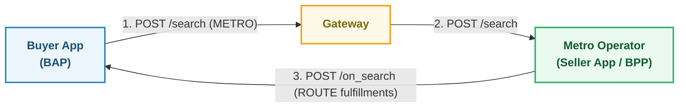
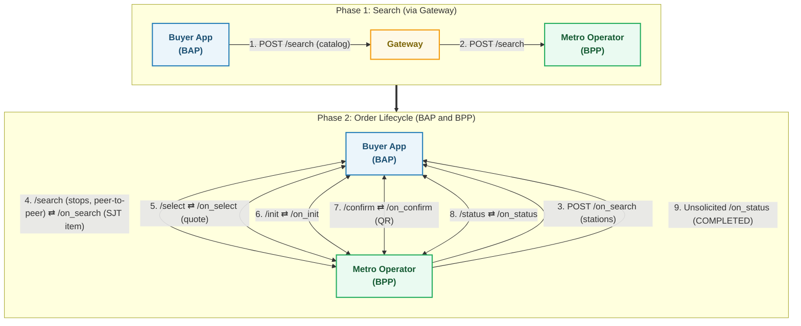
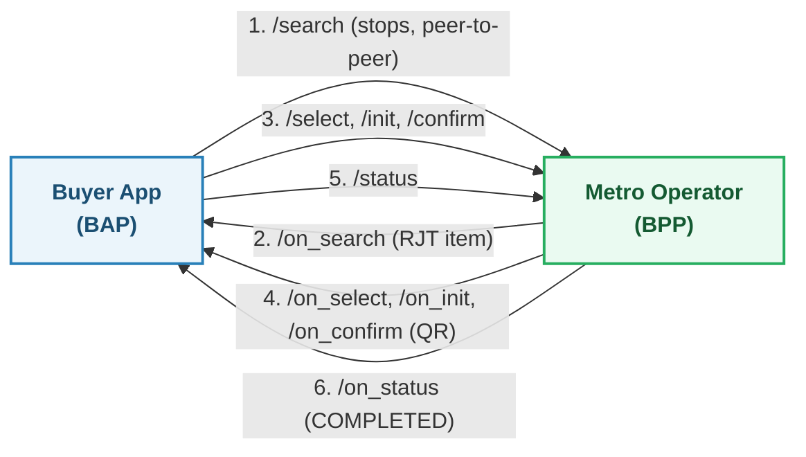
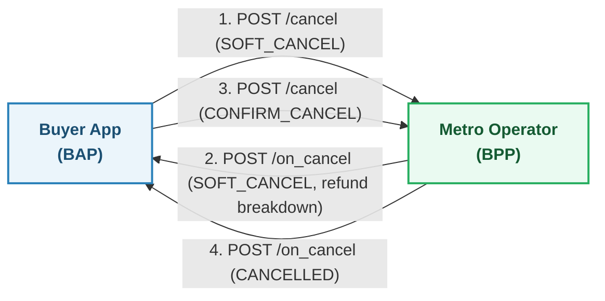
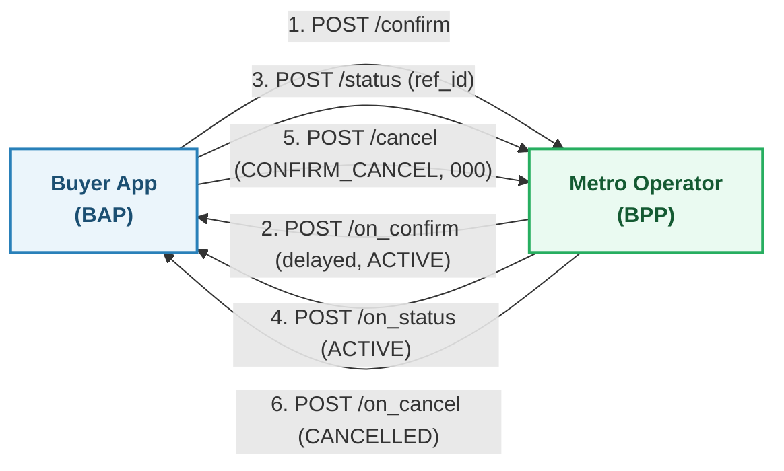
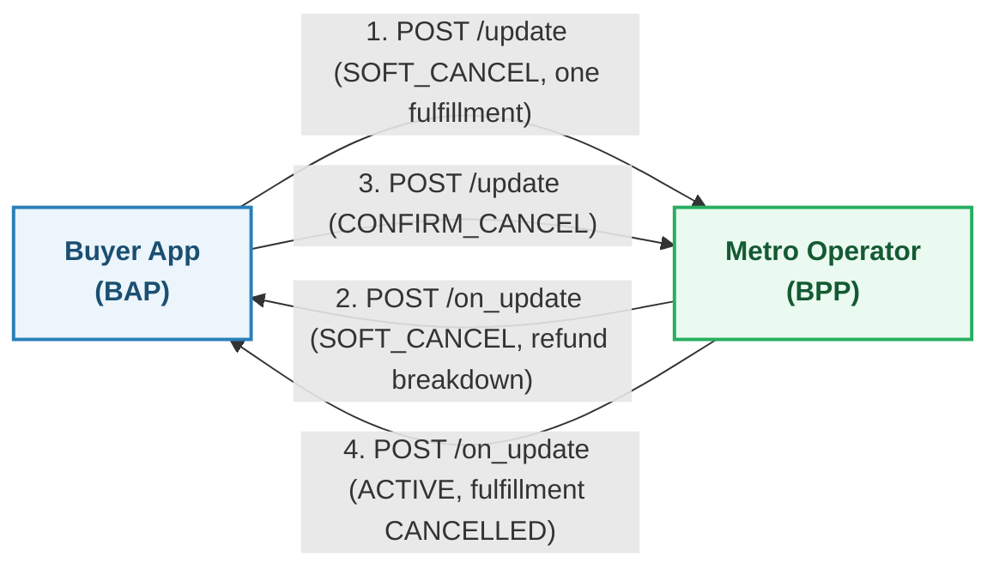
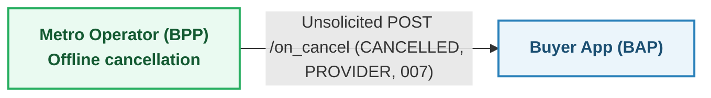
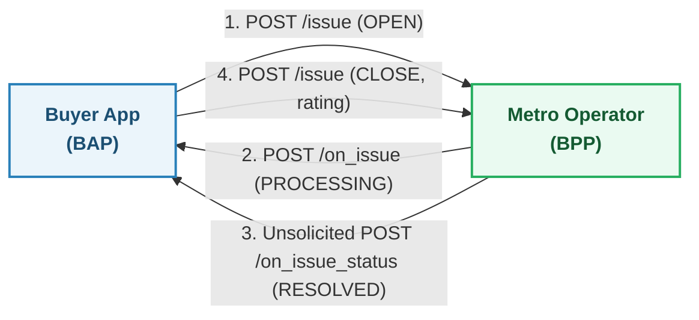
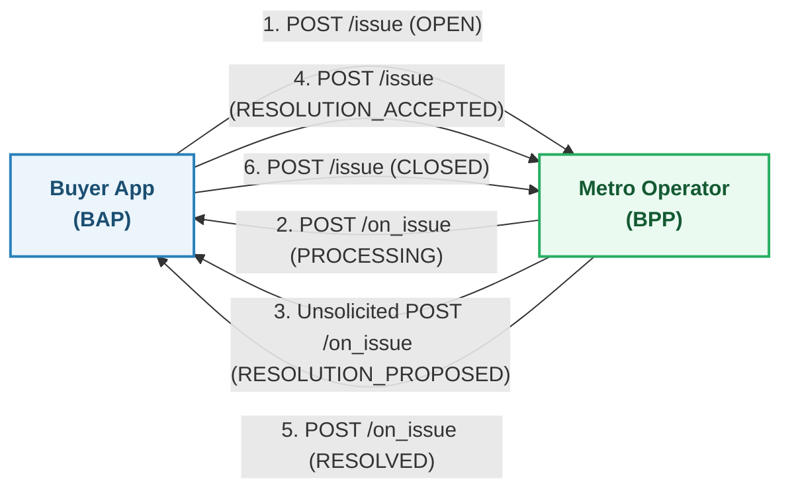

# Metro

---

## Overview

Metro ticketing in `ONDC:TRV11` 2.0.0 lets a buyer discover a metro operator's stations, search a fare between two stations, buy Single Journey Tickets (`SJT`) or Round Journey Tickets (`RJT`), receive a QR ticket for each trip, track the order, and cancel or raise an issue after the booking. Every call is an action pair: the sender issues `X` and the receiver answers with `on_X`. Some callbacks are sent by the Seller App on its own (`unsolicited: true` in the flow files).

What the 2.0.0 Metro flows define:

- Catalog search by city, returning `ROUTE` fulfillments with stops and station codes (`STATION_CODE_FLOW_CATALOG`).
- Station-pair search (`START` / `END` stops) returning fare-bearing items `SJT` (`I1`) and `RJT` (`I2`).
- `select`, `init`, `confirm` and `status` for an order, with payment collected by the Buyer App (`collected_by: BAP`) and the `BUYER_FINDER_FEES` and `SETTLEMENT_TERMS` tag groups.
- One `TRIP` fulfillment per ticket, each with a QR `authorization` on its `START` stop from `on_confirm`.
- Variants of every order and cancellation flow that skip the first `search` and the `select` (`W/O search_1 & select`).
- Cancellation: user (`SOFT_CANCEL` then `CONFIRM_CANCEL`), technical, partial (per fulfillment, through `update`) and seller-initiated offline.
- Issue and Grievance Management (IGM 1.0.0 and IGM 2.0.0).

The use case is marked `TO_BE_DEPRECATED` in `x-status` of `config/index.yaml`.

---

## Participants

| Participant | What This Means |
|---|---|
| **Buyer App (BAP)** | Owns the `search`, `select`, `init`, `confirm`, `status`, `cancel`, `update` and `issue` calls. Collects payment (`payments[].collected_by: BAP`). |
| **Seller App (BPP)** | Owns the `on_search`, `on_select`, `on_init`, `on_confirm`, `on_status`, `on_cancel`, `on_update`, `on_issue` and `on_issue_status` calls, including the unsolicited ones. Owns the catalog, fares, QR tickets and order states. |
| **Gateway** | Sits between the BAP and the BPP for the first `search` (by city, `search1`) only. The second `search` (station to station, `search2`) is peer-to-peer between BAP and BPP, as are all later calls. |

---

## The User Journey

```
[Search Stations] ───► [Search Fare for a Station Pair] ───► [Select Tickets] ───► [Init: Billing & Payment Terms] ───► [Confirm & Pay] ───► [QR Tickets] ───► [Status]
```

Mandatory flags below come from the `REQUIRED_*` tests in `config/validations/index.yaml` and the flow input forms. Attribute descriptions are in `config/attributes/Metro.yaml`.

### 1. Station Discovery (Catalog Search)

The Buyer App searches without stops to get the operator's network.

| Category | Field | Key | Mandatory | Type / Values |
|---|---|---|---|---|
| Context | City | `context.location.city.code` | Yes | Text (for example `*` or `std:080`) |
| Vehicle | Transport Category | `message.intent.fulfillment.vehicle.category` | Yes | ENUM (`METRO`; the validation list is `BUS`, `METRO`) |
| Payment | Collector | `message.intent.payment.collected_by` | Yes (flow payload) | ENUM (`BAP`) |
| Payment tags | Buyer finder fee | `message.intent.payment.tags` → `BUYER_FINDER_FEES` | Yes (flow payload) | `BUYER_FINDER_FEES_PERCENTAGE`, `BUYER_FINDER_FEES_TYPE` (`percent`) |
| | Settlement terms | `message.intent.payment.tags` → `SETTLEMENT_TERMS` | Yes (flow payload) | `DELAY_INTEREST`, `STATIC_TERMS` |

**Network interaction:**

- **`/search`**: The Buyer App (BAP) sends the catalog search with `vehicle.category = METRO` and its payment terms.
- **`/on_search`**: The Seller App (BPP) returns `catalog.providers[]` with:
  - `categories[]`: `C1` (`TICKET`) and `C2` (`PASS`)
  - `time.range` (`start`, `end`) of the provider
  - `fulfillments[]` of `type: ROUTE`, each with `vehicle.category: METRO` and `stops[]`. Stop types are `START`, `INTERMEDIATE_STOP` and `END`; each stop has `id`, `parent_stop_id` (previous stop), `instructions.name`, `location.descriptor.code` (the station code), `location.descriptor.name` and `location.gps`
  - `payments[]` with `collected_by` and the `BUYER_FINDER_FEES` and `SETTLEMENT_TERMS` tag groups (`SETTLEMENT_WINDOW`, `SETTLEMENT_BASIS`, `MANDATORY_ARBITRATION`, `COURT_JURISDICTION`, `STATIC_TERMS`)
  - `tags`: `SCHEDULED_INFO` → `GTFS`

### 2. Fare Search (Station Pair)

| Category | Field | Key | Mandatory | Type / Values |
|---|---|---|---|---|
| Routing | Origin Station Code | `message.intent.fulfillment.stops[type=START].location.descriptor.code` | Yes (flow input) | Text (for example `SHAHEED_STHAL`) |
| | Destination Station Code | `message.intent.fulfillment.stops[type=END].location.descriptor.code` | Yes (flow input) | Text (for example `AZADPUR`) |
| Vehicle | Transport Category | `message.intent.fulfillment.vehicle.category` | Yes | ENUM (`METRO`) |
| Context | City | `context.location.city.code` | Yes | Text |
| Payment | Collector and tags | `message.intent.payment` | Yes (flow payload) | Same as the catalog search |

**Network interaction:**

- **`/search`**: The Buyer App (BAP) repeats the search with a `START` and an `END` stop.
- **`/on_search`**: The Seller App (BPP) returns `items[]`: `I1` `Single Journey Ticket` (`SJT`, price `60` INR) in the SJT flows, or `I2` `Round Journey Ticket` (`RJT`, price `110` INR) in the RJT flows. Each item has `category_ids: [C1]`, `quantity.minimum.count: 1`, `quantity.maximum.count: 6`, `fulfillment_ids` and `time` (`label: Validity`). `fulfillments[]` are of `type: TRIP`.

### 3. Selection and Quote

| Category | Field | Key | Mandatory | Type / Values |
|---|---|---|---|---|
| Provider | Provider ID | `message.order.provider.id` | Yes | Text (`P1`) |
| Item | Item ID | `message.order.items[].id` | Yes | Text (`I1`) |
| | Quantity | `message.order.items[].quantity.selected.count` | Yes | Number |

**Network interaction:**

- **`/select`**: The Buyer App (BAP) sends the provider, item and quantity (example: `I1`, count `2`).
- **`/on_select`**: The Seller App (BPP) returns the priced order:
  - `items[]` with `descriptor.code`, `price`, `quantity.selected.count`, `fulfillment_ids` (the ids of the `TRIP` fulfillments) and `time`
  - one `TRIP` fulfillment per ticket, each with `stops[]` from `START` to `END` (`INTERMEDIATE_STOP` between) and `vehicle.category: METRO`
  - `quote.price` and `quote.breakup[]` with `title: BASE_FARE`, the item, and its price
  - `cancellation_terms[].external_ref` (`mimetype: text/html`, `url`)
  - `tags`: `SCHEDULED_INFO` → `GTFS`

The `W/O search_1 & select` flows skip this stage; their `init` takes the provider, fulfillment and items from a flow input form (`init_with_user_input_METRO_200`).

### 4. Billing and Payment Terms (Init)

| Category | Field | Key | Mandatory | Type / Values |
|---|---|---|---|---|
| Items | Item ID and quantity | `message.order.items[]` | Yes | As in `select` |
| Provider | Provider ID | `message.order.provider.id` | Yes | Text |
| Billing | Name, email, phone | `message.order.billing` | Per flow payload | `name`, `email`, `phone` |
| Payment | Collector | `message.order.payments[].collected_by` | Yes | ENUM (`BAP`, `BPP`) |
| | Status | `message.order.payments[].status` | Yes | ENUM (`NOT-PAID`, `PAID`) |
| | Type | `message.order.payments[].type` | Yes | ENUM (`PRE-ORDER`, `ON-FULFILLMENT`, `POST-FULFILLMENT`); flows use `PRE-ORDER` |
| Payment tags | Settlement terms | `payments[].tags` → `SETTLEMENT_TERMS` | Per flow payload | `SETTLEMENT_AMOUNT`, `SETTLEMENT_WINDOW`, `SETTLEMENT_TYPE`, `DELAY_INTEREST`, `STATIC_TERMS`, `MANDATORY_ARBITRATION`, `COURT_JURISDICTION` |

**Network interaction:**

- **`/init`**: The Buyer App (BAP) sends billing and a payment with `status: NOT-PAID`.
- **`/on_init`**: The Seller App (BPP) returns the order with `billing`, `quote`, `cancellation_terms`, and `payments[]` carrying an `id` (`PA1`) and `params` (`bank_code`, `bank_account_number`).

### 5. Confirmation and Ticketing

| Category | Field | Key | Mandatory | Type / Values |
|---|---|---|---|---|
| Payment | Payment ID | `message.order.payments[].id` | Yes | Text (`PA1`) |
| | Status | `message.order.payments[].status` | Yes | ENUM (`PAID`) |
| | Transaction ID | `message.order.payments[].params.transaction_id` | Yes | Text |
| | Currency and amount | `message.order.payments[].params.currency`, `.amount` | Yes | `INR`, amount as text |

**Network interaction:**

- **`/confirm`**: The Buyer App (BAP) sends the order with `payments[]` marked `PAID`, with `params` and the tag groups.
- **`/on_confirm`**: The Seller App (BPP) returns:
  - `order.id`, `order.status: ACTIVE`, `created_at`, `updated_at`
  - `fulfillments[]` of `type: TRIP`; on each `START` stop an `authorization` with `type: QR`, `token`, `valid_to` and `status: UNCLAIMED`; fulfillment tags `TICKET_INFO` → `NUMBER`
  - `quote`, `payments[]` (with `params.bank_code` and `bank_account_number`), `cancellation_terms` and `tags` (`SCHEDULED_INFO` → `GTFS`)

### 6. Status and Journey Completion

**Network interaction:**

- **`/status`**: The Buyer App (BAP) sends `order_id`.
- **`/on_status`**: The Seller App (BPP) returns the order. After the journey the example has `order.status: COMPLETED` and `authorization.status: CLAIMED` on the ticket stops. The flows also include an unsolicited `on_status` with the same completion state.

---

## Additional Scenarios

### 1. User Cancellation (Full Cancellation)

```
[cancel SOFT_CANCEL] ───► [on_cancel: SOFT_CANCEL + refund breakdown] ───► [cancel CONFIRM_CANCEL] ───► [on_cancel: CANCELLED]
```

- **`/cancel` (soft)**: `descriptor.code: SOFT_CANCEL`, `cancellation_reason_id` (example `005`), `order_id`.
- **`/on_cancel` (soft)**: `order.status: SOFT_CANCEL`, `cancellation.cancelled_by: CONSUMER`, `cancellation_terms`, and a quote with `BASE_FARE`, `REFUND` (negative) and `CANCELLATION_CHARGES`.
- **`/cancel` (hard)**: `descriptor.code: CONFIRM_CANCEL`.
- **`/on_cancel` (hard)**: `order.status: CANCELLED` with the final quote breakup.

### 2. Technical Cancellation

```
[confirm] ───► [on_confirm (delayed, ACTIVE)] ───► [status (ref_id)] ───► [on_status (ACTIVE)] ───► [cancel CONFIRM_CANCEL, reason 000] ───► [on_cancel: CANCELLED]
```

- **`/on_confirm` (delayed)**: order `ACTIVE` with QR authorization `UNCLAIMED`.
- **`/status`**: carries `ref_id`. **`/on_status`** returns `order.status: ACTIVE`.
- **`/cancel`**: `descriptor.code: CONFIRM_CANCEL`, `cancellation_reason_id: 000`.
- **`/on_cancel`**: `order.status: CANCELLED`, `cancellation.cancelled_by: CONSUMER`, `cancellation.reason.descriptor.code: 000`, quote with `BASE_FARE`, `REFUND`, `CANCELLATION_CHARGES`.

### 3. Partial Cancellation (via `/update`)

```
[update SOFT_CANCEL for one fulfillment] ───► [on_update: SOFT_CANCEL + refund breakdown] ───► [update CONFIRM_CANCEL] ───► [on_update: ACTIVE, fulfillment CANCELLED]
```

- **`/update` (soft)**: `update_target: order.fulfillments`, `order.id`, one fulfillment (`type: TRIP`), `order.cancellation.reason.id: 001`, `order.cancellation.reason.descriptor.code: SOFT_CANCEL`.
- **`/on_update` (soft)**: `order.status: SOFT_CANCEL`; quote with `BASE_FARE`, `CANCELLATION_CHARGES` and `REFUND` (the `REFUND` item carries `fulfillment_ids` of the cancelled fulfillment); `cancellation_terms` with `cancel_by.duration` and `cancellation_fee.percentage`.
- **`/update` (confirm)**: same target with `descriptor.code: CONFIRM_CANCEL`.
- **`/on_update` (confirm)**: `order.status: ACTIVE`; the cancelled fulfillment has `state.descriptor.code: CANCELLED`; the other fulfillment stays in the order.

### 4. Seller Offline Cancellation

```
[Seller cancels offline] ───► [unsolicited on_cancel: CANCELLED, cancelled_by PROVIDER, reason 007]
```

- **`/on_cancel` (unsolicited)**: `order.status: CANCELLED`, `cancellation.cancelled_by: PROVIDER`, `cancellation.reason.descriptor.code: 007`, a quote with `BASE_FARE`, `REFUND` and `CANCELLATION_CHARGES`, and QR `authorization.status: UNCLAIMED`.

---

## Issue and Grievance Management

The flows define two IGM versions after an order that reached `on_status`. Calls are `issue` (BAP), `on_issue` (BPP) and, in 1.0.0, `on_issue_status` (BPP, unsolicited).

**IGM 2.0.0** payloads use `issue.status` (`OPEN`, `PROCESSING`, `RESOLVED`, `CLOSED`), `issue.level` (`ISSUE`; the escalation flow also uses `GREVIENCE`, spelled as in the payloads), `issue.descriptor.code` (`FLM101`), `issue.refs[].ref_type` (`ORDER`, `PROVIDER`, `FULFILLMENT`, `ITEM`), `issue.actions[].descriptor.code` (`OPEN`, `PROCESSING`, `INFO_REQUESTED`, `INFO_PROVIDED`, `RESOLUTION_PROPOSED`, `RESOLUTION_ACCEPTED`, `RESOLUTION_REJECTED`, `ESCALATED`, `RESOLVED`, `CLOSED`), `issue.actors[].type` (`CONSUMER`, `INTERFACING_NP`, `COUNTERPARTY_NP`, `COUNTERPARTY_NP_GRO`) and `update_target[].action: APPENDED`.

**IGM 1.0.0** payloads use `issue.issue_type`, `issue.category` (`FULFILLMENT`), `issue.sub_category` (`FLM101`), `issue.source.type` (`CONSUMER`), `issue.issue_actions.complainant_actions[]` (`OPEN`, `CLOSE`), `issue.issue_actions.respondent_actions[]` (`PROCESSING`, `RESOLVED`), `issue.resolution_provider.respondent_info.type` (`TRANSACTION-COUNTERPARTY-NP`) and `issue.rating` (`THUMBS_UP`) on close.

---

## Detailed Protocol Flows

All flows below are in `config/flows/Metro` (16 flows). Each order flow also exists as a `W/O search_1 & select` variant unless noted.

### Flow 1: Metro – Station Code Catalog (`STATION_CODE_FLOW_CATALOG`)

#### 1. Short Description

The Buyer App searches without stops to fetch the operator's routes and station codes. This flow has two steps and no `W/O search_1 & select` variant.

#### 2. Visual Interaction Map



#### 3. API Breakdown & Technical Actions

- **`/search` (BAP → Gateway → BPP)**: `search1_METRO_200`; `vehicle.category = METRO`, payment terms in tags.
- **`/on_search` (BPP → BAP)**: `on_search1_METRO_200`; categories, provider time range, `ROUTE` fulfillments with station codes, payment tags and `GTFS`.

---

### Flow 2: Metro – Order Journey, Single Journey Ticket (`ORDER_TO_CONFIRM_TO_JOURNEY_COMPLETION_SJT`)

#### 1. Short Description

A purchase from catalog search to journey completion for `SJT` tickets. The `(W/O search_1 & select)` variant starts at the fare search and uses `init_with_user_input_METRO_200` in place of `select`.

#### 2. Visual Interaction Map



#### 3. API Breakdown & Technical Actions

- **`/search` and `/on_search`** (`search1`, `on_search1`, `search2`, `on_search2_Sjt`): catalog (by city, via Gateway), then station pair (peer-to-peer, direct to the BPP); the second `on_search` returns item `I1` (`SJT`).
- **`/select` and `/on_select`**: item, quantity and quote with `BASE_FARE`; one `TRIP` fulfillment per ticket.
- **`/init` and `/on_init`**: billing and `NOT-PAID` payment; the seller returns `payments[].id`.
- **`/confirm` and `/on_confirm`**: `PAID` payment; the seller returns `order.status: ACTIVE` and QR authorization `UNCLAIMED`.
- **`/status` and `/on_status`** (`on_status_complete_METRO_200`), then an unsolicited `on_status` (`unsoliciated_on_status_complete_METRO_200`): `order.status: COMPLETED`, QR `CLAIMED`.

---

### Flow 3: Metro – Order Journey, Round Journey Ticket (`ORDER_TO_CONFIRM_TO_JOURNEY_COMPLETION_RJT`)

#### 1. Short Description

Same sequence as the SJT flow. The fare search `on_search` (`on_search2_Rjt_METRO_200`) returns item `I2` (`RJT`, price `110` INR). Both the full flow and its `W/O search_1 & select` variant exist.

#### 2. Process Flow



#### 3. API Breakdown & Technical Actions

- Steps and payload fields are the same as Flow 2; only the item (`I2`, `RJT`) and its price differ.

---

### Flow 4: Metro – User Cancellation (`USER_CANCELLATION_FLOW`)

#### 1. Short Description

An order through `on_confirm`, followed by a soft cancel and a confirmed cancel. Both the full flow and its `W/O search_1 & select` variant exist.

#### 2. Process Flow



#### 3. API Breakdown & Technical Actions

- **`/cancel`** (`cancel_soft_METRO_200`, `cancel_hard_METRO_200`): `order_id`, `cancellation_reason_id`, `descriptor.name`, `descriptor.code`.
- **`/on_cancel`** (`on_cancel_soft_METRO_200`, `on_cancel_hard_METRO_200`): `SOFT_CANCEL` then `CANCELLED`, `cancelled_by: CONSUMER`, quote with `BASE_FARE`, `REFUND`, `CANCELLATION_CHARGES`.

---

### Flow 5: Metro – Technical Cancellation (`TECHNICAL_CANCELLATION_FLOW`)

#### 1. Short Description

The order reaches a delayed `on_confirm`, the Buyer App checks `status`, then cancels with reason `000`. Both the full flow and its `W/O search_1 & select` variant exist.

#### 2. Process Flow



#### 3. API Breakdown & Technical Actions

- **Steps:** `on_confirm_delayed_METRO_200`, `status_tech_cancel_METRO_200`, `on_status_active_METRO_200`, `cancel_tech_METRO_200`, `on_cancel_tech_METRO_200`.
- **Key values:** `cancellation_reason_id: 000`, `cancellation.cancelled_by: CONSUMER`, `order.status: CANCELLED`.

---

### Flow 6: Metro – Partial Cancellation (`PARTIAL_CANCELLATION_FLOW`)

#### 1. Short Description

A two-ticket order in which one fulfillment is cancelled through `update`. Both the full flow and its `W/O search_1 & select` variant exist.

#### 2. Process Flow



#### 3. API Breakdown & Technical Actions

- **`/update`** (`update_METRO_201`, `update_METRO_202`): `update_target: order.fulfillments`, reason id `001`.
- **`/on_update`** (`on_update_METRO_201`, `on_update_METRO_202`): quote with `BASE_FARE`, `CANCELLATION_CHARGES`, `REFUND`; final order state `ACTIVE` with the cancelled fulfillment in state `CANCELLED`.

---

### Flow 7: Metro – Seller Offline Cancellation (`SELLER_OFFLINE_CANCELLATION (W/O search_1 & select)`)

#### 1. Short Description

Only the `W/O search_1 & select` form exists. After `on_confirm` the Seller App sends an unsolicited `on_cancel`.

#### 2. Process Flow



#### 3. API Breakdown & Technical Actions

- **`/on_cancel`** (`on_cancel_unsoliciated`): `order.status: CANCELLED`, `cancelled_by: PROVIDER`, reason `007`, `REFUND` in the quote.

---

### Flow 8: Metro – IGM 1.0.0 (`ORDER_TO_CONFIRM_TO_JOURNEY_COMPLETION_SJT (W/O search_1 & select) With_IGM(v-1.0.0)`)

#### 1. Short Description

The SJT order through the status and unsolicited completion, then an issue.

#### 2. Process Flow



#### 3. API Breakdown & Technical Actions

- **Steps:** `issue_open_100`, `on_issue_processing_100`, `on_issue_resolved_100` (unsolicited `on_issue_status`), `issue_close_100`. `issue_close_100` takes a `rating` input (`THUMBS_UP`, `THUMBS_DOWN`).

---

### Flow 9: Metro – IGM 2.0.0 (three flows)

All three are `W/O search_1 & select` SJT flows through `on_status_complete`, followed by the issue steps below (`*` = unsolicited).

| Flow ID | Issue steps |
|---|---|
| `..._SJT_WITHOUT_SEARCH_ND_SELECT_With_IGM_v-2.0.0` | `issue_open` → `on_issue_processing` → `on_issue_need_more_info`* → `issue_info_provided` → `on_issue_provided` → `on_issue_resolution`* → `issue_resolution_accept` → `on_issue_resolved` → `issue_close` |
| `..._With_IGM_Rejection_v-2.0.0` | `issue_open` → `on_issue_processing` → `on_issue_resolution`* → `issue_resolution_reject` → `on_issue_processing_1` → `on_issue_resolution_1`* → `issue_escalate` → `on_issue_processing_2` → `on_issue_resolution_2`* → `issue_resolution_accept` → `on_issue_resolved` → `issue_close` |
| `..._With_IGM_No_Action_v-2.0.0` | `issue_open_2` → `on_issue_processing` → `on_issue_resolution_igm_3`* → `issue_resolution_accept_igm_3` → `on_issue_resolved_igm_3` → `issue_close_igm_3` |



---

## Flow Catalogue

| Flow ID | Use |
|---|---|
| `STATION_CODE_FLOW_CATALOG` | Catalog search with route and station codes |
| `ORDER_TO_CONFIRM_TO_JOURNEY_COMPLETION_SJT` | SJT order, search to completion |
| `ORDER_TO_CONFIRM_TO_JOURNEY_COMPLETION_SJT (W/O search_1 & select)` | Same, starting at fare search |
| `ORDER_TO_CONFIRM_TO_JOURNEY_COMPLETION_RJT` | RJT order, search to completion |
| `ORDER_TO_CONFIRM_TO_JOURNEY_COMPLETION_RJT (W/O search_1 & select)` | Same, starting at fare search |
| `USER_CANCELLATION_FLOW` | Soft then confirmed cancellation |
| `USER_CANCELLATION_FLOW (W/O search_1 & select)` | Same, starting at fare search |
| `TECHNICAL_CANCELLATION_FLOW` | Delayed `on_confirm`, then cancel with reason `000` |
| `TECHNICAL_CANCELLATION_FLOW (W/O search_1 & select)` | Same, starting at fare search |
| `PARTIAL_CANCELLATION_FLOW` | Cancel one fulfillment through `update` |
| `PARTIAL_CANCELLATION_FLOW (W/O search_1 & select)` | Same, starting at fare search |
| `SELLER_OFFLINE_CANCELLATION (W/O search_1 & select)` | Unsolicited `on_cancel` from the seller |
| `ORDER_TO_CONFIRM_TO_JOURNEY_COMPLETION_SJT (W/O search_1 & select) With_IGM(v-1.0.0)` | Order, then IGM 1.0.0 issue |
| `ORDER_TO_CONFIRM_TO_JOURNEY_COMPLETION_SJT_WITHOUT_SEARCH_ND_SELECT_With_IGM_v-2.0.0` | Order, then IGM 2.0.0 with more-info path |
| `ORDER_TO_CONFIRM_TO_JOURNEY_COMPLETION_SJT_WITHOUT_SEARCH_ND_SELECT_With_IGM_Rejection_v-2.0.0` | Order, then IGM 2.0.0 with rejection and escalation |
| `ORDER_TO_CONFIRM_TO_JOURNEY_COMPLETION_SJT_WITHOUT_SEARCH_ND_SELECT_With_IGM_No_Action_v-2.0.0` | Order, then IGM 2.0.0 with no action by the buyer |

---

## Key Data Model

| Object | Values in the flows and validations |
|---|---|
| `context.domain`, `context.version` | `ONDC:TRV11`, `2.0.0` |
| `context.ttl` | `PT30S` |
| Item `descriptor.code` | `SJT`, `RJT` in the flows (validation list also has `SFSJT`, `PASS`) |
| Fulfillment `type` | `ROUTE` (`on_search` catalog), `TRIP` (search by station pair onward) |
| Stop `type` | `START`, `INTERMEDIATE_STOP`, `END` (also `TRANSIT_STOP` in the validation list) |
| `order.status` | `ACTIVE`, `COMPLETED`, `SOFT_CANCEL`, `CANCELLED` |
| `payments[].status` / `type` | `NOT-PAID`, `PAID` / `PRE-ORDER` |
| `authorization` | `type: QR`; `status`: `UNCLAIMED`, `CLAIMED` |
| `cancel` `descriptor.code` | `SOFT_CANCEL`, `CONFIRM_CANCEL` |
| `cancellation_reason_id` | `005` (user cancel), `000` (technical), `001` (partial, in `update`), `007` (offline, on `on_cancel`) |
| `cancellation.cancelled_by` | `CONSUMER`, `PROVIDER` |
| `quote.breakup[].title` | `BASE_FARE`, `REFUND`, `CANCELLATION_CHARGES` (validation list adds `OFFER`, `TOLL`) |
| `update_target` | `order.fulfillments` |
| Payment tag `BUYER_FINDER_FEES` | `BUYER_FINDER_FEES_PERCENTAGE`, `BUYER_FINDER_FEES_TYPE` |
| Payment tag `SETTLEMENT_TERMS` | `SETTLEMENT_AMOUNT`, `SETTLEMENT_WINDOW`, `SETTLEMENT_BASIS`, `SETTLEMENT_TYPE`, `DELAY_INTEREST`, `STATIC_TERMS`, `MANDATORY_ARBITRATION`, `COURT_JURISDICTION` |
| Other tags | `SCHEDULED_INFO` → `GTFS`; `TICKET_INFO` → `NUMBER` |

---

## Error Codes

Error codes for this version are defined in `config/errors/index.yaml`.
