# Metro

---

## Overview

Metro ticketing in `ONDC:TRV11` 2.0.1 lets a buyer discover a metro operator's stations, search a fare between two stations, buy Single Journey Tickets (`SJT`) or Round Journey Tickets (`RJT`), receive a QR ticket, track the order, and cancel, change the end stop or raise an issue after the booking. Every call is an action pair: the sender issues `X` and the receiver answers with `on_X`. Some callbacks are sent by the Seller App on its own (`unsolicited: true` in the flow files).

What the 2.0.1 Metro flows define:

- Catalog search by city, returning `ROUTE` fulfillments with stops and station codes (`STATION_CODE_FLOW_CATALOG`).
- Station-pair search (`START` / `END` stops) returning fare-bearing items `SJT` (`I1`) and `RJT` (`I2`).
- `select`, `init`, `confirm` and `status` for an order, with payment collected by the Buyer App (`collected_by: BAP`) and the `BUYER_FINDER_FEES` and `SETTLEMENT_TERMS` tag groups.
- A `TRIP` fulfillment and a `TICKET` fulfillment from `on_select` onward, with a QR `authorization` on the `START` stop of the `TICKET` fulfillment from `on_confirm`.
- Variants of every flow that skip the first `search` and the `select` (`W/O Search1 and Select`).
- Cancellation: user (`SOFT_CANCEL` then `CONFIRM_CANCEL`), technical, delayed (accepted and rejected, for technical and user cancellation), partial (through `update`) and offline.
- End stop update through `update` / `on_update`.
- Issue and Grievance Management (IGM 1.0.0 and IGM 2.0.0).

The use case is marked `RELEASED` in `x-status` of `config/index.yaml`.

---

## Participants

| Participant | What This Means |
|---|---|
| **Buyer App (BAP)** | Owns the `search`, `select`, `init`, `confirm`, `status`, `cancel`, `update` and `issue` calls. Collects payment (`payments[].collected_by: BAP`). |
| **Seller App (BPP)** | Owns the `on_search`, `on_select`, `on_init`, `on_confirm`, `on_status`, `on_cancel`, `on_update`, `on_issue` and `on_issue_status` calls, including the unsolicited ones. Owns the catalog, fares, QR tickets and order states. |
| **Gateway** | Sits between the BAP and the BPP for the first `search` (by city, `search1`) only. The second `search` (station to station, `search2`) is peer-to-peer between BAP and BPP, as are all later calls. |

---

## The User Journey

```
[Search Stations] ───► [Search Fare for a Station Pair] ───► [Select Ticket] ───► [Init: Billing & Payment Terms] ───► [Confirm & Pay] ───► [QR Ticket] ───► [Status]
```

Mandatory flags below are marked `Yes` only where `config/validations/index.yaml` has a presence test for the field. `—` means no presence test exists; the field may still be present in the flow payloads. Attribute descriptions are in `config/attributes/Metro.yaml`.

### 1. Station Discovery (Catalog Search)

The Buyer App searches without stops to get the operator's network.

| Category | Field | Key | Mandatory | Type / Values |
|---|---|---|---|---|
| Context | Domain, action, version, timestamp, ids | `context.domain`, `context.action`, `context.version`, `context.timestamp`, `context.bap_id`, `context.bap_uri`, `context.transaction_id`, `context.message_id` | Yes | `ONDC:TRV11`, `search`, `2.0.1` in the examples |
| | Country | `context.location.country.code` | Yes | ENUM (`IND`) |
| | City | `context.location.city.code` | — | Text (for example `std:011`); validation format `^std:0\d+$`, flow input pattern `^std:\d{3,5}$` |
| Vehicle | Transport Category | `message.intent.fulfillment.vehicle.category` | Yes | ENUM (`BUS`, `METRO`); the flows use `METRO` |
| Payment | Collector | `message.intent.payment.collected_by` | — | ENUM (`BAP`) in the examples |
| Payment tags | Buyer finder fee | `message.intent.payment.tags` → `BUYER_FINDER_FEES` | — | `BUYER_FINDER_FEES_PERCENTAGE` |
| | Settlement terms | `message.intent.payment.tags` → `SETTLEMENT_TERMS` | — | `DELAY_INTEREST`, `STATIC_TERMS` |

**Network interaction:**

- **`/search`** (BAP → Gateway → BPP): The Buyer App (BAP) sends the catalog search (`search1_METRO_201`) with `vehicle.category = METRO`, its payment terms and a city code from a flow input form (`city_code`).
- **`/on_search`**: The Seller App (BPP) returns `catalog.descriptor` and `catalog.providers[]` with:
  - `categories[]`: `C1` (`TICKET`) and `C2` (`PASS`)
  - `time.range` (`start`, `end`) of the provider
  - `fulfillments[]` of `type: ROUTE`, each with `vehicle.category: METRO`, `stops[]` and the tag group `ROUTE_INFO` (`ROUTE_ID`, `ROUTE_NAME`). Each stop has `id`, `type`, `instructions.name`, `location.descriptor.code` (the station code), `location.descriptor.name` and `location.gps`
  - `payments[]` with `collected_by` and the `BUYER_FINDER_FEES` and `SETTLEMENT_TERMS` tag groups (`SETTLEMENT_WINDOW`, `SETTLEMENT_BASIS`, `MANDATORY_ARBITRATION`, `COURT_JURISDICTION`, `STATIC_TERMS`)
  - `tags`: `SCHEDULED_INFO` → `GTFS`

### 2. Fare Search (Station Pair)

| Category | Field | Key | Mandatory | Type / Values |
|---|---|---|---|---|
| Routing | Origin Station Code | `message.intent.fulfillment.stops[type=START].location.descriptor.code` | — (flow input `start_code`) | Text (default `MOCK_STATION_1`) |
| | Destination Station Code | `message.intent.fulfillment.stops[type=END].location.descriptor.code` | — (flow input `end_code`) | Text (default `MOCK_STATION_2`) |
| Vehicle | Transport Category | `message.intent.fulfillment.vehicle.category` | Yes | ENUM (`METRO`) |
| Payment | Collector and tags | `message.intent.payment` | — | Same as the catalog search |
| Context | Seller App id and URI | `context.bpp_id`, `context.bpp_uri` | — | Present in the `search2` examples of the full flows |

**Network interaction:**

- **`/search`** (BAP → BPP, peer-to-peer): The Buyer App (BAP) repeats the search (`search2_METRO_201`) with a `START` and an `END` stop.
- **`/on_search`**: The Seller App (BPP) returns `items[]` `I1` (`SJT`, price `60`) and `I2` (`RJT`, price `110`). Each item has `category_ids: [C1]`, `quantity.maximum.count: 6`, `fulfillment_ids` and `time` (`label: Validity`, `duration: P2D`). The two items share one fulfillment; its `type` is `ROUTE` in some flows and `TRIP` in others (the validation list is `ROUTE`, `TRIP`).

### 3. Selection and Quote

| Category | Field | Key | Mandatory | Type / Values |
|---|---|---|---|---|
| Provider | Provider ID | `message.order.provider.id` | Yes | Text (`P1`) |
| Item | Item ID | `message.order.items[].id` | Yes | Text (`I1`) |
| | Quantity | `message.order.items[].quantity.selected.count` | Yes | Number (flow input default `1`) |

**Network interaction:**

- **`/select`**: The Buyer App (BAP) sends the provider, item and quantity (example: `I1`, count `1`).
- **`/on_select`**: The Seller App (BPP) returns the priced order:
  - `items[]` with `descriptor.code`, `price`, `quantity.selected.count`, `fulfillment_ids` and `time`
  - a `TRIP` fulfillment and a `TICKET` fulfillment; the `TICKET` fulfillment has the tag group `INFO` (`PARENT_ID`)
  - `quote.price` and `quote.breakup[]` with `title: BASE_FARE`, the item and its price
  - `cancellation_terms[].external_ref`
  - `tags`: `SCHEDULED_INFO` → `GTFS`

The `W/O Search1 and Select` flows skip this stage; their `init` (`init_without_select_METRO_201`) takes the provider, items and billing from a flow input form (`init_metro_trv11`).

### 4. Billing and Payment Terms (Init)

| Category | Field | Key | Mandatory | Type / Values |
|---|---|---|---|---|
| Items | Item ID and quantity | `message.order.items[]` | Yes | As in `select` |
| Provider | Provider ID | `message.order.provider.id` | Yes | Text |
| Billing | Name, email, phone | `message.order.billing` | — | `name`, `email`, `phone` |
| Payment | Collector | `message.order.payments[].collected_by` | Yes | ENUM (`BAP`, `BPP`) |
| | Status | `message.order.payments[].status` | Yes | ENUM (`NOT-PAID`, `PAID`) |
| | Type | `message.order.payments[].type` | Yes | ENUM (`PRE-ORDER`, `ON-FULFILLMENT`, `POST-FULFILLMENT`); the flows use `PRE-ORDER` |
| Payment tags | Settlement terms | `payments[].tags` → `SETTLEMENT_TERMS` | — | `SETTLEMENT_AMOUNT`, `SETTLEMENT_TYPE`, `DELAY_INTEREST`, `STATIC_TERMS`, `MANDATORY_ARBITRATION`, `COURT_JURISDICTION` |
| | Buyer finder fee | `payments[].tags` → `BUYER_FINDER_FEES` | — | `BUYER_FINDER_FEES_PERCENTAGE` |

**Network interaction:**

- **`/init`**: The Buyer App (BAP) sends billing and a payment with `status: NOT-PAID`, `type: PRE-ORDER`, `collected_by: BAP`.
- **`/on_init`**: The Seller App (BPP) returns the order with `quote`, `cancellation_terms`, the `TRIP` and `TICKET` fulfillments, and `payments[]` with an `id` and `params` (`bank_code`, `bank_account_number`).

### 5. Confirmation and Ticketing

| Category | Field | Key | Mandatory | Type / Values |
|---|---|---|---|---|
| Payment | Payment ID | `message.order.payments[].id` | Yes | Text |
| | Status | `message.order.payments[].status` | Yes | ENUM (`PAID`) |
| | Transaction ID | `message.order.payments[].params.transaction_id` | Yes | Text |
| | Currency and amount | `message.order.payments[].params.currency`, `.amount` | Yes | `INR`, amount as text |

**Network interaction:**

- **`/confirm`**: The Buyer App (BAP) sends the order with `payments[]` marked `PAID`, with `params` and the tag groups (`SETTLEMENT_WINDOW` and `SETTLEMENT_BASIS` are added to `SETTLEMENT_TERMS`).
- **`/on_confirm`**: The Seller App (BPP) returns:
  - `order.id`, `order.status: ACTIVE`, `created_at`, `updated_at`
  - `fulfillments[]`: a `TRIP` fulfillment and a `TICKET` fulfillment; on the `START` stop of the `TICKET` fulfillment an `authorization` with `type: QR`, `token`, `valid_to` and `status: UNCLAIMED`; `TICKET` tags `INFO` (`PARENT_ID`) and `TICKET_INFO` (`NUMBER`)
  - `items[].time` (`label: Validity`, `duration: P2D`), `quote`, `payments[]` (with `params.bank_code` and `bank_account_number`), `cancellation_terms` and `tags` (`SCHEDULED_INFO` → `GTFS`)

### 6. Status and Journey Completion

**Network interaction:**

- **`/status`**: The Buyer App (BAP) sends `order_id` (`ref_id` in the technical and delayed cancellation flows).
- **`/on_status`**: The Seller App (BPP) returns the order. After the journey the example has `order.status: COMPLETED` and `authorization.status: CLAIMED` on the ticket stop.

---

## Additional Scenarios

All scenarios below start with the order sequence (search to `on_confirm`) in a full form and a `W/O Search1 and Select` form.

### 1. User Cancellation (Full Cancellation)

```
[cancel SOFT_CANCEL] ───► [on_cancel: SOFT_CANCEL + refund breakdown] ───► [cancel CONFIRM_CANCEL] ───► [on_cancel: CANCELLED]
```

- **`/cancel` (soft)**: `order_id`, `cancellation_reason_id: 006`, `descriptor` (`code: SOFT_CANCEL`, `name: Ride Cancellation`).
- **`/on_cancel` (soft)**: `order.status: SOFT_CANCEL`, `order.cancellation.cancelled_by: CONSUMER`, reason code `006`, and a quote with `BASE_FARE`, `REFUND` and `CANCELLATION_CHARGES`.
- **`/cancel` (hard)**: `cancellation_reason_id: 000`, `descriptor.code: CONFIRM_CANCEL`.
- **`/on_cancel` (hard)**: `order.status: CANCELLED`, `cancelled_by: CONSUMER`, reason code `000`.

### 2. Technical Cancellation

```
[on_confirm (delayed)] ───► [status with ref_id] ───► [on_status: ACTIVE] ───► [cancel CONFIRM_CANCEL, reason 000] ───► [on_cancel: CANCELLED]
```

- **`/on_confirm` (`on_confirm_delayed_METRO_201`)**: `order.status: ACTIVE`.
- **`/status` and `/on_status`**: the request carries `ref_id`; the response has `order.status: ACTIVE` and the QR `authorization` still `UNCLAIMED`.
- **`/cancel`** (`cancel_tech_METRO_201`): `descriptor.code: CONFIRM_CANCEL`, `cancellation_reason_id: 000`.
- **`/on_cancel`**: `order.status: CANCELLED`, `cancelled_by: CONSUMER`, reason code `000`, quote with `BASE_FARE`, `REFUND`, `CANCELLATION_CHARGES`.

### 3. Delayed Cancellation (Accepted or Rejected)

Four flows: accepted or rejected, each for a technical cancellation (reason `000`) and a user cancellation (reason `007`).

```
[on_confirm (delayed)] ───► [status] ───► [on_status: ACTIVE] ───► [cancel CONFIRM_CANCEL] ───► [on_cancel: CANCELLATION_INITIATED] ───► [unsolicited: accepted or rejected]
```

- **`/cancel`**: `descriptor.code: CONFIRM_CANCEL`, `cancellation_reason_id` `000` (technical) or `007` (user).
- **`/on_cancel` (`on_cancel_init_METRO_201`)**: `order.status: CANCELLATION_INITIATED`, `cancelled_by: CONSUMER`.
- **Accepted**: unsolicited `/on_update` (`on_update_accepted_METRO_201`) with `order.status: CANCELLED`, a quote with `BASE_FARE`, `REFUND` and `CANCELLATION_CHARGES`, and `cancellation_terms` with `cancel_by` and `cancellation_fee`.
- **Rejected**: unsolicited `/on_status` (`on_status_cancel_METRO_201`) with `order.status: COMPLETED` and `authorization.status: CLAIMED` on the ticket stops.

### 4. Partial Cancellation

```
[update SOFT_UPDATE] ───► [on_update: SOFT_UPDATE] ───► [update CONFIRM_UPDATE] ───► [on_update: UPDATED]
```

- **`/update`** (`update_partial_cancellation_1`, `_2`): `update_target: order.fulfillments`, `order.id`, `order.status` `SOFT_UPDATE` then `CONFIRM_UPDATE`. The fulfillment to cancel comes from a flow input (`fulfillments[]` with `id` and `type`, enum `TICKET`).
- **`/on_update`**: `order.status` `SOFT_UPDATE`, then `UPDATED`; fulfillments `ROUTE` and `TICKET`; the final response adds a payment `NOT-PAID` / `POST-FULFILLMENT` with amount `-10`.

### 5. End Stop Update

```
[update SOFT_UPDATE] ───► [on_update] ───► [update CONFIRM_UPDATE] ───► [on_update: UPDATED] ───► [update payments] ───► [on_update: UPDATED]
```

- **`/update` 1 and 2** (`update_end_stop_1`, `_2`): `update_target: order.fulfillments`, `order.status` `SOFT_UPDATE` then `CONFIRM_UPDATE`, one fulfillment with the new `END` stop (`location.descriptor.code` from the flow input `end_code`, default `MOCK_STATION_5`).
- **`/on_update` 1 and 2**: `SOFT_UPDATE`, then `UPDATED`; the second response adds a payment `NOT-PAID` / `POST-FULFILLMENT` with amount `-10`.
- **`/update` 3** (`update_end_stop_3`): `update_target: payments`, a payment with `collected_by: BAP`, `status: PAID`, `type: POST-FULFILLMENT` and `params` (`amount`, `currency`, `transaction_id`).
- **`/on_update` 3**: `order.status: UPDATED`; payments `PAID` / `PRE-ORDER` (amount `60.00`) and `PAID` / `POST-FULFILLMENT` (amount `50.00`).

### 6. Offline (Seller) Cancellation

```
[confirm] ───► [on_confirm] ───► [unsolicited on_cancel: CANCELLATION_INITIATED]
```

- **`/on_cancel`** (`on_cancel_offline`, unsolicited): `order.status: CANCELLATION_INITIATED`, `order.cancellation.cancelled_by: CONSUMER`, `cancellation.reason.descriptor.code: 000`, `TRIP` and `TICKET` fulfillments with the QR `authorization` `UNCLAIMED`.

---

## Issue and Grievance Management

Four IGM flow families run the order sequence through `status` / `on_status`, then the issue calls. Each exists in a full and a `W/O Search1 and Select` form.

| Flow | Issue steps (`issue` = BAP, `on_issue` = BPP, `*` = unsolicited) |
|---|---|
| `STATION_CODE_FLOW_ORDER_IGM(v-2.0.0)` | `issue_open` → `on_issue_processing` → `on_issue_need_more_info`* → `issue_info_provided` → `on_issue_provided` → `on_issue_resolution`* → `issue_resolution_accept` → `on_issue_resolved` → `issue_close` |
| `STATION_CODE_FLOW_ORDER_IGM_Rejection(v-2.0.0)` | `issue_open` → `on_issue_processing` → `on_issue_resolution`* → `issue_resolution_reject` → `on_issue_processing_1` → `on_issue_resolution_1`* → `issue_escalate` → `on_issue_processing_2` → `on_issue_resolution_2`* → `issue_resolution_accept` → `on_issue_resolved` → `issue_close` |
| `STATION_CODE_FLOW_ORDER_IGM_No_Action(v-2.0.0)` | `issue_open_2` → `on_issue_processing` → `on_issue_resolution_igm_3`* → `issue_resolution_accept_igm_3` → `on_issue_resolved_igm_3` → `issue_close_igm_3` |
| `STATION_CODE_FLOW_ORDER_IGM_(v-1.0.0)` | `issue_open_metro_100` → `on_issue_processing_metro_100` → `on_issue_resolved_metro_100`* (`on_issue_status`) → `issue_close_metro_100` |

IGM 2.0.0 issue fields seen in the payloads:

| Field | Values |
|---|---|
| `issue.status` | `OPEN`, `PROCESSING`, `RESOLVED`, `CLOSED` |
| `issue.level` | `ISSUE`; `GREVIENCE` after `issue_escalate` (spelled as in the payloads) |
| `issue.descriptor.code` | `FLM101` |
| `issue.actions[].descriptor.code` | `OPEN`, `PROCESSING`, `INFO_REQUESTED`, `INFO_PROVIDED`, `RESOLUTION_PROPOSED`, `RESOLUTION_ACCEPTED`, `RESOLUTION_REJECTED`, `ESCALATED`, `RESOLVED`, `CLOSED` |

IGM 1.0.0 uses `issue.issue_type: ISSUE`, `issue.category: FULFILLMENT`, `issue.sub_category: FLM101`, `issue.issue_actions.complainant_actions[]` (`OPEN`, `CLOSE`) and `issue.issue_actions.respondent_actions[]` (`PROCESSING`, `RESOLVED`), `issue.source.type: CONSUMER`, and `issue.rating: THUMBS_UP` on close. The close step has a flow input `rating` (`THUMBS_UP`, `THUMBS_DOWN`).

---

## Detailed Protocol Flows

### Flow 1: STATION_CODE_FLOW_CATALOG

#### 1. Short Description

The Buyer App searches without stops and the Seller App returns the operator's catalog of `ROUTE` fulfillments with station codes. The flow has two steps (`search1_METRO_201`, `on_search1_METRO_201`) and no `W/O Search1 and Select` variant.

#### 2. Process Flow

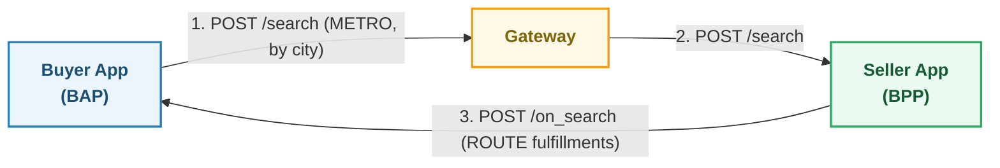

#### 3. API Breakdown & Technical Actions

- **`/search` (BAP → Gateway → BPP)**: `vehicle.category = METRO`, payment terms in tags, city code from the flow input.
- **`/on_search` (BPP → BAP)**: categories, provider time range, `ROUTE` fulfillments with stops and `ROUTE_INFO`, payment tags and `GTFS`.

---

### Flow 2: STATION_CODE_FLOW_ORDER

Covers `STATION_CODE_FLOW_ORDER` (12 steps) and `STATION_CODE_FLOW_ORDER (W/O Search1 and Select)` (8 steps).

#### 1. Short Description

The Buyer App searches stations, searches a fare for a station pair, selects an item, initialises the order, confirms it with payment and checks the status. The `W/O Search1 and Select` variant starts at `search2` and goes from `on_search2` straight to `init_without_select_METRO_201`.

#### 2. Visual Interaction Map

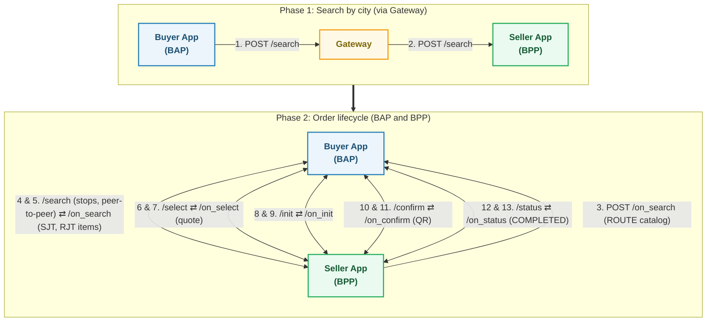

#### 3. API Breakdown & Technical Actions

- **`/search` and `/on_search`** (`search1`, `on_search1`, `search2`, `on_search2`): catalog (by city, via Gateway), then station pair (peer-to-peer, direct to the BPP); the second `on_search` returns items `I1` (`SJT`) and `I2` (`RJT`).
- **`/select` and `/on_select`**: item, quantity and quote with `BASE_FARE`; a `TRIP` and a `TICKET` fulfillment.
- **`/init` and `/on_init`**: billing and payment `NOT-PAID` / `PRE-ORDER`; the response adds payment `params`.
- **`/confirm` and `/on_confirm`**: payment `PAID`; the response has `order.id`, `order.status: ACTIVE` and the QR `authorization`.
- **`/status` and `/on_status`** (`on_status_complete_METRO_201`): `order.status: COMPLETED`, `authorization.status: CLAIMED`.

---

### Flow 3: USER_CANCELLATION_FLOW

Covers `USER_CANCELLATION_FLOW` (14 steps) and `USER_CANCELLATION_FLOW (W/O Search1 and Select)` (10 steps).

#### 1. Short Description

After `on_confirm` the Buyer App cancels in two steps: `SOFT_CANCEL`, then `CONFIRM_CANCEL`.

#### 2. Process Flow

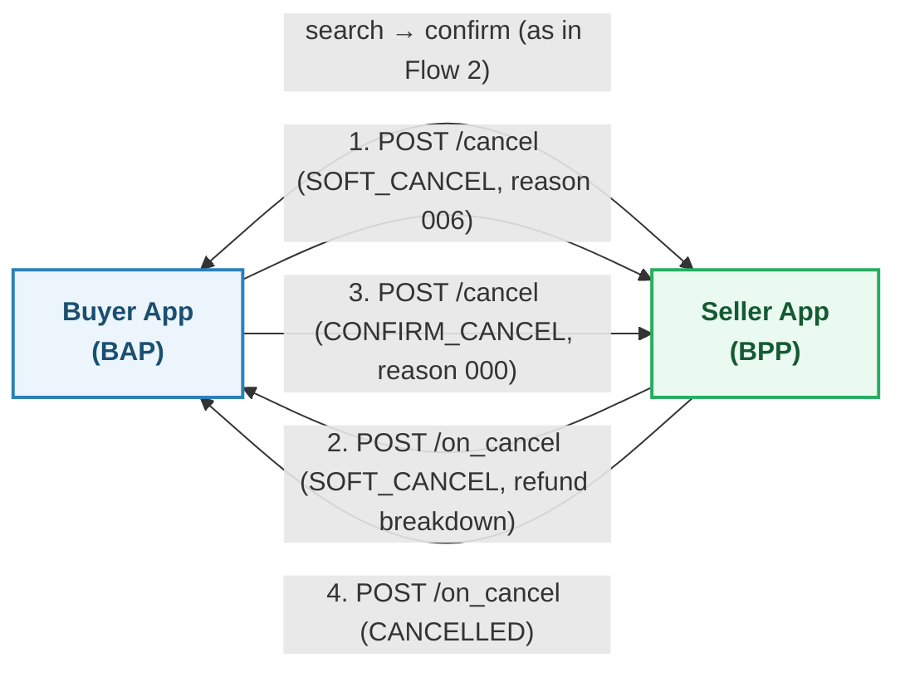

#### 3. API Breakdown & Technical Actions

- **`/cancel`**: `order_id`, `cancellation_reason_id`, `descriptor` (`code`, `name`).
- **`/on_cancel`**: `order.status`, `order.cancellation.cancelled_by: CONSUMER` with the reason code, quote with `BASE_FARE`, `REFUND` and `CANCELLATION_CHARGES` in the soft response.

---

### Flow 4: TECHNICAL_CANCELLATION_FLOW

Covers `TECHNICAL_CANCELLATION_FLOW` (14 steps) and `TECHNICAL_CANCELLATION_FLOW (W/O Search1 and Select)` (10 steps).

#### 1. Short Description

The `on_confirm` is delayed (`on_confirm_delayed_METRO_201`); the Buyer App checks the status with a `ref_id` and then cancels with `CONFIRM_CANCEL` and reason `000`.

#### 2. Process Flow

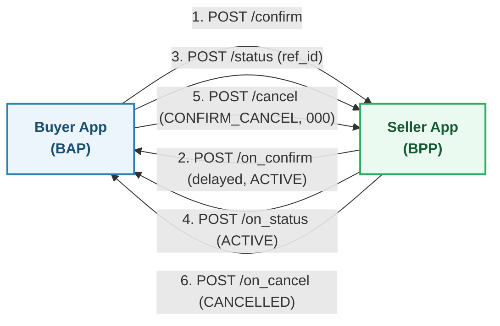

#### 3. API Breakdown & Technical Actions

- **`/status`** (`status_tech_cancel_METRO_201`): `ref_id`.
- **`/cancel`** (`cancel_tech_METRO_201`): `descriptor.code: CONFIRM_CANCEL`, `cancellation_reason_id: 000`.
- **`/on_cancel`** (`on_cancel_hard_METRO_201`): `order.status: CANCELLED`, `cancelled_by: CONSUMER`, quote with `BASE_FARE`, `REFUND`, `CANCELLATION_CHARGES`.

---

### Flow 5: DELAYED_CANCELLATION_FLOW (Accepted)

Covers `DELAYED_CANCELLATION_FLOW_ACCEPTED_IN_CASE_OF_TECHNICAL_CANCELLATION` and `DELAYED_CANCELLATION_FLOW_ACCEPTED_IN_CASE_OF_USER_CANCELLATION` (15 steps each) and their `W/O Search1 and Select` variants (11 steps each).

#### 1. Short Description

The cancellation is acknowledged with `CANCELLATION_INITIATED` and later accepted by an unsolicited `on_update` with `CANCELLED`.

#### 2. Process Flow

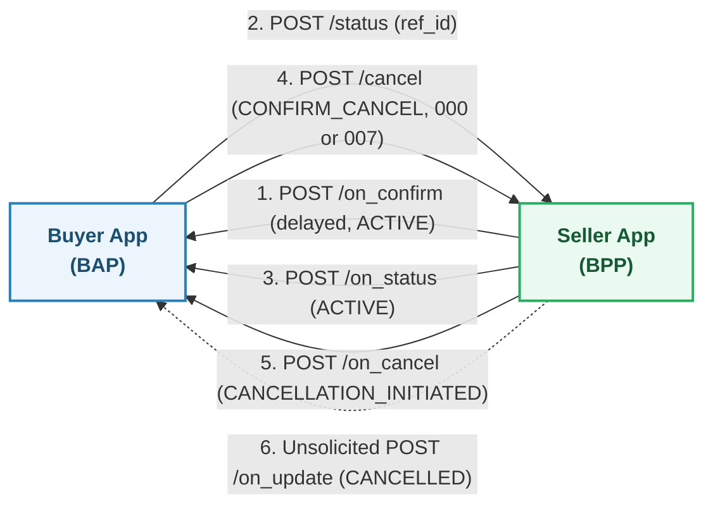

#### 3. API Breakdown & Technical Actions

- **`/cancel`** (`cancel_hard_METRO_201`): `CONFIRM_CANCEL`, reason `000` (technical) or `007` (user).
- **`/on_cancel`** (`on_cancel_init_METRO_201`): `order.status: CANCELLATION_INITIATED`, `cancelled_by: CONSUMER`.
- **`/on_update`** (`on_update_accepted_METRO_201`, unsolicited): `order.status: CANCELLED`, quote with `REFUND` and `CANCELLATION_CHARGES`, `cancellation_terms` with `cancel_by` and `cancellation_fee`.

---

### Flow 6: DELAYED_CANCELLATION_FLOW (Rejected)

Covers `DELAYED_CANCELLATION_FLOW_REJECTED_IN_CASE_OF_TECHNICAL_CANCELLATION` and `DELAYED_CANCELLATION_FLOW_REJECTED_IN_CASE_OF_USER_CANCELLATION` (15 steps each) and their `W/O Search1 and Select` variants (11 steps each).

#### 1. Short Description

The cancellation is acknowledged with `CANCELLATION_INITIATED`, then the Seller App rejects it by sending an unsolicited `on_status` in which the order is `COMPLETED`.

#### 2. Process Flow

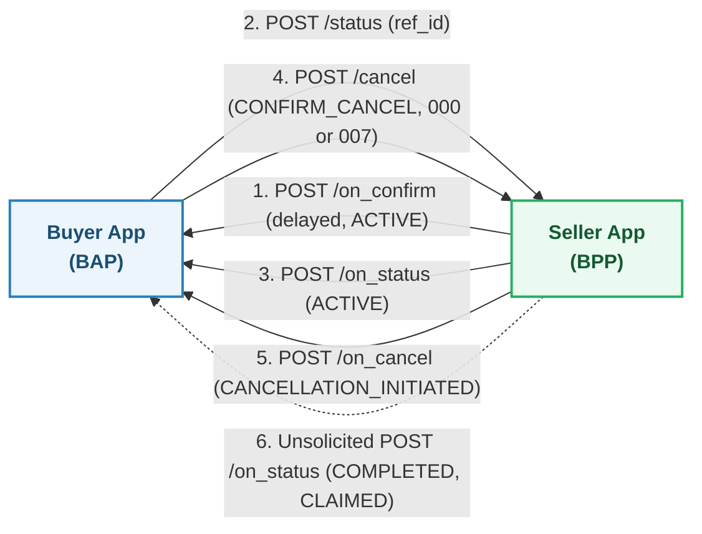

#### 3. API Breakdown & Technical Actions

- **`/on_status`** (`on_status_cancel_METRO_201`, unsolicited): `order.status: COMPLETED`, `cancellation.cancelled_by: CONSUMER`, QR `authorization.status: CLAIMED`.

---

### Flow 7: PARTIAL_CANCELLATION_FLOW

Covers `PARTIAL_CANCELLATION_FLOW` (14 steps) and `PARTIAL_CANCELLATION_FLOW (W/O Search1 and Select)` (10 steps).

#### 1. Short Description

After `on_confirm` the Buyer App cancels part of the order through two `update` calls: `SOFT_UPDATE`, then `CONFIRM_UPDATE`.

#### 2. Process Flow

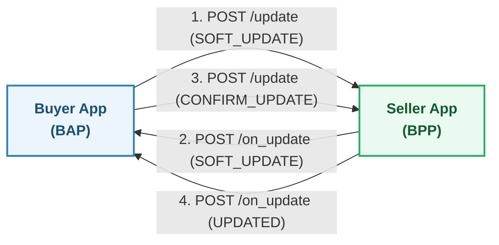

#### 3. API Breakdown & Technical Actions

- **`/update`** (`update_partial_cancellation_1`, `_2`): `update_target: order.fulfillments`, `order.id`, `order.status`.
- **`/on_update`** (`on_update_partial_cancellation_1`, `_2`): order status `SOFT_UPDATE`, then `UPDATED`; the final response has a payment `NOT-PAID` / `POST-FULFILLMENT` with amount `-10`.

---

### Flow 8: END_STOP_UPDATE_FLOW

Covers `END_STOP_UPDATE_FLOW` (16 steps) and `END_STOP_UPDATE_FLOW (W/O Search1 and Select)` (12 steps).

#### 1. Short Description

After `on_confirm` the Buyer App changes the end stop through three `update` calls: a soft update, a confirmed update, then a payment update.

#### 2. Process Flow

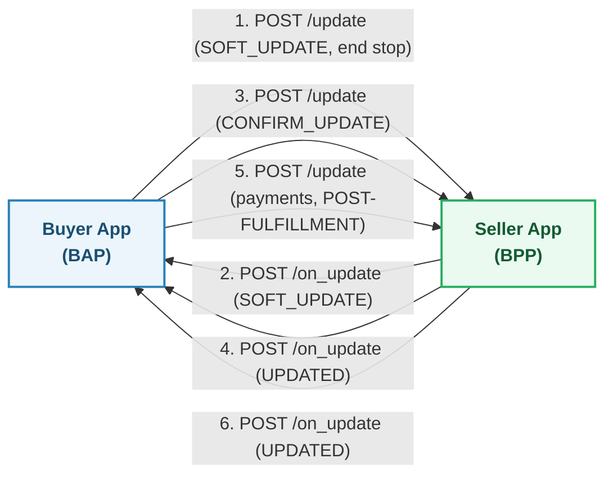

#### 3. API Breakdown & Technical Actions

- **`/update`** (`update_end_stop_1`, `_2`): `update_target: order.fulfillments`, new `END` stop.
- **`/update`** (`update_end_stop_3`): `update_target: payments`.
- **`/on_update`** (`on_update_end_stop_1`, `_2`, `_3`): `SOFT_UPDATE`, `UPDATED`, `UPDATED`.

---

### Flow 9: OFFLINE_CANCELLATION_FLOW

Covers `OFFLINE_CANCELLATION_FLOW` (11 steps) and `OFFLINE_CANCELLATION_FLOW (W/O Search1 and Select)` (7 steps).

#### 1. Short Description

After `on_confirm` the Seller App sends an unsolicited `on_cancel` with `CANCELLATION_INITIATED`.

#### 2. Process Flow

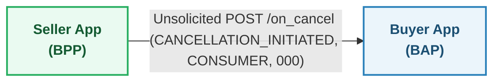

#### 3. API Breakdown & Technical Actions

- **`/on_cancel`** (`on_cancel_offline`): `order.status`, `order.cancellation` (`cancelled_by`, `time`, `reason.descriptor.code`), fulfillments and the QR `authorization`.

---

### Flow 10: STATION_CODE_FLOW_ORDER_IGM_(v-1.0.0)

Covers `STATION_CODE_FLOW_ORDER_IGM_(v-1.0.0)` (16 steps) and its `W/O Search1 and Select` variant.

#### 1. Short Description

After the order status, the Buyer App opens an issue, the Seller App processes it and reports it resolved with an unsolicited `on_issue_status`, and the Buyer App closes it with a rating.

#### 2. Process Flow

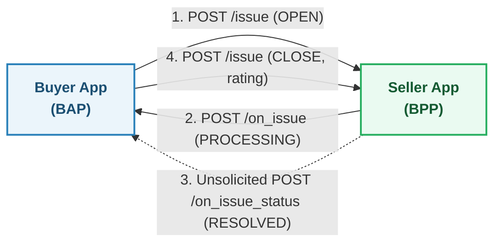

#### 3. API Breakdown & Technical Actions

- **`/issue`**: `issue_type`, `category`, `sub_category`, `complainant_info`, `order_details`, `issue_actions.complainant_actions[]`.
- **`/on_issue` and `/on_issue_status`**: `issue_actions.respondent_actions[]` (`PROCESSING`, `RESOLVED`).

---

### Flow 11: STATION_CODE_FLOW_ORDER_IGM(v-2.0.0)

Covers `STATION_CODE_FLOW_ORDER_IGM(v-2.0.0)` (21 steps) and its `W/O Search1 and Select` variant.

#### 1. Short Description

The issue has a need-more-info round before the resolution is proposed, accepted and closed.

#### 2. Process Flow

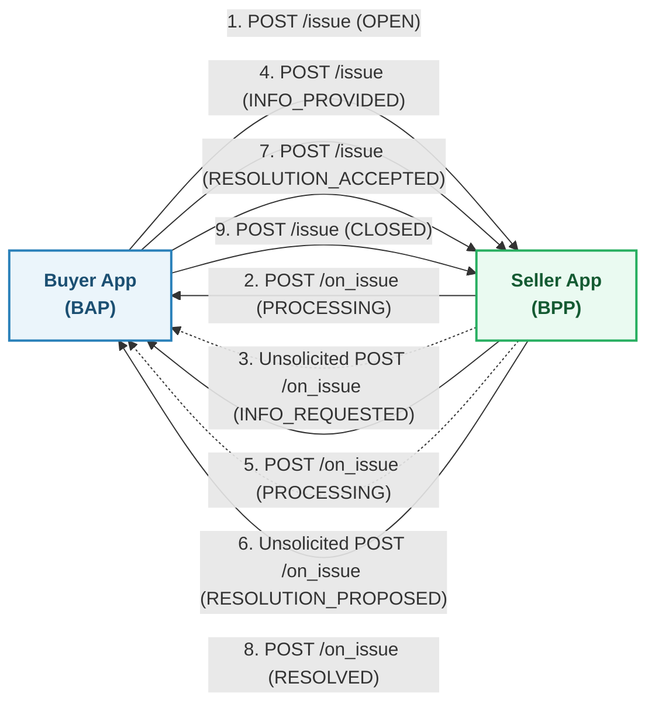

#### 3. API Breakdown & Technical Actions

- **`/issue` and `/on_issue`**: `issue.status`, `issue.level`, `issue.descriptor.code`, `issue.actions[]` growing by one entry per step.

---

### Flow 12: STATION_CODE_FLOW_ORDER_IGM_Rejection(v-2.0.0)

Covers `STATION_CODE_FLOW_ORDER_IGM_Rejection(v-2.0.0)` (24 steps) and its `W/O Search1 and Select` variant.

#### 1. Short Description

The buyer rejects the proposed resolution, receives another proposal, escalates, and finally accepts a resolution.

#### 2. Process Flow

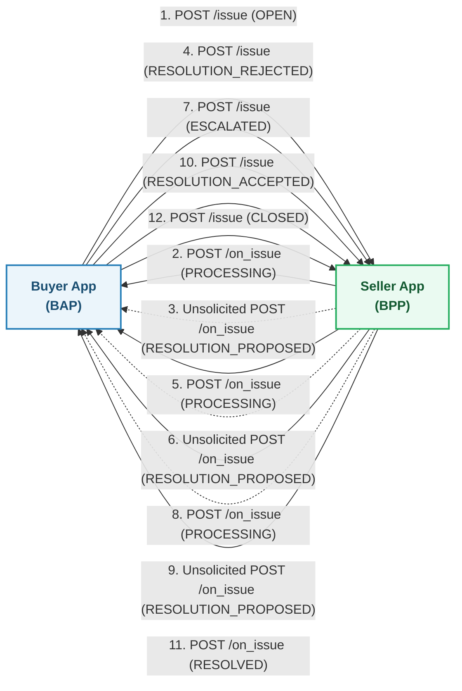

#### 3. API Breakdown & Technical Actions

- **`/issue`** (`issue_resolution_reject`, `issue_escalate`, `issue_resolution_accept`): the escalation changes `issue.level` to `GREVIENCE`.

---

### Flow 13: STATION_CODE_FLOW_ORDER_IGM_No_Action(v-2.0.0)

Covers `STATION_CODE_FLOW_ORDER_IGM_No_Action(v-2.0.0)` (18 steps) and its `W/O Search1 and Select` variant.

#### 1. Short Description

The issue goes from open to processing, then a resolution is proposed, accepted and closed, without an information round.

#### 2. Process Flow

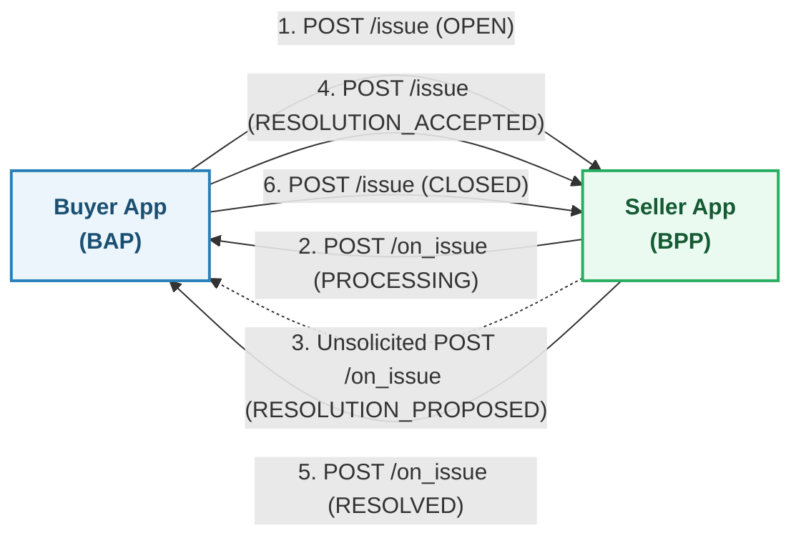

#### 3. API Breakdown & Technical Actions

- **`/issue` and `/on_issue`**: step ids `issue_open_2`, `on_issue_processing`, `on_issue_resolution_igm_3`, `issue_resolution_accept_igm_3`, `on_issue_resolved_igm_3`, `issue_close_igm_3`.

---

## Flow Catalogue

All 29 Metro flows from `config/flows/index.yaml` (tags `WORKBENCH`, `MANDATORY`, `REPORTABLE`).

| # | Flow ID | Purpose (from the index) |
|---|---|---|
| 1 | `DELAYED_CANCELLATION_FLOW_ACCEPTED_IN_CASE_OF_TECHNICAL_CANCELLATION` | Delayed cancellation after a confirmed booking, accepted by the seller |
| 2 | `DELAYED_CANCELLATION_FLOW_ACCEPTED_IN_CASE_OF_TECHNICAL_CANCELLATION (W/O Search1 and Select)` | Booking cancelled due to technical constraints; accepted and processed |
| 3 | `DELAYED_CANCELLATION_FLOW_REJECTED_IN_CASE_OF_TECHNICAL_CANCELLATION` | Cancellation attempt rejected due to technical constraints |
| 4 | `DELAYED_CANCELLATION_FLOW_REJECTED_IN_CASE_OF_TECHNICAL_CANCELLATION (W/O Search1 and Select)` | Cancellation request delayed and rejected due to technical constraints or timing limits |
| 5 | `DELAYED_CANCELLATION_FLOW_ACCEPTED_IN_CASE_OF_USER_CANCELLATION` | Customer cancels after confirmation; delayed post-confirmation cancellation accepted |
| 6 | `DELAYED_CANCELLATION_FLOW_ACCEPTED_IN_CASE_OF_USER_CANCELLATION (W/O Search1 and Select)` | Passenger cancels after confirmation; cancellation accepted and processed |
| 7 | `DELAYED_CANCELLATION_FLOW_REJECTED_IN_CASE_OF_USER_CANCELLATION` | Cancellation of the confirmed order rejected due to business rules |
| 8 | `DELAYED_CANCELLATION_FLOW_REJECTED_IN_CASE_OF_USER_CANCELLATION (W/O Search1 and Select)` | Operator rejects the passenger's cancellation due to timing or business constraints |
| 9 | `END_STOP_UPDATE_FLOW` | Customer books and receives multiple updates while changing the end stop |
| 10 | `END_STOP_UPDATE_FLOW (W/O Search1 and Select)` | Passenger adjusts the alighting stop multiple times during the transaction |
| 11 | `STATION_CODE_FLOW_CATALOG` | Commuter searches for metro stations using a station code |
| 12 | `STATION_CODE_FLOW_ORDER` | Search with station codes, select, confirm and track order status |
| 13 | `STATION_CODE_FLOW_ORDER (W/O Search1 and Select)` | Search and book between stations without an intermediate selection step |
| 14 | `STATION_CODE_FLOW_ORDER_IGM(v-2.0.0)` | Order, then grievance filed, tracked and resolved (IGM 2.0.0) |
| 15 | `STATION_CODE_FLOW_ORDER_IGM(v-2.0.0)(W/O Search1 and Select)` | Order with station code search, then grievance resolution (IGM 2.0.0) |
| 16 | `STATION_CODE_FLOW_ORDER_IGM_(v-1.0.0)` | Order with issues detected and resolved without customer intervention (IGM 1.0.0) |
| 17 | `STATION_CODE_FLOW_ORDER_IGM_(v-1.0.0)(W/O Search1 and Select)` | Order, then an unresolved issue reported and tracked (IGM 1.0.0) |
| 18 | `STATION_CODE_FLOW_ORDER_IGM_No_Action(v-2.0.0)` | Order, then escalation through repeated issue management cycles (IGM 2.0.0) |
| 19 | `STATION_CODE_FLOW_ORDER_IGM_No_Action(v-2.0.0)(W/O Search1 and Select)` | Order, status tracking and issue handling (IGM 2.0.0) |
| 20 | `STATION_CODE_FLOW_ORDER_IGM_Rejection(v-2.0.0)` | Order, then a complaint rejected through the issue resolution process (IGM 2.0.0) |
| 21 | `STATION_CODE_FLOW_ORDER_IGM_Rejection(v-2.0.0)(W/O Search1 and Select)` | Order, then resolution through multiple interactions (IGM 2.0.0) |
| 22 | `TECHNICAL_CANCELLATION_FLOW` | Booking confirmed, then reversed through a technical cancellation |
| 23 | `TECHNICAL_CANCELLATION_FLOW (W/O Search1 and Select)` | Booking confirmed, then a technical cancellation reverses the transaction |
| 24 | `USER_CANCELLATION_FLOW` | Passenger selects, confirms and cancels |
| 25 | `USER_CANCELLATION_FLOW (W/O Search1 and Select)` | Passenger searches, confirms and cancels |
| 26 | `PARTIAL_CANCELLATION_FLOW` | Customer books and initiates a partial cancellation |
| 27 | `PARTIAL_CANCELLATION_FLOW (W/O Search1 and Select)` | Partial cancellation with cancellation policies applied |
| 28 | `OFFLINE_CANCELLATION_FLOW` | Customer cancels offline; the cancellation is processed |
| 29 | `OFFLINE_CANCELLATION_FLOW (W/O Search1 and Select)` | Customer cancels through an offline request |

---

## Key Data Model

### Context (examples in the flows)

| Field | Notes |
|---|---|
| `domain` | `ONDC:TRV11` |
| `action` | API name |
| `version` | `2.0.1` |
| `location.country.code` | `IND` |
| `location.city.code` | For example `std:011` |
| `transaction_id` | Persists across all API calls |
| `message_id` | Persists during a request / callback cycle |
| `timestamp` | Time of request generation |
| `ttl` | `PT30S` |
| `bap_id`, `bap_uri` | Buyer App |
| `bpp_id`, `bpp_uri` | Seller App; absent from `search1`, present on `on_` calls and on `search2` in the full flows |

### Fulfillment and stop types

| Fulfillment `type` | Where it appears |
|---|---|
| `ROUTE` | `on_search` |
| `TRIP` | `on_select` onward |
| `TICKET` | `on_select` onward; carries the QR `authorization` from `on_confirm` |

| Stop `type` | Where it appears |
|---|---|
| `START`, `END` | Search `intent` and all fulfillments |
| `INTERMEDIATE_STOP` | `on_search` catalog |
| `TRANSIT_STOP` | In the validation list |

### Order, payment and ticket states

| Object | Values seen in the flows |
|---|---|
| `order.status` | `ACTIVE`, `COMPLETED`, `SOFT_CANCEL`, `CANCELLATION_INITIATED`, `CANCELLED`, `SOFT_UPDATE`, `UPDATED` (and `CONFIRM_UPDATE` in the `update` requests) |
| `payments[].status` | `NOT-PAID`, `PAID` |
| `payments[].type` | `PRE-ORDER`, `POST-FULFILLMENT` |
| `payments[].collected_by` | `BAP` |
| `authorization` | `type: QR`; `status`: `UNCLAIMED`, `CLAIMED` |
| `cancel` `descriptor.code` | `SOFT_CANCEL`, `CONFIRM_CANCEL` |
| `cancellation_reason_id` | `000`, `006`, `007` |
| `order.cancellation.cancelled_by` | `CONSUMER` |
| `update_target` | `order.fulfillments`, `payments` |
| `quote.breakup[].title` | `BASE_FARE`, `REFUND`, `CANCELLATION_CHARGES` |
| Item `descriptor.code` | `SJT`, `RJT` |

### Tags

| Tag group | Codes in the flows |
|---|---|
| `BUYER_FINDER_FEES` | `BUYER_FINDER_FEES_PERCENTAGE` |
| `SETTLEMENT_TERMS` | `SETTLEMENT_AMOUNT`, `SETTLEMENT_WINDOW`, `SETTLEMENT_BASIS`, `SETTLEMENT_TYPE`, `DELAY_INTEREST`, `STATIC_TERMS`, `MANDATORY_ARBITRATION`, `COURT_JURISDICTION` |
| `ROUTE_INFO` (fulfillment) | `ROUTE_ID`, `ROUTE_NAME` |
| `INFO` (fulfillment) | `PARENT_ID` |
| `TICKET_INFO` (fulfillment) | `NUMBER` |
| `SCHEDULED_INFO` (provider in `on_search`, order) | `GTFS` |

---

## Contract Notes

Items found while reading the 2.0.1 contract; recorded as found, not resolved.

- The `order.status` validation list (`SOFT_CANCEL`, `CONFIRM_CANCEL`, `ACTIVE`, `COMPLETE`, `CANCELLED`) has no `COMPLETED`, `CANCELLATION_INITIATED`, `SOFT_UPDATE`, `CONFIRM_UPDATE` or `UPDATED`, which the payloads use.
- The payloads and validations use `PRE-ORDER`. The official 2.0.1 changelog (6 August 2026) says payment type values moved to underscores (`PRE_ORDER`); the branch does not have that change.
- The city code validation format is `^std:0\d+$`, while the `search1` flow input pattern is `^std:\d{3,5}$`.
- The `search2` payload of `DELAYED_CANCELLATION_FLOW_ACCEPTED_IN_CASE_OF_USER_CANCELLATION (W/O Search1 and Select)` has no stops and no `bpp_id`, while the flow input form asks for `start_code` and `end_code`; its `on_search2` returns a route catalog without items.
- The `on_search2` fulfillment `type` is `ROUTE` in some flows and `TRIP` in others.
- The number of `TICKET` fulfillments differs between steps of the same flow (for example `USER_CANCELLATION_FLOW`: two in `on_cancel_soft_METRO_201`, four in `on_cancel_hard_METRO_201`).
- The official changelog (4 November 2026) adds `update` / `on_update` calls for refund status in the Metro cancellation flow; `USER_CANCELLATION_FLOW` on this branch has no `update` step.
- The IGM escalation payloads use `GREVIENCE` as `issue.level`.
- The step descriptions in the flow files are placeholders ("please add relevant description"); the Developer Guide shows them as written.

---

## Error Codes

Error codes for this version are defined in `config/errors/index.yaml`.
