# OnDemand_Assign_driver_on_onconfirm_With_IGM_Rejection(v-2.0.0) — Sequence Diagrams

Internal data file consumed by the Developer Guide's "Sequence Diagram" tab (API Walkthrough).
Not meant to be shown as its own docs page — the frontend filters this slug out of the Use Case
Brief / Additional Resources / Changelog tab lists and instead looks up the section matching the
selected API call's `action_id` (the `##` heading below) to render that step's diagram.

One `## <action_id>` heading per step of `OnDemand_Assign_driver_on_onconfirm_With_IGM_Rejection_v-2_0_0_.yaml` (Ride-hailing), in that flow's own step order, each followed by its Mermaid `sequenceDiagram`: the whole flow, with that call's own message(s) highlighted — same convention as the other domains' per-step sequence-diagram docs.

## search_ride

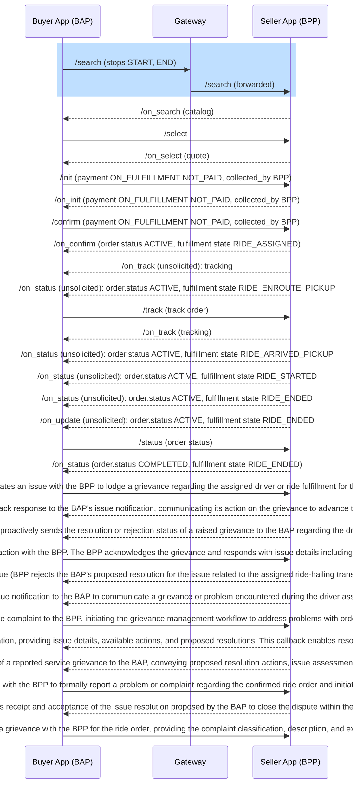

## on_search

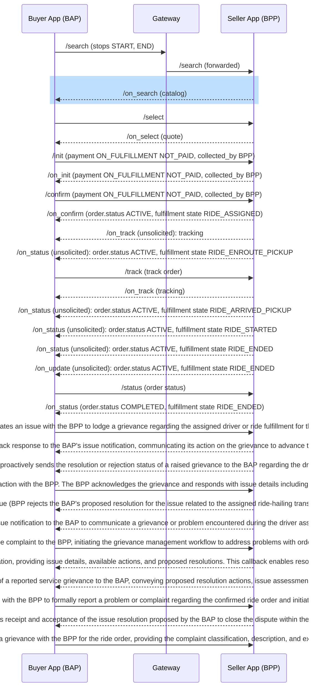

## select

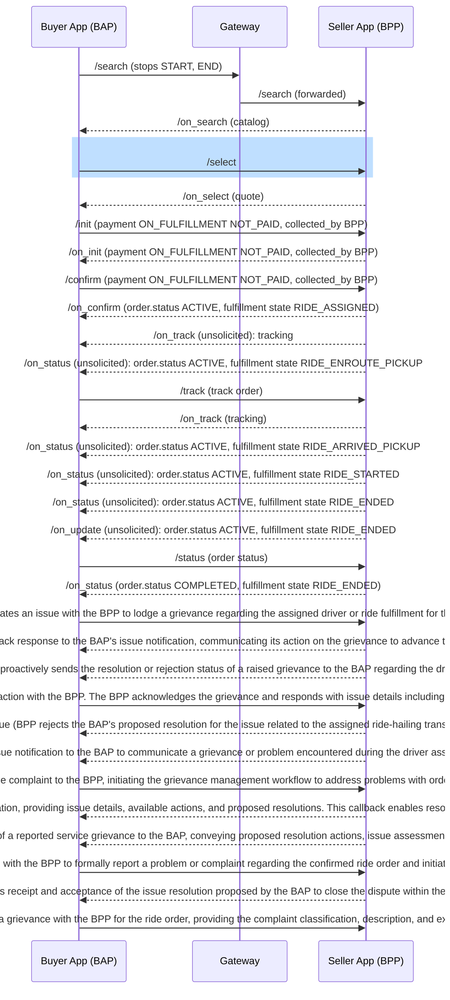

## on_select

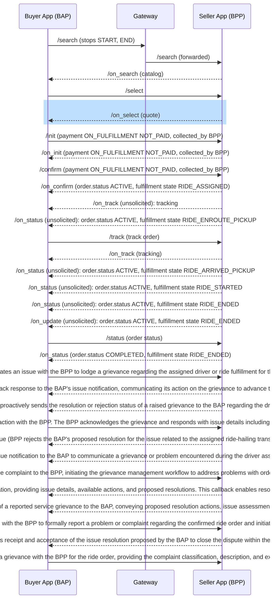

## init

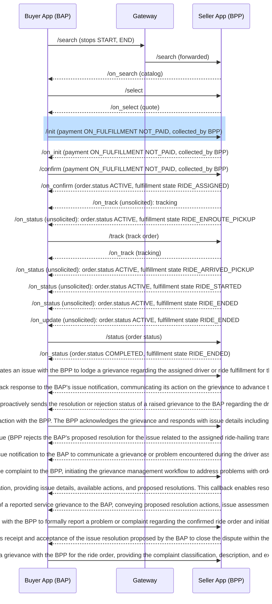

## on_init

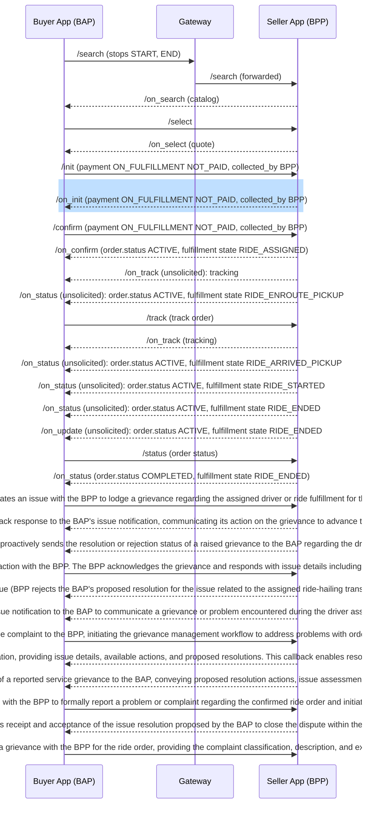

## confirm

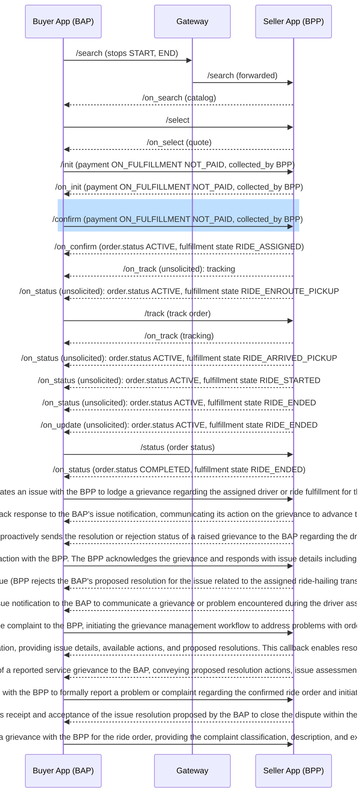

## on_confirm

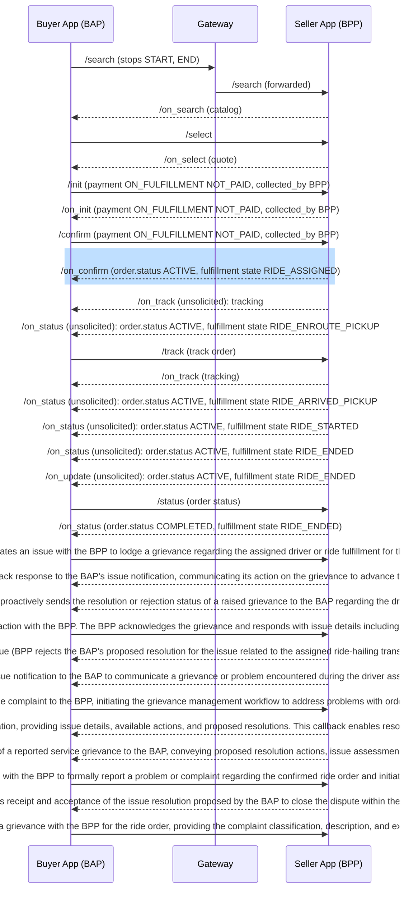

## on_track_on_assign

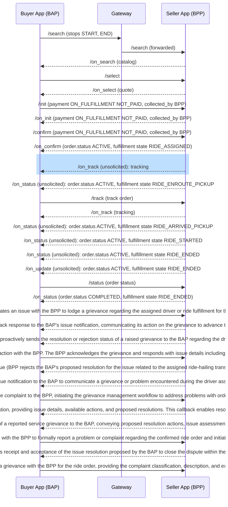

## on_status_unsolicited

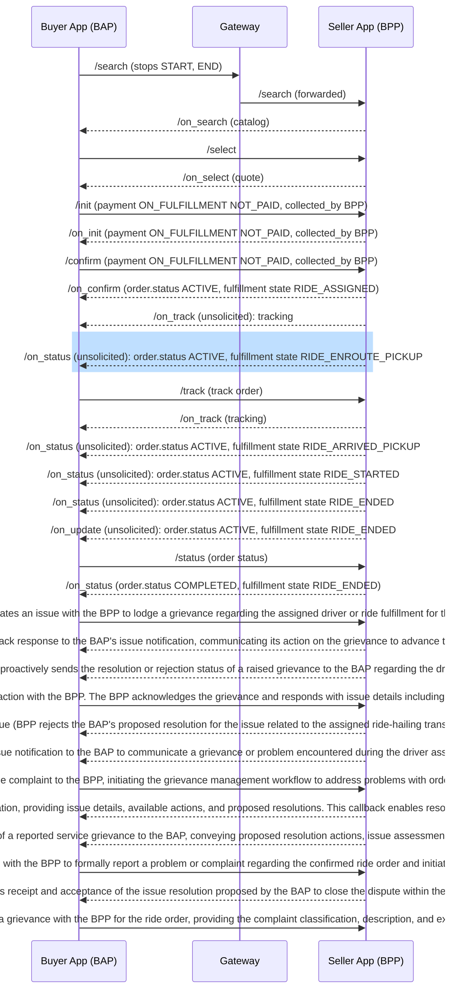

## track_ride

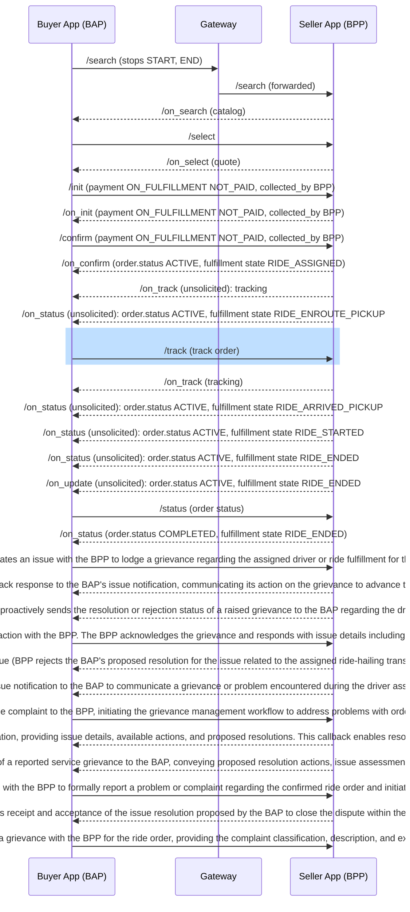

## on_track_ride

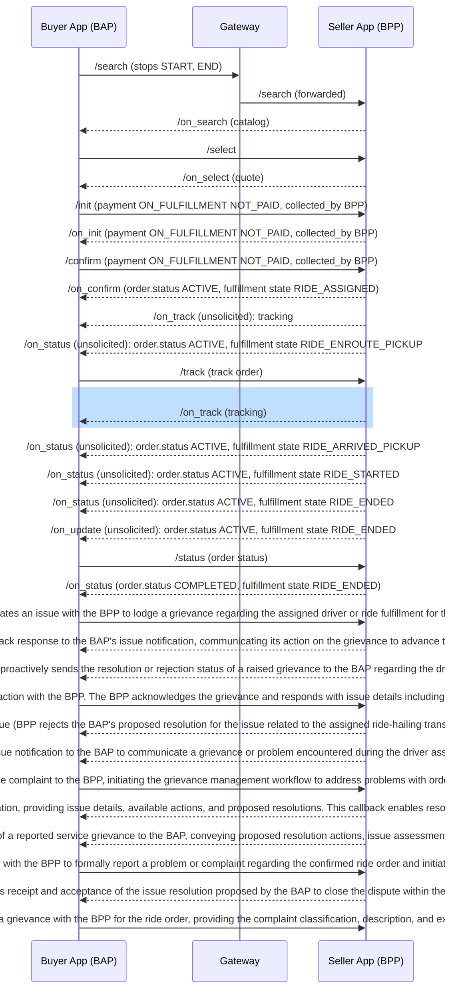

## on_status_ride_arrived

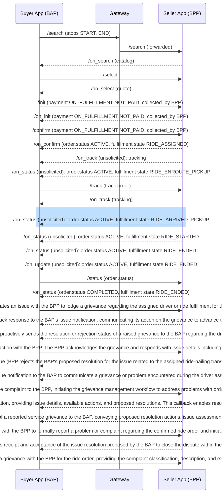

## on_status_ride_started

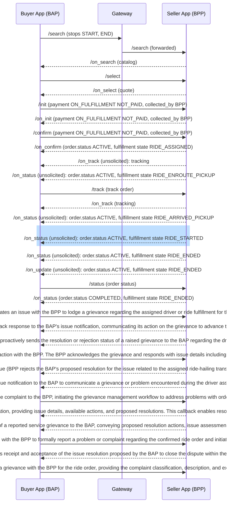

## on_status_ride_ended

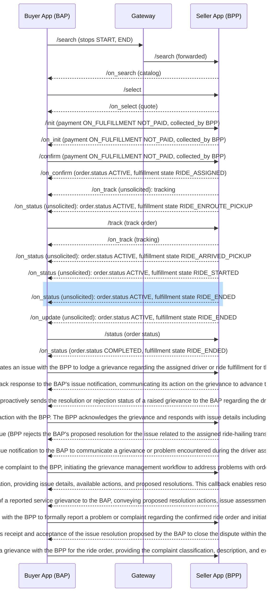

## on_update_fare_charges

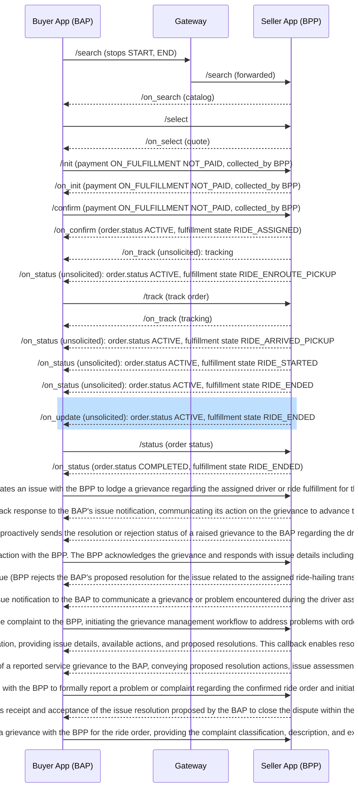

## status

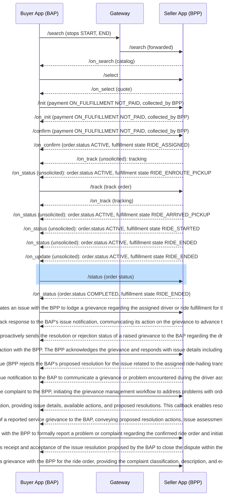

## on_status_solicited

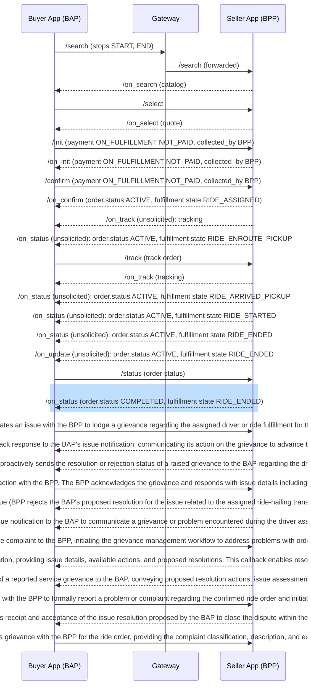

## issue_open

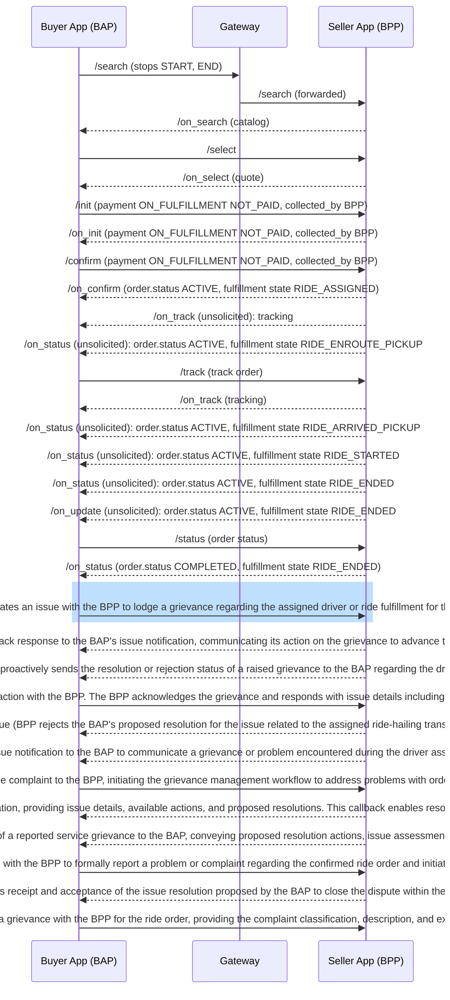

## on_issue_processing

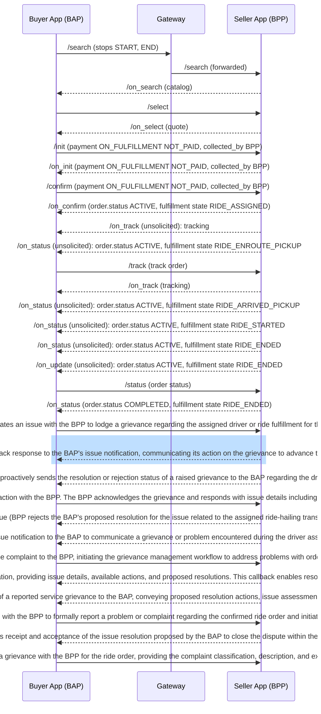

## on_issue_resolution

```mermaid
sequenceDiagram
  participant Buyer App (BAP)
  participant Gateway
  participant Seller App (BPP)
  Buyer App (BAP)->>Gateway: /search (stops START, END)
  Gateway->>Seller App (BPP): /search (forwarded)
  Seller App (BPP)-->>Buyer App (BAP): /on_search (catalog)
  Buyer App (BAP)->>Seller App (BPP): /select
  Seller App (BPP)-->>Buyer App (BAP): /on_select (quote)
  Buyer App (BAP)->>Seller App (BPP): /init (payment ON_FULFILLMENT NOT_PAID, collected_by BPP)
  Seller App (BPP)-->>Buyer App (BAP): /on_init (payment ON_FULFILLMENT NOT_PAID, collected_by BPP)
  Buyer App (BAP)->>Seller App (BPP): /confirm (payment ON_FULFILLMENT NOT_PAID, collected_by BPP)
  Seller App (BPP)-->>Buyer App (BAP): /on_confirm (order.status ACTIVE, fulfillment state RIDE_ASSIGNED)
  Seller App (BPP)-->>Buyer App (BAP): /on_track (unsolicited): tracking
  Seller App (BPP)-->>Buyer App (BAP): /on_status (unsolicited): order.status ACTIVE, fulfillment state RIDE_ENROUTE_PICKUP
  Buyer App (BAP)->>Seller App (BPP): /track (track order)
  Seller App (BPP)-->>Buyer App (BAP): /on_track (tracking)
  Seller App (BPP)-->>Buyer App (BAP): /on_status (unsolicited): order.status ACTIVE, fulfillment state RIDE_ARRIVED_PICKUP
  Seller App (BPP)-->>Buyer App (BAP): /on_status (unsolicited): order.status ACTIVE, fulfillment state RIDE_STARTED
  Seller App (BPP)-->>Buyer App (BAP): /on_status (unsolicited): order.status ACTIVE, fulfillment state RIDE_ENDED
  Seller App (BPP)-->>Buyer App (BAP): /on_update (unsolicited): order.status ACTIVE, fulfillment state RIDE_ENDED
  Buyer App (BAP)->>Seller App (BPP): /status (order status)
  Seller App (BPP)-->>Buyer App (BAP): /on_status (order.status COMPLETED, fulfillment state RIDE_ENDED)
  Buyer App (BAP)->>Seller App (BPP): /issue (The BAP initiates an issue with the BPP to lodge a grievance regarding the assigned driver or ride fulfillment for the confirmed order.)
  Seller App (BPP)-->>Buyer App (BAP): /on_issue (The BPP provides an on issue callback response to the BAP's issue notification, communicating its action on the grievance to advance the integrated grievance management process.)
  rect rgb(191, 223, 255)
  Seller App (BPP)-->>Buyer App (BAP): /on_issue (unsolicited): The BPP proactively sends the resolution or rejection status of a raised grievance to the BAP regarding the driver assignment or ride fulfillment.
  end
  Buyer App (BAP)->>Seller App (BPP): /issue (The BAP initiates an issue complaint regarding the confirmed ride transaction with the BPP. The BPP acknowledges the grievance and responds with issue details including category, status, expected resolution timeline, and available remedial actions.)
  Seller App (BPP)-->>Buyer App (BAP): /on_issue (BPP rejects the BAP's proposed resolution for the issue related to the assigned ride-hailing transaction.)
  Seller App (BPP)-->>Buyer App (BAP): /on_issue (unsolicited): The BPP sends an unsolicited issue notification to the BAP to communicate a grievance or problem encountered during the driver assignment phase in the on-demand ride-hailing transaction.
  Buyer App (BAP)->>Seller App (BPP): /issue (The BAP submits an issue complaint to the BPP, initiating the grievance management workflow to address problems with order fulfillment or service delivery.)
  Seller App (BPP)-->>Buyer App (BAP): /on_issue (The BPP sends an on issue response to the BAP's issue escalation, providing issue details, available actions, and proposed resolutions. This callback enables resolution tracking within the ride assignment grievance management process.)
  Seller App (BPP)-->>Buyer App (BAP): /on_issue (unsolicited): The BPP communicates its handling of a reported service grievance to the BAP, conveying proposed resolution actions, issue assessment details, and expected timelines for addressing the complaint.
  Buyer App (BAP)->>Seller App (BPP): /issue (The BAP raises an issue with the BPP to formally report a problem or complaint regarding the confirmed ride order and initiate the issue resolution process.)
  Seller App (BPP)-->>Buyer App (BAP): /on_issue (The BPP confirms receipt and acceptance of the issue resolution proposed by the BAP to close the dispute within the ONDC grievance workflow.)
  Buyer App (BAP)->>Seller App (BPP): /issue (The BAP escalates a grievance with the BPP for the ride order, providing the complaint classification, description, and expected response timeline.)
```

## issue_resolution_reject

```mermaid
sequenceDiagram
  participant Buyer App (BAP)
  participant Gateway
  participant Seller App (BPP)
  Buyer App (BAP)->>Gateway: /search (stops START, END)
  Gateway->>Seller App (BPP): /search (forwarded)
  Seller App (BPP)-->>Buyer App (BAP): /on_search (catalog)
  Buyer App (BAP)->>Seller App (BPP): /select
  Seller App (BPP)-->>Buyer App (BAP): /on_select (quote)
  Buyer App (BAP)->>Seller App (BPP): /init (payment ON_FULFILLMENT NOT_PAID, collected_by BPP)
  Seller App (BPP)-->>Buyer App (BAP): /on_init (payment ON_FULFILLMENT NOT_PAID, collected_by BPP)
  Buyer App (BAP)->>Seller App (BPP): /confirm (payment ON_FULFILLMENT NOT_PAID, collected_by BPP)
  Seller App (BPP)-->>Buyer App (BAP): /on_confirm (order.status ACTIVE, fulfillment state RIDE_ASSIGNED)
  Seller App (BPP)-->>Buyer App (BAP): /on_track (unsolicited): tracking
  Seller App (BPP)-->>Buyer App (BAP): /on_status (unsolicited): order.status ACTIVE, fulfillment state RIDE_ENROUTE_PICKUP
  Buyer App (BAP)->>Seller App (BPP): /track (track order)
  Seller App (BPP)-->>Buyer App (BAP): /on_track (tracking)
  Seller App (BPP)-->>Buyer App (BAP): /on_status (unsolicited): order.status ACTIVE, fulfillment state RIDE_ARRIVED_PICKUP
  Seller App (BPP)-->>Buyer App (BAP): /on_status (unsolicited): order.status ACTIVE, fulfillment state RIDE_STARTED
  Seller App (BPP)-->>Buyer App (BAP): /on_status (unsolicited): order.status ACTIVE, fulfillment state RIDE_ENDED
  Seller App (BPP)-->>Buyer App (BAP): /on_update (unsolicited): order.status ACTIVE, fulfillment state RIDE_ENDED
  Buyer App (BAP)->>Seller App (BPP): /status (order status)
  Seller App (BPP)-->>Buyer App (BAP): /on_status (order.status COMPLETED, fulfillment state RIDE_ENDED)
  Buyer App (BAP)->>Seller App (BPP): /issue (The BAP initiates an issue with the BPP to lodge a grievance regarding the assigned driver or ride fulfillment for the confirmed order.)
  Seller App (BPP)-->>Buyer App (BAP): /on_issue (The BPP provides an on issue callback response to the BAP's issue notification, communicating its action on the grievance to advance the integrated grievance management process.)
  Seller App (BPP)-->>Buyer App (BAP): /on_issue (unsolicited): The BPP proactively sends the resolution or rejection status of a raised grievance to the BAP regarding the driver assignment or ride fulfillment.
  rect rgb(191, 223, 255)
  Buyer App (BAP)->>Seller App (BPP): /issue (The BAP initiates an issue complaint regarding the confirmed ride transaction with the BPP. The BPP acknowledges the grievance and responds with issue details including category, status, expected resolution timeline, and available remedial actions.)
  end
  Seller App (BPP)-->>Buyer App (BAP): /on_issue (BPP rejects the BAP's proposed resolution for the issue related to the assigned ride-hailing transaction.)
  Seller App (BPP)-->>Buyer App (BAP): /on_issue (unsolicited): The BPP sends an unsolicited issue notification to the BAP to communicate a grievance or problem encountered during the driver assignment phase in the on-demand ride-hailing transaction.
  Buyer App (BAP)->>Seller App (BPP): /issue (The BAP submits an issue complaint to the BPP, initiating the grievance management workflow to address problems with order fulfillment or service delivery.)
  Seller App (BPP)-->>Buyer App (BAP): /on_issue (The BPP sends an on issue response to the BAP's issue escalation, providing issue details, available actions, and proposed resolutions. This callback enables resolution tracking within the ride assignment grievance management process.)
  Seller App (BPP)-->>Buyer App (BAP): /on_issue (unsolicited): The BPP communicates its handling of a reported service grievance to the BAP, conveying proposed resolution actions, issue assessment details, and expected timelines for addressing the complaint.
  Buyer App (BAP)->>Seller App (BPP): /issue (The BAP raises an issue with the BPP to formally report a problem or complaint regarding the confirmed ride order and initiate the issue resolution process.)
  Seller App (BPP)-->>Buyer App (BAP): /on_issue (The BPP confirms receipt and acceptance of the issue resolution proposed by the BAP to close the dispute within the ONDC grievance workflow.)
  Buyer App (BAP)->>Seller App (BPP): /issue (The BAP escalates a grievance with the BPP for the ride order, providing the complaint classification, description, and expected response timeline.)
```

## on_issue_processing_1

```mermaid
sequenceDiagram
  participant Buyer App (BAP)
  participant Gateway
  participant Seller App (BPP)
  Buyer App (BAP)->>Gateway: /search (stops START, END)
  Gateway->>Seller App (BPP): /search (forwarded)
  Seller App (BPP)-->>Buyer App (BAP): /on_search (catalog)
  Buyer App (BAP)->>Seller App (BPP): /select
  Seller App (BPP)-->>Buyer App (BAP): /on_select (quote)
  Buyer App (BAP)->>Seller App (BPP): /init (payment ON_FULFILLMENT NOT_PAID, collected_by BPP)
  Seller App (BPP)-->>Buyer App (BAP): /on_init (payment ON_FULFILLMENT NOT_PAID, collected_by BPP)
  Buyer App (BAP)->>Seller App (BPP): /confirm (payment ON_FULFILLMENT NOT_PAID, collected_by BPP)
  Seller App (BPP)-->>Buyer App (BAP): /on_confirm (order.status ACTIVE, fulfillment state RIDE_ASSIGNED)
  Seller App (BPP)-->>Buyer App (BAP): /on_track (unsolicited): tracking
  Seller App (BPP)-->>Buyer App (BAP): /on_status (unsolicited): order.status ACTIVE, fulfillment state RIDE_ENROUTE_PICKUP
  Buyer App (BAP)->>Seller App (BPP): /track (track order)
  Seller App (BPP)-->>Buyer App (BAP): /on_track (tracking)
  Seller App (BPP)-->>Buyer App (BAP): /on_status (unsolicited): order.status ACTIVE, fulfillment state RIDE_ARRIVED_PICKUP
  Seller App (BPP)-->>Buyer App (BAP): /on_status (unsolicited): order.status ACTIVE, fulfillment state RIDE_STARTED
  Seller App (BPP)-->>Buyer App (BAP): /on_status (unsolicited): order.status ACTIVE, fulfillment state RIDE_ENDED
  Seller App (BPP)-->>Buyer App (BAP): /on_update (unsolicited): order.status ACTIVE, fulfillment state RIDE_ENDED
  Buyer App (BAP)->>Seller App (BPP): /status (order status)
  Seller App (BPP)-->>Buyer App (BAP): /on_status (order.status COMPLETED, fulfillment state RIDE_ENDED)
  Buyer App (BAP)->>Seller App (BPP): /issue (The BAP initiates an issue with the BPP to lodge a grievance regarding the assigned driver or ride fulfillment for the confirmed order.)
  Seller App (BPP)-->>Buyer App (BAP): /on_issue (The BPP provides an on issue callback response to the BAP's issue notification, communicating its action on the grievance to advance the integrated grievance management process.)
  Seller App (BPP)-->>Buyer App (BAP): /on_issue (unsolicited): The BPP proactively sends the resolution or rejection status of a raised grievance to the BAP regarding the driver assignment or ride fulfillment.
  Buyer App (BAP)->>Seller App (BPP): /issue (The BAP initiates an issue complaint regarding the confirmed ride transaction with the BPP. The BPP acknowledges the grievance and responds with issue details including category, status, expected resolution timeline, and available remedial actions.)
  rect rgb(191, 223, 255)
  Seller App (BPP)-->>Buyer App (BAP): /on_issue (BPP rejects the BAP's proposed resolution for the issue related to the assigned ride-hailing transaction.)
  end
  Seller App (BPP)-->>Buyer App (BAP): /on_issue (unsolicited): The BPP sends an unsolicited issue notification to the BAP to communicate a grievance or problem encountered during the driver assignment phase in the on-demand ride-hailing transaction.
  Buyer App (BAP)->>Seller App (BPP): /issue (The BAP submits an issue complaint to the BPP, initiating the grievance management workflow to address problems with order fulfillment or service delivery.)
  Seller App (BPP)-->>Buyer App (BAP): /on_issue (The BPP sends an on issue response to the BAP's issue escalation, providing issue details, available actions, and proposed resolutions. This callback enables resolution tracking within the ride assignment grievance management process.)
  Seller App (BPP)-->>Buyer App (BAP): /on_issue (unsolicited): The BPP communicates its handling of a reported service grievance to the BAP, conveying proposed resolution actions, issue assessment details, and expected timelines for addressing the complaint.
  Buyer App (BAP)->>Seller App (BPP): /issue (The BAP raises an issue with the BPP to formally report a problem or complaint regarding the confirmed ride order and initiate the issue resolution process.)
  Seller App (BPP)-->>Buyer App (BAP): /on_issue (The BPP confirms receipt and acceptance of the issue resolution proposed by the BAP to close the dispute within the ONDC grievance workflow.)
  Buyer App (BAP)->>Seller App (BPP): /issue (The BAP escalates a grievance with the BPP for the ride order, providing the complaint classification, description, and expected response timeline.)
```

## on_issue_resolution_1

```mermaid
sequenceDiagram
  participant Buyer App (BAP)
  participant Gateway
  participant Seller App (BPP)
  Buyer App (BAP)->>Gateway: /search (stops START, END)
  Gateway->>Seller App (BPP): /search (forwarded)
  Seller App (BPP)-->>Buyer App (BAP): /on_search (catalog)
  Buyer App (BAP)->>Seller App (BPP): /select
  Seller App (BPP)-->>Buyer App (BAP): /on_select (quote)
  Buyer App (BAP)->>Seller App (BPP): /init (payment ON_FULFILLMENT NOT_PAID, collected_by BPP)
  Seller App (BPP)-->>Buyer App (BAP): /on_init (payment ON_FULFILLMENT NOT_PAID, collected_by BPP)
  Buyer App (BAP)->>Seller App (BPP): /confirm (payment ON_FULFILLMENT NOT_PAID, collected_by BPP)
  Seller App (BPP)-->>Buyer App (BAP): /on_confirm (order.status ACTIVE, fulfillment state RIDE_ASSIGNED)
  Seller App (BPP)-->>Buyer App (BAP): /on_track (unsolicited): tracking
  Seller App (BPP)-->>Buyer App (BAP): /on_status (unsolicited): order.status ACTIVE, fulfillment state RIDE_ENROUTE_PICKUP
  Buyer App (BAP)->>Seller App (BPP): /track (track order)
  Seller App (BPP)-->>Buyer App (BAP): /on_track (tracking)
  Seller App (BPP)-->>Buyer App (BAP): /on_status (unsolicited): order.status ACTIVE, fulfillment state RIDE_ARRIVED_PICKUP
  Seller App (BPP)-->>Buyer App (BAP): /on_status (unsolicited): order.status ACTIVE, fulfillment state RIDE_STARTED
  Seller App (BPP)-->>Buyer App (BAP): /on_status (unsolicited): order.status ACTIVE, fulfillment state RIDE_ENDED
  Seller App (BPP)-->>Buyer App (BAP): /on_update (unsolicited): order.status ACTIVE, fulfillment state RIDE_ENDED
  Buyer App (BAP)->>Seller App (BPP): /status (order status)
  Seller App (BPP)-->>Buyer App (BAP): /on_status (order.status COMPLETED, fulfillment state RIDE_ENDED)
  Buyer App (BAP)->>Seller App (BPP): /issue (The BAP initiates an issue with the BPP to lodge a grievance regarding the assigned driver or ride fulfillment for the confirmed order.)
  Seller App (BPP)-->>Buyer App (BAP): /on_issue (The BPP provides an on issue callback response to the BAP's issue notification, communicating its action on the grievance to advance the integrated grievance management process.)
  Seller App (BPP)-->>Buyer App (BAP): /on_issue (unsolicited): The BPP proactively sends the resolution or rejection status of a raised grievance to the BAP regarding the driver assignment or ride fulfillment.
  Buyer App (BAP)->>Seller App (BPP): /issue (The BAP initiates an issue complaint regarding the confirmed ride transaction with the BPP. The BPP acknowledges the grievance and responds with issue details including category, status, expected resolution timeline, and available remedial actions.)
  Seller App (BPP)-->>Buyer App (BAP): /on_issue (BPP rejects the BAP's proposed resolution for the issue related to the assigned ride-hailing transaction.)
  rect rgb(191, 223, 255)
  Seller App (BPP)-->>Buyer App (BAP): /on_issue (unsolicited): The BPP sends an unsolicited issue notification to the BAP to communicate a grievance or problem encountered during the driver assignment phase in the on-demand ride-hailing transaction.
  end
  Buyer App (BAP)->>Seller App (BPP): /issue (The BAP submits an issue complaint to the BPP, initiating the grievance management workflow to address problems with order fulfillment or service delivery.)
  Seller App (BPP)-->>Buyer App (BAP): /on_issue (The BPP sends an on issue response to the BAP's issue escalation, providing issue details, available actions, and proposed resolutions. This callback enables resolution tracking within the ride assignment grievance management process.)
  Seller App (BPP)-->>Buyer App (BAP): /on_issue (unsolicited): The BPP communicates its handling of a reported service grievance to the BAP, conveying proposed resolution actions, issue assessment details, and expected timelines for addressing the complaint.
  Buyer App (BAP)->>Seller App (BPP): /issue (The BAP raises an issue with the BPP to formally report a problem or complaint regarding the confirmed ride order and initiate the issue resolution process.)
  Seller App (BPP)-->>Buyer App (BAP): /on_issue (The BPP confirms receipt and acceptance of the issue resolution proposed by the BAP to close the dispute within the ONDC grievance workflow.)
  Buyer App (BAP)->>Seller App (BPP): /issue (The BAP escalates a grievance with the BPP for the ride order, providing the complaint classification, description, and expected response timeline.)
```

## issue_escalate

```mermaid
sequenceDiagram
  participant Buyer App (BAP)
  participant Gateway
  participant Seller App (BPP)
  Buyer App (BAP)->>Gateway: /search (stops START, END)
  Gateway->>Seller App (BPP): /search (forwarded)
  Seller App (BPP)-->>Buyer App (BAP): /on_search (catalog)
  Buyer App (BAP)->>Seller App (BPP): /select
  Seller App (BPP)-->>Buyer App (BAP): /on_select (quote)
  Buyer App (BAP)->>Seller App (BPP): /init (payment ON_FULFILLMENT NOT_PAID, collected_by BPP)
  Seller App (BPP)-->>Buyer App (BAP): /on_init (payment ON_FULFILLMENT NOT_PAID, collected_by BPP)
  Buyer App (BAP)->>Seller App (BPP): /confirm (payment ON_FULFILLMENT NOT_PAID, collected_by BPP)
  Seller App (BPP)-->>Buyer App (BAP): /on_confirm (order.status ACTIVE, fulfillment state RIDE_ASSIGNED)
  Seller App (BPP)-->>Buyer App (BAP): /on_track (unsolicited): tracking
  Seller App (BPP)-->>Buyer App (BAP): /on_status (unsolicited): order.status ACTIVE, fulfillment state RIDE_ENROUTE_PICKUP
  Buyer App (BAP)->>Seller App (BPP): /track (track order)
  Seller App (BPP)-->>Buyer App (BAP): /on_track (tracking)
  Seller App (BPP)-->>Buyer App (BAP): /on_status (unsolicited): order.status ACTIVE, fulfillment state RIDE_ARRIVED_PICKUP
  Seller App (BPP)-->>Buyer App (BAP): /on_status (unsolicited): order.status ACTIVE, fulfillment state RIDE_STARTED
  Seller App (BPP)-->>Buyer App (BAP): /on_status (unsolicited): order.status ACTIVE, fulfillment state RIDE_ENDED
  Seller App (BPP)-->>Buyer App (BAP): /on_update (unsolicited): order.status ACTIVE, fulfillment state RIDE_ENDED
  Buyer App (BAP)->>Seller App (BPP): /status (order status)
  Seller App (BPP)-->>Buyer App (BAP): /on_status (order.status COMPLETED, fulfillment state RIDE_ENDED)
  Buyer App (BAP)->>Seller App (BPP): /issue (The BAP initiates an issue with the BPP to lodge a grievance regarding the assigned driver or ride fulfillment for the confirmed order.)
  Seller App (BPP)-->>Buyer App (BAP): /on_issue (The BPP provides an on issue callback response to the BAP's issue notification, communicating its action on the grievance to advance the integrated grievance management process.)
  Seller App (BPP)-->>Buyer App (BAP): /on_issue (unsolicited): The BPP proactively sends the resolution or rejection status of a raised grievance to the BAP regarding the driver assignment or ride fulfillment.
  Buyer App (BAP)->>Seller App (BPP): /issue (The BAP initiates an issue complaint regarding the confirmed ride transaction with the BPP. The BPP acknowledges the grievance and responds with issue details including category, status, expected resolution timeline, and available remedial actions.)
  Seller App (BPP)-->>Buyer App (BAP): /on_issue (BPP rejects the BAP's proposed resolution for the issue related to the assigned ride-hailing transaction.)
  Seller App (BPP)-->>Buyer App (BAP): /on_issue (unsolicited): The BPP sends an unsolicited issue notification to the BAP to communicate a grievance or problem encountered during the driver assignment phase in the on-demand ride-hailing transaction.
  rect rgb(191, 223, 255)
  Buyer App (BAP)->>Seller App (BPP): /issue (The BAP submits an issue complaint to the BPP, initiating the grievance management workflow to address problems with order fulfillment or service delivery.)
  end
  Seller App (BPP)-->>Buyer App (BAP): /on_issue (The BPP sends an on issue response to the BAP's issue escalation, providing issue details, available actions, and proposed resolutions. This callback enables resolution tracking within the ride assignment grievance management process.)
  Seller App (BPP)-->>Buyer App (BAP): /on_issue (unsolicited): The BPP communicates its handling of a reported service grievance to the BAP, conveying proposed resolution actions, issue assessment details, and expected timelines for addressing the complaint.
  Buyer App (BAP)->>Seller App (BPP): /issue (The BAP raises an issue with the BPP to formally report a problem or complaint regarding the confirmed ride order and initiate the issue resolution process.)
  Seller App (BPP)-->>Buyer App (BAP): /on_issue (The BPP confirms receipt and acceptance of the issue resolution proposed by the BAP to close the dispute within the ONDC grievance workflow.)
  Buyer App (BAP)->>Seller App (BPP): /issue (The BAP escalates a grievance with the BPP for the ride order, providing the complaint classification, description, and expected response timeline.)
```

## on_issue_processing_2

```mermaid
sequenceDiagram
  participant Buyer App (BAP)
  participant Gateway
  participant Seller App (BPP)
  Buyer App (BAP)->>Gateway: /search (stops START, END)
  Gateway->>Seller App (BPP): /search (forwarded)
  Seller App (BPP)-->>Buyer App (BAP): /on_search (catalog)
  Buyer App (BAP)->>Seller App (BPP): /select
  Seller App (BPP)-->>Buyer App (BAP): /on_select (quote)
  Buyer App (BAP)->>Seller App (BPP): /init (payment ON_FULFILLMENT NOT_PAID, collected_by BPP)
  Seller App (BPP)-->>Buyer App (BAP): /on_init (payment ON_FULFILLMENT NOT_PAID, collected_by BPP)
  Buyer App (BAP)->>Seller App (BPP): /confirm (payment ON_FULFILLMENT NOT_PAID, collected_by BPP)
  Seller App (BPP)-->>Buyer App (BAP): /on_confirm (order.status ACTIVE, fulfillment state RIDE_ASSIGNED)
  Seller App (BPP)-->>Buyer App (BAP): /on_track (unsolicited): tracking
  Seller App (BPP)-->>Buyer App (BAP): /on_status (unsolicited): order.status ACTIVE, fulfillment state RIDE_ENROUTE_PICKUP
  Buyer App (BAP)->>Seller App (BPP): /track (track order)
  Seller App (BPP)-->>Buyer App (BAP): /on_track (tracking)
  Seller App (BPP)-->>Buyer App (BAP): /on_status (unsolicited): order.status ACTIVE, fulfillment state RIDE_ARRIVED_PICKUP
  Seller App (BPP)-->>Buyer App (BAP): /on_status (unsolicited): order.status ACTIVE, fulfillment state RIDE_STARTED
  Seller App (BPP)-->>Buyer App (BAP): /on_status (unsolicited): order.status ACTIVE, fulfillment state RIDE_ENDED
  Seller App (BPP)-->>Buyer App (BAP): /on_update (unsolicited): order.status ACTIVE, fulfillment state RIDE_ENDED
  Buyer App (BAP)->>Seller App (BPP): /status (order status)
  Seller App (BPP)-->>Buyer App (BAP): /on_status (order.status COMPLETED, fulfillment state RIDE_ENDED)
  Buyer App (BAP)->>Seller App (BPP): /issue (The BAP initiates an issue with the BPP to lodge a grievance regarding the assigned driver or ride fulfillment for the confirmed order.)
  Seller App (BPP)-->>Buyer App (BAP): /on_issue (The BPP provides an on issue callback response to the BAP's issue notification, communicating its action on the grievance to advance the integrated grievance management process.)
  Seller App (BPP)-->>Buyer App (BAP): /on_issue (unsolicited): The BPP proactively sends the resolution or rejection status of a raised grievance to the BAP regarding the driver assignment or ride fulfillment.
  Buyer App (BAP)->>Seller App (BPP): /issue (The BAP initiates an issue complaint regarding the confirmed ride transaction with the BPP. The BPP acknowledges the grievance and responds with issue details including category, status, expected resolution timeline, and available remedial actions.)
  Seller App (BPP)-->>Buyer App (BAP): /on_issue (BPP rejects the BAP's proposed resolution for the issue related to the assigned ride-hailing transaction.)
  Seller App (BPP)-->>Buyer App (BAP): /on_issue (unsolicited): The BPP sends an unsolicited issue notification to the BAP to communicate a grievance or problem encountered during the driver assignment phase in the on-demand ride-hailing transaction.
  Buyer App (BAP)->>Seller App (BPP): /issue (The BAP submits an issue complaint to the BPP, initiating the grievance management workflow to address problems with order fulfillment or service delivery.)
  rect rgb(191, 223, 255)
  Seller App (BPP)-->>Buyer App (BAP): /on_issue (The BPP sends an on issue response to the BAP's issue escalation, providing issue details, available actions, and proposed resolutions. This callback enables resolution tracking within the ride assignment grievance management process.)
  end
  Seller App (BPP)-->>Buyer App (BAP): /on_issue (unsolicited): The BPP communicates its handling of a reported service grievance to the BAP, conveying proposed resolution actions, issue assessment details, and expected timelines for addressing the complaint.
  Buyer App (BAP)->>Seller App (BPP): /issue (The BAP raises an issue with the BPP to formally report a problem or complaint regarding the confirmed ride order and initiate the issue resolution process.)
  Seller App (BPP)-->>Buyer App (BAP): /on_issue (The BPP confirms receipt and acceptance of the issue resolution proposed by the BAP to close the dispute within the ONDC grievance workflow.)
  Buyer App (BAP)->>Seller App (BPP): /issue (The BAP escalates a grievance with the BPP for the ride order, providing the complaint classification, description, and expected response timeline.)
```

## on_issue_resolution_2

```mermaid
sequenceDiagram
  participant Buyer App (BAP)
  participant Gateway
  participant Seller App (BPP)
  Buyer App (BAP)->>Gateway: /search (stops START, END)
  Gateway->>Seller App (BPP): /search (forwarded)
  Seller App (BPP)-->>Buyer App (BAP): /on_search (catalog)
  Buyer App (BAP)->>Seller App (BPP): /select
  Seller App (BPP)-->>Buyer App (BAP): /on_select (quote)
  Buyer App (BAP)->>Seller App (BPP): /init (payment ON_FULFILLMENT NOT_PAID, collected_by BPP)
  Seller App (BPP)-->>Buyer App (BAP): /on_init (payment ON_FULFILLMENT NOT_PAID, collected_by BPP)
  Buyer App (BAP)->>Seller App (BPP): /confirm (payment ON_FULFILLMENT NOT_PAID, collected_by BPP)
  Seller App (BPP)-->>Buyer App (BAP): /on_confirm (order.status ACTIVE, fulfillment state RIDE_ASSIGNED)
  Seller App (BPP)-->>Buyer App (BAP): /on_track (unsolicited): tracking
  Seller App (BPP)-->>Buyer App (BAP): /on_status (unsolicited): order.status ACTIVE, fulfillment state RIDE_ENROUTE_PICKUP
  Buyer App (BAP)->>Seller App (BPP): /track (track order)
  Seller App (BPP)-->>Buyer App (BAP): /on_track (tracking)
  Seller App (BPP)-->>Buyer App (BAP): /on_status (unsolicited): order.status ACTIVE, fulfillment state RIDE_ARRIVED_PICKUP
  Seller App (BPP)-->>Buyer App (BAP): /on_status (unsolicited): order.status ACTIVE, fulfillment state RIDE_STARTED
  Seller App (BPP)-->>Buyer App (BAP): /on_status (unsolicited): order.status ACTIVE, fulfillment state RIDE_ENDED
  Seller App (BPP)-->>Buyer App (BAP): /on_update (unsolicited): order.status ACTIVE, fulfillment state RIDE_ENDED
  Buyer App (BAP)->>Seller App (BPP): /status (order status)
  Seller App (BPP)-->>Buyer App (BAP): /on_status (order.status COMPLETED, fulfillment state RIDE_ENDED)
  Buyer App (BAP)->>Seller App (BPP): /issue (The BAP initiates an issue with the BPP to lodge a grievance regarding the assigned driver or ride fulfillment for the confirmed order.)
  Seller App (BPP)-->>Buyer App (BAP): /on_issue (The BPP provides an on issue callback response to the BAP's issue notification, communicating its action on the grievance to advance the integrated grievance management process.)
  Seller App (BPP)-->>Buyer App (BAP): /on_issue (unsolicited): The BPP proactively sends the resolution or rejection status of a raised grievance to the BAP regarding the driver assignment or ride fulfillment.
  Buyer App (BAP)->>Seller App (BPP): /issue (The BAP initiates an issue complaint regarding the confirmed ride transaction with the BPP. The BPP acknowledges the grievance and responds with issue details including category, status, expected resolution timeline, and available remedial actions.)
  Seller App (BPP)-->>Buyer App (BAP): /on_issue (BPP rejects the BAP's proposed resolution for the issue related to the assigned ride-hailing transaction.)
  Seller App (BPP)-->>Buyer App (BAP): /on_issue (unsolicited): The BPP sends an unsolicited issue notification to the BAP to communicate a grievance or problem encountered during the driver assignment phase in the on-demand ride-hailing transaction.
  Buyer App (BAP)->>Seller App (BPP): /issue (The BAP submits an issue complaint to the BPP, initiating the grievance management workflow to address problems with order fulfillment or service delivery.)
  Seller App (BPP)-->>Buyer App (BAP): /on_issue (The BPP sends an on issue response to the BAP's issue escalation, providing issue details, available actions, and proposed resolutions. This callback enables resolution tracking within the ride assignment grievance management process.)
  rect rgb(191, 223, 255)
  Seller App (BPP)-->>Buyer App (BAP): /on_issue (unsolicited): The BPP communicates its handling of a reported service grievance to the BAP, conveying proposed resolution actions, issue assessment details, and expected timelines for addressing the complaint.
  end
  Buyer App (BAP)->>Seller App (BPP): /issue (The BAP raises an issue with the BPP to formally report a problem or complaint regarding the confirmed ride order and initiate the issue resolution process.)
  Seller App (BPP)-->>Buyer App (BAP): /on_issue (The BPP confirms receipt and acceptance of the issue resolution proposed by the BAP to close the dispute within the ONDC grievance workflow.)
  Buyer App (BAP)->>Seller App (BPP): /issue (The BAP escalates a grievance with the BPP for the ride order, providing the complaint classification, description, and expected response timeline.)
```

## issue_resolution_accept

```mermaid
sequenceDiagram
  participant Buyer App (BAP)
  participant Gateway
  participant Seller App (BPP)
  Buyer App (BAP)->>Gateway: /search (stops START, END)
  Gateway->>Seller App (BPP): /search (forwarded)
  Seller App (BPP)-->>Buyer App (BAP): /on_search (catalog)
  Buyer App (BAP)->>Seller App (BPP): /select
  Seller App (BPP)-->>Buyer App (BAP): /on_select (quote)
  Buyer App (BAP)->>Seller App (BPP): /init (payment ON_FULFILLMENT NOT_PAID, collected_by BPP)
  Seller App (BPP)-->>Buyer App (BAP): /on_init (payment ON_FULFILLMENT NOT_PAID, collected_by BPP)
  Buyer App (BAP)->>Seller App (BPP): /confirm (payment ON_FULFILLMENT NOT_PAID, collected_by BPP)
  Seller App (BPP)-->>Buyer App (BAP): /on_confirm (order.status ACTIVE, fulfillment state RIDE_ASSIGNED)
  Seller App (BPP)-->>Buyer App (BAP): /on_track (unsolicited): tracking
  Seller App (BPP)-->>Buyer App (BAP): /on_status (unsolicited): order.status ACTIVE, fulfillment state RIDE_ENROUTE_PICKUP
  Buyer App (BAP)->>Seller App (BPP): /track (track order)
  Seller App (BPP)-->>Buyer App (BAP): /on_track (tracking)
  Seller App (BPP)-->>Buyer App (BAP): /on_status (unsolicited): order.status ACTIVE, fulfillment state RIDE_ARRIVED_PICKUP
  Seller App (BPP)-->>Buyer App (BAP): /on_status (unsolicited): order.status ACTIVE, fulfillment state RIDE_STARTED
  Seller App (BPP)-->>Buyer App (BAP): /on_status (unsolicited): order.status ACTIVE, fulfillment state RIDE_ENDED
  Seller App (BPP)-->>Buyer App (BAP): /on_update (unsolicited): order.status ACTIVE, fulfillment state RIDE_ENDED
  Buyer App (BAP)->>Seller App (BPP): /status (order status)
  Seller App (BPP)-->>Buyer App (BAP): /on_status (order.status COMPLETED, fulfillment state RIDE_ENDED)
  Buyer App (BAP)->>Seller App (BPP): /issue (The BAP initiates an issue with the BPP to lodge a grievance regarding the assigned driver or ride fulfillment for the confirmed order.)
  Seller App (BPP)-->>Buyer App (BAP): /on_issue (The BPP provides an on issue callback response to the BAP's issue notification, communicating its action on the grievance to advance the integrated grievance management process.)
  Seller App (BPP)-->>Buyer App (BAP): /on_issue (unsolicited): The BPP proactively sends the resolution or rejection status of a raised grievance to the BAP regarding the driver assignment or ride fulfillment.
  Buyer App (BAP)->>Seller App (BPP): /issue (The BAP initiates an issue complaint regarding the confirmed ride transaction with the BPP. The BPP acknowledges the grievance and responds with issue details including category, status, expected resolution timeline, and available remedial actions.)
  Seller App (BPP)-->>Buyer App (BAP): /on_issue (BPP rejects the BAP's proposed resolution for the issue related to the assigned ride-hailing transaction.)
  Seller App (BPP)-->>Buyer App (BAP): /on_issue (unsolicited): The BPP sends an unsolicited issue notification to the BAP to communicate a grievance or problem encountered during the driver assignment phase in the on-demand ride-hailing transaction.
  Buyer App (BAP)->>Seller App (BPP): /issue (The BAP submits an issue complaint to the BPP, initiating the grievance management workflow to address problems with order fulfillment or service delivery.)
  Seller App (BPP)-->>Buyer App (BAP): /on_issue (The BPP sends an on issue response to the BAP's issue escalation, providing issue details, available actions, and proposed resolutions. This callback enables resolution tracking within the ride assignment grievance management process.)
  Seller App (BPP)-->>Buyer App (BAP): /on_issue (unsolicited): The BPP communicates its handling of a reported service grievance to the BAP, conveying proposed resolution actions, issue assessment details, and expected timelines for addressing the complaint.
  rect rgb(191, 223, 255)
  Buyer App (BAP)->>Seller App (BPP): /issue (The BAP raises an issue with the BPP to formally report a problem or complaint regarding the confirmed ride order and initiate the issue resolution process.)
  end
  Seller App (BPP)-->>Buyer App (BAP): /on_issue (The BPP confirms receipt and acceptance of the issue resolution proposed by the BAP to close the dispute within the ONDC grievance workflow.)
  Buyer App (BAP)->>Seller App (BPP): /issue (The BAP escalates a grievance with the BPP for the ride order, providing the complaint classification, description, and expected response timeline.)
```

## on_issue_resolved

```mermaid
sequenceDiagram
  participant Buyer App (BAP)
  participant Gateway
  participant Seller App (BPP)
  Buyer App (BAP)->>Gateway: /search (stops START, END)
  Gateway->>Seller App (BPP): /search (forwarded)
  Seller App (BPP)-->>Buyer App (BAP): /on_search (catalog)
  Buyer App (BAP)->>Seller App (BPP): /select
  Seller App (BPP)-->>Buyer App (BAP): /on_select (quote)
  Buyer App (BAP)->>Seller App (BPP): /init (payment ON_FULFILLMENT NOT_PAID, collected_by BPP)
  Seller App (BPP)-->>Buyer App (BAP): /on_init (payment ON_FULFILLMENT NOT_PAID, collected_by BPP)
  Buyer App (BAP)->>Seller App (BPP): /confirm (payment ON_FULFILLMENT NOT_PAID, collected_by BPP)
  Seller App (BPP)-->>Buyer App (BAP): /on_confirm (order.status ACTIVE, fulfillment state RIDE_ASSIGNED)
  Seller App (BPP)-->>Buyer App (BAP): /on_track (unsolicited): tracking
  Seller App (BPP)-->>Buyer App (BAP): /on_status (unsolicited): order.status ACTIVE, fulfillment state RIDE_ENROUTE_PICKUP
  Buyer App (BAP)->>Seller App (BPP): /track (track order)
  Seller App (BPP)-->>Buyer App (BAP): /on_track (tracking)
  Seller App (BPP)-->>Buyer App (BAP): /on_status (unsolicited): order.status ACTIVE, fulfillment state RIDE_ARRIVED_PICKUP
  Seller App (BPP)-->>Buyer App (BAP): /on_status (unsolicited): order.status ACTIVE, fulfillment state RIDE_STARTED
  Seller App (BPP)-->>Buyer App (BAP): /on_status (unsolicited): order.status ACTIVE, fulfillment state RIDE_ENDED
  Seller App (BPP)-->>Buyer App (BAP): /on_update (unsolicited): order.status ACTIVE, fulfillment state RIDE_ENDED
  Buyer App (BAP)->>Seller App (BPP): /status (order status)
  Seller App (BPP)-->>Buyer App (BAP): /on_status (order.status COMPLETED, fulfillment state RIDE_ENDED)
  Buyer App (BAP)->>Seller App (BPP): /issue (The BAP initiates an issue with the BPP to lodge a grievance regarding the assigned driver or ride fulfillment for the confirmed order.)
  Seller App (BPP)-->>Buyer App (BAP): /on_issue (The BPP provides an on issue callback response to the BAP's issue notification, communicating its action on the grievance to advance the integrated grievance management process.)
  Seller App (BPP)-->>Buyer App (BAP): /on_issue (unsolicited): The BPP proactively sends the resolution or rejection status of a raised grievance to the BAP regarding the driver assignment or ride fulfillment.
  Buyer App (BAP)->>Seller App (BPP): /issue (The BAP initiates an issue complaint regarding the confirmed ride transaction with the BPP. The BPP acknowledges the grievance and responds with issue details including category, status, expected resolution timeline, and available remedial actions.)
  Seller App (BPP)-->>Buyer App (BAP): /on_issue (BPP rejects the BAP's proposed resolution for the issue related to the assigned ride-hailing transaction.)
  Seller App (BPP)-->>Buyer App (BAP): /on_issue (unsolicited): The BPP sends an unsolicited issue notification to the BAP to communicate a grievance or problem encountered during the driver assignment phase in the on-demand ride-hailing transaction.
  Buyer App (BAP)->>Seller App (BPP): /issue (The BAP submits an issue complaint to the BPP, initiating the grievance management workflow to address problems with order fulfillment or service delivery.)
  Seller App (BPP)-->>Buyer App (BAP): /on_issue (The BPP sends an on issue response to the BAP's issue escalation, providing issue details, available actions, and proposed resolutions. This callback enables resolution tracking within the ride assignment grievance management process.)
  Seller App (BPP)-->>Buyer App (BAP): /on_issue (unsolicited): The BPP communicates its handling of a reported service grievance to the BAP, conveying proposed resolution actions, issue assessment details, and expected timelines for addressing the complaint.
  Buyer App (BAP)->>Seller App (BPP): /issue (The BAP raises an issue with the BPP to formally report a problem or complaint regarding the confirmed ride order and initiate the issue resolution process.)
  rect rgb(191, 223, 255)
  Seller App (BPP)-->>Buyer App (BAP): /on_issue (The BPP confirms receipt and acceptance of the issue resolution proposed by the BAP to close the dispute within the ONDC grievance workflow.)
  end
  Buyer App (BAP)->>Seller App (BPP): /issue (The BAP escalates a grievance with the BPP for the ride order, providing the complaint classification, description, and expected response timeline.)
```

## issue_close

```mermaid
sequenceDiagram
  participant Buyer App (BAP)
  participant Gateway
  participant Seller App (BPP)
  Buyer App (BAP)->>Gateway: /search (stops START, END)
  Gateway->>Seller App (BPP): /search (forwarded)
  Seller App (BPP)-->>Buyer App (BAP): /on_search (catalog)
  Buyer App (BAP)->>Seller App (BPP): /select
  Seller App (BPP)-->>Buyer App (BAP): /on_select (quote)
  Buyer App (BAP)->>Seller App (BPP): /init (payment ON_FULFILLMENT NOT_PAID, collected_by BPP)
  Seller App (BPP)-->>Buyer App (BAP): /on_init (payment ON_FULFILLMENT NOT_PAID, collected_by BPP)
  Buyer App (BAP)->>Seller App (BPP): /confirm (payment ON_FULFILLMENT NOT_PAID, collected_by BPP)
  Seller App (BPP)-->>Buyer App (BAP): /on_confirm (order.status ACTIVE, fulfillment state RIDE_ASSIGNED)
  Seller App (BPP)-->>Buyer App (BAP): /on_track (unsolicited): tracking
  Seller App (BPP)-->>Buyer App (BAP): /on_status (unsolicited): order.status ACTIVE, fulfillment state RIDE_ENROUTE_PICKUP
  Buyer App (BAP)->>Seller App (BPP): /track (track order)
  Seller App (BPP)-->>Buyer App (BAP): /on_track (tracking)
  Seller App (BPP)-->>Buyer App (BAP): /on_status (unsolicited): order.status ACTIVE, fulfillment state RIDE_ARRIVED_PICKUP
  Seller App (BPP)-->>Buyer App (BAP): /on_status (unsolicited): order.status ACTIVE, fulfillment state RIDE_STARTED
  Seller App (BPP)-->>Buyer App (BAP): /on_status (unsolicited): order.status ACTIVE, fulfillment state RIDE_ENDED
  Seller App (BPP)-->>Buyer App (BAP): /on_update (unsolicited): order.status ACTIVE, fulfillment state RIDE_ENDED
  Buyer App (BAP)->>Seller App (BPP): /status (order status)
  Seller App (BPP)-->>Buyer App (BAP): /on_status (order.status COMPLETED, fulfillment state RIDE_ENDED)
  Buyer App (BAP)->>Seller App (BPP): /issue (The BAP initiates an issue with the BPP to lodge a grievance regarding the assigned driver or ride fulfillment for the confirmed order.)
  Seller App (BPP)-->>Buyer App (BAP): /on_issue (The BPP provides an on issue callback response to the BAP's issue notification, communicating its action on the grievance to advance the integrated grievance management process.)
  Seller App (BPP)-->>Buyer App (BAP): /on_issue (unsolicited): The BPP proactively sends the resolution or rejection status of a raised grievance to the BAP regarding the driver assignment or ride fulfillment.
  Buyer App (BAP)->>Seller App (BPP): /issue (The BAP initiates an issue complaint regarding the confirmed ride transaction with the BPP. The BPP acknowledges the grievance and responds with issue details including category, status, expected resolution timeline, and available remedial actions.)
  Seller App (BPP)-->>Buyer App (BAP): /on_issue (BPP rejects the BAP's proposed resolution for the issue related to the assigned ride-hailing transaction.)
  Seller App (BPP)-->>Buyer App (BAP): /on_issue (unsolicited): The BPP sends an unsolicited issue notification to the BAP to communicate a grievance or problem encountered during the driver assignment phase in the on-demand ride-hailing transaction.
  Buyer App (BAP)->>Seller App (BPP): /issue (The BAP submits an issue complaint to the BPP, initiating the grievance management workflow to address problems with order fulfillment or service delivery.)
  Seller App (BPP)-->>Buyer App (BAP): /on_issue (The BPP sends an on issue response to the BAP's issue escalation, providing issue details, available actions, and proposed resolutions. This callback enables resolution tracking within the ride assignment grievance management process.)
  Seller App (BPP)-->>Buyer App (BAP): /on_issue (unsolicited): The BPP communicates its handling of a reported service grievance to the BAP, conveying proposed resolution actions, issue assessment details, and expected timelines for addressing the complaint.
  Buyer App (BAP)->>Seller App (BPP): /issue (The BAP raises an issue with the BPP to formally report a problem or complaint regarding the confirmed ride order and initiate the issue resolution process.)
  Seller App (BPP)-->>Buyer App (BAP): /on_issue (The BPP confirms receipt and acceptance of the issue resolution proposed by the BAP to close the dispute within the ONDC grievance workflow.)
  rect rgb(191, 223, 255)
  Buyer App (BAP)->>Seller App (BPP): /issue (The BAP escalates a grievance with the BPP for the ride order, providing the complaint classification, description, and expected response timeline.)
  end
```
