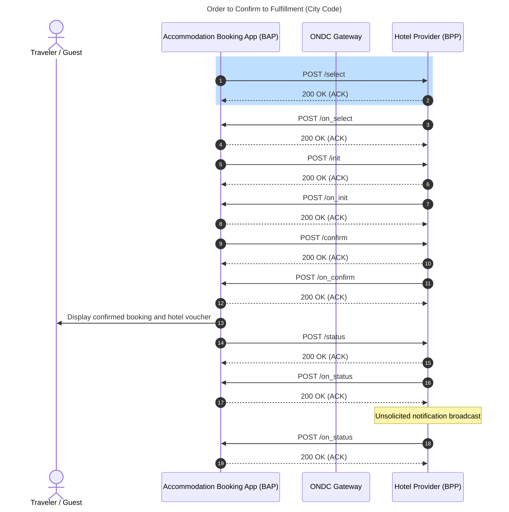
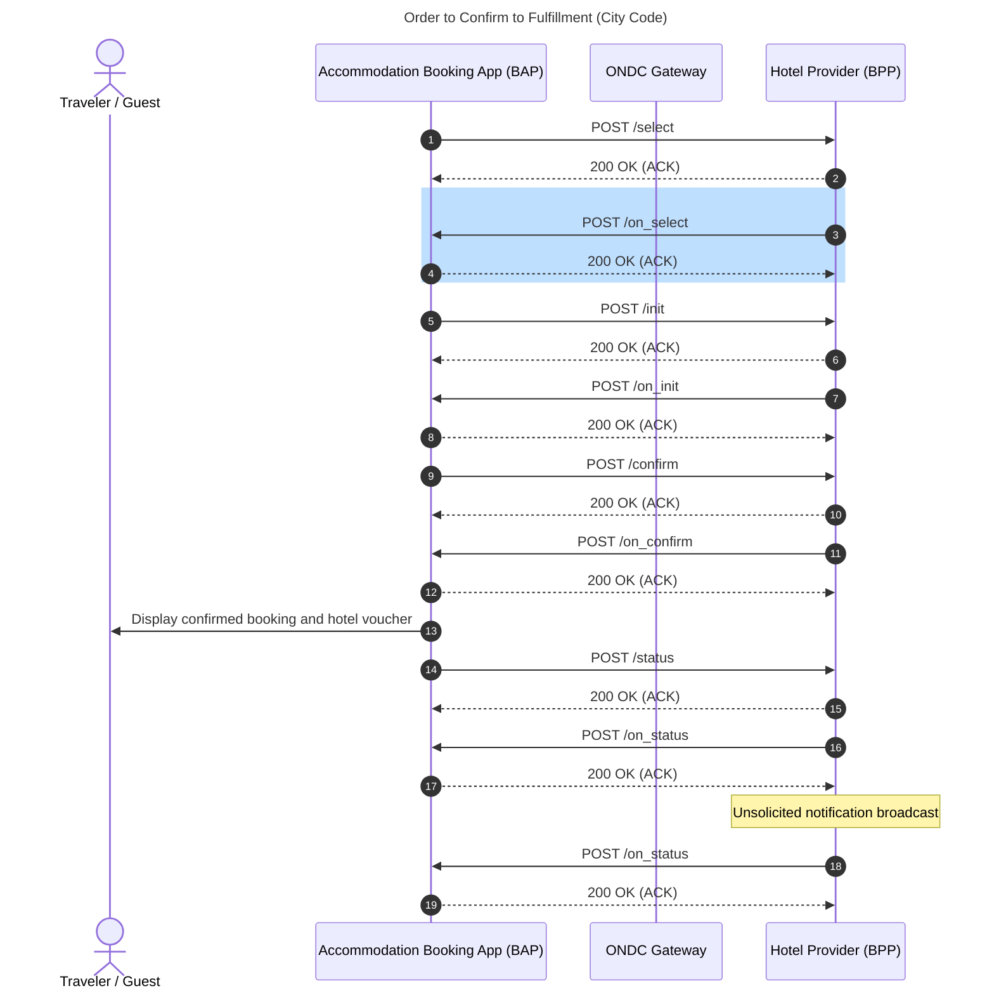
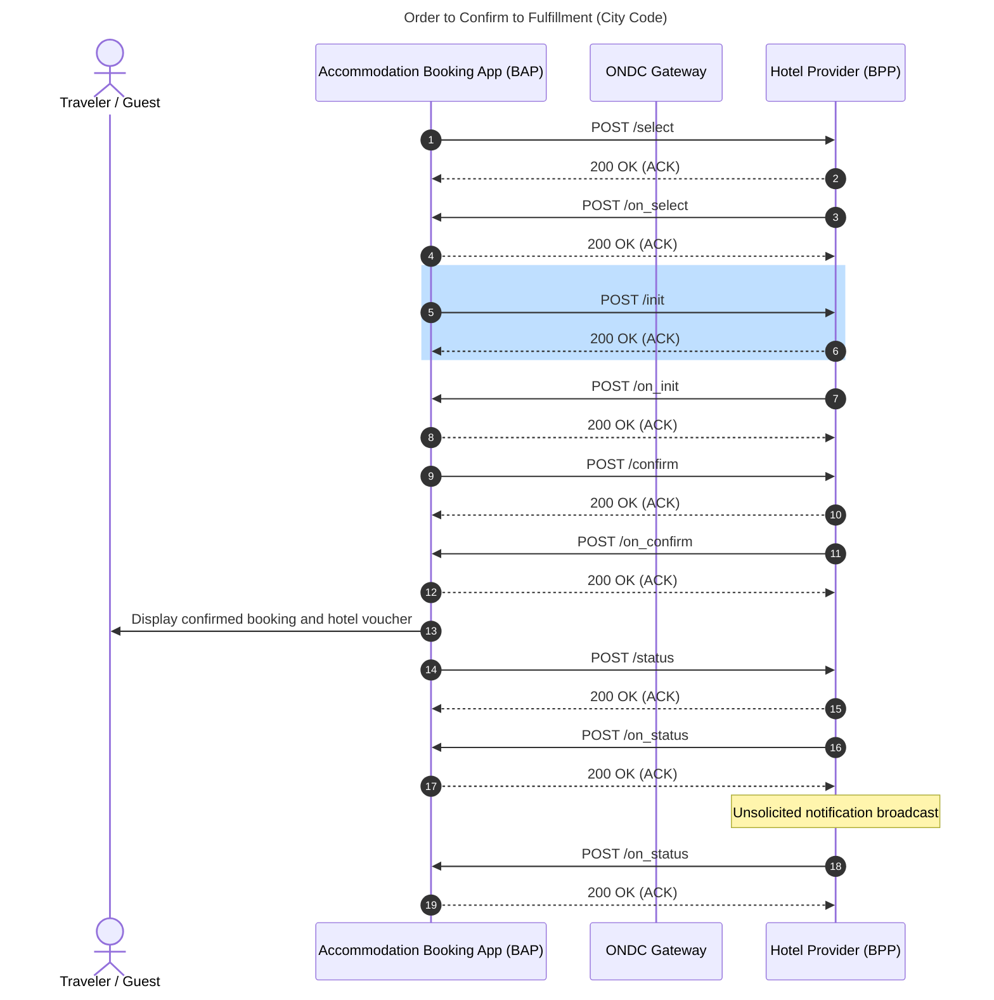
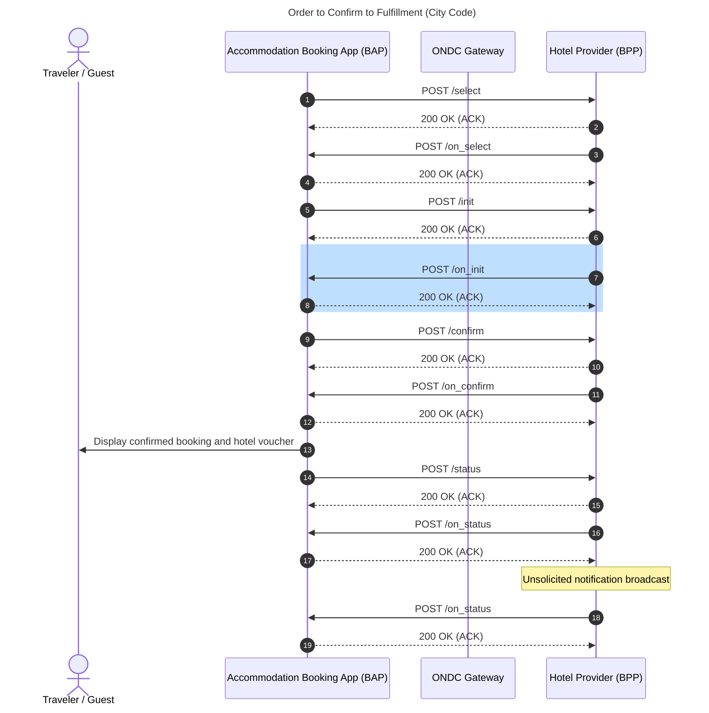
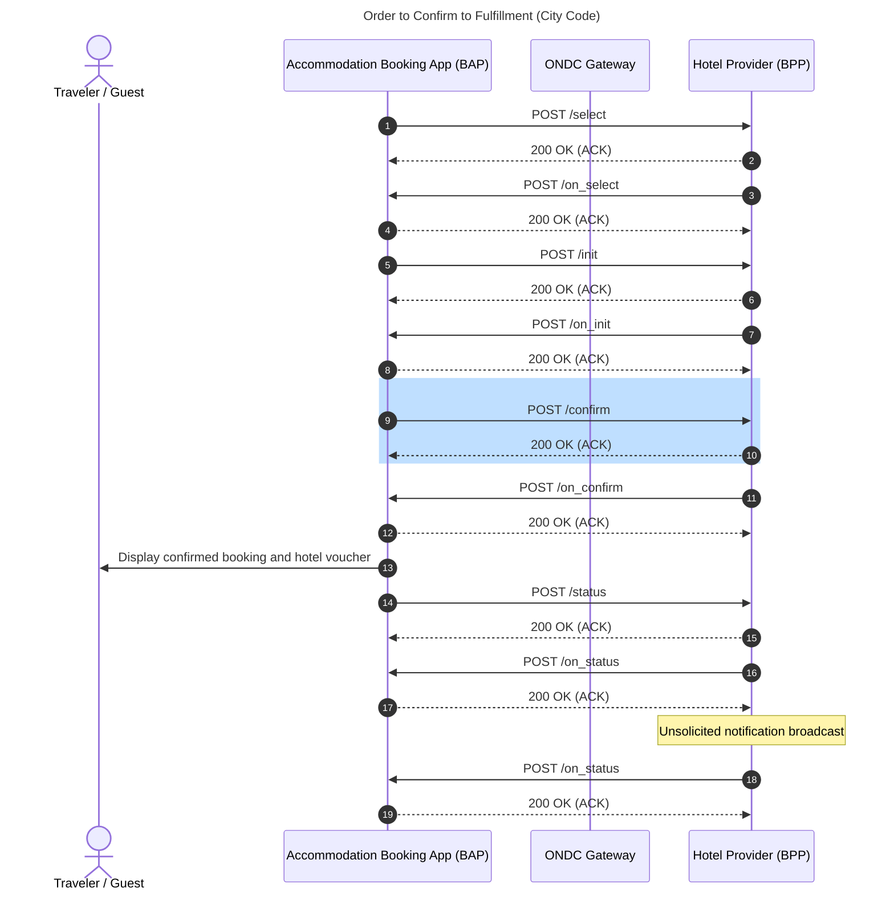
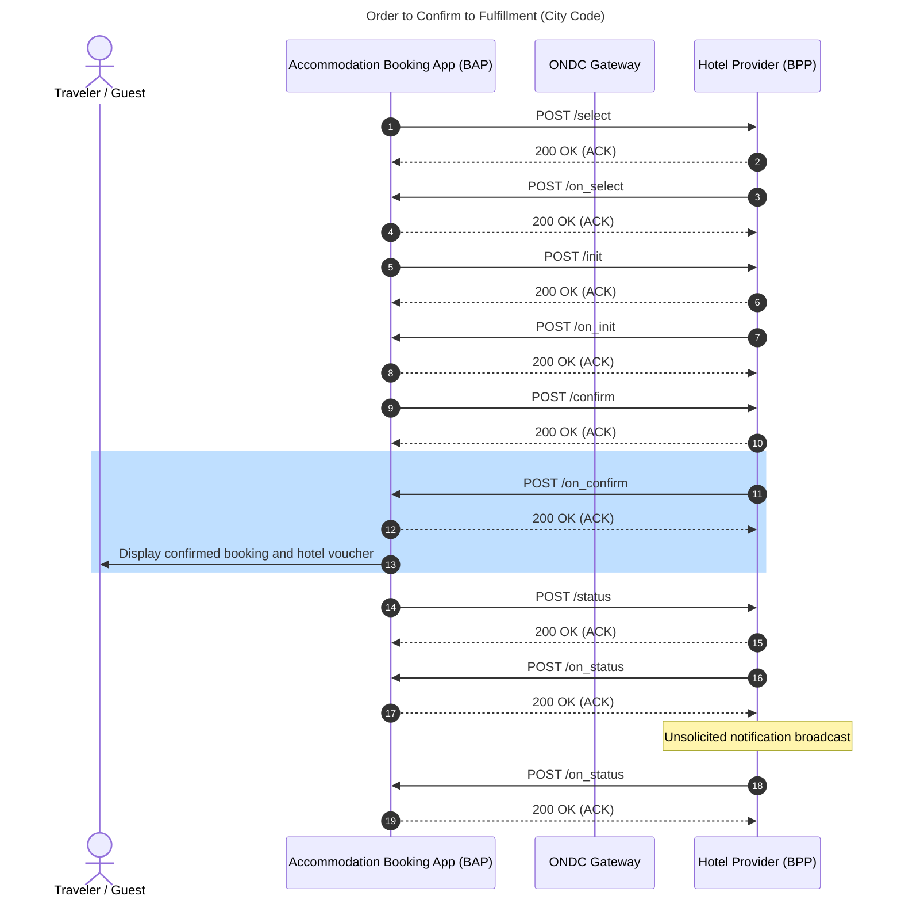
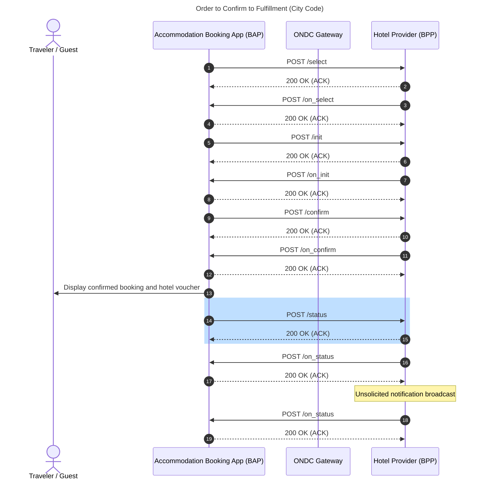
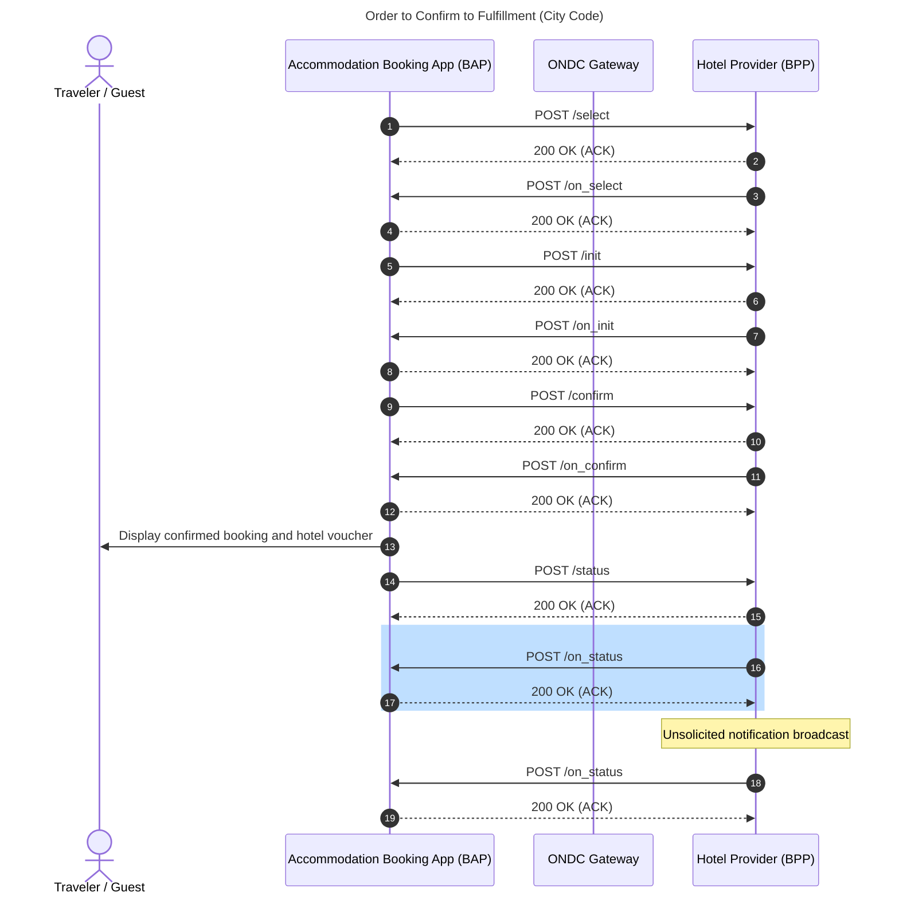
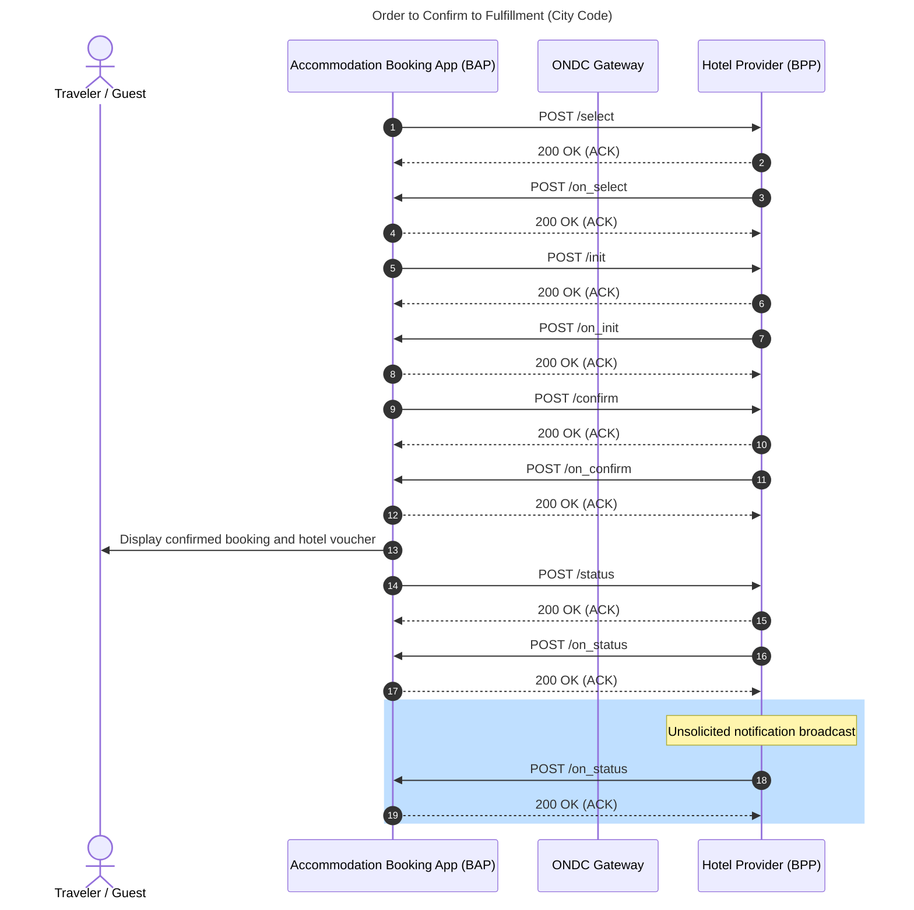

# Order to Confirm to Fulfillment (City Code) — Sequence Diagrams

Internal data file consumed by the Developer Guide's "Sequence Diagram" tab (API Walkthrough).
Not meant to be shown as its own docs page — the frontend filters this slug out of the Use Case
Brief / Additional Resources / Changelog tab lists and instead looks up the section matching the
selected API call's `action_id` (the `##` heading below) to render that step's diagram.

One `## <action_id>` heading per step of `Order_to_Confirm_to_Fulfillment__City_Code_.yaml`, in that flow's own step order, each
followed by its Mermaid `sequenceDiagram`.

## select_5

## on_select_5

## init_5

## on_init_5

## confirm_5

## on_confirm_5

## status_5

## on_status_city_code

## on_status_unsoliciated

