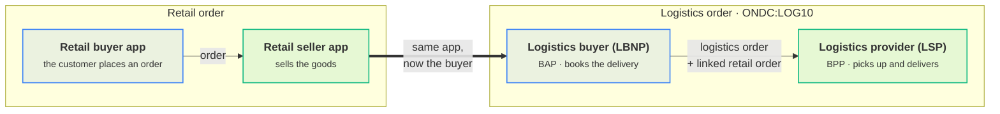
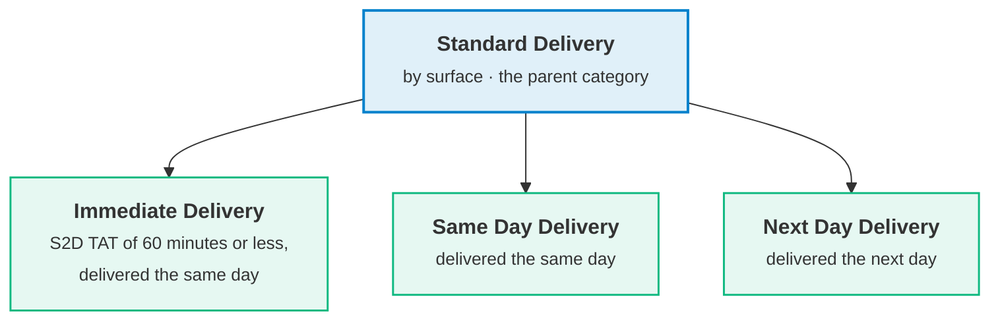
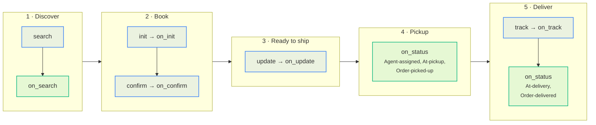
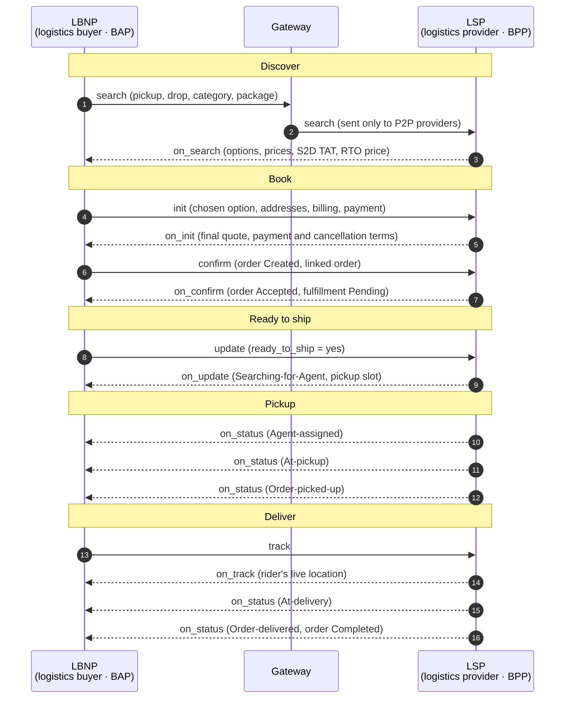
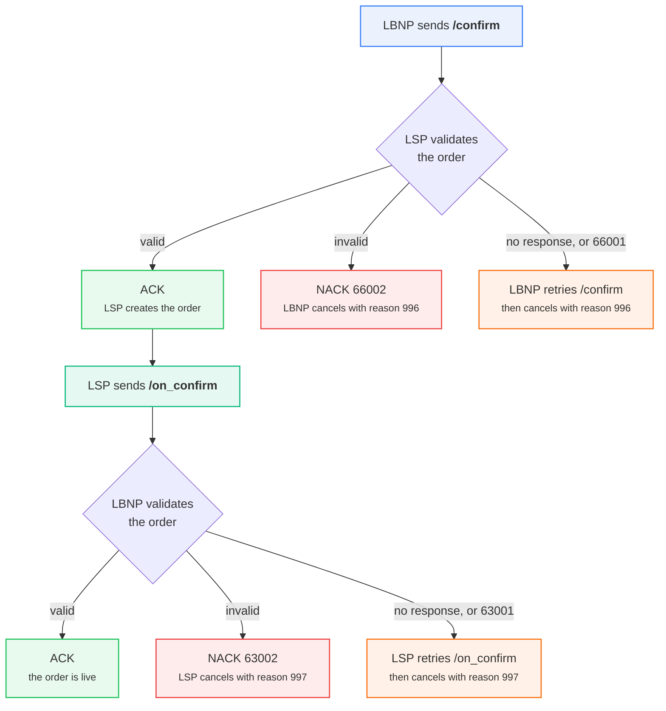
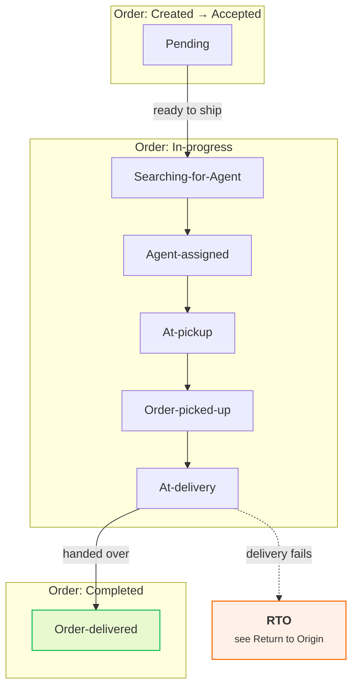
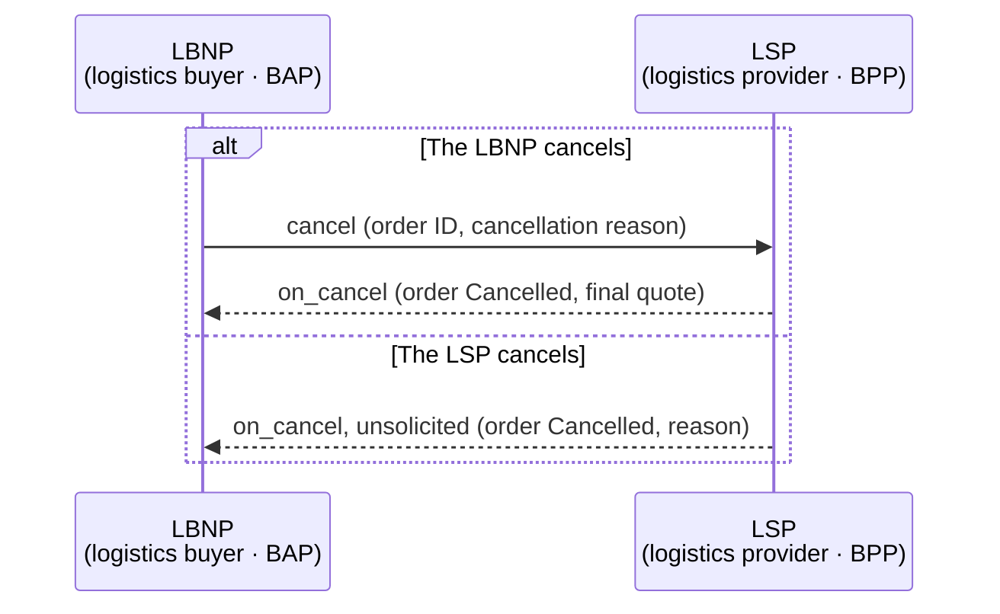
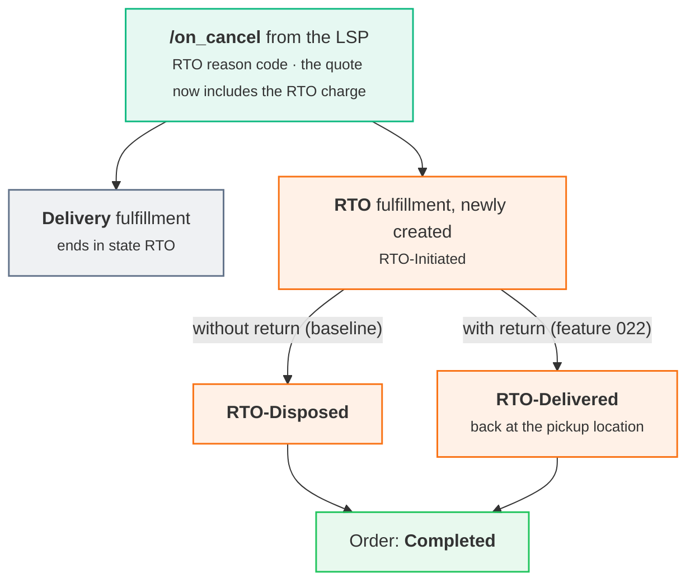
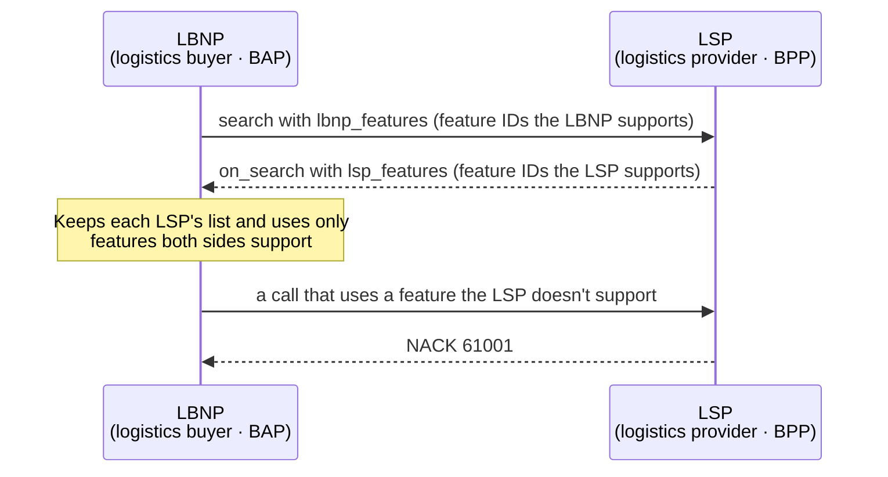

# Logistics (P2P)

> Point-to-point (hyperlocal) delivery on ONDC, domain `ONDC:LOG10`, as defined in the **ONDC API Contract for Logistics, v1.2.5**.

---

## 1. Overview

In a **point-to-point (P2P)** shipment, a rider picks up a package at the merchant's location and takes it straight to the buyer's location. The package never goes through a hub. This is the model for hyperlocal, intracity deliveries, such as a food or grocery order that has to reach the customer within the hour or the same day.

A logistics order always sits behind a retail order. When a customer buys from a seller on ONDC, the seller's app has to get the goods delivered. To do that, it becomes a **buyer on the logistics network** and books a delivery from a **Logistics Service Provider (LSP)**. It shares the retail order's details with the LSP as the *linked order*.

The retail seller app sells on the retail network and buys on the logistics network. In the logistics transaction it is the BAP, and the LSP is the BPP.

**Why a separate domain:** since version 1.2.5, P2P shipments use their own domain code, `ONDC:LOG10`. This lets the Gateway send a P2P search only to P2P providers. Hub-based shipments use `ONDC:LOG11`.

**Version:** 1.2.5 builds on 1.2.0, and most APIs are backward compatible. The one exception is the updated RTO flow, described in [Return to Origin](#7-return-to-origin-rto). Because of it, the two versions run side by side.

### Participants

| Participant | Role |
| --- | --- |
| **Logistics buyer (LBNP)** | The buyer app (BAP) on the logistics network, usually the seller app of the retail order. It searches for delivery options, books one, says when the package is ready to ship, and tracks the shipment. |
| **Logistics Service Provider (LSP)** | The seller app (BPP) on the logistics network. It checks whether it can serve the route, quotes prices and delivery times, assigns a rider and reports progress until delivery. |
| **Rider** | The LSP's delivery agent. The rider doesn't call any API, but the states the LSP reports, such as `At-pickup` and `Order-picked-up`, follow the rider's progress. |
| **End seller and end buyer** | The merchant who hands over the package and the customer who receives it. They confirm the handover with pickup and delivery codes, such as an OTP. |

---

## 2. Key Terms

| Term | Meaning |
| --- | --- |
| **Ready to ship (RTS)** | The `ready_to_ship` tag says the package is packed and can be picked up. The LSP starts looking for a rider only after RTS. |
| **S2D TAT** | Ship-to-delivery turnaround time: how long the LSP takes to deliver once it has the shipment. It is quoted per category, or per option, in `/on_search`. |
| **Linked order** | The retail order being delivered: its ID, items, weight, dimensions, declared value and category. |
| **Pickup and delivery codes** | Codes that confirm a handover, such as the merchant's order number or an OTP. The contract calls them PCC (pickup confirmation code) and DCC (delivery confirmation code). |
| **RTO** | Return to origin: what happens to a package that can't be delivered. |
| **Baseline and enhanced features** | Every participant must support the baseline features. Enhanced features are optional and have a feature ID, for example `008` for cash on delivery. See [Enhanced Features](#9-enhanced-features). |

---

## 3. Delivery Categories

The LBNP asks for a delivery category in `/search`, and the LSP quotes its options for each category in `/on_search`.

- **A search for Standard Delivery** returns every option the LSP can offer, including Immediate, Same Day and Next Day Delivery.
- **A search for a specific category** returns the options for that category only. An LSP with no option for it doesn't respond.
- **Express Delivery** (by air) applies only to P2H2P shipments.
- **Instant Delivery** is the category for quick commerce logistics (feature `005`).

---

## 4. The Order Journey

### Journey at a Glance

Blue boxes are calls the LBNP starts, and green boxes are callbacks or updates from the LSP.

### The Complete Flow

The **ORDER FLOW BASE LINE** flow in the API Walkthrough follows this sequence.

### Stage 1: Discover

The LBNP asks which providers can deliver between two points, and at what price.

**Network interaction:**

- **`/search`**: The LBNP sends the pickup and drop locations (GPS coordinates and area code), the category, the package's weight, dimensions and declared value, and the payment type. It can also send the store's pickup hours and the time it needs to prepare an order. The Gateway sends the search only to P2P providers.
- **`/on_search`**: Each LSP checks whether it can serve the route. If it can, it returns its catalog. The catalog lists each delivery option with a tax-inclusive price, the S2D TAT, the average time to pickup and the motorable distance. Each option comes with a linked RTO price, so the LBNP knows the return cost up front. An LSP that can't serve the route doesn't respond.

### Stage 2: Book

The LBNP picks an option, gets the final quote, and places the order.

**Network interaction:**

- **`/init`**: The LBNP sends the chosen option, the full pickup and drop addresses and contacts, its billing details, including its GST number, and the payment type. The LSP checks serviceability again and returns an error if it can't serve the locations.
- **`/on_init`**: The LSP returns the itemised quote: the delivery charge and tax, whose total must equal the sum of the line items. The quote also gives how long it is valid, along with the payment terms and cancellation terms. The price must match `/on_search` and can't change until the order is confirmed.
- **`/confirm`**: The LBNP creates the order in state **`Created`**, with an order ID that is unique across the network. It sends the linked retail order, the pickup and delivery codes, and the `ready_to_ship` status. It also says whether a failed delivery should return to the pickup location, and accepts the LSP's terms. The LSP creates the shipment manifest.
- **`/on_confirm`**: The LSP returns the same order ID in state **`Accepted`**, with the fulfillment in **`Pending`**. It confirms the S2D TAT. If the package is already ready to ship, it also gives the pickup time slot.

The payment type is one of `ON-ORDER` (prepaid, typically from a wallet), `ON-FULFILLMENT` (cash on delivery) or `POST-FULFILLMENT` (billed after delivery).

#### Confirming an Order Safely

The contract sets rules so that neither side keeps an order the other side doesn't have. `/confirm` and `/on_confirm` must be idempotent: sending the same call again must not create a second order.

### Stage 3: Ready to Ship

The LSP looks for a rider only once the package is packed. The LBNP can say the package is ready in `/confirm`, or later with `/update`.

**Network interaction:**

- **`/update`**: The LBNP sets `ready_to_ship` to `yes` and sends the pickup code.
- **`/on_update`**: The LSP moves the order to **`In-progress`** and the fulfillment to **`Searching-for-Agent`**. It also returns a pickup time slot: an exact slot for Immediate Delivery, or possibly the whole day for Same Day or Next Day Delivery.

#### Immediate Delivery

Since version 1.2.5, Immediate Delivery is part of the baseline. Because the order has to be delivered within 60 minutes, the rules are stricter:

- In `/on_init`, the LSP must check that a rider is available and report the result.
- In `/confirm`, the LBNP must send `ready_to_ship` as `yes`, its estimated order preparation time and the retail order ID. It can also send static OTPs for pickup and delivery.
- The LSP can reject `/confirm` with **65005** if these details are missing, or with **60004** if no rider is available.
- When the package is actually ready, the LBNP sends `/update` with `order_ready` set to `yes`.

The LBNP should use its preparation time and the LSP's time to pickup to decide when to place the logistics order. See the **IMMEDIATE DELIVERY FLOW** in the API Walkthrough.

### Stage 4: Pickup

The LSP sends unsolicited `/on_status` updates as the rider moves.

**Network interaction:**

- **`/on_status`**: **`Agent-assigned`**, when a rider accepts the job. The LSP may share tracking details at this point.
- **`/on_status`**: **`At-pickup`**, when the rider reaches the edge of the pickup location. The LSP decides how far that edge extends.
- **`/on_status`**: **`Order-picked-up`**, once the rider has the package and the pickup code is verified. The LSP can revise the delivery time window here.

### Stage 5: Deliver

**Network interaction:**

- **`/track`**: The LBNP asks where the shipment is. If tracking isn't enabled for the order yet, the LSP can reply with **NACK 60012**.
- **`/on_track`**: For P2P, the LSP returns the rider's live GPS location, which the LBNP polls for updates.
- **`/on_status`**: **`At-delivery`**, when the rider reaches the edge of the delivery location.
- **`/on_status`**: **`Order-delivered`**, after the handover, and after the delivery code check if one was set. The order is now **`Completed`**.

---

## 5. Order and Fulfillment States

Each `/on_confirm`, `/on_update`, `/on_status` and `/on_cancel` carries two states: the **order** state and the **fulfillment** state. In the diagram, each box around a group of fulfillment states shows the order state at that point.

When an order is cancelled, both the order and the fulfillment move to `Cancelled`. See [Cancellation](#6-cancellation).

| Fulfillment state | When the LSP sets it | Order state |
| --- | --- | --- |
| `Pending` | The default, from `/on_confirm` | `Created` or `Accepted` |
| `Searching-for-Agent` | After the package is ready to ship | `In-progress` |
| `Agent-assigned` | A rider is assigned | `In-progress` |
| `At-pickup` | The rider reaches the pickup location | `In-progress` |
| `Order-picked-up` | The rider picks up the package | `In-progress` |
| `At-delivery` | The rider reaches the delivery location | `In-progress` |
| `Order-delivered` | The package is delivered | `Completed` |
| `Cancelled` | The order is cancelled | `Cancelled` |

- **Who sets the order state:** the LBNP creates the order as `Created` in `/confirm`, and the LSP returns it as `Accepted` in `/on_confirm`. The LSP never holds an order in `Created`.
- **`Out-for-delivery`** is not used for P2P and will be removed in a future version. Use `At-delivery`.

---

## 6. Cancellation

Either side can cancel an order. The LBNP asks with `/cancel`, and the LSP cancels on its own with an unsolicited `/on_cancel`.

- If the reason code isn't valid, the LSP can reply with **NACK 60009**.
- If the LBNP cancels for a missed delivery time (reason **175**) but the LSP hasn't missed it, the LSP can reply with **NACK 60010**.
- `/on_cancel` records the fulfillment's state just before the cancellation (`precancel_state`). Its quote shows the final amount, including any cancellation fee.

See **BUYER SIDE ORDER CANCELLATION**, **SELLER SIDE ORDER CANCELLATION** and, for fees by fulfillment state, **CANCELLATION TERMS FLOW** (feature `01A`).

---

## 7. Return to Origin (RTO)

If the package can't be delivered, for example because the buyer refuses it or can't be reached, the LSP starts an RTO. It sends an unsolicited `/on_cancel` with an RTO reason code.

- **Two fulfillments:** the LSP creates a separate fulfillment of type `RTO`, linked to the delivery fulfillment through the `rto_event` tag. The delivery fulfillment ends in state `RTO`, and the RTO fulfillment starts at `RTO-Initiated`.
- **Order state:** stays as it was (`In-progress`) until the RTO fulfillment reaches `RTO-Disposed` or `RTO-Delivered`. Then the order is `Completed`.
- **Quote:** the RTO charge, the RTO price quoted in `/on_search`, is added to the order's quote.
- **With or without return:** by default the package is not brought back (`RTO-Disposed`). An LSP that supports **RTO with return** (feature `022`) brings it back to the pickup location (`RTO-Delivered`). The LBNP marks which fulfillments should come back with `return_to_origin` in `/confirm`.
- **Accepting the request:** the LBNP must accept a valid RTO request. Under feature `022`, if the RTO charge differs from the `/on_search` quote, the LBNP can reply with **NACK 62503**, and the LSP must resend the request with the correct charge.
- **Retail order:** when the delivery was booked over ONDC (on-network logistics), the RTO also leads to an `/on_cancel` on the linked retail order.

See **RTO FLOW** and, for verifying the return with an OTP, **STATIC OTP RTO DELIVERY** (feature `00A`).

---

## 8. Changing an Order

The LBNP uses `/update`, and the LSP replies with `/on_update`, to:

- say the package is ready to ship;
- change the delivery instructions;
- change the linked retail order, for example when part of the retail order is cancelled or returned and the weight or items change;
- change how pickup or delivery is verified;
- change the delivery address, for a normal or an RTO fulfillment (feature `011`, **UPDATE DELIVERY ADDRESS**).

---

## 9. Enhanced Features

Enhanced features are optional, so each side tells the other which ones it supports. This is called **feature discovery**.

If the LSP sends an update that uses a feature the LBNP doesn't support, the LBNP can reply with **NACK 64001**. The **FEATURE DISCOVERY** flow shows the exchange.

| Feature | What It Adds | Flow in the API Walkthrough |
| --- | --- | --- |
| `003` Rate card for P2P | A price list from the pickup location, by distance and time slot, separate from live search prices | RATE CARD (P2P) |
| `005` Quick commerce | Bulk deliveries booked by number of orders or riders, in the Instant Delivery category | QUICK COMMERCE FLOW |
| `008` Cash on delivery | The rider collects the order value. Payment terms for the logistics order and the retail order are kept separate. | CASH ON DELIVERY FLOW |
| `009` Static OTP (pickup and delivery) | A fixed OTP, set by the LBNP, that the seller gives at pickup and the buyer gives at delivery | STATIC OTP PICKUP DELIVERY |
| `00A` Static OTP (RTO) | A fixed OTP that the seller gives when an RTO package comes back | STATIC OTP RTO DELIVERY |
| `00C` FIFO orders | A rider is booked first, and any retail order can be assigned to the rider before pickup | FIFO FLOW |
| `00D` Payment wallet | Prepaid payment from a wallet the LSP keeps for the LBNP: blocked in `/on_init`, debited in `/on_confirm` | PREPAID PAYMENT FLOW |
| `00F` ePOD | Electronic proof of pickup and delivery, such as a photo, the rider's GPS position or the recipient's name | E-POD |
| `010` Call masking | Contact modes other than a phone number, such as IVR | Call-Masking |
| `011` Update delivery address | Changes the delivery address after the order is placed | UPDATE DELIVERY ADDRESS |
| `013` Seller and buyer instructions | Pickup notes from the seller and delivery notes from the buyer | SELLER BUYER INSTRUCTIONS |
| `014` Seller credentials | Tags orders from specific sellers, for example women-owned or tribal-owned businesses | ORDER FLOW BASE LINE SELLER CREDS |
| `017` Surge fee | A surge charge, declared in the catalog, added on top of the base fare | SURGE FEE FLOW |
| `019` E-way bill | Several e-way bills per order. The LBNP sends each item's HSN code and e-way bill exemption, and the seller's GSTIN. | E-WAY BILL |
| `01A` Cancellation terms | Cancellation fees by fulfillment state and reason | CANCELLATION TERMS FLOW |
| `01C` SLA metrics | Service levels the LBNP defines, such as time to assign a rider, with penalties | ORDER FLOW BASE LINE SLA METRICS |
| `01D` Special capabilities | What the LSP can handle, such as fragile or dangerous goods, cold storage, open-box delivery and cash on delivery | ORDER FLOW BASE LINE PUBLIC SPECIAL CAPABILITIES |
| `01E` RCM self-declaration | The LSP's declaration for the GST reverse charge mechanism | ORDER FLOW RCM |
| `01F` Codified static terms | The LSP's standard terms, published in `/on_search` | ORDER FLOW CODIFIED STATIC TERMS |
| `020` Customer support details | Support contacts exchanged in `/confirm` and `/on_confirm` | ORDER FLOW EXCHANGE CUSTOMER SUPPORT DETAILS |

---

## 10. Issue and Grievance Management

Either side can raise an issue about an order, for example a delayed, damaged or undelivered shipment. Issues are handled with the IGM APIs.

**Network interaction:**

- **`/issue`**: The LBNP raises an issue for an order, with its category, a description and the expected resolution time.
- **`/on_issue`**: The LSP replies with the actions it has taken and a proposed resolution, and keeps sending updates until the issue is resolved.
- **`/issue`**: The LBNP accepts the resolution or escalates it, and closes the issue.

If an order is cancelled through an issue, the LSP can refer to the resolved issue in `/on_cancel` and in later updates. The API Walkthrough has flows for IGM v1.0.0 and v2.0.0, covering issues that are resolved, rejected or closed with no action.
