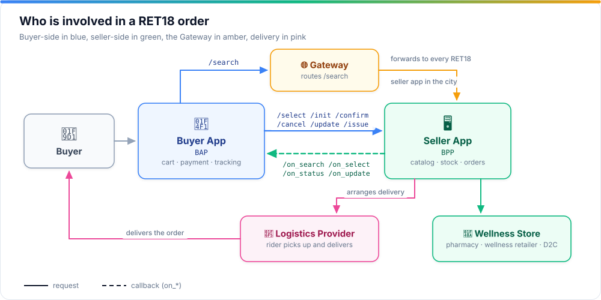
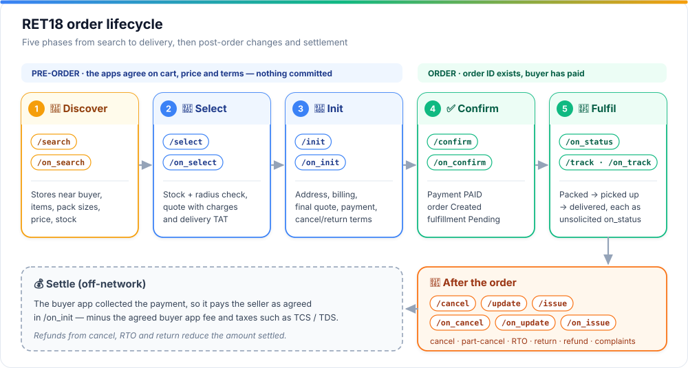
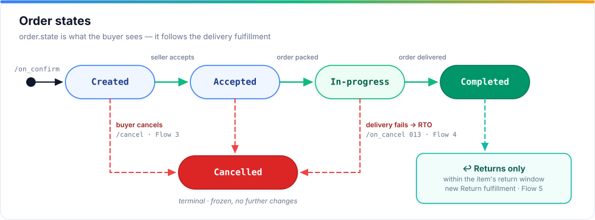
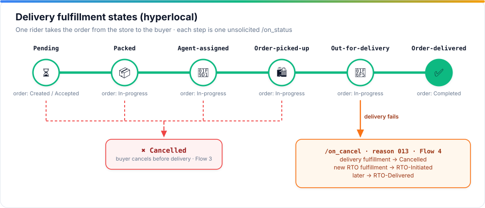
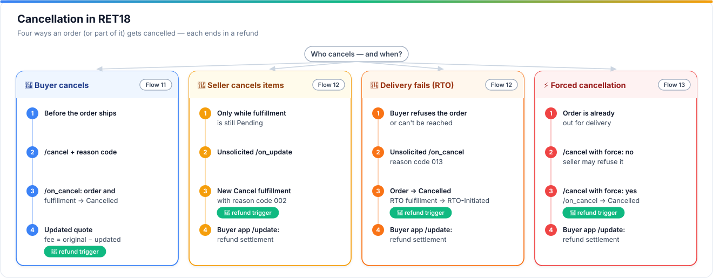
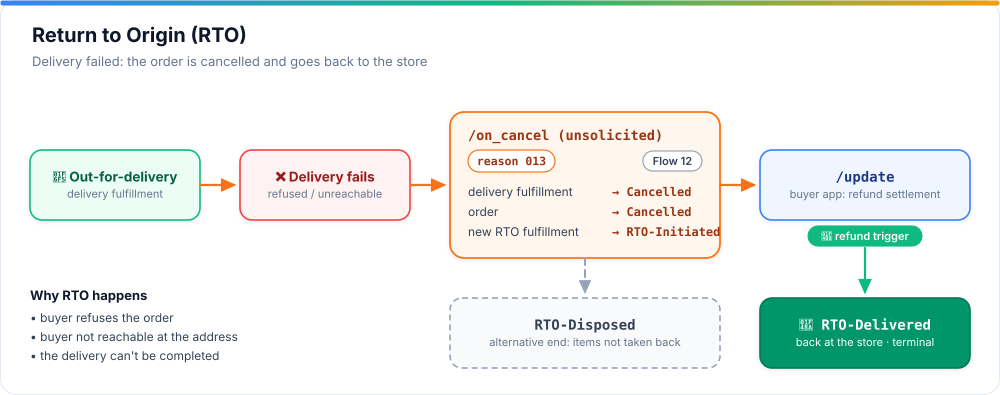
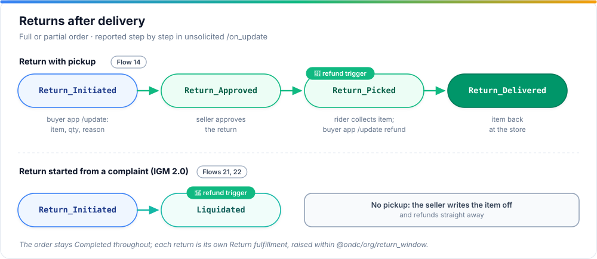
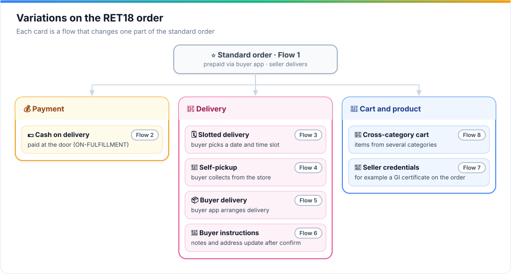
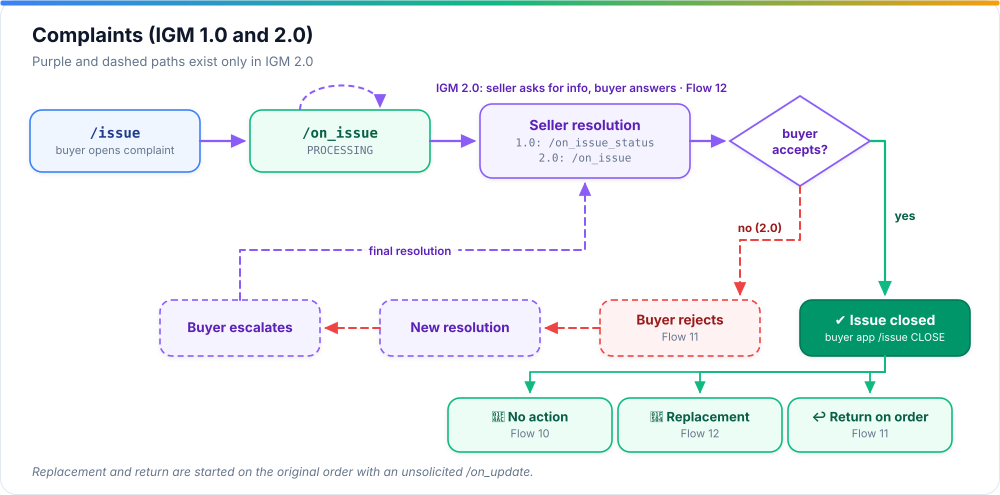
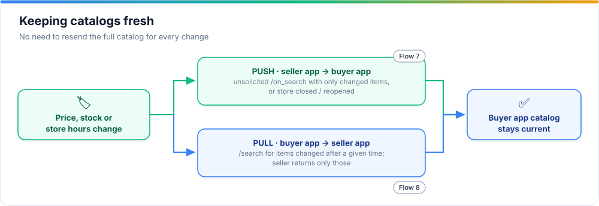

# Retail Health & Wellness (ONDC:RET18 1.2.5)

> **Shop health and wellness products from any store, through any app.** ONDC lets one buyer app show catalogs from many wellness sellers, and lets one seller reach buyers on every buyer app, all through a single open protocol.

## At a Glance

| | |
|---|---|
| **Domain** | `ONDC:RET18` (Retail Health & Wellness) |
| **Version** | `1.2.5` |
| **What is sold** | Nutrition and fitness supplements, Ayurvedic and herbal products, personal health devices and everyday wellness essentials |
| **Use case** | `HEALTH&WELLNESS` |
| **Delivery model** | Seller-managed delivery, usually hyperlocal from a nearby store |
| **Payment** | Prepaid, collected by the buyer app (`payment.type` `ON-ORDER`, `collected_by` `BAP`); cash on delivery (`ON-FULFILLMENT`, Flow 2) |
| **Fulfillment types offered** | `Delivery` (seller delivers), `Buyer-Delivery` (buyer app delivers), `Self-Pickup` (buyer collects) |
| **Flows in this spec** | 22 (15 mandatory): ordering, delivery, cancellation, RTO, returns, replacement, catalog sync and grievances |
| **Grievances** | IGM 1.0.0 and IGM 2.0.0 |

**Why health and wellness is different:** many products are consumed, so catalogs carry ingredients, net quantity, expiry dates and batch details, and regulated items must show the right licence and statutory details. Buyers often need items quickly from a nearby store, and sealed products usually can't be returned once opened.

**Who is responsible for what:** the seller owns its catalog, prices, stock, packing, delivery and after-sales service. ONDC standardizes the messages used to discover products, place orders, track delivery, and handle cancellations, returns and grievances.

### What's New in 1.2.5

Compared with version 1.2.0, this version adds:

| Area | What it adds |
|---|---|
| **Fulfillment choices** | Slotted delivery (buyer picks a date and time window), self-pickup from the store, buyer-managed delivery. |
| **Changes after the order** | Buyer instructions and delivery address change after confirmation, and a delivery OTP sent by the seller for handover. |
| **Payments and commercials** | Cash on Delivery. |
| **Products and sellers** | Cross-category carts, seller credentials (for example GI). |
| **Reverse flows** | Replacement with reverse QC, forced cancellation, seller cancellation with RTO. |

---

## Who Is Involved

| Participant | Role in RET18 |
|---|---|
| **Buyer App (BAP)** | Where the buyer searches, builds a cart, pays, tracks the order and raises complaints. It usually collects the payment and settles with the seller later. In Flow 5 it also arranges delivery. |
| **Seller App (BPP)** | Represents pharmacies, wellness retailers and D2C health brands. It publishes the catalog, checks stock and serviceability, prices and confirms the order, manages packing and delivery, and handles cancellations, RTO, returns and replacements. |
| **Logistics Provider** | Picks up from the store and delivers to the buyer. Usually arranged by the seller app; arranged by the buyer app in Flow 5. |
| **Gateway** | Forwards a buyer app's `/search` to every seller app serving that city for `ONDC:RET18`. |

### How the Two Apps Talk

Every call is **asynchronous**. The sender gets only an acknowledgement on the same HTTP call. The real answer comes later as a separate call in the other direction, named `on_<action>`.

- An **ACK** only means the message passed schema and signature checks. It is not a business "yes".
- A **business failure**, such as an out-of-stock item, comes back inside the callback as an `error` object (for example `40002` in Flow 10).

| Concept | What it means in RET18 |
|---|---|
| `context.domain` | Always `ONDC:RET18`. `context.core_version` is `1.2.5`. |
| `context.transaction_id` | One ID for one cart's whole journey, from `/select` through delivery, cancellation, return and grievance. |
| `context.message_id` | Pairs a request with its callback: `/select` with M2 is answered by `/on_select` with M2. |
| **Solicited and unsolicited** | A solicited callback answers a request. An unsolicited one is pushed by the seller app on its own, for example `/on_status` when the order is packed, or `/on_search` when a price changes. |
| **Order and fulfillment** | The order has one `state`. Each **fulfillment** inside it has its own `state` and `type`: `Delivery` (or `Buyer-Delivery`) for the forward shipment, `Cancel` for items the seller cancelled, `RTO` for a failed delivery going back, `Return` for items the buyer returned. |
| **Quote and breakup** | `quote.price` is the order total. `quote.breakup` has one line per item plus `delivery`, `packing`, `tax`, `discount` and `misc` lines (`@ondc/org/title_type`). |
| **Quote trail** | When a cancel, RTO or return lowers the order value, the seller app records the change as a quote trail. The buyer app works out the refund from it. |

---

## Order Lifecycle

A health and wellness order goes through two phases. In **pre-order** the two apps agree on the cart, price and terms; nothing is committed. The **order** starts at `/confirm`, once the payment terms are fixed. From then on the order has an ID and a state, and every change is a message on the same `transaction_id`.

| Phase | Buyer app sends | Seller app answers | What is decided in RET18 |
|---|---|---|---|
| Discover | `/search` (through the Gateway) | `/on_search` | Which sellers serve the buyer, with their items, prices and stock |
| Select | `/select` | `/on_select` | Stock and serviceability for the cart; item prices, delivery and packing charges, taxes; delivery time (`@ondc/org/TAT`); delivery slots (Flow 3) |
| Init | `/init` | `/on_init` | Delivery address and billing; final quote; payment, cancellation, return and settlement terms |
| Confirm | `/confirm` | `/on_confirm` | Payment `PAID` (or `NOT-PAID` for cash on delivery, Flow 2); the order is `Created`, its delivery fulfillment is `Pending` |
| Fulfil | `/track` | `/on_status` (unsolicited), `/on_track` | Accepted, packed, agent assigned, picked up, out for delivery, delivered |
| After order | `/cancel`, `/update`, `/issue` | `/on_cancel`, `/on_update`, `/on_issue` | Cancellation, part-cancellation, RTO, returns, replacements, refunds, complaints |
| Settle | — (off-network) | — | Whoever collected the payment settles with the other side as agreed in `/on_init`, less the agreed buyer app fee and taxes such as TCS or TDS |

If the buyer changes the delivery address, or `/on_init` comes back with a smaller cart, the buyer app must send `/select` again.

### Order States

The order `state` is what the buyer sees. It follows the state of the order's fulfillments.

| Order state | Meaning |
|---|---|
| `Created` | `/on_confirm` sent. The seller app has the order; the seller hasn't accepted it yet. |
| `Accepted` | The seller accepted the order. Cancellation terms from `/on_init` apply from here. |
| `In-progress` | The order is being packed, picked up or delivered. |
| `Completed` | The order is delivered. Only returns can change it now. |
| `Cancelled` | The whole order is cancelled: by the buyer before shipping, or because delivery failed (RTO). |

### Delivery Fulfillment States

The seller app reports every step of the delivery fulfillment in an unsolicited `/on_status`, one message per change. Delivery is usually hyperlocal: a rider takes the order from the store to the buyer.

| Fulfillment state | When it is set | Order state | Sent in |
|---|---|---|---|
| `Pending` | As soon as the order is confirmed | `Created`, then `Accepted` | `/on_confirm`, `/on_status` |
| `Packed` | Items packed and ready for pickup | `In-progress` | `/on_status` |
| `Agent-assigned` | Delivery agent assigned; name and phone shared | `In-progress` | `/on_status` |
| `Order-picked-up` | Agent collected the order from the store | `In-progress` | `/on_status` |
| `Out-for-delivery` | Agent on the way to the buyer | `In-progress` | `/on_status` |
| `Order-delivered` | Handed over, with the delivery time; for cash on delivery, payment becomes `PAID` | `Completed` | `/on_status` |
| `Cancelled` | Fulfillment cancelled, or RTO started | `Cancelled` | `/on_cancel` |

In Flow 5 (`Buyer-Delivery`), the same states are reported the other way: the buyer app sends them to the seller app in `/update`.

### Lifecycle Rules for RET18 Implementations

1. **Terminal states are frozen.** Nothing changes a `Cancelled` order. A `Completed` order changes only through returns and replacements.
2. **One message per change.** Every status change is an unsolicited `/on_status`. Every change to order details (part-cancel, return) is an `/on_update`. Changes are never batched.
3. **`/on_update` and `/on_status` carry the full picture:** every item and fulfillment with its current state, the quote and breakup, the quote trail and the settlement trail.
4. **The order value never goes up after confirmation.** It only goes down, and only by reducing an item's quantity.
5. **Cancellation fees follow the terms in `/on_init`,** which are set per fulfillment state and reason code.
6. **Refunds are settled with `/update`.** After a part-cancel, RTO or return, the buyer app sends `/update` with the settlement details for the refund (Flows 12 and 14).

---

## Scenarios: Where the Order Branches

These are the points in a RET18 order where more than one outcome is possible, with the flow that tests each path. The green **refund trigger** badge marks the point: the seller app sends the updated quote there, and the buyer app works out the refund from the quote trail.

### 1. Select: Is Everything in Stock?

Stock varies from store to store, so the seller app re-checks every item at `/select`.

Flow 10 stops at the error. Flow 9 goes on: the buyer fixes the cart, selects again and completes the order.

### 2. Cancellation: Who Cancels, and When

A forced cancellation (Flow 13) is for an order that is already out for delivery. The buyer app first sends `/cancel` with the `force` param set to `no`, which the seller can refuse within `ttl_response`. It then sends `/cancel` again with `force` set to `yes`, and the seller app must cancel the order.

### 3. Return to Origin (RTO): Delivery Failed

RTO starts when the buyer refuses the order or can't be reached at the address.

If the items are not taken back to the store, the RTO fulfillment ends in `RTO-Disposed` instead of `RTO-Delivered`.

### 4. Return: After Delivery

A buyer can return a delivered item within its return window from the catalog (`@ondc/org/return_window`), for the full order or part of it. The buyer app sends `/update` with the item, quantity and reason. The seller app creates a new **Return** fulfillment and reports each step in an unsolicited `/on_update`.

The order stays `Completed` throughout. The refund is triggered at `Return_Picked` (pickup) or `Liquidated` (no pickup).

**Replacement (Flow 15).** The buyer asks for a replacement of a damaged or wrong item. The seller approves it, a reverse quality check (QC) is done at pickup, the item goes back to the seller, and a replacement is packed and delivered.

### 5. Who Delivers?

| Fulfillment type | Who arranges delivery | Who reports delivery states | Flow |
|---|---|---|---|
| `Delivery` | The seller app, through its own fleet or a logistics provider | The seller app, in unsolicited `/on_status` | 1 |
| `Buyer-Delivery` | The buyer app, through its own logistics provider | The buyer app, in `/update`; the seller app answers with `/on_update` and marks the order complete once delivered | 5 |
| `Self-Pickup` | The buyer collects from the store | The seller app, in unsolicited `/on_status`: ready for pickup, then collected | 4 |

For `Buyer-Delivery`, the seller app's quote has packing charges but no delivery charge, plus the time to get the order ready and the package weight and dimensions.

### 6. Variations on the Standard Order

RET18 1.2.5 adds flows that change one part of the standard order: how it is paid for, how it is delivered, or what goes in the cart.

| Variation | What changes | Flow |
|---|---|---|
| Cash on delivery | The buyer chooses to pay at delivery. The order is placed with payment type `ON-FULFILLMENT` and payment status `NOT-PAID`. When the agent collects cash at the door, the seller sends the delivered status with the payment marked `PAID`. | 2 |
| Slotted delivery | The seller offers delivery slots (a date and time window) in `/on_select`. The buyer picks a slot, which is carried through `/init` and `/confirm`, and the seller delivers within that slot. | 3 |
| Buyer instructions | After the order is confirmed and before dispatch, the buyer can send delivery instructions (for example "call on arrival") and correct the delivery address. The seller acknowledges each change through `/on_update`, and sends a delivery OTP through `/on_update` before handover. | 6 |
| Cross-category cart | The buyer can place one order with items from different categories offered by the same seller, and the order is priced and fulfilled together. | 8 |
| Seller credentials | Sellers can share credentials such as a Geographical Indication (GI) certificate in `provider.creds`. These are carried with the order so the buyer app can display them. | 7 |

### 7. Complaints (IGM)

A buyer can raise a complaint about a delivered order, for example a damaged pack, an expired product or a missing item. It runs on its own `/issue` and `/on_issue` messages, on the same order.

| Version | How it works in RET18 |
|---|---|
| **IGM 1.0.0** | The buyer opens an issue, the seller acknowledges it and sends the resolution through `/on_issue_status`, and the buyer closes it (Flow 19). |
| **IGM 2.0.0** | Adds information requests, resolution acceptance or rejection, and escalation. An accepted resolution can start a replacement or a return on the order through `/on_update` (Flows 20, 21 and 22). |

---

## The Health & Wellness Catalog

### What the Catalog Contains

Each seller app's `/on_search` can include:

- Store name, location, timings and serviceable area
- Products with images, brand and description
- Pack size, ingredients, net quantity and expiry date
- MRP, selling price and stock availability
- Return window and whether the item is returnable
- Statutory details such as manufacturer, licence details and country of origin

### Keeping Catalogs Fresh

Sellers don't need to resend the whole catalog for every change.

---

## Flow Summary

15 of the 22 flows are mandatory. The API Walkthrough shows the step-by-step calls for each one.

| # | Flow | Group | Status | What it covers |
|---|---|---|---|---|
| 1 | Delivery Flow | Ordering | Mandatory | The standard order: the buyer selects items, gets a quote, pays online, and receives the order through seller-managed delivery |
| 2 | Cash on Delivery Flow | Payment | Optional | Same as the Delivery Flow, except the buyer pays in cash at the door instead of paying online |
| 3 | Slotted Delivery Flow | Ordering | Optional | The buyer books a delivery date and time slot, and the seller delivers within it |
| 4 | Self-Pickup Flow | Ordering | Optional | The buyer orders online and collects the order from the store |
| 5 | Buyer Delivery Flow | Ordering | Optional | The buyer app arranges delivery |
| 6 | Buyer Instructions and Delivery Update Flow | Ordering | Optional | After confirming the order, the buyer adds delivery instructions and changes the delivery address before dispatch |
| 7 | Seller Credentials Flow | Ordering | Mandatory | A normal order where the seller's credentials (for example a GI certification) are shared with the order, so the buyer app can show them to the buyer |
| 8 | Cross-Category Cart Flow | Ordering | Mandatory | The buyer combines items from more than one category in a single cart and order |
| 9 | Out of Stock Flow | Ordering | Mandatory | An item turns out to be out of stock when the buyer selects it |
| 10 | Out of Stock Flow (Error Code) | Ordering | Mandatory | The seller rejects the selection straight away because an item is out of stock |
| 11 | Buyer Cancellation Flow | After the order | Mandatory | The buyer cancels a confirmed order before it is shipped |
| 12 | Seller Cancellation Flow | After the order | Mandatory | The seller cancels part of the order after confirmation, and later the remaining order is cancelled as Return to Origin (RTO) when delivery fails |
| 13 | Forced Cancellation Flow | After the order | Mandatory | The order is already out for delivery when the buyer wants to cancel |
| 14 | Return Flow | After the order | Mandatory | After delivery, the buyer returns an item |
| 15 | Replacement Flow | After the order | Optional | After delivery, the buyer asks for a replacement |
| 16 | Discovery Flow – Full Catalog | Catalog | Mandatory | The buyer app searches a city and the seller returns its full catalog |
| 17 | Discovery Flow – Incremental Catalog (Push) | Catalog | Mandatory | After the first search, the seller pushes catalog changes as they happen, without resending the whole catalog |
| 18 | Discovery Flow – Incremental Catalog Refresh (Pull) | Catalog | Optional | The buyer app asks the seller for only the items that changed after a given time |
| 19 | Delivery Flow with IGM 1.0.0 | Grievances | Mandatory | A delivered order followed by a complaint handled under IGM 1.0.0 |
| 20 | Delivery Flow with IGM 2.0.0 – No Action | Grievances | Mandatory | A complaint under IGM 2.0.0 that the seller resolves with an explanation and no further action, which the buyer accepts |
| 21 | Delivery Flow with IGM 2.0.0 – Rejection and Escalation | Grievances | Mandatory | The buyer rejects the seller's resolution and escalates the complaint |
| 22 | Delivery Flow with IGM 2.0.0 | Grievances | Mandatory | A complaint under IGM 2.0.0 where the seller asks for more information, proposes a replacement, and the buyer accepts |
