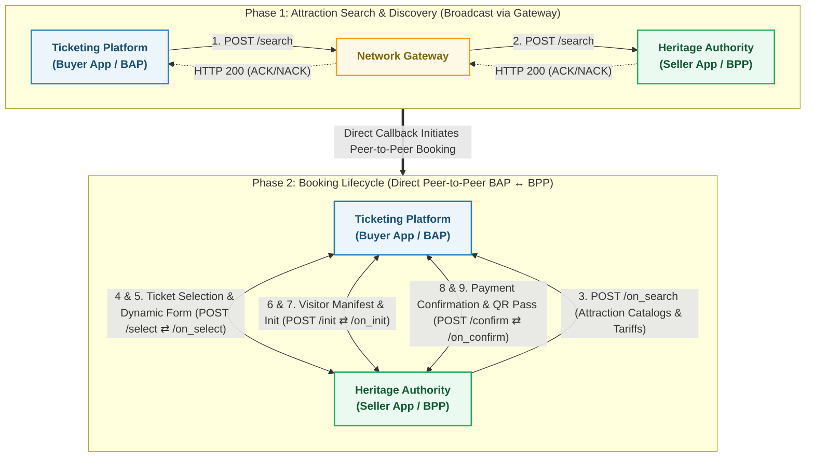
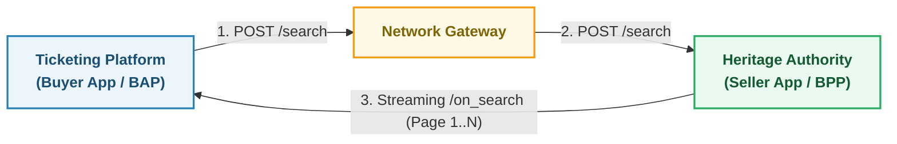
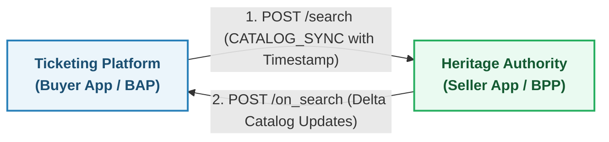
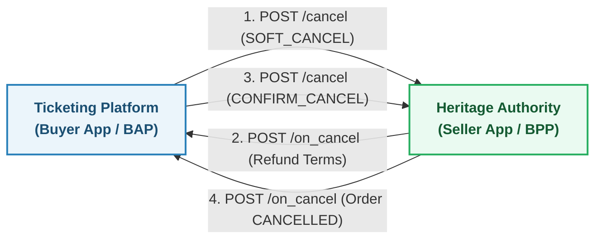
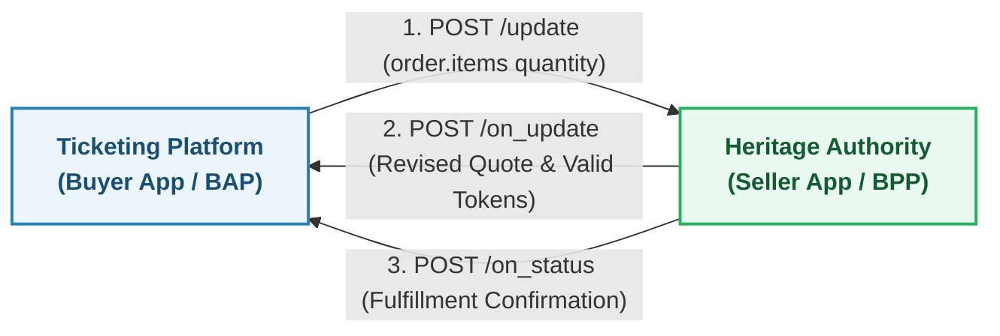
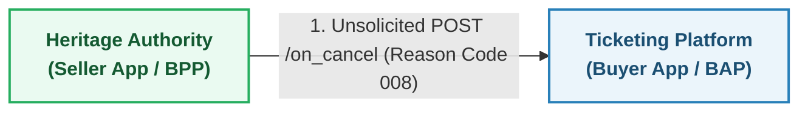

# Culture & Heritage Admissions

---

## Overview

Unreserved entry passes and admissions for cultural landmarks, monuments, museums, leisure attractions, and heritage sites are managed by archaeological trusts (such as the Archaeological Survey of India - ASI), museum boards, state tourism corporations, and experience organizers based on factors such as site capacity, operational hours, statutory tariffs, and visitor nationality classifications. Each attraction operator independently manages its site schedules, admissions, ticket categories, pricing, terms, visitor verification policies, and entry fulfillment.

ONDC enables these heritage authorities, monument operators, and ticketing platforms to connect through a common, open protocol instead of building separate integrations with each other. A ticketing platform integrates with the ONDC network as a Buyer App (BAP) and can discover and offer entry passes and admission tickets from participating cultural and heritage operators. Attraction operators integrate once with the network to make their site admissions available to participating ticketing applications.

The attraction operator remains responsible for the entry pass product, including site operations, pricing, nationality-based tariffs, entry gate verification, turnstile QR scanning, visitor safety, and on-site servicing. ONDC standardizes the network interactions for discovering, comparing, booking, and servicing unreserved entry passes across participating network participants.

This guide explains the culture and heritage ticketing use case and end-to-end journey from a business and product perspective, before covering the corresponding technical specifications and API flows.

---

## Participants

| Participant | What This Means |
|---|---|
| **Ticketing Platform (Buyer App / BAP)** | A consumer-facing application (monument ticketing portal, city exploration guide, travel platform, or digital wallet) that enables visitors to search for cultural landmarks, heritage sites, and museums, compare ticket categories and statutory tariffs, submit visitor declarations via dynamic forms, make payments, and access digital QR entry passes by connecting with participating attraction operators through the network. |
| **Heritage Authority / Attraction Operator (Seller App / BPP)** | The cultural institution, archaeological trust (e.g., Archaeological Survey of India - ASI), museum board, botanical garden, or experience operator that offers unreserved admission tickets on the network. The operator is responsible for site operations, operational schedules, visitor capacity, statutory nationality tariffs, issuing digital QR entry tokens, turnstile scanning, and on-site visitor servicing. |

---

## The User Journey

The unreserved entry pass journey enables a visitor to discover cultural monuments and heritage sites, compare ticket categories and nationality tariffs, select tickets and add-ons, complete mandatory visitor declarations via dynamic seller forms, complete payment, and receive secure digital QR entry passes.

```
[Search Attractions] ───► [Compare Sites & Ticket Tiers] ───► [Select Tickets & Add-Ons] ───► [Visitor Details & Form] ───► [Payment & Confirmation] ───► [QR Entry Pass Issued]
```

The journey consists of the following stages:

### 1. Attraction Search and Discovery

Through the Ticketing Platform (Buyer App / BAP), the visitor provides search criteria for attractions:

| Category | Field | Key | Mandatory | Type / Values |
|---|---|---|---|---|
| Location | Destination City / Location | `context.location.city.code` / `stops[type=END].location.gps` | Yes | Text (City STD Code, e.g. `std:011` or GPS coordinates e.g. `28.524428, 77.185456`) |
| | Postal Area Code | `stops[type=END].location.area_code` | No | Text (PIN Code, e.g. `110030`) |
| Category | Domain Category | `category.descriptor.code` | Yes | ENUM (`CULTURE_HERITAGE`, `EXPERIENCE`, `TOURS_SIGHTSEEING`) |
| Vehicle | Fulfillment Vehicle | `fulfillment.vehicle.category` | Yes | ENUM (`SITE`) |
| Schedule | Visit Date | `category.time.range.start` / `category.time.range.end` | No | ISO 8601 Date / Timestamp |

The Ticketing Platform (Buyer App / BAP) transmits the search request to discover available heritage sites, monuments, and museums across participating attraction operators.

**Network interaction:**

- **`/search`**: The Buyer App (BAP) broadcasts the attraction search intent to the Gateway using destination city codes or GPS coordinates, category `CULTURE_HERITAGE`, and vehicle category `SITE`. The Gateway routes this request to registered heritage operators.
- **`/on_search`**: Participating Seller Apps (BPP) respond asynchronously with catalogs containing attraction sites, operating schedules, ticket categories, statutory tariffs, and amenity descriptions.

### 2. Site Comparison and Ticket Tiers

Attraction operators return catalog offerings structured around an abstract parent attraction item and concrete bookable ticket classes:

- **Abstract Parent Item (`I0`)**: Defines overarching monument attributes, operational schedules (`OPERATIONAL_HOURS`, e.g., `09:00` to `17:00`), weekly open days (`1,2,3,4,5,6,7`), and statutory annual holiday closures (e.g., Independence Day, Republic Day).
- **Differentiated Nationality Tariffs**: Statutory pricing based on visitor citizenship:
  - `INDIAN`: Domestic visitor tariff
  - `SAARC_BIMSTEC`: Regional treaty partner tariff
  - `FOREIGNER`: International tourist tariff
- **Age and Concession Categories**: Concrete ticket items (`I1`, `I2`, `I3`) linking to the abstract parent via `parent_item_id`:
  - Adult Ticket
  - Child Ticket (free or concessional for visitors under 15 years)
  - Student / Senior Citizen Concession Ticket
- **Inclusions and Exclusions Taxonomy**:
  - Inclusions: Drinking water, wheelchair ramps, manicured gardens, washrooms, cloakroom facilities
  - Exclusions: Outside food and beverages, commercial videography/drones, pets, smoking
- **Experience Add-Ons**: Optional site enhancements such as multilingual audio guide headsets, battery-operated eco-shuttle transit, or museum gallery access.

The Ticketing Platform (Buyer App / BAP) presents the available sites, ticket tiers, and tariffs for the visitor to compare.

### 3. Ticket Selection and Dynamic Form Prompt

The visitor selects a specific monument or cultural site, ticket quantities across categories (e.g., 2 Adults, 1 Child), visit date, and optional add-ons through the Ticketing Platform (Buyer App / BAP).

- **Concrete Ticket Selection**: Visitor selects concrete item IDs linking to the parent site (`parent_item_id: "I0"`).
- **Margin Governance**: The Seller App (BPP) publishes acceptable commission margin boundaries (`margin.minimum` and `margin.maximum`). The Buyer App must ensure its requested margin conforms to these limits.
- **Dynamic Form Requirement**: When a heritage authority requires visitor identity or nationality disclosures prior to ticket issuance, the Seller App (BPP) embeds a dynamic `xinput` form descriptor in its response.

**Network interaction:**

- **`/select`**: The Buyer App (BAP) sends the selected ticket items, quantities, visit schedule, and declared margin.
- **`/on_select`**: The Seller App (BPP) validates capacity, calculates an itemized price quotation, and returns a dynamic `xinput` form descriptor if visitor information is mandatory.

### 4. Visitor Details and Dynamic Form Submission

When required by the attraction operator (e.g., statutory requirements by archaeological authorities for visitor tracking or nationality verification), the visitor completes the seller's dynamic `xinput` form rendered within the Buyer App:

| Category | Field | Key | Mandatory | Format / Rules |
|---|---|---|---|---|
| Personal | Attendee Full Name | `person.name` | Yes | Text (e.g. `Aditi Sharma`) |
| | Age | `person.age` | Yes | Number (e.g. `29`) |
| | Gender | `person.gender` | Yes | ENUM (`MALE`, `FEMALE`, `OTHER`) |
| Identity | Nationality | `person.nationality` | Yes | ENUM (`INDIAN`, `SAARC_BIMSTEC`, `FOREIGNER`) |
| | Photo ID / Passport Number | `person.id_proof` | Conditional | Government ID (Aadhaar, Voter ID, Passport number for foreign visitors) |
| Contact | Phone Number & Email | `contact.phone` / `contact.email` | Yes | Mobile number and email for ticket receipt |

The visitor submits the form directly to the Seller Form Service and receives a unique `submission_id`. The Buyer App then re-invokes `/select` with the `submission_id` to obtain a finalized quote ready for checkout.

**Network interaction:**

- **`/select` (with `submission_id`)**: The Buyer App (BAP) re-submits the selection containing the visitor form `submission_id`.
- **`/on_select`**: The Seller App (BPP) validates the form submission and returns the final verified price quote.

### 5. Order Initialization and Settlement Terms

The visitor reviews the finalized price breakdown and provides billing details for invoice generation.

**Network interaction:**

- **`/init`**: The Buyer App (BAP) initializes the draft order with billing name, address, visitor manifest, and payment terms.
- **`/on_init`**: The Seller App (BPP) reserves the admission passes, locks the price quote, and provides payment collection instructions, settlement terms, and applicable cancellation slabs.

### 6. Booking Confirmation and Digital Pass Issuance

Once the visitor completes payment through the checkout interface, the Ticketing Platform (Buyer App / BAP) transmits the payment confirmation to the heritage operator.

The operator verifies payment, confirms the admission booking, changes order status to `ACTIVE`, and issues secure digital QR code entry passes for each ticketed visitor.

**Network interaction:**

- **`/confirm`**: The Buyer App (BAP) transmits payment authorization details (transaction ID, payment method, settlement parameters).
- **`/on_confirm`**: The Seller App (BPP) sets order state to `ACTIVE` and generates digital QR admission tokens (`stops.authorization.type: "QR"`, status `UNCLAIMED`) valid for entry during site operational hours.

### 7. Turnstile Gate Entry, Scan & Lifecycle Completion

Upon arriving at the monument, the visitor displays the digital QR pass on their smartphone screen:

1. **Automated Turnstile Scan**: The turnstile optical scanner at the entrance gate reads the digital QR token.
2. **Token Validation**: The gate validation controller verifies the token authenticity and validity window.
3. **Status Transition**: The authorization status updates from `UNCLAIMED` to `CLAIMED`, and the fulfillment state transitions to `COMPLETED`.
4. **Post-Visit Ratings**: The visitor can rate their visit experience (e.g., 5 stars) via `/rating`.

**Network interaction:**

- **`/status` & `/on_status`**: The Buyer App queries order status or receives proactive updates showing fulfillment state `COMPLETED` and QR token state `CLAIMED`.
- **`/rating`**: The Buyer App submits visitor feedback and rating metrics for the attraction.

---

## Additional Scenarios

The unreserved entry pass journey continues after pass issuance through entry validation, order servicing, cancellations, and grievance management. The network supports the following additional scenarios:

### 1. Two-Step User Cancellation (Full Cancellation)

A visitor can cancel an unreserved entry pass order prior to visiting, subject to the operator's cancellation policy. The protocol enforces a two-step cancellation preview and confirmation mechanism:

```
[Visitor Requests Cancellation] ───► [POST /cancel (SOFT_CANCEL Preview)] ───► [Operator Returns Refund Quote] ───► [POST /cancel (CONFIRM_CANCEL Commit)] ───► [Pass Voided & Refund Issued]
```

**Network interaction:**

- **`/cancel` (`SOFT_CANCEL`)**: The Buyer App (BAP) requests a preview of cancellation terms and expected refund amount.
- **`/on_cancel`**: The Seller App (BPP) returns the cancellation quote, displaying cancellation fees and net refund.
- **`/cancel` (`CONFIRM_CANCEL`)**: The Buyer App (BAP) commits the cancellation.
- **`/on_cancel`**: The Seller App (BPP) transitions the order to `CANCELLED`, voids the QR entry token (`status: "CANCELLED"`), and issues the refund ledger.

### 2. Granular Partial Ticket Cancellation (via `/update`)

When a booking contains multiple tickets (e.g., 3 Adult Tickets) and the visitor wishes to cancel a subset (e.g., 1 Adult Ticket) without cancelling the entire visit, the network utilizes the `/update` API:

```
[Visitor Selects Specific Ticket] ───► [POST /update (Item Reduction)] ───► [Operator Recalculates Order & Voids Specific QR] ───► [Partial Refund Processed]
```

**Network interaction:**

- **`/update`**: The Buyer App (BAP) sends an update request targeting `order.items`, specifying the reduced item quantity.
- **`/on_update` / `/on_status`**: The Seller App (BPP) validates the modification, recalculates the order quote, voids the specific QR pass, and returns the updated order with remaining valid passes and partial refund credit.

### 3. Incremental Catalog Pull Synchronization

Heritage sites occasionally modify opening hours, declare sudden maintenance closures, or update seasonal tariffs. Buyer Apps maintain up-to-date catalog data via periodic incremental pull synchronization:

```
[Periodic BAP Sync] ───► [POST /search (tags[CATALOG_SYNC])] ───► [Operator Evaluates Changes] ───► [Incremental /on_search Delta Received]
```

**Network interaction:**

- **`/search`**: The Buyer App (BAP) sends an incremental search query with `tags[CATALOG_SYNC]` specifying the timestamp range since the last synchronization.
- **`/on_search`**: The Seller App (BPP) responds with delta catalog updates (revised hours, holiday notices, or modified tariffs) without resending the entire inventory.

### 4. Merchant Emergency Site Closure (Unsolicited Cancellation)

When a monument or cultural site must close unexpectedly due to adverse weather, district administrative orders, VIP state visits, or emergency maintenance, the operator notifies all ticket holders immediately:

```
[Site Emergency / Force Majeure] ───► [Unsolicited on_cancel (Reason 008)] ───► [100% Full Refund Issued]
```

**Network interaction:**

- **`/on_cancel` (Unsolicited)**: The Seller App (BPP) pushes an unsolicited cancellation callback with reason code `008` (Venue/Site Emergency), providing a mandatory 100% full refund with zero cancellation penalty.

---

## Issue and Grievance Management

A visitor can raise a grievance through the Buyer App (BAP) for issues related to their entry pass or the network transaction. The Buyer App (BAP) routes the grievance to the relevant attraction partner through the network's grievance mechanism.

The attraction operator is responsible for investigating and resolving the grievance. The operator communicates the grievance status and resolution to the Buyer App (BAP), which makes the relevant information available to the visitor.

The grievance process can include:

- **Grievance Registration**: The visitor raises an issue through the Buyer App (BAP).
- **Grievance Routing**: The Buyer App (BAP) routes the grievance to the relevant attraction operator.
- **Resolution**: The operator investigates the issue and takes the required action.
- **Status Updates**: The operator communicates progress and resolution status to the Buyer App (BAP).
- **Closure**: The Buyer App (BAP) communicates the resolution to the visitor and closes the grievance when appropriate.

The operator and Buyer App (BAP) remain responsible for complying with applicable grievance redressal requirements. Applicable guidelines provide for visitor grievance redressal mechanisms and identify the operator and Buyer App's designated grievance channels.

---

## Detailed Protocol Flows

### Flow 1: Unreserved Entry Pass – Standard Booking Flow (Culture-Heritage)

#### 1. Short Description

The Standard Booking Flow enables visitors to search for cultural heritage attractions by city code or GPS radius, review monument operating hours and nationality-based tariffs, select ticket categories and optional add-ons, complete visitor declarations via dynamic seller forms, complete payment, and receive secure digital QR entry passes for turnstile access.

#### 2. Visual Interaction Map



#### 3. API Breakdown & Technical Actions

- **`/search` (Buyer App [BAP] → Gateway → Seller App [BPP])**: Triggered when a visitor searches for attractions. The Buyer App (BAP) specifies destination city code (`context.location.city.code = "std:011"`), category code `CULTURE_HERITAGE`, and fulfillment vehicle category `SITE`.
- **`/on_search` (Seller App [BPP] → Buyer App [BAP])**: The operator returns its attraction catalog. Each listing includes an abstract monument item (`I0`) with operating hours (`OPERATIONAL_HOURS`), weekly open days, annual holiday closures, concrete ticket classes (`I1`, `I2`) with nationality tariffs (`INDIAN`, `SAARC_BIMSTEC`, `FOREIGNER`), inclusions/exclusions, and experience add-ons.
- **`/select` (Buyer App [BAP] → Seller App [BPP])**: The visitor selects specific ticket classes, quantities, visit date, and optional add-ons, specifying buyer margin parameters within the seller's published limits.
- **`/on_select` (Seller App [BPP] → Buyer App [BAP])**: The operator validates site capacity, calculates an itemized price quotation, and provides a dynamic `xinput` form descriptor if visitor declarations are mandatory.
- **`/select` (with `submission_id`) (Buyer App [BAP] → Seller App [BPP])**: After the visitor completes the `xinput` form, the Buyer App re-sends `/select` containing the `submission_id` from the Seller Form Service.
- **`/on_select` (Seller App [BPP] → Buyer App [BAP])**: The operator validates the submitted form data and returns the final confirmed price quote ready for initialization.
- **`/init` (Buyer App [BAP] → Seller App [BPP])**: The Buyer App (BAP) submits billing information, primary visitor contact details, and settlement parameters.
- **`/on_init` (Seller App [BPP] → Buyer App [BAP])**: The operator locks the entry tickets, verifies validity, and returns payment collection instructions, settlement terms, and cancellation slabs.
- **`/confirm` (Buyer App [BAP] → Seller App [BPP])**: Transmitted following successful payment. Contains payment status `PAID`, transaction ID, paid amount, and payment settlement terms.
- **`/on_confirm` (Seller App [BPP] → Buyer App [BAP])**: The operator confirms order `O1` as `ACTIVE`, attaches the confirmed fulfillment, and issues digital QR code entry passes (`stops.authorization.type: "QR"`, status `UNCLAIMED`).
- **`/status` & `/on_status` (BAP ⇄ BPP)**: Used to track turnstile validation. When the visitor scans their pass at the entrance gate, the authorization status transitions to `CLAIMED` and fulfillment state to `COMPLETED`.

---

### Flow 2: Unreserved Entry Pass – Seller App Pagination Flow

#### 1. Short Description

When a state tourism corporation, heritage authority, or ticket aggregator manages hundreds of cultural monuments, historical sites, and museums across a region, catalog results are partitioned into paginated batches. The Seller App (BPP) streams catalog pages sequentially using pagination tokens so the Buyer App (BAP) can render attraction results smoothly without gateway timeouts.

#### 2. Process Flow

```
[BAP: POST /search] ──► [Network Gateway Broadcast] ──► [Heritage Authority Engine] ──► [Streaming POST /on_search Page 1..N] ──► [BAP: Incremental Attraction Display]
```



#### 3. API Breakdown & Technical Actions

- **`/search` (Buyer App [BAP] → Gateway → Seller App [BPP])**: The Buyer App (BAP) sends a broad search query across a city or state for category `CULTURE_HERITAGE`.
- **First `/on_search` (Seller App [BPP] → Buyer App [BAP])**: The operator returns the first page of attraction results, appending pagination metadata within `message.catalog.tags[CATALOG_PAGINATION]`:
  - `PAGINATION_ID`: Unique pagination session identifier
  - `CURRENT_PAGE_NUMBER`: `1`
  - `MAX_PAGE_NUMBER`: Total page count (e.g. `3`)
- **Subsequent `/on_search` (Seller App [BPP] → Buyer App [BAP])**: The operator automatically streams subsequent catalog pages referencing the same `PAGINATION_ID` and incrementing `CURRENT_PAGE_NUMBER` until `MAX_PAGE_NUMBER` is reached.
- **Catalog Assembly**: The Buyer App (BAP) incrementally appends received monuments to its discovery interface without blocking the user experience.

---

### Flow 3: Incremental Catalog Pull Synchronization Flow

#### 1. Short Description

Attraction operators periodically update site opening schedules, announce temporary maintenance closures, or adjust statutory tariffs. The Incremental Catalog Pull Flow allows Buyer Apps to synchronize catalog changes efficiently by requesting only delta updates that occurred since the last synchronization timestamp.

#### 2. Process Flow

```
[BAP: Incremental Sync Trigger] ──► [POST /search (CATALOG_SYNC)] ──► [Heritage Authority Delta Engine] ──► [POST /on_search (Updated Sites & Tariffs)]
```



#### 3. API Breakdown & Technical Actions

- **`/search` (Buyer App [BAP] → Seller App [BPP])**: The Buyer App initiates a point-to-point incremental search containing `tags[CATALOG_SYNC]` with the start and end timestamps representing the elapsed synchronization window.
- **`/on_search` (Seller App [BPP] → Buyer App [BAP])**: The operator evaluates the timestamp window and returns only the modified attraction items, revised operational hours, or updated tariff schedules. Unaltered site listings are omitted to conserve bandwidth.

---

### Flow 4: User Cancellation Flow (Full Cancellation)

#### 1. Short Description

When a visitor needs to cancel their unreserved entry pass, the network provides a two-step cancellation mechanism. In the first step (`SOFT_CANCEL`), the operator calculates the applicable cancellation penalty and refund amount according to statutory rules. In the second step (`CONFIRM_CANCEL`), the visitor confirms the cancellation, the digital QR pass is voided, and the refund is credited.

#### 2. Process Flow

```
[Visitor Initiates Cancel] ──► [POST /cancel (SOFT_CANCEL)] ──► [Refund Preview /on_cancel] ──► [POST /cancel (CONFIRM_CANCEL)] ──► [Pass Voided & Refund Processed]
```



#### 3. API Breakdown & Technical Actions

- **`/cancel` (`SOFT_CANCEL`) (Buyer App [BAP] → Seller App [BPP])**: The Buyer App transmits a cancellation quote request with `cancellation_type: "SOFT_CANCEL"` and the selected cancellation reason code.
- **`/on_cancel` (Seller App [BPP] → Buyer App [BAP])**: The operator calculates the cancellation fee and returns an itemized quote with the net refund amount. The order remains active at this stage.
- **`/cancel` (`CONFIRM_CANCEL`) (Buyer App [BAP] → Seller App [BPP])**: After the visitor confirms acceptance of the refund quote, the Buyer App sends `cancellation_type: "CONFIRM_CANCEL"`.
- **`/on_cancel` (Seller App [BPP] → Buyer App [BAP])**: The operator transitions order state to `CANCELLED`, voids the QR pass token (`stops.authorization.status = "CANCELLED"`), and issues the final refund ledger.

---

### Flow 5: Partial Ticket Cancellation Flow (via `/update`)

#### 1. Short Description

When a visitor has booked multiple admission passes (e.g., 2 Adult Tickets and 1 Child Ticket) and desires to cancel only a subset (e.g., 1 Adult Ticket), the network uses the `/update` API to execute granular partial cancellation without voiding the entire booking.

#### 2. Process Flow

```
[Visitor Selects Pass to Cancel] ──► [POST /update (Item Reduction)] ──► [Operator Recalculates Order Quote] ──► [Remaining Passes Valid & Partial Refund]
```



#### 3. API Breakdown & Technical Actions

- **`/update` (Buyer App [BAP] → Seller App [BPP])**: The Buyer App sends a modification request targeting `order.items`, specifying the updated item quantity and cancellation reason code.
- **`/on_update` / `/on_status` (Seller App [BPP] → Buyer App [BAP])**: The operator processes the partial cancellation, recalculates the revised order quote, voids the cancelled ticket's QR authorization token, preserves the remaining valid QR tokens, and issues the partial refund credit.

---

### Flow 6: Merchant Emergency Site Closure Flow

#### 1. Short Description

In the event of unexpected monument closures due to adverse weather, district administrative orders, security drills, or structural maintenance, the attraction operator initiates an unsolicited cancellation across all affected bookings, providing a mandatory 100% full refund with zero cancellation penalty.

#### 2. Process Flow

```
[Site Emergency / Force Majeure] ──► [Unsolicited POST /on_cancel (Reason 008)] ──► [Pass Voided & 100% Full Refund Issued]
```



#### 3. API Breakdown & Technical Actions

- **`/on_cancel` (Unsolicited) (Seller App [BPP] → Buyer App [BAP])**: The operator pushes an unsolicited cancellation callback specifying cancellation reason code `008` (Venue/Site Emergency), transitioning order state to `CANCELLED`, voiding all QR entry tokens, and initiating a 100% full refund to the visitor.
- **Visitor Notification**: The Buyer App (BAP) immediately alerts the visitor of the emergency site closure and confirms the automated refund disbursement.
