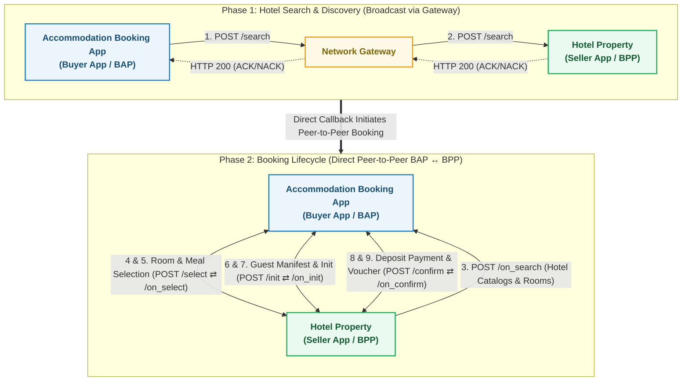
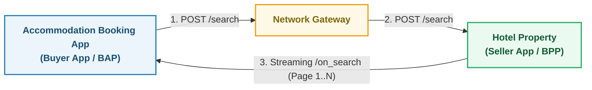
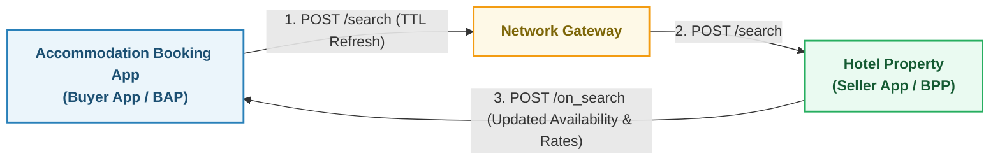
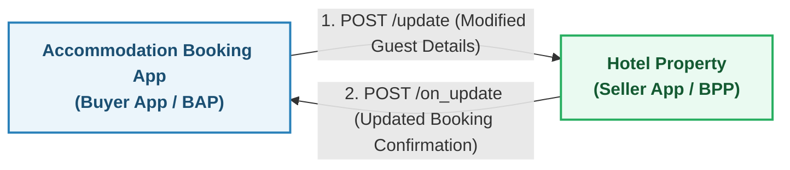
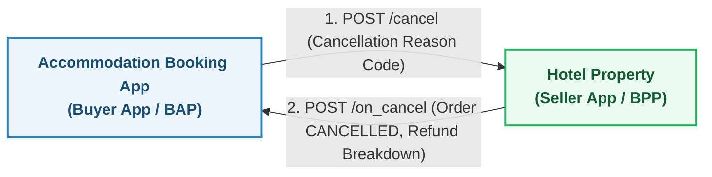
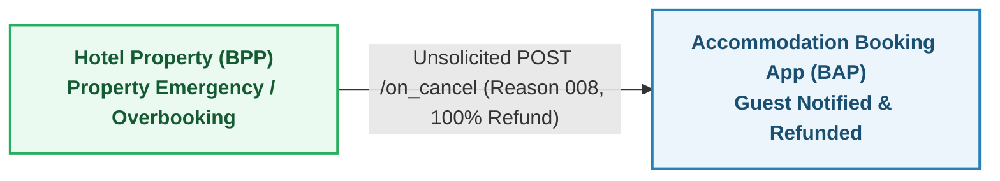

# Hotel Booking

---

## Overview

Hotel booking encompasses scheduled lodging and accommodation services offered by hotel properties, resorts, and hospitality providers. Each hotel independently manages its property details, room inventory, rates, meal plans, amenities, check-in policies, cancellation rules, and guest servicing.

The network enables hotel operators and accommodation booking platforms to connect through a common, open protocol instead of building separate integrations with each other. An accommodation booking platform integrates with the network as a Buyer App (BAP) to discover, compare, and book hotel rooms from participating properties. Hotels and hospitality aggregators integrate once as a Seller App (BPP) to make their room inventory and rates available to participating accommodation booking platforms.

The hotel remains responsible for the accommodation service, including room quality, inventory availability, check-in and check-out management, hospitality amenities, guest safety, pricing, booking voucher issuance, and guest servicing. The network standardizes the interactions for searching, comparing, selecting, booking, and servicing hotel accommodations across participating network participants.

This guide explains the hotel booking use case and end-to-end journey from a business and product perspective, before covering the corresponding technical specifications and API flows.

---

## Participants

| Participant | What This Means |
|---|---|
| **Accommodation Booking App (Buyer App / BAP)** | A consumer-facing application (hotel booking app, hospitality portal, or consumer lifestyle platform) that enables guests to search for accommodations, compare hotel properties and room types, review amenities and cancellation policies, select rooms and meal plans, provide guest manifests, and manage reservations by connecting with participating hotels through the network. |
| **Hotel Property / Aggregator (Seller App / BPP)** | The accommodation provider (boutique hotel, resort, hotel chain, or hospitality aggregator) that publishes property details, room inventories, real-time rates, and amenities, manages reservations, and issues booking confirmation vouchers. The hotel is responsible for property operations, room availability, guest check-in/check-out services, hospitality amenities, and on-property servicing. |

---

## The User Journey

The hotel booking journey enables a traveler to search for accommodations by location and stay dates, compare room types and amenities, select rooms and meal plans, provide guest details, complete payment, and receive confirmed booking vouchers.

```
[Search Hotels] ───► [Compare Properties & Rooms] ───► [Select Room & Meal Plans] ───► [Provide Guest Info] ───► [Payment & Confirmation] ───► [Booking Voucher Issued]
```

The journey consists of the following stages:

### 1. Hotel Search and Discovery

Through the Accommodation Booking App (Buyer App / BAP), the traveler provides accommodation search criteria:

| Category | Field | Key | Mandatory | Type / Values |
|---|---|---|---|---|
| Location | Destination City / Location | `context.location.city.code` / `stops[type=END].location.gps` | Yes | Text (City STD Code, e.g. `std:080` or GPS coordinates e.g. `12.827359, 77.691570`) |
| | Postal Area Code | `stops[type=END].location.area_code` | No | Text (PIN Code, e.g. `560100`) |
| Schedule | Check-in Date & Time | `category.time.range.start` | Yes | ISO 8601 Date / Timestamp |
| | Check-out Date & Time | `category.time.range.end` | Yes | ISO 8601 Date / Timestamp |
| Category | Accommodation Category | `category.descriptor.code` | Yes | ENUM (`HOTEL`) |
| Guests | Adult Count | `fulfillments[].tags[GUESTS].ADULTS` | Yes | Number (Minimum 1) |
| | Child Count | `fulfillments[].tags[GUESTS].CHILDREN` | No | Number |

The Accommodation Booking App (Buyer App / BAP) transmits the search request to discover available hotel properties across participating accommodation providers.

**Network interaction:**

- **`/search`**: The Buyer App (BAP) broadcasts the hotel search intent to the Gateway using destination city codes or GPS coordinates, stay date ranges, and guest counts. The Gateway routes this request to registered hotel operators.
- **`/on_search`**: Participating Seller Apps (BPP) respond asynchronously with property catalogs containing available hotel properties, room categories (Deluxe, Suite), nightly rates, meal plans, and property amenities.

### 2. Property Offers and Room Comparison

Hotel operators return catalog offerings that may include:

- Property details: Hotel branding, star ratings, address, GPS location, and property photographs
- Room categories: Deluxe Room, Executive Suite, Family Room, Presidential Suite
- Meal plan options: Room Only (EP), Continental Plan / Bed & Breakfast (CP / B&B), Half Board (MAP), Full Board (AP)
- Inclusions and Exclusions taxonomy:
  - Property-level: Wi-Fi, swimming pool, fitness center, free parking, 24-hour front desk, power backup
  - Room-level: Air conditioning, king/twin bed, electric kettle, balcony, private bathroom, complimentary toiletries
- Transparent cancellation terms and check-in (`14:00`) / check-out (`11:00`) policies

The Accommodation Booking App (Buyer App / BAP) presents the available hotel properties and room packages for the traveler to compare.

### 3. Room Selection and Meal Add-Ons

The traveler selects a specific hotel property, room type, quantity of rooms, stay duration, and preferred meal plan through the Accommodation Booking App (Buyer App / BAP).

- **Room & Stay Selection**: Traveler designates the room ID (e.g. `Accommodation-1`), number of rooms required, check-in and check-out dates, and guest demographics.
- **Meal Plan Add-Ons**: Optional meal packages (e.g. `full-board` or `B&B`) are attached to the selected room.
- **Split Payment Terms**: Accommodations may support split payment models, specifying an advance deposit required at checkout versus the remaining balance collected upon arrival at the property (`PRE-ORDER` vs `ON-FULFILLMENT`).

**Network interaction:**

- **`/select`**: The Buyer App (BAP) sends the chosen property ID, selected room item ID, stay date range, guest counts, and selected meal plan add-ons.
- **`/on_select`**: The Seller App (BPP) validates room inventory, holds the room temporarily, and returns an itemized price quotation (base room tariff, taxes/GST, meal charges, deposit requirements).

### 4. Guest Details and Manifest

The traveler provides guest information required for the hotel's reservation manifest:

| Category | Field | Key | Mandatory | Format / Rules |
|---|---|---|---|---|
| Personal | Primary Guest Name | `person.name` | Yes | `<Title>\|<First Name>\|<Middle Name>\|<Last Name>` (e.g. `Mr\|Rajesh\|K\|Verma`) |
| | Age | `person.age` | Yes | Number (e.g. `32`) |
| | Gender | `person.gender` | Yes | ENUM (`MALE`, `FEMALE`, `OTHER`) |
| Contact | Phone Number | `contact.phone` | Yes | 10-digit mobile number |
| | Email Address | `contact.email` | Yes | Valid email address for reservation voucher |
| Identification | ID Verification Credential | `creds` | No | Identity proof (Aadhaar, Passport, Driving License) |
| Billing | Billing Name & Address | `billing` | Yes | Name, address, phone, and optional GSTIN for tax invoices |

**Network interaction:**

- **`/init`**: The Buyer App (BAP) initializes the draft booking order with guest details, contact info, and billing address.
- **`/on_init`**: The Seller App (BPP) creates a draft reservation, locks the room tariff for payment, and provides payment collection instructions, settlement terms, and cancellation slabs.

### 5. Booking Confirmation and Voucher Issuance

Once the traveler completes payment of the advance deposit (or full tariff) through the checkout interface, the Accommodation Booking App (Buyer App / BAP) confirms the booking with the hotel.

The hotel validates the transaction, confirms room reservation, generates the booking reference, and issues the official electronic hotel voucher.

**Network interaction:**

- **`/confirm`**: The Buyer App (BAP) transmits the payment authorization details and finalized order payload.
- **`/on_confirm`**: The Seller App (BPP) confirms the booking, changes the order status to `ACTIVE`, and returns the confirmed hotel reservation voucher with check-in instructions and booking ID.

### 6. Post-Booking Servicing, In-Stay, and Checkout

After confirmation, the traveler can view reservation details, check-in instructions, front-desk telephone contact, and property directions through the Accommodation Booking App (Buyer App / BAP).

Upon arrival, the guest presents the voucher at the hotel reception. After check-in and stay completion, the hotel processes checkout, settles any incidental expenses, and transitions the reservation status to `COMPLETED`.

**Network interaction:**

- **`/status`**: The Buyer App (BAP) queries current reservation lifecycle state.
- **`/on_status`**: The Seller App (BPP) returns real-time fulfillment status, check-in verification, or checkout completion.

---

## Additional Scenarios

The hotel booking lifecycle supports operational modifications, cancellations, and disruptions post-booking.

### 1. Buyer-Initiated Cancellation

A traveler can cancel a confirmed hotel booking prior to check-in, subject to the hotel's cancellation policy and penalty slabs.

```
[Cancel Request] ───► [Calculate Slabs & Deductions] ───► [Confirm Cancel] ───► [Voucher Voided & Refund Issued]
```

**Network interaction:**

- **`/cancel`**: The Buyer App (BAP) initiates a cancellation request specifying the order ID and cancellation reason code.
- **`/on_cancel`**: The Seller App (BPP) processes the cancellation according to policy slabs, sets order status to `CANCELLED`, releases the room back to inventory, and returns the refund calculation.

### 2. Booking Modifications

A traveler can modify their reservation details—such as updating guest contact information or adjusting stay parameters—without cancelling and rebooking.

```
[Modify Request] ───► [POST /update (Guest / Stay Details)] ───► [Hotel Validates Modification] ───► [Updated Booking Voucher Issued]
```

**Network interaction:**

- **`/update`**: The Buyer App (BAP) transmits an update request targeting `order.fulfillments` or guest contact details.
- **`/on_update`**: The Seller App (BPP) validates the changes, updates the reservation, and returns the modified order confirmation.

### 3. TTL-Based Inventory & Catalog Refresh

Hotels experience dynamic room occupancy throughout the day. To ensure travelers always view accurate room availability and prevent double-booking, hotels use TTL-based cache controls.

```
[Periodic Search] ───► [TTL Cache Evaluation] ───► [Incremental /on_search Refresh] ───► [Real-Time Availability Synced]
```

**Network interaction:**

- **`/search` & `/on_search`**: The Buyer App (BAP) and Seller App (BPP) utilize `ttl` parameters to refresh property availability and rate brackets without placing unnecessary load on backend reservation systems.

### 4. Merchant-Initiated Cancellation

When a hotel must cancel a reservation due to unexpected property maintenance, overbooking, or force majeure events, the hotel notifies the guest immediately.

```
[Property Emergency / Overbooking] ───► [Unsolicited on_cancel (Reason 008)] ───► [100% Full Refund Issued]
```

**Network interaction:**

- **`/on_cancel` (Unsolicited)**: The Seller App (BPP) pushes an unsolicited cancellation callback with reason code `008` (Venue/Property Emergency), providing a mandatory 100% full refund with zero cancellation penalty.

---

## Issue and Grievance Management

A guest can raise a grievance through the Buyer App (BAP) for issues related to their hotel booking or the network transaction. The Buyer App (BAP) routes the grievance to the relevant hotel partner through the network's grievance mechanism.

The hotel is responsible for investigating and resolving the grievance. The hotel communicates the grievance status and resolution to the Buyer App (BAP), which makes the relevant information available to the guest.

The grievance process can include:

- **Grievance Registration**: The guest raises an issue through the Buyer App (BAP).
- **Grievance Routing**: The Buyer App (BAP) routes the grievance to the relevant hotel.
- **Resolution**: The hotel investigates the issue and takes the required action.
- **Status Updates**: The hotel communicates progress and resolution status to the Buyer App (BAP).
- **Closure**: The Buyer App (BAP) communicates the resolution to the guest and closes the grievance when appropriate.

The hotel and Buyer App (BAP) remain responsible for complying with applicable grievance redressal requirements. Applicable guidelines provide for guest grievance redressal mechanisms and identify the hotel and Buyer App's designated grievance channels.

---

## Detailed Protocol Flows

### Flow 1: Hotel Booking – City Code / Location Based Booking Flow

#### 1. Short Description

The City Code / Location Based Booking Flow enables travelers to search for hotel properties by city code or GPS radius, select rooms and meal plan add-ons, provide guest manifests, complete advance deposit payment, and receive confirmed hotel reservation vouchers.

#### 2. Visual Interaction Map



#### 3. API Breakdown & Technical Actions

- **`/search` (Buyer App [BAP] → Gateway → Seller App [BPP])**: Triggered when a traveler searches for accommodations. The Buyer App (BAP) specifies destination city code (`context.location.city.code = "std:080"`), check-in/out date range (`category.time.range`), category code `HOTEL`, and guest counts.
- **`/on_search` (Seller App [BPP] → Buyer App [BAP])**: The hotel returns its property catalog. Each property contains room categories (Deluxe, Suite), nightly tariffs, meal plans, inclusions/exclusions taxonomy, and cancellation policies.
- **`/select` (Buyer App [BAP] → Seller App [BPP])**: The traveler selects a specific hotel property, room type, quantity of rooms, stay dates, and optional meal add-ons.
- **`/on_select` (Seller App [BPP] → Buyer App [BAP])**: The hotel validates room availability, places a temporary soft-lock, and returns an itemized price quotation including room tariff, taxes, meal charges, and advance deposit terms.
- **`/init` (Buyer App [BAP] → Seller App [BPP])**: The Buyer App (BAP) submits the guest manifest (`person.name` as `<Title>|<First Name>|<Middle Name>|<Last Name>`, age, gender), contact phone/email, identity credentials, and billing details.
- **`/on_init` (Seller App [BPP] → Buyer App [BAP])**: The hotel validates guest demographics, creates a draft reservation, locks the room tariff for payment, and provides payment collection instructions and cancellation penalty slabs.
- **`/confirm` (Buyer App [BAP] → Seller App [BPP])**: Transmitted after successful payment of the required deposit. Contains payment transaction ID, settlement terms, and confirmation request.
- **`/on_confirm` (Seller App [BPP] → Buyer App [BAP])**: The hotel sets order status to `ACTIVE`, assigns the booking confirmation ID, and returns the official hotel reservation voucher.

---

### Flow 2: Hotel Booking – Seller App Pagination Flow

#### 1. Short Description

When a hotel chain or hospitality aggregator manages a large inventory of properties or room types in a popular metropolitan market, results are split into paginated batches. The Seller App (BPP) streams catalog pages sequentially using pagination tokens so the Buyer App (BAP) can render hotel results smoothly without gateway timeouts.

#### 2. Process Flow

```
[BAP: POST /search] ──► [Network Gateway Broadcast] ──► [Hotel Inventory Engine] ──► [Streaming POST /on_search Page 1..N] ──► [BAP: Incremental Hotel Display]
```



#### 3. API Breakdown & Technical Actions

- **`/search` (Buyer App [BAP] → Gateway → Seller App [BPP])**: Initial hotel search request for the specified location broadcast across the Gateway to registered hotel providers.
- **Sequential `/on_search` Callbacks (Seller App [BPP] → Buyer App [BAP])**: The hotel delivers catalog pages in consecutive asynchronous callbacks directly to the Buyer App (BAP). Each payload contains:
  - `PAGINATION_ID`: Unique session identifier correlating the pages.
  - `CURRENT_PAGE_NUMBER`: Index of the current batch (e.g., `1`, `2`, `3`).
  - `MAX_PAGE_NUMBER`: Total page count for the search response.
  The Buyer App (BAP) acknowledges each callback with HTTP 200 `ACK` and renders the hotel properties incrementally.

---

### Flow 3: Hotel Booking – TTL-Based Booking & Catalog Refresh Flow

#### 1. Short Description

Hotels experience dynamic room inventory and occupancy throughout the day. To ensure inventory consistency and prevent stale pricing across sequential search sessions, the network supports TTL-based controlled refresh cycles.

#### 2. Process Flow

```
[BAP: Periodic Search] ──► [TTL Cache Evaluation] ──► [BPP: Incremental /on_search] ──► [Real-Time Availability Synced]
```



#### 3. API Breakdown & Technical Actions

- **`/search` [TTL Evaluation] (Buyer App [BAP] → Gateway → Seller App [BPP])**: The Buyer App (BAP) checks whether its cached property data has expired based on the provider's declared `ttl`. If expired, it triggers a lightweight refresh request.
- **`/on_search` [Live Rates & Inventory] (Seller App [BPP] → Buyer App [BAP])**: The hotel validates current occupancy and returns updated room counts and dynamic tariffs, maintaining booking integrity before the user proceeds to checkout.

---

### Flow 4: Hotel Booking – Booking Modifications Flow

#### 1. Short Description

When a guest needs to update their booking details—such as updating contact phone numbers, email addresses, or special requests—the Buyer App (BAP) uses the `/update` API to modify the confirmed booking without cancelling the reservation.

#### 2. Process Flow

```
[Guest Request] ───► [POST /update (Modify Contact / Details)] ───► [Hotel Validates Modification] ───► [POST /on_update (Updated Confirmation)]
```



#### 3. API Breakdown & Technical Actions

- **`/update` (Buyer App [BAP] → Seller App [BPP])**: The Buyer App (BAP) transmits an update request targeting `order.fulfillments` or guest contact information, providing the order ID and the updated parameters.
- **`/on_update` (Seller App [BPP] → Buyer App [BAP])**: The hotel updates its property management system (PMS), validates the modification, and returns the updated order state and revised booking confirmation.

---

### Flow 5: Hotel Booking – Buyer Cancellation Flow

#### 1. Short Description

When a guest initiates a reservation cancellation, the network executes a cancellation workflow that evaluates applicable cancellation slabs, calculates deductions and refund amounts, voids the reservation voucher, and releases the room inventory.

#### 2. Process Flow

```
[Cancel Request (Reason Code)] ───► [Evaluate Cancellation Slabs] ───► [Order CANCELLED & Voucher Voided] ───► [Refund Issued]
```



#### 3. API Breakdown & Technical Actions

- **`/cancel` (Buyer App [BAP] → Seller App [BPP])**: The Buyer App (BAP) initiates cancellation by transmitting the order ID and the cancellation reason code (e.g. `001` for change of plans).
- **`/on_cancel` (Seller App [BPP] → Buyer App [BAP])**: The hotel calculates deductions based on the cancellation policy and time remaining before check-in. The response sets `order.status = "CANCELLED"`, itemizes the cancellation fees, and provides the net refund disbursement ledger.

---

### Flow 6: Hotel Booking – Merchant Cancellation Flow

#### 1. Short Description

If a hotel property must cancel a confirmed reservation due to overbooking, mechanical failure, or emergency property closure, the Seller App (BPP) triggers an unsolicited cancellation pushing a 100% full refund to the guest.

#### 2. Process Flow

```
[Property Emergency / Overbooking] ───► [Unsolicited POST /on_cancel (Reason Code 008)] ───► [100% Full Refund Issued to BAP]
```



#### 3. API Breakdown & Technical Actions

- **`/on_cancel` [Unsolicited] (Seller App [BPP] → Buyer App [BAP])**: Fired directly by the hotel upon reservation cancellation. The payload contains `order.status = "CANCELLED"`, `cancellation.cancelled_by = "PROVIDER"`, reason code `008` (Venue/Property Emergency), and a 100% full refund breakup without cancellation charges.
