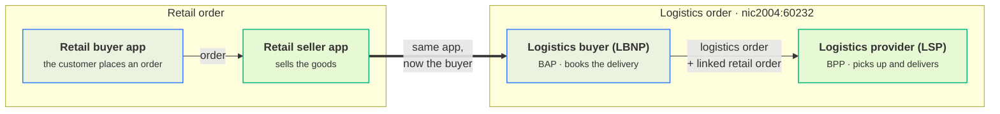
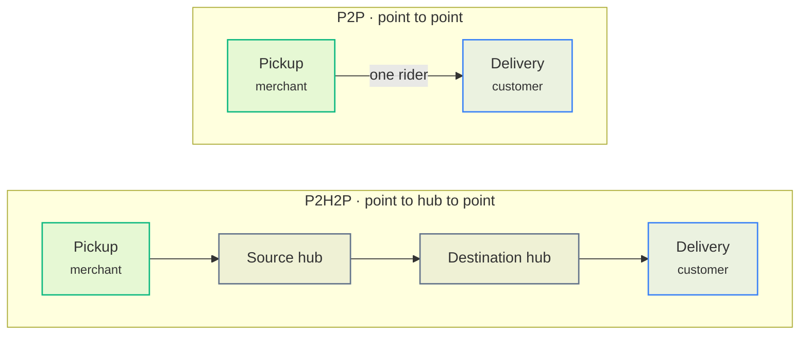
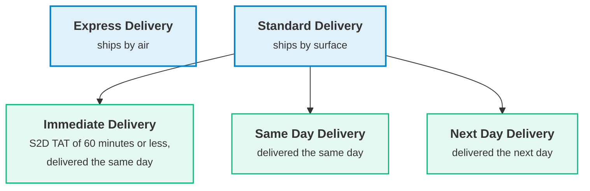
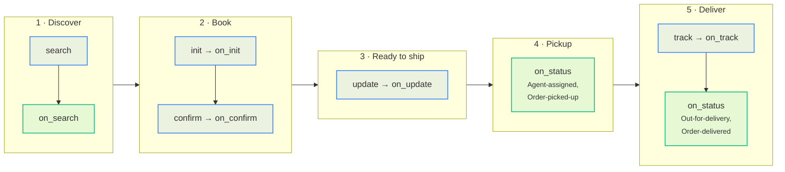
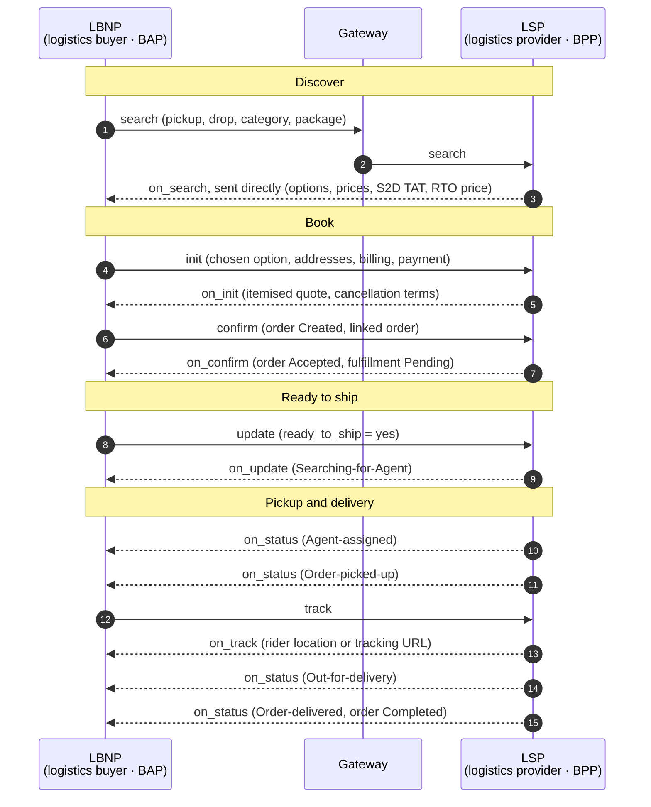
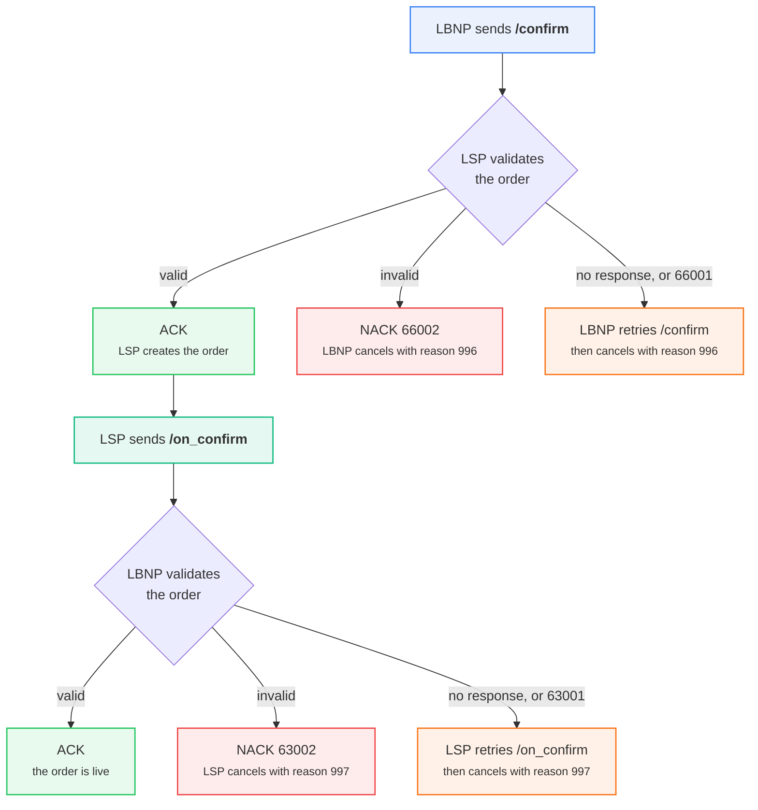
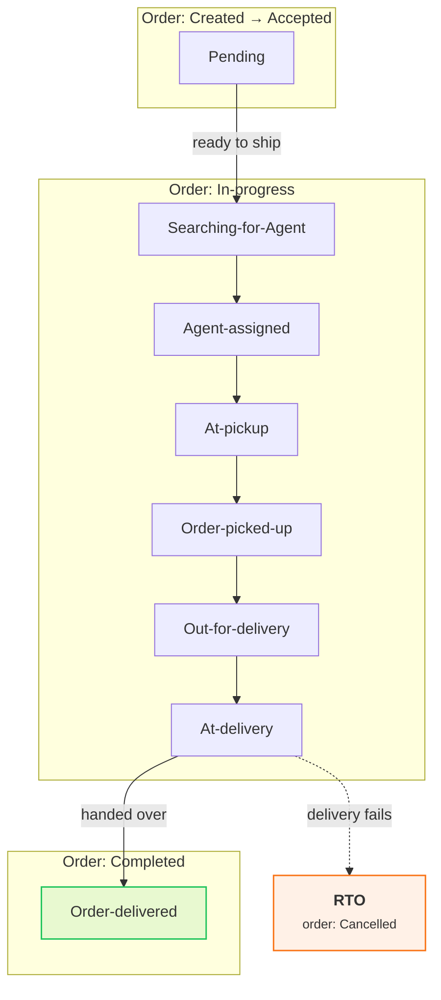
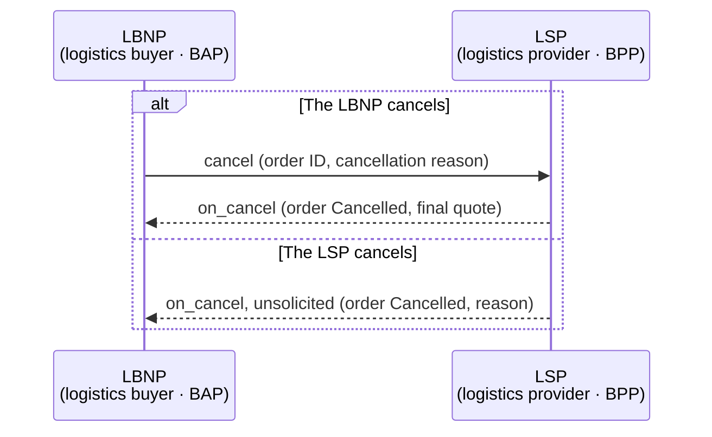
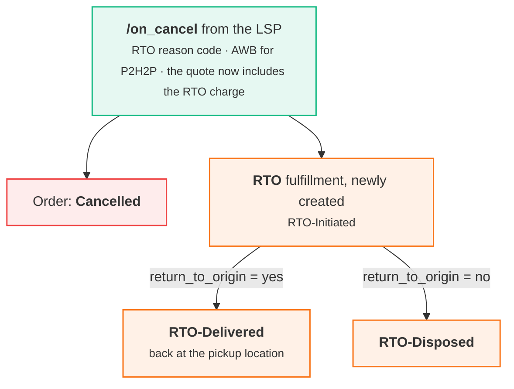

# Logistics (NIC2004:60232)

> Logistics on ONDC, domain `nic2004:60232`, as defined in the **ONDC API Contract for Logistics, v1.2.0**. It covers both direct (P2P) and hub-based (P2H2P) delivery.

---

## 1. Overview

This is version 1.2.0 of ONDC logistics. Here a seller app books a delivery from a **Logistics Service Provider (LSP)** over the network, instead of building a separate integration with each courier.

A logistics order always sits behind a retail order. When a customer buys from a seller on ONDC, the seller's app has to get the goods delivered. To do that, it becomes a **buyer on the logistics network** and books a delivery, sharing the retail order's details with the LSP as the *linked order*.

The retail seller app sells on the retail network and buys on the logistics network. In the logistics transaction it is the BAP, and the LSP is the BPP.

### Two Ways to Deliver

In this version, one domain covers both delivery types. Each option in the LSP's catalog says which type it is, in the item's `descriptor.code`.

- **P2P:** the rider takes the package straight from the merchant to the buyer. This is typical for hyperlocal, intracity orders.
- **P2H2P:** the package is routed through hubs. It needs different packaging and an **AWB number** (11 to 16 digits). The LBNP can tell the merchant which packaging to use, based on the option it books.

> **Newer version:** version 1.2.5 splits this domain into `ONDC:LOG10` (P2P) and `ONDC:LOG11` (P2H2P), and adds many optional features. `nic2004:60232` stays until most participants have moved to the new domains. Check which version each counterparty supports.

### Participants

| Participant | Role |
| --- | --- |
| **Logistics buyer (LBNP)** | The buyer app (BAP) on the logistics network, usually the seller app of the retail order. It searches for delivery options, books one, says when the package is ready to ship, and tracks the shipment. |
| **Logistics Service Provider (LSP)** | The seller app (BPP) on the logistics network. It checks whether it can serve the route, quotes prices and delivery times, assigns a rider and reports progress until delivery. |
| **Rider** | The LSP's delivery agent. The rider doesn't call any API, but the states the LSP reports follow the rider's progress. |
| **End seller and end buyer** | The merchant who hands over the package and the customer who receives it. They confirm the handover with pickup and delivery codes, such as an OTP. |

---

## 2. Key Terms

| Term | Meaning |
| --- | --- |
| **Ready to ship (RTS)** | The `ready_to_ship` tag says the package is packed and can be picked up. The LSP starts looking for a rider only after RTS. |
| **S2D TAT** | Ship-to-delivery turnaround time: how long the LSP takes to deliver once it has the shipment. It is part of the quote and of the order. |
| **O2D TAT** | Order-to-delivery time that the retail seller app works out for the customer: the S2D TAT, plus its own order-to-ship time, plus the LSP's average time to pickup. |
| **Linked order** | The retail order being delivered: its ID, items, weight, dimensions, declared value and category. |
| **Pickup and delivery codes** | Codes that confirm a handover, such as the merchant's order number or an OTP. The contract calls them PCC and DCC. |
| **AWB number** | The waybill number for P2H2P shipments. Either side can provide it: the LBNP in `/confirm` or `/update`, or the LSP in `/on_confirm` or `/on_update`. |
| **RTO** | Return to origin: what happens to a package that can't be delivered. |

---

## 3. Delivery Categories

- **A search for Standard Delivery** returns every option the LSP can offer, including Immediate, Same Day and Next Day Delivery. **A search for Express Delivery** returns every Express option.
- **A search for a specific category** returns the options for that category only. An LSP with no option for it doesn't respond.

---

## 4. The Order Journey

### Journey at a Glance

Blue boxes are calls the LBNP starts, and green boxes are callbacks or updates from the LSP.

### The Complete Flow

The **ORDER FLOW BASELINE** flow in the API Walkthrough follows this sequence. If the package is already ready to ship at `/confirm`, there's no `/update` step. See **ORDER FLOW BASELINE(without rts)**.

### Stage 1: Discover

**Network interaction:**

- **`/search`**: The LBNP sends the pickup and drop locations, the category, the package's weight, dimensions and declared value, and the payment type. It can also send the order preparation time, which the LSP can use to plan pickups.
- **`/on_search`**: Each LSP checks whether it can serve the route. If it can, it sends its catalog directly to the LBNP. The catalog lists each option as P2P or P2H2P, with a tax-inclusive price and the S2D TAT. It also gives the motorable distance and the average time to pickup, which help with Immediate Delivery. Each option comes with a linked RTO price, so the LBNP knows the return cost up front. An LSP that can't serve the route doesn't respond.

In the acknowledgement of `/on_search`, the LBNP can accept or reject the LSP's standard terms.

### Stage 2: Book

**Network interaction:**

- **`/init`**: The LBNP sends the chosen option, the full pickup and drop addresses, its billing details, including its GST number, and the payment type. The LSP checks serviceability again.
- **`/on_init`**: The LSP returns the quote, with tax as a separate line, and the total must equal the sum of the lines. It also returns the payment terms and the cancellation terms, which set fees by fulfillment state and reason. For Immediate Delivery, it can say whether it checked rider availability. If the cancellation terms aren't acceptable, the LBNP replies with **NACK 62505**.
- **`/confirm`**: The LBNP creates the order in state **`Created`**, with an order ID that is unique across the network. It sends the linked retail order, the pickup and delivery codes, and the `ready_to_ship` status. It also says whether a failed delivery should return to the pickup location, and accepts the LSP's terms. The LSP creates the shipment manifest.
- **`/on_confirm`**: The LSP returns the same order ID in state **`Accepted`**, with the fulfillment in **`Pending`** and the S2D TAT. Where applicable, it also returns the pickup slot, the rider and vehicle details, and, for inter-state shipments, the e-way bill number.

The payment type is one of `ON-ORDER` (prepaid, typically from a wallet), `ON-FULFILLMENT` (cash on delivery) or `POST-FULFILLMENT` (billed after delivery).

#### Confirming an Order Safely

`/confirm` and `/on_confirm` must be idempotent: sending the same call again must not create a second order. The contract also says what each side does when the other can't confirm the order.

### Stage 3: Ready to Ship

**Network interaction:**

- **`/update`**: The LBNP sets `ready_to_ship` to `yes` and sends the pickup code. For P2H2P, it can also send the AWB number here.
- **`/on_update`**: The LSP moves the fulfillment to **`Searching-for-Agent`**, and the order to **`In-progress`**.

### Stage 4: Pickup and Delivery

The LSP sends unsolicited `/on_status` updates as the shipment moves.

**Network interaction:**

- **`/on_status`**: **`Agent-assigned`**, when a rider is assigned.
- **`/on_status`**: **`Order-picked-up`**, once the rider has the package. The LSP can revise the delivery time window here.
- **`/track`**: The LBNP asks where the shipment is. It should call `/track` only after a rider is assigned. If the order isn't picked up yet, or tracking is off for it, the LSP replies with **NACK 60012**.
- **`/on_track`**: For P2P, the LSP returns the rider's live GPS location, which the LBNP polls. For P2H2P, it returns a tracking URL.
- **`/on_status`**: **`Out-for-delivery`**, during the last mile.
- **`/on_status`**: **`Order-delivered`**, after the handover. The order is now **`Completed`**.

The LSP can also share proof of pickup and delivery, such as photos and the rider's last GPS position. When a pickup or delivery is delayed or an attempt fails, it records the reason code and the updated time slot.

---

## 5. Order and Fulfillment States

Each `/on_confirm`, `/on_update`, `/on_status` and `/on_cancel` carries two states: the **order** state and the **fulfillment** state. The diagram shows the P2P path, and each box around a group of states shows the order state at that point.

`At-pickup` and `At-delivery`, when the rider reaches the pickup or delivery location, were added to this version in May 2024. When an order is cancelled, both the order and the fulfillment move to `Cancelled`.

| Stage | P2P fulfillment states | P2H2P fulfillment states | Order state |
| --- | --- | --- | --- |
| Booked | `Pending` | `Pending` | `Created` or `Accepted` |
| Ready to ship | `Searching-for-Agent` | `Searching-for-Agent` | `In-progress` |
| Rider assigned | `Agent-assigned` | `Agent-assigned` | `In-progress` |
| Going to pick up | `At-pickup` | `Out-for-pickup`, `Pickup-failed`, `Pickup-rescheduled` | `In-progress` |
| Picked up | `Order-picked-up` | `Order-picked-up` | `In-progress` |
| Between hubs | — | `In-transit` (at the source hub), `At-destination-hub` | `In-progress` |
| Last mile | `Out-for-delivery`, `At-delivery` | `Out-for-delivery`, `Delivery-failed`, `Delivery-rescheduled` | `In-progress` |
| Delivered | `Order-delivered` | `Order-delivered` | `Completed` |
| Cancelled | `Cancelled` | `Cancelled` | `Cancelled` |
| Returned | `RTO-Initiated`, then `RTO-Delivered` or `RTO-Disposed` | the same | `Cancelled` |

---

## 6. Cancellation

Either side can cancel an order. The LBNP asks with `/cancel`, and the LSP cancels on its own with an unsolicited `/on_cancel`.

- If the reason code isn't valid, the LSP can reply with **NACK 60009**.
- If the LBNP cancels for a missed delivery time (reason **007**) but the LSP hasn't missed it, the LSP can reply with **NACK 60010**.
- When the retail order misses its promised delivery time, the retail apps can cancel it, and that cancellation carries through to the logistics order.
- `/on_cancel` records the fulfillment's state just before the cancellation (`precancel_state`), and the quote shows the final amount.

See **BUYER SIDE ORDER CANCELLATION** in the API Walkthrough.

---

## 7. Return to Origin (RTO)

An RTO starts when the end buyer refuses the package, or can't be found at the delivery address. Except for Immediate Delivery, the LSP normally retries the delivery first, typically 3 times, the industry standard.

- **What changes:** the LSP adds a new fulfillment of type `RTO`, in state `RTO-Initiated`, and the order moves to **`Cancelled`**. The RTO charge from `/on_search` is added to the quote.
- **With or without return:** the `return_to_origin` flag the LBNP set in `/confirm` decides the outcome. With return, the package goes back to the pickup location and ends in `RTO-Delivered`. Without return, it ends in `RTO-Disposed`. The order stays `Cancelled` either way.
- **Accepting the request:** the LBNP must accept a valid RTO request. If the RTO charge differs from the `/on_search` quote, the LBNP can reply with **NACK 62503**, and the LSP must resend the request with the correct charge.
- **Who pays:** if the delivery missed its promised time, the buyer is within their rights to refuse it. If it didn't, the LBNP can recover both the forward and the RTO cost from the retail buyer app. The LSP may need to help show that the buyer refused the package or couldn't be reached.
- **Retail order:** the logistics `/on_cancel` also leads to an `/on_cancel` on the retail order, carrying the new RTO fulfillment. The final RTO state is passed on to the retail order too.

See **RTO FLOW** in the API Walkthrough.

> **Changed in 1.2.5:** in `ONDC:LOG10` and `ONDC:LOG11`, the order no longer moves to `Cancelled` during RTO. It stays `In-progress` and ends `Completed`. This is the one change in 1.2.5 that isn't backward compatible.

---

## 8. Changing an Order

The LBNP uses `/update`, and the LSP replies with `/on_update`, to:

- say the package is ready to ship;
- change the delivery instructions;
- change the linked retail order, for example when part of the retail order is cancelled or returned;
- change how pickup or delivery is verified.

**Weight differential:** if the LSP finds that the package weighs more than declared, it sends the extra charge, the updated weight and dimensions, and proof images in an unsolicited `/on_update`. If the LBNP acknowledges it (ACK), it accepts the new quote. If it disagrees, it replies with **NACK 62504**: the LSP reverts the change, and the agreed terms apply. For an RTO, the LSP sends the same details in `/on_cancel`.

---

## 9. Issue and Grievance Management

Either side can raise an issue about an order, for example a delayed, damaged or undelivered shipment. This version uses **IGM v1.0.0**.

**Network interaction:**

- **`/issue`**: The LBNP raises an issue for an order, with its category, a description and the expected resolution time.
- **`/on_issue`**: The LSP replies with the actions it has taken and a proposed resolution.
- **`/on_issue_status`** (unsolicited): The LSP sends updates on the resolution.
- **`/issue`**: The LBNP accepts the resolution and closes the issue, or escalates it.

See **ORDER FLOW BASELINE WITH IGM(v-1.0.0)** in the API Walkthrough.
