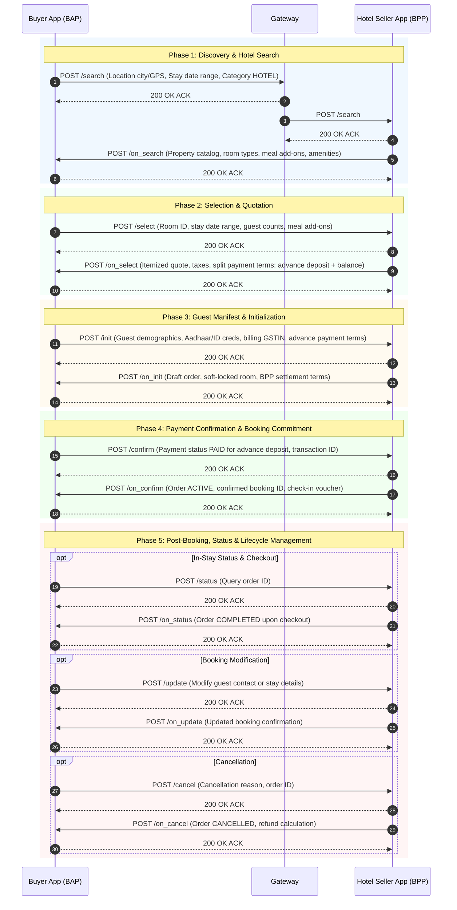

# Hotel Booking

## Overview

ONDC:TRV13 enables hotel bookings to flow through the ONDC network, connecting consumers directly to hotel properties. Hotels list their rooms, rates, and availability; travelers search, book, and manage reservations using ONDC-enabled applications, creating a standardized marketplace for accommodation transactions.

## Sector & Purpose

**Sector:** Hospitality and accommodation services.

**Problem Solved:** Hotels traditionally sell inventory through fragmented channels—direct websites, call centers, and third-party OTAs—each requiring separate integrations and commissions. ONDC:TRV13 standardizes hotel bookings on a single, open network. This allows hotels of any size to list inventory once and reach consumers across all ONDC-enabled buyer applications, while travelers access hotel options through a common set of discovery and booking flows.

## Real-World Actors

- **Consumers:** Travelers seeking accommodation who use ONDC-enabled mobile apps or websites to search, compare, and book hotels.
- **Hotels:** Accommodation providers (from boutique properties to chains) that list rooms, manage availability, set rates, and process bookings through ONDC-enabled backend services.

## Use Cases

- **Standard Hotel Booking:** Consumer searches for hotels by location and dates, views options with amenities and rates, selects a room, and completes a booking.
- **Real-Time Inventory Management:** Hotels push room availability updates using TTL-based catalog refresh, ensuring search results reflect current stock.
- **Buyer-Initiated Cancellation:** A consumer cancels their reservation and receives a refund according to the hotel's cancellation policy.
- **Merchant-Initiated Cancellation:** A hotel cancels a booking (e.g., due to overbooking or property closure) and notifies the consumer.
- **Booking Updates:** A consumer modifies their reservation (room type, check-in date, guest count) without canceling and rebooking.
- **Large Inventory Display:** Hotels with many properties or room types use pagination to serve search results efficiently.
- **Location-Based Search:** Consumers search hotels using GPS coordinates or city codes for precise geographic filtering.

## Key Concepts

- **Hotel Booking:** The transaction of reserving one or more rooms at a hotel for specified check-in and check-out dates.
- **Hotel Amenities:** Features and facilities offered by a property (e.g., WiFi, pool, parking, gym) that influence booking decisions.
- **Inventory & Availability:** Real-time room counts and rates that hotels update continuously to reflect occupancy and pricing.
- **Cancellation Policies:** Terms under which bookings can be canceled, including refund eligibility and deadlines.
- **Booking Updates:** Changes to confirmed reservations (dates, rooms, guests) made after the initial transaction.

## Example Scenario

A consumer traveling to a new city opens an ONDC-enabled travel app and searches for hotels near their destination using a map or city name. The app returns a list of available properties with room types, nightly rates, and key amenities. The consumer selects a 3-star hotel with good reviews, books a deluxe room for three nights, and receives a confirmation with payment details and cancellation terms. Two days later, the consumer's plans change; they log in and extend their stay by one night, and the hotel confirms the update. On the morning of checkout, the consumer cancels the last night under the hotel's flexible cancellation policy and receives a partial refund. Throughout this journey, the hotel managed its inventory on the ONDC platform, and the consumer used only their preferred ONDC-enabled app—no separate website visits or phone calls required.

---

## Complete API Contract & Architecture Guide

The `ONDC:TRV13` specification (v2.0.1) standardizes communication between **Buyer Applications (BAP)** and **Seller Applications (BPP / Hotel Properties & Aggregators)** across the entire accommodation reservation lifecycle.

Every transaction across the network follows the Beckn asynchronous request-callback protocol:
1. The requester dispatches an HTTP `POST` action call.
2. The receiver immediately replies with a synchronous HTTP 200 `ACK` (or `NACK` if signature or schema validation fails) within **5000 milliseconds**.
3. The receiver performs business processing asynchronously (e.g., querying room inventory, checking guest capacities, computing taxes).
4. The receiver transmits the response via an asynchronous callback `POST /on_<action>` to the requester's webhook URL (`bap_uri`).
5. The requester acknowledges the callback with a synchronous HTTP 200 `ACK`.



---

### Complete Transaction Lifecycle Matrix

| Phase | Action API | Sender → Receiver | Callback API | Callback Sender → Receiver | Primary Business Purpose |
| :--- | :--- | :--- | :--- | :--- | :--- |
| **Discovery** | `POST /search` | BAP → Gateway / BPP | `POST /on_search` | BPP → BAP | Search accommodations by city STD code, GPS radius, check-in/out date range, or incremental catalog refresh. |
| **Pagination** | `POST /search` | BAP → BPP | `POST /on_search` | BPP → BAP | Multi-page catalog pagination handling using `PAGINATION_ID`, `CURRENT_PAGE_NUMBER`, and `MAX_PAGE_NUMBER`. |
| **Selection** | `POST /select` | BAP → BPP | `POST /on_select` | BPP → BAP | Select specific room type, stay duration range, room count, meal plan add-ons, and declare guest counts. |
| **Initialization** | `POST /init` | BAP → BPP | `POST /on_init` | BPP → BAP | Submit guest demographic manifests, Aadhaar/identity verification credentials, billing address with GSTIN, and advance deposit terms. |
| **Confirmation** | `POST /confirm` | BAP → BPP | `POST /on_confirm` | BPP → BAP | Transmit advance deposit payment proof to commit the reservation and receive active booking voucher. |
| **Status** | `POST /status` | BAP → BPP | `POST /on_status` | BPP → BAP | Poll order lifecycle state (`ACTIVE`, `COMPLETED`), check-in verification, or checkout completion. |
| **Booking Update** | `POST /update` | BAP → BPP | `POST /on_update` | BPP → BAP | Modify guest contact details (email/phone) or update stay attributes without cancelling the order. |
| **Cancellation** | `POST /cancel` | BAP → BPP | `POST /on_cancel` | BPP → BAP | Buyer-initiated reservation cancellation subject to hotel cancellation deduction slabs. |
| **Merchant Cancellation**| *Unsolicited* | — | `POST /on_cancel` | BPP → BAP | Hotel-initiated cancellation (overbooking/property emergency) with mandatory 100% full refund. |
| **Support** | `POST /support` | BAP → BPP | `POST /on_support` | BPP → BAP | Retrieve front-desk phone number, hotel escalation email, and concierge support channels. |
| **Grievance (IGM)** | `POST /issue` | BAP → BPP | `POST /on_issue` | BPP → BAP | Raise customer grievance ticket (IGM 2.0.0) for booking denial, substandard room condition, or refund dispute. |
| **IGM Status** | `POST /issue_status` | BAP → BPP | `POST /on_issue_status`| BPP → BAP | Track dispute resolution progress, respondent remarks, and refund escalation. |

---

### Common Beckn Context Object (`ONDC:TRV13 2.0.1`)

Every request and callback envelope includes a mandatory `context` object providing transaction tracing and routing metadata:

```yaml
context:
  domain: "ONDC:TRV13"                              # Fixed hotel domain code
  version: "2.0.1"                                  # Specification version
  action: "search"                                  # Protocol method being executed
  location:
    country:
      code: "IND"                                   # ISO 3166-1 alpha-3 country code
    city:
      code: "std:080"                               # Destination city STD code (e.g. std:080 for Bangalore)
  bap_id: "travel-bap.example.com"                  # Subscriber ID of the Buyer App
  bap_uri: "https://travel-bap.example.com/beckn"   # Callback webhook URL of the Buyer App
  bpp_id: "hotel-bpp.operator.com"                  # Subscriber ID of the Hotel Seller App (null in broadcast search)
  bpp_uri: "https://hotel-bpp.operator.com/api"     # Direct API URL of the Hotel Seller App
  transaction_id: "a9aaecca-10b7-4d19-b640-b047a7c62196"  # Shared UUID across all calls in a transaction
  message_id: "bb579fb8-cb82-4824-be12-fcbc405b6608"      # Unique UUID per request-response pair
  timestamp: "2026-11-20T08:00:00.000Z"             # RFC3339 / ISO 8601 UTC timestamp
  ttl: "PT30S"                                      # Message validity window (ISO 8601 duration)
```

---

### Synchronous Response Contract (`ACK` vs `NACK`)

Every network endpoint must reply synchronously within **5000 milliseconds**:

#### Successful Acknowledgment (`ACK`):
```json
{
  "message": {
    "ack": {
      "status": "ACK"
    }
  }
}
```

#### Synchronous Rejection (`NACK`):
```json
{
  "message": {
    "ack": {
      "status": "NACK"
    }
  },
  "error": {
    "type": "GATEWAY",
    "code": "30000",
    "message": "Invalid Signature / Context Validation Failed"
  }
}
```

---

### Cryptographic Security & Header Signatures

All payloads must be cryptographically signed using the Beckn standard:
- **Hashing**: BLAKE-512 cryptographic digest computed over the raw HTTP request body.
- **Signing Algorithm**: `Ed25519` asymmetric private key.
- **HTTP Authorization Header**:
  ```http
  Authorization: Signature keyId="subscriber_id|unique_key_id|ed25519",algorithm="ed25519",created="1700000000",expires="1700000030",headers="(created) (expires) digest",signature="base64_encoded_signature..."
  ```
- **Verification**: The receiver verifies the signature by fetching the sender's public key from the ONDC Registry.

---

## Detailed API Specifications & Contract Payloads

### 1. `POST /search` — Hotel & Accommodation Discovery

- **Flow**: Buyer App (BAP) → Gateway → Hotel Seller App (BPP)
- **Business Role**: Dispatched when a traveler searches for hotels in a city or around a specific GPS point for specified check-in and check-out dates.
- **Key Payload Elements (`message.intent`)**:
  - `category.descriptor.code`: Declared as `HOTEL`.
  - `category.time`:
    - `label`: `AVAILABLE`.
    - `range.start`: Requested check-in date/time (e.g., `2026-12-25T00:00:00.000Z`).
    - `range.end`: Requested check-out date/time (e.g., `2026-12-27T00:00:00.000Z`).
  - `fulfillment.stops`:
    - `type: END`: Destination location with `gps` coordinates (`12.827359, 77.691570`) and postal `area_code` (`560100`).
  - `tags`:
    - `BAP_TERMS`: Buyer platform terms (`STATIC_TERMS_NEW`, `EFFECTIVE_DATE`).
    - `BUYER_FINDER_FEES`: Buyer commission rate (`BUYER_FINDER_FEES_PERCENTAGE`).

```yaml
# Example: POST /search (Date Range & Location Search)
context:
  domain: "ONDC:TRV13"
  version: "2.0.1"
  action: "search"
  location:
    country:
      code: "IND"
    city:
      code: "std:080"
  transaction_id: "a9aaecca-10b7-4d19-b640-b047a7c62196"
  message_id: "bb579fb8-cb82-4824-be12-fcbc405b6608"
  timestamp: "2026-11-20T08:00:00.000Z"
  bap_id: "travel-bap.example.com"
  bap_uri: "https://travel-bap.example.com/beckn"
  ttl: "PT30S"
message:
  intent:
    category:
      descriptor:
        code: "HOTEL"
      time:
        label: "AVAILABLE"
        range:
          start: "2026-12-25T00:00:00.000Z"
          end: "2026-12-27T00:00:00.000Z"
    fulfillment:
      stops:
        - type: "END"
          location:
            gps: "12.827359, 77.691570"
            area_code: "560100"
    tags:
      - descriptor:
          code: "BAP_TERMS"
        list:
          - descriptor:
              code: "STATIC_TERMS_NEW"
            value: "https://travel-bap.example.com/legal/tc.pdf"
          - descriptor:
              code: "EFFECTIVE_DATE"
            value: "2026-01-01T00:00:00.000Z"
      - descriptor:
          code: "BUYER_FINDER_FEES"
        list:
          - descriptor:
              code: "BUYER_FINDER_FEES_PERCENTAGE"
            value: "3"
```

---

### 2. `POST /on_search` — Hotel Property Catalog, Room Options & Amenities

- **Flow**: Hotel Seller App (BPP) → Buyer App (BAP)
- **Business Role**: Returns properties meeting the search criteria, including hotel address, star rating, room accommodations (Deluxe, Suite), prices, meal add-ons, cancellation terms, and detailed amenity inclusions/exclusions.
- **Key Payload Elements (`message.catalog`)**:
  - `bpp/descriptor`: Aggregator or chain branding, logo, and description.
  - `providers`: Hotel property identity (`id: P1`), name, photos, and ratings:
    - `locations`: Physical property location (`id: L1`, `gps`, `address`, `city.name`, `area_code`, `rating: '5'`).
    - `categories`: Room classifications (`dlx-1234` Deluxe Room, `fml-ste` Family Suite).
    - `payments`: Supported payment models (`PRE-ORDER`, `ON-FULFILLMENT`, `PART-PAYMENT`).
    - `items`: Room types available for booking:
      - `id`: Unique room identifier (e.g. `Accommodation-1`).
      - `price`: Nightly tariff bracket (`currency: INR`, `value: '2000.00'`, `maximum_value: '3000.00'`).
      - `quantity`: `available.count: 12`, `maximum.count: 4` (max rooms per booking).
      - `add_ons`: Meal plans and extra beds (`B&B` Breakfast Included, `full-board` All Meals Included, `extra-bed-adult`).
      - `cancellation_terms`: Structured cancellation terms with `cancel_by.range` and `cancellation_fee` (percentage or fixed amount).
      - `tags.INCLUSIONS`: Room-level amenities (`PATIO`, `LAWN`, `GARDEN`, `PICNIC_AREA`).
      - `tags.EXCLUSIONS`: Disclosed non-included facilities (`OUTDOOR_FURNITURE`, `SUN_DECK`, `SWIMMING_POOL`).
    - `tags.INCLUSIONS` (Provider level): Property amenities (`FREE_TOILETRIES`, `IRONING_FACILITIES`, `LAN`, `HAIR_DRYER`).
    - `tags.EXCLUSIONS` (Provider level): Property exclusions (`MICROWAVE`, `REFRIGERATOR`, `WASHING_MACHINE`, `COOKING_APPLIANCES`).
  - `tags.PAGINATION`: Multi-page metadata (`PAGINATION_ID: "P1"`, `CURRENT_PAGE_NUMBER: "1"`, `MAX_PAGE_NUMBER: "3"`).

```yaml
# Example: POST /on_search (Property & Room Catalog Snippet)
context:
  domain: "ONDC:TRV13"
  version: "2.0.1"
  action: "on_search"
  location:
    country:
      code: "IND"
    city:
      code: "std:080"
  transaction_id: "a9aaecca-10b7-4d19-b640-b047a7c62196"
  message_id: "bb579fb8-cb82-4824-be12-fcbc405b6608"
  timestamp: "2026-11-20T08:00:02.000Z"
  bap_id: "travel-bap.example.com"
  bap_uri: "https://travel-bap.example.com/beckn"
  bpp_id: "hotel-bpp.operator.com"
  bpp_uri: "https://hotel-bpp.operator.com/api"
  ttl: "PT30S"
message:
  catalog:
    descriptor:
      name: "Grand Horizon Hotel Collection"
      images:
        - url: "https://hotel-bpp.operator.com/brand-logo.png"
    providers:
      - id: "P1"
        descriptor:
          name: "Grand Horizon Palace Hotel"
          short_desc: "Luxury 5-Star Heritage Hotel in Bangalore"
          images:
            - url: "https://hotel-bpp.operator.com/hotel-exterior.jpg"
        locations:
          - id: "L1"
            gps: "12.889849, 78.006663"
            address: "Hosur Main Road, Electronic City"
            city:
              name: "Bangalore"
            state:
              name: "Karnataka"
            area_code: "560100"
            rating: "5"
        categories:
          - id: "dlx-1234"
            descriptor:
              name: "Deluxe Heritage Room"
        payments:
          - id: "pymnt-1"
            type: "PRE-ORDER"
          - id: "pymnt-2"
            type: "ON-FULFILLMENT"
          - id: "pymnt-3"
            type: "PART-PAYMENT"
        items:
          - id: "Accommodation-1"
            descriptor:
              name: "Deluxe King Room"
              code: "DELUXE"
              images:
                - url: "https://hotel-bpp.operator.com/room-deluxe-1.jpg"
            price:
              currency: "INR"
              value: "2000.00"
              maximum_value: "3000.00"
            quantity:
              available:
                count: 12
              maximum:
                count: 4
            location_ids:
              - "L1"
            category_ids:
              - "dlx-1234"
            payment_ids:
              - "pymnt-1"
              - "pymnt-2"
              - "pymnt-3"
            add_ons:
              - id: "full-board"
                descriptor:
                  name: "Full Board Meal Plan"
                  short_desc: "Buffet Breakfast, Lunch, and Dinner included"
                price:
                  currency: "INR"
                  value: "500.00"
            cancellation_terms:
              - cancellation_fee:
                  percentage: "10"
                cancel_by:
                  range:
                    start: "2026-12-20T00:00:00.000Z"
                    end: "2026-12-23T00:00:00.000Z"
                cancellation_eligible: true
            tags:
              - descriptor:
                  code: "INCLUSIONS"
                  name: "Inclusions"
                display: true
                list:
                  - descriptor:
                      code: "PATIO"
                  - descriptor:
                      code: "LAWN"
                  - descriptor:
                      code: "GARDEN"
              - descriptor:
                  code: "EXCLUSIONS"
                  name: "Exclusions"
                display: true
                list:
                  - descriptor:
                      code: "OUTDOOR_FURNITURE"
                  - descriptor:
                      code: "SUN_DECK"
        tags:
          - descriptor:
              code: "INCLUSIONS"
              name: "Inclusions"
            display: true
            list:
              - descriptor:
                  code: "FREE_TOILETRIES"
              - descriptor:
                  code: "IRONING_FACILITIES"
              - descriptor:
                  code: "LAN"
                  code: "HAIR_DRYER"
          - descriptor:
              code: "EXCLUSIONS"
              name: "Exclusions"
            display: true
            list:
              - descriptor:
                  code: "MICROWAVE"
              - descriptor:
                  code: "REFRIGERATOR"
```

---

### 3. `POST /select` — Selection of Room, Stay Dates, Meal Add-Ons & Guests

- **Flow**: Buyer App (BAP) → Hotel Seller App (BPP)
- **Business Role**: Traveler selects a specific room accommodation, specifies the exact check-in and check-out dates, chooses room quantity and optional meal plans, and specifies guest counts (adults and children).
- **Key Payload Elements (`message.order`)**:
  - `provider.id`: Target hotel property ID (`P1`).
  - `provider.time`: Stay duration range:
    - `label`: `AVAILABLE`.
    - `range.start`: Check-in date (`2026-12-25T00:00:00.000Z`).
    - `range.end`: Check-out date (`2026-12-27T00:00:00.000Z`).
  - `items`: Selected room (`Accommodation-1`), location ID (`L1`), quantity (`count: 1`), and requested meal plan add-on (`full-board`).
  - `fulfillments[].tags.GUESTS`: Guest manifest declaration:
    - `ADULTS`: Number of adult guests (`value: '1'`).
    - `CHILDREN`: Number of children (`value: '0'`).

```yaml
# Example: POST /select
context:
  domain: "ONDC:TRV13"
  version: "2.0.1"
  action: "select"
  location:
    country:
      code: "IND"
    city:
      code: "std:080"
  transaction_id: "a9aaecca-10b7-4d19-b640-b047a7c62196"
  message_id: "aa579fb8-cb82-4824-be12-fcbc405b6608"
  timestamp: "2026-11-20T08:02:00.000Z"
  bap_id: "travel-bap.example.com"
  bap_uri: "https://travel-bap.example.com/beckn"
  bpp_id: "hotel-bpp.operator.com"
  bpp_uri: "https://hotel-bpp.operator.com/api"
  ttl: "PT30S"
message:
  order:
    provider:
      id: "P1"
      time:
        label: "AVAILABLE"
        range:
          start: "2026-12-25T00:00:00.000Z"
          end: "2026-12-27T00:00:00.000Z"
    items:
      - id: "Accommodation-1"
        location_ids:
          - "L1"
        quantity:
          selected:
            count: 1
        add_ons:
          - id: "full-board"
    fulfillments:
      - tags:
          - descriptor:
              code: "GUESTS"
            list:
              - descriptor:
                  code: "ADULTS"
                value: "1"
              - descriptor:
                  code: "CHILDREN"
                value: "0"
```

---

### 4. `POST /on_select` — Itemized Quotation & Split Payment Architecture

- **Flow**: Hotel Seller App (BPP) → Buyer App (BAP)
- **Business Role**: Validates room availability for the requested dates, calculates base room tariff, meal plan charges, statutory taxes (Service Tax @ 9%, GST @ 12%), holds room inventory with a quote TTL (`P1D`), and specifies the **Split Payment Terms** (Advance Deposit online vs Balance at check-in).
- **Key Payload Elements (`message.order`)**:
  - `quote.price`: Total reservation value (e.g. `INR 3025.00`).
  - `quote.breakup`:
    - `title: Deluxe Room accommodation with all meals included`: Base room + add-on tariff (`INR 2500.00`).
    - `title: Service Tax @ 9%`: Service tax component (`INR 225.00`).
    - `title: GST @ 12%`: Goods and Services Tax (`INR 300.00`).
    - `quote.ttl`: Quote validity window (e.g. `P1D` - 24 hours).
  - `payments`: Modular split payment model:
    - `pymnt-1`: Full prepayment (`PRE-ORDER`, tag `FULL-PAYMENT`).
    - `pymnt-2`: Pay on arrival (`ON-FULFILLMENT`, tag `FULL-PAYMENT`).
    - `pymnt-3`: Part payment (`PART-PAYMENT`) with `LINKED-PAYMENTS`:
      - `pymnt-4`: `PRE-ORDER` advance deposit (`ADV-DEPOSIT`, amount: `2000.00`).
      - `pymnt-5`: `ON-FULFILLMENT` balance at hotel desk (`FINAL-PAYMENT`, amount: `1025.00`).

```yaml
# Example: POST /on_select (Quote & Split Payment Snippet)
message:
  order:
    provider:
      id: "P1"
    items:
      - id: "Accommodation-1"
        add_ons:
          - id: "full-board"
        payment_ids:
          - "pymnt-3"
    quote:
      price:
        currency: "INR"
        value: "3025.00"
      breakup:
        - item:
            id: "Accommodation-1"
            quantity:
              selected:
                count: 1
            price:
              currency: "INR"
              value: "2000.00"
            add_ons:
              - id: "full-board"
                price:
                  currency: "INR"
                  value: "500.00"
          title: "Deluxe Room accommodation with all meals included"
          price:
            currency: "INR"
            value: "2500.00"
        - title: "Service Tax @ 9%"
          price:
            currency: "INR"
            value: "225"
        - title: "GST @ 12%"
          price:
            currency: "INR"
            value: "300"
      ttl: "P1D"
    payments:
      - id: "pymnt-3"
        type: "PART-PAYMENT"
        tags:
          - descriptor:
              code: "LINKED-PAYMENTS"
            list:
              - descriptor:
                  code: "pymnt-4"
                value: "1"
              - descriptor:
                  code: "pymnt-5"
                value: "2"
      - id: "pymnt-4"
        type: "PRE-ORDER"
        tags:
          - descriptor:
              code: "ADV-DEPOSIT"
        params:
          currency: "INR"
          amount: "2000.00"
      - id: "pymnt-5"
        type: "ON-FULFILLMENT"
        tags:
          - descriptor:
              code: "FINAL-PAYMENT"
        params:
          currency: "INR"
          amount: "1025.00"
```

---

### 5. `POST /init` — Guest Demographics, Identity Credentials & Billing

- **Flow**: Buyer App (BAP) → Hotel Seller App (BPP)
- **Business Role**: Submits primary guest personal information, government-issued identity credentials (e.g. Aadhaar), contact details, corporate/individual tax invoice details (GSTIN), and declares the chosen split-payment terms.
- **Key Payload Elements (`message.order`)**:
  - `fulfillments[].customer.person`:
    - `name`: Guest name (e.g. `Sandeep S`).
    - `age`: Guest age (`'25'`).
    - `dob`: Date of birth (`2001-05-18`).
    - `gender`: Gender code (`M`, `F`, `O`).
    - `creds`: Verification identity credentials (`type: AADHAAR`, `id: AADHAAR_NO_123` or `PASSPORT`).
  - `billing`: Guest residential/corporate address, state, city, email, phone, and `tax_id` (GSTIN).
  - `payments`: Selected advance payment configuration (`pymnt-4` collected by BAP for ₹2000.00, `pymnt-5` collected by BPP for ₹1025.00).

```yaml
# Example: POST /init
context:
  domain: "ONDC:TRV13"
  version: "2.0.1"
  action: "init"
  location:
    country:
      code: "IND"
    city:
      code: "std:080"
  transaction_id: "a9aaecca-10b7-4d19-b640-b047a7c62196"
  message_id: "ab379fb8-cb82-4824-be12-fcbc405b6608"
  timestamp: "2026-11-20T08:04:00.000Z"
  bap_id: "travel-bap.example.com"
  bap_uri: "https://travel-bap.example.com/beckn"
  bpp_id: "hotel-bpp.operator.com"
  bpp_uri: "https://hotel-bpp.operator.com/api"
  ttl: "PT30S"
message:
  order:
    provider:
      id: "P1"
    items:
      - id: "Accommodation-1"
        location_ids:
          - "L1"
        quantity:
          selected:
            count: 1
        add_ons:
          - id: "full-board"
    payments:
      - id: "pymnt-3"
        type: "PART-PAYMENT"
        status: "NOT-PAID"
        tags:
          - descriptor:
              code: "LINKED-PAYMENTS"
            list:
              - descriptor:
                  code: "pymnt-4"
                value: "1"
              - descriptor:
                  code: "pymnt-5"
                value: "2"
      - id: "pymnt-4"
        type: "PRE-ORDER"
        collected_by: "BAP"
        tags:
          - descriptor:
              code: "ADV-DEPOSIT"
        params:
          amount: "2000.00"
          currency: "INR"
      - id: "pymnt-5"
        type: "ON-FULFILLMENT"
        collected_by: "BPP"
        tags:
          - descriptor:
              code: "FINAL-PAYMENT"
        params:
          amount: "1025.00"
          currency: "INR"
    billing:
      name: "Sandeep Sharma"
      address: "123 MG Road, Bangalore-560001"
      state:
        name: "Karnataka"
      city:
        name: "Bangalore"
      email: "sandeep@example.com"
      phone: "+919876543210"
      tax_id: "GSTIN29AAAAA0000A1Z5"
    fulfillments:
      - id: "customer-1"
        customer:
          person:
            name: "Sandeep Sharma"
            age: "25"
            dob: "2001-05-18"
            gender: "M"
            creds:
              - id: "AADHAAR_XXXX_1234"
                type: "AADHAAR"
          contact:
            phone: "+919876543210"
            email: "sandeep@example.com"
```

---

### 6. `POST /on_init` — Draft Order & Settlement Banking Parameters

- **Flow**: Hotel Seller App (BPP) → Buyer App (BAP)
- **Business Role**: Validates guest credentials, locks room stock in the hotel Property Management System (PMS), and delivers finalized settlement legal terms (`BPP_TERMS`).
- **Key Payload Elements (`message.order`)**:
  - `tags.BPP_TERMS`: Operator liability and dispute parameters (`MAX_LIABILITY`, `MAX_LIABILITY_CAP: "1000.00"`, `MANDATORY_ARBITRATION: "false"`, `COURT_JURISDICTION: "New Delhi"`, `DELAY_INTEREST`, `TAX_NUMBER`).
  - `cancellation_terms`: Final cancellation timeline and fee brackets.

---

### 7. `POST /confirm` — Advance Deposit Payment & Order Commitment

- **Flow**: Buyer App (BAP) → Hotel Seller App (BPP)
- **Business Role**: Dispatched immediately after the guest completes payment for the advance deposit (`ADV-DEPOSIT`) on the Buyer App to permanently instruct the hotel to issue the reservation voucher.
- **Key Payload Elements (`message.order`)**:
  - `payments`:
    - `pymnt-4`: Updated to `status: PAID` with gateway `params.transaction_id`, `amount: "2000.00"`, `currency: "INR"`.
    - `pymnt-5`: Remains `status: NOT-PAID` (`type: ON-FULFILLMENT`, payable at hotel desk).

```yaml
# Example: POST /confirm (Payment excerpt)
payments:
  - id: "pymnt-3"
    type: "PART-PAYMENT"
    status: "NOT-PAID"
    tags:
      - descriptor:
          code: "LINKED-PAYMENTS"
        list:
          - descriptor:
              code: "pymnt-4"
            value: "1"
          - descriptor:
              code: "pymnt-5"
            value: "2"
  - id: "pymnt-4"
    type: "PRE-ORDER"
    status: "PAID"
    collected_by: "BAP"
    params:
      transaction_id: "TXN-HOTEL-88492019"
      amount: "2000.00"
      currency: "INR"
  - id: "pymnt-5"
    type: "ON-FULFILLMENT"
    status: "NOT-PAID"
    collected_by: "BPP"
    params:
      amount: "1025.00"
      currency: "INR"
```

---

### 8. `POST /on_confirm` — Booking Confirmation & Hotel Voucher Issuance

- **Flow**: Hotel Seller App (BPP) → Buyer App (BAP)
- **Business Role**: The hotel PMS confirms the reservation, transitions order status to `ACTIVE`, issues the permanent booking reference ID, and delivers check-in voucher terms.
- **Key Payload Elements (`message.order`)**:
  - `id`: Permanent booking order ID (e.g. `O1`).
  - `status`: `ACTIVE`.
  - `created_at` & `updated_at`: Order issuance timestamps.
  - Full room items, billing invoice, and cancellation terms embedded.

---

### 9. `POST /status` & `POST /on_status` — In-Stay Monitoring & Checkout

- **Flow**: BAP ↔ BPP (polled and unsolicited)
- **Business Role**: Tracks reservation progression throughout the stay:
  1. **Active Stay**: Polling `/status` returns `order.status: "ACTIVE"` with check-in verification.
  2. **Checkout Completion**: Upon guest departure and settlement of incidentals/final payment, the hotel dispatches `/on_status` updating `order.status: "COMPLETED"`.

```yaml
# Example: POST /on_status (Checkout Completed)
context:
  domain: "ONDC:TRV13"
  version: "2.0.1"
  action: "on_status"
  location:
    country:
      code: "IND"
    city:
      code: "std:080"
  transaction_id: "a9aaecca-10b7-4d19-b640-b047a7c62196"
  message_id: "ad786fb8-cb82-4824-be12-fcbc405b6608"
  timestamp: "2026-12-27T11:00:00.000Z"
  bap_id: "travel-bap.example.com"
  bap_uri: "https://travel-bap.example.com/beckn"
  bpp_id: "hotel-bpp.operator.com"
  bpp_uri: "https://hotel-bpp.operator.com/api"
  ttl: "PT30S"
message:
  order:
    id: "O1"
    status: "COMPLETED"
```

---

### 10. `POST /update` & `POST /on_update` — Booking Modifications

- **Flow**: Buyer App (BAP) → Hotel Seller App (BPP)
- **Business Role**: Modifies confirmed reservation details without cancelling and recreating the booking (e.g., updating guest contact email or telephone).
- **Key Payload Elements**:
  - `update_target: fulfillment`
  - `fulfillments[].tags.UPDATE_REQUEST`: Target attribute being updated (e.g., `contact.email: "newemail@example.com"`).

```yaml
# Example: POST /update
message:
  update_target: "fulfillment"
  order:
    id: "O1"
    fulfillments:
      - id: "customer-1"
        tags:
          - descriptor:
              code: "UPDATE_REQUEST"
            list:
              - descriptor:
                  code: "contact.email"
                value: "newemail@example.com"
```

---

### 11. `POST /cancel` & `POST /on_cancel` — Cancellation Engine

`ONDC:TRV13` supports two cancellation paradigms:

#### 1. Buyer-Initiated Cancellation
- **Request (`POST /cancel`)**:
  - `order_id: "O1"`
  - `cancellation_reason_id: "001"` (e.g. *"Change of travel plans / Hotel available at lower price"*).
- **Response (`POST /on_cancel`)**:
  - `order.status`: Updated to `CANCELLED`.
  - `order.cancellation`:
    - `cancelled_by: "CONSUMER"`
    - `reason.id: "001"`
  - Refund ledger computed according to `cancellation_terms`.

#### 2. Merchant-Initiated Cancellation (Operational Emergency)
- If the hotel property cancels a booking (e.g., plumbing failure, structural damage, or emergency closure), the BPP triggers an unsolicited `POST /on_cancel`.
- `order.status: "CANCELLED"`.
- `order.cancellation.cancelled_by`: `MERCHANT`.
- Mandatory **100% full refund** with zero cancellation penalties.

```yaml
# Example: POST /on_cancel
message:
  order:
    id: "O1"
    status: "CANCELLED"
    cancellation:
      cancelled_by: "CONSUMER"
      reason:
        id: "001"
        descriptor:
          short_desc: "Change of plans"
          long_desc: "Traveler no longer visiting city"
    updated_at: "2026-12-21T08:00:00.000Z"
```

---

### 12. `POST /support` & `POST /on_support` — Front-Desk Concierge Support

Enables travelers to retrieve 24x7 hotel front-desk contact numbers and guest support email addresses:

```yaml
# Example: POST /on_support
message:
  ref_id: "O1"
  phone: "+918023232323"
  email: "frontdesk@grandhorizon.com"
```

---

### 13. Integrated Grievance Mechanism (IGM 2.0.0)

For disputes regarding denied check-in, room cleanliness, amenities misrepresentation, or refund processing:
- **`POST /issue`**: The Buyer App logs a grievance ticket specifying complainant details, issue category (`FULFILLMENT`, `PAYMENT`), and description.
- **`POST /on_issue`**: The Hotel Seller App returns a grievance tracking ID and contact details of its Grievance Redressal Officer (GRO).
- **`POST /issue_status` & `POST /on_issue_status`**: Tracks dispute resolution progress and corrective actions.

---

## Domain Specific Tags & Data Models

### 1. The Inclusions & Exclusions Taxonomy

To ensure total transparency and avoid guest surprises at check-in, `ONDC:TRV13` standardizes hotel and room amenity disclosures through `INCLUSIONS` and `EXCLUSIONS` tag groups:

#### Property Level Amenities (`providers[].tags`):
- `FREE_TOILETRIES`: Complimentary soaps, shampoos, and dental kits.
- `IRONING_FACILITIES`: Iron and ironing board provided in property.
- `LAN`: High-speed local area network / ethernet connectivity.
- `HAIR_DRYER`: In-room or front-desk hairdryer available.
- `MICROWAVE`: Microwave appliances available.
- `REFRIGERATOR`: Mini-fridge or refrigerator available.
- `WASHING_MACHINE`: Guest laundry facilities.
- `COOKING_APPLIANCES`: Kitchenette with induction/stovetop.

#### Room Level Facilities (`items[].tags`):
- `PATIO`: Private outdoor patio adjoining the room.
- `LAWN`: Direct lawn access.
- `GARDEN`: Garden view or access.
- `PICNIC_AREA`: Designated outdoor seating area.
- `POOLSIDE_SIT_OUT`: Poolside lounger access.
- `RESTAURANT`: On-site restaurant access.
- `SWIMMING_POOL`: Swimming pool facilities.
- `BBQ_FACILITIES`: Barbecue grills available on request.
- `SUN_DECK` / `SUN_BEDS` / `BEACH_BEDS`: Lounging beds and sun decks.

### 2. Multi-Page Catalog Pagination Architecture

When hotel aggregators or large chains list hundreds of properties in a metropolitan area, serving the entire catalog in a single payload can cause HTTP timeouts or buffer overruns. `ONDC:TRV13` implements the **Seller App Pagination Flow**:
- In `POST /on_search`, the BPP embeds the `PAGINATION` tag group:
  - `PAGINATION_ID`: Unique session identifier for the paginated search query (e.g. `P1`).
  - `CURRENT_PAGE_NUMBER`: Current page index (`1`, `2`, `3`).
  - `MAX_PAGE_NUMBER`: Total number of available pages (e.g. `3`).
- The BPP streams subsequent pages via consecutive asynchronous `POST /on_search` callbacks to the Buyer App without requiring repeated `/search` queries from the buyer.

### 3. Guest Manifest & Identity Credentials (`GUESTS` & `creds`)

- **Guest Headcount**:
  - `ADULTS`: Integer count of adult travelers (aged 12+).
  - `CHILDREN`: Integer count of minor travelers (aged 0–11).
- **Government Identity Credentials**:
  - `type`: `AADHAAR`, `PASSPORT`, `VOTER_ID`, or `DRIVING_LICENSE`.
  - `id`: Masked or encrypted identity number (e.g. `AADHAAR_XXXX_1234`).

---

## Domain Error Codes Catalog

All TRV13 hotel domain errors must be returned using the standard Beckn error format:

| Error Code | Source | Event Name | Business Description & Corrective Handling |
| :--- | :--- | :--- | :--- |
| **90201** | BPP | Route Serviceability error | The requested destination city or geographic coordinates cannot be serviced by the Seller application. |
| **90202** | BPP | Tracking not enabled | Live check-in/tracking is not enabled for the selected accommodation fulfillment. |
| **90203** | BPP | Room locking period expired | **Buyer app did not respond within the room locking TTL window** specified in the quote object. The buyer must reselect the room. |
| **90204** | BPP | Temporarily unavailable | Hotel reservation engine or PMS connection is temporarily down for maintenance. |
| **90205** | BPP | Room not available | Selected room type or category is sold out and no longer bookable for the requested dates. |
| **90206** | BPP | Maximum occupancy exceeded | The requested number of adult/child guests exceeds the maximum permissible room capacity. |
| **90207** | BPP | Invalid stay duration | The requested check-in or check-out dates are invalid, in the past, or violate minimum stay policies. |
| **90208** | BPP | Error in retrieving confirmation | Unable to retrieve hotel reservation voucher or confirmation code from the hotel PMS. |
| **30001** | BPP | Internal Error | Internal system exception occurred during transaction processing. |
| **30008** | BPP | Location unserviceable | The requested city STD code or GPS radius is not serviced by the hotel network participant. |
| **50001** | BPP | Cancellation not possible | Cancellation is not permitted under the strict non-refundable terms of the reservation. |

---

## Network Participant (NP) Go-Live Checklist

Before certifying on the ONDC staging and production environments, every Buyer App (BAP) and Hotel Seller App (BPP) must pass the following implementation checklist:

- [ ] **Cryptographic Signatures**: Verify that BLAKE-512 request hashing and Ed25519 digital signatures are properly computed on all outbound HTTP calls and validated on all inbound webhooks.
- [ ] **Synchronous SLA Compliance**: Return HTTP 200 `ACK` (or `NACK`) within 5000 milliseconds on all endpoints prior to executing asynchronous logic.
- [ ] **Context Integrity**: Maintain persistent `transaction_id` throughout the transaction lifecycle and generate a fresh `message_id` for every request-callback pair.
- [ ] **Check-In & Check-Out Date Range Parsing**: Accurately pass and validate stay dates (`AVAILABLE` range start and end) from `/search` through `/select`, `/init`, and `/confirm`.
- [ ] **Guest Headcount Validation**: Enforce `GUESTS` tags (`ADULTS` and `CHILDREN`) to ensure reservations do not exceed maximum room capacity (`90206`).
- [ ] **Split Payment Handling**: Correctly render and process `PART-PAYMENT` workflows featuring an online advance deposit (`ADV-DEPOSIT`) and balance payment at check-in (`FINAL-PAYMENT`).
- [ ] **Amenity Disclosure Compliance**: Accurately parse and display `INCLUSIONS` and `EXCLUSIONS` tags at both property and room levels.
- [ ] **Multi-Page Catalog Handling**: Support `PAGINATION` tag consumption across consecutive `on_search` callbacks.
- [ ] **Dual Cancellation Support**: Implement both consumer-initiated cancellations with penalty slabs and merchant-initiated emergency cancellations with 100% full refunds.
- [ ] **Lifecycle State Progression**: Transition booking order status to `COMPLETED` upon checkout completion.
- [ ] **IGM 2.0.0 Compliance**: Implement `/issue`, `/on_issue`, `/issue_status`, and `/on_issue_status` for guest dispute resolution.
