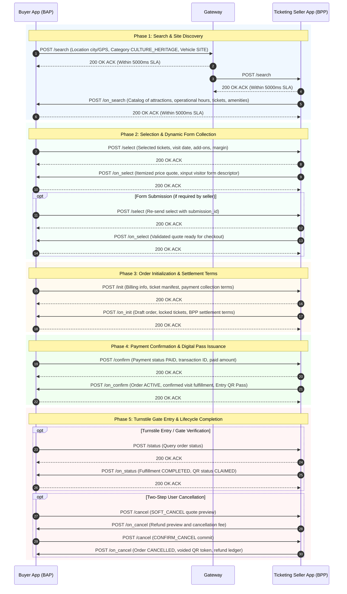
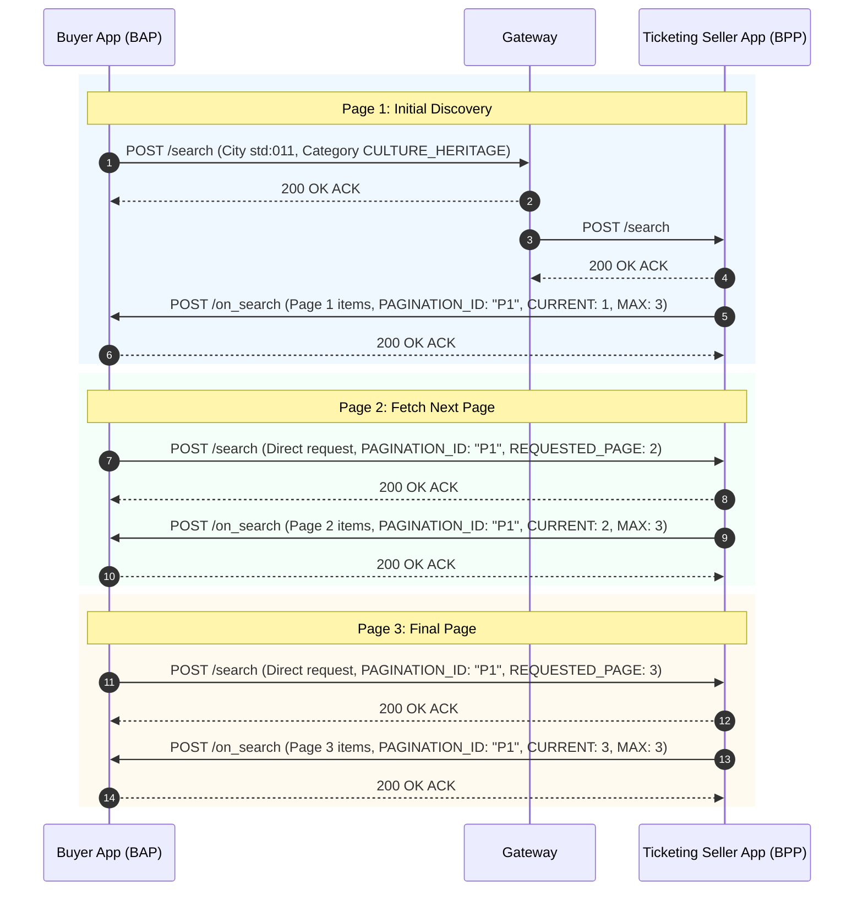
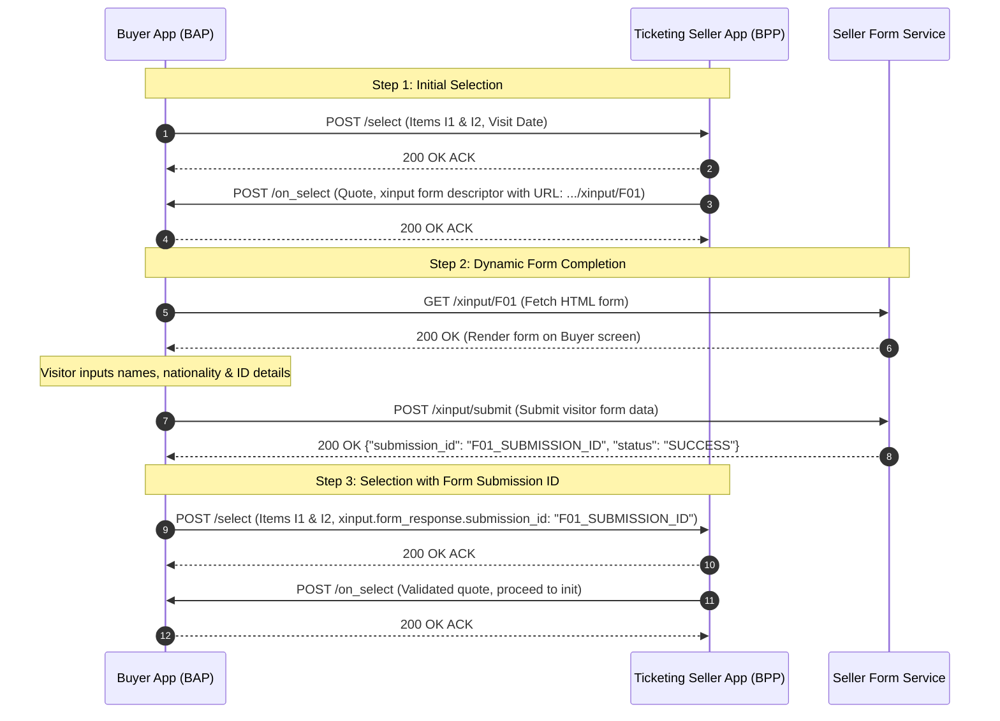
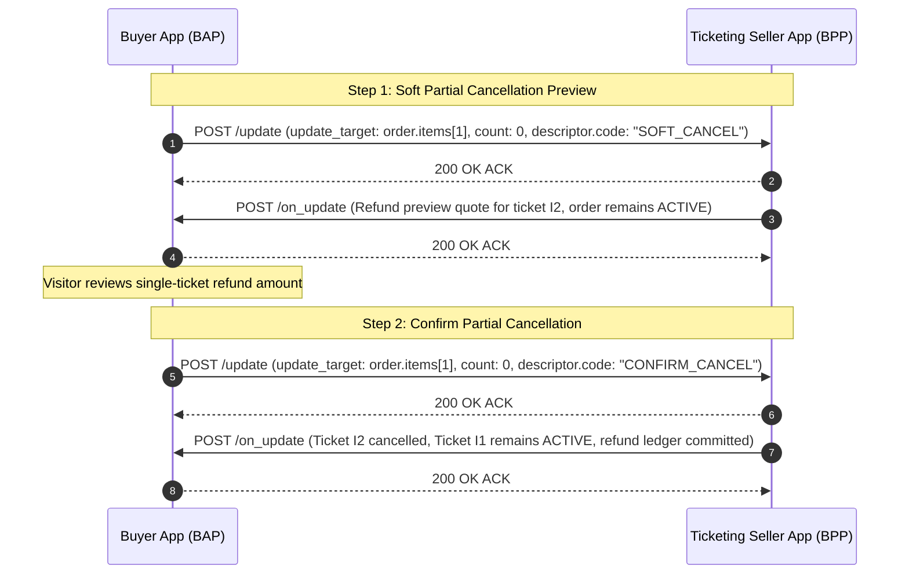

# Culture-Heritage

## Overview

`ONDC:TRV14` is the open standard protocol for **Unreserved Entry Passes, Monument Admissions, Cultural & Heritage Sites, Museums, Leisure Attractions, and Experience Ticketing** across the Open Network for Digital Commerce (ONDC). 

This domain standardizes the end-to-end ticketing lifecycle—enabling consumers to discover cultural landmarks, historical monuments, botanical gardens, wildlife parks, museums, and experiential activities across India, select visiting dates and access tiers, complete visitor nationality declarations through dynamic forms, and receive cryptographically verified digital QR/barcode passes for automated turnstile gate entry.

---

## Sector & Purpose

**Sector:** Tourism, Culture, Heritage, Leisure Attractions, and Experiential Activities.

**Problem Solved:** Today, ticketing for tourist attractions and cultural sites in India is deeply fragmented:
1. **Long Physical Queues:** Millions of domestic and international travelers wait in hours-long queues at physical ticket counters at historical monuments, national parks, and museums.
2. **Disparate Online Systems:** Archaeological authorities (e.g., Archaeological Survey of India - ASI), state tourism development corporations, municipal trusts, and private amusement parks operate siloed ticketing portals, each requiring separate user accounts, payment setups, and interfaces.
3. **Complex Differential Pricing:** Historical monuments enforce differentiated statutory tariffs based on visitor nationality (Domestic Indian, SAARC/BIMSTEC, Foreign), age brackets (adult vs. child under 15), and photography/audio equipment permissions.

`ONDC:TRV14` solves this by creating an open, interoperable digital ticketing rail:
- **For Visitors:** Any consumer application (banking app, travel portal, local city guide, ride-hailing app) can offer instant entry pass discovery, visitor form completion, and digital QR ticket delivery directly on the traveler's smartphone.
- **For Authorities & Site Operators (BPP):** Cultural institutions, monument trusts, and attraction organizers list their sites once on the ONDC network and gain instant distribution across all participating Buyer Apps without building custom integrations or paying proprietary OTA channel commissions.

---

## Real-World Actors

- **Consumers / Visitors:** Travelers, families, educational school groups, and international tourists seeking admission passes to cultural monuments, heritage sites, museums, and experiential tours.
- **Experience Providers & Heritage Authorities (BPP):** Monument trusts (e.g., ASI), museum boards, state tourism corporations, botanical gardens, and private tour/experience operators that publish site schedules, define visitor fare policies, issue digital QR entry passes, and validate tickets at gate turnstiles.
- **Buyer Platforms (BAP):** Consumer-facing mobile applications, travel agencies, and fintech wallets that provide search, ticket selection, visitor identity collection via dynamic `xinput` forms, payment settlement, and in-app QR ticket display.
- **The Gateway:** The broadcast router that distributes location-based and category-based discovery requests to all eligible ticketing BPPs.
- **ONDC Registry:** The central trust anchor containing authenticated subscriber IDs, encryption keys, and digital certificates.

---

## Real-World Use Cases

- **Monument & Heritage Site Admission:** Searching and booking unreserved entry tickets for historical sites (e.g., Qutab Minar, Red Fort, Taj Mahal, Ajanta & Ellora Caves).
- **Multi-Tier Ticket Classes:** Selecting combinations of Adult, Child, Student, and Senior Citizen tickets with automated statutory tariff calculation.
- **Nationality-Based Tariff Rules:** Enforcing differentiated ticket prices based on visitor citizenship (`INDIAN`, `SAARC_BIMSTEC`, `FOREIGNER`) with demographic verification.
- **Ancillary Add-Ons:** Purchasing optional site add-ons such as audio guide headsets, museum exhibition entry, battery-operated shuttle transit, or licensed tour guide services.
- **Multi-Checkpoint Sequential Entry:** Modeling complexes with sequential access points (e.g., Main Perimeter Gate → Security Turnstile → Inner Monument / Museum Wing).
- **Dynamic Form Collection (`xinput`):** Capturing mandatory visitor declarations, attendee identity details, or educational institution details using dynamic seller-rendered forms.
- **Multi-Page Catalog Pagination:** Streaming large catalogs of hundreds of tourist attractions across states using asynchronous pagination (`PAGINATION_ID`, `CURRENT_PAGE_NUMBER`, `MAX_PAGE_NUMBER`).
- **Incremental Catalog Synchronization:** Keeping buyer platforms synchronized with real-time operational hour updates and site holiday closures via incremental catalog pulls.
- **Turnstile Digital QR Ticket Scanning:** Delivering secure QR code tokens (`type: QR`) rendered on buyer screens, scanned and marked `CLAIMED` at entry turnstiles.
- **Full & Granular Partial Ticket Cancellation:** Two-step cancellation previews (`SOFT_CANCEL` followed by `CONFIRM_CANCEL`) for full orders, and single-ticket cancellations via `POST /update`.
- **Merchant Emergency Site Closures:** Unsolicited operator cancellations due to adverse weather, state functions, or maintenance, with automatic 100% full refunds.
- **Post-Visit Ratings & Grievance Resolution:** Capturing visitor reviews and resolving ticketing or gate denial disputes via IGM 2.0.0.

---

## Key Concepts

- **Abstract Parent Item (`I0`) vs. Concrete Tickets (`I1`, `I2`):** A cultural monument or attraction is modeled as an abstract parent item (`code: ABSTRACT`) defining overarching site rules (validity duration, operational hours, inclusion/exclusion amenities, general terms). Concrete bookable ticket classes (Adult Ticket, Child Ticket, Foreigner Ticket) link back to this parent via `parent_item_id`.
- **Operational Hours & Scheduled Holidays:** Locations declare granular opening/closing hours per day of the week (`OPERATIONAL_HOURS`, e.g., `days: "1,2,3,4,5,6,7"`, `09:00` to `17:00`) along with statutory annual holiday closures (e.g., Republic Day, Independence Day).
- **Sequential Entry Checkpoints:** Fulfillments model sequential access paths using `type: START` (initial entry turnstile) and chained `type: CHECKPOINT` stops referencing their parent stop via `parent_stop_id`.
- **Dynamic `xinput` Form Engine:** When attractions require specialized visitor information (attendee full names, passport numbers, nationality disclosures), the BPP provides an `xinput` form descriptor in `on_select`. The buyer submits the form directly to the Seller Form Service and attaches the resulting `submission_id` to subsequent protocol calls.
- **Flexible Margin Governance:** Sellers declare acceptable buyer margin limits (`margin.minimum` and `margin.maximum`). If a buyer specifies a commission margin exceeding the seller's cap, the BPP rejects the request with domain error code `93209`.
- **Digital Authorization Tokens:** Entry fulfillments deliver a secure authorization token (`stops.authorization.type: "QR"`, status `UNCLAIMED`). When the gate barcode reader validates the visitor at the turnstile, the ticket transitions to `CLAIMED` and fulfillment state to `COMPLETED`.

---

## Example Scenario

**A family visiting the Qutab Minar Complex in New Delhi on ONDC:**

1. **Discovery:** A traveler opens their preferred ONDC-enabled travel app in New Delhi and searches for cultural heritage attractions in the city (`std:011`) for category `CULTURE_HERITAGE`.
2. **Catalog Exploration:** The BPP returns a catalog featuring the Qutab Minar Complex. The listing details 5-star ratings, operational hours (09:00 to 17:00 daily), scheduled holiday closures, inclusion tags (drinking water, manicured lawns), exclusion tags (outside food, commercial photography), and ticket options: Adult Ticket (₹350), Child Ticket (₹150), and an Audio Assistance add-on (₹100).
3. **Selection & Dynamic Form:** The traveler selects 1 Adult Ticket and 1 Child Ticket with Audio Assistance. In `POST /on_select`, the operator returns an itemized price quote (₹600 total) and presents an `xinput` form requiring visitor name and nationality verification. The traveler completes the form, receiving `submission_id: "F01_SUBMISSION_ID"`.
4. **Manifest & Payment:** In `POST /init`, the traveler provides their billing details and attaches the form submission ID. The operator locks the entry tickets, verifies validity, and returns payment terms in `POST /on_init`. The traveler authorizes payment via UPI, and the Buyer App dispatches `POST /confirm`.
5. **Voucher Issuance:** In `POST /on_confirm`, the operator confirms order `O1` as `ACTIVE` and issues two **Digital QR Code Entry Passes (`type: QR`, status `UNCLAIMED`)** valid for 48 hours.
6. **Turnstile Entry & Completion:** Upon arriving at Qutab Minar, the traveler scans their phone's QR code at the automated turnstile scanner. The system validates the token, marks authorization as `CLAIMED`, and records order status as `COMPLETED`.
7. **Post-Visit Feedback:** After touring the minaret, the traveler rates the experience 5 stars via `POST /rating`.

---

## 1. Network Architecture & Beckn Protocol Mechanics

The `ONDC:TRV14` specification (v2.0.0) standardizes communication between **Buyer Applications (BAP)** and **Ticketing Seller Applications (BPP)** across the entire entry pass lifecycle.



### 1.1 Asynchronous Request-Callback SLA

Communication across the network is strictly **decoupled and asynchronous**:
1. **Outbound Action**: The requester (e.g. BAP) submits an HTTP `POST` action request.
2. **Synchronous Acknowledgment (`ACK` / `NACK`)**: The receiver validates HTTP headers, schema compliance, and cryptographic signatures, returning an immediate HTTP 200 `ACK` (or `NACK`) within **5000 milliseconds**.
3. **Asynchronous Business Execution**: The receiver processes the request asynchronously (querying monument ticketing engines, checking operational hours, generating QR codes).
4. **Inbound Callback (`POST /on_<action>`)**: The receiver transmits the response via an asynchronous callback to the sender's webhook URL (`bap_uri`).
5. **Callback Acknowledgment**: The sender validates the callback and immediately returns an HTTP 200 `ACK`.

### 1.2 Synchronous Response Contract (`ACK` vs `NACK`)

Every endpoint must respond synchronously with an `ACK` or `NACK`:

#### Successful Acknowledgment (`ACK`):
```json
{
  "message": {
    "ack": {
      "status": "ACK"
    }
  }
}
```

#### Synchronous Rejection (`NACK`):
```json
{
  "message": {
    "ack": {
      "status": "NACK"
    }
  },
  "error": {
    "type": "GATEWAY",
    "code": "30000",
    "message": "Invalid Signature / Context Validation Failed"
  }
}
```

### 1.3 Role of the Gateway and Direct Routing

- **The Gateway**: Facilitates network discovery. During `POST /search`, the Buyer App sends its query to the Gateway. The Gateway queries the central ONDC Registry to look up active, subscribed Seller Apps (BPPs) servicing the requested domain (`ONDC:TRV14`) and city code, replicates the search call to all eligible BPPs, and aggregates acknowledgments.
- **Direct Point-to-Point Messaging**: Once a visitor selects an attraction from the catalog, all subsequent lifecycle requests (`/select`, `/init`, `/confirm`, `/status`, `/cancel`, `/update`) are dispatched **directly point-to-point** between the BAP and the chosen BPP using the `bpp_uri` discovered during search. The Gateway is bypassed after discovery.

### 1.4 Cryptographic Security & Header Signatures

All payloads must be cryptographically signed using the Beckn standard:
- **Hashing**: BLAKE-512 cryptographic digest computed over the raw HTTP request body.
- **Signing Algorithm**: `Ed25519` asymmetric private key.
- **HTTP Authorization Header**:
  ```http
  Authorization: Signature keyId="subscriber_id|unique_key_id|ed25519",algorithm="ed25519",created="1700000000",expires="1700000030",headers="(created) (expires) digest",signature="base64_encoded_signature..."
  ```
- **Verification**: The receiver verifies the signature by retrieving the sender's public key from the ONDC Registry.

### 1.5 Common Context Object (`ONDC:TRV14 2.0.0`)

Every request and callback envelope includes a mandatory `context` object providing transaction tracing and routing metadata:

```yaml
context:
  domain: "ONDC:TRV14"                              # Unreserved entry pass domain code
  version: "2.0.0"                                  # Protocol version
  action: "search"                                  # Protocol method being executed
  location:
    country:
      code: "IND"                                   # ISO 3166-1 alpha-3 country code
    city:
      code: "std:011"                               # Destination city STD code (e.g. std:011 for Delhi)
  bap_id: "travel-bap.example.com"                  # Subscriber ID of the Buyer App
  bap_uri: "https://travel-bap.example.com/beckn"   # Webhook callback URL of the Buyer App
  bpp_id: "monuments-bpp.operator.com"              # Subscriber ID of the Ticketing Seller App
  bpp_uri: "https://monuments-bpp.operator.com/api" # Direct API URL of the Ticketing Seller App
  transaction_id: "cf7bb367-c820-4bc9-9be8-f548e0bbf222"  # Unique UUID persisting across all calls
  message_id: "5fd86e70-3465-4759-ac6c-910ab16e2db9"      # Unique UUID per request-response pair
  timestamp: "2026-11-20T08:00:00.000Z"             # RFC3339 / ISO 8601 UTC timestamp
  ttl: "PT30S"                                      # Message validity window (ISO 8601 duration)
```

---

### 1.6 Complete Transaction Lifecycle Matrix

| Phase | Action API | Sender → Receiver | Callback API | Callback Sender → Receiver | Primary Business Purpose |
| :--- | :--- | :--- | :--- | :--- | :--- |
| **Discovery** | `POST /search` | BAP → Gateway / BPP | `POST /on_search` | BPP → BAP | Search entry passes by city code (`std:011`), GPS coordinates, visit date range, or incremental catalog pull. |
| **Pagination** | `POST /search` | BAP → BPP | `POST /on_search` | BPP → BAP | Stream multi-page attraction catalogs using `PAGINATION_ID`, `CURRENT_PAGE_NUMBER`, and `MAX_PAGE_NUMBER`. |
| **Selection** | `POST /select` | BAP → BPP | `POST /on_select` | BPP → BAP | Select ticket classes, visit date/time, add-ons (audio guide), buyer margin, and receive `xinput` dynamic form schema. |
| **Form Submit** | `POST /select` | BAP → BPP | `POST /on_select` | BPP → BAP | Re-dispatch selection payload with attached `submission_id` after visitor completes dynamic form. |
| **Initialization** | `POST /init` | BAP → BPP | `POST /on_init` | BPP → BAP | Submit visitor billing contact info, ticket manifest, payment collection terms (`collected_by: BAP`), and BAP terms. |
| **Confirmation** | `POST /confirm` | BAP → BPP | `POST /on_confirm` | BPP → BAP | Authorize booking with payment confirmation; receives issued digital entry pass QR code and check-in instructions. |
| **Turnstile Scan** | `POST /status` | BAP → BPP | `POST /on_status` | BPP → BAP | Poll order lifecycle state; turnstile scanner marks QR authorization status as `CLAIMED` and fulfillment as `COMPLETED`. |
| **Partial Cancel** | `POST /update` | BAP → BPP | `POST /on_update` | BPP → BAP | Selectively cancel individual tickets (e.g. child ticket) in a multi-ticket order without voiding the entire booking. |
| **Cancellation** | `POST /cancel` | BAP → BPP | `POST /on_cancel` | BPP → BAP | Two-step full cancellation flow (`SOFT_CANCEL` quote preview followed by `CONFIRM_CANCEL`). |
| **Unsolicited Cancel**| *Unsolicited* | — | `POST /on_cancel` | BPP → BAP | Operator emergency site closure (severe weather/VIP visit) triggering mandatory 100% full refund. |
| **Cancel Rejection** | `POST /cancel` | BAP → BPP | `POST /on_cancel` | BPP → BAP | Rejection of cancellation request if visit time has passed or cancellation window is closed (`93206`). |
| **Feedback** | `POST /rating` | BAP → BPP | `POST /on_rating` | BPP → BAP | Submit visitor feedback and ratings (1–5 stars) on site facilities, cleanliness, and staff assistance. |
| **Grievance (IGM)** | `POST /issue` | BAP → BPP | `POST /on_issue` | BPP → BAP | Raise passenger grievance ticket (IGM 2.0.0) for gate denial, overcharging, or refund dispute. |
| **IGM Status** | `POST /issue_status` | BAP → BPP | `POST /on_issue_status`| BPP → BAP | Track dispute resolution progress, respondent remarks, and refund escalation. |

---

## 2. Visual Sequence Diagrams

### 2.1 Seller App Pagination Flow (`Unreserved Entry Pass - Culture-Heritage`)



---

### 2.2 Purchase Journey with Dynamic `xinput` Visitor Forms



---

### 2.3 Granular Partial Ticket Cancellation (`POST /update`)



---

## 3. Detailed API Specifications & Contract Payloads

### 3.1 `POST /search` — Discovery by City, GPS & Category

- **Flow**: Buyer App (BAP) → Gateway → Ticketing Seller App (BPP)
- **Business Role**: Broadcasts search query across the network for attraction entry passes in a city (`std:011`) under category `CULTURE_HERITAGE`.
- **Key Payload Elements (`message.intent`)**:
  - `category.descriptor.code`: Target category (`CULTURE_HERITAGE`, `EXPERIENCE`, `TOURS_SIGHTSEEING`).
  - `fulfillment.vehicle.category`: Declared as `SITE`.
  - `fulfillment.stops[].location.city.code`: Destination city STD code (e.g. `std:011`).
  - `fulfillment.stops[].time.range`: Target visiting date window (`start` and `end`).
  - `tags.BAP_TERMS`: Buyer platform terms (`BUYER_FINDER_FEES_PERCENTAGE`, `SETTLEMENT_BASIS`, `SETTLEMENT_WINDOW`).

```yaml
# Example: POST /search
context:
  domain: "ONDC:TRV14"
  version: "2.0.0"
  action: "search"
  location:
    country:
      code: "IND"
    city:
      code: "std:011"
  transaction_id: "cf7bb367-c820-4bc9-9be8-f548e0bbf222"
  message_id: "5fd86e70-3465-4759-ac6c-910ab16e2db9"
  timestamp: "2026-11-20T08:00:00.000Z"
  bap_id: "travel-bap.example.com"
  bap_uri: "https://travel-bap.example.com/beckn"
  ttl: "PT30S"
message:
  intent:
    category:
      descriptor:
        code: "CULTURE_HERITAGE"
    fulfillment:
      stops:
        - type: "START"
          location:
            city:
              code: "std:011"
          time:
            range:
              start: "2026-11-25T00:00:00.000Z"
              end: "2026-11-27T00:00:00.000Z"
      vehicle:
        category: "SITE"
    payment:
      collected_by: "BAP"
    tags:
      - descriptor:
          code: "BAP_TERMS"
        list:
          - descriptor:
              code: "BUYER_FINDER_FEES_PERCENTAGE"
            value: "1"
          - descriptor:
              code: "BUYER_FINDER_FEES_TYPE"
            value: "percent"
          - descriptor:
              code: "STATIC_TERMS"
            value: "https://travel-bap.example.com/booking/terms"
          - descriptor:
              code: "SETTLEMENT_BASIS"
            value: "INVOICE_RECEIPT"
          - descriptor:
              code: "SETTLEMENT_WINDOW"
            value: "P30D"
```

---

### 3.2 `POST /on_search` — Attraction Catalog, Operational Hours & Tickets

- **Flow**: Ticketing Seller App (BPP) → Buyer App (BAP)
- **Business Role**: Returns tourist attraction catalogs, location GPS, star ratings, operational hours, scheduled holiday closures, abstract site parent items (`I0`), child ticket options (`I1` Adult, `I2` Child), margin brackets, audio guide add-ons, and cancellation terms.
- **Key Payload Elements (`message.catalog`)**:
  - `providers`: Ticketing authority or site operator (`id: P1`):
    - `categories`: Hierarchy (`C1` Culture & Heritage → `C4` Monument & Historical Site, `C5` Museum & Galleries).
    - `locations`: Physical monument coordinates (`gps: "28.524596, 77.185577"`), city code (`std:011`), descriptor, rating (`"5"`):
      - `time`: `label: OPERATIONAL_HOURS`, `days: "1,2,3,4,5,6,7"`, operating range (`09:00Z` to `17:00Z`), and holiday schedule (`2026-01-26`, `2026-08-15`).
    - `items`:
      - `id: I0`: Abstract parent site item (`code: ABSTRACT`, `VALIDITY: P2D`, `INCLUSIONS: [water]`, `EXCLUSIONS: [outside food, commercial photography]`, `INFO.TNC_LINK`).
      - `id: I1`: Concrete ticket (`Adult-Ticket`, `code: ENTRY_PASS`, price `350`, `parent_item_id: I0`, `margin` max `10` / min `8`, `add_ons: [{id: A1, name: Audio Assistance, price: 100}]`, `tags.FARE_POLICY`: `MIN_AGE: 18`, `NATIONALITY: INDIAN`, `ADDITIONAL_DETAILS_REQUIRED: TRUE`).
      - `id: I2`: Child ticket (`Child-Ticket`, price `150`).
    - `fulfillments`: `type: VISIT`, `vehicle.category: SITE`, host details (`agent.organization`).
  - `tags.PAGINATION`: Multi-page state (`PAGINATION_ID: "P1"`, `CURRENT_PAGE_NUMBER: "1"`, `MAX_PAGE_NUMBER: "2"`).

```yaml
# Example: POST /on_search (Attraction & Ticket Catalog Snippet)
context:
  domain: "ONDC:TRV14"
  version: "2.0.0"
  action: "on_search"
  location:
    country:
      code: "IND"
    city:
      code: "std:011"
  transaction_id: "cf7bb367-c820-4bc9-9be8-f548e0bbf222"
  message_id: "84e573df-0f06-449b-9f02-7bf1f1694d83"
  timestamp: "2026-11-20T08:00:02.000Z"
  bap_id: "travel-bap.example.com"
  bap_uri: "https://travel-bap.example.com/beckn"
  bpp_id: "monuments-bpp.operator.com"
  bpp_uri: "https://monuments-bpp.operator.com/api"
  ttl: "PT30S"
message:
  catalog:
    descriptor:
      name: "Archaeological Monument Services"
      images:
        - url: "https://monuments-bpp.operator.com/logo.png"
    providers:
      - id: "P1"
        descriptor:
          name: "National Heritage Authority"
        categories:
          - id: "C1"
            descriptor:
              name: "Culture & Heritage"
              code: "CULTURE_HERITAGE"
          - id: "C4"
            parent_category_id: "C1"
            descriptor:
              name: "Monument & Historical Site"
              code: "MONUMENT_HISTORICAL_SITE"
        locations:
          - id: "L1"
            gps: "28.524596, 77.185577"
            city:
              code: "std:011"
            descriptor:
              name: "Qutab Minar Complex"
              short_desc: "UNESCO World Heritage Victory Tower and Minaret complex"
            rating: "5"
            time:
              - label: "OPERATIONAL_HOURS"
                days: "1,2,3,4,5,6,7"
                range:
                  start: "2026-01-26T09:00:00Z"
                  end: "2026-01-26T17:00:00Z"
                schedule:
                  holidays:
                    - "2026-01-26T00:00:00.000Z"
                    - "2026-08-15T00:00:00.000Z"
        items:
          - id: "I0"
            descriptor:
              name: "Qutab Minar Monument Entry Pass"
              code: "ABSTRACT"
            location_ids:
              - "L1"
            category_ids:
              - "C4"
            time:
              label: "VALIDITY"
              duration: "P2D"
            fulfillment_ids:
              - "F1"
            cancellation_terms:
              - cancellation_fee:
                  percentage: "10"
                fulfillment_state:
                  descriptor:
                    code: "CONFIRMED"
                cancel_by:
                  label: "DURATION"
                  duration: "PT1H30M"
                cancellation_eligible: true
            tags:
              - descriptor:
                  code: "INCLUSIONS"
                list:
                  - value: "Drinking Water"
              - descriptor:
                  code: "EXCLUSIONS"
                list:
                  - value: "Outside Food"
                  - value: "Commercial Tripods"
          - id: "I1"
            descriptor:
              name: "Adult Entry Ticket (Indian National)"
              code: "ENTRY_PASS"
            parent_item_id: "I0"
            location_ids:
              - "L1"
            category_ids:
              - "C4"
            price:
              currency: "INR"
              value: "350"
            quantity:
              minimum:
                count: 1
              maximum:
                count: 6
            margin:
              minimum:
                measure:
                  value: "8"
                  unit: "INR"
              maximum:
                measure:
                  value: "10"
                  unit: "INR"
            add_ons:
              - id: "A1"
                descriptor:
                  name: "Multilingual Audio Guide Headset"
                price:
                  currency: "INR"
                  value: "100"
            tags:
              - descriptor:
                  code: "FARE_POLICY"
                list:
                  - descriptor:
                      code: "MIN_AGE"
                    value: "18"
                  - descriptor:
                      code: "NATIONALITY"
                    value: "INDIAN"
                  - descriptor:
                      code: "ADDITIONAL_DETAILS_REQUIRED"
                    value: "TRUE"
          - id: "I2"
            descriptor:
              name: "Child Entry Ticket (Under 15 Years)"
              code: "ENTRY_PASS"
            parent_item_id: "I0"
            location_ids:
              - "L1"
            category_ids:
              - "C4"
            price:
              currency: "INR"
              value: "150"
        fulfillments:
          - id: "F1"
            type: "VISIT"
            vehicle:
              category: "SITE"
        tags:
          - descriptor:
              code: "PAGINATION"
            list:
              - descriptor:
                  code: "PAGINATION_ID"
                value: "P1"
              - descriptor:
                  code: "CURRENT_PAGE_NUMBER"
                value: "1"
              - descriptor:
                  code: "MAX_PAGE_NUMBER"
                value: "2"
```

---

### 3.3 `POST /select` — Selection of Tickets, Add-Ons & Margin

- **Flow**: Buyer App (BAP) → Ticketing Seller App (BPP)
- **Business Role**: The visitor selects ticket classes (`I1` Adult, `I2` Child), selects margin fee (`₹10`), adds audio assistance (`A1`), and chooses the scheduled visit timestamp.
- **Key Payload Elements (`message.order`)**:
  - `provider.id`: Target monument authority ID (`P1`).
  - `items`: Selected tickets with `parent_item_id: "I0"`, quantity, `margin.selected`, and chosen `add_ons`.
  - `fulfillments[].stops[].time.timestamp`: Selected visit date and entry time (`2026-11-25T10:00:00.000Z`).
  - `xinput` *(on resubmission)*: If dynamic form was completed, includes `form.id` and `form_response.submission_id`.

```yaml
# Example: POST /select
context:
  domain: "ONDC:TRV14"
  version: "2.0.0"
  action: "select"
  location:
    country:
      code: "IND"
    city:
      code: "std:011"
  transaction_id: "cf7bb367-c820-4bc9-9be8-f548e0bbf222"
  message_id: "7b355323-11aa-4be9-9648-9628618b1157"
  timestamp: "2026-11-20T08:02:00.000Z"
  bap_id: "travel-bap.example.com"
  bap_uri: "https://travel-bap.example.com/beckn"
  bpp_id: "monuments-bpp.operator.com"
  bpp_uri: "https://monuments-bpp.operator.com/api"
  ttl: "PT30S"
message:
  order:
    provider:
      id: "P1"
    items:
      - id: "I1"
        parent_item_id: "I0"
        quantity:
          selected:
            count: 1
        margin:
          selected:
            measure:
              value: "10"
              unit: "INR"
        add_ons:
          - id: "A1"
            quantity:
              selected:
                count: 1
      - id: "I2"
        parent_item_id: "I0"
        quantity:
          selected:
            count: 1
        margin:
          selected:
            measure:
              value: "10"
              unit: "INR"
    fulfillments:
      - id: "F1"
        stops:
          - type: "START"
            time:
              timestamp: "2026-11-25T10:00:00.000Z"
```

---

### 3.4 `POST /on_select` — Quotation, Checkpoints & Dynamic Form Descriptor

- **Flow**: Ticketing Seller App (BPP) → Buyer App (BAP)
- **Business Role**: Delivers itemized tariff calculation (`BASE_PRICE` for Adult & Child, add-ons), sequential entry gate checkpoints (`CHECKPOINT` stops), and the dynamic `xinput` form descriptor for visitor nationality declarations.
- **Key Payload Elements (`message.order`)**:
  - `quote.price`: Total calculated tariff (`INR 600.00`).
  - `quote.breakup`:
    - `title: BASE_PRICE`: Base ticket for Adult (`350`) and Child (`150`).
    - `title: ADD_ONS`: Audio guide headset (`100`).
    - `title: TAX`: Statutory GST / monument cess (`0`).
  - `fulfillments[].stops`: Sequential entry modeling:
    - Stop 1: `type: START`, `id: "1"` (Main Turnstile Gate).
    - Stop 2: `type: CHECKPOINT`, `id: "2"`, `parent_stop_id: "1"` (Inner Archaeological Museum Entrance).
  - `xinput`: Dynamic form descriptor:
    - `head.descriptor.name`: `"Visitor Nationality & Identity Declaration"`.
    - `form.id`: `"F01"`.
    - `form.url`: `"https://monuments-bpp.operator.com/xinput/visitor-details/F01"`.
    - `required: true`.

```yaml
# Example: POST /on_select (Quote & xinput Form Snippet)
message:
  order:
    provider:
      id: "P1"
    items:
      - id: "I1"
        parent_item_id: "I0"
        price:
          currency: "INR"
          value: "350"
      - id: "I2"
        parent_item_id: "I0"
        price:
          currency: "INR"
          value: "150"
    quote:
      price:
        currency: "INR"
        value: "600"
      breakup:
        - title: "BASE_PRICE"
          item:
            id: "I1"
            quantity:
              selected:
                count: 1
          price:
            currency: "INR"
            value: "350"
        - title: "BASE_PRICE"
          item:
            id: "I2"
            quantity:
              selected:
                count: 1
          price:
            currency: "INR"
            value: "150"
        - title: "ADD_ONS"
          item:
            id: "I1"
            add_ons:
              - id: "A1"
          price:
            currency: "INR"
            value: "100"
        - title: "TAX"
          price:
            currency: "INR"
            value: "0"
    xinput:
      head:
        descriptor:
          name: "Visitor Identity Declaration"
      form:
        id: "F01"
        mime_type: "text/html"
        url: "https://monuments-bpp.operator.com/xinput/visitor-details/F01"
        required: true
    fulfillments:
      - id: "F1"
        type: "VISIT"
        stops:
          - type: "START"
            id: "1"
            time:
              timestamp: "2026-11-25T10:00:00.000Z"
          - type: "CHECKPOINT"
            id: "2"
            parent_stop_id: "1"
```

---

### 3.5 `POST /init` — Order Initialization & Billing Details

- **Flow**: Buyer App (BAP) → Ticketing Seller App (BPP)
- **Business Role**: Submits primary purchaser billing information (name, email, mobile phone), ticket manifest, and payment collection mode (`collected_by: BAP`).
- **Key Payload Elements (`message.order`)**:
  - `billing`: Purchaser contact name, email, and telephone.
  - `payments`: `collected_by: "BAP"`, `status: "NOT_PAID"`, `type: "PRE_ORDER"`.
  - `items`: Selected tickets with attached form submission references if required.

```yaml
# Example: POST /init
context:
  domain: "ONDC:TRV14"
  version: "2.0.0"
  action: "init"
  location:
    country:
      code: "IND"
    city:
      code: "std:011"
  transaction_id: "cf7bb367-c820-4bc9-9be8-f548e0bbf222"
  message_id: "764b4322-8f7c-402c-b907-80484e9ad40c"
  timestamp: "2026-11-20T08:04:00.000Z"
  bap_id: "travel-bap.example.com"
  bap_uri: "https://travel-bap.example.com/beckn"
  bpp_id: "monuments-bpp.operator.com"
  bpp_uri: "https://monuments-bpp.operator.com/api"
  ttl: "PT30S"
message:
  order:
    provider:
      id: "P1"
    items:
      - id: "I1"
        parent_item_id: "I0"
        quantity:
          selected:
            count: 1
        add_ons:
          - id: "A1"
            quantity:
              selected:
                count: 1
      - id: "I2"
        parent_item_id: "I0"
        quantity:
          selected:
            count: 1
    fulfillments:
      - id: "F1"
        stops:
          - type: "START"
            time:
              timestamp: "2026-11-25T10:00:00.000Z"
    billing:
      name: "Rajesh Sharma"
      email: "rajesh.sharma@example.com"
      phone: "+919876543210"
    payments:
      - id: "PA1"
        collected_by: "BAP"
        status: "NOT_PAID"
        type: "PRE_ORDER"
```

---

### 3.6 `POST /on_init` — Draft Order & Settlement Banking Parameters

- **Flow**: Ticketing Seller App (BPP) → Buyer App (BAP)
- **Business Role**: Confirms ticket inventory hold, provides draft order details, and delivers finalized BPP settlement legal terms.
- **Key Payload Elements (`message.order`)**:
  - `tags.BPP_TERMS`: Court jurisdiction (`COURT_JURISDICTION: "New Delhi"`), mandatory arbitration, delay interest, settlement amount, and operator bank escrow details.
  - Finalized `cancellation_terms` and `replacement_terms`.

---

### 3.7 `POST /confirm` — Payment Authorization & Order Placement

- **Flow**: Buyer App (BAP) → Ticketing Seller App (BPP)
- **Business Role**: Dispatched immediately after the visitor completes payment on the Buyer App to permanently instruct the ticketing system to issue the digital entry passes.
- **Key Payload Elements (`message.order`)**:
  - `payments`:
    - `status`: Updated to `PAID`.
    - `params.transaction_id`: Gateway payment reference ID (e.g. `61b4be7e-d85c-456a-99e5-ce3d83be135d`).
    - `params.amount`: Exact collected total (`600`).
    - `params.currency`: `INR`.

```yaml
# Example: POST /confirm (Payment block)
payments:
  - id: "PA1"
    collected_by: "BAP"
    status: "PAID"
    type: "PRE_ORDER"
    params:
      transaction_id: "TXN-ASI-9841209"
      amount: "600"
      currency: "INR"
```

---

### 3.8 `POST /on_confirm` — Entry QR Pass Issuance & Active Order

- **Flow**: Ticketing Seller App (BPP) → Buyer App (BAP)
- **Business Role**: The ticketing engine commits the reservation, transitions order status to `ACTIVE`, and generates the **Digital QR Code Entry Pass (`type: QR`)** for turnstile gate admission.
- **Key Payload Elements (`message.order`)**:
  - `id`: Permanent booking order ID (e.g. `O1`).
  - `status`: `ACTIVE`.
  - `fulfillments[].stops[].authorization`:
    - `type`: `QR`.
    - `token`: Base64 encoded QR image data stream or alphanumeric barcode token.
    - `valid_to`: Ticket expiration timestamp (e.g. `2026-11-27T10:00:00.000Z`).
    - `status`: Initialized as `UNCLAIMED`.
  - `fulfillments[].state.descriptor.code`: `CONFIRMED`.

```yaml
# Example: POST /on_confirm (Digital Pass Issuance Snippet)
message:
  order:
    id: "O1"
    status: "ACTIVE"
    items:
      - id: "I1"
        parent_item_id: "I0"
      - id: "I2"
        parent_item_id: "I0"
    fulfillments:
      - id: "F1"
        type: "VISIT"
        state:
          descriptor:
            code: "CONFIRMED"
        stops:
          - type: "START"
            id: "1"
            time:
              timestamp: "2026-11-25T10:00:00.000Z"
            authorization:
              type: "QR"
              token: "iVBORw0KGgoAAAANSUhEUgAAAH0AAAB9AQAAAACn+1GIAAAApklEQVR4Xu2UMQ4EMQgD/QP+/0vK6zjsvayUMmavWxQpMAUBkwS12wcveAAkgNSCD3rR5Lkgoai3GUCMgWqbAEYR3HxAkZlzU/0MyBisYRsgI1ERFfcpBpA+ze6k56Cj7KTdXNigFWZvSOpsgqLfd18i2aAukXh9TXBNmdWt5gzA/oqzWkkN8HtA7G8CNOwYAiZt3wZixUfkA32OHNQq7Bxs9oI/gC/9fV8AVCkPjQAAAABJRU5ErkJggg=="
              valid_to: "2026-11-27T10:00:00.000Z"
              status: "UNCLAIMED"
          - type: "CHECKPOINT"
            id: "2"
            parent_stop_id: "1"
    quote:
      price:
        currency: "INR"
        value: "600"
```

---

### 3.9 `POST /status` & `POST /on_status` — Turnstile Gate Verification & Completion

- **Flow**: BAP ↔ BPP (polled and unsolicited)
- **Business Role**: 
  1. **Polled Tracking**: BAP sends `/status` with `order_id: "O1"` to verify ticket validity or retrieve gate entry instructions.
  2. **Turnstile Entry Verification**: When the visitor scans their QR pass at the entrance turnstile, the turnstile scanner marks `authorization.status: "CLAIMED"`, and the BPP dispatches `/on_status` updating `order.status: "COMPLETED"`.

```yaml
# Example: POST /on_status (Turnstile Scanned & Completed)
message:
  order:
    id: "O1"
    status: "COMPLETED"
    fulfillments:
      - id: "F1"
        type: "VISIT"
        state:
          descriptor:
            code: "COMPLETED"
        stops:
          - type: "START"
            id: "1"
            authorization:
              type: "QR"
              status: "CLAIMED"
```

---

### 3.10 `POST /update` & `POST /on_update` — Granular Partial Ticket Cancellation

In multi-ticket orders (e.g. 1 Adult + 1 Child ticket under `O1`), a visitor can cancel **only the Child ticket (`I2`)** while retaining the Adult ticket:

1. **Soft Partial Cancel**: BAP sends `/update` specifying `update_target: "order.items[1]"` with target item `I2` count set to `0` and `cancellation.reason.descriptor.code: "SOFT_CANCEL"`. The BPP calculates the single-ticket refund deduction in `/on_update`.
2. **Confirm Partial Cancel**: BAP sends `/update` with `descriptor.code: "CONFIRM_CANCEL"`. The BPP marks ticket `I2` as cancelled, keeps `I1` active, and settles the partial refund.

---

### 3.11 `POST /cancel` & `POST /on_cancel` — Two-Step Full Order Cancellation

#### Step 1: Soft Cancellation (Refund Quote Preview)
- **Request (`POST /cancel`)**: `order_id: "O1"`, `cancellation_reason_id: "001"`, `descriptor.code: "SOFT_CANCEL"`.
- **Response (`POST /on_cancel`)**: `order.status: "SOFT_CANCEL"`, itemized refund preview in `quote.breakup` (`title: REFUND`, `title: CANCELLATION_CHARGES`).

#### Step 2: Confirmed Cancellation (Commit)
- **Request (`POST /cancel`)**: `order_id: "O1"`, `descriptor.code: "CONFIRM_CANCEL"`.
- **Response (`POST /on_cancel`)**: `order.status: "CANCELLED"`, QR token voided, final refund settlement order committed.

#### Cancellation Rejection Flow (`cancelleation_rejected`)
If the visitor attempts to cancel after the site's permitted cancellation window has elapsed, the BPP rejects the request via `on_cancel` returning domain error code **`93206`** (*"Cancellation Window Closed"*) or **`93207`** (*"Cancellation not allowed"*).

---

### 3.12 `POST /rating` & `POST /on_rating` — Visitor Reviews

After touring the monument, the visitor submits feedback:

```yaml
# Example: POST /rating
context:
  domain: "ONDC:TRV14"
  version: "2.0.0"
  action: "rating"
  bap_id: "travel-bap.example.com"
  bpp_id: "monuments-bpp.operator.com"
  transaction_id: "cf7bb367-c820-4bc9-9be8-f548e0bbf222"
  message_id: "764b4322-8f7c-402c-b907-80484e9ad40c"
  timestamp: "2026-11-25T14:00:00.000Z"
  ttl: "PT30S"
message:
  order_id: "O1"
  ratings:
    - rating_category: "FULFILLMENT"
      id: "O1"
      value: "5"
      feedback: "Spectacular monument, seamless QR turnstile entry, and very informative audio guide!"
```

---

## 4. Domain Specific Tags & Data Models

### 4.1 Parent-Child Item Hierarchy

Cultural sites separate physical monument attributes from ticket commercial classes:
- **Parent Site Item (`I0`)**: Defines site-wide rules:
  - `code: ABSTRACT`.
  - `time.label: VALIDITY`: Duration pass remains valid after purchase (e.g. `P2D` - 2 days).
  - `tags.INCLUSIONS` / `tags.EXCLUSIONS`: Disclosed amenities.
  - `tags.INFO`: Terms link (`TNC_LINK`) and visitor guidance (`What to pack`, dress code, permitted bags).
- **Child Ticket Items (`I1`, `I2`)**: Represent purchasable admissions:
  - `parent_item_id: "I0"`.
  - `code: ENTRY_PASS`.
  - `margin`: Minimum and maximum acceptable buyer margin.
  - `tags.FARE_POLICY`: Demographic constraints (`MIN_AGE`, `MAX_AGE`, `GENDER`, `NATIONALITY`).

### 4.2 Operational Hours & Holiday Schedules (`OPERATIONAL_HOURS`)

In `locations[].time`, operators declare visiting schedules:
- `label: OPERATIONAL_HOURS`
- `days`: Comma-separated day indices (`"1,2,3,4,5,6,7"` where 1 = Monday).
- `range`: Opening and closing timestamps (`09:00Z` to `17:00Z`).
- `schedule.holidays`: Array of scheduled monument closures (e.g. national holidays, maintenance days).

### 4.3 Sequential Checkpoint Modeling (`CHECKPOINT`)

Complex attractions declare multiple sequential stops under `fulfillments[].stops`:
- Stop 1: `id: "1"`, `type: START` (Outer gate entry turnstile).
- Stop 2: `id: "2"`, `type: CHECKPOINT`, `parent_stop_id: "1"` (Inner museum gallery checkpoint).
- Stop 3: `id: "3"`, `type: CHECKPOINT`, `parent_stop_id: "2"` (Light & Sound show pavilion).

### 4.4 Dynamic `xinput` Form Engine

Attractions requiring identity disclosures deliver an `xinput` form descriptor in `POST /on_select`:
- `form.id`: Unique form template ID (e.g. `F01`).
- `form.url`: HTTPS URL to the dynamic HTML form hosted by the Seller Form Service.
- `required: true`: Mandatory form submission before booking.
- Once submitted, the buyer app receives a `submission_id` and attaches it in `select_request_submission.yaml`:
  ```yaml
  xinput:
    form:
      id: "F01"
    form_response:
      status: "SUCCESS"
      submission_id: "F01_SUBMISSION_ID"
  ```

---

## 5. Domain Error Codes Catalog

All TRV14 errors must be communicated using the standard Beckn error format:

| Error Code | Source | Event Name | Business Description & Corrective Handling |
| :--- | :--- | :--- | :--- |
| **93201** | BPP | Temporarily unavailable | Service temporarily unavailable from seller side |
| **93202** | BPP | Experience not available | Selected experience is no longer available for booking |
| **93203** | BPP | Maximum order qty exceeded | Maximum order qty exceeded |
| **93204** | BPP | Out-of-operational hours | Ticketing not allowed during un-operational hours |
| **93205** | BPP | Error in retrieving the ticket details | Unable to retrieve ticket details |
| **93206** | BPP | Cancellation Window Closed | Cancellation Window Closed |
| **93207** | BPP | Cancellation not allowed | The seller application does not allow user to cancel of ticket |
| **93208** | BPP | Invalid order id | Invalid order id |
| **93209** | BPP | Margin limit exceeded | The specified margin exceeds the permissible limit set by the seller. |

### Cancellation Reason Codes (`cancellation_reason_id`)

When initiating a cancellation request (`/cancel` or `/update`), the Buyer App must supply one of the standardized reason codes:

| Reason Code | Name | Description |
| :--- | :--- | :--- |
| **000** | Technical cancellation | Cancellation triggered due to technical or network errors |
| **001** | Change in travel plans/mind | Consumer decided to alter their itinerary |
| **002** | Personal emergency | Unforeseen medical or personal emergency |
| **003** | Wrong date/time booked | User accidentally selected the incorrect visit slot |
| **004** | Duplicate booking | Redundant booking created for the same attraction |
| **005** | Booked for wrong experience | Customer booked the wrong monument, museum, or tour tier |
| **006** | Did not receive booking confirmation | Timed out before receiving confirmation |
| **007** | Inability to download/access ticket | QR pass rendering or barcode access failed |
| **008** | Venue closure | Site shut down due to government orders, weather, or maintenance |


---

## 6. Terms, Limits & Contractual Agreements (TLC-UI)

The Terms, Limits & Contractual Agreements (TLC) define the bilateral commercial and operational covenants established between Buyer Platforms (BAP) and Seller Platforms (BPP) across search, selection, order initialization, and settlement phases:

| Term | Target APIs | Attribute / Tag Code | Owner | Permissible Values | Contractual Description |
| :--- | :--- | :--- | :--- | :--- | :--- |
| **Buyer App Fee Type** | `search`, `on_search`, `init`, `on_init` | `BUYER_FINDER_FEE_TYPE` | Buyer App | `"amount"`, `"percent"` | Specifies whether the Buyer App fee is calculated as a flat rupee sum (`"amount"`) or as a percentage (`"percent"`) of the total ticket fare. |
| **Buyer App Fee Quantum** | `search`, `on_search`, `init`, `on_init` | `BUYER_FINDER_FEE_AMOUNT`<br>`BUYER_FINDER_FEE_PERCENTAGE` | Buyer App | Positive Decimal Number | Quantum of finder fee claimed by the Buyer App (e.g. `5` interpreted as ₹5 if type is `"amount"` or 5% of order value if type is `"percent"`). |
| **Payment Collector** | `search`, `on_search`, `init`, `on_init` | `payment.collected_by` | Either | `"BAP"`, `"BPP"` | Designates which network participant collects visitor payment. `"BAP"` indicates the buyer app captures funds at checkout; `"BPP"` indicates the seller app collects payment. |
| **Payment Type** | `init`, `on_init` | `payment.type` | Either | `"ON-ORDER"`, `"PRE_ORDER"` | Defines when payment is captured. `"ON-ORDER"` / `"PRE_ORDER"` denotes prepaid admission passes captured at booking confirmation time. |
| **Settlement Basis** | `search`, `on_search`, `init`, `on_init` | `SETTLEMENT_BASIS` | Seller App | `"INVOICE_RECEIPT"`, `"delivery"` | Trigger event initiating inter-participant remittance (e.g. immediately upon delivery of confirmed digital QR passes or upon generation of commercial tax invoice). |
| **Settlement Window** | `search`, `on_search`, `init`, `on_init` | `SETTLEMENT_WINDOW` | Either | ISO 8601 Duration (e.g. `"P5D"`, `"PT120H"`) | Permissible time elapsed following the settlement basis event within which the Payment Collector must remit due funds to the counterparty. |
| **Settlement Amount** | `init`, `on_init` | `SETTLEMENT_AMOUNT` | Either | Positive Decimal Number | Exact rupee amount remitted to counterparty after deducting applicable finder fees or commissions. |
| **Settlement Type** | `search`, `on_search`, `init`, `on_init` | `SETTLEMENT_TYPE` | Either | `"neft"`, `"rtgs"`, `"upi"` | Banking channel utilized by the payment collector for balance remittance. |
| **Item Cancellation Window** | Handled in `cancellation_terms` | `cancellation_terms[].cancel_by` | Seller App | ISO 8601 Duration (e.g. `"P2D"`, `"PT24H"`) | Window relative to ticket start or booking time within which cancellation remains permissible. |
| **Item Cancellability** | Handled in `cancellation_terms` | `cancellation_terms[].cancellation_eligible` | Seller App | `true`, `false` | Declares whether confirmed admission tickets can be cancelled. |
| **Mandatory Arbitration** | `search`, `on_search`, `init`, `on_init` | `MANDATORY_ARBITRATION` | Seller App | `true`, `false` | Dictates whether commercial disputes must be submitted to binding arbitration prior to litigation. |
| **Court Jurisdiction** | `search`, `on_search`, `init`, `on_init` | `COURT_JURISDICTION` | Seller App | City code / City Name with High Court bench (e.g. `std:011` / `New Delhi`) | Judicial seat holding exclusive dispute jurisdiction. |
| **Delay Interest** | `search`, `on_search`, `init`, `on_init` | `DELAY_INTEREST` | Seller App | Positive Decimal Number (e.g. `7.3`) | Annualized pro-rata interest percentage assessed against the payment collector for delinquent settlements beyond the agreed window. |
| **Static Terms** | `search`, `on_search`, `init`, `on_init` | `STATIC_TERMS` | Both | HTTPS Web URL | Publicly accessible URL hosting statutory conditions, park safety waivers, and indemnities. |

---

## 7. Domain Features & Implementation Guidelines (Feature-UI)

The Feature-UI specifications standardize four fundamental building blocks of the TRV14 ecosystem:

### 7.1 Category & Subcategory Taxonomy Mapping

The root domain category is **`EXPERIENCE`**, which branches into five primary categories and specialized subcategories covering the spectrum of Indian cultural, leisure, and adventure tourism:

| Category Code | Subcategory Display Name | Subcategory Enum Code | Illustrative Real-World Examples |
| :--- | :--- | :--- | :--- |
| **`CULTURE_HERITAGE`** | Monument & Historical Site | `MONUMENT_HISTORICAL_SITE` | Red Fort, Hauz Khas Fort, Qutab Minar, Amber Fort (Jaipur), Gwalior Fort |
| | Museum & Galleries | `MUSEUM_GALLERIES` | National Gallery of Modern Art, National Museum (Delhi), Salar Jung Museum, Kiran Nadar Museum |
| | Religious Sites | `RELIGIOUS_SITES` | Shri Sai Baba Samadhi Mandir, Akshardham Temple |
| | Others | `OTHERS` | National Memorials, Heritage Trains (Palace on Wheels, Maharaja Express), India Gate |
| **`EVENTS_WORKSHOPS`** | Workshops | `WORKSHOPS` | Terracotta & Blue Pottery Making, Clay Painting, Culinary & Baking Masterclasses |
| | Concert & Music | `CONCERT_MUSIC` | Classical Recitals, Musical Shows, Sunburn Festival, NH7 Weekender |
| | Performances | `PERFORMANCES` | Dandiya Raas Nights, Bharatanatyam Ensembles, Sufi/Qawwali Soirees |
| | Drama / Play | `DRAMA / PLAY` | Prithvi Theatre, IPTA Street Plays, Nukkad Natak |
| | Standup Events | `STANDUP_EVENTS` | Comedy Specials, Standup Tours |
| | Sports Events | `SPORTS_EVENTS` | Marathon Registrations, Pro Kabaddi League, Polo Matches |
| | Others | `OTHERS` | Pushkar Mela, Rann Utsav, Hornbill Festival |
| **`LEISURE`** | Parks & Gardens | `PARKS_GARDENS` | Lalbagh Botanical Garden, Cubbon Park (Bengaluru), Lodhi Gardens (Delhi) |
| | Amusement & Water Parks | `AMUSEMENT_WATER_PARKS` | Wonderla, Adlabs Imagica, Worlds of Wonder, Water Kingdom |
| | Waterfalls & Dams | `WATERFALLS_DAMS` | Athirappilly Falls, Dudhsagar Falls, Jog Falls, Bhakra Nangal Dam |
| | Zoo & Aquarium | `ZOO_AQUARIUM` | National Zoological Park (Delhi), Nehru Zoo (Hyderabad), Taraporewala Aquarium |
| | Indoor Activities | `INDOOR_ACTIVITIES_ATTRACTIONS` | Smaaash, Mystery Rooms, Trampoline Arenas, Bowling Alleys, VR Gaming Lounges |
| | Others | `OTHERS` | Escape Rooms, Board Game Cafés |
| **`OUTDOOR_ADVENTURE`** | Trekking | `TREKKING` | Triund Trek, Kedarkantha Winter Trek, Hampta Pass Trail |
| | Camping | `CAMPING` | Rishikesh Riverside Camps, Pangong Tso Lake Camping, Thar Desert Glamping |
| | Water Sports | `WATER_SPORTS` | White-water River Rafting, Scuba Diving, Kayaking |
| | Outdoor Adventure | `OUTDOOR_ADVENTURE` | Paragliding (Bir Billing), Bungee Jumping, Go-Karting, Zip-lining, Rock Climbing |
| | Others | `OTHERS` | Hot Air Ballooning, ATV Quad Biking Trails |
| **`TOURS_SIGHTSEEING`** | City Tours | `CITY_TOURS` | Delhi City Sightseeing, Mumbai Darshan, Jaipur Pink City Tour |
| | Cultural & Heritage Tours | `CULTURAL_HERITAGE_TOURS` | Old Delhi Heritage Walk, Hampi Ruins Guided Walk |
| | Pilgrimage | `PILGRIMAGE` | Ganga Aarti Tours (Varanasi/Haridwar), Char Dham Yatra, Vaishno Devi |
| | Nature & Wildlife | `NATURE_WILDLIFE` | Jim Corbett Jungle Safari, Ranthambore Tiger Trails, Bird Sanctuary Walks |
| | Hop On & Hop Off | `HOP_ON_HOP_OFF` | Delhi HoHo Bus Tours, Mumbai Open-Deck City Bus |
| | Biking Tours | `BIKING_TOURS` | Leh-Ladakh Expedition, Coastal Highway Motorcycle Tours |
| | Boat & Cruise | `BOAT_CRUISE` | Kerala Backwater Houseboat, Mandovi River Cruise, Ganga River Cruise |
| | Farm Tour | `FARM_TOUR` | Coorg Coffee Plantation Trail, Munnar Tea Estate Walk |
| | Wine Tour | `WINE_TOUR` | Nashik Vineyards Tours (Sula, Fratelli) |
| | Food Tours | `FOOD_TOURS` | Chandni Chowk Food Walks, Street Food Trails |
| | Others | `OTHERS` | Local Night Market Tours, Sunset Point Hikes |

---

### 7.2 Standard Visitor Identity Form Fields (`common_form_fields`)

When capturing visitor demographic profiles and statutory declarations, Buyer Apps and Seller Forms must validate inputs against the standardized field specifications:

| Form Field Name | Heading Category | Target Flow | Data Type | Required | Regex / Permissible Enum | Format Description |
| :--- | :--- | :--- | :--- | :--- | :--- | :--- |
| **`name`** | `ADDITIONAL_DETAILS` | Purchase Journey (Culture Heritage) | `string` | Optional | `^[A-Za-z]+(?:\s[A-Za-z]+)*$` | Alphabetic visitor full name with single spaces. |
| **`country`** | `ADDITIONAL_DETAILS` | Purchase Journey (Culture Heritage) | `string` | Optional | `^[A-Za-z]+(?:[ ]+[A-Za-z]+)*$` | Visitor nationality country name. |
| **`countryCode`** | `ADDITIONAL_DETAILS` | Purchase Journey (Culture Heritage) | `string` | Optional | `^[A-Z]{3}$` | 3-letter ISO alpha-3 country code (e.g. `IND`, `USA`, `GBR`). |
| **`age`** | `ADDITIONAL_DETAILS` | Purchase Journey (Culture Heritage) | `string` | Optional | `^(?:120\|1[01]\d\|[1-9]?\d)$` | Visitor age integer between 0 and 120. |
| **`email`** | `ADDITIONAL_DETAILS` | Purchase Journey (Culture Heritage) | `string` | Optional | `^[a-zA-Z0-9._%+-]+@[a-zA-Z0-9.-]+\.[a-zA-Z]{2,}$` | Standard RFC-compliant visitor email address. |
| **`gender`** | `ADDITIONAL_DETAILS` | Purchase Journey (Culture Heritage) | `enum` | Optional | `Male` \| `Female` \| `Transgender` | Standard gender identity options. |
| **`phoneNumber`** | `ADDITIONAL_DETAILS` | Purchase Journey (Culture Heritage) | `string` | Optional | `^(?:\+91\|91)?[6-9]\d{9}$` | Valid Indian 10-digit mobile number with optional `+91` country code. |
| **`idProof`** | `ADDITIONAL_DETAILS` | Purchase Journey (Culture Heritage) | `enum` | Optional | `Passport` | Accepted photographic identification type. |
| **`passportNumber`**| `ADDITIONAL_DETAILS` | Purchase Journey (Culture Heritage) | `string` | Optional | `^[A-Za-z0-9]{6,20}$` | Alphanumeric passport identifier for foreign visitors. |

---

### 7.3 XInput Architecture & Interaction Models

The ONDC `xinput` framework facilitates dynamic data collection without forcing static schemas onto bespoke heritage attractions. It operates under two distinct MIME configurations:

#### 1. In-Payload API Submission (`mime_type: "none"`)
When `mime_type` is `"none"`, no external web form is rendered. The Seller App communicates its required field structure directly in JSON payload attributes using camelCase notation:
```json
{
  "xinput": {
    "head": {
      "descriptor": { "name": "Visitor Declaration", "code": "ADDITIONAL_DETAILS" },
      "headings": ["ADDITIONAL_DETAILS"]
    },
    "form": {
      "id": "F01",
      "mime_type": "none",
      "data": {
        "name": { "type": "string" },
        "country": { "type": "string" },
        "countryCode": { "type": "string" },
        "passportNumber": { "type": "string" }
      }
    },
    "required": true
  }
}
```
The Buyer App renders native UI components matching the schema and transmits visitor inputs in subsequent API requests.

#### 2. Hosted HTML Form Redirect (`mime_type: "application/html"`)
When monuments enforce proprietary identity verification or biometric disclaimers, the BPP supplies an HTTPS form endpoint. The visitor is redirected to complete the form, after which the Seller Form Service redirects the browser back to the Buyer App callback endpoint:
- **Callback URL:** `GET <bap_subscriber_url>/callback?transaction_id=...&status=SUCCESS&form_id=F01&submission_id=SUB_98723`
- **Asynchronous Status Callback:** The Seller App sends `POST /on_status` with `form_response`:
```json
{
  "xinput": {
    "form_response": {
      "status": "SUCCESS",
      "submission_id": "SUB_98723"
    }
  }
}
```
The Buyer App embeds the resulting `submission_id` in subsequent `/select` or `/init` payloads.

---

### 7.4 Log Verification Scenarios & Validation Endpoints

Network Participants must submit structured transaction logs for verification prior to production gating:

#### Submission Rules & Structure
1. Fork the official [ONDC-Official/verification-logs](https://github.com/ONDC-Official/verification-logs) repository.
2. Create an organization folder under `TRV14/<Participant_Name>/`:
   - Transactional API JSON payloads stored directly in root: `search_1.json`, `on_search_1.json`, `select.json`, `on_select.json`, etc.
   - IGM logs stored under `TRV14/<Participant_Name>/igm/`.
   - RSF logs stored under `TRV14/<Participant_Name>/RSF/`.
3. File naming conventions:
   - Single call endpoints: `<endpoint>.json` (e.g. `select.json`, `init.json`).
   - Multiple sequential invocations: `<endpoint>_<sequence>.json` (e.g. `search_1.json`, `search_2.json`, `on_search_1.json`).

#### 9 Mandatory Certification Scenarios
1. **Multi-Page Pagination Flow**: Large catalog split and streamed via sequential `on_search` parts.
2. **Purchase of 1 Ticket with Add-On**: Selecting admission tier (adult/economy) along with museum add-on (audio guide) through payment and ticket issuance.
3. **Purchase of 2 Tickets with Variants under 1 Parent**: Booking 1 Adult and 1 Child ticket associated with the same abstract parent monument (`I0`).
4. **Technical Cancellation Flow**: Handling network TTL timeout, retrieving order state via `status`/`on_status`, and executing automated cancellation with reason `000`.
5. **User Cancellation Flow**: Consumer-initiated two-step cancellation preview (`SOFT_CANCEL`) followed by final cancellation (`CONFIRM_CANCEL`).
6. **Partial Cancellation Flow**: Selective cancellation of specific attendee tickets within a multi-pass order via `POST /update`.
7. **Cancellation Rejected Flow**: Seller app rejection of cancellation outside the allowable cutoff window (`93206` / `93207`).
8. **IGM Redressal Flow 2.0**: End-to-end issue creation, escalation, resolution proposal, and closure.
9. **RSF Settlement Flow 2.0**: Reconciliation and fund settlement across counterparty accounts.

#### Automated Cloud Validation Endpoints
- **IGM Log Validator API:** `POST https://log-validation.ondc.org/api/validate/igm`
- **RSF Log Validator API:** `POST https://log-validation.ondc.org/api/validate/rsf`

---

## 8. Network Participant (NP) Go-Live Checklist

Before certifying on the ONDC staging and production networks, every Buyer App (BAP) and Ticketing Seller App (BPP) must pass this checklist:

- [ ] **Cryptographic Signatures**: Verify that BLAKE-512 request hashing and Ed25519 digital signatures are computed on all outbound HTTP calls and validated on all inbound webhooks.
- [ ] **Synchronous SLA Compliance**: Return HTTP 200 `ACK` (or `NACK`) within 5000 milliseconds on all endpoints prior to executing asynchronous logic.
- [ ] **Context Integrity**: Maintain persistent `transaction_id` across the lifecycle and generate fresh `message_id` for every request-callback pair.
- [ ] **Parent-Child Item Linking**: Accurately associate child ticket classes (`I1`, `I2`) with their abstract parent site item (`I0`).
- [ ] **Operational Hours Compliance**: Parse and enforce site operational hours and holiday calendars to prevent out-of-hours booking errors (`93204`).
- [ ] **Dynamic `xinput` Form Support**: Successfully fetch, render, submit, and attach `submission_id` tokens for visitor demographic forms.
- [ ] **Margin Fee Validation**: Enforce seller-configured margin boundaries (`margin.minimum` and `margin.maximum`) to prevent margin limit rejections (`93209`).
- [ ] **Multi-Page Catalog Pagination**: Support consuming multi-page `PAGINATION` streams across consecutive `on_search` callbacks.
- [ ] **Digital QR Token Rendering**: Prominently display the entry pass QR code (`stops.authorization.token`) and entry instructions in the Buyer App.
- [ ] **Sequential Checkpoint Navigation**: Correctly display multi-stop entry sequences (`CHECKPOINT` stops linked via `parent_stop_id`).
- [ ] **Granular Partial Ticket Cancellation**: Implement single-ticket cancellation flows via `POST /update`.
- [ ] **TLC Commercial Agreement Compliance**: Validate fee structures (`BUYER_FINDER_FEE_*`), settlement timelines (`SETTLEMENT_WINDOW`), and payment types (`PRE_ORDER`).
- [ ] **Taxonomy Compliance**: Accurately map catalog experiences to the root `EXPERIENCE` domain and official subcategory enum codes.
- [ ] **IGM 2.0.0 Compliance**: Implement `/issue`, `/on_issue`, `/issue_status`, and `/on_issue_status` for visitor dispute resolution.
- [ ] **RSF 2.0.0 Compliance**: Support settlement verification and reconciliation logging.

