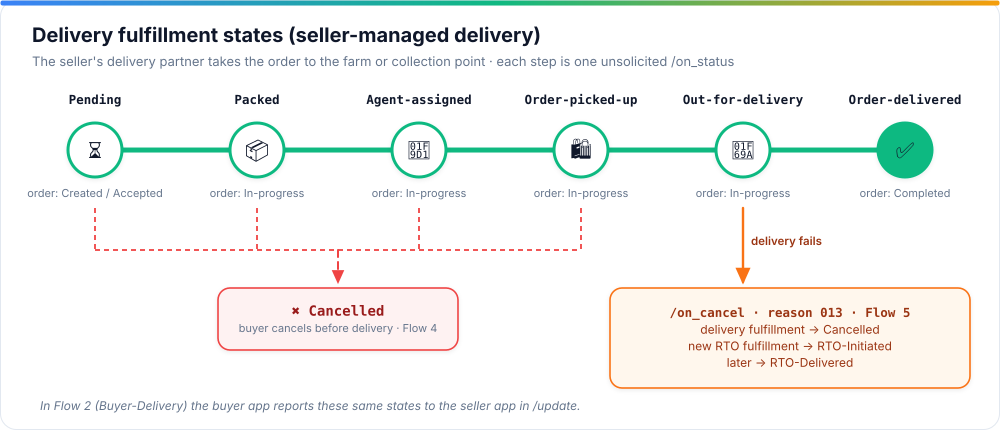
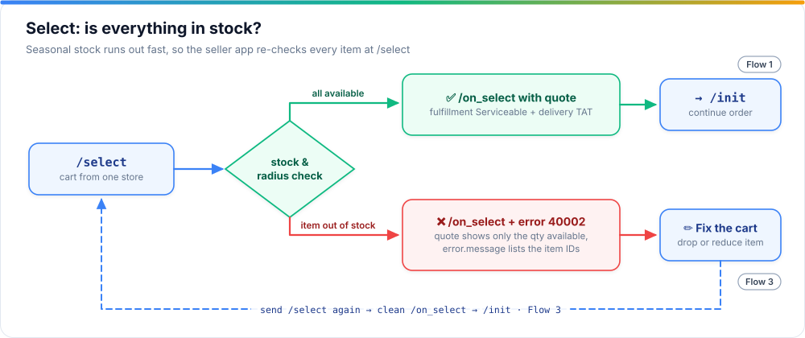
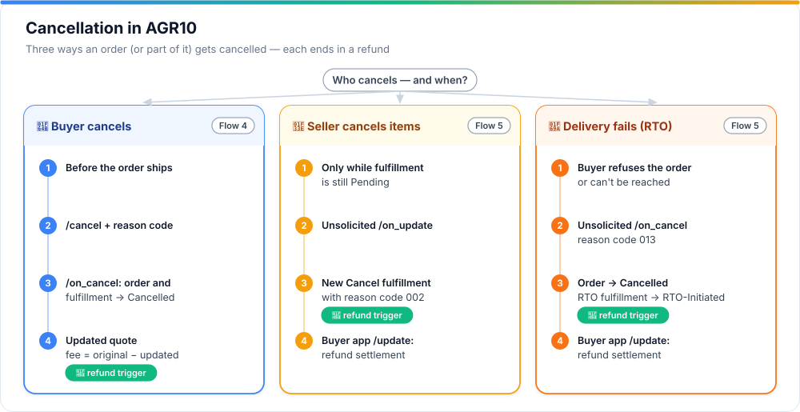
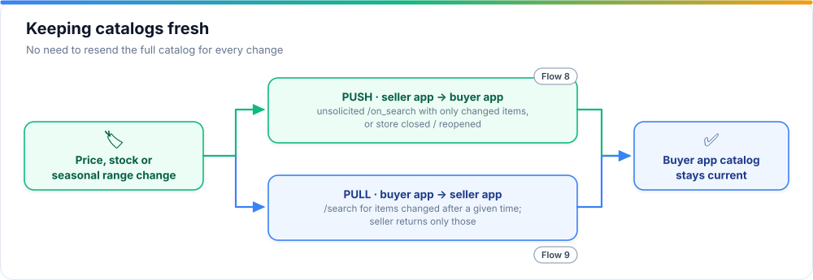

# Agriculture (ONDC:AGR10 1.2.0)

> **Buy farm inputs from any seller, through any app.** ONDC lets one buyer app show catalogs from many agri-input sellers, and lets one seller reach farmers and FPOs on every buyer app, all through a single open protocol.

## At a Glance

| | |
|---|---|
| **Domain** | `ONDC:AGR10` (Agriculture) |
| **Version** | `1.2.0` |
| **What is sold** | Seeds and planting material, fertilizers and plant nutrients, crop protection products, farm tools, sprayers and irrigation accessories, animal feed and packaged agri-commodities |
| **Use case** | `AGRICULTURE` |
| **Delivery model** | Seller-managed delivery, often to villages, farms or FPO collection points; the buyer app can arrange transport instead |
| **Payment** | Prepaid, collected by the buyer app (`payment.type` `ON-ORDER`, `collected_by` `BAP`) |
| **Fulfillment types offered** | `Delivery` (seller delivers), `Buyer-Delivery` (buyer app delivers) |
| **Flows in this spec** | 14 (14 mandatory): ordering, delivery, cancellation, RTO, returns, catalog sync and grievances |
| **Grievances** | IGM 1.0.0 and IGM 2.0.0 |

**Why agriculture is different:** demand follows the crop season. It peaks around sowing windows, when popular seed varieties and nutrients can run out quickly. Buyers are often farmers or Farmer Producer Organizations (FPOs) far from the seller, and orders can be heavy or need careful handling. Seeds, fertilizers and pesticides are regulated (for example under the Seeds Act, the Fertiliser Control Order and the Insecticides Act), and packaged items must carry statutory details under the Legal Metrology (Packaged Commodities) Rules. That's why this spec puts weight on stock checks at `/select`, frequent catalog updates, and buyer-arranged delivery for FPOs that collect orders with their own vehicles.

**Who is responsible for what:** the seller owns its catalog, prices, stock, packing, delivery and after-sales service. ONDC standardizes the messages used to discover products, place orders, track delivery, and handle cancellations, returns and grievances.

---

## Who Is Involved

| Participant | Role in AGR10 |
|---|---|
| **Buyer App (BAP)** | Where the buyer searches, builds a cart, pays, tracks the order and raises complaints. It usually collects the payment and settles with the seller later. In Flow 2 it also arranges delivery. |
| **Seller App (BPP)** | Represents agri-input dealers, FPO outlets, cooperatives, and seed, fertilizer and farm-tool brands. It publishes the catalog, checks stock and serviceability, prices and confirms the order, manages packing and delivery, and handles cancellations, RTO, returns. |
| **Logistics Provider** | Picks up from the store and delivers to the buyer. Usually arranged by the seller app; arranged by the buyer app in Flow 2. |
| **Gateway** | Forwards a buyer app's `/search` to every seller app serving that city for `ONDC:AGR10`. |

### How the Two Apps Talk

Every call is **asynchronous**. The sender gets only an acknowledgement on the same HTTP call. The real answer comes later as a separate call in the other direction, named `on_<action>`.

- An **ACK** only means the message passed schema and signature checks. It is not a business "yes".
- A **business failure**, such as an out-of-stock item, comes back inside the callback as an `error` object (for example `40002` in Flow 3).

| Concept | What it means in AGR10 |
|---|---|
| `context.domain` | Always `ONDC:AGR10`. `context.core_version` is `1.2.0`. |
| `context.transaction_id` | One ID for one cart's whole journey, from `/select` through delivery, cancellation, return and grievance. |
| `context.message_id` | Pairs a request with its callback: `/select` with M2 is answered by `/on_select` with M2. |
| **Solicited and unsolicited** | A solicited callback answers a request. An unsolicited one is pushed by the seller app on its own, for example `/on_status` when the order is packed, or `/on_search` when a price changes. |
| **Order and fulfillment** | The order has one `state`. Each **fulfillment** inside it has its own `state` and `type`: `Delivery` (or `Buyer-Delivery`) for the forward shipment, `Cancel` for items the seller cancelled, `RTO` for a failed delivery going back, `Return` for items the buyer returned. |
| **Quote and breakup** | `quote.price` is the order total. `quote.breakup` has one line per item plus `delivery`, `packing`, `tax`, `discount` and `misc` lines (`@ondc/org/title_type`). |
| **Quote trail** | When a cancel, RTO or return lowers the order value, the seller app records the change as a quote trail. The buyer app works out the refund from it. |

---

## Order Lifecycle

A farm input order goes through two phases. In **pre-order** the two apps agree on the cart, price and terms; nothing is committed. The **order** starts at `/confirm`, after the buyer has paid. From then on the order has an ID and a state, and every change is a message on the same `transaction_id`.

| Phase | Buyer app sends | Seller app answers | What is decided in AGR10 |
|---|---|---|---|
| Discover | `/search` (through the Gateway) | `/on_search` | Which sellers serve the buyer, with their items, prices and stock |
| Select | `/select` | `/on_select` | Stock and serviceability for the cart; item prices, delivery and packing charges, taxes; delivery time (`@ondc/org/TAT`) |
| Init | `/init` | `/on_init` | Delivery address and billing; final quote; payment, cancellation, return and settlement terms |
| Confirm | `/confirm` | `/on_confirm` | Payment `PAID`; the order is `Created`, its delivery fulfillment is `Pending` |
| Fulfil | `/track` | `/on_status` (unsolicited), `/on_track` | Accepted, packed, agent assigned, picked up, out for delivery, delivered |
| After order | `/cancel`, `/update`, `/issue` | `/on_cancel`, `/on_update`, `/on_issue` | Cancellation, part-cancellation, RTO, returns, refunds, complaints |
| Settle | — (off-network) | — | The buyer app pays the seller as agreed in `/on_init`, less the agreed buyer app fee and taxes such as TCS or TDS |

If the buyer changes the delivery address, or `/on_init` comes back with a smaller cart, the buyer app must send `/select` again.

### Order States

The order `state` is what the buyer sees. It follows the state of the order's fulfillments.

| Order state | Meaning |
|---|---|
| `Created` | `/on_confirm` sent. The seller app has the order; the seller hasn't accepted it yet. |
| `Accepted` | The seller accepted the order. Cancellation terms from `/on_init` apply from here. |
| `In-progress` | The order is being packed, picked up or delivered. |
| `Completed` | The order is delivered. Only returns can change it now. |
| `Cancelled` | The whole order is cancelled: by the buyer before shipping, or because delivery failed (RTO). |

### Delivery Fulfillment States

The seller app reports every step of the delivery fulfillment in an unsolicited `/on_status`, one message per change. Orders are often heavy, such as 50 kg fertilizer bags, and often go to rural addresses, farms or FPO collection points.

| Fulfillment state | When it is set | Order state | Sent in |
|---|---|---|---|
| `Pending` | As soon as the order is confirmed | `Created`, then `Accepted` | `/on_confirm`, `/on_status` |
| `Packed` | Items packed and ready for pickup | `In-progress` | `/on_status` |
| `Agent-assigned` | Delivery agent assigned; name and phone shared | `In-progress` | `/on_status` |
| `Order-picked-up` | Agent collected the order from the store | `In-progress` | `/on_status` |
| `Out-for-delivery` | Agent on the way to the buyer | `In-progress` | `/on_status` |
| `Order-delivered` | Handed over, with the delivery time | `Completed` | `/on_status` |
| `Cancelled` | Fulfillment cancelled, or RTO started | `Cancelled` | `/on_cancel` |

In Flow 2 (`Buyer-Delivery`), the same states are reported the other way: the buyer app sends them to the seller app in `/update`.

### Lifecycle Rules for AGR10 Implementations

1. **Terminal states are frozen.** Nothing changes a `Cancelled` order. A `Completed` order changes only through returns.
2. **One message per change.** Every status change is an unsolicited `/on_status`. Every change to order details (part-cancel, return) is an `/on_update`. Changes are never batched.
3. **`/on_update` and `/on_status` carry the full picture:** every item and fulfillment with its current state, the quote and breakup, the quote trail and the settlement trail.
4. **The order value never goes up after confirmation.** It only goes down, and only by reducing an item's quantity.
5. **Cancellation fees follow the terms in `/on_init`,** which are set per fulfillment state and reason code.
6. **Refunds are settled with `/update`.** After a part-cancel, RTO or return, the buyer app sends `/update` with the settlement details for the refund (Flows 5 and 6).

---

## Scenarios: Where the Order Branches

These are the points in a AGR10 order where more than one outcome is possible, with the flow that tests each path. The green **refund trigger** badge marks the point: the seller app sends the updated quote there, and the buyer app works out the refund from the quote trail.

### 1. Select: Is Everything in Stock?

Popular seed varieties and nutrients can run out during the sowing season, so the seller app re-checks every item at `/select`.

### 2. Cancellation: Who Cancels, and When

### 3. Return to Origin (RTO): Delivery Failed

RTO starts when the buyer refuses the order or can't be reached at the address.

If the items are not taken back to the store, the RTO fulfillment ends in `RTO-Disposed` instead of `RTO-Delivered`.

### 4. Return: After Delivery

A buyer can return a delivered item within its return window from the catalog (`@ondc/org/return_window`), for the full order or part of it. The buyer app sends `/update` with the item, quantity and reason. The seller app creates a new **Return** fulfillment and reports each step in an unsolicited `/on_update`.

The order stays `Completed` throughout. The refund is triggered at `Return_Picked` (pickup) or `Liquidated` (no pickup).

### 5. Who Delivers?

| Fulfillment type | Who arranges delivery | Who reports delivery states | Flow |
|---|---|---|---|
| `Delivery` | The seller app, through its own fleet or a logistics provider | The seller app, in unsolicited `/on_status` | 1 |
| `Buyer-Delivery` | The buyer app, through its own logistics provider | The buyer app, in `/update`; the seller app answers with `/on_update` and marks the order complete once delivered | 2 |

For `Buyer-Delivery`, the seller app's quote has packing charges but no delivery charge, plus the time to get the order ready and the package weight and dimensions.

### 6. Complaints (IGM)

A buyer can raise a complaint about a delivered order, for example a torn fertilizer bag, a leaking pesticide bottle, a wrong seed variety or a damaged tool. It runs on its own `/issue` and `/on_issue` messages, on the same order.

| Version | How it works in AGR10 |
|---|---|
| **IGM 1.0.0** | The buyer opens an issue, the seller acknowledges it and sends the resolution through `/on_issue_status`, and the buyer closes it (Flow 11). |
| **IGM 2.0.0** | Adds information requests, resolution acceptance or rejection, and escalation. An accepted resolution can start a replacement or a return on the order through `/on_update` (Flows 12, 13 and 14). |

---

## The Agriculture Catalog

### What the Catalog Contains

Each seller app's `/on_search` can include:

- Seller name, location, timings and serviceable area
- Categories and items, with images and descriptions
- MRP, selling price, unit and pack size (for example 1 kg seed pouch, 50 kg fertilizer bag, 1 litre bottle)
- Stock availability
- Statutory details for packaged items, such as manufacturer or packer name and address, month and year of packing, and consumer care contact

If a catalog has errors, such as a price above MRP, the buyer app sends `/catalog_rejection` with each error's type, code and path (Flow 10).

### Keeping Catalogs Fresh

Sellers don't need to resend the whole catalog for every change.

---

## Flow Summary

All 14 flows are mandatory. The API Walkthrough shows the step-by-step calls for each one.

| # | Flow | Group | What it covers |
|---|---|---|---|
| 1 | Delivery Flow | Ordering | The standard order: the buyer selects items, gets a quote, pays online, and receives the order through seller-managed delivery |
| 2 | Buyer Delivery Flow | Ordering | The buyer app arranges delivery |
| 3 | Out of Stock Flow (Error Code) | Ordering | The seller rejects the selection straight away because an item is out of stock |
| 4 | Buyer Cancellation Flow | After the order | The buyer cancels a confirmed order before it is shipped |
| 5 | RTO and Part-Cancellation Flow | After the order | The seller cancels some items it cannot supply, then delivery of the rest fails and the order returns to the seller (Return to Origin) |
| 6 | Return Flow | After the order | After delivery, the buyer returns an item |
| 7 | Discovery Flow – Full Catalog | Catalog | The buyer app searches a city and the seller returns its full catalog |
| 8 | Discovery Flow – Incremental Catalog (Push) | Catalog | After the first search, the seller pushes catalog changes as they happen, without resending the whole catalog |
| 9 | Discovery Flow – Incremental Catalog Refresh (Pull) | Catalog | The buyer app asks the seller for only the items that changed after a given time |
| 10 | Catalog Rejection Flow | Catalog | The buyer app finds errors in a seller's catalog and rejects it, telling the seller what is wrong |
| 11 | Delivery Flow with IGM 1.0.0 | Grievances | A delivered order followed by a complaint handled under IGM 1.0.0 |
| 12 | Delivery Flow with IGM 2.0.0 – No Action | Grievances | A complaint under IGM 2.0.0 that the seller resolves with an explanation and no further action, which the buyer accepts |
| 13 | Delivery Flow with IGM 2.0.0 – Rejection and Escalation | Grievances | The buyer rejects the seller's resolution and escalates the complaint |
| 14 | Delivery Flow with IGM 2.0.0 | Grievances | A complaint under IGM 2.0.0 where the seller asks for more information, proposes a replacement, and the buyer accepts |
