# Purchase_Journey_Code_Based_Flow_With_IGM_v-2.0.0 — Sequence Diagrams

Internal data file consumed by the Developer Guide's "Sequence Diagram" tab (API Walkthrough).
Not meant to be shown as its own docs page — the frontend filters this slug out of the Use Case
Brief / Additional Resources / Changelog tab lists and instead looks up the section matching the
selected API call's `action_id` (the `##` heading below) to render that step's diagram.

One `## <action_id>` heading per step of `Purchase_Journey_Code_Based_Flow_With_IGM_v-2.0.0.yaml`, in that flow's own step order, each
followed by its Mermaid `sequenceDiagram`.

## search_1_Airline_200

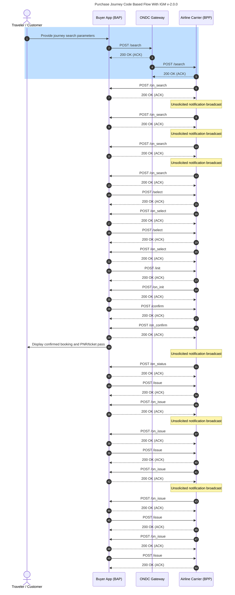

## on_search_1_Airline_200

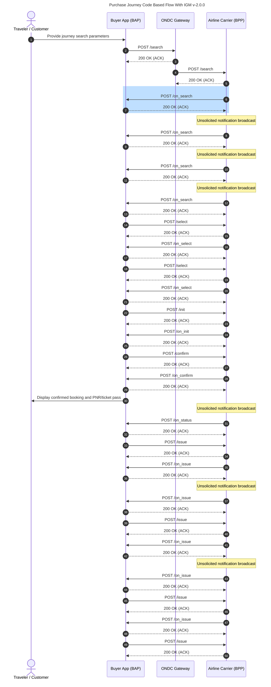

## on_search_2_Airline_200

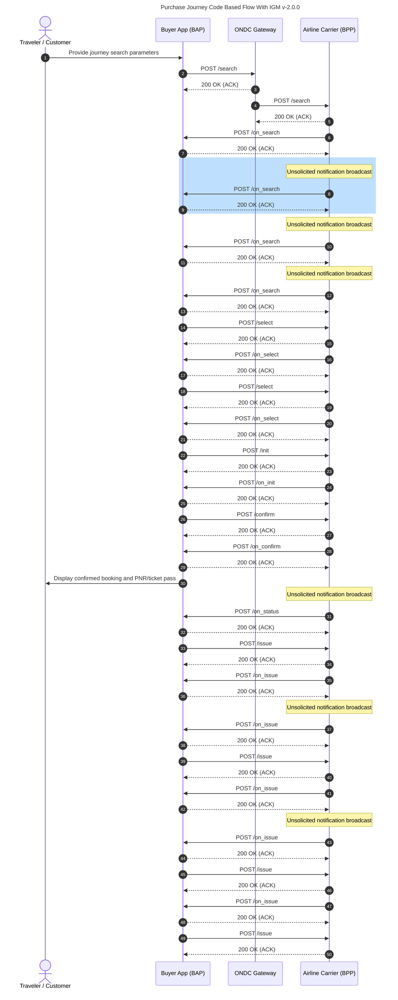

## on_search_3_Airline_200

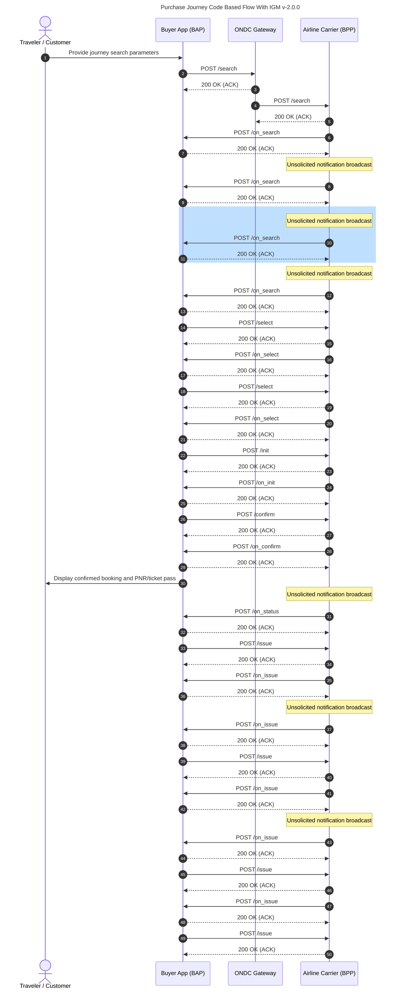

## on_search_4_Airline_200

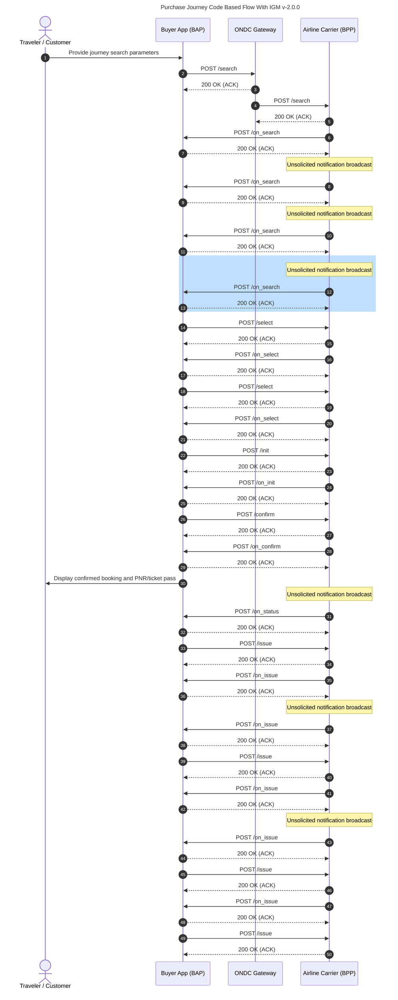

## select_1_Airline_200

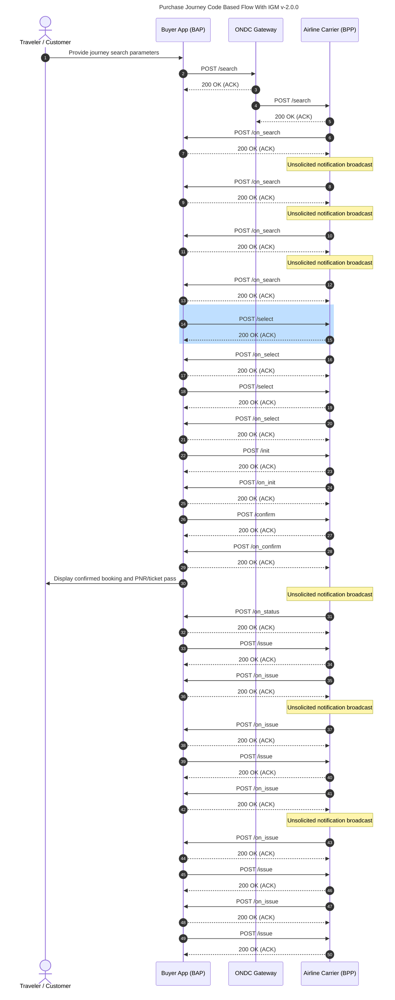

## on_select_1_Airline_200

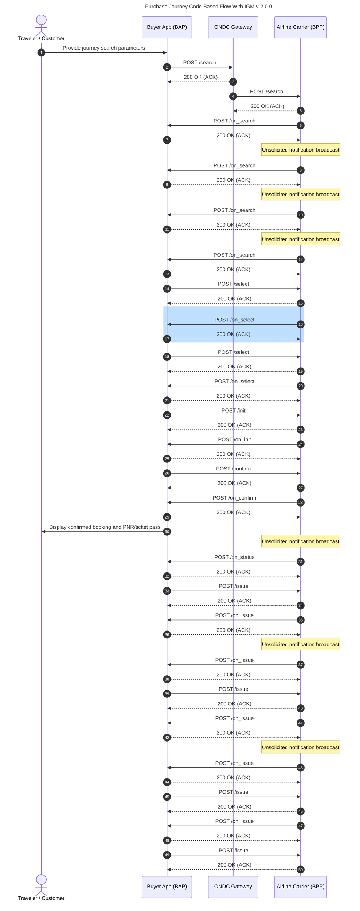

## select_2_Airline_200

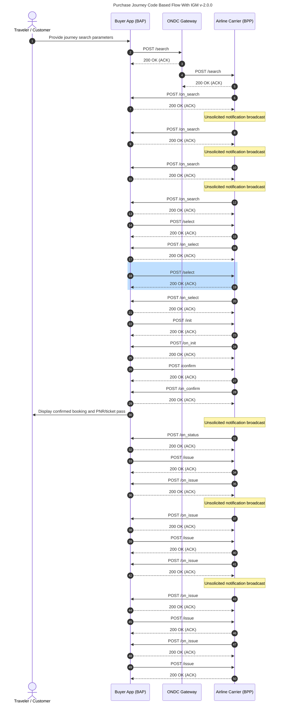

## on_select_2_Airline_200

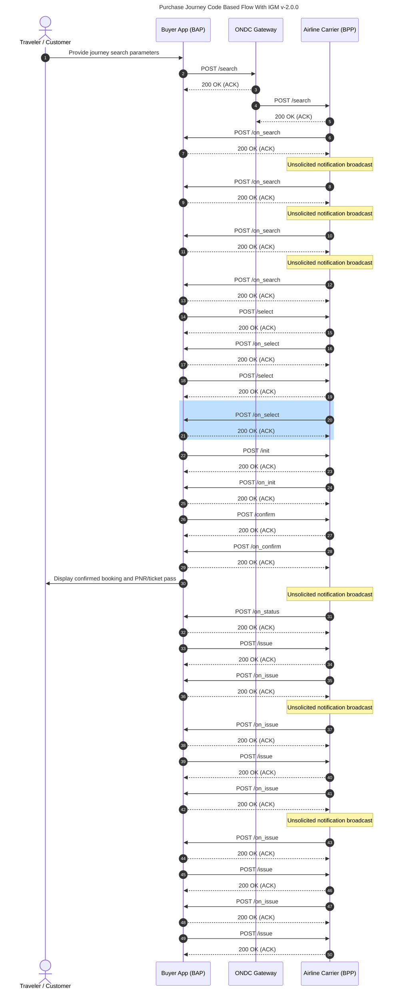

## init_Airline_200

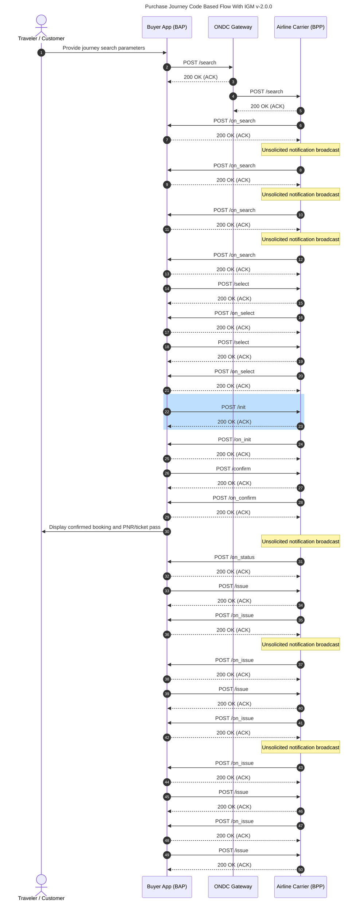

## on_init_Airline_200

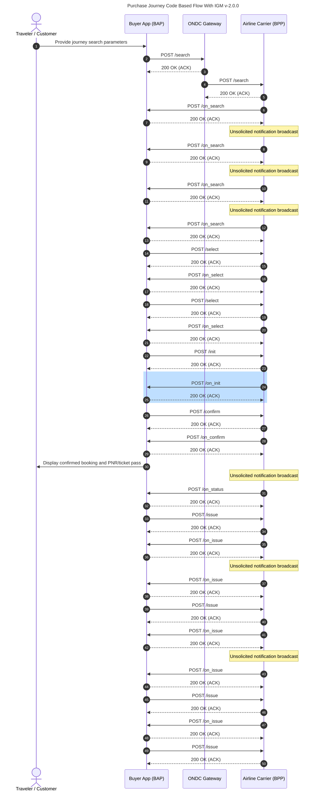

## confirm_Airline_200

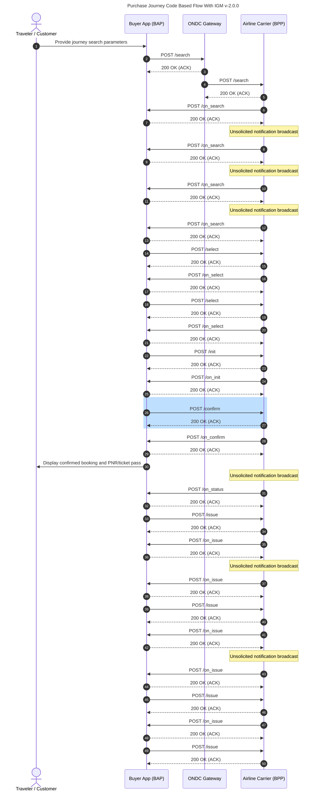

## on_confirm_Airline_200

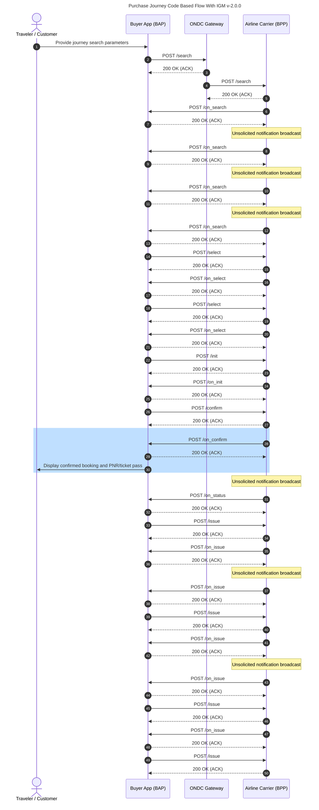

## on_status_unsoliciated_Airline_200

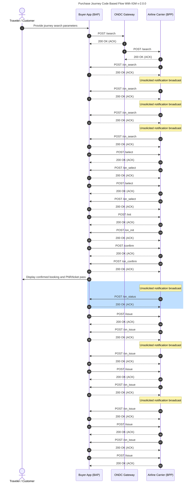

## issue_open

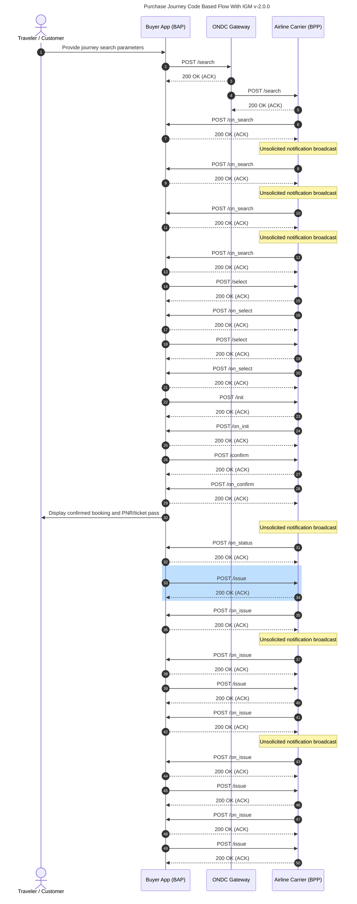

## on_issue_processing

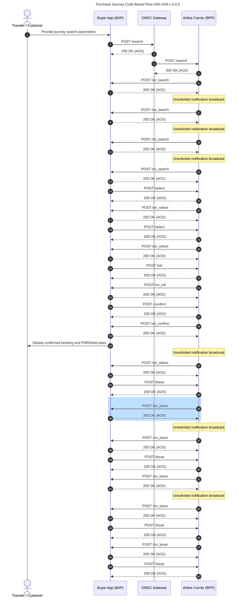

## on_issue_need_more_info

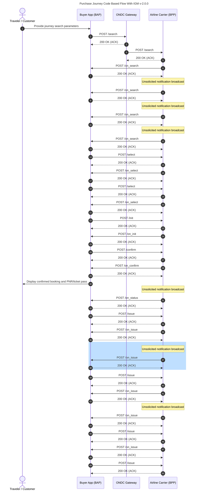

## issue_info_provided

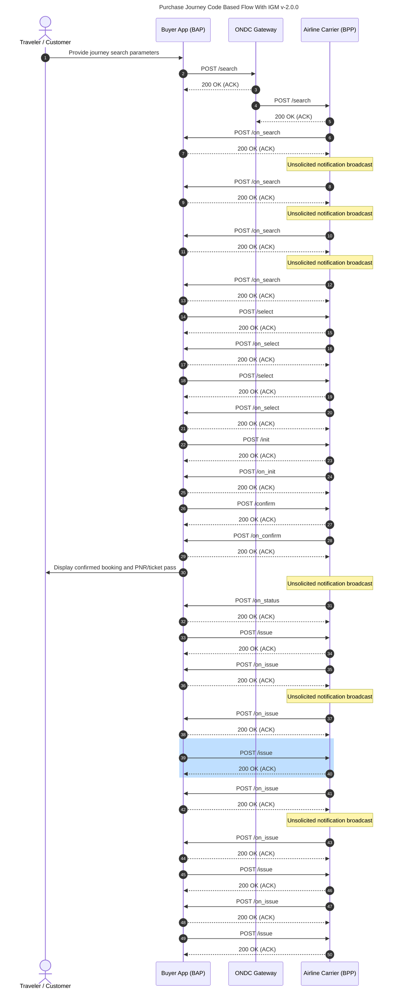

## on_issue_provided

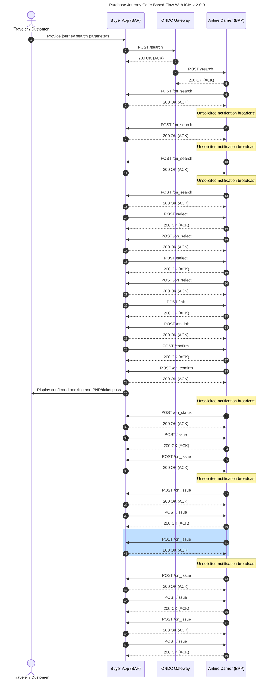

## on_issue_resolution

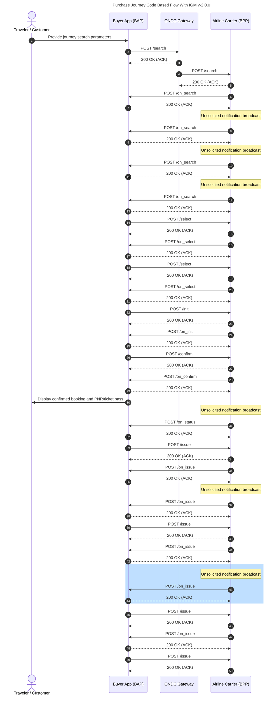

## issue_resolution_accept

```mermaid
sequenceDiagram
    title Purchase Journey Code Based Flow With IGM v-2.0.0
    autonumber
    actor User as Traveler / Customer
    participant BAP as Buyer App (BAP)
    participant BG as ONDC Gateway
    participant BPP as Airline Carrier (BPP)

    User->>BAP: Provide journey search parameters
    BAP->>BG: POST /search
    BG-->>BAP: 200 OK (ACK)
    BG->>BPP: POST /search
    BPP-->>BG: 200 OK (ACK)
    BPP->>BAP: POST /on_search
    BAP-->>BPP: 200 OK (ACK)
    Note over BPP: Unsolicited notification broadcast
    BPP->>BAP: POST /on_search
    BAP-->>BPP: 200 OK (ACK)
    Note over BPP: Unsolicited notification broadcast
    BPP->>BAP: POST /on_search
    BAP-->>BPP: 200 OK (ACK)
    Note over BPP: Unsolicited notification broadcast
    BPP->>BAP: POST /on_search
    BAP-->>BPP: 200 OK (ACK)
    BAP->>BPP: POST /select
    BPP-->>BAP: 200 OK (ACK)
    BPP->>BAP: POST /on_select
    BAP-->>BPP: 200 OK (ACK)
    BAP->>BPP: POST /select
    BPP-->>BAP: 200 OK (ACK)
    BPP->>BAP: POST /on_select
    BAP-->>BPP: 200 OK (ACK)
    BAP->>BPP: POST /init
    BPP-->>BAP: 200 OK (ACK)
    BPP->>BAP: POST /on_init
    BAP-->>BPP: 200 OK (ACK)
    BAP->>BPP: POST /confirm
    BPP-->>BAP: 200 OK (ACK)
    BPP->>BAP: POST /on_confirm
    BAP-->>BPP: 200 OK (ACK)
    BAP->>User: Display confirmed booking and PNR/ticket pass
    Note over BPP: Unsolicited notification broadcast
    BPP->>BAP: POST /on_status
    BAP-->>BPP: 200 OK (ACK)
    BAP->>BPP: POST /issue
    BPP-->>BAP: 200 OK (ACK)
    BPP->>BAP: POST /on_issue
    BAP-->>BPP: 200 OK (ACK)
    Note over BPP: Unsolicited notification broadcast
    BPP->>BAP: POST /on_issue
    BAP-->>BPP: 200 OK (ACK)
    BAP->>BPP: POST /issue
    BPP-->>BAP: 200 OK (ACK)
    BPP->>BAP: POST /on_issue
    BAP-->>BPP: 200 OK (ACK)
    Note over BPP: Unsolicited notification broadcast
    BPP->>BAP: POST /on_issue
    BAP-->>BPP: 200 OK (ACK)
    rect rgb(191, 223, 255)
    BAP->>BPP: POST /issue
    BPP-->>BAP: 200 OK (ACK)
    end
    BPP->>BAP: POST /on_issue
    BAP-->>BPP: 200 OK (ACK)
    BAP->>BPP: POST /issue
    BPP-->>BAP: 200 OK (ACK)
```

## on_issue_resolved

```mermaid
sequenceDiagram
    title Purchase Journey Code Based Flow With IGM v-2.0.0
    autonumber
    actor User as Traveler / Customer
    participant BAP as Buyer App (BAP)
    participant BG as ONDC Gateway
    participant BPP as Airline Carrier (BPP)

    User->>BAP: Provide journey search parameters
    BAP->>BG: POST /search
    BG-->>BAP: 200 OK (ACK)
    BG->>BPP: POST /search
    BPP-->>BG: 200 OK (ACK)
    BPP->>BAP: POST /on_search
    BAP-->>BPP: 200 OK (ACK)
    Note over BPP: Unsolicited notification broadcast
    BPP->>BAP: POST /on_search
    BAP-->>BPP: 200 OK (ACK)
    Note over BPP: Unsolicited notification broadcast
    BPP->>BAP: POST /on_search
    BAP-->>BPP: 200 OK (ACK)
    Note over BPP: Unsolicited notification broadcast
    BPP->>BAP: POST /on_search
    BAP-->>BPP: 200 OK (ACK)
    BAP->>BPP: POST /select
    BPP-->>BAP: 200 OK (ACK)
    BPP->>BAP: POST /on_select
    BAP-->>BPP: 200 OK (ACK)
    BAP->>BPP: POST /select
    BPP-->>BAP: 200 OK (ACK)
    BPP->>BAP: POST /on_select
    BAP-->>BPP: 200 OK (ACK)
    BAP->>BPP: POST /init
    BPP-->>BAP: 200 OK (ACK)
    BPP->>BAP: POST /on_init
    BAP-->>BPP: 200 OK (ACK)
    BAP->>BPP: POST /confirm
    BPP-->>BAP: 200 OK (ACK)
    BPP->>BAP: POST /on_confirm
    BAP-->>BPP: 200 OK (ACK)
    BAP->>User: Display confirmed booking and PNR/ticket pass
    Note over BPP: Unsolicited notification broadcast
    BPP->>BAP: POST /on_status
    BAP-->>BPP: 200 OK (ACK)
    BAP->>BPP: POST /issue
    BPP-->>BAP: 200 OK (ACK)
    BPP->>BAP: POST /on_issue
    BAP-->>BPP: 200 OK (ACK)
    Note over BPP: Unsolicited notification broadcast
    BPP->>BAP: POST /on_issue
    BAP-->>BPP: 200 OK (ACK)
    BAP->>BPP: POST /issue
    BPP-->>BAP: 200 OK (ACK)
    BPP->>BAP: POST /on_issue
    BAP-->>BPP: 200 OK (ACK)
    Note over BPP: Unsolicited notification broadcast
    BPP->>BAP: POST /on_issue
    BAP-->>BPP: 200 OK (ACK)
    BAP->>BPP: POST /issue
    BPP-->>BAP: 200 OK (ACK)
    rect rgb(191, 223, 255)
    BPP->>BAP: POST /on_issue
    BAP-->>BPP: 200 OK (ACK)
    end
    BAP->>BPP: POST /issue
    BPP-->>BAP: 200 OK (ACK)
```

## issue_close

```mermaid
sequenceDiagram
    title Purchase Journey Code Based Flow With IGM v-2.0.0
    autonumber
    actor User as Traveler / Customer
    participant BAP as Buyer App (BAP)
    participant BG as ONDC Gateway
    participant BPP as Airline Carrier (BPP)

    User->>BAP: Provide journey search parameters
    BAP->>BG: POST /search
    BG-->>BAP: 200 OK (ACK)
    BG->>BPP: POST /search
    BPP-->>BG: 200 OK (ACK)
    BPP->>BAP: POST /on_search
    BAP-->>BPP: 200 OK (ACK)
    Note over BPP: Unsolicited notification broadcast
    BPP->>BAP: POST /on_search
    BAP-->>BPP: 200 OK (ACK)
    Note over BPP: Unsolicited notification broadcast
    BPP->>BAP: POST /on_search
    BAP-->>BPP: 200 OK (ACK)
    Note over BPP: Unsolicited notification broadcast
    BPP->>BAP: POST /on_search
    BAP-->>BPP: 200 OK (ACK)
    BAP->>BPP: POST /select
    BPP-->>BAP: 200 OK (ACK)
    BPP->>BAP: POST /on_select
    BAP-->>BPP: 200 OK (ACK)
    BAP->>BPP: POST /select
    BPP-->>BAP: 200 OK (ACK)
    BPP->>BAP: POST /on_select
    BAP-->>BPP: 200 OK (ACK)
    BAP->>BPP: POST /init
    BPP-->>BAP: 200 OK (ACK)
    BPP->>BAP: POST /on_init
    BAP-->>BPP: 200 OK (ACK)
    BAP->>BPP: POST /confirm
    BPP-->>BAP: 200 OK (ACK)
    BPP->>BAP: POST /on_confirm
    BAP-->>BPP: 200 OK (ACK)
    BAP->>User: Display confirmed booking and PNR/ticket pass
    Note over BPP: Unsolicited notification broadcast
    BPP->>BAP: POST /on_status
    BAP-->>BPP: 200 OK (ACK)
    BAP->>BPP: POST /issue
    BPP-->>BAP: 200 OK (ACK)
    BPP->>BAP: POST /on_issue
    BAP-->>BPP: 200 OK (ACK)
    Note over BPP: Unsolicited notification broadcast
    BPP->>BAP: POST /on_issue
    BAP-->>BPP: 200 OK (ACK)
    BAP->>BPP: POST /issue
    BPP-->>BAP: 200 OK (ACK)
    BPP->>BAP: POST /on_issue
    BAP-->>BPP: 200 OK (ACK)
    Note over BPP: Unsolicited notification broadcast
    BPP->>BAP: POST /on_issue
    BAP-->>BPP: 200 OK (ACK)
    BAP->>BPP: POST /issue
    BPP-->>BAP: 200 OK (ACK)
    BPP->>BAP: POST /on_issue
    BAP-->>BPP: 200 OK (ACK)
    rect rgb(191, 223, 255)
    BAP->>BPP: POST /issue
    BPP-->>BAP: 200 OK (ACK)
    end
```
