# Ride-hailing

---

## Overview

Ride-hailing in `ONDC:TRV10` 2.0.1 lets a buyer book an on-demand ride between a pickup point and a drop point. The buyer discovers vehicle options in a city, gets a fare quote, provides customer details, confirms the ride and then follows the ride until it ends. The seller assigns the driver and vehicle, sends status updates and answers tracking requests.

| | |
|---|---|
| **Domain** | `ONDC:TRV10` |
| **Version** | `2.0.1` |
| **Use case** | `Ride-hailing` (`config/index.yaml`, `x-status`: `TO_BE_DEPRECATED`) |
| **Flows** | 11 flows in `config/flows/Ride-hailing`, plus 1 flow that exists only in the official contract |
| **Audience** | BAP (Buyer App) and BPP (Seller App) developers |
| **Source of truth** | `config/flows/Ride-hailing`, `config/attributes/Ride_hailing.yaml`, `config/validations/index.yaml`, `config/actions/index.yaml`, `config/errors/index.yaml`, and the `release-TRV10-2.0.1` contract of `ONDC-Official/mobility-specification` |

What the flows show:

- Catalog search by city, with the pickup (`START`) and drop (`END`) points as GPS coordinates.
- Catalog items with `descriptor.code` `RIDE`, one per vehicle option, with a `fulfillment` of type `DELIVERY` or `SELF_PICKUP`.
- A fare quote (`BASE_FARE`, `DISTANCE_FARE`), item tags `FARE_POLICY` and `INFO`, and route tags `ROUTE_INFO`.
- Payment of type `ON-FULFILLMENT`, collected by the BPP or the BAP (`collected_by`), with `BUYER_FINDER_FEES` and `SETTLEMENT_TERMS` tags.
- Driver assignment in `on_confirm`, or after `on_confirm` through an unsolicited `on_update`, or no driver found.
- Ride progress through fulfillment states `RIDE_ASSIGNED`, `RIDE_ENROUTE_PICKUP`, `RIDE_ARRIVED_PICKUP`, `RIDE_STARTED`, `RIDE_ENDED`, with an `OTP` authorization on the `START` stop.
- `track` / `on_track` for the vehicle location.
- Cancellation by the rider (soft, then confirm), by the driver, and a technical cancellation.
- An optional female-driver preference in `search`.
- Issue and Grievance Management (IGM 1.0.0).

---

## Participants

| Participant | What This Means |
|---|---|
| **Buyer App (BAP)** | The consumer-facing app. Sends `search`, `select`, `init`, `confirm`, `status`, `track`, `cancel` and `issue`. Provides the customer name and phone, and for payment can be the collector (`collected_by: BAP`). |
| **Seller App (BPP)** | The ride provider platform. Sends `on_search`, `on_select`, `on_init`, `on_confirm`, `on_status`, `on_update`, `on_track`, `on_cancel`, `on_issue` and `on_issue_status`. Assigns the driver and vehicle and shares the `OTP`. |
| **Gateway** | Sits between the BAP and the BPP for `search` only. All other calls go directly between BAP and BPP. |

In the flows, `search` goes BAP to Gateway to BPP. The `search` context has no `bpp_id` or `bpp_uri`; `on_search` and every later call carry both.

---

## The User Journey

```
[Search] ───► [Select & Quote] ───► [Init] ───► [Confirm] ───► [Driver Assigned] ───► [Status & Tracking] ───► [Ride Ended]
```

Mandatory flags below come from the presence tests in `config/validations/index.yaml`. A `—` means the validations have no presence test for the field. Attribute descriptions are in `config/attributes/Ride_hailing.yaml`, where `required` refers to the validations file.

### 1. Search

The buyer enters the pickup and drop points. The flows collect them through an input form (`city_code`, `start_gps`, `end_gps`, `collected_by`).

| Category | Field | Key | Mandatory | Type / Values |
|---|---|---|---|---|
| Location | City code | `context.location.city.code` | — (format test `^std:0\d+$`) | Text, for example `std:011` |
| Routing | Pickup point | `message.intent.fulfillment.stops[type=START].location.gps` | — | Text, `lat,lon` |
| | Drop point | `message.intent.fulfillment.stops[type=END].location.gps` | — | Text, `lat,lon` |
| Payment | Collector | `message.intent.payment.collected_by` | — | `BPP` or `BAP` (form input) |
| | Fee terms | `message.intent.payment.tags` | — | `BUYER_FINDER_FEES` (`BUYER_FINDER_FEES_PERCENTAGE`), `SETTLEMENT_TERMS` (`DELAY_INTEREST`, `STATIC_TERMS`) |
| Vehicle (optional) | Category, variant | `message.intent.fulfillment.vehicle.category`, `.variant` | — | Listed in the attributes; not in the default payloads |
| Driver preference | Customer and agent gender | `message.intent.fulfillment.customer.person.gender`, `...agent.person.gender` | — | `FEMALE` in the female-driver flow |

**Network interaction:**

- **`/search`**: The BAP sends the search intent to the Gateway, which forwards it to the BPP. The context has `domain: ONDC:TRV10`, `version: 2.0.1` and `ttl: PT30S`.
- **`/on_search`**: The BPP returns `catalog` with `descriptor.name`, one provider, its `fulfillments` (vehicle `category`, `variant`, `energy_type`, `START` and `END` stops with `instructions`), its `items` (`RIDE`), `locations` and `payments`.

| Category | Field | Key | Mandatory | Type / Values |
|---|---|---|---|---|
| Catalog | Catalog name | `catalog.descriptor.name` | Yes | Text |
| Provider | Provider id | `catalog.providers[].id` | Yes | Text |
| Fulfillment | Fulfillment id and type | `catalog.providers[].fulfillments[].id`, `.type` | Yes | `DELIVERY` (all default payloads) or `SELF_PICKUP` |
| | Vehicle | `...fulfillments[].vehicle.category`, `.variant`, `.energy_type` | — | For example `AUTO_RICKSHAW` / `AUTO_RICKSHAW` / `CNG`, `CAB` / `SEDAN` |
| Item | Item code and name | `...items[].descriptor.code`, `.descriptor.name` | — | `RIDE`; for example `Auto Ride`, `CAB Economy Ride` |
| | Price | `...items[].price.currency`, `.value` | Yes | `INR`; `minimum_value` and `maximum_value` are also present |
| | Links | `...items[].fulfillment_ids[]`, `.location_ids[]` | Yes | Ids of fulfillments and locations |

### 2. Select and Quote

The buyer picks one provider, item and fulfillment. The input form (`provider`, `item`, `fulfillment`) fills these ids from the catalog.

| Category | Field | Key | Mandatory | Type / Values |
|---|---|---|---|---|
| Selection | Provider | `message.order.provider.id` | Yes | Text |
| | Item | `message.order.items[].id` | Yes | Text |
| | Fulfillment | `message.order.fulfillments[].id` | — | Text |

**Network interaction:**

- **`/select`**: The BAP sends the provider, item and fulfillment.
- **`/on_select`**: The BPP returns the priced order:
  - `items[]` with `price`, and item tags `FARE_POLICY` (`MIN_FARE`, `MIN_FARE_DISTANCE_KM`, `PER_KM_CHARGE`) and `INFO` (`DISTANCE_TO_NEAREST_DRIVER_METER`, `ETA_TO_NEAREST_DRIVER_MIN`)
  - `fulfillments[]` with vehicle details and tag `ROUTE_INFO` (`ENCODED_POLYLINE`, `WAYPOINTS`)
  - `quote.price`, `quote.breakup[]` (`BASE_FARE`, `DISTANCE_FARE`) and `quote.ttl` (`PT200S`)

### 3. Init: Customer and Payment Terms

The buyer provides the customer details. The input form asks for `customer_name` and `customer_phone`.

| Category | Field | Key | Mandatory | Type / Values |
|---|---|---|---|---|
| Customer | Name | `message.order.fulfillments[].customer.person.name` | Yes | Text |
| | Phone | `message.order.fulfillments[].customer.contact.phone` | Yes | Text |
| Billing | Name | `message.order.billing.name` | Yes | Text |
| Order | Provider, item, fulfillment | `order.provider.id`, `order.items[].id`, `order.fulfillments[].id` | Yes | Text |
| Payment | Collector, status, type | `order.payments[].collected_by`, `.status`, `.type` | — | `BPP` or `BAP`; `NOT-PAID`; `ON-FULFILLMENT` |
| | Parameters | `order.payments[].params` | — | `bank_code`, `virtual_payment_address` |
| | Terms | `order.payments[].tags` | — | `BUYER_FINDER_FEES`, `SETTLEMENT_TERMS` (`SETTLEMENT_WINDOW`, `SETTLEMENT_BASIS`, `SETTLEMENT_TYPE`) |

**Network interaction:**

- **`/init`**: The BAP sends the customer, billing, vehicle and payment details.
- **`/on_init`**: The BPP returns the draft order: a `payments[].id`, `items[].payment_ids`, the `quote` and `cancellation_terms`.

`cancellation_terms[]` has one entry per fulfillment state (`fulfillment_state.descriptor.code`), each with `reason_required` and a `cancellation_fee` (a `percentage` or an `amount`). In the main flow, `RIDE_ASSIGNED` has a `0` percent fee, `RIDE_ENROUTE_PICKUP` has an amount of `30` `INR` and `RIDE_ARRIVED_PICKUP` has an amount of `50` `INR`.

### 4. Confirm and Driver Assignment

The buyer confirms the ride. Depending on the flow, the seller assigns the driver in `on_confirm`, assigns after `on_confirm`, or reports that no driver is available.

| Category | Field | Key | Mandatory | Type / Values |
|---|---|---|---|---|
| Payment | Payment id | `order.payments[].id` | Yes | Id returned in `on_init` |
| | Payment details | `order.payments[]` | — | `collected_by`, `status`, `type`, `params`, tags |
| Customer | Name and phone | `order.fulfillments[].customer.person.name`, `...contact.phone` | Yes | Text |
| Order | Billing, provider, item | `order.billing.name`, `order.provider.id`, `order.items[].id` | Yes | Text |

**Network interaction:**

- **`/confirm`**: The BAP confirms the order.
- **`/on_confirm`**: The BPP returns the order with `order.id`, `created_at`, `updated_at`, `status: ACTIVE` and, when a driver is assigned, the fulfillment with `state.descriptor.code: RIDE_ASSIGNED`, `agent` (name, contact), `vehicle.registration` and, on the `START` stop, an `authorization` with `type: OTP` and `status: UNCLAIMED`.
- **No driver:** `on_confirm` is sent with an `error` object instead of a `message` (error code `90203`, "Driver not assigned to the order").

### 5. Status and Tracking

After confirmation the seller keeps the buyer informed, and the buyer can ask for status or location.

| Category | Field | Key | Mandatory | Type / Values |
|---|---|---|---|---|
| Driver | Name and phone | `order.fulfillments[].agent.person.name`, `...agent.contact.phone` | Yes in `on_status` and `on_update` | Text |
| Vehicle | Registration | `order.fulfillments[].vehicle.registration` | Yes in `on_status` and `on_update` | Text |
| State | Ride state | `order.fulfillments[].state.descriptor.code` | — | See [Key Data Model](#key-data-model) |
| Authorization | OTP | `order.fulfillments[].stops[type=START].authorization` | — | `type: OTP`; `status`: `UNCLAIMED`, `CLAIMED` |

**Network interaction:**

- **`/on_status` (unsolicited)**: The BPP pushes the updated order whenever the ride moves on. The `START` stop authorization changes from `UNCLAIMED` to `CLAIMED` once the ride has started.
- **`/status`**: The BAP asks for the latest status with `order_id` (the technical cancellation flow sends `ref_id`).
- **`/on_status`**: The BPP returns the order. In the main flow the final one has `order.status: COMPLETED` and the payment `status: PAID`.
- **`/track`**: The BAP sends `order_id`.
- **`/on_track`**: The BPP returns `tracking.status` (`active`) and `tracking.location` (`gps`, `updated_at`).

### 6. Ride End

- **`/on_update` (unsolicited)**: The BPP sends the order with the fulfillment state `RIDE_ENDED` while `order.status` is still `ACTIVE`.
- **`/on_status`**: A later status response carries `order.status: COMPLETED` (main flow).

---

## Additional Scenarios

### 1. Driver Not Found on `on_confirm`

The buyer confirms the ride and the BPP answers `on_confirm` with an `error` object (`code: 90203`, `message: Driver not assigned to the order`). The flow ends there. Flow: `Driver_not_found_on_onconfirm`.

### 2. Driver Not Found After `on_confirm`

The `on_confirm` carries error `90203`. The BPP then sends an unsolicited `on_cancel` with `order.status: CANCELLED`, `cancellation.cancelled_by: PROVIDER`, reason `011` and fulfillment state `RIDE_CANCELLED`. The quote then also has `REFUND` and `CANCELLATION_CHARGES` lines. Flow: `Driver_not_found_post_onconfirm`.

### 3. Driver Assigned After `on_confirm`

The `on_confirm` carries error `90203`. The BPP later sends an unsolicited `on_update` with the fulfillment in state `RIDE_ASSIGNED`, the `agent`, the `vehicle.registration` and the `OTP`. Status, tracking and the ride end follow. Flow: `OnDemand_Assign_driver_post_onconfirm`.

### 4. Self-Pickup

Same sequence as scenario 3. The unsolicited `on_update` carries a fulfillment of `type: SELF_PICKUP`. Flow: `OnDemand_Assign_driver_post_onconfirmSelfPickup`.

### 5. Female Driver Preference

The `search` carries `customer.person.gender: FEMALE` and `agent.person.gender: FEMALE` under `intent.fulfillment`. The rest follows the main flow. Flow: `OnDemand_Female_driver_flow`.

### 6. Cancellation by the Rider

After assignment, the BAP sends `cancel` with `order_id`, `cancellation_reason_id` (`001`) and a `descriptor` (`code`, `name`). The BPP answers `on_cancel` with `order.status: SOFT_CANCEL`, a quote with `CANCELLATION_CHARGES` and `REFUND`, and `cancellation` (`cancelled_by: CONSUMER`, reason `001`). A second `cancel` follows. Flow: `OnDemand_Ride_cancellation_by_rider`.

### 7. Cancellation by the Driver

The BPP sends an unsolicited `on_cancel` with `order.status: CANCELLED`, `cancellation.cancelled_by: PROVIDER`, reason `013` and fulfillment state `RIDE_CANCELLED`. Flow: `OnDemand_Ride_cancellation_by_driver`.

### 8. Technical Cancellation

The `on_confirm` arrives late. The BAP sends `status` (with `ref_id`), gets `on_status` with `order.status: ACTIVE`, then sends `cancel` with reason `000`. A soft cancel returns `order.status: SOFT_CANCEL`, and a second `cancel` with `descriptor.code: CONFIRM_CANCEL` returns `order.status: CANCELLED`. This flow is present in the flow configuration and not in the contract's flow list. Flow: `Technical_cancellation_flow`.

### 9. Journey Updation

The main sequence with status updates, tracking and a final `on_update`. This flow is present in the flow configuration and not in the contract's flow list. Flow: `OnDemand_journey_updation_flow`.

---

## Issue and Grievance Management

IGM 1.0.0 exists as one flow: `OnDemand_Assign_driver_on_onconfirm_with_IGM(1.0.0)`. It follows the main flow with a grievance after the ride end. It is present in the flow configuration and not in the contract's flow list.

| Step | Call | Direction | Contents |
|---|---|---|---|
| 1 | `issue` (`issue_open_100`) | BAP to BPP | `issue.status: OPEN`, `issue_type: ISSUE`, `category: FULFILLMENT`, `sub_category: FLM112`, `description`, `order_details`, `issue_actions.complainant_actions[]` with `OPEN` |
| 2 | `on_issue` (`on_issue_processing_100`) | BPP to BAP | `issue_actions.respondent_actions[]` with `PROCESSING` and `cascaded_level` |
| 3 | `on_issue_status` (`on_issue_resolved_100`) | BPP to BAP, unsolicited | `respondent_actions[]` with `PROCESSING` and `RESOLVED`, `resolution_provider.respondent_info`, `resolution` (`action_triggered: REFUND`, `refund_amount`) |
| 4 | `issue` (`issue_close_100`) | BAP to BPP | The issue payload again |

---

## Detailed Protocol Flows

Each flow below shows its calls in order. `search` goes through the Gateway. Dotted arrows are unsolicited calls from the BPP.

### Flow 1: Assign Driver on `on_confirm`

**Flow ID:** `OnDemand_Assign_driver_on_onconfirm` (contract name: *On-Demand - Assign driver on on-confirm*)

#### 1. Short Description

A customer discovers and confirms a ride; the driver is assigned in `on_confirm` and the ride is followed with continuous status updates and tracking. 16 steps.

#### 2. Visual Interaction Map

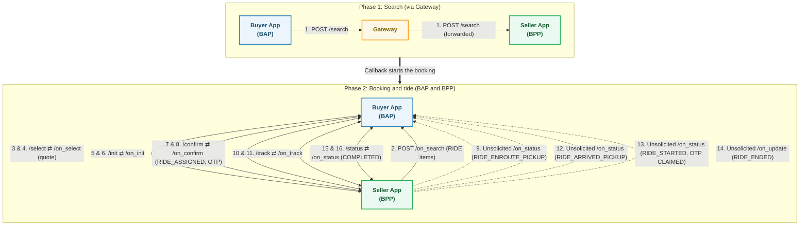

#### 3. API Breakdown & Technical Actions

- **`/search` (BAP → Gateway → BPP)**: City, `START` and `END` GPS points, `payment.collected_by` and the `BUYER_FINDER_FEES` and `SETTLEMENT_TERMS` tags.
- **`/on_search` (BPP → BAP)**: Provider with two fulfillments (an auto rickshaw and a `CAB` `SEDAN`), two `RIDE` items with price ranges, locations and payment terms.
- **`/select`, `/on_select`**: One item and fulfillment; the response has the quote, `FARE_POLICY`, `INFO` and `ROUTE_INFO` tags.
- **`/init`, `/on_init`**: Customer and billing; the response has the payment id and `cancellation_terms`.
- **`/confirm`, `/on_confirm`**: The response has `order.status: ACTIVE`, the assigned driver, vehicle and `OTP`.
- **`/on_status` (unsolicited)**: States `RIDE_ENROUTE_PICKUP`, `RIDE_ARRIVED_PICKUP`, `RIDE_STARTED`.
- **`/track`, `/on_track`**: Location of the vehicle.
- **`/on_update` (unsolicited)**: `RIDE_ENDED`.
- **`/status`, `/on_status`**: `order.status: COMPLETED`, payment `PAID`.

---

### Flow 2: Assign Driver After `on_confirm`

**Flow ID:** `OnDemand_Assign_driver_post_onconfirm` (contract name: *On-Demand - Assign driver post on-confirm*)

#### 1. Short Description

A customer confirms a ride; the provider assigns a driver after `on_confirm` and the ride is followed to its end. 16 steps.

#### 2. Process Flow

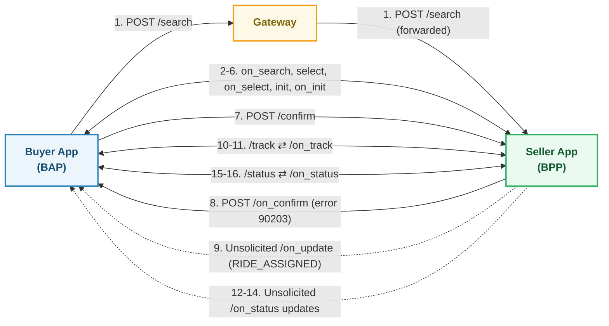

#### 3. API Breakdown & Technical Actions

- **`/on_confirm`**: Carries an `error` (`code: 90203`).
- **`/on_update` (unsolicited)**: `order.status: ACTIVE`, state `RIDE_ASSIGNED`, `agent`, `vehicle.registration`, `OTP` (`UNCLAIMED`).
- **`/on_status` (unsolicited)**: Three updates; in the payloads they carry state `RIDE_ENROUTE_PICKUP` (see [Contract Notes](#contract-notes)).

---

### Flow 3: Assign Driver After `on_confirm` (Self-Pickup)

**Flow ID:** `OnDemand_Assign_driver_post_onconfirmSelfPickup` (contract name: *On-Demand - Assign driver post on-confirm(Self-Pickup)*)

#### 1. Short Description

A confirmed self-pickup ride; the driver is assigned after `on_confirm` and the location of the driver is tracked. 15 steps.

#### 2. Process Flow

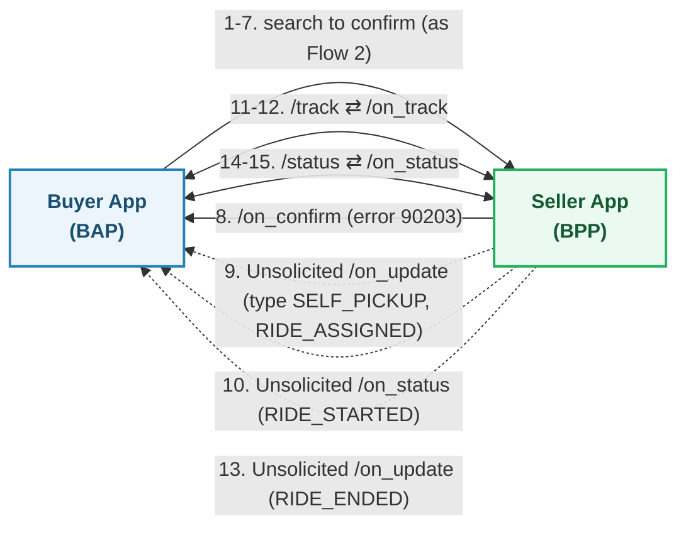

#### 3. API Breakdown & Technical Actions

- **`/on_update` (unsolicited)**: The first one has `fulfillments[].type: SELF_PICKUP`. The later calls in the payloads have type `DELIVERY`.
- **`/track`, `/on_track`**: Use `action_id` `track` and `on_track` in this flow.

---

### Flow 4: Female Driver

**Flow ID:** `OnDemand_Female_driver_flow` (contract name: *On-Demand - Female Driver Flow*)

#### 1. Short Description

A customer searches for a ride with a female driver and books it. The search carries optional customer and agent gender. 16 steps.

#### 2. Process Flow

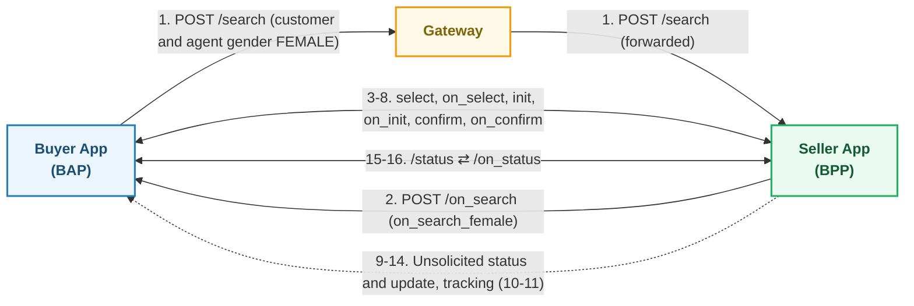

#### 3. API Breakdown & Technical Actions

- **`/search`** (`search_ride_female`): `intent.fulfillment.customer.person.gender` and `intent.fulfillment.agent.person.gender`, both `FEMALE`.
- **`/on_search`** (`on_search_female`): Catalog of rides.
- The remaining steps follow Flow 1.

---

### Flow 5: Driver Not Found on `on_confirm`

**Flow ID:** `Driver_not_found_on_onconfirm` (contract name: *Driver not found on on_confirm*)

#### 1. Short Description

A rider tries to confirm a ride but no driver is available; the request fails. 8 steps.

#### 2. Process Flow

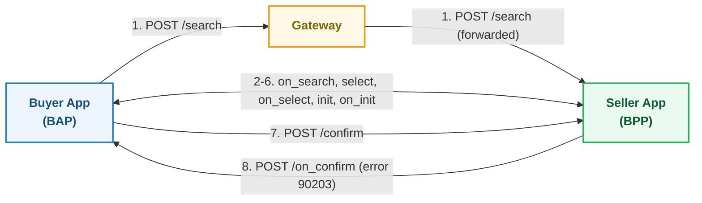

#### 3. API Breakdown & Technical Actions

- **`/on_confirm`** (`on_confirm_driver_not_found`): No `message`; `error.code: 90203`, `error.message: Driver not assigned to the order`.

---

### Flow 6: Driver Not Found After `on_confirm`

**Flow ID:** `Driver_not_found_post_onconfirm` (contract name: *Driver not found post on_confirm*)

#### 1. Short Description

A customer completes the booking flow but no driver is found after confirmation, so the ride is cancelled. 9 steps.

#### 2. Process Flow

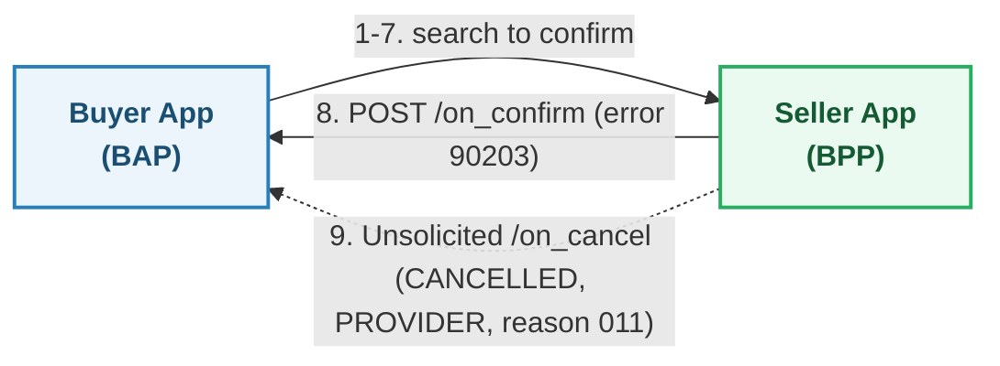

#### 3. API Breakdown & Technical Actions

- **`/on_cancel`** (`on_cancel_rider_not_found`, unsolicited): `order.status: CANCELLED`, `cancellation.cancelled_by: PROVIDER`, reason `011`, fulfillment state `RIDE_CANCELLED`, quote with `REFUND` and `CANCELLATION_CHARGES`.

---

### Flow 7: Cancellation by the Rider

**Flow ID:** `OnDemand_Ride_cancellation_by_rider` (contract name: *On-Demand - Ride cancellation by rider*)

#### 1. Short Description

A rider books a ride and cancels it after the driver has been assigned. 14 steps.

#### 2. Process Flow

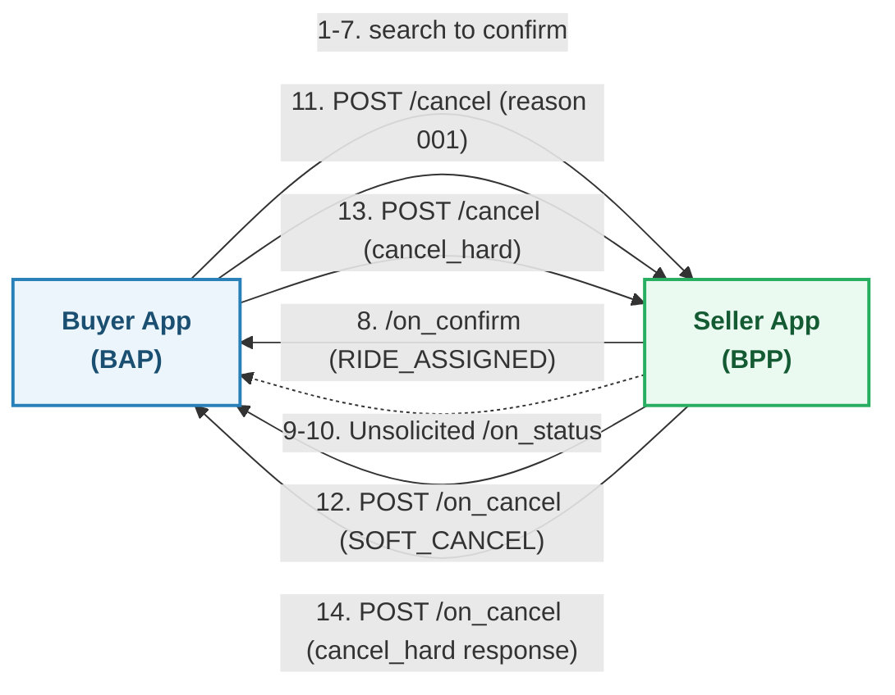

#### 3. API Breakdown & Technical Actions

- **`/cancel`**: `order_id`, `cancellation_reason_id: 001`, `descriptor.code` and `descriptor.name: Ride Cancellation`.
- **`/on_cancel`**: `order.status: SOFT_CANCEL`, quote with `CANCELLATION_CHARGES` and `REFUND`, `cancellation` (`cancelled_by: CONSUMER`).
- The `cancel_hard` request and the `on_cancel_hard` response carry the same values in the payloads (see [Contract Notes](#contract-notes)).

---

### Flow 8: Cancellation by the Driver

**Flow ID:** `OnDemand_Ride_cancellation_by_driver` (contract name: *On-Demand - Ride cancellation by driver*)

#### 1. Short Description

A customer books a ride that the assigned driver then cancels. 9 steps.

#### 2. Process Flow

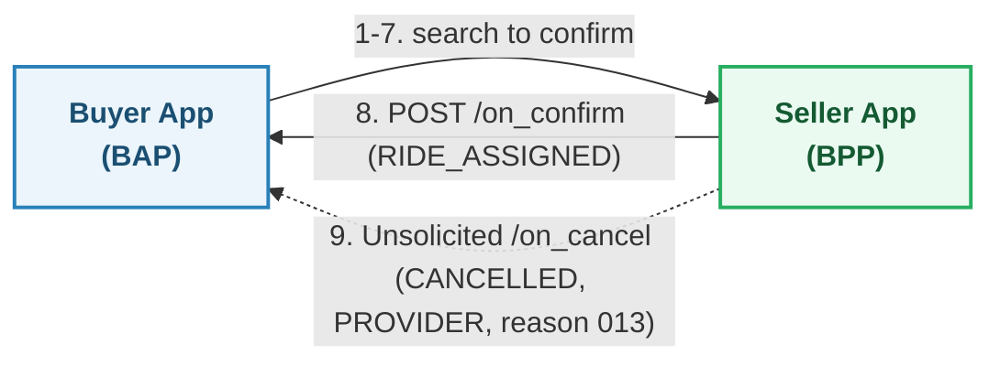

#### 3. API Breakdown & Technical Actions

- **`/on_cancel`** (`on_cancel_async`, unsolicited): `order.status: CANCELLED`, `cancellation.cancelled_by: PROVIDER`, reason `013`, fulfillment state `RIDE_CANCELLED`, quote with `REFUND` and `CANCELLATION_CHARGES`.

---

### Flow 9: Technical Cancellation

**Flow ID:** `Technical_cancellation_flow`
*Present in the flow configuration; not in the contract's flow list.*

#### 1. Short Description

A complete booking followed by a system-initiated cancellation when the `on_confirm` arrives late. 14 steps.

#### 2. Process Flow

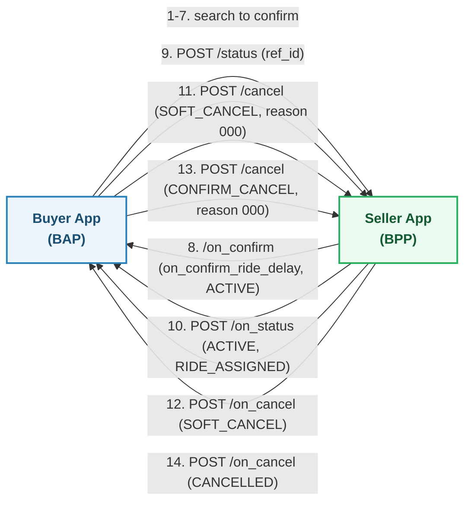

#### 3. API Breakdown & Technical Actions

- **`/status`**: Carries `ref_id`.
- **`/cancel`**: `cancellation_reason_id: 000`; `descriptor.code: SOFT_CANCEL`, then `CONFIRM_CANCEL`.
- **`/on_cancel`**: `order.status` `SOFT_CANCEL`, then `CANCELLED`, with `cancellation.cancelled_by: CONSUMER`.

---

### Flow 10: Journey Updation

**Flow ID:** `OnDemand_journey_updation_flow`
*Present in the flow configuration; not in the contract's flow list.*

#### 1. Short Description

A customer discovers, selects and books a ride and receives journey tracking with continuous status updates until the ride is complete. 15 steps.

#### 2. Process Flow

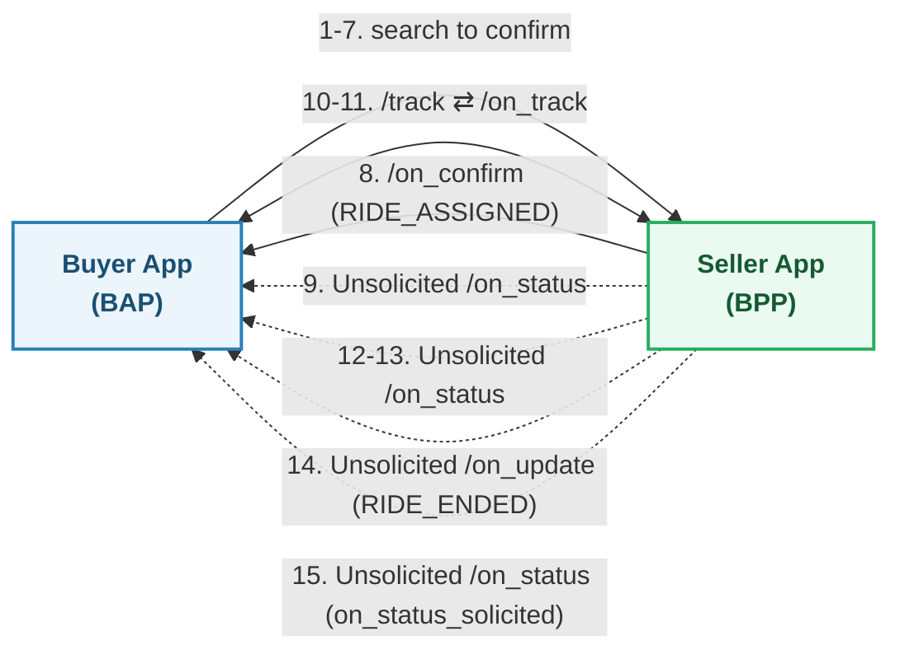

#### 3. API Breakdown & Technical Actions

- The steps match Flow 1 up to `on_update`. The last step (`on_status_solicited`) is flagged unsolicited and there is no `status` request before it.

---

### Flow 11: Assign Driver on `on_confirm` with IGM 1.0.0

**Flow ID:** `OnDemand_Assign_driver_on_onconfirm_with_IGM(1.0.0)`
*Present in the flow configuration; not in the contract's flow list.*

#### 1. Short Description

The main ride flow followed by a grievance raised by the buyer. 20 steps.

#### 2. Process Flow

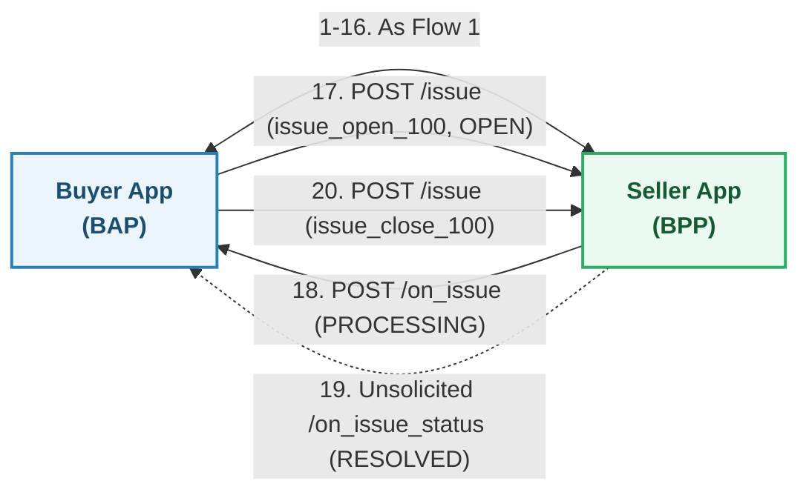

#### 3. API Breakdown & Technical Actions

- See [Issue and Grievance Management](#issue-and-grievance-management).

---

### Flow 12: BPP Collecting - Payment Confirmation

**Flow name:** *BPP Collecting - Payment Confirmation*
*Defined in the contract; not present in this branch's flow configuration.*

#### 1. Short Description

The flow shows payment confirmation when the payment page is handled through a form: the buyer initialises the order, the provider returns the draft with the payment terms and a `form`, the buyer asks for status, and then confirms. 7 steps in the contract: `init`, `on_init`, `form`, `status`, `on_status`, `confirm`, `on_confirm`.

#### 2. Process Flow

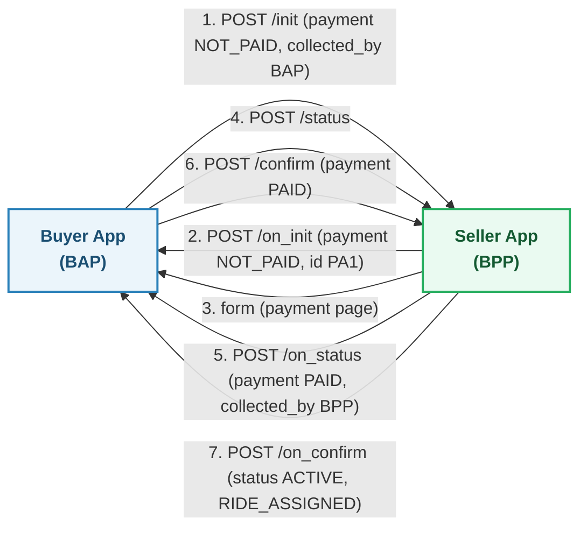

#### 3. API Breakdown & Technical Actions

- **`/init`**: Example has `payments[].collected_by: BAP`, `status: NOT_PAID`, `type: ON_FULFILLMENT`.
- **`/on_init`**: `payments[].id: PA1`, `cancellation_terms` (`RIDE_ASSIGNED`, `RIDE_ENROUTE_PICKUP`, `RIDE_ARRIVED_PICKUP`).
- **`form`**: The provider sends the form. The contract example is an HTML file that reads "This will redirected to different html page".
- **`/status`, `/on_status`**: The `on_status` example has `payments[].collected_by: BPP`, `status: PAID`.
- **`/confirm`, `/on_confirm`**: `confirm` has `collected_by: BPP`, `status: PAID`; `on_confirm` has `order.status: ACTIVE` and fulfillment state `RIDE_ASSIGNED`.

---

## Flow Catalogue

| Flow ID (branch) | Contract name | In branch config | In contract | Steps | Purpose |
|---|---|---|---|---|---|
| `OnDemand_Assign_driver_on_onconfirm` | On-Demand - Assign driver on on-confirm | Yes | Yes | 16 | Driver assigned in `on_confirm`, status, tracking |
| `OnDemand_Assign_driver_post_onconfirm` | On-Demand - Assign driver post on-confirm | Yes | Yes | 16 | Driver assigned after `on_confirm` |
| `OnDemand_Assign_driver_post_onconfirmSelfPickup` | On-Demand - Assign driver post on-confirm(Self-Pickup) | Yes | Yes | 15 | Self-pickup ride, driver assigned after `on_confirm` |
| `OnDemand_Female_driver_flow` | On-Demand - Female Driver Flow | Yes | Yes | 16 | Search with female driver preference |
| `Driver_not_found_on_onconfirm` | Driver not found on on_confirm | Yes | Yes | 8 | `on_confirm` with error `90203` |
| `Driver_not_found_post_onconfirm` | Driver not found post on_confirm | Yes | Yes | 9 | No driver after `on_confirm`, provider cancels |
| `OnDemand_Ride_cancellation_by_rider` | On-Demand - Ride cancellation by rider | Yes | Yes | 14 | Rider cancels (soft, then second cancel) |
| `OnDemand_Ride_cancellation_by_driver` | On-Demand - Ride cancellation by driver | Yes | Yes | 9 | Driver cancels, unsolicited `on_cancel` |
| `Technical_cancellation_flow` | — | Yes | No | 14 | Late `on_confirm`, status check, cancel |
| `OnDemand_journey_updation_flow` | — | Yes | No | 15 | Journey updates until the ride ends |
| `OnDemand_Assign_driver_on_onconfirm_with_IGM(1.0.0)` | — | Yes | No | 20 | Main flow with IGM 1.0.0 |
| — | BPP Collecting - Payment Confirmation | No | Yes | 7 | Payment confirmation through a form |

---

## Key Data Model

### Context

| Field | Notes |
|---|---|
| `domain` | `ONDC:TRV10` |
| `version` | `2.0.1` |
| `action` | API name |
| `location.country.code`, `location.city.code` | `IND`; city code like `std:011` |
| `transaction_id`, `message_id`, `timestamp` | Present in every call |
| `ttl` | `PT30S` in all example payloads |
| `bap_id`, `bap_uri` | Buyer App |
| `bpp_id`, `bpp_uri` | Seller App; not in `search` |

### Fulfillment

| Object | Values |
|---|---|
| `fulfillments[].type` | `DELIVERY`, `SELF_PICKUP` |
| `stops[].type` | `START`, `END` |
| `fulfillments[].state.descriptor.code` | `RIDE_CONFIRMED`, `RIDE_ASSIGNED`, `RIDE_ENROUTE_PICKUP`, `RIDE_ARRIVED_PICKUP`, `RIDE_STARTED`, `RIDE_ENDED`, `RIDE_CANCELLED` |
| `stops[].authorization` | `type`: `OTP` (payloads), `QR`; `status`: `UNCLAIMED`, `CLAIMED` |
| Status order, `DELIVERY` | `RIDE_CONFIRMED`, `RIDE_ASSIGNED`, `RIDE_ENROUTE_PICKUP`, `RIDE_ARRIVED_PICKUP`, `RIDE_STARTED`, `RIDE_ENDED` |
| Status order, cancel | `RIDE_CONFIRMED`, `RIDE_ASSIGNED`, `RIDE_ENROUTE_PICKUP` (optional), `RIDE_ARRIVED_PICKUP` (optional), `RIDE_CANCELLED` |
| Status order, `SELF_PICKUP` | `RIDE_CONFIRMED`, `RIDE_ASSIGNED`, `RIDE_STARTED`, `RIDE_ENDED` |

The status orders come from the official 2.0.1 changelog (3 September 2024). The flow payloads in this branch use `RIDE_ASSIGNED` as the first state.

### Vehicle

| Field | Values (contract enum) | Used in the flow payloads |
|---|---|---|
| `vehicle.category` | `AUTO_RICKSHAW`, `CAB`, `TWO_WHEELER` | `AUTO_RICKSHAW`, `CAB` |
| `vehicle.variant` | `SEDAN`, `SUV`, `HATCHBACK`, `TWO_WHEELER`, `AUTO_RICKSHAW` | `AUTO_RICKSHAW`, `SEDAN` |
| `vehicle.energy_type` | `ELECTRIC`, `PETRO`, `DIESEL`, `HYDROGEN`, `BIOFUELS`, `CNG`, `LPG` | `CNG` |

### Order, payment and cancellation

| Object | Values |
|---|---|
| `order.status` | Payloads: `ACTIVE`, `COMPLETED`, `SOFT_CANCEL`, `CANCELLED`. Contract enum: `SOFT_CANCEL`, `CONFIRM_CANCEL`, `ACTIVE`, `COMPLETED`, `CANCELLED` |
| `descriptor.code` in `cancel` | `SOFT_CANCEL`, `CONFIRM_CANCEL` |
| `payments[].collected_by` | `BPP`, `BAP` |
| `payments[].status` | Payloads: `NOT-PAID`, `PAID`. Contract enum: `NOT_PAID`, `PAID` |
| `payments[].type` | Payloads: `ON-FULFILLMENT`. Contract enum: `PRE_ORDER`, `ON_ORDER`, `ON_FULFILLMENT` |
| `order.cancellation.cancelled_by` | `CONSUMER`, `PROVIDER` |
| `quote.breakup[].title` | Payloads: `BASE_FARE`, `DISTANCE_FARE`, `REFUND`, `CANCELLATION_CHARGES`. Contract enum also: `TOLL_CHARGES`, `PARKING_CHARGES`, `TAX`, `WAITING_CHARGES`, `DRIVER_BATA`, `NIGHT_CHARGES` |

### Cancellation reason codes

From the official changelog (3 September 2024):

| Code | Reason | Raised by |
|---|---|---|
| `000` | Technical cancellation | BAP/BPP |
| `001` | Driver not moving | BAP |
| `002` | Unable to contact driver | BAP |
| `003` | Driver asked me to cancel | BAP |
| `004` | My pickup location is incorrect | BAP |
| `005` | Booked by mistake | BAP |
| `011` | No drivers available | BPP |
| `012` | Rider not present at location | BPP |
| `013` | Accepted by mistake | BPP |
| `014` | Unable to contact rider | BPP |

### Tags

| Tag group | Where | Codes in the flows |
|---|---|---|
| `BUYER_FINDER_FEES` | `payments[].tags` | `BUYER_FINDER_FEES_PERCENTAGE` |
| `SETTLEMENT_TERMS` | `payments[].tags` | `DELAY_INTEREST`, `STATIC_TERMS`, `SETTLEMENT_WINDOW`, `SETTLEMENT_BASIS`, `SETTLEMENT_TYPE` |
| `FARE_POLICY` | `items[].tags` | `MIN_FARE`, `MIN_FARE_DISTANCE_KM`, `PER_KM_CHARGE` |
| `INFO` | `items[].tags` | `DISTANCE_TO_NEAREST_DRIVER_METER`, `ETA_TO_NEAREST_DRIVER_MIN` |
| `ROUTE_INFO` | `fulfillments[].tags` | `ENCODED_POLYLINE`, `WAYPOINTS` |

---

## Error Codes

Error codes for this version are defined in `config/errors/index.yaml`. All are raised by the BPP.

| Code | Event | Description |
|---|---|---|
| `90201` | Route Serviceability error | To & from location not serviceable by Seller application |
| `90202` | Tracking not enabled | Tracking not enabled for any fulfillment in the order |
| `90203` | Driver not assigned | Driver not assigned to the order |

Only `90203` is used in the flow payloads (`on_confirm` steps without a `message`).

---

## Contract Notes

Inconsistencies found while reading the contract. They are recorded as found.

- **Attribute files:** `config/attributes` has two files, `Ride-hailing.yaml` and `Ride_hailing.yaml`. `index.yaml` refers only to `Ride_hailing.yaml`. In `Ride_hailing.yaml`, `required` is `refer to validations.yaml` and there are no `enums`; enum values are in the contract's `enum` files.
- **Payment enums:** the flow payloads use `NOT-PAID` and `ON-FULFILLMENT`, while the contract enum uses `NOT_PAID` and `ON_FULFILLMENT`. The official changelog (6 August 2026) says hyphens became underscores; this branch's flows still have hyphens.
- **Payment collector:** `search`, `init` and `confirm` use `collected_by: BPP` in all flows. Some later calls use `BAP` (`on_confirm` in the IGM and female-driver flows, unsolicited updates in the post-confirm and rider-cancellation flows).
- **Hard cancel:** in `OnDemand_Ride_cancellation_by_rider`, the `cancel_hard` request has `descriptor.code: SOFT_CANCEL` and its `on_cancel_hard` response has `order.status: SOFT_CANCEL`. The technical cancellation flow uses `CONFIRM_CANCEL` and `CANCELLED`.
- **Ride states:** `on_status_ride_arrived` and `on_status_ride_started` carry `RIDE_ENROUTE_PICKUP` in the post-confirm, rider-cancellation and journey-updation flows; in the main flow they carry `RIDE_ARRIVED_PICKUP` and `RIDE_STARTED`.
- **Self-pickup:** the first `on_update` has `type: SELF_PICKUP`; the later calls have `type: DELIVERY`.
- **Journey updation:** the last step is named `on_status_solicited` but flagged unsolicited, and there is no `status` request before it.
- **`status` request:** it carries `order_id` in most flows and `ref_id` in the technical cancellation flow.
- **IGM 1.0.0:** `issue_close_100` has `issue.status: OPEN` and only the `OPEN` complainant action. `order_details.state` is `Completed` and the fulfillment state is `CLAIMED`.
- **Errors:** both `on_confirm` error steps have no `message`. `90201` and `90202` are not used in any flow.
- **Validations:** there are no presence tests for message fields of `search`, `status` and `track`.
- **Search attributes:** the attributes list `vehicle.energy_types` under `search`, while the official changelog (13 November 2024) says `energy_type` was removed from the search call.
- **Flow lists:** the contract lists 9 flows and this branch has 11. *BPP Collecting - Payment Confirmation* is only in the contract. `Technical_cancellation_flow`, `OnDemand_journey_updation_flow` and the IGM 1.0.0 flow are only in the branch. Several contract flows list fewer steps than the branch (for example the female-driver flow lists `search` and `on_search`).
- **BPP Collecting form:** the contract describes the `form` step as fetching a "SIP setup form" in its description and as a payment gateway page in its summary; the example file only says "This will redirected to different html page".
