# Ride-hailing

---

## Overview

Ride-hailing in `ONDC:TRV10` 2.1.0 lets a buyer book a ride between a pickup point and a drop point, as an on-demand trip or rental, or scheduled for a later time. The buyer discovers vehicle options in a city, gets a fare quote, provides customer details, confirms the ride and follows it until it ends. The seller assigns the driver and vehicle, sends status updates, answers tracking requests and shares the invoice. The buyer can rate the ride, ask for support and raise a grievance.

| | |
|---|---|
| **Domain** | `ONDC:TRV10` |
| **Version** | `2.1.0` |
| **Use case** | `Ride-hailing` (`config/index.yaml`, `x-status`: `RELEASED`) |
| **Flows** | 42 flows in `config/flows/Ride-hailing`, plus 4 flows (and 2 more files) that exist only in the official contract |
| **Audience** | BAP (Buyer App) and BPP (Seller App) developers |
| **Source of truth** | `config/flows/Ride-hailing`, `config/attributes/Ride_hailing.yaml`, `config/validations/index.yaml`, `config/actions/index.yaml`, `config/errors/index.yaml`, and the `release-TRV10-2.1.0` contract of `ONDC-Official/mobility-specification` (flows, examples, enum, tags, `error_codes`, change log) |

What the flows show:

- Catalog search by city, with the pickup (`START`) and drop (`END`) points, an optional `INTERMEDIATE_STOP`, and the categories `ON_DEMAND_TRIP`, `ON_DEMAND_RENTAL`, `SCHEDULED_TRIP` and `SCHEDULED_RENTAL`.
- Catalog items with `descriptor.code` `RIDE` (the contract enum also has `RENTAL`), one per vehicle option, with a `fulfillment` of type `DELIVERY` or `SELF_PICKUP`.
- A fare quote (`BASE_FARE`, `DISTANCE_FARE`, and `ADD_ONS`, `BUYER_ADDITIONAL_AMOUNT`, `CANCELLATION_CHARGES`, `REFUND` where a flow uses them), item tags (`FARE_POLICY`, `INFO`, `FEATURE_LIST`, `DISABILITY_*`) and fulfillment tags (`ROUTE_INFO`).
- Payment of type `ON_FULFILLMENT`, `PRE_ORDER` or `POST_FULFILLMENT`, collected by the BPP or the BAP (`collected_by`), with the terms tags `BAP_TERMS` and `BPP_TERMS` (finder fee, settlement, static terms, arbitration, jurisdiction).
- Driver assignment in `on_confirm`, or after `on_confirm` through an unsolicited `on_update`, or no driver found.
- Ride progress through the fulfillment states `RIDE_CONFIRMED`, `RIDE_ASSIGNED`, `RIDE_ENROUTE_PICKUP`, `RIDE_ARRIVED_PICKUP`, `RIDE_STARTED`, `RIDE_ENDED` and `RIDE_CANCELLED`, with an `OTP` authorization on the `START` stop.
- `track` / `on_track` for the vehicle location, an `INVOICE` document on completion, `rating`, and `support` / `on_support`.
- Cancellation by the rider (soft, then confirm), by the driver, a technical cancellation, and two flows where the seller app does not accept a soft cancel or soft update.
- Stop changes with `update` (`SOFT_UPDATE`, `CONFIRM_UPDATE`).
- Issue and Grievance Management (IGM 1.0.0 and 2.0.0).

---

## Participants

| Participant | What This Means |
|---|---|
| **Buyer App (BAP)** | The consumer-facing app. Sends `search`, `select`, `init`, `confirm`, `status`, `track`, `update`, `cancel`, `rating`, `support` and `issue`. Provides the customer name and phone, and for payment can be the collector (`collected_by: BAP`). |
| **Seller App (BPP)** | The ride provider platform. Sends `on_search`, `on_select`, `on_init`, `on_confirm`, `on_status`, `on_update`, `on_track`, `on_cancel`, `on_support`, `on_issue` and `on_issue_status`. Assigns the driver and vehicle, shares the `OTP` and the invoice. |
| **Gateway** | Sits between the BAP and the BPP for `search` only. All other calls go directly between BAP and BPP. |

In the flows, `search` goes BAP to Gateway to BPP. The `search` context has no `bpp_id` or `bpp_uri`; `on_search` and every later call carry both.

---

## The User Journey

```
[Search] ───► [Select & Quote] ───► [Init] ───► [Confirm] ───► [Driver Assigned] ───► [Status & Tracking] ───► [Ride Ended] ───► [Rating / Support]
```

Mandatory flags below come from the presence tests in `config/validations/index.yaml`. A `—` means the validations have no presence test for the field. Attribute descriptions are in `config/attributes/Ride_hailing.yaml`, where `required` refers to the validations file.

### 1. Search

The buyer enters the pickup and drop points. The flows collect them through an input form.

| Category | Field | Key | Mandatory | Type / Values |
|---|---|---|---|---|
| Location | City code | `context.location.city.code` | — (format test `^std:0\d+$`) | Text, for example `std:080` |
| Category | Ride category | `message.intent.category.descriptor.code` | — | `ON_DEMAND_TRIP`, `ON_DEMAND_RENTAL`, `SCHEDULED_TRIP`, `SCHEDULED_RENTAL` (contract enum) |
| Routing | Pickup point | `message.intent.fulfillment.stops[type=START].location` | — | `gps`, `address`, `city`, `district`, `country`, `area_code` |
| | Drop point | `message.intent.fulfillment.stops[type=END].location` | — | Same fields; absent in the rental flows that have only a `START` stop |
| | Intermediate stop | `message.intent.fulfillment.stops[type=INTERMEDIATE_STOP]` | — | In the multiple-stops, update-stop and soft-update flows |
| | Pickup time | `stops[type=START].time.timestamp` | — | In the scheduled trip flows |
| Payment | Collector | `message.intent.payment.collected_by` | — | `BPP` or `BAP` |
| Terms | Buyer terms | `message.intent.tags` | — | `BAP_TERMS`: `BUYER_FINDER_FEES_PERCENTAGE`, `DELAY_INTEREST`, `STATIC_TERMS` |
| Driver preference | Customer and agent gender | `message.intent.fulfillment.customer.person.gender`, `...agent.person.gender` | — | `FEMALE` in the female-driver flow |

**Network interaction:**

- **`/search`**: The BAP sends the search intent to the Gateway, which forwards it to the BPP. The context has `domain: ONDC:TRV10`, `version: 2.1.0` and `ttl: PT30S`.
- **`/on_search`**: The BPP returns `catalog` with one provider: `descriptor` (name, descriptions, images), `categories`, `fulfillments`, `items`, `locations`, `payments`, `cancellation_terms`, and the `BPP_TERMS` tags.

| Category | Field | Key | Mandatory | Type / Values |
|---|---|---|---|---|
| Catalog | Catalog name | `catalog.descriptor.name` | Yes | Text |
| Provider | Provider id | `catalog.providers[].id` | Yes | Text |
| Fulfillment | Fulfillment id and type | `catalog.providers[].fulfillments[].id`, `.type` | Yes | `DELIVERY` or `SELF_PICKUP` |
| | Vehicle | `...fulfillments[].vehicle.category`, `.variant`, `.energy_type` | — | `AUTO_RICKSHAW`, `CAB`, `TWO_WHEELER` and their variants |
| Item | Item code and name | `...items[].descriptor.code`, `.descriptor.name` | — | `RIDE` |
| | Price | `...items[].price.currency`, `.value` | Yes | `INR`; `minimum_value` and `maximum_value` also appear |
| | Links | `...items[].fulfillment_ids[]` | Yes | Ids of fulfillments |
| | Terms | `...items[].cancellation_terms`, `provider.cancellation_terms` | — | `cancellation_fee`, `fulfillment_state`, `reason_required`, `external_ref` |

### 2. Select and Quote

The buyer picks one provider, item and fulfillment.

| Category | Field | Key | Mandatory | Type / Values |
|---|---|---|---|---|
| Selection | Provider | `message.order.provider.id` | Yes | Text |
| | Item | `message.order.items[].id` | Yes | Text |
| | Fulfillment | `message.order.fulfillments[].id` | — | Text (fulfillment selection enabled in `select` on 30 Apr 2025 per the change log) |
| Options | Add-ons | `message.order.items[].add_ons[]` | — | `id`, `quantity.selected.count` (add-ons flows) |
| | Bid price | `message.order.items[].price` | — | `currency`, `value` (pre-order bid flows) |
| | Needs | `message.order.items[].tags` | — | `DISABILITY_VIS` (purple tags flow) |

**Network interaction:**

- **`/select`**: The BAP sends the provider, item and fulfillment.
- **`/on_select`**: The BPP returns the priced order:
  - `items[]` with `price` and tags `FARE_POLICY`, `INFO`
  - `fulfillments[]` with vehicle details and the tag `ROUTE_INFO` (`ENCODED_POLYLINE`, `WAYPOINTS`)
  - `quote.price`, `quote.breakup[]` and `quote.ttl` (`PT200S`)

### 3. Init: Customer and Payment Terms

| Category | Field | Key | Mandatory | Type / Values |
|---|---|---|---|---|
| Customer | Name | `message.order.fulfillments[].customer.person.name` | Yes | Text |
| | Phone | `message.order.fulfillments[].customer.contact.phone` | Yes | Text |
| Billing | Name | `message.order.billing.name` | Yes | Text |
| Order | Provider, item, fulfillment | `order.provider.id`, `order.items[].id`, `order.fulfillments[].id` | Yes | Text |
| Payment | Collector, status, type | `order.payments[].collected_by`, `.status`, `.type` | — | `BPP` or `BAP`; `NOT_PAID`; `ON_FULFILLMENT`, `PRE_ORDER` |
| | Terms | `order.tags` | — | `BAP_TERMS`, `BPP_TERMS` with `SETTLEMENT_*` codes |

**Network interaction:**

- **`/init`**: The BAP sends the customer, billing and payment details.
- **`/on_init`**: The BPP returns the draft order: a `payments[].id`, `items[].payment_ids`, the `quote`, `cancellation_terms` and the terms tags. In the BAP-collecting flows the settlement tags also carry `SETTLEMENT_BANK_CODE`, `SETTLEMENT_BANK_ACCOUNT_NUMBER` and `SETTLEMENT_VIRTUAL_PAYMENT_ADDRESS` (see [Contract Notes](#contract-notes)).

`cancellation_terms[]` has one entry per fulfillment state (`fulfillment_state.descriptor.code`), each with `reason_required` and a `cancellation_fee` (`percentage` or `amount`); an entry with `external_ref` (a PDF link) is also present.

### 4. Confirm and Driver Assignment

| Category | Field | Key | Mandatory | Type / Values |
|---|---|---|---|---|
| Payment | Payment id | `order.payments[].id` | Yes | Id returned in `on_init` |
| Customer | Name and phone | `order.fulfillments[].customer.person.name`, `...contact.phone` | Yes | Text |
| Order | Billing, provider, item | `order.billing.name`, `order.provider.id`, `order.items[].id` | Yes | Text |

**Network interaction:**

- **`/confirm`**: The BAP confirms the order.
- **`/on_confirm`**: The BPP returns the order with `order.id`, `created_at`, `updated_at` and `status: ACTIVE`. When a driver is assigned the fulfillment has `state.descriptor.code: RIDE_ASSIGNED`, `agent` (contact, person name and image, rating), `vehicle` (`category`, `variant`, `make`, `model`, `registration`) and an `authorization` of `type: OTP`, `status: UNCLAIMED`, on the `START` stop. When no driver is assigned yet the state is `RIDE_CONFIRMED`.
- **No driver:** `on_confirm` is sent with an `error` object instead of a `message` (error code `90203`).

### 5. Status and Tracking

| Category | Field | Key | Mandatory | Type / Values |
|---|---|---|---|---|
| Driver | Name and phone | `order.fulfillments[].agent.person.name`, `...agent.contact.phone` | Yes in `on_update` and `on_status` | Text |
| State | Ride state | `order.fulfillments[].state.descriptor.code` | — | See [Key Data Model](#key-data-model) |
| Authorization | OTP | `order.fulfillments[].stops[type=START].authorization` | — | `type: OTP`; `status`: `UNCLAIMED`, `CLAIMED` |
| Documents | Invoice | `order.documents[]` | — | `descriptor.code: INVOICE`, `mime_type`, `url` |

**Network interaction:**

- **`/on_status` (unsolicited)**: The BPP pushes the updated order whenever the ride moves on.
- **`/status`**: The BAP asks for the latest status with `order_id` (the technical cancellation flow sends `ref_id`).
- **`/on_status`**: The BPP returns the order. In the main flow the final one has `order.status: COMPLETED`, payment `PAID` and the invoice.
- **`/on_track` (unsolicited), `/track`, `/on_track`**: `tracking.status` (`active`) and `tracking.location` (`gps`, `updated_at`).

### 6. Ride End, Rating and Support

- **`/on_status` or `/on_update` (unsolicited)**: the fulfillment state `RIDE_ENDED` while `order.status` is still `ACTIVE`.
- **`/rating`**: the BAP sends `order_id`, `rating_entity`, `ratings[]` (`id`, `rating_category`, `value`) and `feedback[]`. The validations require `message.order_id`, `message.ratings[].id` and `message.ratings[].value`.
- **`/support` and `/on_support`**: `support.descriptor.code` (`SOS`, `LONG_HALT`, `ROUTE_DEV`), `ref_type`, `ref_id`; the response has `email`, `phone` and `url`. The change log says support and on_support can be used either way, as a support call or as an unsolicited `on_support`.

---

## Additional Scenarios

| Scenario | What changes | Flow IDs |
|---|---|---|
| Driver assigned after `on_confirm` | `on_confirm` has `RIDE_CONFIRMED`; an unsolicited `on_update` assigns the driver | `OnDemand_Assign_driver_post_on_ confirm`, `OnDemand_Assign_driver_post_onconfirmSelfPickup`, rental and scheduled flows |
| Self-pickup | Fulfillment `type: SELF_PICKUP`; no enroute or arrived states | `OnDemand_Assign_driver_post_onconfirmSelfPickup` |
| No driver | `on_confirm` with error `90203`, or an unsolicited `on_cancel` with reason `011` | `Driver_not_found_on_onconfirm`, `Driver_not_found_post_onconfirm`, `Schedule_Trip_Driver_Not_Found_Post_onconfirm` |
| Female driver | `customer` and `agent` gender `FEMALE` in `search` | `OnDemand_Female_Driver_Flow` |
| Accessibility needs | `DISABILITY_*` tags | `OnDemand_Purple_Tags_Assign_driver_on_onconfirm` |
| Add-ons | `add_ons` in `select`; `ADD_ONS` in the quote | `OnDemand_Assign_driver_on_onconfirm_Add_Ons`, `Schedule_Trip_With_Add_Ons*`, `OnDemand_Rental` |
| Buyer collects payment | `collected_by: BAP`, `PRE_ORDER` or `POST_FULFILLMENT` payments, payment `update` | `OnDemand_Assign_driver_on_onconfirm_BAP_Collecting*`, `Schedule_Trip_BAP_Collecting*` |
| Bid and tip | A bid price in `select`; `BUYER_ADDITIONAL_AMOUNT` | `OnDemand_Pre_Order_Bid`, `OnDemand_Post_Order_Tip`, `Schedule_Trip_With_Pre_Order_Bid*` |
| Stop changes | `INTERMEDIATE_STOP`; `update` with `SOFT_UPDATE` and `CONFIRM_UPDATE` | `OnDemand_Ride_with_multiple_stops`, `OnDemand_Update_Stop`, `No_Acceptance_SoftUpdate` |
| Rider cancels | `cancel` with `SOFT_CANCEL`, then `CONFIRM_CANCEL` | `OnDemand_Ride_cancellation_by_rider`, `Schedule_Trip_Cancellation_By_Rider`, `Schedule_Trip_Rider_Cancellation_After_Driver_Assignment` |
| Driver cancels | Unsolicited `on_cancel`, reason `013` | `OnDemand_Ride_cancellation_by_driver`, `Schedule_Trip_Cancellation_By_Driver` |
| Technical cancellation | `on_confirm` rejected after its TTL; `status` then `cancel` with reason `000` | `OnDemand_Ride_Technical_Cancellation_Flow` |
| Cancel or update not accepted | The seller app ignores a soft cancel or soft update | `No_Acceptance_SoftCancel`, `No_Acceptance_SoftUpdate` |
| Rental and scheduled | Categories `ON_DEMAND_RENTAL`, `SCHEDULED_TRIP`, `SCHEDULED_RENTAL` | `OnDemand_Rental`, `Schedule_*` |
| Grievance | `issue`, `on_issue`, `on_issue_status` | The IGM flows below |

---

## Issue and Grievance Management

Seven flows in this branch carry IGM calls. None of them is in the contract's flow list.

**IGM 1.0.0** (`OnDemand_Assign_driver_on_onconfirm_With_IGM(v-1.0.0)`, `Schedule_Trip_With_IGM(v-1.0.0)`, and the two `..._With_Seller_Cancellation` flows):

| Step | Call | Direction | Contents |
|---|---|---|---|
| 1 | `issue` (`issue_open_100`) | BAP to BPP | `issue.status: OPEN`, `issue_type: ISSUE`, `category: FULFILLMENT`, `sub_category: FLM115`, `issue_actions.complainant_actions[]` |
| 2 | `on_issue` (`on_issue_processing_100`) | BPP to BAP | `issue_actions.respondent_actions[]` with "Complaint is being processed" |
| 3 | `on_issue_status` (`on_issue_resolved_100`) | BPP to BAP, unsolicited | `respondent_actions[]` with "Complaint resolved", `resolution` (`action_triggered: REFUND`) |
| 4 | `issue` (`issue_close_100`) | BAP to BPP | `issue.status: CLOSED` |

**IGM 2.0.0** (`With_IGM(v-2.0.0)`, `With_IGM_No_Action(v-2.0.0)`, `With_IGM_Rejection(v-2.0.0)`): `issue.actions[]` carry the parties `NP1` (buyer side) and `NP2` (seller side); every call after the first has `update_target` (`issue.actions`, `APPENDED`).

| Flow | Sequence |
|---|---|
| `With_IGM(v-2.0.0)` (27 steps) | `issue_open`, `on_issue_processing`, `on_issue_need_more_info` (unsolicited), `issue_info_provided`, `on_issue_provided`, `on_issue_resolution` (unsolicited), `issue_resolution_accept`, `on_issue_resolved`, `issue_close` |
| `With_IGM_No_Action(v-2.0.0)` (24 steps) | `issue_open_2`, `on_issue_processing`, `on_issue_resolution_igm_3` (unsolicited), `issue_resolution_accept_igm_3`, `on_issue_resolved_igm_3`, `issue_close_igm_3` |
| `With_IGM_Rejection(v-2.0.0)` (30 steps) | `issue_open`, `on_issue_processing`, `on_issue_resolution` (unsolicited), `issue_resolution_reject`, `on_issue_processing_1`, `on_issue_resolution_1` (unsolicited), `issue_escalate` (`level: GREVIENCE`), `on_issue_processing_2`, `on_issue_resolution_2` (unsolicited), `issue_resolution_accept`, `on_issue_resolved`, `issue_close` |

The status values are `OPEN`, `PROCESSING`, `RESOLVED` and `CLOSED`.

---

## What Changed in 2.1.0

From the official change log (`TRV10_2.1.0_030924`); the dates are as published.

| Date | Change |
|---|---|
| 11 Oct 2024 | Intermediate stop flow and update stop flow |
| 30 Oct 2024 | Pre Order Bid, Post Order Tip, ride with multiple stops |
| 5 Feb 2025 | Purple tags flow |
| 12 Feb 2025 | `on_update` with agent details; end-OTP in the rental and schedule examples; soft and confirm updates for stops; `feature_list` tag group; the two No Acceptance flows; categories `ON_DEMAND_TRIP`, `ON_DEMAND_RENTAL`, `SCHEDULED_TRIP`, `SCHEDULED_RENTAL` |
| 27 Mar 2025 | Example fixes; `track` and `on_track` added to attribute-ui |
| 30 Apr 2025 | Fulfillment selection in `select`; `cancellation_terms` at provider and item level in `on_search`; vehicle details optional in action calls |
| 20 May 2025 | Optional `vehicle.energy_type`; `params.amount` in the self-pickup payment; end location in the purple tags search; `collected_by` fix in the driver-cancellation flow |
| 1 Dec 2025 | Female Driver flow (optional customer and agent gender) |
| 6 Mar 2026 | Technical Cancellation flow |
| 19 Jun 2026 | `location.address` mandatory in `search`; names and images for providers; invoice document on completion; driver name (mandatory), photo and rating |
| 29 Jun 2026 | Add-ons flow (for example ride insurance) |
| 3 Jul 2026 | BAP Collecting flow |
| 6 Jul 2026 | BAP Collecting Pre-Order and Quote-Update flows; `FREE_WAIT_TIME_PERIOD` in `FARE_POLICY` |
| 22 Jul 2026 | `ROUTE_INFO` removed from Schedule - Rental; optional `DEAD_KM_FARE` in `FARE_POLICY` |
| 28 Jul 2026 | Missing `fulfillments.stops` fields in the rider and driver cancellation flows |
| 3 Aug 2026 | `BAP_TERMS` and `BPP_TERMS` with `STATIC_TERMS` and `OFFLINE_CONTRACT` only; Ride cancellation by rider (BAP Collecting) and Support flows; invoice construct; agent creds |
| 17 Aug 2026 | Cancellation code `999` ("Others", `short_desc` mandatory); support enums `SOS`, `LONG_HALT`, `ROUTE_DEV` |
| 24 Aug 2026 | Rating (Success) flow |
| 22 Sep 2026 | `BAP_TERMS` and `BPP_TERMS` with the BFF construct, reverting to the older TLC format |
| 5 Oct 2026 | Quote titles `SCHEDULING_CHARGE`, `NEGOTIATED_FARE_DELTA` |
| 7 Oct 2026 | `SETTLEMENT_AMOUNT`, `SETTLEMENT_BANK_CODE`, `SETTLEMENT_BANK_ACCOUNT_NUMBER` moved from `init` to `on_init` when the payment is collected by the BAP |
| 14 Oct 2026 | Rating API construct updated |

The full change log is in `release-notes.md`.

---

## Contract-Only Flows

These flows are in the official `release-TRV10-2.1.0` flow list (`api/components/flows/index.yaml`) and not in this branch's flow configuration. The branch has no sequence-diagram file for them, because the Developer Guide builds its diagrams from the flows in the branch.

### BPP Collecting - Payment Confirmation

*Contract name: BPP Collecting - Payment Confirmation.* 7 steps: `init`, `on_init`, `form`, `status`, `on_status`, `confirm`, `on_confirm`.

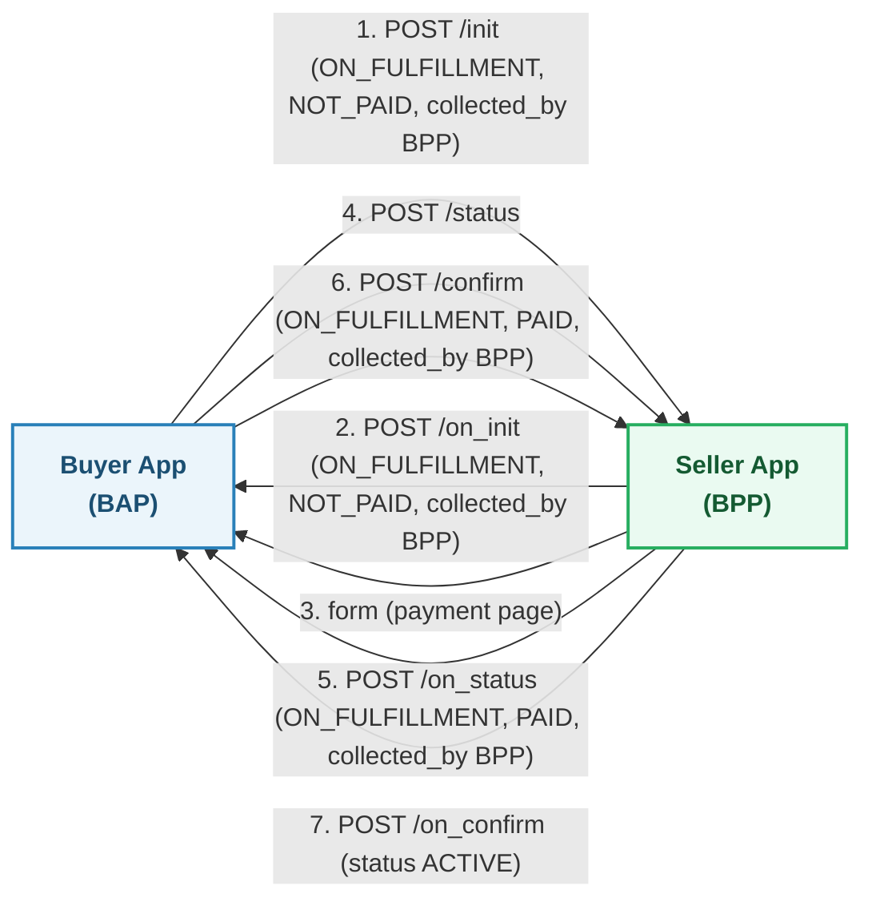

- The contract summary for `init`, `on_init` and `on_status` is labelled "[Buyer Collecting]" and the `form` step reads "Buyer app redirects to payment gateway page", while the payloads have `collected_by: BPP` (see [Contract Notes](#contract-notes)).

### On-Demand - Ride cancellation by rider (BAP Collecting)

*Contract name: On-Demand - Ride cancellation by rider(BAP Collecting)* (`cancel_collection_bap`). 9 steps.

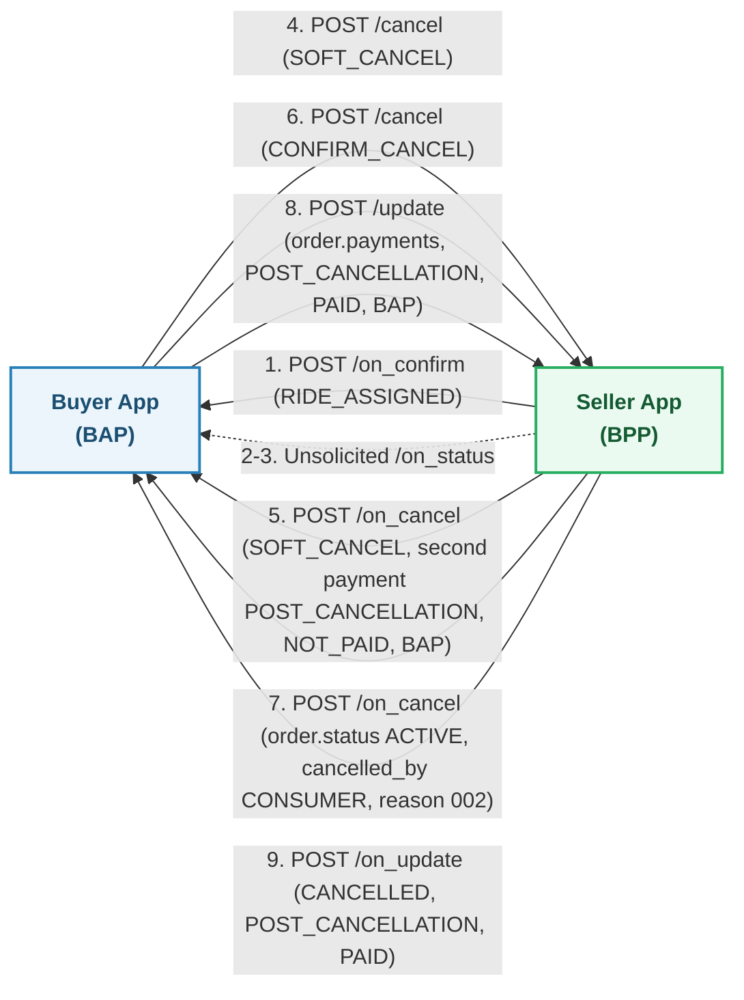

- The cancellation fee is collected by the buyer app through a second payment of type `POST_CANCELLATION`; the quote has `CANCELLATION_CHARGES` and `REFUND`.
- The `on_cancel` after the confirmed cancel has `order.status: ACTIVE` in the example (see [Contract Notes](#contract-notes)).

### On-Demand - Support

*Contract name: On-Demand - Support.* 6 steps: `on_confirm`, three `on_status`, `support`, `on_support`.

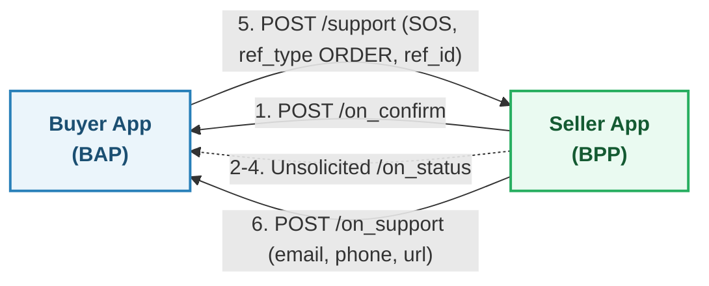

- `support.descriptor`: `code: SOS`, `name: sos emergency`, `short_desc: Driver has deviated from the planned route.`; `ref_type: ORDER`, `ref_id: O1`.
- The branch has `on_support` as an unsolicited step in `OnDemand_Assign_driver_post_on_ confirm` and `Schedule_Trip_With_Pre_Order_Bid`; it has no `support` request.

### On-Demand - Rating(Success)

*Contract name: On-Demand - Rating(Success).* 10 steps: `on_confirm`, `on_status`, `track`, `on_track`, two `on_status`, `on_update`, `status`, `on_status`, `rating`.

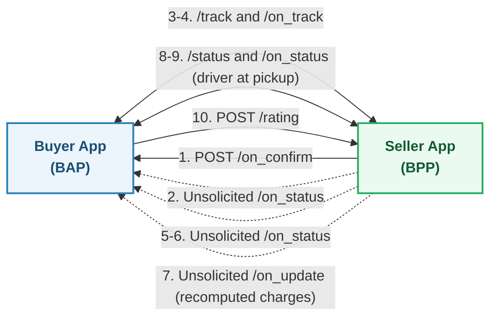

- The contract example for `rating` has `message.id`, `rating_category: DRIVER` and `value: 4`, and a variant with `feedback_form`. The branch flows send `order_id`, `rating_entity`, `ratings[]` and `feedback[]` (see [Contract Notes](#contract-notes)).
- The contract has an `on_rating` example (`rating_ack`, `feedback_ack`) that this flow does not use.

### Other contract files

- `schedule_rental_when_end_stop_gps_coordinate_is_present` ("Schedule - Rental(when end stop gps coordinate is not present)") is commented out in the contract's flow index.
- `on_demand___update_add_intermediate_stop` ("On-Demand - Add intermediate stop") is in the contract repository and is not referenced by the flow index.

---

## Detailed Protocol Flows

Each flow below shows its calls in order. `search` goes through the Gateway. Dotted arrows are unsolicited calls from the BPP. The step labels come from the example payloads of the flow configuration; each flow has its own Mermaid flowchart. Flows marked "not in the contract's flow list" exist only in this branch.

### Core On-Demand Flows

#### Flow 1: OnDemand Assign driver on onconfirm

**Flow ID:** `OnDemand_Assign_driver_on_onconfirm` (contract name: *On-Demand - Assign driver on on-confirm*)  
**Config file:** `Ride-hailing/OnDemand_Assign_driver_on_onconfirm.yaml` · **Tags:** `MANDATORY`, `ON_DEMAND`, `REPORTABLE`

**1. Short description.** A rider books an on-demand ride; the driver is assigned in `on_confirm`, the ride is followed with status updates and tracking, and the buyer rates the ride after completion. 19 steps.

**2. Process flow.**


**3. API breakdown and technical actions.**

- **`/search`** (`search_ride`): `START` and `END` stops with `gps`, `address`, `city`, `district`, `country`, `area_code`; `BAP_TERMS` tags.
- **`/on_search`**: one provider with `descriptor` (name, descriptions, images), `fulfillments`, `items` (`RIDE`), `categories`, `locations`, `payments`, `cancellation_terms` at provider and item level and `BPP_TERMS`.
- **`/select`, `/on_select`**: provider, item and fulfillment; the response has the quote (`BASE_FARE`, `DISTANCE_FARE`) and `quote.ttl: PT200S`.
- **`/init`, `/on_init`**: customer and billing; payment `ON_FULFILLMENT`, `NOT_PAID`, collected by `BPP`. The response carries `payments[].id`, `cancellation_terms` and the settlement tags.
- **`/confirm`, `/on_confirm`**: `order.status: ACTIVE`, fulfillment state `RIDE_ASSIGNED`, `agent` (contact, name, image, rating), `vehicle` (category, variant, make, model, registration) and the `OTP` authorization on the `START` stop.
- **`/on_track` (unsolicited), `/track`, `/on_track`**: `tracking.status: active` and `tracking.location` (`gps`, `updated_at`).
- **`/on_status` (unsolicited)**: `RIDE_ENROUTE_PICKUP`, `RIDE_ARRIVED_PICKUP`, `RIDE_STARTED`, `RIDE_ENDED`.
- **`/on_update` (unsolicited)**: `on_update_fare_charges` at `RIDE_ENDED` with the final quote, which also has a `CANCELLATION_CHARGES` line (see [Contract Notes](#contract-notes)).
- **`/status`, `/on_status`**: `order.status: COMPLETED`, payment `PAID`, an `INVOICE` document (`application/pdf`).
- **`/rating`**: `order_id`, `rating_entity`, `ratings[]` (`id`, `rating_category`, `value`) and `feedback[]`. The flow has no `on_rating` step.

---

#### Flow 2: OnDemand Assign driver post on  confirm

**Flow ID:** `OnDemand_Assign_driver_post_on_ confirm` (contract name: *On-Demand - Assign driver post on-confirm*)  
**Config file:** `Ride-hailing/OnDemand_Assign_driver_post_on__confirm.yaml` · **Tags:** `MANDATORY`, `ON_DEMAND`, `REPORTABLE`

**1. Short description.** The seller app confirms the ride first and assigns the driver afterwards, through an unsolicited `on_update`. 21 steps.

**2. Process flow.**

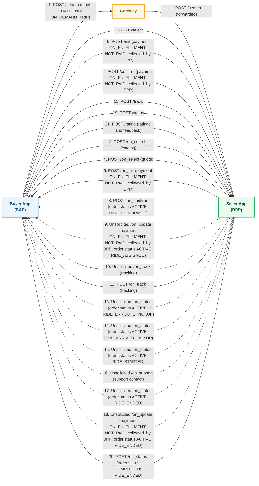

**3. API breakdown and technical actions.**

- **`/on_confirm`** (`on_confirm_driver_not_assigned`): `order.status: ACTIVE`, fulfillment state `RIDE_CONFIRMED`; no agent.
- **`/on_update` (unsolicited)** (`on_update_ride`): state `RIDE_ASSIGNED`, agent, vehicle and `OTP`.
- **`/on_support` (unsolicited)**: contact details (`email`, `phone`, `url`) with `descriptor.code: SOS`, `ref_type: ORDER`.
- **`/on_status`, `/on_update`, `/status`, `/rating`**: as in the main flow.

---

#### Flow 3: OnDemand Assign driver post onconfirmSelfPickup

**Flow ID:** `OnDemand_Assign_driver_post_onconfirmSelfPickup` (contract name: *On-Demand - Assign driver post on-confirm(Self-Pickup)*)  
**Config file:** `Ride-hailing/OnDemand_Assign_driver_post_onconfirmSelfPickup.yaml` · **Tags:** `OPTIONAL`, `ON_DEMAND`, `REPORTABLE`

**1. Short description.** A self-pickup ride (for example from a queue at an airport or station). The fulfillment has `type: SELF_PICKUP` and the driver is assigned after `on_confirm`. 16 steps.

**2. Process flow.**


**3. API breakdown and technical actions.**

- **`/on_search`** (`on_search_self_pickup`), **`/on_select`, `/init`** (`init_with_self_pickup`), **`/on_init`, `/confirm`, `/on_confirm`** (`on_confirm_self_pickup`): `fulfillments[].type: SELF_PICKUP`.
- **`/on_update` (unsolicited)**: `RIDE_ASSIGNED` after `RIDE_CONFIRMED`.
- **`/on_status` (unsolicited)**: `RIDE_STARTED`, then `RIDE_ENDED`; there is no `RIDE_ENROUTE_PICKUP` or `RIDE_ARRIVED_PICKUP`.

---

#### Flow 4: OnDemand Assign driver on onconfirm

**Flow ID:** `OnDemand_Female_Driver_Flow` (contract name: *On-Demand - Female Driver Flow*)  
**Config file:** `Ride-hailing/OnDemand_Female_Driver_Flow.yaml` · **Tags:** `OPTIONAL`, `ON_DEMAND`

**1. Short description.** The rider asks for a female driver. The search carries optional customer and agent gender. 18 steps.

**2. Process flow.**


**3. API breakdown and technical actions.**

- **`/search`** (`search_female`): `intent.fulfillment.customer.person.gender` and `agent.person.gender`, both `FEMALE`.
- **`/on_search`** (`on_search_female`): the catalog of rides. The remaining steps follow the main flow, without the `rating` step.

---

#### Flow 5: OnDemand Purple Tags Assign driver on onconfirm

**Flow ID:** `OnDemand_Purple_Tags_Assign_driver_on_onconfirm` (contract name: *On-Demand - Purple Tags (Assign driver on on-confirm)*)  
**Config file:** `Ride-hailing/OnDemand_Purple_Tags_Assign_driver_on_onconfirm.yaml` · **Tags:** `OPTIONAL`, `ON_DEMAND`, `REPORTABLE`

**1. Short description.** The rider shares disability-related needs (the `DISABILITY_*` tag groups) when selecting a ride. 17 steps.

**2. Process flow.**


**3. API breakdown and technical actions.**

- **`/select`** (`select_with_purple_tags`): `items[].tags` with `DISABILITY_VIS` (`VIS_LEVEL`, `VIS_SCREEN_READER_USAGE`, `VIS_CANE_USAGE`, `VIS_SPECIAL_REQUIREMENT`).
- **`/on_search`** (`on_search_purple`): item tags `DISABILITY_VIS` and `DISABILITY_DWARFISM`. **`/on_select`, `/on_confirm`, `/on_status`**: `DISABILITY_VIS`.
- The remaining steps follow the main flow, without the `rating` step.

---

#### Flow 6: OnDemand Assign driver on onconfirm (Add Ons)

**Flow ID:** `OnDemand_Assign_driver_on_onconfirm_Add_Ons` (contract name: *On-Demand - Assign driver on on-confirm (Add Ons)*)  
**Config file:** `Ride-hailing/OnDemand_Assign_driver_on_onconfirm_Add_Ons.yaml` · **Tags:** `OPTIONAL`, `ON_DEMAND`, `REPORTABLE`

**1. Short description.** The main flow with add-ons (for example ride insurance offered by the seller app) selected on the ride. 18 steps.

**2. Process flow.**


**3. API breakdown and technical actions.**

- **`/select`**: `items[].add_ons[]` with `id` and `quantity.selected.count`.
- **`/on_select` onwards**: the quote has an extra `ADD_ONS` line.
- The remaining steps follow the main flow, without the `rating` step.

---

### Payment Variants

#### Flow 7: OnDemand Assign driver on onconfirm (BAP Collecting)

**Flow ID:** `OnDemand_Assign_driver_on_onconfirm_BAP_Collecting` (contract name: *On-Demand - Assign driver on on-confirm(BAP Collecting)*)  
**Config file:** `Ride-hailing/OnDemand_Assign_driver_on_onconfirm_BAP_Collecting.yaml` · **Tags:** `OPTIONAL`, `ON_DEMAND`, `REPORTABLE`

**1. Short description.** The buyer app collects the payment. The ride proceeds as in the main flow, and the buyer app sends an `update` with the payment once the ride has ended. 17 steps.

**2. Process flow.**

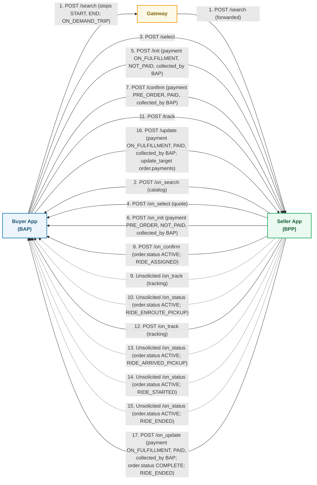

**3. API breakdown and technical actions.**

- **`/init`**: payment `ON_FULFILLMENT`, `NOT_PAID`, collected by `BAP`; `SETTLEMENT_AMOUNT` is in the settlement tags.
- **`/on_init`**: payment `PRE_ORDER`, `NOT_PAID`, `BAP`; the settlement tags also have `SETTLEMENT_BANK_CODE`, `SETTLEMENT_BANK_ACCOUNT_NUMBER` and `SETTLEMENT_VIRTUAL_PAYMENT_ADDRESS`.
- **`/confirm`**: payment `PRE_ORDER`, `PAID`, `BAP`. **`/on_confirm`** and the later `on_status` calls carry `ON_FULFILLMENT`, `NOT_PAID`, `BAP`.
- **`/update`** (`update_payment`): `update_target: order.payments` with `collected_by: BAP`, `status: PAID` and `params` (`amount`, `currency`, `transaction_id`).
- **`/on_update`** (`on_update_payment`): payment `PAID` and `order.status: COMPLETE` (see [Contract Notes](#contract-notes)).

---

#### Flow 8: OnDemand Assign driver on onconfirm (BAP Collecting, Pre-Order)

**Flow ID:** `OnDemand_Assign_driver_on_onconfirm_BAP_Collecting_Pre_Order` (contract name: *On-Demand - Assign driver on on-confirm(BAP Collecting, On-Order) (contract file `on_order.yaml`; the changelog calls it "BAP Collecting, Pre-Order")*)  
**Config file:** `Ride-hailing/OnDemand_Assign_driver_on_onconfirm_BAP_Collecting_Pre_Order.yaml` · **Tags:** `OPTIONAL`, `ON_DEMAND`, `REPORTABLE`

**1. Short description.** The buyer app collects the payment before the ride (`PRE_ORDER`). No payment `update` follows the ride. 17 steps.

**2. Process flow.**

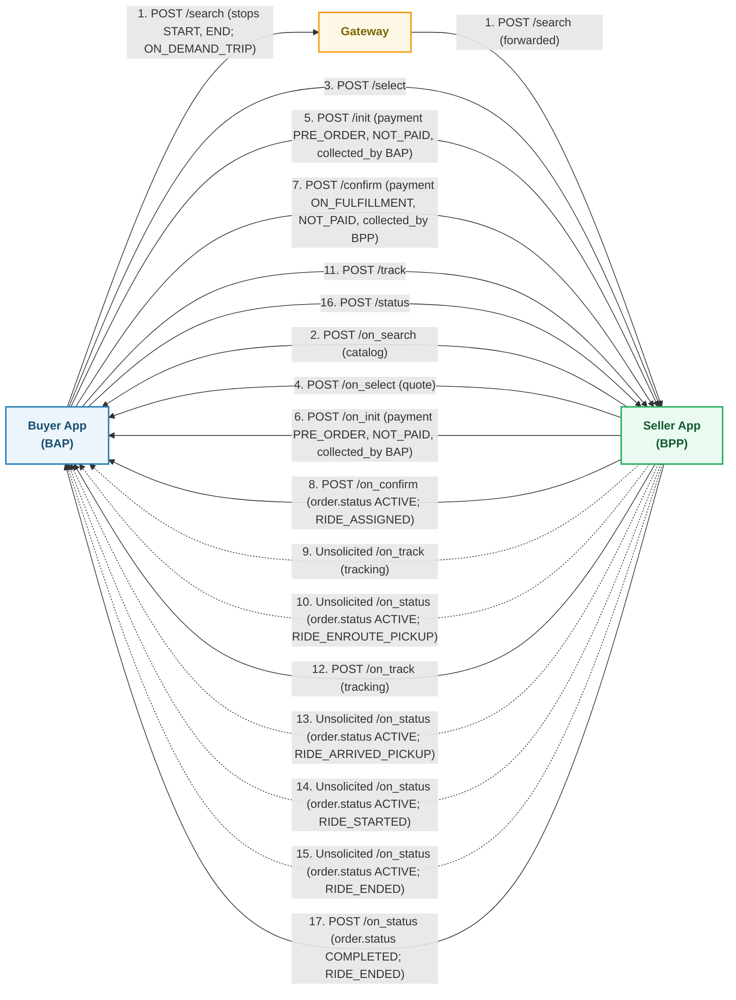

**3. API breakdown and technical actions.**

- **`/init`** (`init_bap_pre_order`) and **`/on_init`** (`on_init_bap_pre_order`): payment `PRE_ORDER`, `NOT_PAID`, `BAP`.
- **`/confirm`**: payment `ON_FULFILLMENT`, `NOT_PAID`, `BPP` (see [Contract Notes](#contract-notes)). **`/on_confirm`** and the `on_status` calls carry `PRE_ORDER`, `PAID`, `BAP`.
- **`/status`, `/on_status`**: `order.status: COMPLETED`.

---

#### Flow 9: OnDemand Assign driver on onconfirm (BAP Collecting, Quote Update)

**Flow ID:** `OnDemand_Assign_driver_on_onconfirm_BAP_Collecting_Quote_Update` (contract name: *On-Demand - Assign driver on on-confirm(BAP Collecting, Quote-Update)*)  
**Config file:** `Ride-hailing/OnDemand_Assign_driver_on_onconfirm_BAP_Collecting_Quote_Update.yaml` · **Tags:** `OPTIONAL`, `ON_DEMAND`, `REPORTABLE`

**1. Short description.** The buyer app collects the payment before the ride; after the ride the final quote is settled with an `update` of type `POST_FULFILLMENT`. 17 steps.

**2. Process flow.**

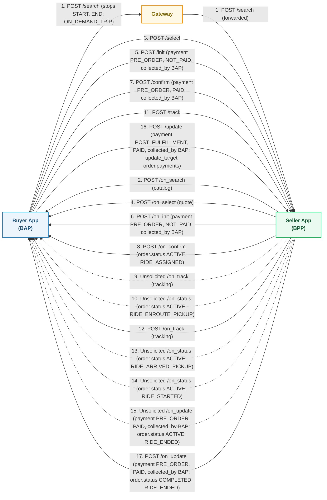

**3. API breakdown and technical actions.**

- **`/init`, `/on_init`, `/confirm`, `/on_confirm`**: payment `PRE_ORDER`; `NOT_PAID` until `confirm`, then `PAID`, collected by `BAP`.
- **`/on_update` (unsolicited)** (`on_update_ride_ended`): `RIDE_ENDED`.
- **`/update`** (`update_payment`): `update_target: order.payments`, payment `POST_FULFILLMENT`, `PAID`, `BAP`.
- **`/on_update`** (`on_update_payment`): `order.status: COMPLETED`.

---

#### Flow 10: OnDemand Pre Order Bid

**Flow ID:** `OnDemand_Pre_Order_Bid` (contract name: *On-Demand - Pre Order Bid*)  
**Config file:** `Ride-hailing/OnDemand_Pre_Order_Bid.yaml` · **Tags:** `OPTIONAL`, `ON_DEMAND`, `REPORTABLE`

**1. Short description.** The buyer offers a price for the ride in `select`. 17 steps.

**2. Process flow.**

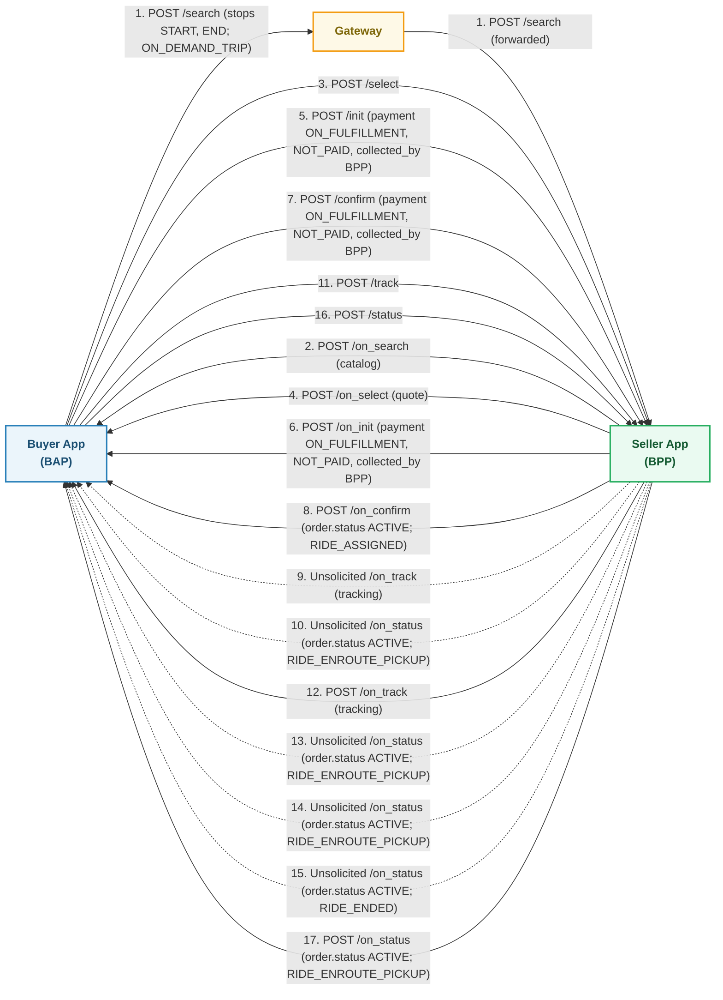

**3. API breakdown and technical actions.**

- **`/select`** (`select_preorder_bid`): `items[].price` with `currency` and `value` (the bid).
- **`/on_select`** (`on_select_preorder`) and **`/on_init`**: the quote has a `BUYER_ADDITIONAL_AMOUNT` line.
- The `on_status` payloads after `RIDE_ENROUTE_PICKUP` carry `RIDE_ENROUTE_PICKUP` and `ACTIVE` (see [Contract Notes](#contract-notes)).

---

#### Flow 11: OnDemand Post Order Tip

**Flow ID:** `OnDemand_Post_Order_Tip` (contract name: *On-Demand - Post Order Tip*)  
**Config file:** `Ride-hailing/OnDemand_Post_Order_Tip.yaml` · **Tags:** `OPTIONAL`, `ON_DEMAND`, `REPORTABLE`

**1. Short description.** After the ride, the buyer adds an additional amount (a tip) to the quote through an `update`. 19 steps.

**2. Process flow.**

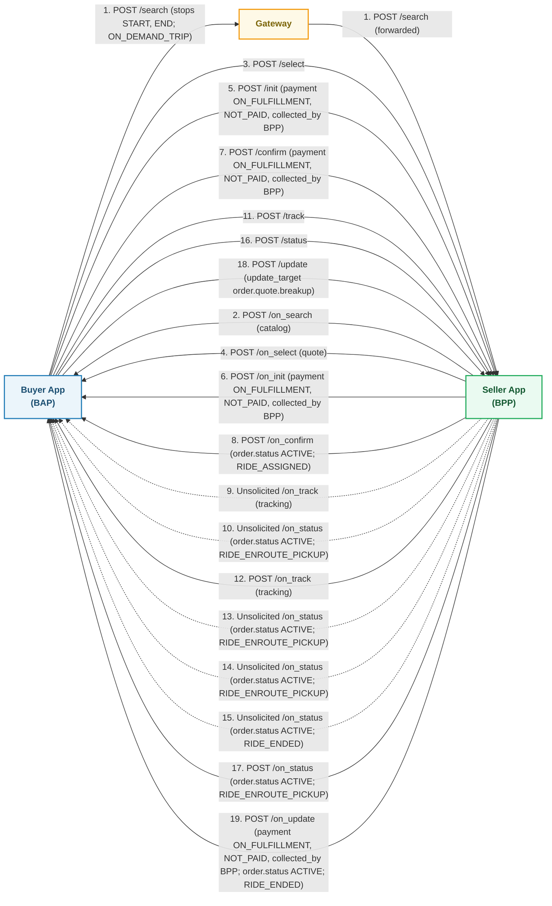

**3. API breakdown and technical actions.**

- **`/update`** (`update_quote`): `update_target: order.quote.breakup` with a `BUYER_ADDITIONAL_AMOUNT` line.
- **`/on_update`** (`on_update_quote`): the updated order at `RIDE_ENDED`.
- The `on_status` payloads after `RIDE_STARTED` carry `RIDE_ENROUTE_PICKUP` and `ACTIVE` (see [Contract Notes](#contract-notes)).

---

### Stops and Updates

#### Flow 12: OnDemand Ride with multiple stops

**Flow ID:** `OnDemand_Ride_with_multiple_stops` (contract name: *On-Demand - Ride with multiple stops*)  
**Config file:** `Ride-hailing/OnDemand_Ride_with_multiple_stops.yaml` · **Tags:** `OPTIONAL`, `ON_DEMAND`, `REPORTABLE`

**1. Short description.** A ride with an `INTERMEDIATE_STOP` between the pickup and the drop. 17 steps.

**2. Process flow.**


**3. API breakdown and technical actions.**

- **`/search`**: stops `START`, `INTERMEDIATE_STOP`, `END`. **`/on_search`** (`on_search_with_multiple_stops`): the catalog.
- The remaining steps follow the main flow. The later `on_status` payloads carry `RIDE_ENROUTE_PICKUP` and `ACTIVE` (see [Contract Notes](#contract-notes)).

---

#### Flow 13: OnDemand Update Stop

**Flow ID:** `OnDemand_Update_Stop` (contract name: *On-Demand - Update Stop*)  
**Config file:** `Ride-hailing/OnDemand_Update_Stop.yaml` · **Tags:** `OPTIONAL`, `ON_DEMAND`, `REPORTABLE`

**1. Short description.** The buyer changes a stop while the ride is in progress: a soft update, then a confirmed update. 21 steps.

**2. Process flow.**


**3. API breakdown and technical actions.**

- **`/update`**: `update_target: order.fulfillments`, `order.status: SOFT_UPDATE`, a stop with `id`, `parent_stop_id` and `location.gps`.
- **`/on_update`** (`on_update_soft_update`): `SOFT_UPDATE`.
- **`/update`** (`update_hard`): `order.status: CONFIRM_UPDATE`. **`/on_update`** (`on_update_ride_updated`): `order.status: UPDATED`.

---

### Rental and Scheduled Flows

#### Flow 14: OnDemand Rental

**Flow ID:** `OnDemand_Rental` (contract name: *On-Demand - Rental*)  
**Config file:** `Ride-hailing/OnDemand_Rental.yaml` · **Tags:** `OPTIONAL`, `ON_DEMAND`, `RENTAL`, `REPORTABLE`

**1. Short description.** An on-demand rental. The search has only a `START` stop and the category `ON_DEMAND_RENTAL`. 17 steps.

**2. Process flow.**


**3. API breakdown and technical actions.**

- **`/search`** (`search_rental`): category `ON_DEMAND_RENTAL`, `START` stop. **`/on_search`**: category `ON_DEMAND_RENTAL`; items `RIDE`.
- **`/on_select`, `/on_confirm`**: the quote has an `ADD_ONS` line.
- The later `on_status` payloads carry `RIDE_ENROUTE_PICKUP` and `ACTIVE` (see [Contract Notes](#contract-notes)).

---

#### Flow 15: OnDemand Rentalwhen end stop gps coordinate is present

**Flow ID:** `OnDemand_Rentalwhen_end_stop_gps_coordinate_is_present` (contract name: *On-Demand - Rental(when end stop gps coordinate is present)*)  
**Config file:** `Ride-hailing/OnDemand_Rentalwhen_end_stop_gps_coordinate_is_present.yaml` · **Tags:** `OPTIONAL`, `ON_DEMAND`, `RENTAL`, `REPORTABLE`

**1. Short description.** An on-demand rental where the search also has an `END` stop with GPS coordinates. The driver is assigned after `on_confirm`. 18 steps.

**2. Process flow.**


**3. API breakdown and technical actions.**

- **`/search`** (`search_rental_end`): `START` and `END` stops.
- **`/on_confirm`** (`on_confirm_rental`): `RIDE_CONFIRMED`; **`/on_update` (unsolicited)** (`on_update_ride_assigned`): `RIDE_ASSIGNED`.

---

#### Flow 16: Schedule Rental

**Flow ID:** `Schedule_Rental` (contract name: *Schedule - Rental*)  
**Config file:** `Ride-hailing/Schedule_Rental.yaml` · **Tags:** `OPTIONAL`, `SCHEDULED`, `RENTAL`, `REPORTABLE`

**1. Short description.** A scheduled rental: the driver is assigned after `on_confirm`. 17 steps.

**2. Process flow.**

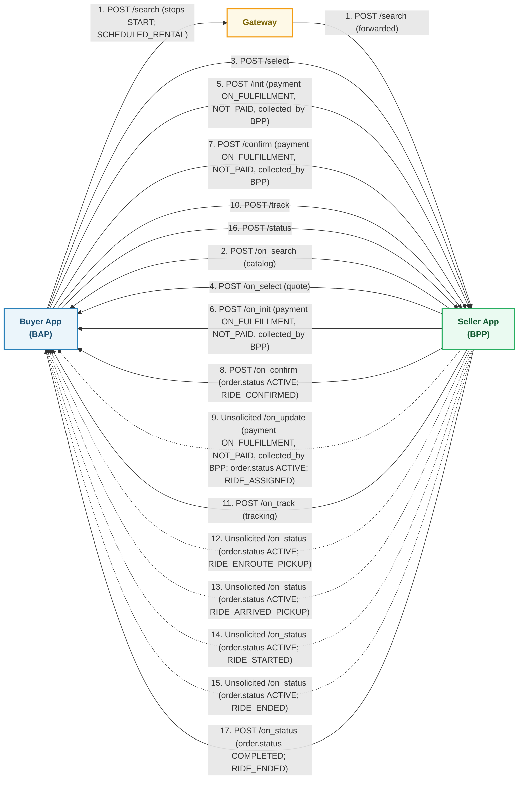

**3. API breakdown and technical actions.**

- **`/search`** (`search_schedule_rental`): category `SCHEDULED_RENTAL`, `START` stop.
- **`/on_confirm`**: `RIDE_CONFIRMED`; **`/on_update` (unsolicited)**: `RIDE_ASSIGNED`.
- **`/track`, `/on_track`** follow the assignment; status updates `RIDE_ENROUTE_PICKUP` to `RIDE_ENDED`; final `on_status` `COMPLETED`.

---

#### Flow 17: Schedule Trip

**Flow ID:** `Schedule_Trip` (contract name: *Schedule - Trip*)  
**Config file:** `Ride-hailing/Schedule_Trip.yaml` · **Tags:** `OPTIONAL`, `SCHEDULED`, `REPORTABLE`

**1. Short description.** A scheduled trip: the `START` stop has a `time.timestamp`, the driver is assigned after `on_confirm`, and the buyer rates the ride. 18 steps.

**2. Process flow.**

```mermaid
flowchart LR
    classDef client fill:#EBF5FB,stroke:#2980B9,stroke-width:2px,color:#1B4F72,font-weight:bold;
    classDef gateway fill:#FEF9E7,stroke:#F39C12,stroke-width:2px,color:#7D6608,font-weight:bold;
    classDef provider fill:#EAFAF1,stroke:#27AE60,stroke-width:2px,color:#145A32,font-weight:bold;

    BAP["Buyer App<br/>(BAP)"]:::client
    GW["Gateway"]:::gateway
    BPP["Seller App<br/>(BPP)"]:::provider

    BAP -->|"1. POST /search (stops START, END; SCHEDULED_TRIP)"| GW
    GW -->|"1. POST /search (forwarded)"| BPP
    BPP -->|"2. POST /on_search (catalog)"| BAP
    BAP -->|"3. POST /select"| BPP
    BPP -->|"4. POST /on_select (quote)"| BAP
    BAP -->|"5. POST /init (payment ON_FULFILLMENT, NOT_PAID, collected_by BPP)"| BPP
    BPP -->|"6. POST /on_init (payment ON_FULFILLMENT, NOT_PAID, collected_by BPP)"| BAP
    BAP -->|"7. POST /confirm (payment ON_FULFILLMENT, NOT_PAID, collected_by BPP)"| BPP
    BPP -->|"8. POST /on_confirm (order.status ACTIVE; RIDE_CONFIRMED)"| BAP
    BPP -.->|"9. Unsolicited /on_update (payment ON_FULFILLMENT, NOT_PAID, collected_by BPP; order.status ACTIVE; RIDE_ASSIGNED)"| BAP
    BAP -->|"10. POST /track"| BPP
    BPP -->|"11. POST /on_track (tracking)"| BAP
    BPP -.->|"12. Unsolicited /on_status (order.status ACTIVE; RIDE_ENROUTE_PICKUP)"| BAP
    BPP -.->|"13. Unsolicited /on_status (order.status ACTIVE; RIDE_ARRIVED_PICKUP)"| BAP
    BPP -.->|"14. Unsolicited /on_status (order.status ACTIVE; RIDE_STARTED)"| BAP
    BPP -.->|"15. Unsolicited /on_update (payment ON_FULFILLMENT, NOT_PAID, collected_by BPP; order.status ACTIVE; RIDE_ENDED)"| BAP
    BAP -->|"16. POST /status"| BPP
    BPP -->|"17. POST /on_status (order.status COMPLETED; RIDE_ENDED)"| BAP
    BAP -->|"18. POST /rating (ratings and feedback)"| BPP
```

**3. API breakdown and technical actions.**

- **`/search`** (`search_schedule_trip`): category `SCHEDULED_TRIP`, `START` stop with `time.timestamp`, `END` stop.
- **`/on_confirm`**: `RIDE_CONFIRMED`; **`/on_update` (unsolicited)**: `RIDE_ASSIGNED`; the ride end is an unsolicited `on_update`.
- **`/status`, `/on_status`**: `COMPLETED`. **`/rating`** follows.

---

#### Flow 18: Schedule Trip

**Flow ID:** `Schedule_Trip_Without_Ride_Enroute_Pickup_Status`  
*Present in the flow configuration; not in the contract's flow list.*  
**Config file:** `Ride-hailing/Schedule_Trip_Without_Ride_Enroute_Pickup_Status.yaml` · **Tags:** `OPTIONAL`, `SCHEDULED`

**1. Short description.** A scheduled trip without the `RIDE_ENROUTE_PICKUP` update. 17 steps.

**2. Process flow.**

```mermaid
flowchart LR
    classDef client fill:#EBF5FB,stroke:#2980B9,stroke-width:2px,color:#1B4F72,font-weight:bold;
    classDef gateway fill:#FEF9E7,stroke:#F39C12,stroke-width:2px,color:#7D6608,font-weight:bold;
    classDef provider fill:#EAFAF1,stroke:#27AE60,stroke-width:2px,color:#145A32,font-weight:bold;

    BAP["Buyer App<br/>(BAP)"]:::client
    GW["Gateway"]:::gateway
    BPP["Seller App<br/>(BPP)"]:::provider

    BAP -->|"1. POST /search (stops START, END; SCHEDULED_TRIP)"| GW
    GW -->|"1. POST /search (forwarded)"| BPP
    BPP -->|"2. POST /on_search (catalog)"| BAP
    BAP -->|"3. POST /select"| BPP
    BPP -->|"4. POST /on_select (quote)"| BAP
    BAP -->|"5. POST /init (payment ON_FULFILLMENT, NOT_PAID, collected_by BPP)"| BPP
    BPP -->|"6. POST /on_init (payment ON_FULFILLMENT, NOT_PAID, collected_by BPP)"| BAP
    BAP -->|"7. POST /confirm (payment ON_FULFILLMENT, NOT_PAID, collected_by BPP)"| BPP
    BPP -->|"8. POST /on_confirm (order.status ACTIVE; RIDE_CONFIRMED)"| BAP
    BPP -.->|"9. Unsolicited /on_update (payment ON_FULFILLMENT, NOT_PAID, collected_by BPP; order.status ACTIVE; RIDE_ASSIGNED)"| BAP
    BAP -->|"10. POST /track"| BPP
    BPP -->|"11. POST /on_track (tracking)"| BAP
    BPP -.->|"12. Unsolicited /on_status (order.status ACTIVE; RIDE_ARRIVED_PICKUP)"| BAP
    BPP -.->|"13. Unsolicited /on_status (order.status ACTIVE; RIDE_STARTED)"| BAP
    BPP -.->|"14. Unsolicited /on_update (payment ON_FULFILLMENT, NOT_PAID, collected_by BPP; order.status ACTIVE; RIDE_ENDED)"| BAP
    BAP -->|"15. POST /status"| BPP
    BPP -->|"16. POST /on_status (order.status COMPLETED; RIDE_ENDED)"| BAP
    BAP -->|"17. POST /rating (ratings and feedback)"| BPP
```

**3. API breakdown and technical actions.**

- The first `on_status` is `RIDE_ARRIVED_PICKUP`; the flow ends with a `rating`.

---

#### Flow 19: Schedule Trip (Add Ons)

**Flow ID:** `Schedule_Trip_With_Add_Ons`  
*Present in the flow configuration; not in the contract's flow list.*  
**Config file:** `Ride-hailing/Schedule_Trip_With_Add_Ons.yaml` · **Tags:** `OPTIONAL`, `SCHEDULED`

**1. Short description.** A scheduled trip with add-ons (child seat, luggage carrier, pet carrier per the contract description). 17 steps.

**2. Process flow.**

```mermaid
flowchart LR
    classDef client fill:#EBF5FB,stroke:#2980B9,stroke-width:2px,color:#1B4F72,font-weight:bold;
    classDef gateway fill:#FEF9E7,stroke:#F39C12,stroke-width:2px,color:#7D6608,font-weight:bold;
    classDef provider fill:#EAFAF1,stroke:#27AE60,stroke-width:2px,color:#145A32,font-weight:bold;

    BAP["Buyer App<br/>(BAP)"]:::client
    GW["Gateway"]:::gateway
    BPP["Seller App<br/>(BPP)"]:::provider

    BAP -->|"1. POST /search (stops START, END; SCHEDULED_TRIP)"| GW
    GW -->|"1. POST /search (forwarded)"| BPP
    BPP -->|"2. POST /on_search (catalog)"| BAP
    BAP -->|"3. POST /select"| BPP
    BPP -->|"4. POST /on_select (quote)"| BAP
    BAP -->|"5. POST /init (payment ON_FULFILLMENT, NOT_PAID, collected_by BPP)"| BPP
    BPP -->|"6. POST /on_init (payment ON_FULFILLMENT, NOT_PAID, collected_by BPP)"| BAP
    BAP -->|"7. POST /confirm (payment ON_FULFILLMENT, NOT_PAID, collected_by BPP)"| BPP
    BPP -->|"8. POST /on_confirm (order.status ACTIVE; RIDE_CONFIRMED)"| BAP
    BPP -.->|"9. Unsolicited /on_update (payment ON_FULFILLMENT, NOT_PAID, collected_by BPP; order.status ACTIVE; RIDE_ASSIGNED)"| BAP
    BAP -->|"10. POST /track"| BPP
    BPP -->|"11. POST /on_track (tracking)"| BAP
    BPP -.->|"12. Unsolicited /on_status (order.status ACTIVE; RIDE_ENROUTE_PICKUP)"| BAP
    BPP -.->|"13. Unsolicited /on_status (order.status ACTIVE; RIDE_ARRIVED_PICKUP)"| BAP
    BPP -.->|"14. Unsolicited /on_status (order.status ACTIVE; RIDE_STARTED)"| BAP
    BPP -.->|"15. Unsolicited /on_update (payment ON_FULFILLMENT, NOT_PAID, collected_by BPP; order.status ACTIVE; RIDE_ENDED)"| BAP
    BAP -->|"16. POST /status"| BPP
    BPP -->|"17. POST /on_status (order.status COMPLETED; RIDE_ENDED)"| BAP
```

**3. API breakdown and technical actions.**

- The quote has an `ADD_ONS` line from `on_select` to `on_status`; the ride-end `on_update` quote has none.

---

#### Flow 20: Schedule Trip (Add Ons)

**Flow ID:** `Schedule_Trip_With_Add_Ons_Without_Ride_Enroute_Pickup`  
*Present in the flow configuration; not in the contract's flow list.*  
**Config file:** `Ride-hailing/Schedule_Trip_With_Add_Ons_Without_Ride_Enroute_Pickup.yaml` · **Tags:** `OPTIONAL`, `SCHEDULED`

**1. Short description.** A scheduled trip with add-ons, without the `RIDE_ENROUTE_PICKUP` update. 16 steps.

**2. Process flow.**

```mermaid
flowchart LR
    classDef client fill:#EBF5FB,stroke:#2980B9,stroke-width:2px,color:#1B4F72,font-weight:bold;
    classDef gateway fill:#FEF9E7,stroke:#F39C12,stroke-width:2px,color:#7D6608,font-weight:bold;
    classDef provider fill:#EAFAF1,stroke:#27AE60,stroke-width:2px,color:#145A32,font-weight:bold;

    BAP["Buyer App<br/>(BAP)"]:::client
    GW["Gateway"]:::gateway
    BPP["Seller App<br/>(BPP)"]:::provider

    BAP -->|"1. POST /search (stops START, END; SCHEDULED_TRIP)"| GW
    GW -->|"1. POST /search (forwarded)"| BPP
    BPP -->|"2. POST /on_search (catalog)"| BAP
    BAP -->|"3. POST /select"| BPP
    BPP -->|"4. POST /on_select (quote)"| BAP
    BAP -->|"5. POST /init (payment ON_FULFILLMENT, NOT_PAID, collected_by BPP)"| BPP
    BPP -->|"6. POST /on_init (payment ON_FULFILLMENT, NOT_PAID, collected_by BPP)"| BAP
    BAP -->|"7. POST /confirm (payment ON_FULFILLMENT, NOT_PAID, collected_by BPP)"| BPP
    BPP -->|"8. POST /on_confirm (order.status ACTIVE; RIDE_CONFIRMED)"| BAP
    BPP -.->|"9. Unsolicited /on_update (payment ON_FULFILLMENT, NOT_PAID, collected_by BPP; order.status ACTIVE; RIDE_ASSIGNED)"| BAP
    BAP -->|"10. POST /track"| BPP
    BPP -->|"11. POST /on_track (tracking)"| BAP
    BPP -.->|"12. Unsolicited /on_status (order.status ACTIVE; RIDE_ARRIVED_PICKUP)"| BAP
    BPP -.->|"13. Unsolicited /on_status (order.status ACTIVE; RIDE_STARTED)"| BAP
    BPP -.->|"14. Unsolicited /on_update (payment ON_FULFILLMENT, NOT_PAID, collected_by BPP; order.status ACTIVE; RIDE_ENDED)"| BAP
    BAP -->|"15. POST /status"| BPP
    BPP -->|"16. POST /on_status (order.status COMPLETED; RIDE_ENDED)"| BAP
```

**3. API breakdown and technical actions.**

- The quote has an `ADD_ONS` line until the ride-end `on_update`.

---

#### Flow 21: Schedule Trip

**Flow ID:** `Schedule_Trip_With_Pre_Order_Bid`  
*Present in the flow configuration; not in the contract's flow list.*  
**Config file:** `Ride-hailing/Schedule_Trip_With_Pre_Order_Bid.yaml` · **Tags:** `OPTIONAL`, `SCHEDULED`

**1. Short description.** A scheduled trip with a bid in `select`. 18 steps.

**2. Process flow.**

```mermaid
flowchart LR
    classDef client fill:#EBF5FB,stroke:#2980B9,stroke-width:2px,color:#1B4F72,font-weight:bold;
    classDef gateway fill:#FEF9E7,stroke:#F39C12,stroke-width:2px,color:#7D6608,font-weight:bold;
    classDef provider fill:#EAFAF1,stroke:#27AE60,stroke-width:2px,color:#145A32,font-weight:bold;

    BAP["Buyer App<br/>(BAP)"]:::client
    GW["Gateway"]:::gateway
    BPP["Seller App<br/>(BPP)"]:::provider

    BAP -->|"1. POST /search (stops START, END; SCHEDULED_TRIP)"| GW
    GW -->|"1. POST /search (forwarded)"| BPP
    BPP -->|"2. POST /on_search (catalog)"| BAP
    BAP -->|"3. POST /select"| BPP
    BPP -->|"4. POST /on_select (quote)"| BAP
    BAP -->|"5. POST /init (payment ON_FULFILLMENT, NOT_PAID, collected_by BPP)"| BPP
    BPP -->|"6. POST /on_init (payment ON_FULFILLMENT, NOT_PAID, collected_by BPP)"| BAP
    BAP -->|"7. POST /confirm (payment ON_FULFILLMENT, NOT_PAID, collected_by BPP)"| BPP
    BPP -->|"8. POST /on_confirm (order.status ACTIVE; RIDE_CONFIRMED)"| BAP
    BPP -.->|"9. Unsolicited /on_update (payment ON_FULFILLMENT, NOT_PAID, collected_by BPP; order.status ACTIVE; RIDE_ASSIGNED)"| BAP
    BAP -->|"10. POST /track"| BPP
    BPP -->|"11. POST /on_track (tracking)"| BAP
    BPP -.->|"12. Unsolicited /on_status (order.status ACTIVE; RIDE_ENROUTE_PICKUP)"| BAP
    BPP -.->|"13. Unsolicited /on_status (order.status ACTIVE; RIDE_ARRIVED_PICKUP)"| BAP
    BPP -.->|"14. Unsolicited /on_status (order.status ACTIVE; RIDE_STARTED)"| BAP
    BPP -.->|"15. Unsolicited /on_support (support contact)"| BAP
    BPP -.->|"16. Unsolicited /on_update (payment ON_FULFILLMENT, NOT_PAID, collected_by BPP; order.status ACTIVE; RIDE_ENDED)"| BAP
    BAP -->|"17. POST /status"| BPP
    BPP -->|"18. POST /on_status (order.status COMPLETED; RIDE_ENDED)"| BAP
```

**3. API breakdown and technical actions.**

- **`/select`**: bid price. **`/on_support` (unsolicited)**: support contact.

---

#### Flow 22: Schedule Trip

**Flow ID:** `Schedule_Trip_With_Pre_Order_Bid_Without_Ride_Enroute_Pickup`  
*Present in the flow configuration; not in the contract's flow list.*  
**Config file:** `Ride-hailing/Schedule_Trip_With_Pre_Order_Bid_Without_Ride_Enroute_Pickup.yaml` · **Tags:** `OPTIONAL`, `SCHEDULED`

**1. Short description.** A scheduled trip with a bid, without the `RIDE_ENROUTE_PICKUP` update. 17 steps.

**2. Process flow.**

```mermaid
flowchart LR
    classDef client fill:#EBF5FB,stroke:#2980B9,stroke-width:2px,color:#1B4F72,font-weight:bold;
    classDef gateway fill:#FEF9E7,stroke:#F39C12,stroke-width:2px,color:#7D6608,font-weight:bold;
    classDef provider fill:#EAFAF1,stroke:#27AE60,stroke-width:2px,color:#145A32,font-weight:bold;

    BAP["Buyer App<br/>(BAP)"]:::client
    GW["Gateway"]:::gateway
    BPP["Seller App<br/>(BPP)"]:::provider

    BAP -->|"1. POST /search (stops START, END; SCHEDULED_TRIP)"| GW
    GW -->|"1. POST /search (forwarded)"| BPP
    BPP -->|"2. POST /on_search (catalog)"| BAP
    BAP -->|"3. POST /select"| BPP
    BPP -->|"4. POST /on_select (quote)"| BAP
    BAP -->|"5. POST /init (payment ON_FULFILLMENT, NOT_PAID, collected_by BPP)"| BPP
    BPP -->|"6. POST /on_init (payment ON_FULFILLMENT, NOT_PAID, collected_by BPP)"| BAP
    BAP -->|"7. POST /confirm (payment ON_FULFILLMENT, NOT_PAID, collected_by BPP)"| BPP
    BPP -->|"8. POST /on_confirm (order.status ACTIVE; RIDE_CONFIRMED)"| BAP
    BPP -.->|"9. Unsolicited /on_update (payment ON_FULFILLMENT, NOT_PAID, collected_by BPP; order.status ACTIVE; RIDE_ASSIGNED)"| BAP
    BAP -->|"10. POST /track"| BPP
    BPP -->|"11. POST /on_track (tracking)"| BAP
    BPP -.->|"12. Unsolicited /on_status (order.status ACTIVE; RIDE_ARRIVED_PICKUP)"| BAP
    BPP -.->|"13. Unsolicited /on_status (order.status ACTIVE; RIDE_STARTED)"| BAP
    BPP -.->|"14. Unsolicited /on_update (payment ON_FULFILLMENT, NOT_PAID, collected_by BPP; order.status ACTIVE; RIDE_ENDED)"| BAP
    BAP -->|"15. POST /status"| BPP
    BPP -->|"16. POST /on_status (order.status COMPLETED; RIDE_ENDED)"| BAP
    BAP -->|"17. POST /rating (ratings and feedback)"| BPP
```

**3. API breakdown and technical actions.**

- The flow ends with a `rating`.

---

#### Flow 23: Schedule Trip

**Flow ID:** `Schedule_Trip_BAP_Collecting`  
*Present in the flow configuration; not in the contract's flow list.*  
**Config file:** `Ride-hailing/Schedule_Trip_BAP_Collecting.yaml` · **Tags:** `OPTIONAL`, `SCHEDULED`

**1. Short description.** A scheduled trip where the buyer app collects the payment. 17 steps.

**2. Process flow.**

```mermaid
flowchart LR
    classDef client fill:#EBF5FB,stroke:#2980B9,stroke-width:2px,color:#1B4F72,font-weight:bold;
    classDef gateway fill:#FEF9E7,stroke:#F39C12,stroke-width:2px,color:#7D6608,font-weight:bold;
    classDef provider fill:#EAFAF1,stroke:#27AE60,stroke-width:2px,color:#145A32,font-weight:bold;

    BAP["Buyer App<br/>(BAP)"]:::client
    GW["Gateway"]:::gateway
    BPP["Seller App<br/>(BPP)"]:::provider

    BAP -->|"1. POST /search (stops START, END; SCHEDULED_TRIP)"| GW
    GW -->|"1. POST /search (forwarded)"| BPP
    BPP -->|"2. POST /on_search (catalog)"| BAP
    BAP -->|"3. POST /select"| BPP
    BPP -->|"4. POST /on_select (quote)"| BAP
    BAP -->|"5. POST /init (payment ON_FULFILLMENT, NOT_PAID, collected_by BAP)"| BPP
    BPP -->|"6. POST /on_init (payment ON_FULFILLMENT, NOT_PAID, collected_by BAP)"| BAP
    BAP -->|"7. POST /confirm (payment ON_FULFILLMENT, NOT_PAID, collected_by BAP)"| BPP
    BPP -->|"8. POST /on_confirm (order.status ACTIVE; RIDE_CONFIRMED)"| BAP
    BPP -.->|"9. Unsolicited /on_update (payment ON_FULFILLMENT, NOT_PAID, collected_by BAP; order.status ACTIVE; RIDE_ASSIGNED)"| BAP
    BAP -->|"10. POST /track"| BPP
    BPP -->|"11. POST /on_track (tracking)"| BAP
    BPP -.->|"12. Unsolicited /on_status (order.status ACTIVE; RIDE_ENROUTE_PICKUP)"| BAP
    BPP -.->|"13. Unsolicited /on_status (order.status ACTIVE; RIDE_ARRIVED_PICKUP)"| BAP
    BPP -.->|"14. Unsolicited /on_status (order.status ACTIVE; RIDE_STARTED)"| BAP
    BPP -.->|"15. Unsolicited /on_update (payment ON_FULFILLMENT, NOT_PAID, collected_by BPP; order.status ACTIVE; RIDE_ENDED)"| BAP
    BAP -->|"16. POST /status"| BPP
    BPP -->|"17. POST /on_status (order.status COMPLETED; RIDE_ENDED)"| BAP
```

**3. API breakdown and technical actions.**

- The payments carry `collected_by: BAP` from `on_confirm`; the `on_update` at `RIDE_ENDED` carries `BPP` (see [Contract Notes](#contract-notes)).

---

#### Flow 24: Schedule Trip

**Flow ID:** `Schedule_Trip_BAP_Collecting_Without_Ride_Enroute_Pickup`  
*Present in the flow configuration; not in the contract's flow list.*  
**Config file:** `Ride-hailing/Schedule_Trip_BAP_Collecting_Without_Ride_Enroute_Pickup.yaml` · **Tags:** `OPTIONAL`, `SCHEDULED`

**1. Short description.** A scheduled trip where the buyer app collects the payment, without the `RIDE_ENROUTE_PICKUP` update. 16 steps.

**2. Process flow.**

```mermaid
flowchart LR
    classDef client fill:#EBF5FB,stroke:#2980B9,stroke-width:2px,color:#1B4F72,font-weight:bold;
    classDef gateway fill:#FEF9E7,stroke:#F39C12,stroke-width:2px,color:#7D6608,font-weight:bold;
    classDef provider fill:#EAFAF1,stroke:#27AE60,stroke-width:2px,color:#145A32,font-weight:bold;

    BAP["Buyer App<br/>(BAP)"]:::client
    GW["Gateway"]:::gateway
    BPP["Seller App<br/>(BPP)"]:::provider

    BAP -->|"1. POST /search (stops START, END; SCHEDULED_TRIP)"| GW
    GW -->|"1. POST /search (forwarded)"| BPP
    BPP -->|"2. POST /on_search (catalog)"| BAP
    BAP -->|"3. POST /select"| BPP
    BPP -->|"4. POST /on_select (quote)"| BAP
    BAP -->|"5. POST /init (payment ON_FULFILLMENT, NOT_PAID, collected_by BAP)"| BPP
    BPP -->|"6. POST /on_init (payment ON_FULFILLMENT, NOT_PAID, collected_by BAP)"| BAP
    BAP -->|"7. POST /confirm (payment ON_FULFILLMENT, NOT_PAID, collected_by BAP)"| BPP
    BPP -->|"8. POST /on_confirm (order.status ACTIVE; RIDE_CONFIRMED)"| BAP
    BPP -.->|"9. Unsolicited /on_update (payment ON_FULFILLMENT, NOT_PAID, collected_by BAP; order.status ACTIVE; RIDE_ASSIGNED)"| BAP
    BAP -->|"10. POST /track"| BPP
    BPP -->|"11. POST /on_track (tracking)"| BAP
    BPP -.->|"12. Unsolicited /on_status (order.status ACTIVE; RIDE_ARRIVED_PICKUP)"| BAP
    BPP -.->|"13. Unsolicited /on_status (order.status ACTIVE; RIDE_STARTED)"| BAP
    BPP -.->|"14. Unsolicited /on_update (payment ON_FULFILLMENT, NOT_PAID, collected_by BPP; order.status ACTIVE; RIDE_ENDED)"| BAP
    BAP -->|"15. POST /status"| BPP
    BPP -->|"16. POST /on_status (order.status COMPLETED; RIDE_ENDED)"| BAP
```

**3. API breakdown and technical actions.**

- Same payment values as `Schedule_Trip_BAP_Collecting`.

---

### Failure and Cancellation Flows

#### Flow 25: Driver not found on onconfirm

**Flow ID:** `Driver_not_found_on_onconfirm` (contract name: *Driver not found on on_confirm*)  
**Config file:** `Ride-hailing/Driver_not_found_on_onconfirm.yaml` · **Tags:** `MANDATORY`, `ON_DEMAND`, `REPORTABLE`

**1. Short description.** The rider confirms a ride and no driver is available; the request fails in `on_confirm`. 8 steps.

**2. Process flow.**

```mermaid
flowchart LR
    classDef client fill:#EBF5FB,stroke:#2980B9,stroke-width:2px,color:#1B4F72,font-weight:bold;
    classDef gateway fill:#FEF9E7,stroke:#F39C12,stroke-width:2px,color:#7D6608,font-weight:bold;
    classDef provider fill:#EAFAF1,stroke:#27AE60,stroke-width:2px,color:#145A32,font-weight:bold;

    BAP["Buyer App<br/>(BAP)"]:::client
    GW["Gateway"]:::gateway
    BPP["Seller App<br/>(BPP)"]:::provider

    BAP -->|"1. POST /search (stops START, END; ON_DEMAND_TRIP)"| GW
    GW -->|"1. POST /search (forwarded)"| BPP
    BPP -->|"2. POST /on_search (catalog)"| BAP
    BAP -->|"3. POST /select"| BPP
    BPP -->|"4. POST /on_select (quote)"| BAP
    BAP -->|"5. POST /init (payment ON_FULFILLMENT, NOT_PAID, collected_by BPP)"| BPP
    BPP -->|"6. POST /on_init (payment ON_FULFILLMENT, NOT_PAID, collected_by BPP)"| BAP
    BAP -->|"7. POST /confirm (payment ON_FULFILLMENT, NOT_PAID, collected_by BPP)"| BPP
    BPP -->|"8. POST /on_confirm (error 90203)"| BAP
```

**3. API breakdown and technical actions.**

- **`/on_confirm`** (`on_confirm_driver_not_found`): no `message`; `error.code: 90203`.

---

#### Flow 26: Driver not found post onconfirm

**Flow ID:** `Driver_not_found_post_onconfirm` (contract name: *Driver not found post on_confirm*)  
**Config file:** `Ride-hailing/Driver_not_found_post_onconfirm.yaml` · **Tags:** `MANDATORY`, `ON_DEMAND`, `REPORTABLE`

**1. Short description.** The seller app confirms the ride and later cancels it because no driver is found. 9 steps.

**2. Process flow.**

```mermaid
flowchart LR
    classDef client fill:#EBF5FB,stroke:#2980B9,stroke-width:2px,color:#1B4F72,font-weight:bold;
    classDef gateway fill:#FEF9E7,stroke:#F39C12,stroke-width:2px,color:#7D6608,font-weight:bold;
    classDef provider fill:#EAFAF1,stroke:#27AE60,stroke-width:2px,color:#145A32,font-weight:bold;

    BAP["Buyer App<br/>(BAP)"]:::client
    GW["Gateway"]:::gateway
    BPP["Seller App<br/>(BPP)"]:::provider

    BAP -->|"1. POST /search (stops START, END; ON_DEMAND_TRIP)"| GW
    GW -->|"1. POST /search (forwarded)"| BPP
    BPP -->|"2. POST /on_search (catalog)"| BAP
    BAP -->|"3. POST /select"| BPP
    BPP -->|"4. POST /on_select (quote)"| BAP
    BAP -->|"5. POST /init (payment ON_FULFILLMENT, NOT_PAID, collected_by BPP)"| BPP
    BPP -->|"6. POST /on_init (payment ON_FULFILLMENT, NOT_PAID, collected_by BPP)"| BAP
    BAP -->|"7. POST /confirm (payment ON_FULFILLMENT, NOT_PAID, collected_by BPP)"| BPP
    BPP -->|"8. POST /on_confirm (order.status ACTIVE; RIDE_CONFIRMED)"| BAP
    BPP -.->|"9. Unsolicited /on_cancel (order.status CANCELLED; RIDE_CANCELLED; cancelled_by PROVIDER, reason 011)"| BAP
```

**3. API breakdown and technical actions.**

- **`/on_confirm`** (`on_confirm_driver_not_assigned`): `ACTIVE`, `RIDE_CONFIRMED`.
- **`/on_cancel` (unsolicited)** (`on_cancel_rider_not_found`): `order.status: CANCELLED`, `cancelled_by: PROVIDER`, reason `011`, `RIDE_CANCELLED`, and the quote with `REFUND` and `CANCELLATION_CHARGES`.

---

#### Flow 27: OnDemand Ride cancellation by rider

**Flow ID:** `OnDemand_Ride_cancellation_by_rider` (contract name: *On-Demand - Ride cancellation by rider*)  
**Config file:** `Ride-hailing/OnDemand_Ride_cancellation_by_rider.yaml` · **Tags:** `MANDATORY`, `ON_DEMAND`, `CANCELLATION`, `REPORTABLE`

**1. Short description.** The rider cancels after the driver has been assigned: a soft cancel first, then a confirmed cancel. 14 steps.

**2. Process flow.**

```mermaid
flowchart LR
    classDef client fill:#EBF5FB,stroke:#2980B9,stroke-width:2px,color:#1B4F72,font-weight:bold;
    classDef gateway fill:#FEF9E7,stroke:#F39C12,stroke-width:2px,color:#7D6608,font-weight:bold;
    classDef provider fill:#EAFAF1,stroke:#27AE60,stroke-width:2px,color:#145A32,font-weight:bold;

    BAP["Buyer App<br/>(BAP)"]:::client
    GW["Gateway"]:::gateway
    BPP["Seller App<br/>(BPP)"]:::provider

    BAP -->|"1. POST /search (stops START, END; ON_DEMAND_TRIP)"| GW
    GW -->|"1. POST /search (forwarded)"| BPP
    BPP -->|"2. POST /on_search (catalog)"| BAP
    BAP -->|"3. POST /select"| BPP
    BPP -->|"4. POST /on_select (quote)"| BAP
    BAP -->|"5. POST /init (payment ON_FULFILLMENT, NOT_PAID, collected_by BPP)"| BPP
    BPP -->|"6. POST /on_init (payment ON_FULFILLMENT, NOT_PAID, collected_by BPP)"| BAP
    BAP -->|"7. POST /confirm (payment ON_FULFILLMENT, NOT_PAID, collected_by BPP)"| BPP
    BPP -->|"8. POST /on_confirm (order.status ACTIVE; RIDE_ASSIGNED)"| BAP
    BPP -.->|"9. Unsolicited /on_status (order.status ACTIVE; RIDE_ENROUTE_PICKUP)"| BAP
    BPP -.->|"10. Unsolicited /on_status (order.status ACTIVE; RIDE_ARRIVED_PICKUP)"| BAP
    BAP -->|"11. POST /cancel (SOFT_CANCEL, reason 005)"| BPP
    BPP -->|"12. POST /on_cancel (order.status SOFT_CANCEL; RIDE_ARRIVED_PICKUP; cancelled_by CONSUMER, reason 005)"| BAP
    BAP -->|"13. POST /cancel (CONFIRM_CANCEL, reason 005)"| BPP
    BPP -->|"14. POST /on_cancel (order.status CANCELLED; RIDE_CANCELLED; cancelled_by CONSUMER, reason 005)"| BAP
```

**3. API breakdown and technical actions.**

- **`/on_confirm`**: payment collected by `BAP` here, while `init` and `confirm` have `BPP` (see [Contract Notes](#contract-notes)).
- **`/cancel`**: `order_id`, `cancellation.reason.descriptor.code: 005`, `descriptor.code: SOFT_CANCEL`.
- **`/on_cancel`**: `SOFT_CANCEL`, state `RIDE_ARRIVED_PICKUP`, `cancelled_by: CONSUMER`, quote with `CANCELLATION_CHARGES` and `REFUND`.
- **`/cancel`** (`cancel_hard`): `CONFIRM_CANCEL`. **`/on_cancel`** (`on_cancel_hard`): `CANCELLED`, `RIDE_CANCELLED`.

---

#### Flow 28: OnDemand Ride cancellation by driver

**Flow ID:** `OnDemand_Ride_cancellation_by_driver` (contract name: *On-Demand - Ride cancellation by driver*)  
**Config file:** `Ride-hailing/OnDemand_Ride_cancellation_by_driver.yaml` · **Tags:** `MANDATORY`, `ON_DEMAND`, `CANCELLATION`, `REPORTABLE`

**1. Short description.** The assigned driver cancels the ride. 9 steps.

**2. Process flow.**

```mermaid
flowchart LR
    classDef client fill:#EBF5FB,stroke:#2980B9,stroke-width:2px,color:#1B4F72,font-weight:bold;
    classDef gateway fill:#FEF9E7,stroke:#F39C12,stroke-width:2px,color:#7D6608,font-weight:bold;
    classDef provider fill:#EAFAF1,stroke:#27AE60,stroke-width:2px,color:#145A32,font-weight:bold;

    BAP["Buyer App<br/>(BAP)"]:::client
    GW["Gateway"]:::gateway
    BPP["Seller App<br/>(BPP)"]:::provider

    BAP -->|"1. POST /search (stops START, END; ON_DEMAND_TRIP)"| GW
    GW -->|"1. POST /search (forwarded)"| BPP
    BPP -->|"2. POST /on_search (catalog)"| BAP
    BAP -->|"3. POST /select"| BPP
    BPP -->|"4. POST /on_select (quote)"| BAP
    BAP -->|"5. POST /init (payment ON_FULFILLMENT, NOT_PAID, collected_by BPP)"| BPP
    BPP -->|"6. POST /on_init (payment ON_FULFILLMENT, NOT_PAID, collected_by BPP)"| BAP
    BAP -->|"7. POST /confirm (payment ON_FULFILLMENT, NOT_PAID, collected_by BPP)"| BPP
    BPP -->|"8. POST /on_confirm (order.status ACTIVE; RIDE_ASSIGNED)"| BAP
    BPP -.->|"9. Unsolicited /on_cancel (order.status CANCELLED; RIDE_CANCELLED; cancelled_by PROVIDER, reason 013)"| BAP
```

**3. API breakdown and technical actions.**

- **`/on_cancel` (unsolicited)** (`on_cancel_async`): `CANCELLED`, `cancelled_by: PROVIDER`, reason `013`, `RIDE_CANCELLED`; quote with `REFUND` and `CANCELLATION_CHARGES`.

---

#### Flow 29: OnDemand Ride Technical Cancellation Flow

**Flow ID:** `OnDemand_Ride_Technical_Cancellation_Flow` (contract name: *On-Demand - Technical Cancellation Flow*)  
**Config file:** `Ride-hailing/OnDemand_Ride_Technical_Cancellation_Flow.yaml` · **Tags:** `OPTIONAL`, `ON_DEMAND`, `CANCELLATION`, `REPORTABLE`

**1. Short description.** The `on_confirm` reaches the buyer app after its TTL and is rejected with a NACK; the buyer app checks the status and cancels with reason `000`. 14 steps.

**2. Process flow.**

```mermaid
flowchart LR
    classDef client fill:#EBF5FB,stroke:#2980B9,stroke-width:2px,color:#1B4F72,font-weight:bold;
    classDef gateway fill:#FEF9E7,stroke:#F39C12,stroke-width:2px,color:#7D6608,font-weight:bold;
    classDef provider fill:#EAFAF1,stroke:#27AE60,stroke-width:2px,color:#145A32,font-weight:bold;

    BAP["Buyer App<br/>(BAP)"]:::client
    GW["Gateway"]:::gateway
    BPP["Seller App<br/>(BPP)"]:::provider

    BAP -->|"1. POST /search (stops START, END; ON_DEMAND_TRIP)"| GW
    GW -->|"1. POST /search (forwarded)"| BPP
    BPP -->|"2. POST /on_search (catalog)"| BAP
    BAP -->|"3. POST /select"| BPP
    BPP -->|"4. POST /on_select (quote)"| BAP
    BAP -->|"5. POST /init (payment ON_FULFILLMENT, NOT_PAID, collected_by BPP)"| BPP
    BPP -->|"6. POST /on_init (payment ON_FULFILLMENT, NOT_PAID, collected_by BPP)"| BAP
    BAP -->|"7. POST /confirm (payment ON_FULFILLMENT, NOT_PAID, collected_by BPP)"| BPP
    BPP -->|"8. POST /on_confirm (order.status ACTIVE; RIDE_ASSIGNED)"| BAP
    BAP -->|"9. POST /status (ref_id)"| BPP
    BPP -->|"10. POST /on_status (order.status ACTIVE; RIDE_ASSIGNED)"| BAP
    BAP -->|"11. POST /cancel (SOFT_CANCEL, reason 000)"| BPP
    BPP -->|"12. POST /on_cancel (order.status SOFT_CANCEL; RIDE_ASSIGNED; cancelled_by CONSUMER, reason 000)"| BAP
    BAP -->|"13. POST /cancel (CONFIRM_CANCEL, reason 000)"| BPP
    BPP -->|"14. POST /on_cancel (order.status CANCELLED; RIDE_CANCELLED; cancelled_by CONSUMER, reason 000)"| BAP
```

**3. API breakdown and technical actions.**

- **`/on_confirm`** (`on_confirm_technical`): the buyer app answers with a NACK in the contract diagram.
- **`/status`** (`status_pre_order`): carries `ref_id`. **`/on_status`**: `ACTIVE`, `RIDE_ASSIGNED`.
- **`/cancel`** (`cancel_technical`, `cancel_technical_hard`): reason `000`. **`/on_cancel`**: `SOFT_CANCEL`, then `CANCELLED`, `cancelled_by: CONSUMER`.

---

#### Flow 30: No Acceptance SoftCancel

**Flow ID:** `No_Acceptance_SoftCancel` (contract name: *No Acceptance - Soft_Cancel*)  
**Config file:** `Ride-hailing/No_Acceptance_SoftCancel.yaml` · **Tags:** `OPTIONAL`, `ON_DEMAND`, `CANCELLATION`, `REPORTABLE`

**1. Short description.** The rider soft-cancels, the seller app does not accept the cancellation and the ride continues. 13 steps.

**2. Process flow.**

```mermaid
flowchart LR
    classDef client fill:#EBF5FB,stroke:#2980B9,stroke-width:2px,color:#1B4F72,font-weight:bold;
    classDef gateway fill:#FEF9E7,stroke:#F39C12,stroke-width:2px,color:#7D6608,font-weight:bold;
    classDef provider fill:#EAFAF1,stroke:#27AE60,stroke-width:2px,color:#145A32,font-weight:bold;

    BAP["Buyer App<br/>(BAP)"]:::client
    GW["Gateway"]:::gateway
    BPP["Seller App<br/>(BPP)"]:::provider

    BAP -->|"1. POST /search (stops START, END; ON_DEMAND_TRIP)"| GW
    GW -->|"1. POST /search (forwarded)"| BPP
    BPP -->|"2. POST /on_search (catalog)"| BAP
    BAP -->|"3. POST /select"| BPP
    BPP -->|"4. POST /on_select (quote)"| BAP
    BAP -->|"5. POST /init (payment ON_FULFILLMENT, NOT_PAID, collected_by BPP)"| BPP
    BPP -->|"6. POST /on_init (payment ON_FULFILLMENT, NOT_PAID, collected_by BPP)"| BAP
    BAP -->|"7. POST /confirm (payment ON_FULFILLMENT, NOT_PAID, collected_by BPP)"| BPP
    BPP -->|"8. POST /on_confirm (order.status ACTIVE; RIDE_ASSIGNED)"| BAP
    BPP -.->|"9. Unsolicited /on_status (order.status ACTIVE; RIDE_ENROUTE_PICKUP)"| BAP
    BPP -.->|"10. Unsolicited /on_status (order.status ACTIVE; RIDE_ENROUTE_PICKUP)"| BAP
    BAP -->|"11. POST /cancel (SOFT_CANCEL, reason None)"| BPP
    BPP -->|"12. POST /on_cancel (order.status SOFT_CANCEL; RIDE_ARRIVED_PICKUP; cancelled_by CONSUMER, reason 005)"| BAP
    BPP -.->|"13. Unsolicited /on_status (order.status ACTIVE; RIDE_ENROUTE_PICKUP)"| BAP
```

**3. API breakdown and technical actions.**

- **`/cancel`**: reason `005`, `SOFT_CANCEL`. **`/on_cancel`**: `SOFT_CANCEL`, `RIDE_ARRIVED_PICKUP`.
- **`/on_status` (unsolicited)** (`on_status_ride_arrived_2`): `ACTIVE`, `RIDE_ENROUTE_PICKUP`; there is no `CONFIRM_CANCEL`.

---

#### Flow 31: No Acceptance SoftUpdate

**Flow ID:** `No_Acceptance_SoftUpdate` (contract name: *No Acceptance - Soft_Update*)  
**Config file:** `Ride-hailing/No_Acceptance_SoftUpdate.yaml` · **Tags:** `OPTIONAL`, `ON_DEMAND`, `REPORTABLE`

**1. Short description.** The rider asks for a change of stop with a soft update, the seller app does not accept it and the ride continues. 16 steps.

**2. Process flow.**

```mermaid
flowchart LR
    classDef client fill:#EBF5FB,stroke:#2980B9,stroke-width:2px,color:#1B4F72,font-weight:bold;
    classDef gateway fill:#FEF9E7,stroke:#F39C12,stroke-width:2px,color:#7D6608,font-weight:bold;
    classDef provider fill:#EAFAF1,stroke:#27AE60,stroke-width:2px,color:#145A32,font-weight:bold;

    BAP["Buyer App<br/>(BAP)"]:::client
    GW["Gateway"]:::gateway
    BPP["Seller App<br/>(BPP)"]:::provider

    BAP -->|"1. POST /search (stops START, INTERMEDIATE_STOP, END; ON_DEMAND_TRIP)"| GW
    GW -->|"1. POST /search (forwarded)"| BPP
    BPP -->|"2. POST /on_search (catalog)"| BAP
    BAP -->|"3. POST /select"| BPP
    BPP -->|"4. POST /on_select (quote)"| BAP
    BAP -->|"5. POST /init (payment ON_FULFILLMENT, NOT_PAID, collected_by BPP)"| BPP
    BPP -->|"6. POST /on_init (payment ON_FULFILLMENT, NOT_PAID, collected_by BPP)"| BAP
    BAP -->|"7. POST /confirm (payment ON_FULFILLMENT, NOT_PAID, collected_by BPP)"| BPP
    BPP -->|"8. POST /on_confirm (order.status ACTIVE; RIDE_ASSIGNED)"| BAP
    BPP -.->|"9. Unsolicited /on_track (tracking)"| BAP
    BPP -.->|"10. Unsolicited /on_status (order.status ACTIVE; RIDE_ENROUTE_PICKUP)"| BAP
    BAP -->|"11. POST /track"| BPP
    BPP -->|"12. POST /on_track (tracking)"| BAP
    BPP -.->|"13. Unsolicited /on_status (order.status ACTIVE; RIDE_ENROUTE_PICKUP)"| BAP
    BAP -->|"14. POST /update (update_target order.fulfillments, SOFT_UPDATE)"| BPP
    BPP -->|"15. POST /on_update (payment ON_FULFILLMENT, NOT_PAID, collected_by BPP; order.status SOFT_UPDATE; RIDE_STARTED)"| BAP
    BPP -.->|"16. Unsolicited /on_status (order.status ACTIVE; RIDE_ENROUTE_PICKUP)"| BAP
```

**3. API breakdown and technical actions.**

- **`/search`**: stops `START`, `INTERMEDIATE_STOP`, `END`.
- **`/update`**: `SOFT_UPDATE`, `order.fulfillments`. **`/on_update`**: `SOFT_UPDATE`, `RIDE_STARTED`.
- **`/on_status` (unsolicited)** (`on_status_ride_started_soft_update`): `ACTIVE`, `RIDE_ENROUTE_PICKUP`.

---

#### Flow 32: Schedule Trip

**Flow ID:** `Schedule_Trip_Cancellation_By_Driver`  
*Present in the flow configuration; not in the contract's flow list.*  
**Config file:** `Ride-hailing/Schedule_Trip_Cancellation_By_Driver.yaml` · **Tags:** `OPTIONAL`, `SCHEDULED`

**1. Short description.** The driver cancels a scheduled trip after assignment. 10 steps.

**2. Process flow.**

```mermaid
flowchart LR
    classDef client fill:#EBF5FB,stroke:#2980B9,stroke-width:2px,color:#1B4F72,font-weight:bold;
    classDef gateway fill:#FEF9E7,stroke:#F39C12,stroke-width:2px,color:#7D6608,font-weight:bold;
    classDef provider fill:#EAFAF1,stroke:#27AE60,stroke-width:2px,color:#145A32,font-weight:bold;

    BAP["Buyer App<br/>(BAP)"]:::client
    GW["Gateway"]:::gateway
    BPP["Seller App<br/>(BPP)"]:::provider

    BAP -->|"1. POST /search (stops START, END; SCHEDULED_TRIP)"| GW
    GW -->|"1. POST /search (forwarded)"| BPP
    BPP -->|"2. POST /on_search (catalog)"| BAP
    BAP -->|"3. POST /select"| BPP
    BPP -->|"4. POST /on_select (quote)"| BAP
    BAP -->|"5. POST /init (payment ON_FULFILLMENT, NOT_PAID, collected_by BPP)"| BPP
    BPP -->|"6. POST /on_init (payment ON_FULFILLMENT, NOT_PAID, collected_by BPP)"| BAP
    BAP -->|"7. POST /confirm (payment ON_FULFILLMENT, NOT_PAID, collected_by BPP)"| BPP
    BPP -->|"8. POST /on_confirm (order.status ACTIVE; RIDE_CONFIRMED)"| BAP
    BPP -.->|"9. Unsolicited /on_update (payment ON_FULFILLMENT, NOT_PAID, collected_by BPP; order.status ACTIVE; RIDE_ASSIGNED)"| BAP
    BPP -.->|"10. Unsolicited /on_cancel (order.status CANCELLED; RIDE_CANCELLED; cancelled_by PROVIDER, reason 013)"| BAP
```

**3. API breakdown and technical actions.**

- **`/on_cancel` (unsolicited)**: `CANCELLED`, `cancelled_by: PROVIDER`, reason `013`, `RIDE_CANCELLED`.

---

#### Flow 33: Schedule Trip

**Flow ID:** `Schedule_Trip_Cancellation_By_Rider`  
*Present in the flow configuration; not in the contract's flow list.*  
**Config file:** `Ride-hailing/Schedule_Trip_Cancellation_By_Rider.yaml` · **Tags:** `OPTIONAL`, `SCHEDULED`

**1. Short description.** The rider cancels a scheduled trip after the driver has arrived: soft cancel, then confirmed cancel. 17 steps.

**2. Process flow.**

```mermaid
flowchart LR
    classDef client fill:#EBF5FB,stroke:#2980B9,stroke-width:2px,color:#1B4F72,font-weight:bold;
    classDef gateway fill:#FEF9E7,stroke:#F39C12,stroke-width:2px,color:#7D6608,font-weight:bold;
    classDef provider fill:#EAFAF1,stroke:#27AE60,stroke-width:2px,color:#145A32,font-weight:bold;

    BAP["Buyer App<br/>(BAP)"]:::client
    GW["Gateway"]:::gateway
    BPP["Seller App<br/>(BPP)"]:::provider

    BAP -->|"1. POST /search (stops START, END; SCHEDULED_TRIP)"| GW
    GW -->|"1. POST /search (forwarded)"| BPP
    BPP -->|"2. POST /on_search (catalog)"| BAP
    BAP -->|"3. POST /select"| BPP
    BPP -->|"4. POST /on_select (quote)"| BAP
    BAP -->|"5. POST /init (payment ON_FULFILLMENT, NOT_PAID, collected_by BPP)"| BPP
    BPP -->|"6. POST /on_init (payment ON_FULFILLMENT, NOT_PAID, collected_by BPP)"| BAP
    BAP -->|"7. POST /confirm (payment ON_FULFILLMENT, NOT_PAID, collected_by BPP)"| BPP
    BPP -->|"8. POST /on_confirm (order.status ACTIVE; RIDE_CONFIRMED)"| BAP
    BPP -.->|"9. Unsolicited /on_update (payment ON_FULFILLMENT, NOT_PAID, collected_by BPP; order.status ACTIVE; RIDE_ASSIGNED)"| BAP
    BAP -->|"10. POST /track"| BPP
    BPP -->|"11. POST /on_track (tracking)"| BAP
    BPP -.->|"12. Unsolicited /on_status (order.status ACTIVE; RIDE_ENROUTE_PICKUP)"| BAP
    BPP -.->|"13. Unsolicited /on_status (order.status ACTIVE; RIDE_ARRIVED_PICKUP)"| BAP
    BAP -->|"14. POST /cancel (SOFT_CANCEL, reason 450)"| BPP
    BPP -->|"15. POST /on_cancel (order.status SOFT_CANCEL; RIDE_ARRIVED_PICKUP; cancelled_by CONSUMER, reason 450)"| BAP
    BAP -->|"16. POST /cancel (CONFIRM_CANCEL, reason 450)"| BPP
    BPP -->|"17. POST /on_cancel (order.status CANCELLED; RIDE_CANCELLED; cancelled_by CONSUMER, reason 450)"| BAP
```

**3. API breakdown and technical actions.**

- **`/cancel`**, **`/cancel`** (`cancel_hard`): reason `450`, which is not in the contract enum (see [Contract Notes](#contract-notes)).
- **`/on_cancel`**: `SOFT_CANCEL`, then `CANCELLED`, `cancelled_by: CONSUMER`.

---

#### Flow 34: Schedule Trip

**Flow ID:** `Schedule_Trip_Driver_Not_Found_Post_onconfirm`  
*Present in the flow configuration; not in the contract's flow list.*  
**Config file:** `Ride-hailing/Schedule_Trip_Driver_Not_Found_Post_onconfirm.yaml` · **Tags:** `OPTIONAL`, `SCHEDULED`

**1. Short description.** A scheduled trip cancelled by the seller app because no driver is found. 9 steps.

**2. Process flow.**

```mermaid
flowchart LR
    classDef client fill:#EBF5FB,stroke:#2980B9,stroke-width:2px,color:#1B4F72,font-weight:bold;
    classDef gateway fill:#FEF9E7,stroke:#F39C12,stroke-width:2px,color:#7D6608,font-weight:bold;
    classDef provider fill:#EAFAF1,stroke:#27AE60,stroke-width:2px,color:#145A32,font-weight:bold;

    BAP["Buyer App<br/>(BAP)"]:::client
    GW["Gateway"]:::gateway
    BPP["Seller App<br/>(BPP)"]:::provider

    BAP -->|"1. POST /search (stops START, END; SCHEDULED_TRIP)"| GW
    GW -->|"1. POST /search (forwarded)"| BPP
    BPP -->|"2. POST /on_search (catalog)"| BAP
    BAP -->|"3. POST /select"| BPP
    BPP -->|"4. POST /on_select (quote)"| BAP
    BAP -->|"5. POST /init (payment ON_FULFILLMENT, NOT_PAID, collected_by BPP)"| BPP
    BPP -->|"6. POST /on_init (payment ON_FULFILLMENT, NOT_PAID, collected_by BPP)"| BAP
    BAP -->|"7. POST /confirm (payment ON_FULFILLMENT, NOT_PAID, collected_by BPP)"| BPP
    BPP -->|"8. POST /on_confirm (order.status ACTIVE; RIDE_CONFIRMED)"| BAP
    BPP -.->|"9. Unsolicited /on_cancel (order.status CANCELLED; RIDE_CANCELLED; cancelled_by PROVIDER, reason 011)"| BAP
```

**3. API breakdown and technical actions.**

- **`/on_cancel` (unsolicited)**: `CANCELLED`, `cancelled_by: PROVIDER`, reason `011`.

---

#### Flow 35: Schedule Trip

**Flow ID:** `Schedule_Trip_Rider_Cancellation_After_Driver_Assignment`  
*Present in the flow configuration; not in the contract's flow list.*  
**Config file:** `Ride-hailing/Schedule_Trip_Rider_Cancellation_After_Driver_Assignment.yaml` · **Tags:** `OPTIONAL`, `SCHEDULED`

**1. Short description.** The rider cancels right after the driver is assigned. 13 steps.

**2. Process flow.**

```mermaid
flowchart LR
    classDef client fill:#EBF5FB,stroke:#2980B9,stroke-width:2px,color:#1B4F72,font-weight:bold;
    classDef gateway fill:#FEF9E7,stroke:#F39C12,stroke-width:2px,color:#7D6608,font-weight:bold;
    classDef provider fill:#EAFAF1,stroke:#27AE60,stroke-width:2px,color:#145A32,font-weight:bold;

    BAP["Buyer App<br/>(BAP)"]:::client
    GW["Gateway"]:::gateway
    BPP["Seller App<br/>(BPP)"]:::provider

    BAP -->|"1. POST /search (stops START, END; SCHEDULED_TRIP)"| GW
    GW -->|"1. POST /search (forwarded)"| BPP
    BPP -->|"2. POST /on_search (catalog)"| BAP
    BAP -->|"3. POST /select"| BPP
    BPP -->|"4. POST /on_select (quote)"| BAP
    BAP -->|"5. POST /init (payment ON_FULFILLMENT, NOT_PAID, collected_by BPP)"| BPP
    BPP -->|"6. POST /on_init (payment ON_FULFILLMENT, NOT_PAID, collected_by BPP)"| BAP
    BAP -->|"7. POST /confirm (payment ON_FULFILLMENT, NOT_PAID, collected_by BPP)"| BPP
    BPP -->|"8. POST /on_confirm (order.status ACTIVE; RIDE_CONFIRMED)"| BAP
    BPP -.->|"9. Unsolicited /on_update (payment ON_FULFILLMENT, NOT_PAID, collected_by BPP; order.status ACTIVE; RIDE_ASSIGNED)"| BAP
    BAP -->|"10. POST /cancel (SOFT_CANCEL, reason 450)"| BPP
    BPP -->|"11. POST /on_cancel (order.status SOFT_CANCEL; RIDE_ASSIGNED; cancelled_by CONSUMER, reason 450)"| BAP
    BAP -->|"12. POST /cancel (CONFIRM_CANCEL, reason 450)"| BPP
    BPP -->|"13. POST /on_cancel (order.status CANCELLED; RIDE_CANCELLED; cancelled_by CONSUMER, reason 450)"| BAP
```

**3. API breakdown and technical actions.**

- **`/cancel`** reason `450`; **`/on_cancel`**: `SOFT_CANCEL`, then `CANCELLED`.

---

### Issue and Grievance Flows

#### Flow 36: OnDemand Assign driver on onconfirm With IGM(v-1.0.0)

**Flow ID:** `OnDemand_Assign_driver_on_onconfirm_With_IGM(v-1.0.0)`  
*Present in the flow configuration; not in the contract's flow list.*  
**Config file:** `Ride-hailing/OnDemand_Assign_driver_on_onconfirm_With_IGM_v-1_0_0_.yaml` · **Tags:** `MANDATORY`, `ON_DEMAND`, `REPORTABLE`

**1. Short description.** IGM 1.0.0 grievance after a completed ride (issue open, processing, resolved, close). 22 steps.

**2. Process flow.**

```mermaid
flowchart LR
    classDef client fill:#EBF5FB,stroke:#2980B9,stroke-width:2px,color:#1B4F72,font-weight:bold;
    classDef gateway fill:#FEF9E7,stroke:#F39C12,stroke-width:2px,color:#7D6608,font-weight:bold;
    classDef provider fill:#EAFAF1,stroke:#27AE60,stroke-width:2px,color:#145A32,font-weight:bold;

    BAP["Buyer App<br/>(BAP)"]:::client
    GW["Gateway"]:::gateway
    BPP["Seller App<br/>(BPP)"]:::provider

    BAP -->|"1. POST /search (stops START, END; ON_DEMAND_TRIP)"| GW
    GW -->|"1. POST /search (forwarded)"| BPP
    BPP -->|"2. POST /on_search (catalog)"| BAP
    BAP -->|"3. POST /select"| BPP
    BPP -->|"4. POST /on_select (quote)"| BAP
    BAP -->|"5. POST /init (payment ON_FULFILLMENT, NOT_PAID, collected_by BPP)"| BPP
    BPP -->|"6. POST /on_init (payment ON_FULFILLMENT, NOT_PAID, collected_by BPP)"| BAP
    BAP -->|"7. POST /confirm (payment ON_FULFILLMENT, NOT_PAID, collected_by BPP)"| BPP
    BPP -->|"8. POST /on_confirm (order.status ACTIVE; RIDE_ASSIGNED)"| BAP
    BPP -.->|"9. Unsolicited /on_track (tracking)"| BAP
    BPP -.->|"10. Unsolicited /on_status (order.status ACTIVE; RIDE_ENROUTE_PICKUP)"| BAP
    BAP -->|"11. POST /track"| BPP
    BPP -->|"12. POST /on_track (tracking)"| BAP
    BPP -.->|"13. Unsolicited /on_status (order.status ACTIVE; RIDE_ARRIVED_PICKUP)"| BAP
    BPP -.->|"14. Unsolicited /on_status (order.status ACTIVE; RIDE_STARTED)"| BAP
    BPP -.->|"15. Unsolicited /on_status (order.status ACTIVE; RIDE_ENDED)"| BAP
    BPP -.->|"16. Unsolicited /on_update (payment ON_FULFILLMENT, NOT_PAID, collected_by BPP; order.status ACTIVE; RIDE_ENDED)"| BAP
    BAP -->|"17. POST /status"| BPP
    BPP -->|"18. POST /on_status (order.status COMPLETED; RIDE_ENDED)"| BAP
    BAP -->|"19. POST /issue (issue_open_100)"| BPP
    BPP -->|"20. POST /on_issue (on_issue_processing_100)"| BAP
    BPP -.->|"21. Unsolicited /on_issue_status (on_issue_resolved_100)"| BAP
    BAP -->|"22. POST /issue (issue_close_100)"| BPP
```

**3. API breakdown and technical actions.**

- See [Issue and Grievance Management](#issue-and-grievance-management).

---

#### Flow 37: OnDemand Assign driver on onconfirm With IGM(v-2.0.0)

**Flow ID:** `OnDemand_Assign_driver_on_onconfirm_With_IGM(v-2.0.0)`  
*Present in the flow configuration; not in the contract's flow list.*  
**Config file:** `Ride-hailing/OnDemand_Assign_driver_on_onconfirm_With_IGM_v-2_0_0_.yaml` · **Tags:** `OPTIONAL`, `ON_DEMAND`, `REPORTABLE`

**1. Short description.** IGM 2.0.0 with a full resolution cycle: more information requested and provided, resolution accepted, resolved and closed. 27 steps.

**2. Process flow.**

```mermaid
flowchart LR
    classDef client fill:#EBF5FB,stroke:#2980B9,stroke-width:2px,color:#1B4F72,font-weight:bold;
    classDef gateway fill:#FEF9E7,stroke:#F39C12,stroke-width:2px,color:#7D6608,font-weight:bold;
    classDef provider fill:#EAFAF1,stroke:#27AE60,stroke-width:2px,color:#145A32,font-weight:bold;

    BAP["Buyer App<br/>(BAP)"]:::client
    GW["Gateway"]:::gateway
    BPP["Seller App<br/>(BPP)"]:::provider

    BAP -->|"1. POST /search (stops START, END; ON_DEMAND_TRIP)"| GW
    GW -->|"1. POST /search (forwarded)"| BPP
    BPP -->|"2. POST /on_search (catalog)"| BAP
    BAP -->|"3. POST /select"| BPP
    BPP -->|"4. POST /on_select (quote)"| BAP
    BAP -->|"5. POST /init (payment ON_FULFILLMENT, NOT_PAID, collected_by BPP)"| BPP
    BPP -->|"6. POST /on_init (payment ON_FULFILLMENT, NOT_PAID, collected_by BPP)"| BAP
    BAP -->|"7. POST /confirm (payment ON_FULFILLMENT, NOT_PAID, collected_by BPP)"| BPP
    BPP -->|"8. POST /on_confirm (order.status ACTIVE; RIDE_ASSIGNED)"| BAP
    BPP -.->|"9. Unsolicited /on_track (tracking)"| BAP
    BPP -.->|"10. Unsolicited /on_status (order.status ACTIVE; RIDE_ENROUTE_PICKUP)"| BAP
    BAP -->|"11. POST /track"| BPP
    BPP -->|"12. POST /on_track (tracking)"| BAP
    BPP -.->|"13. Unsolicited /on_status (order.status ACTIVE; RIDE_ARRIVED_PICKUP)"| BAP
    BPP -.->|"14. Unsolicited /on_status (order.status ACTIVE; RIDE_STARTED)"| BAP
    BPP -.->|"15. Unsolicited /on_status (order.status ACTIVE; RIDE_ENDED)"| BAP
    BPP -.->|"16. Unsolicited /on_update (payment ON_FULFILLMENT, NOT_PAID, collected_by BPP; order.status ACTIVE; RIDE_ENDED)"| BAP
    BAP -->|"17. POST /status"| BPP
    BPP -->|"18. POST /on_status (order.status COMPLETED; RIDE_ENDED)"| BAP
    BAP -->|"19. POST /issue (issue_open)"| BPP
    BPP -->|"20. POST /on_issue (on_issue_processing)"| BAP
    BPP -.->|"21. Unsolicited /on_issue (on_issue_need_more_info)"| BAP
    BAP -->|"22. POST /issue (issue_info_provided)"| BPP
    BPP -->|"23. POST /on_issue (on_issue_provided)"| BAP
    BPP -.->|"24. Unsolicited /on_issue (on_issue_resolution)"| BAP
    BAP -->|"25. POST /issue (issue_resolution_accept)"| BPP
    BPP -->|"26. POST /on_issue (on_issue_resolved)"| BAP
    BAP -->|"27. POST /issue (issue_close)"| BPP
```

**3. API breakdown and technical actions.**

- See [Issue and Grievance Management](#issue-and-grievance-management).

---

#### Flow 38: OnDemand Assign driver on onconfirm With IGM No Action(v-2.0.0)

**Flow ID:** `OnDemand_Assign_driver_on_onconfirm_With_IGM_No_Action(v-2.0.0)`  
*Present in the flow configuration; not in the contract's flow list.*  
**Config file:** `Ride-hailing/OnDemand_Assign_driver_on_onconfirm_With_IGM_No_Action_v-2_0_0_.yaml` · **Tags:** `OPTIONAL`, `ON_DEMAND`, `REPORTABLE`

**1. Short description.** IGM 2.0.0 where the seller app resolves without asking for more information. 24 steps.

**2. Process flow.**

```mermaid
flowchart LR
    classDef client fill:#EBF5FB,stroke:#2980B9,stroke-width:2px,color:#1B4F72,font-weight:bold;
    classDef gateway fill:#FEF9E7,stroke:#F39C12,stroke-width:2px,color:#7D6608,font-weight:bold;
    classDef provider fill:#EAFAF1,stroke:#27AE60,stroke-width:2px,color:#145A32,font-weight:bold;

    BAP["Buyer App<br/>(BAP)"]:::client
    GW["Gateway"]:::gateway
    BPP["Seller App<br/>(BPP)"]:::provider

    BAP -->|"1. POST /search (stops START, END; ON_DEMAND_TRIP)"| GW
    GW -->|"1. POST /search (forwarded)"| BPP
    BPP -->|"2. POST /on_search (catalog)"| BAP
    BAP -->|"3. POST /select"| BPP
    BPP -->|"4. POST /on_select (quote)"| BAP
    BAP -->|"5. POST /init (payment ON_FULFILLMENT, NOT_PAID, collected_by BPP)"| BPP
    BPP -->|"6. POST /on_init (payment ON_FULFILLMENT, NOT_PAID, collected_by BPP)"| BAP
    BAP -->|"7. POST /confirm (payment ON_FULFILLMENT, NOT_PAID, collected_by BPP)"| BPP
    BPP -->|"8. POST /on_confirm (order.status ACTIVE; RIDE_ASSIGNED)"| BAP
    BPP -.->|"9. Unsolicited /on_track (tracking)"| BAP
    BPP -.->|"10. Unsolicited /on_status (order.status ACTIVE; RIDE_ENROUTE_PICKUP)"| BAP
    BAP -->|"11. POST /track"| BPP
    BPP -->|"12. POST /on_track (tracking)"| BAP
    BPP -.->|"13. Unsolicited /on_status (order.status ACTIVE; RIDE_ARRIVED_PICKUP)"| BAP
    BPP -.->|"14. Unsolicited /on_status (order.status ACTIVE; RIDE_STARTED)"| BAP
    BPP -.->|"15. Unsolicited /on_status (order.status ACTIVE; RIDE_ENDED)"| BAP
    BPP -.->|"16. Unsolicited /on_update (payment ON_FULFILLMENT, NOT_PAID, collected_by BPP; order.status ACTIVE; RIDE_ENDED)"| BAP
    BAP -->|"17. POST /status"| BPP
    BPP -->|"18. POST /on_status (order.status COMPLETED; RIDE_ENDED)"| BAP
    BAP -->|"19. POST /issue (issue_open_2)"| BPP
    BPP -->|"20. POST /on_issue (on_issue_processing)"| BAP
    BPP -.->|"21. Unsolicited /on_issue (on_issue_resolution_igm_3)"| BAP
    BAP -->|"22. POST /issue (issue_resolution_accept_igm_3)"| BPP
    BPP -->|"23. POST /on_issue (on_issue_resolved_igm_3)"| BAP
    BAP -->|"24. POST /issue (issue_close_igm_3)"| BPP
```

**3. API breakdown and technical actions.**

- See [Issue and Grievance Management](#issue-and-grievance-management).

---

#### Flow 39: OnDemand Assign driver on onconfirm With IGM Rejection(v-2.0.0)

**Flow ID:** `OnDemand_Assign_driver_on_onconfirm_With_IGM_Rejection(v-2.0.0)`  
*Present in the flow configuration; not in the contract's flow list.*  
**Config file:** `Ride-hailing/OnDemand_Assign_driver_on_onconfirm_With_IGM_Rejection_v-2_0_0_.yaml` · **Tags:** `OPTIONAL`, `ON_DEMAND`, `REPORTABLE`

**1. Short description.** IGM 2.0.0 where the buyer rejects the first resolution and escalates the issue (`level: GREVIENCE`). 30 steps.

**2. Process flow.**

```mermaid
flowchart LR
    classDef client fill:#EBF5FB,stroke:#2980B9,stroke-width:2px,color:#1B4F72,font-weight:bold;
    classDef gateway fill:#FEF9E7,stroke:#F39C12,stroke-width:2px,color:#7D6608,font-weight:bold;
    classDef provider fill:#EAFAF1,stroke:#27AE60,stroke-width:2px,color:#145A32,font-weight:bold;

    BAP["Buyer App<br/>(BAP)"]:::client
    GW["Gateway"]:::gateway
    BPP["Seller App<br/>(BPP)"]:::provider

    BAP -->|"1. POST /search (stops START, END; ON_DEMAND_TRIP)"| GW
    GW -->|"1. POST /search (forwarded)"| BPP
    BPP -->|"2. POST /on_search (catalog)"| BAP
    BAP -->|"3. POST /select"| BPP
    BPP -->|"4. POST /on_select (quote)"| BAP
    BAP -->|"5. POST /init (payment ON_FULFILLMENT, NOT_PAID, collected_by BPP)"| BPP
    BPP -->|"6. POST /on_init (payment ON_FULFILLMENT, NOT_PAID, collected_by BPP)"| BAP
    BAP -->|"7. POST /confirm (payment ON_FULFILLMENT, NOT_PAID, collected_by BPP)"| BPP
    BPP -->|"8. POST /on_confirm (order.status ACTIVE; RIDE_ASSIGNED)"| BAP
    BPP -.->|"9. Unsolicited /on_track (tracking)"| BAP
    BPP -.->|"10. Unsolicited /on_status (order.status ACTIVE; RIDE_ENROUTE_PICKUP)"| BAP
    BAP -->|"11. POST /track"| BPP
    BPP -->|"12. POST /on_track (tracking)"| BAP
    BPP -.->|"13. Unsolicited /on_status (order.status ACTIVE; RIDE_ARRIVED_PICKUP)"| BAP
    BPP -.->|"14. Unsolicited /on_status (order.status ACTIVE; RIDE_STARTED)"| BAP
    BPP -.->|"15. Unsolicited /on_status (order.status ACTIVE; RIDE_ENDED)"| BAP
    BPP -.->|"16. Unsolicited /on_update (payment ON_FULFILLMENT, NOT_PAID, collected_by BPP; order.status ACTIVE; RIDE_ENDED)"| BAP
    BAP -->|"17. POST /status"| BPP
    BPP -->|"18. POST /on_status (order.status COMPLETED; RIDE_ENDED)"| BAP
    BAP -->|"19. POST /issue (issue_open)"| BPP
    BPP -->|"20. POST /on_issue (on_issue_processing)"| BAP
    BPP -.->|"21. Unsolicited /on_issue (on_issue_resolution)"| BAP
    BAP -->|"22. POST /issue (issue_resolution_reject)"| BPP
    BPP -->|"23. POST /on_issue (on_issue_processing_1)"| BAP
    BPP -.->|"24. Unsolicited /on_issue (on_issue_resolution_1)"| BAP
    BAP -->|"25. POST /issue (issue_escalate)"| BPP
    BPP -->|"26. POST /on_issue (on_issue_processing_2)"| BAP
    BPP -.->|"27. Unsolicited /on_issue (on_issue_resolution_2)"| BAP
    BAP -->|"28. POST /issue (issue_resolution_accept)"| BPP
    BPP -->|"29. POST /on_issue (on_issue_resolved)"| BAP
    BAP -->|"30. POST /issue (issue_close)"| BPP
```

**3. API breakdown and technical actions.**

- See [Issue and Grievance Management](#issue-and-grievance-management).

---

#### Flow 40: OnDemand Assign driver on onconfirm With IGM(v-1.0.0)

**Flow ID:** `OnDemand_Assign_driver_on_onconfirm_With_IGM_v-1.0.0_With_Seller_Cancellation`  
*Present in the flow configuration; not in the contract's flow list.*  
**Config file:** `Ride-hailing/OnDemand_Assign_driver_on_onconfirm_With_IGM_v-1.0.0_With_Seller_Cancellation.yaml` · **Tags:** `OPTIONAL`, `ON_DEMAND`

**1. Short description.** IGM 1.0.0 raised after `on_confirm`, followed by a cancellation by the seller app. 13 steps.

**2. Process flow.**

```mermaid
flowchart LR
    classDef client fill:#EBF5FB,stroke:#2980B9,stroke-width:2px,color:#1B4F72,font-weight:bold;
    classDef gateway fill:#FEF9E7,stroke:#F39C12,stroke-width:2px,color:#7D6608,font-weight:bold;
    classDef provider fill:#EAFAF1,stroke:#27AE60,stroke-width:2px,color:#145A32,font-weight:bold;

    BAP["Buyer App<br/>(BAP)"]:::client
    GW["Gateway"]:::gateway
    BPP["Seller App<br/>(BPP)"]:::provider

    BAP -->|"1. POST /search (stops START, END; ON_DEMAND_TRIP)"| GW
    GW -->|"1. POST /search (forwarded)"| BPP
    BPP -->|"2. POST /on_search (catalog)"| BAP
    BAP -->|"3. POST /select"| BPP
    BPP -->|"4. POST /on_select (quote)"| BAP
    BAP -->|"5. POST /init (payment ON_FULFILLMENT, NOT_PAID, collected_by BPP)"| BPP
    BPP -->|"6. POST /on_init (payment ON_FULFILLMENT, NOT_PAID, collected_by BPP)"| BAP
    BAP -->|"7. POST /confirm (payment ON_FULFILLMENT, NOT_PAID, collected_by BPP)"| BPP
    BPP -->|"8. POST /on_confirm (order.status ACTIVE; RIDE_ASSIGNED)"| BAP
    BAP -->|"9. POST /issue (issue_open_100)"| BPP
    BPP -->|"10. POST /on_issue (on_issue_processing_100)"| BAP
    BPP -.->|"11. Unsolicited /on_issue_status (on_issue_resolved_100)"| BAP
    BAP -->|"12. POST /issue (issue_close_100)"| BPP
    BPP -.->|"13. Unsolicited /on_cancel (order.status CANCELLED; RIDE_CANCELLED; cancelled_by PROVIDER, reason 013)"| BAP
```

**3. API breakdown and technical actions.**

- See [Issue and Grievance Management](#issue-and-grievance-management).

---

#### Flow 41: Schedule Trip

**Flow ID:** `Schedule_Trip_With_IGM(v-1.0.0)`  
*Present in the flow configuration; not in the contract's flow list.*  
**Config file:** `Ride-hailing/Schedule_Trip_with_With_IGM_v-1_0_0_.yaml` · **Tags:** `OPTIONAL`, `SCHEDULED`

**1. Short description.** The scheduled trip with an IGM 1.0.0 grievance at the end. 21 steps.

**2. Process flow.**

```mermaid
flowchart LR
    classDef client fill:#EBF5FB,stroke:#2980B9,stroke-width:2px,color:#1B4F72,font-weight:bold;
    classDef gateway fill:#FEF9E7,stroke:#F39C12,stroke-width:2px,color:#7D6608,font-weight:bold;
    classDef provider fill:#EAFAF1,stroke:#27AE60,stroke-width:2px,color:#145A32,font-weight:bold;

    BAP["Buyer App<br/>(BAP)"]:::client
    GW["Gateway"]:::gateway
    BPP["Seller App<br/>(BPP)"]:::provider

    BAP -->|"1. POST /search (stops START, END; SCHEDULED_TRIP)"| GW
    GW -->|"1. POST /search (forwarded)"| BPP
    BPP -->|"2. POST /on_search (catalog)"| BAP
    BAP -->|"3. POST /select"| BPP
    BPP -->|"4. POST /on_select (quote)"| BAP
    BAP -->|"5. POST /init (payment ON_FULFILLMENT, NOT_PAID, collected_by BPP)"| BPP
    BPP -->|"6. POST /on_init (payment ON_FULFILLMENT, NOT_PAID, collected_by BPP)"| BAP
    BAP -->|"7. POST /confirm (payment ON_FULFILLMENT, NOT_PAID, collected_by BPP)"| BPP
    BPP -->|"8. POST /on_confirm (order.status ACTIVE; RIDE_CONFIRMED)"| BAP
    BPP -.->|"9. Unsolicited /on_update (payment ON_FULFILLMENT, NOT_PAID, collected_by BPP; order.status ACTIVE; RIDE_ASSIGNED)"| BAP
    BAP -->|"10. POST /track"| BPP
    BPP -->|"11. POST /on_track (tracking)"| BAP
    BPP -.->|"12. Unsolicited /on_status (order.status ACTIVE; RIDE_ENROUTE_PICKUP)"| BAP
    BPP -.->|"13. Unsolicited /on_status (order.status ACTIVE; RIDE_ARRIVED_PICKUP)"| BAP
    BPP -.->|"14. Unsolicited /on_status (order.status ACTIVE; RIDE_STARTED)"| BAP
    BPP -.->|"15. Unsolicited /on_update (payment ON_FULFILLMENT, NOT_PAID, collected_by BPP; order.status ACTIVE; RIDE_ENDED)"| BAP
    BAP -->|"16. POST /status"| BPP
    BPP -->|"17. POST /on_status (order.status COMPLETED; RIDE_ENDED)"| BAP
    BAP -->|"18. POST /issue (issue_open_100)"| BPP
    BPP -->|"19. POST /on_issue (on_issue_processing_100)"| BAP
    BPP -.->|"20. Unsolicited /on_issue_status (on_issue_resolved_100)"| BAP
    BAP -->|"21. POST /issue (issue_close_100)"| BPP
```

**3. API breakdown and technical actions.**

- See [Issue and Grievance Management](#issue-and-grievance-management).

---

#### Flow 42: Schedule Trip

**Flow ID:** `Schedule_Trip_With_IGM_v-1.0.0_With_Seller_Cancellation`  
*Present in the flow configuration; not in the contract's flow list.*  
**Config file:** `Ride-hailing/Schedule_Trip_With_IGM_v-1.0.0_With_Seller_Cancellation.yaml` · **Tags:** `OPTIONAL`, `SCHEDULED`

**1. Short description.** A scheduled trip with an IGM 1.0.0 grievance, followed by a cancellation by the seller app. 14 steps.

**2. Process flow.**

```mermaid
flowchart LR
    classDef client fill:#EBF5FB,stroke:#2980B9,stroke-width:2px,color:#1B4F72,font-weight:bold;
    classDef gateway fill:#FEF9E7,stroke:#F39C12,stroke-width:2px,color:#7D6608,font-weight:bold;
    classDef provider fill:#EAFAF1,stroke:#27AE60,stroke-width:2px,color:#145A32,font-weight:bold;

    BAP["Buyer App<br/>(BAP)"]:::client
    GW["Gateway"]:::gateway
    BPP["Seller App<br/>(BPP)"]:::provider

    BAP -->|"1. POST /search (stops START, END; SCHEDULED_TRIP)"| GW
    GW -->|"1. POST /search (forwarded)"| BPP
    BPP -->|"2. POST /on_search (catalog)"| BAP
    BAP -->|"3. POST /select"| BPP
    BPP -->|"4. POST /on_select (quote)"| BAP
    BAP -->|"5. POST /init (payment ON_FULFILLMENT, NOT_PAID, collected_by BPP)"| BPP
    BPP -->|"6. POST /on_init (payment ON_FULFILLMENT, NOT_PAID, collected_by BPP)"| BAP
    BAP -->|"7. POST /confirm (payment ON_FULFILLMENT, NOT_PAID, collected_by BPP)"| BPP
    BPP -->|"8. POST /on_confirm (order.status ACTIVE; RIDE_CONFIRMED)"| BAP
    BPP -.->|"9. Unsolicited /on_update (payment ON_FULFILLMENT, NOT_PAID, collected_by BPP; order.status ACTIVE; RIDE_ASSIGNED)"| BAP
    BAP -->|"10. POST /issue (issue_open_100)"| BPP
    BPP -->|"11. POST /on_issue (on_issue_processing_100)"| BAP
    BPP -.->|"12. Unsolicited /on_issue_status (on_issue_resolved_100)"| BAP
    BAP -->|"13. POST /issue (issue_close_100)"| BPP
    BPP -.->|"14. Unsolicited /on_cancel (order.status CANCELLED; RIDE_CANCELLED; cancelled_by PROVIDER, reason 013)"| BAP
```

**3. API breakdown and technical actions.**

- See [Issue and Grievance Management](#issue-and-grievance-management).

---

## Flow Catalogue

42 flows are in the branch's flow configuration. 24 of them match a flow in the contract's flow list and 18 exist only in the branch. The contract flows missing from the branch are listed after the table.

| Flow ID (branch) | Contract name | In contract flow list | Steps |
|---|---|---|---|
| `OnDemand_Assign_driver_on_onconfirm` | On-Demand - Assign driver on on-confirm | Yes | 19 |
| `OnDemand_Assign_driver_post_on_ confirm` | On-Demand - Assign driver post on-confirm | Yes | 21 |
| `OnDemand_Assign_driver_post_onconfirmSelfPickup` | On-Demand - Assign driver post on-confirm(Self-Pickup) | Yes | 16 |
| `OnDemand_Female_Driver_Flow` | On-Demand - Female Driver Flow | Yes | 18 |
| `OnDemand_Purple_Tags_Assign_driver_on_onconfirm` | On-Demand - Purple Tags (Assign driver on on-confirm) | Yes | 17 |
| `OnDemand_Assign_driver_on_onconfirm_Add_Ons` | On-Demand - Assign driver on on-confirm (Add Ons) | Yes | 18 |
| `OnDemand_Assign_driver_on_onconfirm_BAP_Collecting` | On-Demand - Assign driver on on-confirm(BAP Collecting) | Yes | 17 |
| `OnDemand_Assign_driver_on_onconfirm_BAP_Collecting_Pre_Order` | On-Demand - Assign driver on on-confirm(BAP Collecting, On-Order) | Yes | 17 |
| `OnDemand_Assign_driver_on_onconfirm_BAP_Collecting_Quote_Update` | On-Demand - Assign driver on on-confirm(BAP Collecting, Quote-Update) | Yes | 17 |
| `OnDemand_Pre_Order_Bid` | On-Demand - Pre Order Bid | Yes | 17 |
| `OnDemand_Post_Order_Tip` | On-Demand - Post Order Tip | Yes | 19 |
| `OnDemand_Ride_with_multiple_stops` | On-Demand - Ride with multiple stops | Yes | 17 |
| `OnDemand_Update_Stop` | On-Demand - Update Stop | Yes | 21 |
| `OnDemand_Rental` | On-Demand - Rental | Yes | 17 |
| `OnDemand_Rentalwhen_end_stop_gps_coordinate_is_present` | On-Demand - Rental(when end stop gps coordinate is present) | Yes | 18 |
| `Schedule_Rental` | Schedule - Rental | Yes | 17 |
| `Schedule_Trip` | Schedule - Trip | Yes | 18 |
| `Schedule_Trip_Without_Ride_Enroute_Pickup_Status` | — | No (branch only) | 17 |
| `Schedule_Trip_With_Add_Ons` | — | No (branch only) | 17 |
| `Schedule_Trip_With_Add_Ons_Without_Ride_Enroute_Pickup` | — | No (branch only) | 16 |
| `Schedule_Trip_With_Pre_Order_Bid` | — | No (branch only) | 18 |
| `Schedule_Trip_With_Pre_Order_Bid_Without_Ride_Enroute_Pickup` | — | No (branch only) | 17 |
| `Schedule_Trip_BAP_Collecting` | — | No (branch only) | 17 |
| `Schedule_Trip_BAP_Collecting_Without_Ride_Enroute_Pickup` | — | No (branch only) | 16 |
| `Driver_not_found_on_onconfirm` | Driver not found on on_confirm | Yes | 8 |
| `Driver_not_found_post_onconfirm` | Driver not found post on_confirm | Yes | 9 |
| `OnDemand_Ride_cancellation_by_rider` | On-Demand - Ride cancellation by rider | Yes | 14 |
| `OnDemand_Ride_cancellation_by_driver` | On-Demand - Ride cancellation by driver | Yes | 9 |
| `OnDemand_Ride_Technical_Cancellation_Flow` | On-Demand - Technical Cancellation Flow | Yes | 14 |
| `No_Acceptance_SoftCancel` | No Acceptance - Soft_Cancel | Yes | 13 |
| `No_Acceptance_SoftUpdate` | No Acceptance - Soft_Update | Yes | 16 |
| `Schedule_Trip_Cancellation_By_Driver` | — | No (branch only) | 10 |
| `Schedule_Trip_Cancellation_By_Rider` | — | No (branch only) | 17 |
| `Schedule_Trip_Driver_Not_Found_Post_onconfirm` | — | No (branch only) | 9 |
| `Schedule_Trip_Rider_Cancellation_After_Driver_Assignment` | — | No (branch only) | 13 |
| `OnDemand_Assign_driver_on_onconfirm_With_IGM(v-1.0.0)` | — | No (branch only) | 22 |
| `OnDemand_Assign_driver_on_onconfirm_With_IGM(v-2.0.0)` | — | No (branch only) | 27 |
| `OnDemand_Assign_driver_on_onconfirm_With_IGM_No_Action(v-2.0.0)` | — | No (branch only) | 24 |
| `OnDemand_Assign_driver_on_onconfirm_With_IGM_Rejection(v-2.0.0)` | — | No (branch only) | 30 |
| `OnDemand_Assign_driver_on_onconfirm_With_IGM_v-1.0.0_With_Seller_Cancellation` | — | No (branch only) | 13 |
| `Schedule_Trip_With_IGM(v-1.0.0)` | — | No (branch only) | 21 |
| `Schedule_Trip_With_IGM_v-1.0.0_With_Seller_Cancellation` | — | No (branch only) | 14 |

| Contract flow not in the branch | Steps | Purpose |
|---|---|---|
| BPP Collecting - Payment Confirmation | 7 | Payment confirmation through a form |
| On-Demand - Ride cancellation by rider(BAP Collecting) | 9 | Cancellation fee collected by the buyer app (`POST_CANCELLATION`) |
| On-Demand - Support | 6 | `support` and `on_support` |
| On-Demand - Rating(Success) | 10 | Ride followed by a `rating` |

Branch-only flows (18): the five IGM flows (`..._With_IGM(v-1.0.0)`, `..._With_IGM(v-2.0.0)`, `..._With_IGM_No_Action(v-2.0.0)`, `..._With_IGM_Rejection(v-2.0.0)`, `..._With_IGM_v-1.0.0_With_Seller_Cancellation`) and 13 `Schedule_Trip*` flows (`Schedule_Trip_With_IGM(v-1.0.0)`, `Schedule_Trip_Cancellation_By_Driver`, `Schedule_Trip_Cancellation_By_Rider`, `Schedule_Trip_With_Pre_Order_Bid`, `Schedule_Trip_BAP_Collecting`, `Schedule_Trip_Driver_Not_Found_Post_onconfirm`, `Schedule_Trip_With_IGM_v-1.0.0_With_Seller_Cancellation`, `Schedule_Trip_Rider_Cancellation_After_Driver_Assignment`, `Schedule_Trip_Without_Ride_Enroute_Pickup_Status`, `Schedule_Trip_With_Add_Ons`, `Schedule_Trip_BAP_Collecting_Without_Ride_Enroute_Pickup`, `Schedule_Trip_With_Add_Ons_Without_Ride_Enroute_Pickup`, `Schedule_Trip_With_Pre_Order_Bid_Without_Ride_Enroute_Pickup`).

---

## Key Data Model

### Context

| Field | Notes |
|---|---|
| `domain` | `ONDC:TRV10` |
| `version` | `2.1.0` |
| `action` | API name |
| `location.country.code`, `location.city.code` | `IND`; city code like `std:080` (contract enum), `std:011` in some payloads |
| `transaction_id`, `message_id`, `timestamp` | Present in every call |
| `ttl` | `PT30S` |
| `bap_id`, `bap_uri` | Buyer App |
| `bpp_id`, `bpp_uri` | Seller App; not in `search` |

### Fulfillment

| Object | Values |
|---|---|
| `fulfillments[].type` | `DELIVERY`, `SELF_PICKUP` |
| `stops[].type` | Contract enum: `START`, `END`. Payloads also use `INTERMEDIATE_STOP` |
| `fulfillments[].state.descriptor.code` | `RIDE_CONFIRMED`, `RIDE_ASSIGNED`, `RIDE_ENROUTE_PICKUP`, `RIDE_ARRIVED_PICKUP`, `RIDE_STARTED`, `RIDE_ENDED`, `RIDE_CANCELLED` |
| `stops[].authorization` | `type`: `OTP`, `QR`; `status`: `UNCLAIMED`, `CLAIMED` |
| `agent.person.creds.type` | `MEMBERSHIP_TIER`, `ACTIVE_SINCE`, `ACHIEVEMENTS`, `BADGES`, `TOTAL_NUMBER_OF_TRIPS` |

### Vehicle

| Field | Values (contract enum) |
|---|---|
| `vehicle.category` | `AUTO_RICKSHAW`, `CAB`, `TWO_WHEELER` |
| `vehicle.variant` | `SEDAN`, `SUV`, `HATCHBACK`, `TWO_WHEELER`, `AUTO_RICKSHAW` |
| `vehicle.energy_type` | `ELECTRIC`, `PETROL`, `DIESEL`, `HYDROGEN`, `BIOFUELS`, `CNG`, `LPG` |

### Order, payment and cancellation

| Object | Values |
|---|---|
| `order.status` | Contract enum: `SOFT_CANCEL`, `CONFIRM_CANCEL`, `ACTIVE`, `COMPLETED`, `CANCELLED`. Payloads also: `SOFT_UPDATE`, `CONFIRM_UPDATE`, `UPDATED`, `COMPLETE` |
| `descriptor.code` in `cancel` | `SOFT_CANCEL`, `CONFIRM_CANCEL` (the enum list also has `ACTIVE`, `COMPLETED`, `CANCELLED`) |
| `payments[].collected_by` | `BPP`, `BAP` |
| `payments[].status` | Contract enum: `NOT-PAID`, `PAID`. Payloads: `NOT_PAID`, `PAID` |
| `payments[].type` | Contract enum: `PRE_ORDER`, `ON_ORDER`, `ON_FULFILLMENT`, `POST_FULFILLMENT`, `ON_CANCELLATION`, `POST_CANCELLATION`. Payloads: `ON_FULFILLMENT`, `PRE_ORDER`, `POST_FULFILLMENT`, and `POST_CANCELLATION` in the contract's BAP-collecting cancellation flow |
| `order.cancellation.cancelled_by` | `CONSUMER`, `PROVIDER` |
| `quote.breakup[].title` | Contract enum: `BASE_FARE`, `DISTANCE_FARE`, `CANCELLATION_CHARGES`, `REFUND`, `TOLL_CHARGES`, `PARKING_CHARGES`, `TAX`, `WAITING_CHARGES`, `DRIVER_BATA`, `NIGHT_CHARGES`, `SCHEDULING_CHARGE`, `NEGOTIATED_FARE_DELTA`. Payloads also: `ADD_ONS`, `BUYER_ADDITIONAL_AMOUNT` |
| `order.documents[].descriptor.code` | `INVOICE` |
| `support.descriptor.code` | `SOS`, `LONG_HALT`, `ROUTE_DEV` |
| `ratings[].ref_type` (enum) | `ITEM`, `ORDER`, `FULFILLMENT`, `PROVIDER`, `AGENT` |

### Cancellation reason codes

From the contract enum (`cancellation.reason.descriptor.code`):

| Code | Reason | Raised by |
|---|---|---|
| `000` | Technical cancellation of orders in case of protocol technical failures | BAP/BPP |
| `001` | Driver not moving | BAP |
| `002` | Customer is unable to contact driver | BAP |
| `003` | Driver asked to cancel the ride | BAP |
| `004` | My pickup location is incorrect | BAP |
| `005` | Customer booked the ride mistakenly | BAP |
| `006` | Safety concern with driver / ride | BAP |
| `007` | Vehicle appears unsafe or non-compliant | BAP |
| `011` | Seller app cannot confirm the ride as no drivers are available | BPP |
| `012` | Rider not present at location | BPP |
| `013` | Driver accepted the ride mistakenly | BPP |
| `014` | Unable to contact rider | BPP |
| `015` | Stopped by traffic officials | BPP |
| `016` | Punctured tyre, engine issues | BPP |
| `017` | Customer misconduct or safety concern | BPP |
| `999` | Others, when none of the predefined reasons apply; `short_desc` is mandatory (change log, 17 Aug 2026) | — |

### Tags

| Tag group | Where | Codes in the flows |
|---|---|---|
| `BAP_TERMS` | `intent.tags`, `order.tags` | `BUYER_FINDER_FEES_PERCENTAGE`, `DELAY_INTEREST`, `STATIC_TERMS`; in order calls also `COURT_JURISDICTION`, `MANDATORY_ARBITRATION`, `SETTLEMENT_*` |
| `BPP_TERMS` | `catalog.tags`, `order.tags` | Same codes plus `SETTLEMENT_BASIS`, `SETTLEMENT_TYPE`, `SETTLEMENT_WINDOW` |
| `SETTLEMENT_*` codes | order-level terms | `SETTLEMENT_AMOUNT`, `SETTLEMENT_BANK_CODE`, `SETTLEMENT_BANK_ACCOUNT_NUMBER`, `SETTLEMENT_VIRTUAL_PAYMENT_ADDRESS` |
| `FARE_POLICY` | `items[].tags` | `MIN_FARE`, `MIN_FARE_DISTANCE_KM`, `PER_KM_CHARGE`, `PICKUP_CHARGE`, `WAITING_CHARGE_PER_MIN`, `NIGHT_CHARGE_MULTIPLIER`, `NIGHT_SHIFT_START_TIME`, `NIGHT_SHIFT_END_TIME` |
| `INFO` | `items[].tags` | `DISTANCE_TO_NEAREST_DRIVER_METER`, `ETA_TO_NEAREST_DRIVER_MIN`, `TOTAL_DISTANCE`, `TOTAL_HOURS` |
| `FEATURE_LIST` | `items[].tags` | Present in the flows without list entries |
| `DISABILITY_VIS`, `DISABILITY_DWARFISM` | `items[].tags` | `VIS_LEVEL`, `VIS_SCREEN_READER_USAGE`, `VIS_CANE_USAGE`, `VIS_SPECIAL_REQUIREMENT`; `DWARFISM_SPECIAL_REQUIREMENT` |
| `ROUTE_INFO` | `fulfillments[].tags` | `ENCODED_POLYLINE`, `WAYPOINTS` |

---

## Error Codes

Error codes for this version are defined in `config/errors/index.yaml`, identical to the contract's `error_codes`. All are raised by the BPP.

| Code | Event | Description |
|---|---|---|
| `90201` | Route Serviceability error | To & from location not serviceable by Seller application |
| `90202` | Tracking not enabled | Tracking not enabled for any fulfillment in the order |
| `90203` | Driver not assigned | Driver not assigned to the order |

Only `90203` is used in the flow payloads: the `on_confirm` step of `Driver_not_found_on_onconfirm`, which has an `error` object and no `message`.

---

## Contract Notes

Inconsistencies found while reading the contract and the branch. They are recorded as found.

- **Attribute files:** `config/attributes` has two files, `Ride-hailing.yaml` and `Ride_hailing.yaml`. `attributes/index.yaml` refers only to `Ride_hailing.yaml`.
- **Payment status enum:** the contract enum has `NOT-PAID`; the payloads use `NOT_PAID`.
- **Quote titles:** `ADD_ONS` and `BUYER_ADDITIONAL_AMOUNT` are used in payloads and are not in the `quote.breakup[].title` enum.
- **Stop type:** the payloads of the multiple-stops, update-stop and soft-update flows use `INTERMEDIATE_STOP`; the `stops.type` enum has only `START` and `END`.
- **Order status:** the payloads use `SOFT_UPDATE`, `CONFIRM_UPDATE`, `UPDATED` (update-stop flow) and `COMPLETE` (`on_update_payment` in `OnDemand_Assign_driver_on_onconfirm_BAP_Collecting`); the enum has none of them. The enum has `COMPLETED`, which the other flows use.
- **Cancellation code:** the three scheduled-trip rider-cancellation flows use reason `450`, which is not in the cancellation-code enum.
- **Enums:** the `on_update` context action enum lists `on_cancel`; the `cancel` `descriptor.code` enum also lists `ACTIVE`, `COMPLETED` and `CANCELLED`.
- **Settlement fields:** the change log (7 Oct 2026) says `SETTLEMENT_AMOUNT`, `SETTLEMENT_BANK_CODE` and `SETTLEMENT_BANK_ACCOUNT_NUMBER` moved from `init` to `on_init` when the BAP collects. In `OnDemand_Assign_driver_on_onconfirm_BAP_Collecting` and `..._Pre_Order` the `init` still has `SETTLEMENT_AMOUNT`; in `..._Quote_Update` the `init` still has all four settlement codes; `..._Pre_Order` has no bank code or account number in `on_init`.
- **Pre-order flow name:** the contract file `on_order.yaml` is titled "BAP Collecting, On-Order", the change log says "Pre-Order", and the branch flow id has `Pre_Order`. In that flow `confirm` has payment `ON_FULFILLMENT`, `NOT_PAID`, `BPP` while `on_confirm` has `PRE_ORDER`, `PAID`, `BAP`.
- **Payment collector:** `OnDemand_Ride_cancellation_by_rider` has `collected_by: BPP` in `init` and `confirm` and `BAP` in `on_confirm` and `on_status`; `Schedule_Trip_BAP_Collecting` and its "without enroute pickup" variant have `BPP` in the `on_update` at `RIDE_ENDED` and `BAP` elsewhere.
- **Ride states:** in the tip, pre-order bid, rental, rental (end stop), multiple-stops and update-stop flows, `on_status_ride_started` (and `on_status_ride_arrived` except in the update-stop flow) carry `RIDE_ENROUTE_PICKUP`, and the final `on_status_solicited` has `order.status: ACTIVE` with state `RIDE_ENROUTE_PICKUP` after `RIDE_ENDED`. The `No_Acceptance_*` flows have the same pattern for the ride-arrived status.
- **Quote lines:** the ride-end `on_update_fare_charges` and the final `on_status` in the main, add-ons, IGM 1.0.0 and 2.0.0 flows have a `CANCELLATION_CHARGES` line (1 `INR` in the main flow) although the ride is not cancelled; in `OnDemand_Assign_driver_post_on_ confirm` and `OnDemand_Female_Driver_Flow` the same step has `DISTANCE_FARE` twice.
- **Rating payload:** the contract example has `message.id`, `rating_category` and `value`; the branch flows and the validations use `order_id` and `ratings[]` (`id`, `value`), and the enum lists `ratings.ref_type`. The contract's Rating flow ends with `rating` and has no `on_rating`, although an `on_rating` example exists.
- **BAP-collecting cancellation:** in the contract flow, `on_cancel` after the confirmed cancel has `order.status: ACTIVE`; the other flows return `CANCELLED`.
- **BPP Collecting form:** the contract summaries read "[Buyer Collecting]" and "Buyer app redirects to payment gateway page" while all payments in the flow have `collected_by: BPP`.
- **Technical cancellation:** the contract diagram shows the buyer app answering the late `on_confirm` with a NACK; the flow has no NACK step, since the diagram is the only place it appears.
- **Flow ids:** five branch flows have a `meta.flowId` that differs from the id in `flows/index.yaml` (`on_demand_add_ons_flow`, `on_demand_bap_collecting`, `on_demand_bap_collecting_pre_order`, `on_demand_bap_collecting_quote_update`, `schedule_trip_add_ons_flow`); the sequence-diagram files use the id from the index. `OnDemand_Assign_driver_post_on_ confirm` has a space in its id.
- **Contract flow list:** `schedule_rental_when_end_stop_gps_coordinate_is_present` is commented out and `on_demand___update_add_intermediate_stop` is not referenced; the change log says the intermediate stop and update stop flows were added.
- **Validations:** there are no presence tests for message fields of `search`, `status`, `track`, `on_track`, `support` and `on_support`.
- **IGM:** the contract's flow list has no IGM flow; `level: GREVIENCE` is spelled that way in the payloads.
- **Errors:** `90201` and `90202` are not used in any flow.
