# STATION_CODE_FLOW_ORDER_IGM_Rejection(v-2.0.0) — Sequence Diagrams

Internal data file consumed by the Developer Guide's "Sequence Diagram" tab (API Walkthrough).
Not meant to be shown as its own docs page — the frontend filters this slug out of the Use Case
Brief / Additional Resources / Changelog tab lists and instead looks up the section matching the
selected API call's `action_id` (the `##` heading below) to render that step's diagram.

One `## <action_id>` heading per step of `STATION_CODE_FLOW_ORDER_IGM_Rejection_v-2_0_0_.yaml` (Metro), in that flow's own step order, each followed by its Mermaid `sequenceDiagram`: the whole flow, with that call's own message(s) highlighted — same convention as the other domains' per-step sequence-diagram docs.

## search1_METRO_201

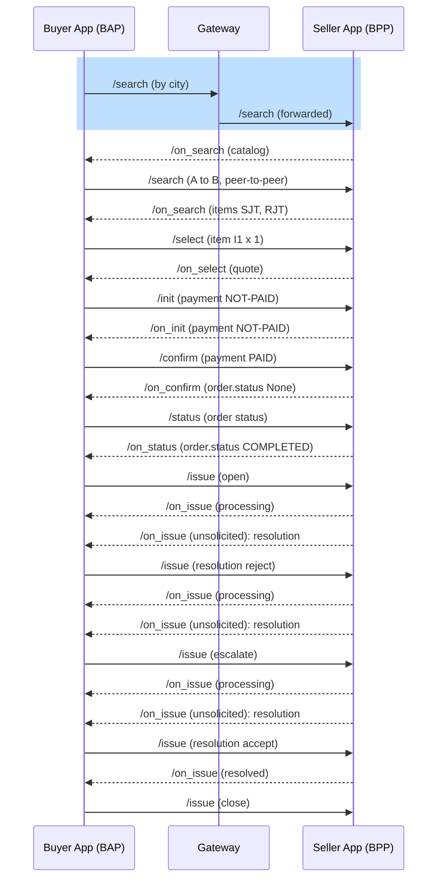

## on_search1_METRO_201

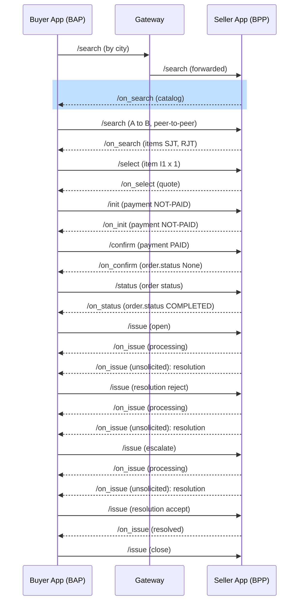

## search2_METRO_201

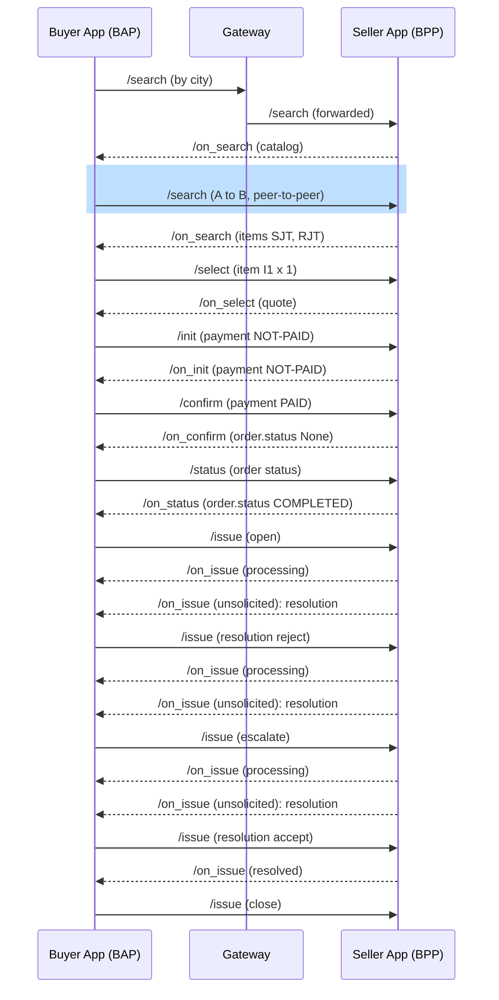

## on_search2_METRO_201

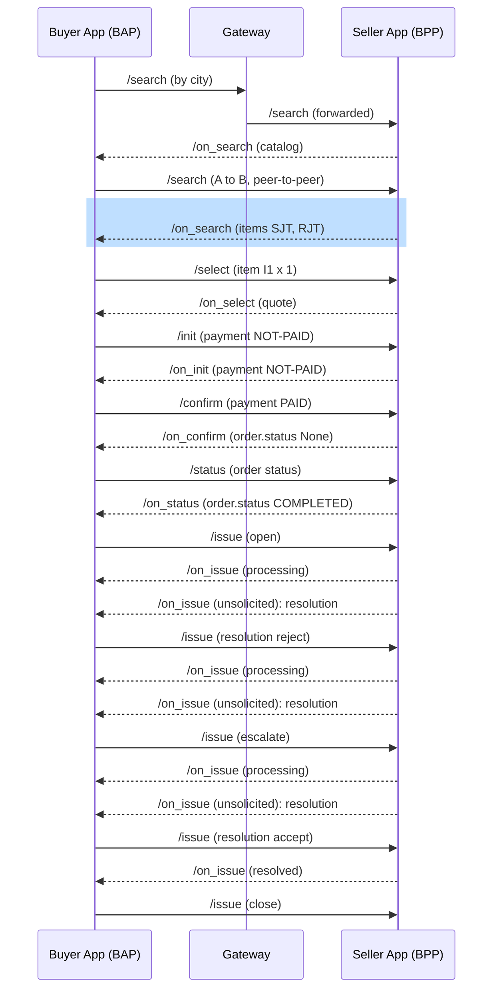

## select_METRO_201


## on_select_METRO_201

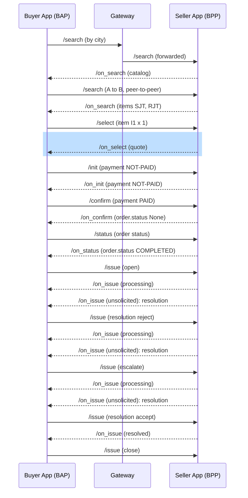

## init_METRO_201

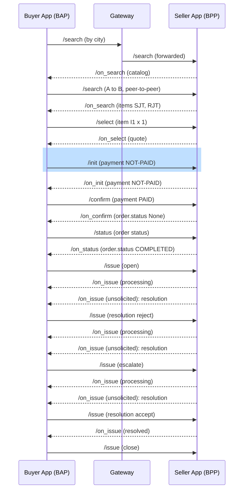

## on_init_METRO_201

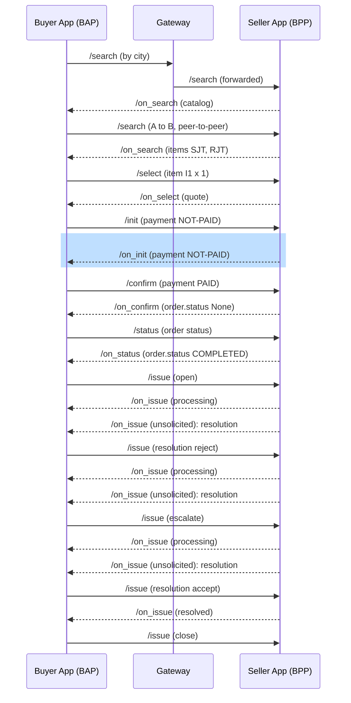

## confirm_METRO_201

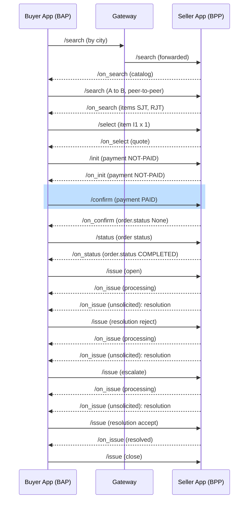

## on_confirm_METRO_201

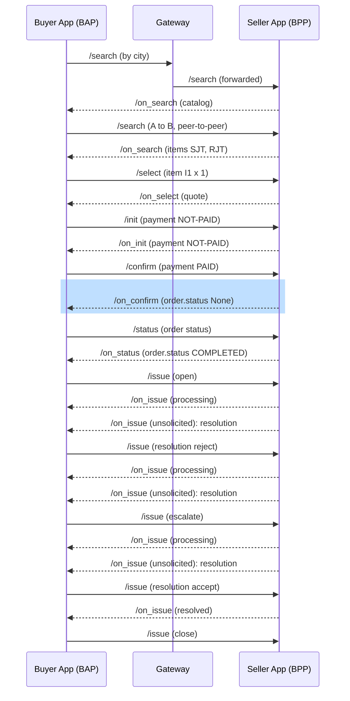

## status_METRO_201

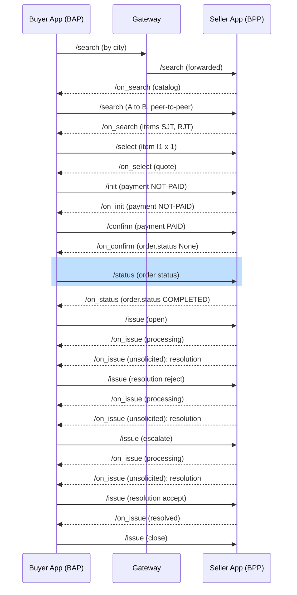

## on_status_complete_METRO_201

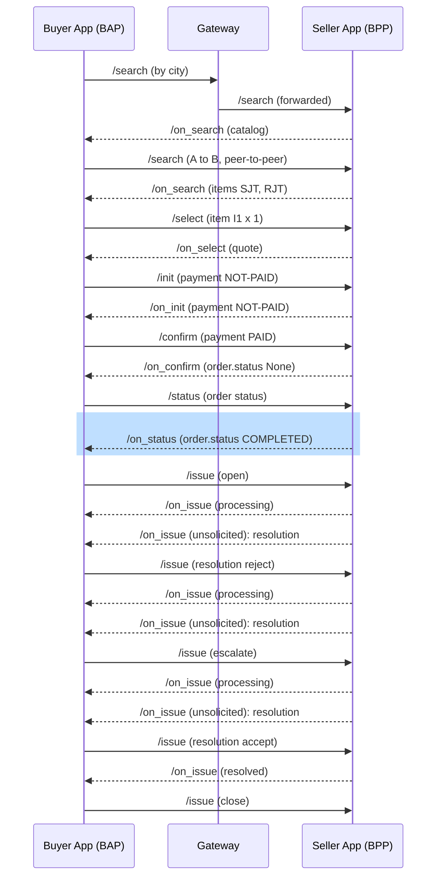

## issue_open

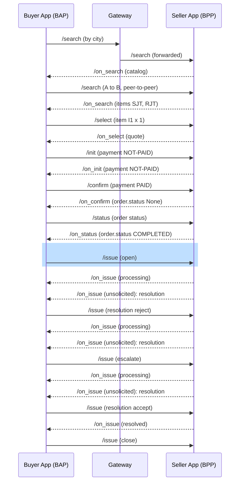

## on_issue_processing


## on_issue_resolution

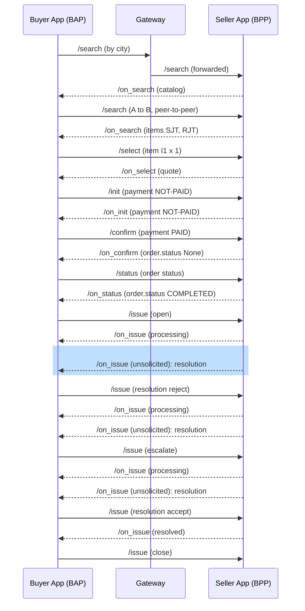

## issue_resolution_reject

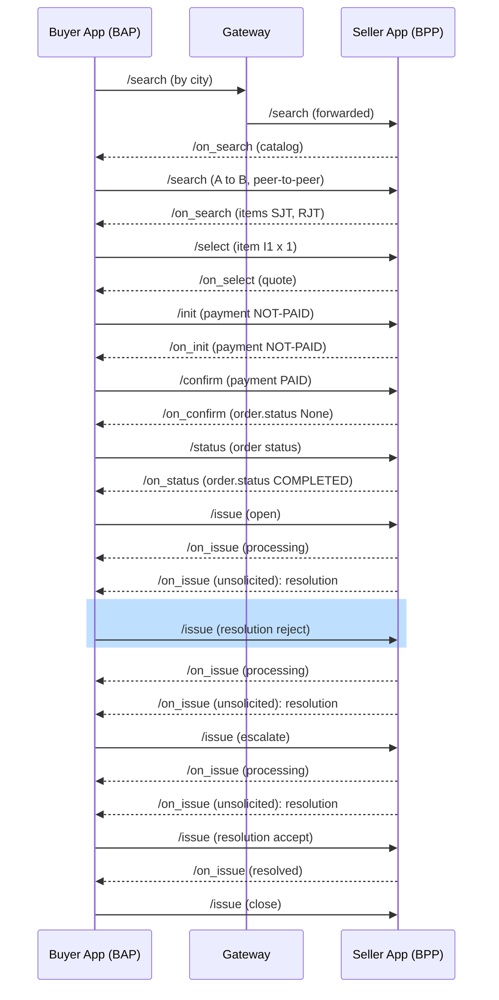

## on_issue_processing_1

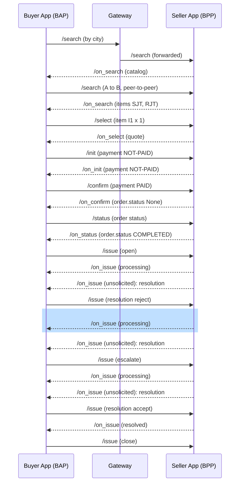

## on_issue_resolution_1

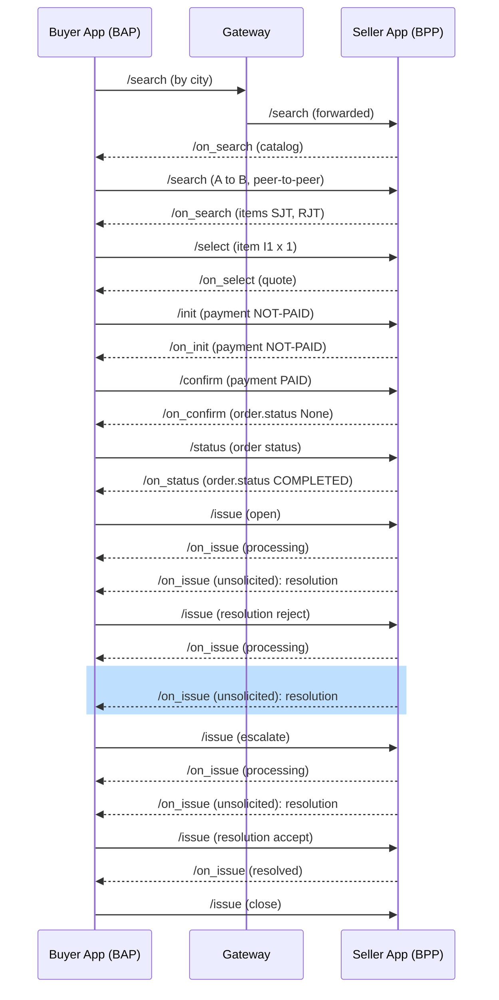

## issue_escalate

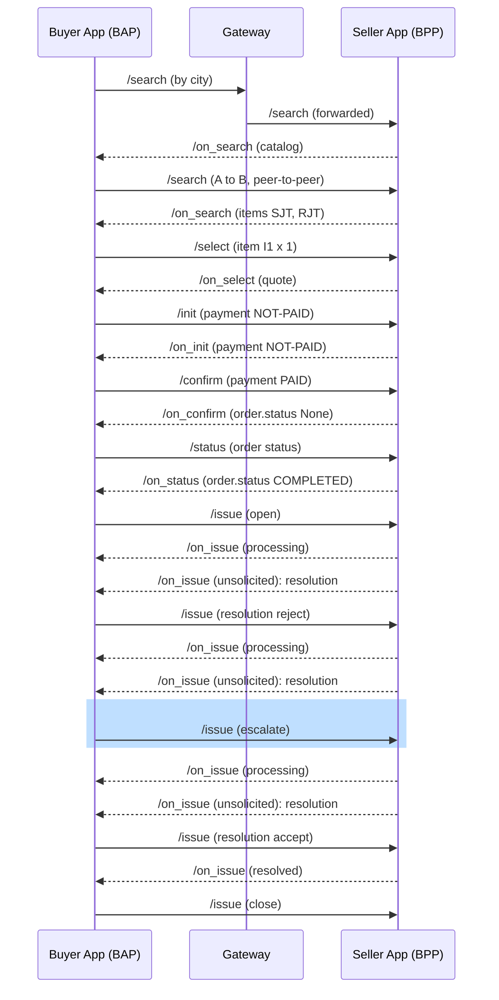

## on_issue_processing_2

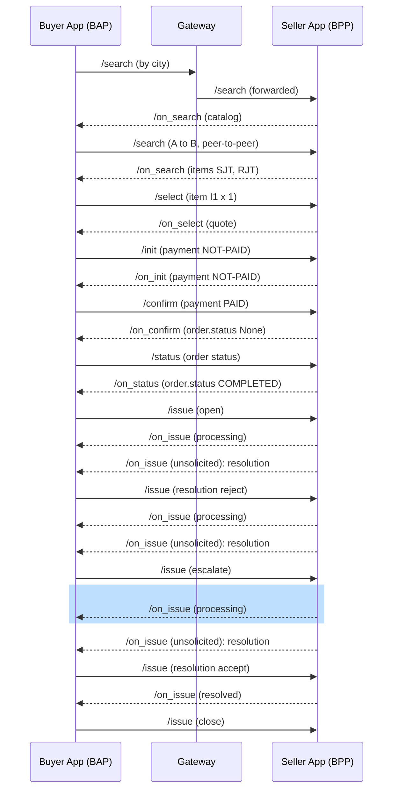

## on_issue_resolution_2

```mermaid
sequenceDiagram
  participant Buyer App (BAP)
  participant Gateway
  participant Seller App (BPP)
  Buyer App (BAP)->>Gateway: /search (by city)
  Gateway->>Seller App (BPP): /search (forwarded)
  Seller App (BPP)-->>Buyer App (BAP): /on_search (catalog)
  Buyer App (BAP)->>Seller App (BPP): /search (A to B, peer-to-peer)
  Seller App (BPP)-->>Buyer App (BAP): /on_search (items SJT, RJT)
  Buyer App (BAP)->>Seller App (BPP): /select (item I1 x 1)
  Seller App (BPP)-->>Buyer App (BAP): /on_select (quote)
  Buyer App (BAP)->>Seller App (BPP): /init (payment NOT-PAID)
  Seller App (BPP)-->>Buyer App (BAP): /on_init (payment NOT-PAID)
  Buyer App (BAP)->>Seller App (BPP): /confirm (payment PAID)
  Seller App (BPP)-->>Buyer App (BAP): /on_confirm (order.status None)
  Buyer App (BAP)->>Seller App (BPP): /status (order status)
  Seller App (BPP)-->>Buyer App (BAP): /on_status (order.status COMPLETED)
  Buyer App (BAP)->>Seller App (BPP): /issue (open)
  Seller App (BPP)-->>Buyer App (BAP): /on_issue (processing)
  Seller App (BPP)-->>Buyer App (BAP): /on_issue (unsolicited): resolution
  Buyer App (BAP)->>Seller App (BPP): /issue (resolution reject)
  Seller App (BPP)-->>Buyer App (BAP): /on_issue (processing)
  Seller App (BPP)-->>Buyer App (BAP): /on_issue (unsolicited): resolution
  Buyer App (BAP)->>Seller App (BPP): /issue (escalate)
  Seller App (BPP)-->>Buyer App (BAP): /on_issue (processing)
  rect rgb(191, 223, 255)
  Seller App (BPP)-->>Buyer App (BAP): /on_issue (unsolicited): resolution
  end
  Buyer App (BAP)->>Seller App (BPP): /issue (resolution accept)
  Seller App (BPP)-->>Buyer App (BAP): /on_issue (resolved)
  Buyer App (BAP)->>Seller App (BPP): /issue (close)
```

## issue_resolution_accept

```mermaid
sequenceDiagram
  participant Buyer App (BAP)
  participant Gateway
  participant Seller App (BPP)
  Buyer App (BAP)->>Gateway: /search (by city)
  Gateway->>Seller App (BPP): /search (forwarded)
  Seller App (BPP)-->>Buyer App (BAP): /on_search (catalog)
  Buyer App (BAP)->>Seller App (BPP): /search (A to B, peer-to-peer)
  Seller App (BPP)-->>Buyer App (BAP): /on_search (items SJT, RJT)
  Buyer App (BAP)->>Seller App (BPP): /select (item I1 x 1)
  Seller App (BPP)-->>Buyer App (BAP): /on_select (quote)
  Buyer App (BAP)->>Seller App (BPP): /init (payment NOT-PAID)
  Seller App (BPP)-->>Buyer App (BAP): /on_init (payment NOT-PAID)
  Buyer App (BAP)->>Seller App (BPP): /confirm (payment PAID)
  Seller App (BPP)-->>Buyer App (BAP): /on_confirm (order.status None)
  Buyer App (BAP)->>Seller App (BPP): /status (order status)
  Seller App (BPP)-->>Buyer App (BAP): /on_status (order.status COMPLETED)
  Buyer App (BAP)->>Seller App (BPP): /issue (open)
  Seller App (BPP)-->>Buyer App (BAP): /on_issue (processing)
  Seller App (BPP)-->>Buyer App (BAP): /on_issue (unsolicited): resolution
  Buyer App (BAP)->>Seller App (BPP): /issue (resolution reject)
  Seller App (BPP)-->>Buyer App (BAP): /on_issue (processing)
  Seller App (BPP)-->>Buyer App (BAP): /on_issue (unsolicited): resolution
  Buyer App (BAP)->>Seller App (BPP): /issue (escalate)
  Seller App (BPP)-->>Buyer App (BAP): /on_issue (processing)
  Seller App (BPP)-->>Buyer App (BAP): /on_issue (unsolicited): resolution
  rect rgb(191, 223, 255)
  Buyer App (BAP)->>Seller App (BPP): /issue (resolution accept)
  end
  Seller App (BPP)-->>Buyer App (BAP): /on_issue (resolved)
  Buyer App (BAP)->>Seller App (BPP): /issue (close)
```

## on_issue_resolved

```mermaid
sequenceDiagram
  participant Buyer App (BAP)
  participant Gateway
  participant Seller App (BPP)
  Buyer App (BAP)->>Gateway: /search (by city)
  Gateway->>Seller App (BPP): /search (forwarded)
  Seller App (BPP)-->>Buyer App (BAP): /on_search (catalog)
  Buyer App (BAP)->>Seller App (BPP): /search (A to B, peer-to-peer)
  Seller App (BPP)-->>Buyer App (BAP): /on_search (items SJT, RJT)
  Buyer App (BAP)->>Seller App (BPP): /select (item I1 x 1)
  Seller App (BPP)-->>Buyer App (BAP): /on_select (quote)
  Buyer App (BAP)->>Seller App (BPP): /init (payment NOT-PAID)
  Seller App (BPP)-->>Buyer App (BAP): /on_init (payment NOT-PAID)
  Buyer App (BAP)->>Seller App (BPP): /confirm (payment PAID)
  Seller App (BPP)-->>Buyer App (BAP): /on_confirm (order.status None)
  Buyer App (BAP)->>Seller App (BPP): /status (order status)
  Seller App (BPP)-->>Buyer App (BAP): /on_status (order.status COMPLETED)
  Buyer App (BAP)->>Seller App (BPP): /issue (open)
  Seller App (BPP)-->>Buyer App (BAP): /on_issue (processing)
  Seller App (BPP)-->>Buyer App (BAP): /on_issue (unsolicited): resolution
  Buyer App (BAP)->>Seller App (BPP): /issue (resolution reject)
  Seller App (BPP)-->>Buyer App (BAP): /on_issue (processing)
  Seller App (BPP)-->>Buyer App (BAP): /on_issue (unsolicited): resolution
  Buyer App (BAP)->>Seller App (BPP): /issue (escalate)
  Seller App (BPP)-->>Buyer App (BAP): /on_issue (processing)
  Seller App (BPP)-->>Buyer App (BAP): /on_issue (unsolicited): resolution
  Buyer App (BAP)->>Seller App (BPP): /issue (resolution accept)
  rect rgb(191, 223, 255)
  Seller App (BPP)-->>Buyer App (BAP): /on_issue (resolved)
  end
  Buyer App (BAP)->>Seller App (BPP): /issue (close)
```

## issue_close

```mermaid
sequenceDiagram
  participant Buyer App (BAP)
  participant Gateway
  participant Seller App (BPP)
  Buyer App (BAP)->>Gateway: /search (by city)
  Gateway->>Seller App (BPP): /search (forwarded)
  Seller App (BPP)-->>Buyer App (BAP): /on_search (catalog)
  Buyer App (BAP)->>Seller App (BPP): /search (A to B, peer-to-peer)
  Seller App (BPP)-->>Buyer App (BAP): /on_search (items SJT, RJT)
  Buyer App (BAP)->>Seller App (BPP): /select (item I1 x 1)
  Seller App (BPP)-->>Buyer App (BAP): /on_select (quote)
  Buyer App (BAP)->>Seller App (BPP): /init (payment NOT-PAID)
  Seller App (BPP)-->>Buyer App (BAP): /on_init (payment NOT-PAID)
  Buyer App (BAP)->>Seller App (BPP): /confirm (payment PAID)
  Seller App (BPP)-->>Buyer App (BAP): /on_confirm (order.status None)
  Buyer App (BAP)->>Seller App (BPP): /status (order status)
  Seller App (BPP)-->>Buyer App (BAP): /on_status (order.status COMPLETED)
  Buyer App (BAP)->>Seller App (BPP): /issue (open)
  Seller App (BPP)-->>Buyer App (BAP): /on_issue (processing)
  Seller App (BPP)-->>Buyer App (BAP): /on_issue (unsolicited): resolution
  Buyer App (BAP)->>Seller App (BPP): /issue (resolution reject)
  Seller App (BPP)-->>Buyer App (BAP): /on_issue (processing)
  Seller App (BPP)-->>Buyer App (BAP): /on_issue (unsolicited): resolution
  Buyer App (BAP)->>Seller App (BPP): /issue (escalate)
  Seller App (BPP)-->>Buyer App (BAP): /on_issue (processing)
  Seller App (BPP)-->>Buyer App (BAP): /on_issue (unsolicited): resolution
  Buyer App (BAP)->>Seller App (BPP): /issue (resolution accept)
  Seller App (BPP)-->>Buyer App (BAP): /on_issue (resolved)
  rect rgb(191, 223, 255)
  Buyer App (BAP)->>Seller App (BPP): /issue (close)
  end
```
