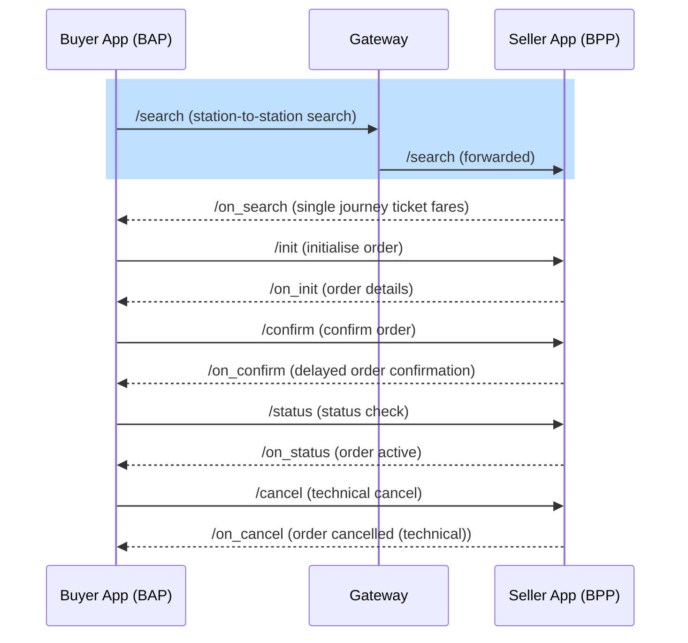
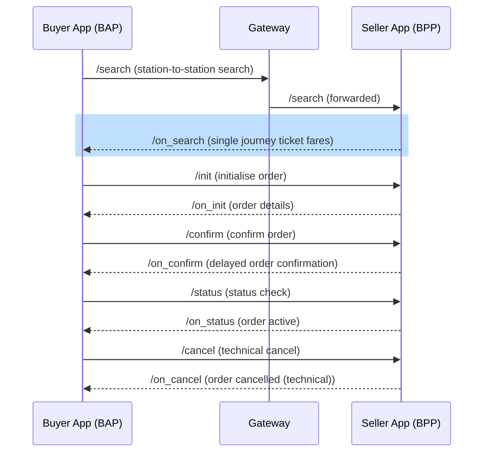
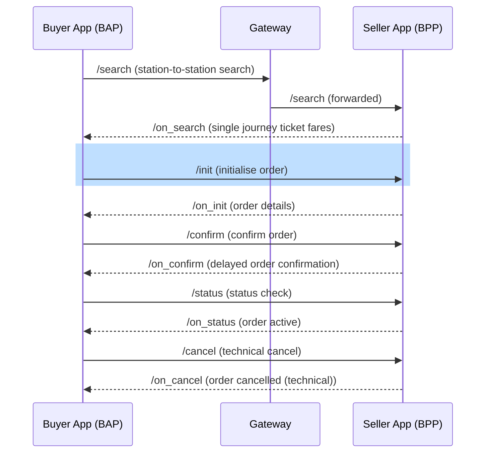
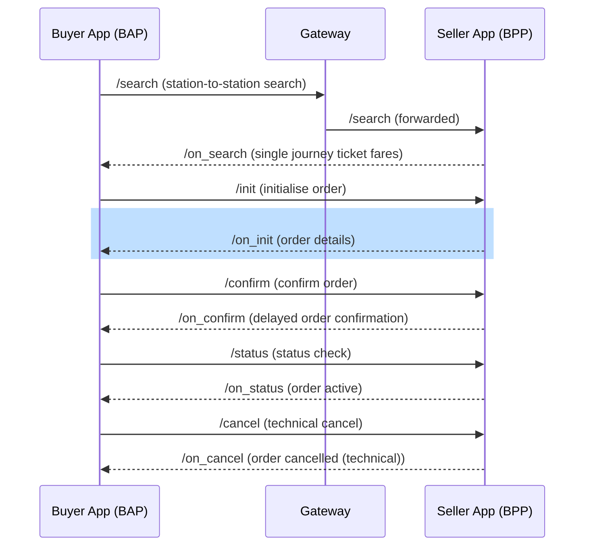
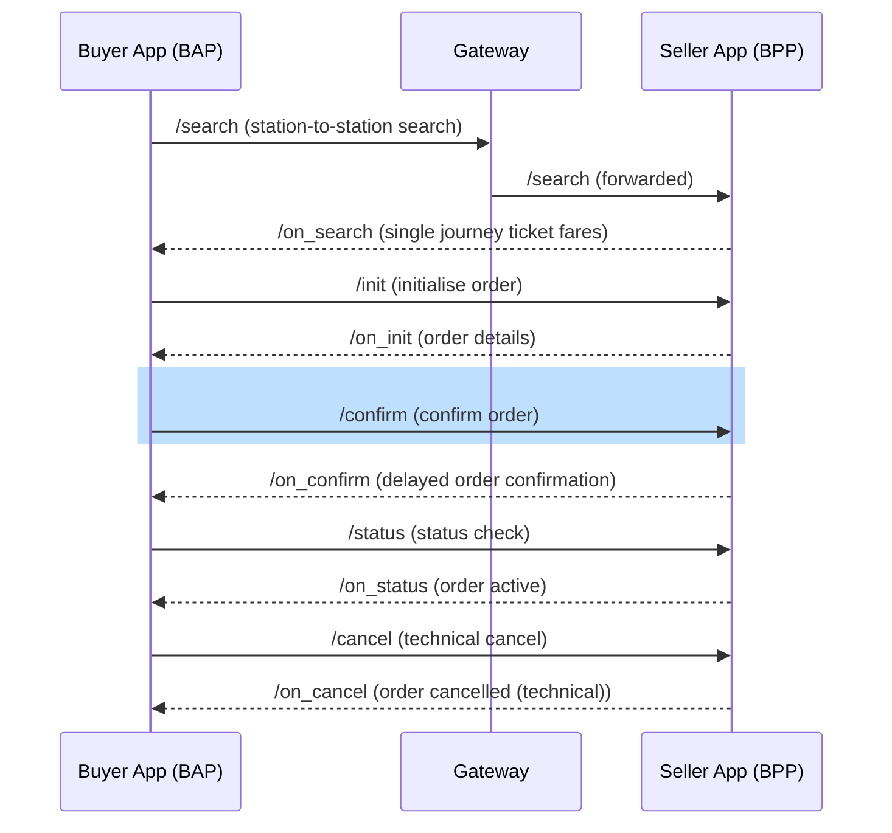
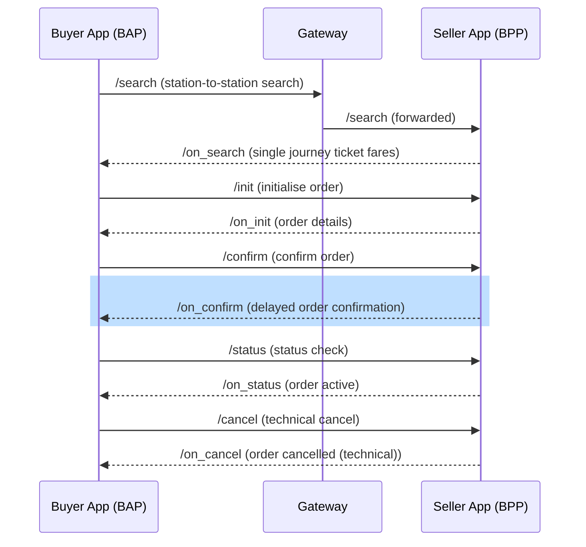
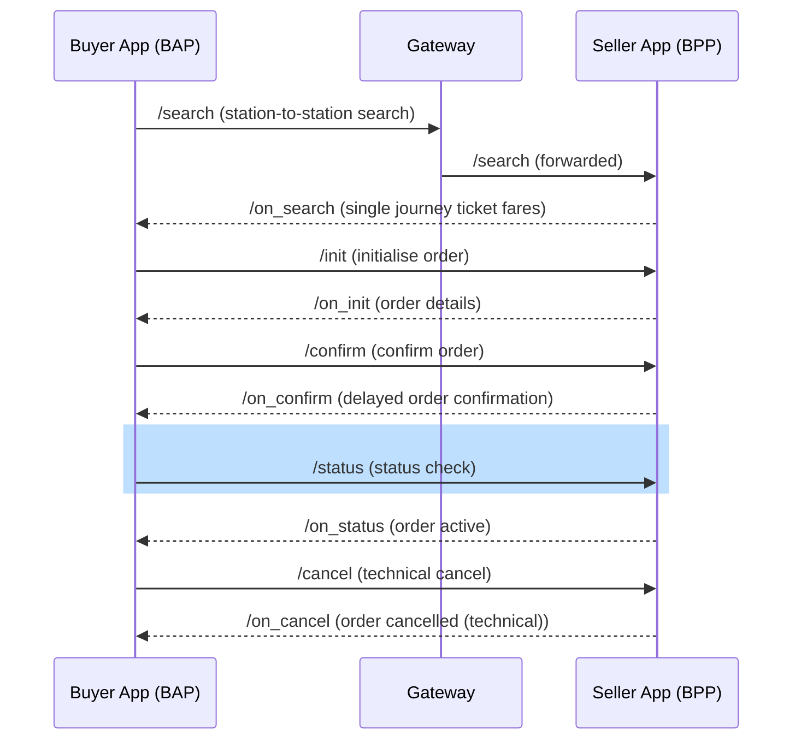
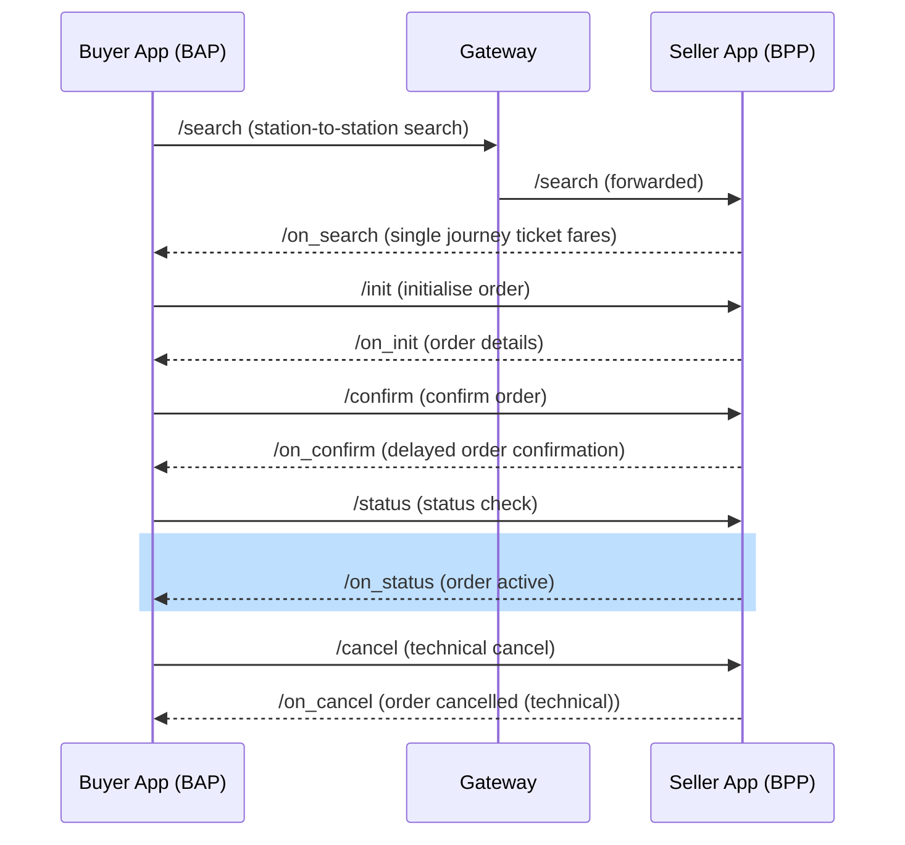
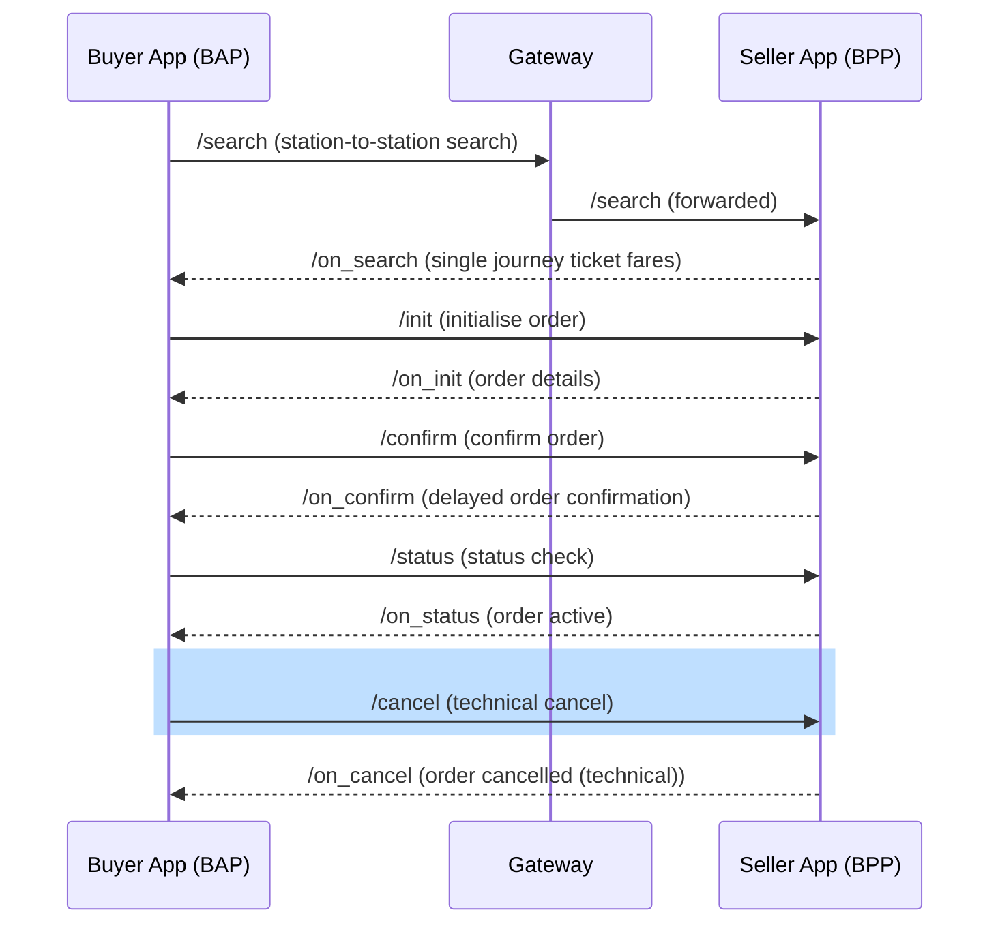
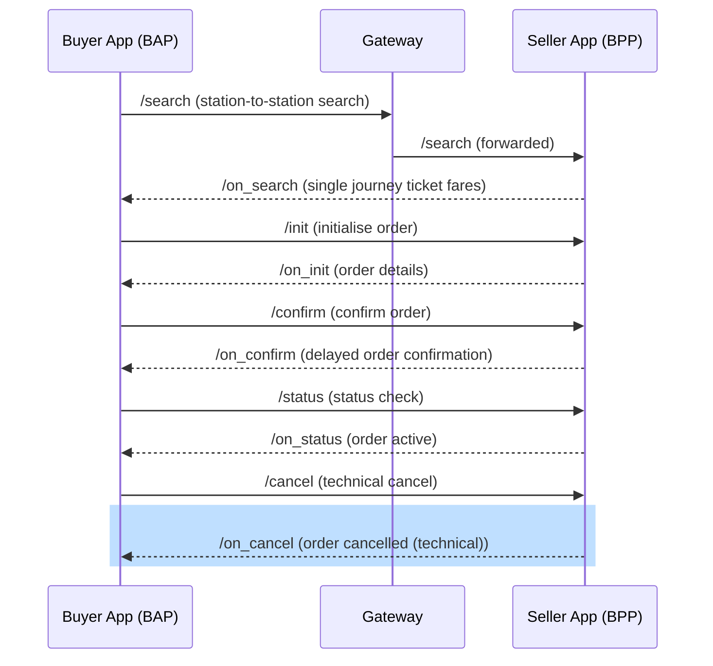

# TECHNICAL_CANCELLATION_FLOW (W/O search_1 & select) — Sequence Diagrams

Internal data file consumed by the Developer Guide's "Sequence Diagram" tab (API Walkthrough).
Not meant to be shown as its own docs page — the frontend filters this slug out of the Use Case
Brief / Additional Resources / Changelog tab lists and instead looks up the section matching the
selected API call's `action_id` (the `##` heading below) to render that step's diagram.

One `## <action_id>` heading per step of `TECHNICAL_CANCELLATION_FLOW_WITHOUT_SEARCH_ND_SELECT.yaml` (Metro), in that flow's own step order, each followed by its Mermaid `sequenceDiagram`: the whole flow, with that call's own message(s) highlighted — same convention as the other domains' per-step sequence-diagram docs.

## search2_METRO_200

## on_search2_Sjt_METRO_200

## init_with_user_input_METRO_200

## on_init_METRO_200

## confirm_METRO_200

## on_confirm_delayed_METRO_200

## status_tech_cancel_METRO_200

## on_status_active_METRO_200

## cancel_tech_METRO_200

## on_cancel_tech_METRO_200

